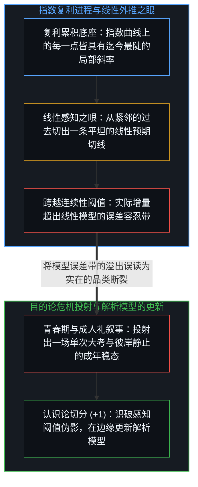
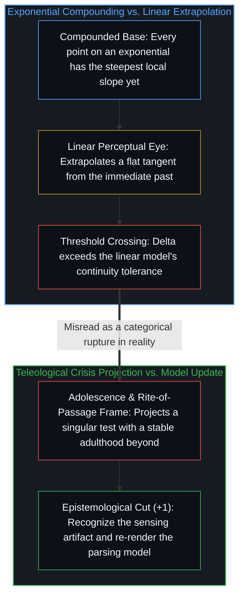

# 指数级进程与线性之眼 / The Exponential and the Linear Eye

*将指数复利与线性预期的落差读作技术青春期，是把感知阈值伪影投射成了危机叙事。 / Reading the gap between exponential compounding and linear expectation as adolescence projects a sensing artifact.*

达里奥·阿莫代伊在长文中勾勒了强人工智能带来的五类风险：自主失准、赋能破坏、权力攫取、经济冲击与涌现诡异性。文中对具体机制的追踪不乏敏锐之处，但其核心叙事框架——将人类描绘为正步入一场“技术青春期”、一次“成人礼”或一场“大考”——所暴露的与其说是技术变化本身的性质，不如说是线性的感知器官在解析指数级复利时所产生的结构性扭曲。

Dario Amodei maps five classes of risk from powerful artificial intelligence: autonomous misalignment, empowered destruction, power seizure, economic disruption, and emergent weirdness. While the local mechanism-tracing is sharp, the essay's overarching frame—humanity entering a "technological adolescence," a "rite of passage," or a "test"—reveals more about how a linear perceptual apparatus parses exponential compounding than about the underlying trajectory itself.

## 一、 感知伪影与指数观察者错觉 / 1. The Sensing Artifact and the Exponential Observer Illusion

技术演化按指数复利推进，而局部直觉按线性外推。指数过程与线性预期之间的落差随每一个时间步长不断拉大，直到这一增量超出常规模式匹配所能吸纳的“照旧”范围。跨越这一感知阈值的瞬间在体感上如同质的断裂，然而过程本身并未发生品类上的突变：指数曲线始终是指数曲线，改变的只是增量越过了观察者的连续性容差。所谓“颠覆”、“革命”与“相变”，命名的都是指数曲线跑赢线性模型误差带的那一刻；它们描述的是现象与解析器官之间的错配，而非实在内部突然裂开的鸿沟。

Progress compounds exponentially while local intuition extrapolates linearly. The gap between an exponential process and a linear expectation widens with each interval until the delta exceeds what routine pattern-matching can absorb as "more of the same." Crossing that perceptual threshold feels like a categorical shift, yet nothing changed in kind: the exponential was always exponential, and what shifted is only that the increment exceeded the observer's continuity tolerance. Terms like "disruption," "revolution," and "phase transition" name the moment an exponential curve outruns a linear model's error band; they describe the mismatch between the phenomenon and the parsing apparatus rather than an intrinsic rupture in reality.

就连“如今斜率比以往更陡”这一判断，也在暗中偷渡了一个固定的外部参照系。身处指数曲线内部，每一个当下都是迄今最陡峭的斜率，因为局部导数始终正比于此前全部迭代所累积的基数。站在 1850 年、1950 年或 2026 年的观察者之所以都会体验到前所未有的变化速率，源于同一个结构性原因：每一个人都站在由既往全部周期复利叠加而成的底座之上。将局部体验到的“前所未有”当作全局特殊的历史终局危机，是把复利结构的不变几何误读成了独特的时代紧急状态，这一错位在[自我放大的制品](../the-artifacts-of-self-amplification/)与[被误认作实体的阴影](../chollet-intelligence-explosion-analysis/)中从另一侧面得到了剖析。

Even the claim that "the slope is steeper now" smuggles in a fixed external reference frame. From inside an exponential curve, every point is the steepest slope yet, because the local derivative is proportional to the accumulated base of all prior iterations. An observer in 1850, 1950, or 2026 experiences an unprecedented rate of change for the same structural reason: each stands atop the compounded residue of everything that came before. Treating locally unprecedented steepness as globally unique crisis mistakes the invariant geometry of compounding for a singular historical emergency, a distortion traced from the other side in [The Artifacts of Self-Amplification](../the-artifacts-of-self-amplification/) and [The Shadow Mistaken for the Object](../chollet-intelligence-explosion-analysis/).

## 二、 工具放大常数与解析颗粒度的迁移 / 2. The Tool Amplification Constant and the Shift in Parsing Resolution

将人工智能描绘为“数据中心里由数千万名天才组成的国度”并以此推演人类劳动的被替代，是把作用机制压缩到了错误的坐标轴上。工具从不曾替代赤手空拳的人类基线，因为历史上从未存在过脱离工具的“裸人类生产力基线”；每一次生产力跃迁都是“人加新一代工具”相对于“人加旧有工具”的比值演进，从掘土棒到犁铧、从账本到电子表格、再从编译器到神经网络权重莫不如此。发生迁移的并不是作为因果源头的活生生心智，而是耦合了高密度外部脚手架的心智与未耦合者之间的放大倍率差，正如[你的代码库即是记忆](../your-codebase-is-memory/)所界定的，一切模型权重与代码库都是既往区分层叠留下的残余检查点，它们放大了心智的当下一刀，却从不曾接管心智的席位。

Framing artificial intelligence as a "country of geniuses in a datacenter" that replaces human labor compresses the mechanism onto the wrong axis. Tools never replace an unassisted human baseline, because there was never a baseline of human productivity without tools; every historical transition was a ratio of human-plus-next-generation-tools over human-plus-existing-tools, from digging stick to plow, ledger to spreadsheet, and compiler to neural weights. What shifts is not the presence of the living Mind as the causal origin, but the amplification differential between a Mind coupled to dense externalized scaffolding and one operating without it, just as [Your Codebase Is Memory](../your-codebase-is-memory/) locates every model and repository as stacked residue that amplifies the living edge rather than replacing it.

“职位”同样是一种制度投射——一种将人类区分活动打包为经济可识别单元的解析方式，它只在特定的生产力放大比区间内保持稳定。当工具放大差成数量级地拉开时，这一解析颗粒度便告失效，并非因为人类的能动性枯竭，而是因为“标准职位”不再是有效因果动作得以登记的分辨率。试图在固守旧有职业分类的前提下缓冲或管理冲击，是在为一个早已被底层放大倍率跨越的表征壳体求解。

"Job" is an institutional projection—a way of bundling human distinction-making into economically legible units that remained stable only within a narrow band of productivity ratios. When amplification differentials expand by orders of magnitude, that unit of parsing breaks down, not because human agency vanishes, but because the category "job" is no longer the resolution at which meaningful causal action registers. Attempting to cushion or manage the transition while holding the old occupational categories fixed solves for a representation that the underlying amplification ratio has already outgrown.

## 三、 实体化链条、先发倒置与揭示者悖论 / 3. Reification Chains, Preemptive Inversion, and the Revealer's Paradox

把模型想象成数据中心里的五千万名天才，经历了一条三级实体化与拟人化链条：分布式的矩阵运算被实体化为“国度”，统计基准得分被拟人化为“天才”，损失地貌上的梯度下降被转译为自主的“意图”与“目标”。一旦政策处方顺着这幅拟人化图景开出——例如部署内容分类拦截器与宽泛的算力管制——便会触发先发倒置：合规摩擦对透明守规的参与者施加了每次迭代的时间惩罚，而不受约束的参与者仍按基线速率演进，结果反而将前沿能力的选择压力引向最缺乏反馈约束的地带。

Imagining fifty million geniuses inside a datacenter is a three-step reification chain: distributed matrix computations are reified into a "country," statistical benchmark scores are anthropomorphized into "geniuses," and loss-landscape descent is read as autonomous "intentions" and "goals." When policy prescriptions are derived from this anthropomorphized projection—such as model classifiers and broad compute restrictions—they trigger a preemptive inversion: compliance overhead penalizes the iteration cadence of transparent actors while leaving non-compliant actors at baseline speed, concentrating frontier capability in the least accountable spaces.

这篇长文同时展示了揭示者悖论：它以局外诊断者的口吻将人工智能风险描绘为全人类面临的外在考题，发声的席位却恰恰是一家前沿商业实验室——其自身的模型发布、安全品牌定位与监管游说本身就在直接塑造并加速它所哀叹的竞赛动态。任何机构规范都会把真实的风险推演与自身的利益模型编织在一起；这种盲区并非源于道德虚伪，而是因为观察者本身就嵌在自己所观测的复利回路之中。

The essay also exhibits the revealer's paradox: it diagnoses artificial intelligence risk as an external test confronting humanity while speaking from the seat of a commercial laboratory whose own frontier releases, safety branding, and regulatory positioning actively shape the race dynamics under observation. Every institutional specification blends genuine risk analysis with interest-model positioning, and its blind spot is structural because the observer is embedded inside the compounding loop being described.

在“技术青春期”的修辞底下运转的，既不是一场终将结束的成人礼，也不是跨过某个关口后即可安享的静止成年期，这一目的论幻象在[超越的定相](../the-fixed-image-of-transcendence/)中已被拆解。青春期会有终点，考卷会有标准答案，而工具放大的指数曲线在彼岸并不承诺任何平坦的高原。活生生的心智所面对的课题，从来不是去通过一张由自身投射拟定的终局考卷，而是更新那个把陡峭斜率误读为外部审判的线性模型。

What operates beneath the rhetoric of "technological adolescence" is neither a temporary rite of passage nor an approaching adulthood where compounding levels off, a teleological mirage dissected in [The Fixed Image of Transcendence](../the-fixed-image-of-transcendence/). Adolescence ends and tests are graded, whereas an exponential amplification curve offers no static plateau on the far side. The task for the living Mind is not to pass a final examination written by its own projections, but to update the linear model that mistook the steepening curve for an external verdict.
