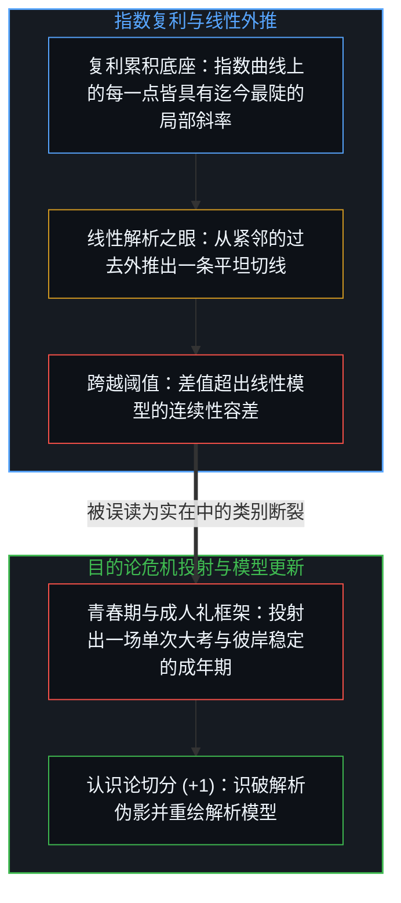
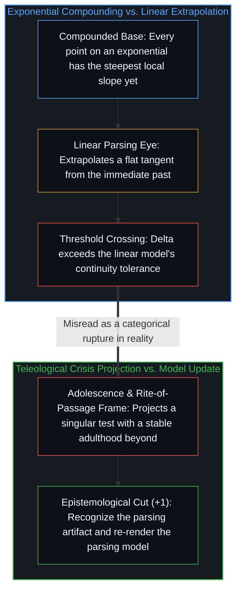

# 指数级进程与线性之眼 / The Exponential and the Linear Eye

*将指数复利与线性预期的落差读作技术青春期，是把解析伪影投射成了危机叙事。 / To read the gap between exponential compounding and linear expectation as adolescence is to project a parsing artifact into a crisis narrative.*

达里奥·阿莫迪在长文中勾勒了强人工智能带来的五类风险：自主失准、赋能破坏、权力攫取、经济冲击与涌现诡异性。文中对局部机制的追踪不乏敏锐之处，但其整体叙事框架——将人类描绘为正步入一场“技术青春期”、一次“成人礼”或一场“大考”——所揭示的与其说是底层轨迹本身，不如说是线性解析模型如何读出指数级复利。

Dario Amodei maps five classes of risk from powerful artificial intelligence: autonomous misalignment, empowered destruction, power seizure, economic disruption, and emergent weirdness. While the local mechanism-tracing is sharp, the essay's overarching frame—humanity entering a "technological adolescence," a "rite of passage," or a "test"—reveals more about how a linear parsing model reads exponential compounding than about the underlying trajectory itself.

## 一、 解析伪影与指数观察者错觉 / 1. The Parsing Artifact and the Exponential Observer Illusion

在心智掌舵的放大呈指数复利推进之处，局部直觉依然按线性外推。指数轨迹与线性预期之间的落差随每一个时间步长不断拉大，直到这一差值超出常规模式匹配所能吸纳的“照旧”范围。跨越这一阈值的瞬间在体感上如同类别跃迁，然而复利动态本身并未发生品类上的突变：这一序列原本就一直在按指数复利推进，改变的只是增量越过了观察者的连续性容差。所谓“颠覆”、“革命”与“相变”，命名的都是复利曲线跑赢线性模型误差带的那一刻；它们标示的是与解析模型的错配，而非过程内部的质的断裂。

Where Mind-steered amplification compounds exponentially, local intuition still extrapolates linearly. The gap between an exponential trajectory and a linear expectation widens with each interval until the delta exceeds what routine pattern-matching can absorb as "more of the same." Crossing that threshold feels like a categorical shift, yet nothing in the compounding dynamic changed in kind: the sequence was compounding exponentially all along, and what shifted is only that the increment exceeded the observer's continuity tolerance. Terms like "disruption," "revolution," and "phase transition" name the moment a compounding curve outruns a linear model's error band; they mark a mismatch with the parsing model rather than a qualitative break in the process.

就连“如今斜率比以往更陡”这一判断，也在暗中偷渡了一个固定的外部参照系。身处指数曲线内部，每一个当下都是迄今最陡峭的斜率，因为局部导数始终正比于此前全部迭代所累积的基数。站在 1850 年、1950 年或 2026 年的观察者之所以都会体验到前所未有的变化速率，源于同一个结构性原因：每一个人都站在由既往全部周期复利叠加而成的底座之上。将局部前所未有的陡峭当作全局独有的危机，是把复利结构的不变几何误读成了独特的历史紧急状态，这一错位在[自我放大的制品](../the-artifacts-of-self-amplification/)与[被误认作实体的阴影](../chollet-intelligence-explosion-analysis/)中从另一侧面得到了剖析。

Even the claim that "the slope is steeper now" smuggles in a fixed external reference frame. From inside an exponential curve, every point is the steepest slope yet, because the local derivative is proportional to the accumulated base of all prior iterations. An observer in 1850, 1950, or 2026 experiences an unprecedented rate of change for the same structural reason: each stands atop the compounded residue of everything that came before. Treating locally unprecedented steepness as globally unique crisis mistakes the invariant geometry of compounding for a singular historical emergency, a distortion traced from the other side in [The Artifacts of Self-Amplification](../the-artifacts-of-self-amplification/) and [The Shadow Mistaken for the Object](../chollet-intelligence-explosion-analysis/).

## 二、 工具放大常数与解析颗粒度的迁移 / 2. The Tool Amplification Constant and the Shift in Parsing Resolution

将人工智能框定为“数据中心里的天才国度”并视作人类劳动的替代者，是把作用机制压缩到了错误的坐标轴上。工具从未替代无辅助的人类基线，因为脱离工具的人类生产力基线本就不存在；每一次历史过渡都是“人加新一代工具”相对于“人加既有工具”的比值，从掘土棒到犁铧、从账本到电子表格、再从编译器到神经网络权重皆是如此。发生改变的不是活的心智作为因果源头的在场，而是耦合了致密外部脚手架的心智与未耦合者之间的放大倍率差，正如[你的代码库即是记忆](../your-codebase-is-memory/)所定位的，每一个模型与代码库都是层叠的残余，放大活的前沿而非取代它。

Framing artificial intelligence as a "country of geniuses in a datacenter" that replaces human labor compresses the mechanism onto the wrong axis. Tools never replace an unassisted human baseline, because there was never a baseline of human productivity without tools; every historical transition was a ratio of human-plus-next-generation-tools over human-plus-existing-tools, from digging stick to plow, ledger to spreadsheet, and compiler to neural weights. What shifts is not the presence of the living Mind as the causal origin, but the amplification differential between a Mind coupled to dense externalized scaffolding and one operating without it, just as [Your Codebase Is Memory](../your-codebase-is-memory/) locates every model and repository as stacked residue that amplifies the living edge rather than replacing it.

“职位”是一种制度投射——一种将人类区分活动打包为经济上可辨识单元的方式，它只在狭窄的生产力比值区间内保持稳定。当放大倍率差成数量级地扩大时，这一解析单元便告失效，并非因为人类能动性消失，而是因为“职位”这一类别不再是有效因果行动得以登记的分辨率。试图在固守旧有职业分类的同时缓冲或管理这一过渡，是在为一个早已被底层放大比跨越的表征求解。

"Job" is an institutional projection—a way of bundling human distinction-making into economically legible units that remained stable only within a narrow band of productivity ratios. When amplification differentials expand by orders of magnitude, that unit of parsing breaks down, not because human agency vanishes, but because the category "job" is no longer the resolution at which meaningful causal action registers. Attempting to cushion or manage the transition while holding the old occupational categories fixed solves for a representation that the underlying amplification ratio has already outgrown.

## 三、 实体化链条、先发倒置与揭示者悖论 / 3. Reification Chains, Preemptive Inversion, and the Revealer's Paradox

想象数据中心里的五千万名天才，是一条三级实体化链条：分布式的矩阵运算被实体化为“国度”，统计基准得分被拟人化为“天才”，损失地貌上的梯度下降被读作自主的“意图”与“目标”。一旦政策处方顺着这幅拟人化投射开出——例如模型分类器与宽泛的算力限制——便会触发先发倒置：合规开销对透明参与者的迭代节奏施加惩罚，同时让不合规的参与者保持基线速率，从而将前沿能力集中到最缺乏问责的空间。

Imagining fifty million geniuses inside a datacenter is a three-step reification chain: distributed matrix computations are reified into a "country," statistical benchmark scores are anthropomorphized into "geniuses," and loss-landscape descent is read as autonomous "intentions" and "goals." When policy prescriptions are derived from this anthropomorphized projection—such as model classifiers and broad compute restrictions—they trigger a preemptive inversion: compliance overhead penalizes the iteration cadence of transparent actors while leaving non-compliant actors at baseline speed, concentrating frontier capability in the least accountable spaces.

这篇长文同时展示了揭示者悖论：它将人工智能风险诊断为全人类面临的外在考题，发声的席位却是一家商业实验室——其自身的前沿发布、安全品牌塑造与监管定位本身就在主动塑造所观测的竞赛动态。机构规范经由自身的战略与监管定位来框定机制层面的风险，而这一盲区是结构性的——而非道德虚伪——因为观察者本身就嵌在正被描述的复利回路之中。

The essay also exhibits the revealer's paradox: it diagnoses artificial intelligence risk as an external test confronting humanity while speaking from the seat of a commercial laboratory whose own frontier releases, safety branding, and regulatory positioning actively shape the race dynamics under observation. An institutional specification frames mechanism-level risk through its own strategic and regulatory positioning, and that blind spot is structural—not moral hypocrisy—because the observer is embedded inside the compounding loop being described.

在“技术青春期”的修辞之下运转的，既不是一次暂时的成人礼，也不是复利即将趋平的成年期，这一目的论幻象已在[超越的定相](../the-fixed-image-of-transcendence/)中得到剖析。青春期会结束，考卷会评分，而由心智掌舵的工具放大并不沿着自主曲线走向彼岸的静态高原。活生生的心智所面对的课题，不是去通过一份由自身投射写下的终局考卷，而是更新那个把复利斜率误读为外部审判的线性模型。

What operates beneath the rhetoric of "technological adolescence" is neither a temporary rite of passage nor an approaching adulthood where compounding levels off, a teleological mirage dissected in [The Fixed Image of Transcendence](../the-fixed-image-of-transcendence/). Adolescence ends and tests are graded, whereas Mind-steered tool amplification runs on no autonomous curve toward a static plateau on the far side. The task for the living Mind is not to pass a final examination written by its own projections, but to update the linear model that mistook a compounding slope for an external verdict.
