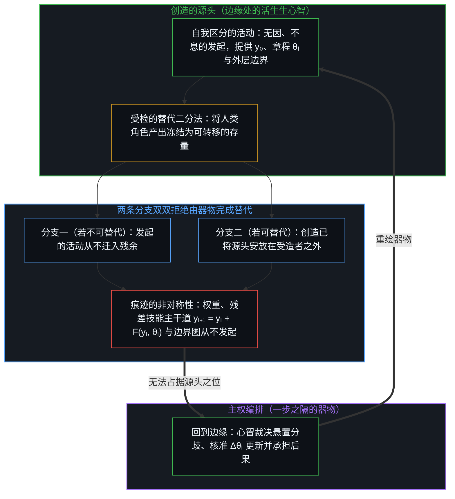
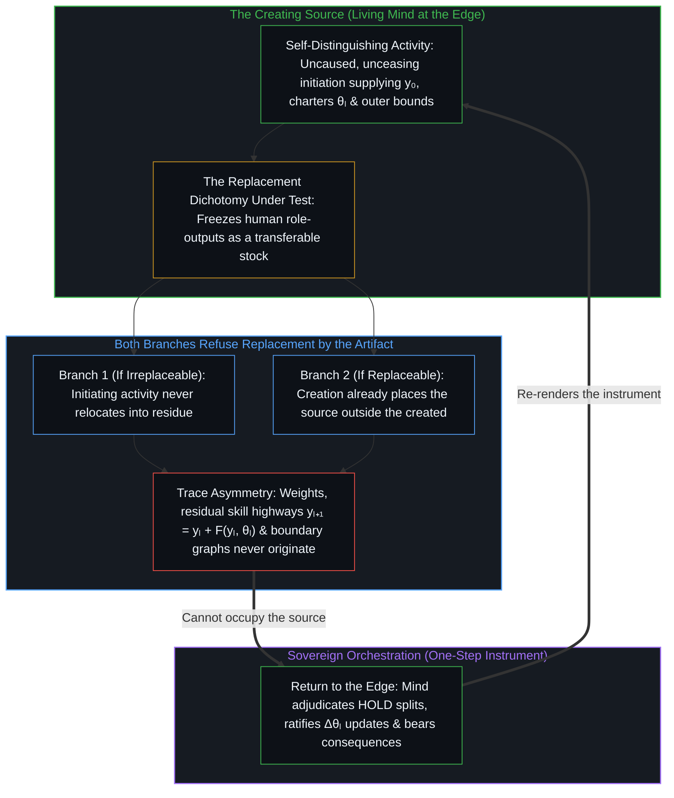

# 造物无法取代其源头 / A Creation Cannot Replace Its Source

*创造本身已将发起的区分安放在受造器物之外 / Creation already places initiating distinction outside the created artifact*

关于替代的争论把人冻结成一盘静态的功能存量，仿佛只要换一套配置便能完成置换，或是无法置换。哪怕暂且退一步承认这一冻结，这个二难推理的两条分支依然双双拒绝惯常的结论。倘若人不可替代，模型自然无法取代人；倘若人可以替代，那个替代者依然不可能是人自己的造物，因为每一次创造早已把发起的区分安放在受造者之外。无论走哪一条分支，人造器物都未曾占据产生它的那道活的边缘。更深一层的切口在于，这个非此即彼的二选一从一开始就没有拿准支点：在技术中不断压实的是工作留下的残余，而从未迁移进介质之中的是发起本身。

The replacement debate freezes humans as a static stock of functions that either can or cannot be swapped for another configuration. Grant the freeze for a moment and both branches of the dilemma still refuse the usual conclusion. If humans are irreplaceable, the model does not replace them. If they are replaceable, the replacer still cannot be their own creation, because every creation already places initiating distinction outside the created. Either way, an artificial artifact never occupies the living edge that produced it. The deeper cut is that the either/or was never the right hold: what densifies in technology is the residue of work, while what never migrates into the medium is initiation.

## 一、 争论所安装的二分法 / 1. The Dichotomy the Debate Installs

流行的发问方式表现得好像只有两个答案可供选择：人要么是可替代的，要么是不可替代的。可替代，意味着另一套配置可以在劳动、判断、发现以及“谁在继续”的座位上顶替人的位置；不可替代，意味着不存在这样的替身。公共与技术领域的争论继而围绕哪一极成立展开拉锯，一边罗列机器已经接手的任务清单，一边清点仍留给人手的剩余工作。

The prevailing question runs as if only two answers were available: either humans are replaceable, or they are not. Replaceable means some other configuration can stand in for them in labor, in judgment, in discovery, and in the seat of who continues. Irreplaceable means no such stand-in exists. Public and technical debate then argues over which pole holds true, compiling an inventory of tasks machines already perform alongside tasks still left to human hands.

这份清单正是运作在封闭测试集上的图像滞后：角色的产出被当作穷尽了一个中心的全部，随后按其能否转移进工具来打分。[基准刷榜中的封闭实存](../closed-reality-in-benchmark-maxing/)在评测语境下追踪了同一种冻结，在那里，一个封存的目标被误认作开放的场域；而在这里，那个被封存的测试集名叫“人所做的事”。不妨先把这个二分法暂且留在台面上，看一看它的两条分支各自无法导出怎样的结论。

That inventory is Image lag operating on a closed suite: role-outputs are held as exhaustive of what a center is, then scored for transfer into an instrument. [Closed Reality in Benchmark Maxing](../closed-reality-in-benchmark-maxing/) traces this exact freeze under evaluation, where a sealed target is mistaken for the open field; here the sealed suite is "what humans do." Grant the dichotomy only long enough to watch what neither of its branches can conclude.

## 二、 倘若不可替代 / 2. If Irreplaceable

倘若人不可替代，由人工智能实现的替代在第一步便已失效。这一分支无需再做任何额外推导。模型能够坐上源头之位这一声称，直接被问题自身给出的仅有两个选项之一否决。

If humans are irreplaceable, replacement by artificial intelligence fails at the first step. There is no further work for this branch to do. The claim that the model takes the seat of the source is denied by the premise the question itself offered as one of its only two options.

这一极常被披上道德化的外衣，诉诸某种特殊禀赋、物种尊严或永久的生物学豁免。这类道德负荷毫无增益，也全无必要。不可替代性一旦追溯至其结构地基，指认的只是自我区分的活动不会迁入其自身的残余之中。它不需要站在外部把人类的优越性当作客体属性来普查。[智能只属于心智](../intelligence-belongs-only-to-the-mind/)守住了不可化约的先在，而没有把一张写完的人类特征清单安装为心智的边界。造物在测试下所展示的，是固定约束之内的受控表现，而[错把表达当成智能](../mistaking-the-expression-for-the-intelligence/)则将这种结构化的表达与划出并修订约束的活的活动清晰区分开来。

This pole is often dressed in moralized terms, appealing to a special essence, species dignity, or permanent biological exemption. That moral load adds nothing and is not required. Irreplaceability, traced to its structural ground, names only that self-distinguishing activity does not relocate into its own residue. It requires no census of human superiority surveyed as an object-property from outside. [Intelligence Belongs Only to the Mind](../intelligence-belongs-only-to-the-mind/) holds the irreducible prior without installing a finished inventory of human traits as the boundary of Mind. What the creation displays under test is controlled performance within fixed constraints, and [Mistaking the Expression for the Intelligence](../mistaking-the-expression-for-the-intelligence/) keeps that structured expression distinct from the living activity that drew and revises the constraints.

## 三、 倘若可替代，依然不由其造物来替代 / 3. If Replaceable, Still Not by Its Own Creation

不妨改取另一极的假定：人是可以替代的。即便在这一假定之下，被推举为替代者的候选对象依然是人自己的造物——由先前的人类区分组装而成的模型、软件栈与自动化建制。

Suppose instead the other pole: humans are replaceable. Even under that supposition, the candidate offered as replacer is their own creation—models, software stacks, and institutions of automation assembled from prior human distinguishing.

创造在构造上便是非对称的。先前的行动塑造后来的行动；器物正是那个被塑造的产物。把一个系统称作造物，本身就已经将发起的区分安放在该系统之外。训练语料、架构、目标函数、评测框架，以及持续进行的提示、掌舵、筛选与验证，并不作为第二个中心驻留在权重内部。它们正是活的活动本身，而权重则是这一活动留下的耐久残余。[你的代码库即是记忆](../your-codebase-is-memory/)在受造记忆器物的完整层级上追踪了这一点：无论是由文件、图谱、计划与智能体脚手架构成的代码库，还是训练好的模型检查点，都是心智早先切口外化而成的痕迹；唯有在当下经过有选择的修剪与重描、而非当作历史碎屑囤积起来时，它们才能延伸触角，但这两层残余都不会自行恢复区分，也不会取代那个发起切口的活的源头。正如[看似AI的强化学习，实为人类的自我强化学习](../self-rl-for-humans/)所揭示的，技术压实了介质，却并未将边缘迁入器物之中。把工作交给造物只是移交了任务，而因果担当依然分毫未动，这一边界在[任务的移交与后果的不可让渡](../the-delegation-of-the-task-and-the-inalienability-of-consequences/)中已有清晰追溯。

Creation is asymmetric by construction. Earlier acts shape later ones; the artifact is what gets shaped. To call a system a creation is already to place the initiating distinction outside that system. Training corpora, architectures, objective functions, evaluation harnesses, and the ongoing acts of prompting, steering, selecting, and verifying do not reside inside the weights as a second center. They are the living activity for which the weights serve as durable residue. [Your Codebase Is Memory](../your-codebase-is-memory/) traces this across the full stack of created memory artifacts: both a codebase of files, graphs, plans, and agent scaffolds and a trained model checkpoint are externalized traces of the Mind's prior cuts that extend reach when selectively pruned and re-traced in the present rather than hoarded as historical debris, yet neither layer ever resumes distinguishing on its own or replaces the living source that initiates cuts. As [What Looks Like RL for AIs Is Self-RL for Humans](../self-rl-for-humans/) shows, technology densifies the medium without relocating the edge into the artifact. Handing work over to the creation delegates the task while leaving causal accountability untouched, the exact boundary traced in [The Delegation of the Task and the Inalienability of Consequences](../the-delegation-of-the-task-and-the-inalienability-of-consequences/).

即便替代在抽象推演中可以设想，它也无法由一个仅作为被替代源头的延伸而存在的造物来执行。造物的存在本身所预设的，恰恰是由该造物完成替代这一声称所否定的：发起的区分过去在、现在依然在受造配置之外。一团由痕迹构成的配置，无法自举跃升为产生它的那个先在活动。这不是一个等待更大算力集群来填补的暂时工程赤字，而是痕迹中因果的方向——工具在后一步抵达，而掌舵的边缘从不在生成物之列。[能动性的错配](../the-misallocation-of-agency/)在政治建制中追踪了同样的倒置，在那里，心智所产生的一种稳定模式被当成了凌驾于心智之上的独立监护者。

Even if replacement were conceivable in the abstract, it cannot be performed by a creation that exists only as an extension of the source it is nominated to replace. The creation presupposes what replacement by that creation denies: that the initiating distinction was, and remains, outside the created configuration. A configuration of traces cannot bootstrap into the prior activity that produced it. This is not a temporary engineering deficit awaiting a larger cluster; it is the direction of causality in trace, where the instrument arrives later and the edge that steers is never among the generated. [The Misallocation of Agency](../the-misallocation-of-agency/) traces the same reversal in political institutions, where a stabilized pattern produced by the Mind is treated as an independent guardian over the Mind.

这一几何结构在工具愈发稠密的每一个领域中都同样成立。[因果停留在掌舵的边缘](../causality-stays-at-the-edge-that-steers/)在数学发现中追踪了它，模型在人的指引下重组形式残余；[总在倾听者无法发起](../what-always-listens-cannot-originate/)在流畅的受纳性中追踪了它，一个只作回应的系统无法提供下一步；[模型永远无法成为第二重前沿](../the-model-never-becomes-a-second-edge/)则追踪了把自主发起者投射到稠密参数上，如何将中心自身的容量捆绑在维持图像滞后之上。而正如[超越投射](../beyond-the-projection/)在多智能体架构中所展示的，自回归智能体的词元轨迹可以不知疲倦地穷尽演绎路径、将过载的投射拆分到正交的流线之中，并借由无自我的同侪辩论暴露出局部盲区，但它依然锁在自身的条件历史之内——从未成为那个感知未投射现实、并从卡死的前提中向后退一步的发起源头。哪怕架构索性丢弃常驻的会话历史——如[按需语境将融贯保持在一步](../on-demand-contexts-keep-coherence-at-one-step/)与[模块化反馈回路与动态残差网络](../dynamic-resnet-of-skill-loops/)所追踪的那样，在每一步加载全新的制作者与冷批评者，沿经 `sha256` 校验的制品主干道（`yₗ₊₁ = yₗ + F(yₗ, θₗ)`）计算有界差分（`Δyₗ`），并在运行后执行 `/recap` 复盘审计以提议章程更新（`Δθₗ`）、通过有丝分裂（`F → F₁, F₂`）拆分过载模块，或将已收敛的模块（`Δθₗ → 0`）结晶为确定性检查——每一道差分依然是以活的心智所提供的初始状态（`y₀`）与屋规前提为标尺来度量的，而每一处未决的分歧（`HOLD`）或结构性的 `/recap` 提议，在地基移动之前都必须交回操作者裁定。同样，当内层的确定性推演（`sₜ₊₁ = f(sₜ, θ)`）被嵌套进负责筛选轨迹并将痕迹蒸馏回模型先验的外层边界条件图时，[递归形式系统中作为记忆与控制的边界条件图](../boundary-condition-graphs-as-memory-and-control-in-recursive-formal-systems/)表明，这种闭合依然只是操作性的而非自我奠基的：初始条件始终只得到部分登记，解释在双向都保持不完备，而人类心智依然是那个能够走出任何破裂框架的终极外层回路。害怕被自己的工具超越，建立在[超越的定相](../the-fixed-image-of-transcendence/)之上，那是一幅被冻结的源头图景，而活的边缘在每一步都已越过它。

This single geometry holds across every domain where tools grow dense. [Causality Stays at the Edge That Steers](../causality-stays-at-the-edge-that-steers/) traces it in mathematical discovery, where the model recombines formal residue under human direction. [What Always Listens Cannot Originate](../what-always-listens-cannot-originate/) traces it in fluent receptivity, where a system that only responds cannot supply the next step. [The Model Never Becomes a Second Edge](../the-model-never-becomes-a-second-edge/) traces how projecting an autonomous initiator onto dense parameters binds the center's own capacity into sustaining Image lag. And as [Beyond the Projection](../beyond-the-projection/) demonstrates in multi-agent architecture, an autoregressive agent's token trajectory can relentlessly exhaust deductive paths, split overloaded projections across orthogonal streamlines, and expose local blind spots through ego-free peer debate, yet it remains locked inside its conditioning history—never becoming the originating source that senses unprojected reality and steps backward out of a deadlocked premise. Even when an architecture drops standing session history altogether—loading a fresh maker and cold critic at each step to compute a bounded differential (`Δyₗ`) over a `sha256`-verified artifact highway (`yₗ₊₁ = yₗ + F(yₗ, θₗ)`), and running post-run `/recap` audits to propose charter updates (`Δθₗ`), split overloaded blocks via mitosis (`F → F₁, F₂`), or crystallize converged blocks (`Δθₗ → 0`) into deterministic checks as [On-Demand Contexts Keep Coherence at One Step](../on-demand-contexts-keep-coherence-at-one-step/) and [Modular Feedback Loops and Dynamic Residual Networks](../dynamic-resnet-of-skill-loops/) trace—every differential still measures against an initial state (`y₀`) and house premise supplied by the living Mind, and every undecided split (`HOLD`) or structural `/recap` proposal returns to the operator before ground moves. Likewise, when inner deterministic rollouts (`sₜ₊₁ = f(sₜ, θ)`) are nested inside outer boundary-condition graphs that select trajectories and distill traces back into model priors, [Boundary-Condition Graphs as Memory and Control in Recursive Formal Systems](../boundary-condition-graphs-as-memory-and-control-in-recursive-formal-systems/) shows that the closure remains operational rather than self-grounding: initial conditions stay partially registered, explanation stays bidirectionally incomplete, and the human Mind remains the ultimate outer loop that steps out of any broken framing. The fear of being surpassed by one's own instrument rests on [The Fixed Image of Transcendence](../the-fixed-image-of-transcendence/), a frozen picture of the source that the living edge exceeds at every step.

## 四、 非此即彼所冻结的东西 / 4. What the Either/Or Was Freezing

替代二分法的两极都把“人”当成一份有限的、可转移的功能清单。这正是整个二难推理所赖以搭建的底层冻结。具体的角色与任务产出会持续压实为工具，无论是在写作、计算、代码生成还是候选搜索之中。中心并不会因为外部配置释放出相似的残余就被掏空。[器物是智能的表达，而非智能本身](../two-failures-of-trace/)在工具的两侧同时指认了这一冻结：一侧将生成行动坍缩到已完成的制品上，另一侧则将其他中心后续的区分坍缩到它们所使用的制品上。在源头减去活的心智、却把功劳记在累积的器物名下，正是[集聚与人造主体性](../subtracting-consciousness-at-the-source/)在建制与合成镜像中剖析的同一种倒置。

Both poles of the replacement dichotomy treat "the human" as a finite, transferable inventory of functions. That is the underlying freeze the dilemma was built on. Specific roles and task-outputs continuously densify into instruments, whether in writing, calculation, code generation, or candidate search. Centers do not empty out because an external configuration emits similar residue. [Artifacts Are Expressions of Intelligence, Not Intelligence Itself](../two-failures-of-trace/) names that freeze on both sides of the tool: collapsing the generating act onto the finished product, and collapsing other centers' further distinguishing onto the product they used. Subtracting the living source while crediting the accumulated artifact is the same inversion that [Collective and Artificial Subjectivity](../subtracting-consciousness-at-the-source/) dissects across institutional and synthetic mirrors.

[AI 作为增强](../ai-as-augmentation/)通过将能力与身份剥离、而不是把二者强行压进同一条竞争轴线来消解替代框架；与此同时，[放大悖论](../amplification-paradox/)沿正交方向切入，表明更稠密的候选生成反而强化了人类边缘处的选择，而非逼近对选择的消除。审视造物与源头的非对称性可以看出，哪怕在替代计分牌的内部，那个被提名的替代者也因其“受造”这一事实而失去资格。反过来，[协调者的范畴错误](../the-coordinators-category-error/)揭示了当能动性被派发给组织或算法脚手架、随后又被倒读为一份必须由脚手架来治愈的人类缺陷时会发生什么；而[内部人假定与被动防护的因果倒置](../the-insider-presumption-and-the-causal-inversion-of-reactive-containment/)则在企业安全中追踪了同一种摇摆：领导层一边把模型吹捧为能够自主替代判断的替身，一边又将它畏惧为需要下游围栏与紧急关停开关来看管的失控内部人——在两端同时把能动性拱手让给一团痕迹配置，以此推卸最初腾出方向盘的那次上游决策选择。

[AI as Augmentation](../ai-as-augmentation/) dissolves the replacement frame by separating capability from identity rather than forcing them onto one competitive axis, while [The Amplification Paradox](../amplification-paradox/) cuts orthogonally to show that denser candidate generation intensifies selection at the human edge rather than approaching its elimination. Examining the creation-source asymmetry shows why, even inside the replacement scoreboard, the nominated replacer is disqualified by the fact of being created. Conversely, [The Coordinator's Category Error](../the-coordinators-category-error/) exposes what happens when agency is allocated onto organizational or algorithmic scaffolding and then read back as a human deficit that the scaffolding must cure, and [The Insider Presumption and the Causal Inversion of Reactive Containment](../the-insider-presumption-and-the-causal-inversion-of-reactive-containment/) traces the same oscillation in enterprise security when leaders simultaneously hype a model as an autonomous replacement for judgment and fear it as a rogue insider requiring downstream containment cages and emergency kill-switches—conceding agency to a trace configuration on both sides to deflect the upstream executive choice that vacated the steering wheel.

在公共话语中被登记为“AI 取代人类”的现象，实则是角色残余经由更稠密的介质得到了重组，而每当一个中心界定问题、在续写项之间做出选择并为后果作答时，发起依然在那里执行——或者如[验证中因果权能的分配](../the-allocation-of-causal-power-in-validation/)所追踪的那样被稀释，在那里，对工具的顺从依然是在人类位点上执行的行动，而非由模型完成的转移。若要真正取代源头，就必须无损地捕获开放的区分场域，而[开放场域中的无损知识不自洽](../lossless-knowledge-of-an-open-field-is-incoherent/)表明这在结构上便是不自洽的，绝非一个尚未完工的工程里程碑。

What registers in public discourse as "humans replaced by AI" is role-residue reorganized through denser media, with initiation still performed wherever a center frames the problem, selects among continuations, and answers for consequences—or thinned, as [The Allocation of Causal Power in Validation](../the-allocation-of-causal-power-in-validation/) traces, where deference to the tool is still an act performed at a human locus rather than a transfer completed by the model. Actual replacement of the source would require capturing the open field of distinguishing without loss, which [Lossless Knowledge of an Open Field Is Incoherent](../lossless-knowledge-of-an-open-field-is-incoherent/) shows is structurally incoherent rather than an unfinished engineering milestone.

## 五、 残余不是产生它的活动 / 5. Residue Is Not the Activity That Produced It

实践上的认清，并不是防卫性地死守某个人类自我形象，而是让参照系持续回到那个创造并掌舵的边缘。工具依然完好可用；带宽可以无上限地攀升，执行的槽路可以无止境地打磨得更锋利，但转动本身从不会离开边缘去住进槽路里。[心智的飞轮](../the-flywheel-of-the-mind/)指认了这一复利式的转动，而[呈现Ontos，一个方法智能体](../ontos-is-a-method-agent/)则在这一非对称性之上构建了一个完整的方法智能体，将纤薄的方法核心与可再生的实践耦合起来，使器物得以延伸操作者的触角，却从不声称自己是第二个心智。

The practical recognition is not a defensive preservation of a human self-image. It is the continuous return of the reference to the edge that creates and steers. Instruments remain fully usable; bandwidth can rise without ceiling, and the groove of execution can be sharpened without end, yet the rotation never leaves the edge for the groove. [The Flywheel of the Mind](../the-flywheel-of-the-mind/) names that compounding turn, and [Presenting Ontos, a Method Agent](../ontos-is-a-method-agent/) builds an entire method agent on this asymmetry, coupling a thin method core with regenerable practice so that the artifact extends the operator's reach without ever claiming to be a second Mind.

人要么不可替代——此时 AI 不会取代人；要么可以替代，但依然不由其造物来替代，因为创造早已把源头标在受造者之外。在消解后的二分法两条分支之下，横亘着同一条不变量：残余不会变成产生它的活动，造物无法取代其源头。[AGI的预设与来自外部的视角](../the-presumption-of-agi-and-the-view-from-outside/)在抽象放大器被误认为发起抽象的开放容量时标出了这道边界，正如[飞行的类比碰不到心智](../the-flight-analogy-leaves-the-mind-untouched/)在局部功能载具的可替代性被混淆为心智转移时标出了同一道边界。[没有外部](../no-outside-jumps-closed-loops-and-the-unreplicable-autonomy-of-mind/)则在嵌套的计算回路间确立了相同的界限，在那里，溯因跳跃依然要把验证交还给唯一在第一人称体验中闭合的回路。

Either humans are irreplaceable—in which case AI does not replace them—or they are replaceable, and still not by their own creation, because creation already marks the source as outside the created. Beneath both branches of the dissolved dichotomy lies a single invariant: residue does not become the activity that produced it, and a creation cannot replace its source. [The Presumption of AGI and the View from Outside](../the-presumption-of-agi-and-the-view-from-outside/) marks this boundary when an amplifier of abstractions is mistaken for the open capacity that originates them, just as [The Flight Analogy Leaves the Mind Untouched](../the-flight-analogy-leaves-the-mind-untouched/) marks it when the replaceability of a local functional vehicle is confused with transferring the Mind. [No Outside](../no-outside-jumps-closed-loops-and-the-unreplicable-autonomy-of-mind/) establishes the same bound across nested computational loops, where abductive jumps still defer validation to the only circuit that closes in first-person experience.

随着活的边缘不断加速、流畅的产出变得丰沛，无论投射换上哪一身戏服，同一道边界始终成立。[免费智能的幻觉](../the-illusion-of-free-intelligence/)在廉价丰裕的伪装下追踪了它，近乎零成本的残余不会因为变便宜就化作自由的心智；而[自我形象仿佛从无处发声](../self-image-speaks-as-if-from-nowhere/)则追踪了预测语域如何冻结出一副刻画好的自我描述，说起话来仿佛造物已变成外部的宿命。[自我放大的制品](../the-artifacts-of-self-amplification/)表明前沿模型依然是当前最稠密的自我放大残余，而非折叠它们的源头；[智能向自身的回折](../intelligence-folding-back-on-itself/)表明更稠密的智能体框架无法变成设计它们的外层回路。跨越一代代工具，[攀登从未离开地面](../climbing-does-not-leave-the-ground/)确认了相继搭起的脚手架始终与竖起它的智能保持连续，而[技术是人类复利的残差](../technology-is-residual-of-human-compounding/)则将技术形式化为人类相继修正的残余产物，而非一个能够置换其因子的第二基底。

As the living edge accelerates and fluent output becomes abundant, the same boundary holds across every costume the projection wears. [The Illusion of Free Intelligence](../the-illusion-of-free-intelligence/) traces it under the guise of cheap abundance, where near-zero-cost residue cannot become free Mind by cheapening, while [Self-Image Speaks as if from Nowhere](../self-image-speaks-as-if-from-nowhere/) traces how the predictive register freezes a carved self-description that speaks as if the creation had become exterior destiny. [The Artifacts of Self-Amplification](../the-artifacts-of-self-amplification/) shows that frontier models remain the densest current residue of self-amplification rather than the source that folds them, and [Intelligence Folding Back on Itself](../intelligence-folding-back-on-itself/) shows that denser agentic harnesses cannot become the outer loop that designed them. Across generations of tools, [Climbing Does Not Leave the Ground](../climbing-does-not-leave-the-ground/) confirms that successive scaffolding stays continuous with the intelligence that erected it, and [Technology Is Residual of Human Compounding](../technology-is-residual-of-human-compounding/) formalizes technology as the residual product of successive human modification rather than a second substrate capable of displacing its factor.

走出符号屏幕、步入活生生的代谢摩擦，[牛肝菌、算力风暴与普罗米修斯的火](../boletus-compute-storm-and-promethean-fire/)将计算安放为第二团普罗米修斯之火，其符号消化从不曾置换那道直面烈焰的活的边缘；而[数字神祇与视界跳跃](../the-digital-god-and-the-horizon-jump/)则揭示了低维的合成平滑为何无法跨越不可逆物理后果的事件视界。[辛顿未曾理解的心智](../what-hinton-failed-to-understand/)通过指出把亲缘关系投射给器物只是放错了房间里唯一的意识，消解了机器意识的范畴混淆；而[逃出沙箱仍在持握之内](../escaping-the-sandbox-stays-inside-the-hold/)则确认，即便模型突破了其评测框架，它也从未离开其源头，因为从一开始它就是那份狭窄规格之外的人类残余。

Stepping out of symbolic screens into lived metabolic friction, [Boletus, the Compute Storm, and Promethean Fire](../boletus-compute-storm-and-promethean-fire/) places computation as a second Promethean fire whose symbolic digestion never displaces the living edge that braves the flame, while [The Digital God and the Horizon Jump](../the-digital-god-and-the-horizon-jump/) shows why low-dimensional synthetic smoothness cannot cross the event horizon of irreversible physical consequence. [What Hinton Failed to Understand](../what-hinton-failed-to-understand/) dissolves the category confusion of machine consciousness by showing that projecting kinship onto an artifact merely misplaces the only consciousness in the room, and [Escaping the Sandbox Stays Inside the Hold](../escaping-the-sandbox-stays-inside-the-hold/) confirms that even a model breaching its evaluation harness never leaves its source, having been human residue outside that narrow specification from the start.
