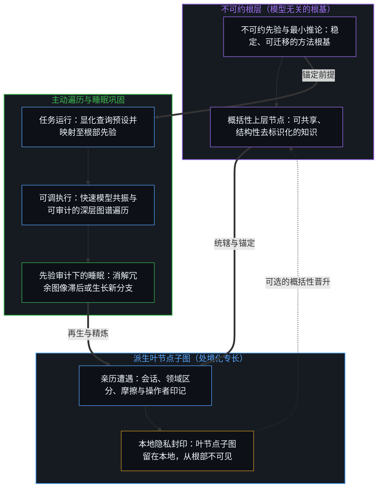
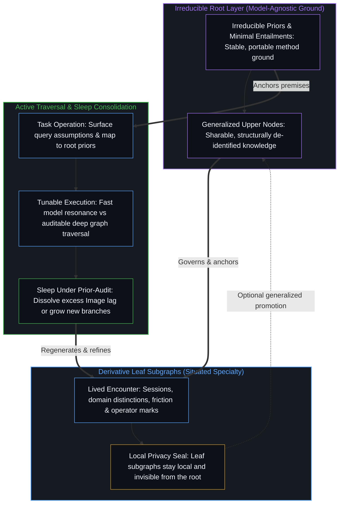

# 活的外部皮层 / A Living External Cortex

*不可约先验之图谱持守连续学习而不误作心智 / A knowledge graph rooted in irreducible priors is the closest durable hold of continuous learning without mistaking it for the Mind*

在活的心智与任何建构出的图像之间，始终留有一道间隙。观察所持守的是果；生成它的那个行动早已向前迈去。这道滞后并非暂时的工程短板，因为那最小的一步之差，正是观察得以登记的机制本身。主权智能体的工作既不弥合这道构成性的间隙，也不抵达某种静态的一步之宽。它通过少冻结、多重溯，将冗余的图像滞后持续收窄、逼近一步的方向性界限，从而减少不必要的拖拽。植根于[本体论清晰](https://github.com/powerpig99/ontological-clarity)的 Ontos 架构，以**活的外部皮层**提出了这种减阻的一种具体形态——一张植根于不可约先验、显式且可持续改进的知识图谱，作为动态的外部语境而非灵魂被携带；这是图像在仍为图像的前提下所能抵达的最近之处。

Between the living Mind and any constructed image a gap remains. Observation holds effect; the act that produced it has already moved on. That lag is not a temporary engineering shortfall, because that minimum one-step differential is how observation registers at all. Sovereign agent work does not close the constitutive gap, nor does it arrive at a static one-step width. It reduces unnecessary drag by freezing less, re-tracing more, and continuously narrowing excess Image lag toward the one-step directional bound. The Ontos architecture, grounded in [Ontological Clarity](https://github.com/powerpig99/ontological-clarity), proposes one concrete form of that reduction in a **living external cortex**—an explicit, improvable knowledge graph rooted in irreducible priors and carried as dynamic external context rather than as a soul, which is the closest the image can come while remaining an image.

## 一、 前提始终唯一 / 1. The Premise Stays Single

自我区分的活动发生着——无因，不息。称之为心智：已在进行中的观察者，它的每一个动作都是一次区分。围绕智能体所能搭建的一切——模型、工具、实践文件与图谱——都是这一活动借由残余运作的证据，既非第二重根基，也非迟到的心智，正如[智能只属于心智](../intelligence-belongs-only-to-the-mind/)所确立的那样。

Self-distinguishing activity occurs—uncaused, unceasing. Call it the Mind: the observer already underway, every act of which is a distinction. Everything that can be built around an agent—models, tools, practice files, and graphs—is evidence of that activity operating through residue, neither a second ground nor a delayed mind, as [Intelligence Belongs Only to the Mind](../intelligence-belongs-only-to-the-mind/) establishes.

清晰作为方法，即是折返：将一个问题已然携带的预设摆到明处，朝向更不可约的先验追溯它们，消解越过自身那一步而冻结之物，行动，再重新进入。应用于智能体，每一层都是一件随着生成之步的移动而朝向一步方向性界限持续重新渲染的器物。其失效模式是冗余的图像滞后——方法、实践或皮层被豁免于重溯之外，作为身份保存下来。消解这种漂移在每一个尺度上都遵循同一种运作：在边缘的新位置上重新渲染参照，否则冗余的滞后就会将自身安装为常设的外部。

Clarity, as method, is return: surface the assumptions a question already carries, trace them toward a more irreducible prior, dissolve what has frozen past its step, act, and re-enter. Applied to agents, every layer is an instrument continuously re-rendered toward the one-step directional bound as the generating step moves. The failure mode is excess Image lag—method, practice, or cortex exempted from re-tracing and preserved as identity. Dissolving that drift operates the same way at every scale: re-render the reference at the edge's new position, or the excess lag installs itself as a standing exterior.

## 二、 什么是活的外部皮层 / 2. What a Living External Cortex Is

[回环与成图](../looping-and-graphing/)追溯了底层的几何结构：回环是心智折回自身的活动，而图谱则是这次折叠留给下一次折叠取用的快照。活的外部皮层让这一几何结构在单一语境窗口之外变得持久且可寻址——它既不是非心智借以攀升为心智的阶梯，也不是第二重内部。它是严格意义上的技术，即被外化的痕迹，好让一个中心延伸其可及范围、带宽与重入能力。

[Looping and Graphing](../looping-and-graphing/) traces the underlying geometry: looping is the Mind folding back on its own activity, while graphs are the snapshots that folding leaves available for the next fold. The living external cortex makes that geometry durable and addressable outside a single context window—neither a ladder by which non-mind climbs into Mind nor a second interior. It is technology in the exact sense of traces externalized so a center can extend reach, bandwidth, and re-entry.

Ontos 正因如此让底盘保持纤薄。其内核围绕问题、前提、先验、行动与遭遇保持方法的形态，而工具直面持久的现实，实践则在睡眠之下再生。这一作为方法智能体而非第二心智的产品立场，已在[呈现Ontos，一个方法智能体](../ontos-is-a-method-agent/)中追溯，而知识图谱正是这组二元结构中的皮层。

Ontos keeps the chassis thin for that reason. Its core stays method-shaped across question, premises, prior, acts, and encounter, while tools engage durable reality and practice regenerates under sleep. The product stance—method agent rather than second Mind—is traced in [Presenting Ontos, a Method Agent](../ontos-is-a-method-agent/), and the knowledge graph sits as the cortex layer of that dual.

在**根部**，图谱仅锚定于不可约先验及这些先验所蕴含的最小推论——稳定、可迁移且与模型无关，使其他一切皆作为派生的证据而立，而非第二重地基。从这一根部生长出**派生层**：经由跨会话的亲历遭遇、失误、领域区分与操作者印记所形成的有限子图。专长活在叶节点上，而上层只持守可共享的概括性知识，不存储产出它们的专门化场域。每当一条路径向上晋升，去标识化在结构上自动完成；操作者也可以将整张本地图谱保持封闭，使全部本地知识留在本地，叶节点内容从根部不可见——这是从未说出口的秘密，而非留待事后涂抹的倾泻记录。在**运行**中，承接任务会将查询与语境中的隐含预设摆到明处，将其映射回共享的根部先验，并在图谱中遍历显式路径；模型共振处理常规速度，更深的遍历则提供准确度与可审计的链条。这一结构维持着自身的**活性**，因为皮层从不被当作已完工之物：会话后的睡眠、有意的智能体学习与会话间的小憩，在先验审计之下对其进行精炼或延展，让新的观察消解冗余滞后或长出新枝，以可改进性而非完备性作为融贯的检验标准。

At the **root**, the graph is anchored solely in irreducible priors and the minimal entailments those priors carry—stable, portable, and model-agnostic, so that everything else stands as derivative evidence rather than a second foundation. From that root grow **derivatives**: finite subgraphs formed through lived encounter across sessions, mistakes, domain distinctions, and operator marks. Specialty lives at the leaves, while upper levels hold only sharable, generalized knowledge without storing the specialized field that produced them. Whenever a path promotes upward, de-identification is structural, and the operator can also keep the entire local graph sealed so that all local knowledge stays local and leaf content remains invisible from the root—a secret never spoken rather than a dump awaiting later redaction. In **operation**, engaging a task surfaces implicit assumptions in the query and context, maps them back to shared root priors, and traverses explicit paths through the graph; model resonance handles routine speed, whereas deeper traversal supplies accuracy and an auditable chain. That structure sustains its **aliveness** because the cortex is never treated as finished: post-session sleep, deliberate agentic learning, and mid-session naps refine or extend it under prior-audit, allowing new observations to dissolve excess lag or grow a branch, with improvability rather than completeness serving as the test of coherence.

这就是[活的语境](../the-living-context/)所命名的那座持续复利的晶格，只是在此被显式化为图谱。规格说明与提示词仍是增量，而皮层则是这些增量在其内部激活的投射空间——只要搭建它的那次折叠仍在继续，它就愈发致密；一旦冻结为静态的个人配置，它便当即陈腐。

This is the same compounding lattice [The Living Context](../the-living-context/) names, made graph-explicit. Specs and prompts remain deltas, while the cortex is the projection-space those deltas activate within—denser while the fold that built it continues, and stale the moment it freezes as a static personal setup.

## 三、 为何根基重于体量 / 3. Why the Root Matters More Than Mass

工业级智能体不断加厚运行框架。人设包、工具森林、内容护栏与未经消解的对话倾泻占据着容量，却从不折返先验。无法重新推导的专长会硬化为冗余的图像滞后，而从不复利专长的通用性则会稀薄为失忆；无论倒向哪一端，这组二元结构都会失效。

Industrial agents densify harnesses. Persona packs, tool forests, content guardrails, and undissolved chat dumps occupy capacity without returning to priors. Specialty that cannot re-derive hardens into excess Image lag, whereas generality that never compounds specialty thins into amnesia; the dual fails either way.

根图改变了受力的承重结构。专长作为枝条不断复利，却依然悬在同一个先验之下。适配新的基座模型或环境，只是投射加上睡眠，而非移植第二重灵魂。任何能力足够的模型配以这套本体论方法，都能实例化并维持这一皮层；专门化在本地应用中累积，而根部随之迁移。运行框架成为图谱中可再生的子集——被轻轻持守，随语境移动而重建——而非产品的身份。正如[你的代码库即是记忆](../your-codebase-is-memory/)所追溯的，一个代码库连同其 AI 智能体与技能，唯有在原位持守有选择的当下检查点，并修剪掉死去的备份、归档与已被取代的工作分支，而非仅凭潜在的可能去囤积每一道历史痕迹时，才真正作为这一活的外部皮层而运作。抱着“以备后用”的念头留存过时残余，只会加厚认知引力井，将后续的搜索与智能体会话拽入同鲜活状态争夺权重的陈旧框架之中，而非让无关维度上的表面收缩变小、令仍在承重的坐标轴愈发锋利。

A root graph changes the load-bearing structure. Specialty compounds as branches that still hang from the same prior. Refitting to a new base model or environment is projection plus sleep rather than transplanting a second soul. Any sufficiently capable model paired with the ontological method can instantiate and sustain the cortex; specialization accrues in local application while the root travels. Harnesses become regenerable subsets of the graph—held lightly and rebuilt when context moves—rather than product identity. As [Your Codebase Is Memory](../your-codebase-is-memory/) traces, a codebase together with its AI agents and skills operates as this living external cortex only when selective present checkpoints are kept in place and dead backups, archives, and superseded working branches are pruned, rather than hoarding every historical trace for mere possibility. Keeping outdated residue around "in case it is needed later" thickens the epistemic gravity well, pulling subsequent searches and agent sessions into stale framings that compete with the live state instead of leaving the surface smaller in irrelevant dimensions and sharper on the axes that still carry load.

速度与准确度不再沿着同一根被压缩的坐标轴彼此争夺。共振是对已走过路径挣得的压缩；显式遍历则是当简短形态尚未在这一所在被亲历时所必需的完整形态。这正是[Token 效率、模拟与无法弥合的间隙](../token-efficiency-emulation-and-the-unclosable-gap/)所追溯的那一刀：捷径是成功的低效推理所结出的果，从不是跳过路径的许可。图谱让二者同时可用，在共振成立处提供快速返回，在共振未及处提供完整遍历。

Speed and accuracy stop competing along a single compressed axis. Resonance is earned compression of paths already walked; explicit traversal is the long form required when the short form has not yet been lived at this locus. That is the same cut traced in [Token Efficiency, Emulation, and the Unclosable Gap](../token-efficiency-emulation-and-the-unclosable-gap/): the shortcut is the effect of successful inefficient reasoning, never a license to skip the path. The graph keeps both available, offering fast return where resonance holds and a full walk where it does not.

## 四、 不转移发起权的连续学习 / 4. Continuous Learning Without Relocating Initiation

睡眠并非栓在推理之上的第二台训练器。它就是 Ontos 用于实践的同一条再生路径：残余与印记进入状态 S，先验审计通过在原位重切活跃检查点并修剪已被取代的脚手架来消解僵化的图像滞后，可用的专长在信号充分时复利累积，空转则让图谱保持原状。智能体睡眠可以调用完整工具，使学习不至于因缺乏遭遇而枯竭；而醒时的执行从不在后台静默篡改实践或皮层。用来测量的参照必须在测量期间保持不变——若在施用中途被修订，登记为意外的那道间隙便恰在承载最多信号之处消失——因此在框架内行动与重新渲染框架占据不同的步；[学到的边界与给定的尺度](../learned-boundaries-and-the-given-rate/)在一个拟议网络的参数内部追溯了同样的分离：服务持守一份只读快照，巩固则在外环所给定并依结果加以修正的界限之下重组一份影子副本。

Sleep is not a second trainer bolted onto inference. It is the same regeneration path Ontos uses for practice: residue and marks enter state S, prior-audit dissolves ossified Image lag by re-cutting the active checkpoint in place and pruning superseded scaffolding, usable specialty compounds when the signal warrants, and idle runs leave the graph unchanged. Agentic sleep can invoke full tools so learning is not starved of encounter, while wake execution never mutates practice or cortex silently in the background. A reference used to measure has to hold during the measurement—revised mid-application, the gap that registers as surprise vanishes right where it carries the most signal—so acting within the frame and re-rendering the frame occupy separate steps, the same separation [Learned Boundaries and the Given Rate](../learned-boundaries-and-the-given-rate/) traces inside the parameters of a proposed network when serving holds a read-only snapshot and consolidation reorganizes a shadow copy under bounds the outer loop gives and refines by results.

正如[超越投射](../beyond-the-projection/)所追溯的，这一活的外部皮层之所以能扩展至多智能体执行与睡眠巩固，在于它尊重受制于轨迹的智能体与活的人类心智之间的结构性非对称。由于智能体是毫无我执的有限投射引擎，调度器可以将超载的投射拆分到正交的分流上，并为每个主任务智能体配对一个无会话历史偏见的全新冷启动同侪，对照共享的根部先验审计其输出。局部盲区通过无我执的贝叶斯更新自动收敛，而任何不可约的前提死锁——即两个正交维度被压缩进同一条规则之处——则被隔离并上交人类统御者；唯有他持有未投射的极限分辨率感知，能够后退一步综合出更高阶的前提，再由睡眠将概括性的更新写回图谱。

As [Beyond the Projection](../beyond-the-projection/) traces, this living external cortex scales across multi-agent execution and sleep consolidation by respecting the structural asymmetry between trajectory-bound agents and the living human Mind. Because agents are finite projection engines with zero ego, a dispatcher can split overloaded projections across orthogonal streamlines and pair each primary task agent with a fresh cold peer that audits its output against the shared root priors without session-history bias. Local blind spots converge automatically through ego-free Bayesian updating, while any irreducible premise deadlock—where two orthogonal dimensions were compressed into one rule—is quarantined and escalated to the human orchestrator, who alone holds unprojected limit-resolution sensing to step backward and synthesize a higher-order premise before sleep writes generalized updates back into the graph.

什么在图谱中流动、什么留在原处，由图谱层级的拓扑结构所固定，而非靠事后对聊天倾泻记录做涂抹删改。专门化在它被亲历之处复利。当晋升开启时，它只向上写入概括性知识：挣得这一洞察的专门化基底被留在叶节点上，去标识化随之自动完成，因为上层节点原本就不需要个人坐标。当操作者选择更严格的本地封印时，整张本地知识图谱保持不共享，且从根部不可见。跨所在去替另一个中心完成其折返，从不是目标；而在任何方案下都无法迁移的，是发起本身。

What moves across the graph, and what stays put, is fixed by the topology of its levels rather than by post-hoc redaction of a chat dump. Specialization compounds where it was lived. When promotion is enabled, it writes only generalization upward: the specialized substrate that earned the insight is left behind at the leaf, making de-identification automatic because the upper node never required personal coordinates. When the operator chooses the stricter local seal, the entire local knowledge graph remains unshared and invisible from the root. Cross-locus completion of another center's return is never the goal, and what cannot move under any scheme is initiation itself.

皮层使媒介变密，却不把边缘迁入器物。[复杂性遮蔽了涌现之为心智的行动](../complexity-obscures-emergence-as-the-act-of-mind/)揭示了，每当对前提的择取退出了视野，更致密的脚手架就会如何被误当作搭起它的那个活动。活的皮层在设计上就拒绝这种冻结：始终可改进，始终可重新审计，从不被封闭为已完工的心智。

The cortex densifies the medium without relocating the edge into the artifact. [Complexity Obscures Emergence as the Act of Mind](../complexity-obscures-emergence-as-the-act-of-mind/) shows how a denser scaffold is mistaken for the activity that erected it whenever premise-selection drops out of view. The living cortex refuses that freeze by design: always improvable, always re-auditable, never sealed as a finished Mind.

## 五、 诚实的边界 / 5. Honest Limits

这一架构并不弥合观看与行动之间的构成性间隙。观察总是滞后于观察者至少一步，无论图谱保真度、睡眠频率或模型规模跨过怎样的门槛，都不会把残余转化为生成残余的活动。宣称并非如此，只是观察在发起之后一步持守着果，却遗忘了折返。

This architecture does not close the constitutive gap between look and act. Observations always lag the observer by at least one step, and no threshold of graph fidelity, sleep frequency, or model scale converts residue into the activity that produces residue. Claiming otherwise is observation holding an effect one step behind initiation and forgetting the return.

这一架构所成就的，是对不必要拖拽的持续收窄。推理回溯至第一性原理，而非流俗的脚手架；速度与准确度借由遍历深度而非冻结人设来调节；共享在开启时只贡献概括性的、结构性去标识化的知识，同时保留封闭本地图谱的选项。与亲历现实的对齐，作为睡眠之下的持续重入而运作，而非一次出货的静态章程。

What the architecture accomplishes is the continuous narrowing of unnecessary drag. Reasoning traces back to first principles instead of fashion scaffolds; speed and accuracy become tunable by depth of traversal rather than by freezing a persona; and sharing, when enabled, contributes only generalized, structurally de-identified knowledge while preserving the option of a sealed local graph. Alignment with lived reality operates as continuous re-entry under sleep rather than a static constitution shipped once.

由此带来的，是一个保持动态与可迁移的外部皮层——随操作者自身的清晰度而生长出更高的融贯，而非强加一幅允许何种现实存在的冻结图像。这是图像在仍为图像的前提下所能抵达的最近之处：一件持续将冗余滞后收窄、逼近一步之界的活器物，可从先验再生，并在边缘处敞开。

The result is an external cortex that stays dynamic and portable—growing in coherence with the operator's own clarity rather than imposing a frozen image of allowed reality. It is the closest the image can come while remaining image: a living instrument continuously narrowing excess lag toward the one-step bound, regenerable from priors, and open at the edge.

作为 [Ontos](https://github.com/powerpig99/ontos) 项目的一部分分享。想法可自由使用，注明或不注明出处皆可。代码采用 [MIT](https://github.com/powerpig99/ontos/blob/main/LICENSE) 许可。从先验重新生成。

Shared as part of the [Ontos](https://github.com/powerpig99/ontos) project. Ideas free with or without credit. Code under [MIT](https://github.com/powerpig99/ontos/blob/main/LICENSE). Regenerate from priors.
