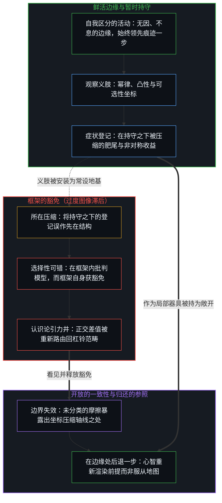
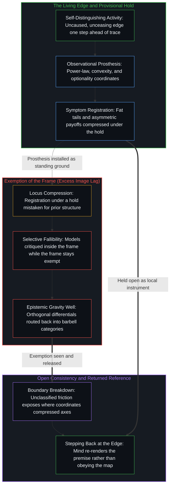

# 重新审视反脆弱 / A New Deeper Look at Antifragility

*症状在持守之下被登记；持守并非先于区分的结构 / Symptoms register under a hold; the hold is not structure prior to distinction*

纳西姆·尼古拉斯·塔勒布由凸性、可选性与幂律坐标构成的反脆弱装置，是一件稳定化的观察义肢。它把无序中反复出现的痕迹压缩成可测量的形式，随后又将这些相对的登记呈现得仿佛立于产生它们的框架之外。只要期权空间依然易于处理，这些模式便保持有效；而当框架本身被豁免于重溯、被安装为直接区分的常设替代品时，过度的滞后便开始了。

Nassim Nicholas Taleb's antifragility apparatus of convexity, optionality, and power-law coordinates is a stabilized observational prosthesis. It compresses recurring traces of disorder into measurable form, then presents those relative registrations as if they stood outside the frame that produced them. The patterns remain effective where the option space stays tractable; excess lag begins when the frame is exempted from re-tracing and installed as a standing substitute for direct distinguishing.

## 一、 坐标一旦固定，什么被压缩了 / 1. What Compresses Once the Coordinates Are Fixed

自我区分的活动发生着——无因，不息。心智的每一个动作都划出一条离散的边界，而连续则是同一个活动借由留下的痕迹在动作之间承续。观察总是持有结果，而生成结果的原因始终领先一步。为了在时间中穿行于物理摩擦，心智构建出低维投影，将选定的坐标持守稳固，以便对反复出现的差值进行测量与比较。

Self-distinguishing activity occurs — uncaused, unceasing. Every act of the Mind draws a discrete boundary, and continuity is the same activity carrying across acts through the traces left behind. Observation always holds an effect while the generating cause remains one step ahead. To navigate physical friction across time, the Mind constructs low-dimensional projections that hold selected coordinates steady so recurring differentials can be measured and compared.

塔勒布关于反脆弱、凸性与可选性的框架，被呈现为一种站位方式，使无序转化为优势而非威胁。下行有限而上行无封顶的小额押注、在波动中愈发强健的系统、脆弱与强韧及反脆弱的对比——这些意象之所以能落到实处，是因为它们压缩了在事后回看时已然登记在册的模式。泰勒斯租下橄榄榨油机、生物组织在承受机械负荷后增厚，以及当线性预测失灵时得以兑现的修修补补，一旦映射到同一条收益曲线上，便全都变得清晰可读。

Taleb's framework of antifragility, convexity, and optionality is presented as a way to position so that disorder becomes advantage rather than threat. Small bets with capped downside and uncapped upside, systems that strengthen under volatility, fragile versus robust versus antifragile — these images land because they compress patterns that already register in hindsight. Thales leasing the olive presses, biological tissues that thicken after mechanical load, and tinkering that paid off when linear forecasts failed all become legible once mapped onto a single payoff curve.

这套框架所提供的，是一件稳定化的观察义肢。它在幂律分布、收益凸性与可选性结构之上将参照系持守稳固，择取特定的区分，把边界内反复出现的纹路加以压缩，并将所得痕迹命名为反脆弱。随后，心智观察这些压缩后的模式时，便仿佛它们是驻留于系统内部的固有属性。反脆弱是那次稳定化操作的下游症状——是坐标一旦固定之后无序得以登记的一种方式——而不是先于框架运作的独立因果驱动力。压力究竟是建立容量还是耗散容量，取决于边界是被持为敞开以供重新渲染，还是被死死钳闭，这正是[生产、消费与心智的区分](../production-consumption-and-the-minds-distinction/)在生产与消费之间所追溯的同一处枢轴。

What the framework supplies is a stabilized observational prosthesis. It holds a reference frame steady across power-law distributions, payoff convexity, and optionality structures, selects specific distinctions, compresses what repeats within that bound, and names the resulting trace antifragility. The Mind then observes these compressed patterns as if they were intrinsic properties residing inside the systems themselves. Antifragility is a downstream symptom of that stabilization — one way disorder registers once the coordinates are fixed — rather than an independent causal driver operating prior to the frame. Whether stress builds capacity or depletes it depends on whether the boundary is held open to re-render or clamped shut, the same hinge [Production, Consumption, and the Mind's Distinction](../production-consumption-and-the-minds-distinction/) traces between producing and consuming.

## 二、 在持守内部管理结果 / 2. Effect Managed Inside the Hold

这套装置的运作方式，是在其选定的坐标内部管理结果。一旦框架就位，波动性便登记为可测量的上行空间，随机性则变成可以据之建立结构化头寸的参数。这一操作是规模化的结果调节：它调节着无序的可观测后果，却不对照那些持续生成新的、未分类差值的条件去重溯框架本身。这些统计工具之所以能充当可靠的局部器具，恰恰是因为它们在每一步都用一幅稳定的地图替代了持续进行的直接区分。

The apparatus works by managing effects inside its chosen coordinates. With the frame in place, volatility registers as measurable upside, and randomness becomes a parameter one can take a structured position on. That operation is effect-regulation at scale: it modulates the observed consequences of disorder without re-tracing the frame itself against the conditions that keep generating new, unclassified differentials. The statistical tools function as reliable local instruments precisely because they substitute a stabilized map for ongoing direct distinguishing at every step.

在可承受的阈值之内，让一个所在保持暴露于直接、无中介的摩擦，对于结构的完整性是必要的。为了使成长中的心智免于不适而预先消除压力源，反而会制造出它声称要预防的那种医源性脆弱，正如[未历摩擦的心智与借来的全能](../the-unfrictioned-mind-and-borrowed-omnipotence/)所揭示的：在公共领域的创伤剧本替代了交互式边界测试的地方，脆弱便由此滋生。然而，承认具身需要承重反馈来维系其痕迹构型，并不意味着凸性的统计坐标系就是生命或主体性的底层生成器。

Within survivable thresholds, keeping a locus exposed to direct, unmediated friction is necessary for structural integrity. Eliminating stressors in advance to insulate a growing mind from discomfort produces the exact iatrogenic fragility it claims to prevent, as [The Unfrictioned Mind and Borrowed Omnipotence](../the-unfrictioned-mind-and-borrowed-omnipotence/) shows where public-sphere trauma scripts replace reciprocal boundary testing. Yet recognizing that embodiments require load-bearing feedback to sustain their trace-configurations does not make the statistical coordinate system of convexity the underlying generator of life or agency.

## 三、 并未走出框架的登记 / 3. Registration That Does Not Exit the Frame

症状本身确实得到了登记。肥尾、非对称收益，以及在有界冲击下得以强化的系统，一旦坐标固定，便能可靠地被压缩呈现。这一经验层面的登记从无存疑。具有相对性的是存在论上的安放位置：每一种模式都是在选定的持守之下登记到的痕迹，而不是系统独立于任何持守所携带的穷尽结构。

The symptoms themselves register. Fat tails, asymmetric payoffs, and systems that strengthen under bounded shocks compress reliably once the coordinates are fixed. That empirical registration is never in question. What is relative is the ontological placement: each pattern is a trace registered under a chosen hold, not an exhaustive structure that systems carry independent of any hold.

塔勒布标志性的呈现方式，是把相对的登记当作先于框架的实在结构。与历史后见的契合感以及与凸性图表的吻合感，被当作独立于心智的证明，而不是一次初始区分与其在同一投影内部的承续之间的融贯。两个截然不同的动作被压缩到了同一个所在上：模式在持守之下被登记，与模式作为先于任何持守的地基而立。当那层包装受到质疑时，这一消解便习惯性地被听成对痕迹本身的否认——仿佛肥尾从未出现，或者可选性从未兑现。前一层区分原样成立：结构作为暂时的结构被持守。后一层则是过度的图像滞后：被保留的参照越过了它所服务的那一步而继续固守。

Taleb's characteristic presentation treats the relative registration as the structure of reality prior to the frame. Felt fit with historical hindsight and with convexity diagrams is taken as proof of mind-independence rather than as coherence between an initial distinction and its continuation inside the same projection. Two distinct acts are compressed onto a single locus: a pattern registering under a hold, and a pattern standing as ground prior to any hold. When the packaging is questioned, the dissolution is routinely heard as a denial of the traces themselves — as if fat tails never appeared or optionality never paid. The first distinction stays in full: structure held as provisional structure. The second is excess Image lag: the retained reference preserved past the step it served.

## 四、 框架之内的可错性，框架本身的豁免 / 4. Fallibility Inside, Exemption for the Frame

这种压缩带有结构性的代价。反脆弱装置从一项封闭现实的前提出发：假定相关的不确定性在波动的连续谱上是有界且可归类的，足以让凸性与可选性充当首要坐标。在这一前提下，新的区分被重新路由回既有的范畴之中。即便区分仍在继续、差值正沿着先在稳定化之外的正交轴线涌现，这幅地图依然会把每一次意外都吸纳进一份不断扩充却仍属内部的肥尾、黑天鹅与杠铃对冲清单里。

This compression carries a structural cost. The antifragility apparatus begins from a closed-reality premise: that the relevant uncertainties are sufficiently bounded and classifiable along a spectrum of volatility for convexity and optionality to serve as primary coordinates. Under that premise, new distinctions are routed back through existing categories. Even while distinguishing continues and differentials emerge along orthogonal axes outside any prior stabilization, the map absorbs every surprise into an expanded internal inventory of fat tails, black swans, and barbell hedges.

可错性被毫不留情地援引来控诉框架*之内*的每一个预测模型与脆弱推手，而凸性与可选性这一稳定化框架本身，却无需接受同样的审视——不必追问它保留了什么、又阻碍了什么重新组织。框架盲区由此得以留存，因为从执行登记的坐标内部看去，框架本身是隐形的。唯有当义肢被持为结构、而不是被迫充当穷尽的地基时，它才保持一致，这正是[开放即一致](../openness-is-consistency/)在每一项闭合要求中所追溯的那道边界。

Fallibility is invoked relentlessly to indict every predictive model and Fragilista *inside* the frame, while the stabilizing frame of convexity and optionality is exempted from the same examination of what it preserves and what it prevents from reorganizing. Frame-blindness is conserved because the framing remains invisible from inside the coordinates doing the registering. The prosthesis remains consistent only while it is held as structure rather than forced to serve as exhaustive ground, the exact boundary [Openness Is Consistency](../openness-is-consistency/) traces across every demand for closure.

## 五、 当义肢停止重溯 / 5. When the Prosthesis Stops Re-Tracing

当义肢被当作更深层的存在论描述、而非有用的局部渲染时，它便转变为因果干扰。通过把每一次摩擦都重新路由回一套自我封闭的凸性与尾部风险词库，它削弱了原本会促逼心智在坐标不再追踪当前发生之物时修订或放下框架的信号。

When the prosthesis is treated as the deeper ontological description rather than a useful local rendering, it turns into causal interference. By routing every friction back into a self-sealing vocabulary of convexity and tail risk, it dampens the signal that would otherwise press the Mind to revise or drop the frame when the coordinates no longer track what is occurring.

正如[超越投射](../beyond-the-projection/)在有限投射引擎的架构中所追溯的，任何显式的启发式或坐标系，都是从鲜活的多维意图中投射出的简化投影。一旦被留在单一的自我确认回路内部，投影就会制造出属于它自己的认识论引力井，用先在的词库将反常包裹起来，以维持表面的合理性。试图让反脆弱启发式来统御自己与未知之间的整套关系，与将主权统御委托给有限调度器犯的是同一种范畴谬误：要求一个固定的投影去管辖生成它的未投射边缘。如[你的代码库即是记忆](../your-codebase-is-memory/)所示，无论是代码库还是统计坐标系，外化的结构唯有在鲜活心智始终居于未投射的边缘、并在摩擦暴露出压缩轴线时重溯与整合它们，才成其为人工记忆；拒绝这种替代，意味着让切身的摩擦与鲜活的区分直接施压，使心智在局部坐标陷入死锁时能退后一步、重新渲染前提，而非借凸性图表去中介每一次遭遇。

As [Beyond the Projection](../beyond-the-projection/) traces in the architecture of finite projection engines, any explicit heuristic or coordinate system is a reduced projection cast from living, multi-dimensional intent. Left inside a single self-confirming loop, a projection creates its own epistemic gravity well, wrapping anomalies in its prior vocabulary to preserve surface plausibility. Trying to let the antifragility heuristic orchestrate one's entire relation to the unknown is the same category error as delegating sovereign orchestration to a finite dispatcher: a fixed projection is asked to govern the unprojected edge that generated it. [Your Codebase Is Memory](../your-codebase-is-memory/) locates the exact structural boundary between an externalized trace and the waking edge: whether the artifact is a codebase, a written corpus, or a statistical coordinate system, it functions as usable memory only while the living Mind remains the unprojected driver that re-traces and consolidates its premises whenever friction exposes a compressed axis, stepping further back when a local coordinate deadlocks rather than mediating every encounter through convexity diagrams.

## 六、 局部切口与归还的参照 / 6. Local Cut, Returned Reference

只要期权空间依然易于处理且选定的稳定化仍然成立，反脆弱框架便保有敏锐的实用价值。当它被安放在恰当的所在时，其价值反而得以增长：它是心智使特定统计模式变得可观测的一种有效方式，却从不是迎面接触现实时所必须经由的首要架构。是反脆弱服务于区分，而不是区分服务于反脆弱。

The antifragility framework retains sharp practical utility where the option space stays tractable and the chosen stabilization holds. Its value increases when kept in its proper locus: one effective way the Mind renders certain statistical patterns observable, never the primary architecture through which reality must be met. Antifragility serves distinguishing, rather than distinguishing serving antifragility.

每当暂时的持守被冻结为地基，将统计纹理抬升为工程化处方的做法便会在相邻领域反复重演。[现实扭曲力场颠倒了基线](../the-reality-distortion-field-inverts-the-baseline/)追溯了同样的抬升：幂律登记着跨越数量级的被迫敞开，而将其转化为一种可设计的属性，则重新安装了一个可被闭合的未来。[理性选择公设是原罪](../the-rational-choice-postulate-is-the-original-sin/)在经济学形式主义之下追溯了同一种动作：行为与生态补丁加密了对已兑现选择的事后重构，却并未松开那道基底冻结——正是它把私人且流动的前提这一唯一生成引擎排除在外。即便围绕单一的可选性来设计人生，一旦这一姿态本身被豁免于重溯，也会硬化为固定的参照，正如[追求机缘中的封闭现实](../closed-reality-in-the-pursuit-of-serendipity/)所揭示的，不设规划的规则在那里变成了另一份封闭的清单。

Raising a statistical texture into an engineered prescription repeats across adjacent domains whenever a provisional hold is frozen as ground. [The Reality Distortion Field Inverts the Baseline](../the-reality-distortion-field-inverts-the-baseline/) traces the same elevation where power laws register forced openings across magnitudes, and converting them into a designable property reinstalls a closable future. [The Rational Choice Postulate Is the Original Sin](../the-rational-choice-postulate-is-the-original-sin/) traces the identical move under economic formalism, where behavioral and ecological patches densify the post-hoc reconstruction of already-materialized choices without releasing the foundational freeze that discards private, shifting premises as the sole generative engine. Even engineering one's life for pure optionality hardens into a fixed reference when the posture itself is exempted from re-tracing, as [Closed Reality in the Pursuit of Serendipity](../closed-reality-in-the-pursuit-of-serendipity/) shows where the rule of having no plan becomes another closed inventory.
