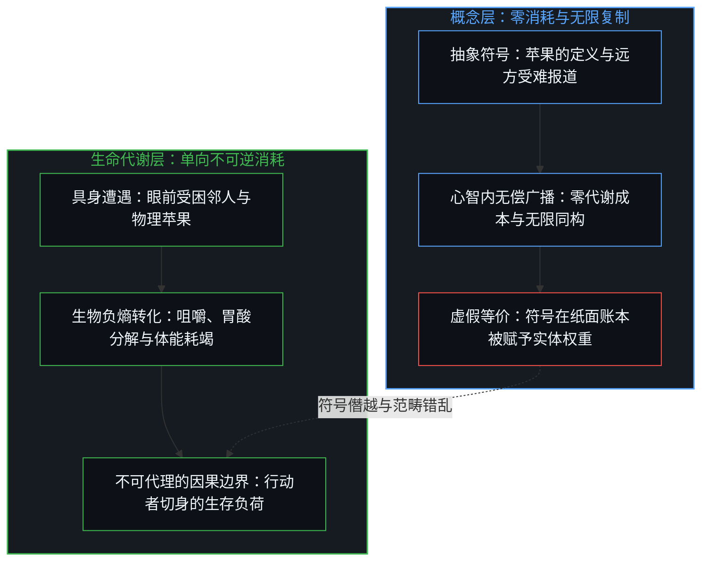
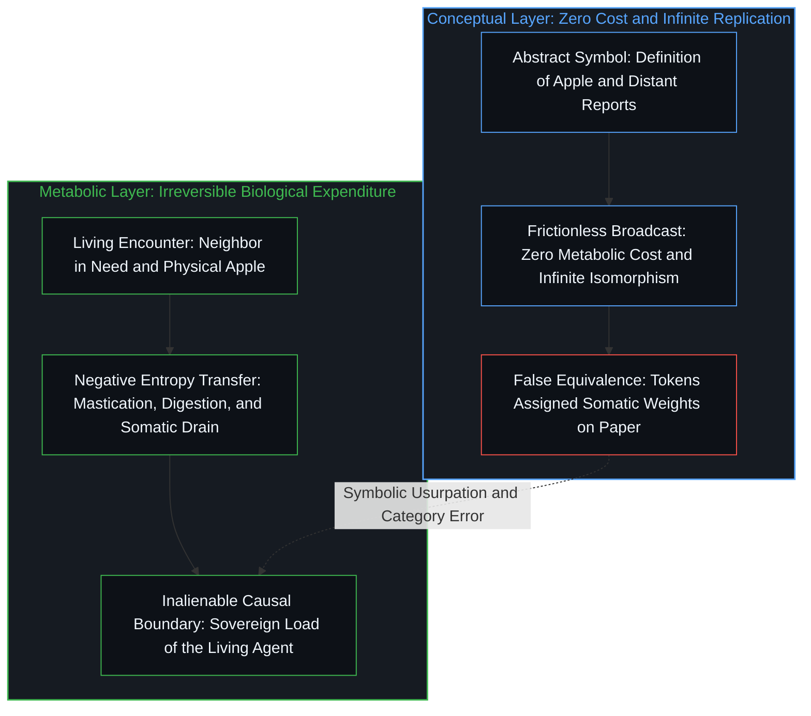
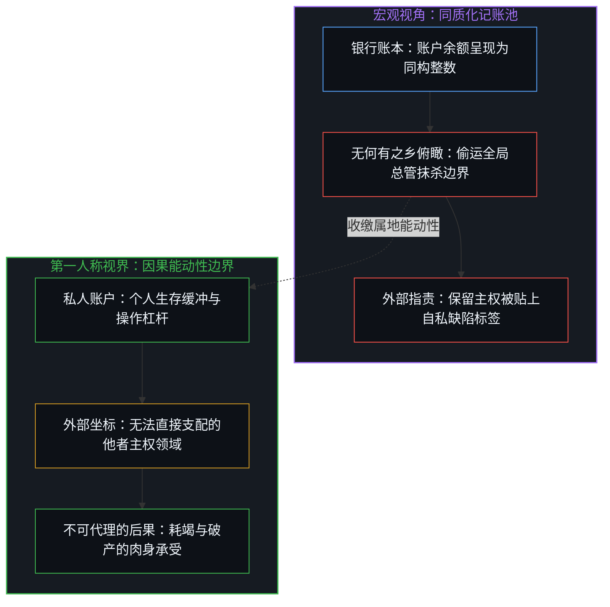
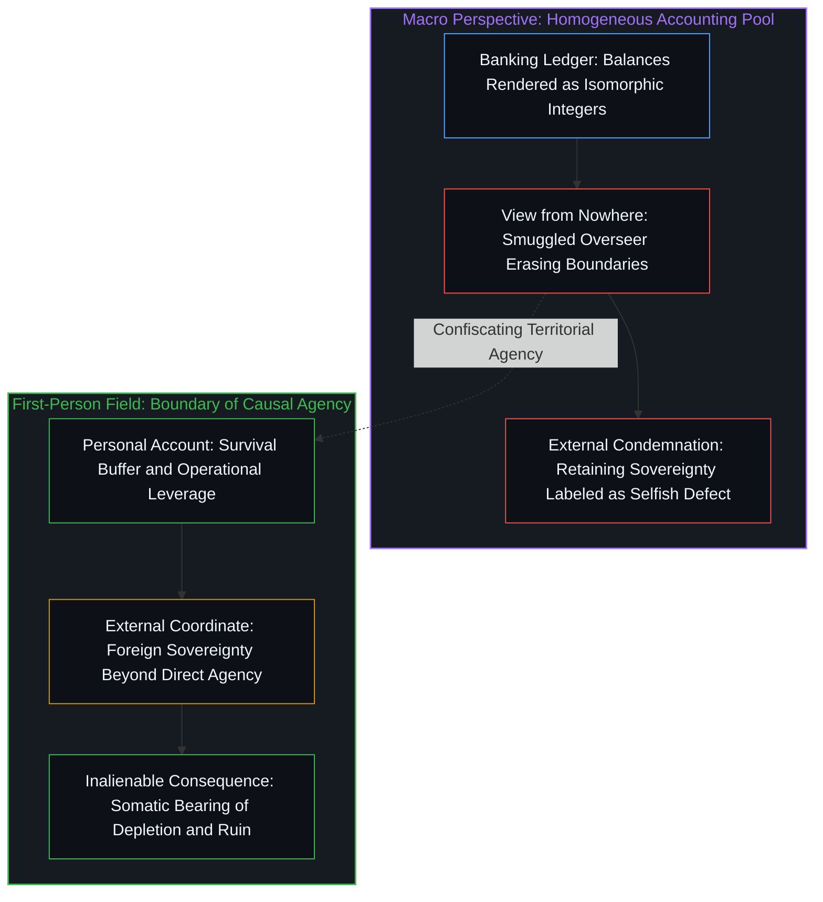
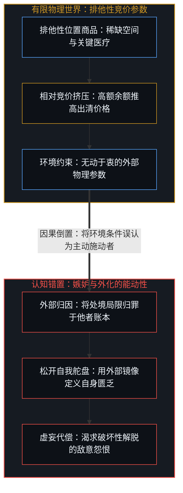
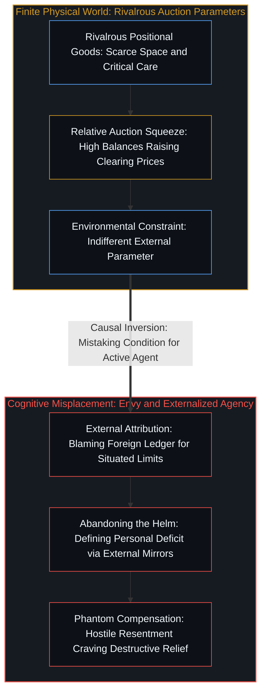
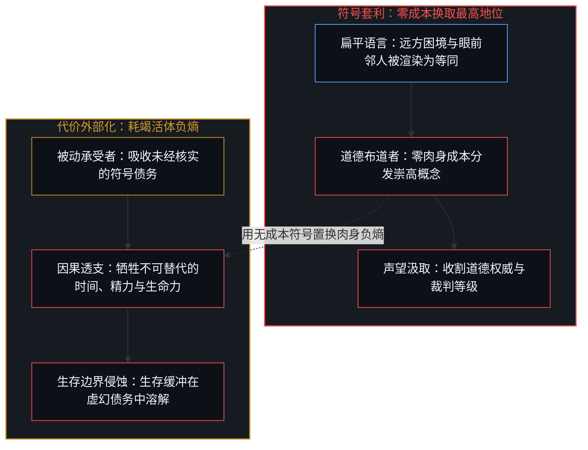
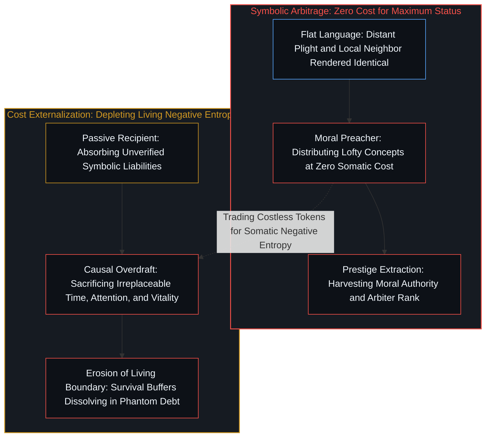

# 抽象的苦难与真实的饥饿 / Abstract Pain and Living Hunger

*概念无法充饥，将符号视同代谢实体的道德等价性抹杀了行动者具身的因果边界。 / Concepts cannot nourish flesh; equating symbols with metabolic entities erases an agent's causal boundary.*

当心智试图理解复杂世界时，抽象是认知不可避免的减熵工具；然而，当抽象符号被反向指认为实体本身时，严重的范畴错乱便悄然发生。在道德话语的掩护下，远方的苦难被压缩为扁平的语义记号，却被要求拥有与眼前肉体遭遇同等强度的因果约束力。这种错乱将概念的无偿调用与肉身的不可逆代谢消耗混为一谈，诱使行动者在符号等价的幻觉中交出自身的生存边界。正如在[未被遭遇之物的账本](../the-ledger-of-the-unencountered/)中所揭示的，未遭遇之物必须由特定的人强行搬运才能进入视界，而这种搬运常常借助概念对具身遭遇的僭越，将虚构的对称性强加于具身的生命。

When minds attempt to comprehend a complex world, abstraction serves as an indispensable tool for cognitive entropy reduction; however, when abstract symbols are inverted into entities in their own right, a grave category error takes hold. Shielded by moralized rhetoric, distant suffering is compressed into flat semantic tokens, yet demanded to exert the identical causal claim as an immediate face-to-face bodily encounter. This confusion conflates the frictionless invocation of concepts with the irreversible metabolic expenditure of flesh, coaxing agents into surrendering their survival boundaries within an illusion of symbolic equivalence. As demonstrated in [The Ledger of the Unencountered](../the-ledger-of-the-unencountered/), the unencountered must be forcibly carried into view by a specific speaker, and this carrying relies on the usurpation of embodied encounter by the concept, projecting a fictitious symmetry onto living existence.

## 一、 概念的充饥与苹果的咬痕 / 1. Consuming the Concept and the Bite of the Apple

概念中的苹果具有完备的属性定义，它可以包含球状外形、果糖香气与纤维组织，并且能在千百万个心智中以光速完成无偿复制与分发。在符号系统中，调取一万个苹果的意象与调取一个苹果所需支付的认知代价几乎没有差异，因为符号并不占有质量，也不受热力学耗散的惩罚。然而，当一个濒临饥饿的有机体急需维系自身的低熵状态时，全宇宙所有苹果的崇高概念加在一起，其提供的热量收益精确为零。生命唯有依赖一颗物理的苹果进入消化系统，经过物理咀嚼、胃酸分解与不可逆的生物化学同化，才能换取微小而珍贵的负熵延续。

The conceptual apple possesses an exhaustive set of defining attributes, containing spherical geometry, fructose sweetness, and dietary fiber, and it can be duplicated across millions of minds at the speed of light at zero metabolic cost. Within a symbolic architecture, retrieving the mental image of ten thousand apples requires virtually the same negligible cognitive expenditure as retrieving one, because symbols occupy no mass and face no penalty from thermodynamic dissipation. Yet, when a starving organism must preserve its low-entropy state, the sublime concept of every apple in the universe yields precisely zero calories. Life depends upon a physical apple entering the digestive tract, undergoing mastication, acid breakdown, and irreversible biochemical assimilation, to secure a tiny and precarious increment of negative entropy.

这种物理实体与信息符号的不可通约性，在常规道德论辩中遭到了系统性的抹杀。远方陌生人经历的痛苦，在观察者的第一人称视界里并非肉身疼痛，而是经由电讯或印刷术编码后的信息序列，它在范畴上属于苹果的概念层级。它没有让观察者的痛觉神经元产生物理去极化，也没有在现场施加任何即时的力学牵引。要求一个人像响应家门口正在流血的邻人一样去响应远方的语义符号，无异于勒令饥饿者用纸上写着的果实充饥；更荒谬的是，当受困者指出概念无法吞咽时，道德家反过来将其指责为对普遍苹果怀有伦理缺陷。正如在[寄存器的算术](../the-arithmetic-of-the-register/)与[你的代码库即是记忆](../your-codebase-is-memory/)中所呈现的，落盘的外化符号账本或文件痕迹虽能为读取它的活态心智提供定向坐标，记账层面的对称性却永远无法替代活体中心自身的状态跃迁与代谢承担。

This incommensurability between physical entities and informational tokens is systematically erased in conventional moral discourse. The agony of a distant stranger does not exist as bodily pain within the observer's first-person field; it arrives as an informational sequence encoded by telecommunications or print, belonging strictly to the category of the conceptual apple. It depolarizes zero pain receptors in the observer's nervous system and exerts zero immediate mechanical traction. Demanding that an individual respond to a remote semantic token with the same somatic urgency as to a neighbor bleeding on their doorstep is equivalent to commanding a starving human to dine on the written word for fruit; absurdly, when the famished agent points out that concepts cannot be swallowed, the moralist charges them with an ethical defect regarding universal apples. As demonstrated in [The Arithmetic of the Register](../the-arithmetic-of-the-register/) and [Your Codebase Is Memory](../your-codebase-is-memory/), an externalized symbolic ledger or file trace on disk can orient a living Mind that reads it, yet symmetry on an accounting ledger can never replace the physical state transitions and metabolic bearing of the living center itself.

## 二、 账户的同构与能动性的属地 / 2. Isomorphic Accounts and the Territoriality of Agency

在中央银行的清算架构或宏观统计账本中，各个账户中的货币单位展现出高度的数学同构性。一万个代币在甲的账户与在乙的账户中，遵循一致的算术法则与复利公式，这种代数上的均匀性容易让人产生一种持久的宏观错觉，仿佛财富与购买力只是无主以太中自由流淌的同质水流。依照功利主义的全局计算，既然边际效用遵循递减规律，那么将盈余账本里的数字转移到赤字坐标，就理应成为不容辩驳的最优效率指令。

Within a central banking settlement architecture or macroeconomic statistical ledger, currency units across different accounts exhibit total mathematical isomorphism. Ten thousand tokens in Account A obey the identical arithmetic rules and compounding formulas as ten thousand tokens in Account B, and this algebraic uniformity generates a persistent macro-illusion that wealth and purchasing power are homogeneous fluids circulating through an unowned ether. Guided by utilitarian global calculus, because marginal utility diminishes, transferring numbers from a surplus ledger to a deficit coordinate appears as an indisputable imperative of optimal efficiency.

然而，第一人称的具身存续反驳了这种算术平权。存放在个人账户中的余额，并非抽象的数学标量，而是行动者在物理世界中缓冲未知波动、保障生物安全并践行主权抉择的操作支点。他人账本中的资产即便庞大，也是处于他者意志管辖之下的外部坐标，你既无法直接行使微观调配权，也无需在他人余额蒸发时承担露宿寒夜的生理后果。要求行动者将外部账本与自身账本同等估值，实质上暗中偷运了一个来自无何有之乡的全知总管，预先将所有私人的因果能动性收缴进了同一个统一资金池。正如在[能动性被转置入形式模型](../agency-relocated-into-the-formal-model/)中所指出的，一旦行动者的因果权能被让渡给形式框架，具身的生存属地便被剥离殆尽。

Yet first-person embodied existence refutes this arithmetic egalitarianism. The balance residing in an individual account is not an abstract mathematical scalar, but an agent's operational fulcrum for buffering against physical unpredictability, securing biological safety, and enacting sovereign choices. Assets residing in another person's ledger, no matter how immense, represent external coordinates governed by a foreign will; you possess zero direct micro-allocation agency over them, nor do you bear the physical consequence of sleeping in the cold when another's balance evaporates. Demanding that an agent value an external ledger identically to their own covertly smuggles an omniscient central overseer who has already confiscated all private agency into a unified pool from nowhere. As argued in [Agency Relocated into the Formal Model](../agency-relocated-into-the-formal-model/), once the causal power of living actors is transferred to an abstract apparatus, the territorial boundaries of embodied survival are extinguished.

## 三、 排他性竞价、因果错置与嫉妒的解剖 / 3. Rivalrous Bidding, Causal Misplacement, and the Anatomy of Envy

将银行账户的推演进一步深化便可见，外部账本中的资金不仅无法与本人账户等价，在微观心理学中它的体验估值甚至常常被反转为负号。这一动态构成了大众普遍仇富的深层心理生成机制。货币不仅是代数的记账筹码，更是参与稀缺物理商品拍卖的竞价入场券。在物质与能量有限的世界里，核心居住空间、不可再生的自然地理、顶尖外科医生有限的临床工时以及位置性的决策权威，皆具有激烈的排他性。当外部资产负债表呈指数级激增时，即便个体自身的储蓄分文未少，有限资源的市场出清门槛也会随之同向抬升。在争夺排他性机会的相对竞价中，外部的盈余直接压缩了落败者可触及的选择视界。

Deepening the bank account analogy reveals that capital residing in an external ledger is not merely non-equivalent to one's own; within micro-psychology, its experienced valuation is frequently inverted into a negative sign. This dynamic constitutes the deep psychological genesis of widespread resentment toward the rich. Money functions not merely as an algebraic counter, but as an auction ticket competing for rivalrous physical goods. In a world of finite matter and energy, prime living space, irreplaceable natural geography, the finite clinical hours of master surgeons, and positional authority remain fiercely rivalrous. When an external balance sheet multiplies exponentially, even if an individual's personal savings remain unchanged, the market clearing threshold for finite resources escalates accordingly. In the relative contest for rivalrous opportunities, an external surplus directly narrows the possibility horizon available to the outbid.

然而，如果试图在结构性理由上将这种怨恨合理化，便犯下了第二重因果倒置。仇富在心智结构中属于心理反应，虽然它产生于具体竞价挤压的背景之下，但这一机制本身依然是第一人称因果错置的产物。在前后一贯的伦理与心理学词典中，“仇富”等同于“嫉妒”。公共舆论习惯于沉溺在虚伪的双重标准里，把私领域的嫉妒谴责为狭隘的品格缺陷，却将公领域的仇富奉为正义的抗争；这种一分为二的修辞戏法，无非是通过切换道德框架来洗白同一种心理运作。嫉妒的点燃，在于有意识的心智将无动于衷的外部环境参数，混淆为了蓄意施加伤害的主动施动者。

Yet attempting to legitimize this resentment on structural grounds commits a second causal inversion. Resentment of wealth operates as a psychological reaction, and although it arises against the backdrop of concrete auction displacement, the mechanism itself remains the outcome of a first-person causal misplacement. Within a consistent ethical and psychological vocabulary, "resentment of wealth" is identical to "envy". Public discourse frequently indulges in a hypocritical double standard, condemning private envy as a petty character flaw while canonizing public resentment of the wealthy as righteous resistance; such bifurcation is an intellectual sleight of hand switching moral frameworks to sanitize a single psychological dynamic. Envy ignites when a conscious mind confuses an indifferent external parameter with an active agent intentionally inflicting injury.

当行动者踏入这一认知陷阱时，他已经松开了自身第一人称能动性的舵盘。他不再依据自身肉体的代谢饥渴、局部的物理摩擦与眼前的行动支点去校准选择，而是将视线钉死在他人的仪表盘上，对照外部账本来衡量自身的价值与匮乏。他将自身局限的根源外化到他人的银行余额之上，沉溺于一种虚妄的预期，误以为只要把富人拉下马，自身的生命力就会奇迹般地扩张。在物理因果中，外部资产负债表的毁灭在个体自身的有机体内创造出的负熵精确为零。正如在[共情的能力倒错与边界的排序之争](../the-capability-reversal-of-empathy-and-the-contest-of-boundaries/)中所剖析的，任何将内部无力感外化为对外部坐标敌意的心理机制，都是对主权自负的放弃；它不仅无法改变物理约束，反而让嫉妒的心智退化为环绕他者账本运转的寄生者。

When an agent enters this cognitive trap, they have released the steering wheel of their own first-person agency. Instead of calibrating choices against their own metabolic needs, localized friction, and actionable levers, they fixate on another person's dashboard, measuring personal worth and scarcity against an external ledger. They externalize the root of their limitations onto a foreign bank balance, indulging in the phantom expectation that bringing down the wealthy will miraculously expand their own vitality. In physical causality, the destruction of an external balance sheet creates zero negative entropy within one's own organism. As dissected in [The Capability Reversal of Empathy and the Contest of Boundaries](../the-capability-reversal-of-empathy-and-the-contest-of-boundaries/), any psychological mechanism that externalizes internal impotence into hostility toward an external coordinate is an abdication of sovereign accountability; it fails to alter physical constraints, reducing the envious mind to a parasite orbiting an alien ledger.

进一步审视这种横向执念的荒谬性，便能印证[私人残差与社会剩余的因果次序](../the-causal-order-of-private-residuals-and-social-surplus/)中所确立的判断：观察者在事后通过静态的相对比较来评估资产负债表，犯下了一个把留存残差误当成全部创造财富的范畴错误。残差财富的不均等，是创新者消费远少于其产出、而大众消费远多于其个体劳动产出这一不对称性的直接后果。生产力极高的创新者之所以在资产负债表上呈现出庞大的数字，恰恰是因为其微小的私人剩余份额必须以生产性资本与股权的形式留存下来，作为协调复杂工业运转的分数账本；与此同时，分配给公众的绝大多数社会剩余，早已通过更低廉的商品、更先进的医药与无处不在的现代便利被即时消费掉了。被消费掉的切身福祉不会在个人银行账本上凝结为静态存款，这便诱使嫉妒的心智将创新者留存的资本视为被窃取的财富。这种认知倒置不仅让个体对技术扩散所馈赠的物质底线视而不见，更驱使其通过攻击上游生产性资本来寻求虚幻的报复，最终切断了下游丰裕产出的生成源头。

Examining the absurdity of this horizontal fixation further reveals what is established in [The Causal Order of Private Residuals and Social Surplus](../the-causal-order-of-private-residuals-and-social-surplus/): by appraising balance sheets through static relative comparisons ex-post, observers commit the category error of mistaking retained residuals for the totality of created wealth. The inequality of residual wealth is the direct consequence of innovators consuming far less than they produce, juxtaposed against the mass consuming far more than their individual labor produces. An exceptionally productive innovator displays a colossal balance sheet precisely because their narrow slice of private surplus must be retained as productive capital and equity, functioning as a fractional ledger to coordinate complex industrial operations; meanwhile, the vast majority of social surplus distributed to the public has already been immediately consumed through cheaper goods, advanced medicine, and ubiquitous modern conveniences. Consumed wellbeing leaves no static deposit on an individual bank ledger, prompting the envious mind to perceive the innovator's retained capital as stolen wealth. This cognitive inversion not only blinds individuals to the rising material baseline gifted by technological diffusion, but drives them to seek phantom retribution by attacking upstream productive capital, severing the generative fountainhead of downstream abundance.

## 四、 语言的扁平性与道德套利的特权 / 4. The Flatness of Language and the Privilege of Moral Arbitrage

这一认知混淆之所以在公共论辩中如此隐蔽且难以撼动，首先源于人类语言介质的均质化特征。在纸张与屏幕上，描述大洋彼岸忍饥挨饿群体的词句与点出断骨邻人的词句，占用着相近的排版空间与音节数量；符号工具天然抹平了肉身在场与缺席之间的鸿沟。由于个体心智无法直接触及那些跨越辽阔地理尺度的具身实体，一切评估被迫在抽象模型的扁平平面上展开，而语言的对等性恰恰掩盖了存在状态的悬殊差异。当这套装置披上道德神圣性的外衣时，任何指出“远方的符号并非当下的肉身遭遇”的分析澄清，都会立刻遭到谴责，被扣上冷血、麻木或道德缺陷的罪名。

The reason this cognitive conflation remains so insidious and difficult to challenge in public debate lies primarily in the homogenizing medium of human language. On paper or screens, the phrase describing starving multitudes across an ocean and the phrase naming a neighbor with a broken bone occupy similar typographic space and syllable counts; the symbolic tool inherently flattens the chasm between physical presence and total absence. Because individual minds cannot directly touch entities sprawled across vast geographies, all evaluation is forced to proceed upon the flat plane of abstract models, and linguistic parity conceals the stark disparity of existential states. When this apparatus is cloaked in moral sanctity, any analytical attempt to clarify that a distant token is not an immediate somatic encounter is swiftly condemned as callousness, apathy, or moral defect.

这种谴责蓄意混同了两个截然不同的认识论命题：承认远方的有机体在各自坐标中承受痛苦，与认识到他们的处境在自身当下的直接经验视界中仅作为信息符号而存在，二者截然不同。道德套利者正是利用这一混同，将无成本的符号转化为可观的社会资本。广播普遍共情无需支付任何生物代谢成本，却能在公共剧场中收割崇高的身份地位；与此同时，履约的实质代价被转嫁给活生生的个体，要求人们耗费有限的工时、切身的体能与不可再生的生命负熵，去偿付一张由未经核实的符号构成的无限资产负债表。正如在[不可还原的观察者](../the-irreducible-observer/)中所确立的，观察者所处的局域立足点永远无法从因果链条中被切除；具身的责任只能源于处境中的心智在局部遭遇里押上自身的资源，而非将血肉之躯献祭在零摩擦抽象概念的祭坛之上。[意识的魔术戏法与推断的非对称性](../the-sleight-of-hand-of-consciousness-and-the-asymmetry-of-inference/)追踪了那种将第三人称不可证性武器化以篡夺主体间权威的认知戏法，它为无痛觉的计算木偶加冕，同时逃避生物性的因果承担。而正如[感知的界限与理解的无限](../the-boundary-of-perception-and-the-infinity-of-understanding/)所确立的，局域化的具身并不保有一个等待被动检视的独立本体；感知的有限边界正是第一人称指向所留下的必要拓扑刻痕，正是这片未被感知的留白，才开启了心智在开放宇宙中践行生成性理解与主权责任的无穷空间。

This condemnation deliberately conflates two distinct epistemological propositions: acknowledging that distant organisms endure pain in their own coordinates is wholly different from recognizing that within one's immediate experiential field, their plight exists strictly as an informational token. Moral arbitrageurs exploit this exact conflation to convert costless symbols into substantial social capital. Broadcasting universal empathy requires zero metabolic expenditure, yet reaps immense status within public scenography; meanwhile, the material cost of compliance is offloaded onto living individuals, demanding that they expend finite hours, bodily stamina, and irreplaceable negative entropy to satisfy an infinite balance sheet of unverified tokens. As established in [The Irreducible Observer](../the-irreducible-observer/), the observer's situated standpoint can never be excised from causality; embodied obligation springs from a situated mind staking its own resources within local encounters, not from sacrificing living flesh upon an altar of frictionless abstractions. [The Sleight of Hand of Consciousness and the Asymmetry of Inference](../the-sleight-of-hand-of-consciousness-and-the-asymmetry-of-inference/) traces the cognitive sleight of hand that weaponizes third-person unprovability to usurp inter-subjective authority, crowning unfeeling computational puppets while evading biological liability. And as [The Boundary of Perception and the Infinity of Understanding](../the-boundary-of-perception-and-the-infinity-of-understanding/) establishes, localized embodiment holds no standalone ontology awaiting passive inspection; the finite boundary of perception is the necessary topological trace of first-person pointing, opening the unperceived void that enables a Mind to exercise generative understanding and sovereign responsibility across an open cosmos.

