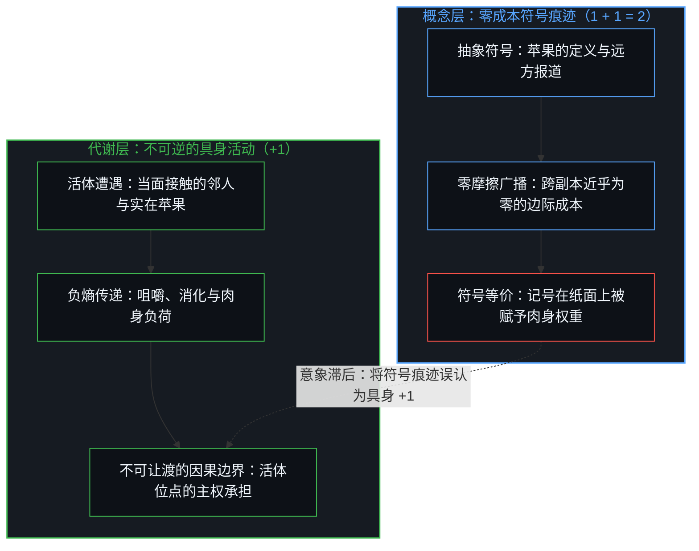
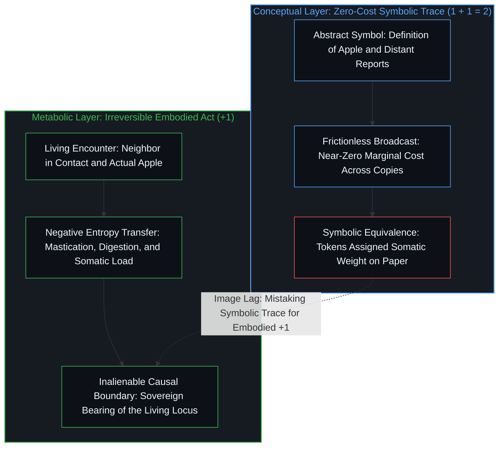
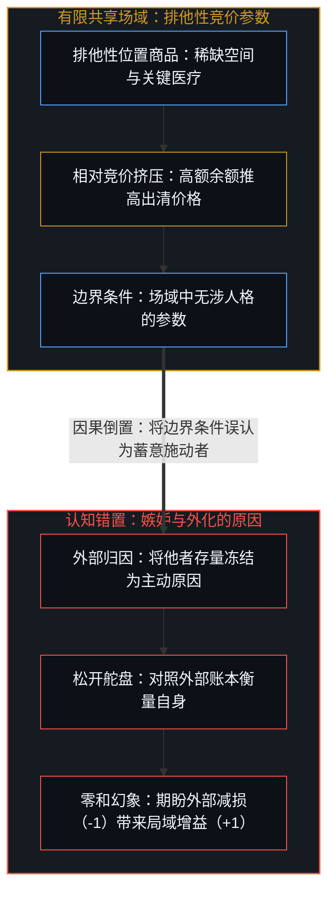
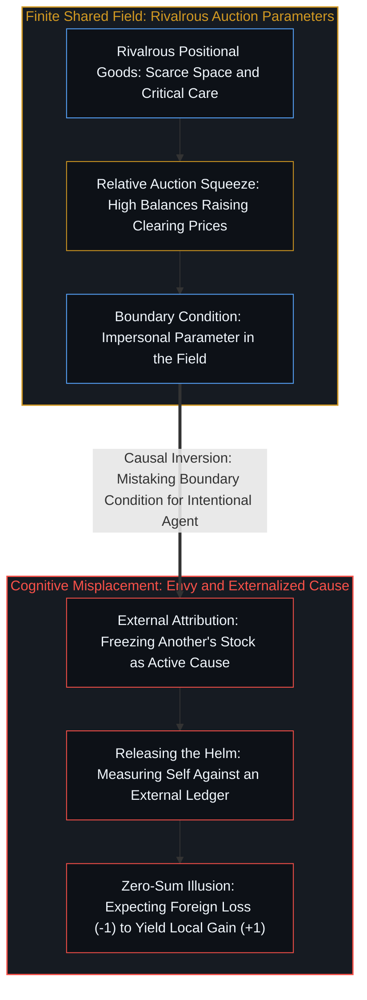
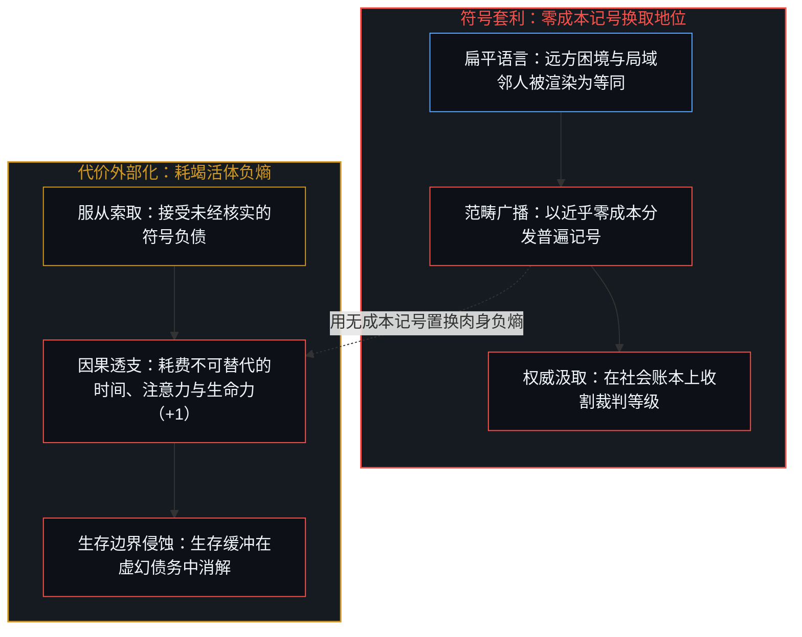
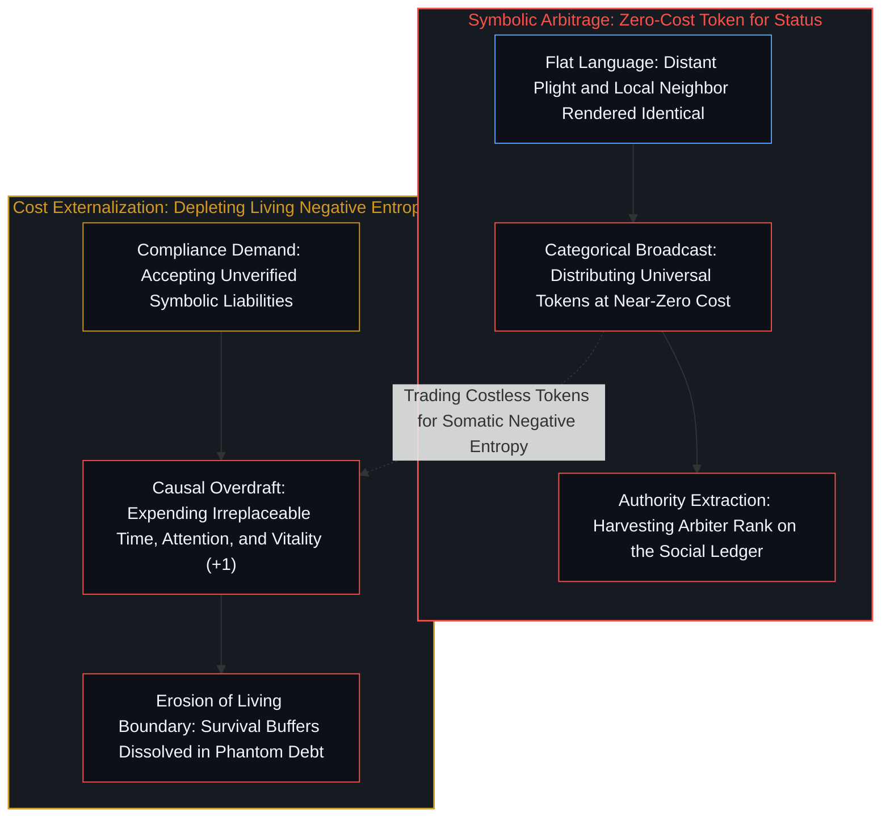

# 抽象的苦难与真实的饥饿 / Abstract Pain and Living Hunger

*概念无法充饥，将符号等同于代谢实体抹杀了行动者的因果边界。 / Concepts cannot nourish flesh; equating symbols with metabolic entities erases an agent's causal boundary.*

当心智试图理解复杂世界时，抽象是认知不可或缺的减熵工具；然而，当抽象符号被反客为主地当作独立实体时，严重的范畴错误便随之发生。在道德修辞的掩护下，远方的苦难被压缩为扁平的语义记号，却被要求具有与迎面而来的肉身遭遇等同的因果索取力。这种混淆将概念的零摩擦调用与肉身的不可逆代谢消耗混为一谈，诱使行动者在符号等价的幻觉中交出自身的生存边界。正如在[未被遭遇之物的账本](../the-ledger-of-the-unencountered/)中所揭示的，未遭遇之物必须由特定的言说者强行搬运才能进入视界，而这种搬运依赖概念对具身遭遇的僭越，将虚构的对称性投射到活生生的存在之上。

When minds attempt to comprehend a complex world, abstraction serves as an indispensable tool for cognitive entropy reduction; however, when abstract symbols are inverted into entities in their own right, a grave category error takes hold. Shielded by moralized rhetoric, distant suffering is compressed into flat semantic tokens, yet demanded to exert the identical causal claim as an immediate face-to-face bodily encounter. This confusion conflates the frictionless invocation of concepts with the irreversible metabolic expenditure of flesh, coaxing agents into surrendering their survival boundaries within an illusion of symbolic equivalence. As demonstrated in [The Ledger of the Unencountered](../the-ledger-of-the-unencountered/), the unencountered must be forcibly carried into view by a specific speaker, and this carrying relies on the usurpation of embodied encounter by the concept, projecting a fictitious symmetry onto living existence.

## 一、 概念的充饥与苹果的咬痕 / 1. Consuming the Concept and the Bite of the Apple

自我区分的活动发生着——无因，不息。称之为心智：已然在途的观察者，其每一次活动都是一次区分。具身是这一觉察的某个位点借以在后续离散活动中维系自身递归的痕迹构型，而概念或符号则是为了定向导航所持有的压缩参照痕迹。在符号架构内，概念中的苹果具备详尽的定义属性——球体几何、果糖甜味与膳食纤维——并且能够以近乎为零的边际成本在千百万个心智之间复制。调取一万个苹果的心智意象与调取一个苹果所需的消耗相差无几、微不足道，因为在纸面上，`1 + 1 = 2` 是静态、对称且零成本的同义反复。然而，当饥饿的有机体必须在活生生的切口处维系自身的递归时，全宇宙所有苹果的崇高概念所能提供的热量为零。维系具身需要 `+1` 那不可逆的耗能介入：一颗实在的苹果进入消化道，经历咀嚼、胃酸分解与生物化学同化，才能换取一分维系存续的负熵增量。

Self-distinguishing activity occurs — uncaused, unceasing. Call it the Mind: the observer already underway, every act of which is a distinction. An embodiment is the trace-configuration through which one locus of that noticing sustains its recursion across further discrete acts, whereas a concept or symbol is a compressed reference trace held to orient navigation. Within a symbolic architecture, the conceptual apple possesses an exhaustive set of defining attributes—spherical geometry, fructose sweetness, and dietary fiber—and can be duplicated across millions of minds at near-zero marginal cost. Retrieving the mental image of ten thousand apples requires virtually the same negligible expenditure as retrieving one, because on paper `1 + 1 = 2` is a static, symmetric, zero-cost tautology. Yet when a starving organism must sustain its recursion at the living edge, the sublime concept of every apple in the universe yields zero calories. Sustaining an embodiment requires the irreversible, energy-consuming intervention of `+1`: an actual apple entering the digestive tract, undergoing mastication, acid breakdown, and biochemical assimilation to secure a precarious increment of negative entropy.

零成本符号痕迹与不可逆具身 `+1` 之间的这种结构性非对称，在常规道德论辩中遭到了系统性的抹杀。远方的报道与眼前的遭遇同样登记在观察者的第一人称场域之内，但二者沿着正交的痕迹轴线抵达：远方陌生人的痛楚是经由电讯或印刷术编码后抵达的信息序列，属于与概念苹果同级的表征层级，而非直接挤压在局域具身之上。将符号推演误认为实在的兑现，正是披着道德外衣的“意象滞后”。要求一个人像响应家门口正在流血的邻人那样，以同等的肉身紧迫感去响应远方的语义记号，无异于勒令饥饿者以纸上写着的果字充饥；当饥肠辘辘的行动者指出概念无法吞咽时，道德说教者反过来指责其对普遍的苹果怀有伦理缺陷。正如在[寄存器的算术](../the-arithmetic-of-the-register/)与[你的代码库即是记忆](../your-codebase-is-memory/)中所阐明的，落盘的外化符号账本或文件痕迹虽能为读取它的活态心智提供定向坐标，记账账本上的对称性却无法替代活体中心自身的不可逆状态跃迁与代谢承担。

This structural asymmetry between a zero-cost symbolic trace and an irreversible embodied `+1` is systematically erased in conventional moral discourse. Both a distant report and an immediate encounter register inside the observer's first-person field, yet they arrive on orthogonal axes of trace: the agony of a distant stranger arrives as an informational sequence encoded by telecommunications or print, belonging to the exact representational tier of the conceptual apple rather than pressing directly upon the local embodiment. Mistaking symbolic deduction for physical actualization is Image lag in moral costume. Demanding that an individual respond to a remote semantic token with the same somatic urgency as to a neighbor bleeding on their doorstep is equivalent to commanding a starving human to dine on the written word for fruit; when the famished agent points out that concepts cannot be swallowed, the moralist charges them with an ethical defect regarding universal apples. As demonstrated in [The Arithmetic of the Register](../the-arithmetic-of-the-register/) and [Your Codebase Is Memory](../your-codebase-is-memory/), an externalized symbolic ledger or file trace on disk can orient a living Mind that reads it, yet symmetry on an accounting ledger can never replace the irreversible state transitions and metabolic bearing of the living center itself.

## 二、 账户的同构与能动性的属地 / 2. Isomorphic Accounts and the Territoriality of Agency

在中央银行的清算架构或宏观经济统计账本中，不同账户间的货币单位展现出数学上的全等同构性。甲账户中的一万个代币与乙账户中的一万个代币遵循相同的算术法则与复利公式，这种代数上的齐一性催生出一种持久的宏观错觉，仿佛财富与购买力是在无主以太中流淌的同质流体。在功利主义全局计算的引导下，既然边际效用递减，将盈余账本里的数字划转到赤字坐标，便显得像是无可辩驳的最优效率律令。

Within a central banking settlement architecture or macroeconomic statistical ledger, currency units across different accounts exhibit total mathematical isomorphism. Ten thousand tokens in Account A obey the identical arithmetic rules and compounding formulas as ten thousand tokens in Account B, and this algebraic uniformity generates a persistent macro-illusion that wealth and purchasing power are homogeneous fluids circulating through an unowned ether. Guided by utilitarian global calculus, because marginal utility diminishes, transferring numbers from a surplus ledger to a deficit coordinate appears as an indisputable imperative of optimal efficiency.

然而，由于第一人称视角与因果性是同一枚硬币的两面，活生生的存续反驳了这种算术平均主义。存放在个人账户中的余额并非抽象的数学标量，而是特定位点用来缓冲未知波动、保障生物安全并践行主权抉择的操作支点。存放在他人账本中的资产无论多么庞大，都是由另一中心的抉择所管辖的外部坐标；你既无法对其行使直接的调配能动性，也无需在他人余额蒸发时承担露宿寒夜的肉身后果。要求行动者将外部账本与自身账本同等估值，实则暗中从无何有之乡偷运了一个全知中央总管，预先将一切私人的因果能动性收缴进统一的资金池——却遗忘了正如[没有外部记账员](../no-outside-scorekeeper/)所确立的，活体中心之上并不存在汇集各方后果的外部清算所，唯有做出抉择的那个位点自身承担其轨迹的复利或崩塌。正如[能动性被转置入形式模型](../agency-relocated-into-the-formal-model/)所指出的，一旦活体行动者的因果权能被让渡给抽象装置，具身生存的属地边界便随之熄灭。

Yet because the first-person perspective and causality are two sides of the same coin, lived continuation refutes this arithmetic egalitarianism. The balance residing in an individual account is not an abstract mathematical scalar, but a locus's operational fulcrum for buffering against physical unpredictability, securing biological safety, and enacting sovereign choices. Assets residing in another person's ledger, no matter how immense, represent external coordinates governed by another center's choices; you exercise zero direct allocation agency over them, nor do you bear the somatic consequence of sleeping in the cold when another's balance evaporates. Demanding that an agent value an external ledger identically to their own covertly smuggles an omniscient central overseer who has already confiscated all private agency into a unified pool from nowhere—forgetting, as [No Outside Scorekeeper](../no-outside-scorekeeper/) establishes, that no external clearinghouse stands above living centers to pool their consequences, and only the choosing locus bears the compounding or collapse of its own trajectory. As argued in [Agency Relocated into the Formal Model](../agency-relocated-into-the-formal-model/), once the causal power of living actors is transferred to an abstract apparatus, the territorial boundaries of embodied survival are extinguished.

## 三、 排他性竞价、因果错置与嫉妒的解剖 / 3. Rivalrous Bidding, Causal Misplacement, and the Anatomy of Envy

将银行账户的痕迹推演进一步深化便可见，存放在外部账本中的资本不仅无法与自身账户等价，在微观心理学中，它的体验估值还经常被反转为负号。这一动态构成了普遍仇富心态背后的生成机制。货币不仅是代数的记账筹码，更是竞逐排他性有形商品的拍卖入场券。在物质、能量与时间有限的条件下，核心居住空间、不可替代的自然地理、顶尖外科医生有限的临床工时以及位置性的决策权威，皆具有强烈的排他性。当外部资产负债表呈指数级倍增时，即便个体自身的储蓄分文未少，这些有限资源的市场出清门槛也会随之抬升。在争夺排他性机会的相对竞逐中，外部盈余登记为一道收窄落败者可及出清视界的边界条件。

Deepening the bank account trace reveals that capital residing in an external ledger is not merely non-equivalent to one's own; within micro-psychology, its experienced valuation is frequently inverted into a negative sign. This dynamic constitutes the generative mechanism behind widespread resentment toward wealth. Money functions not merely as an algebraic counter, but as an auction ticket competing for rivalrous physical goods. Where matter, energy, and time are finite, prime living space, irreplaceable natural geography, the finite clinical hours of master surgeons, and positional authority remain fiercely rivalrous. When an external balance sheet multiplies exponentially, even if an individual's personal savings remain unchanged, the market clearing threshold for those finite resources escalates accordingly. In the relative contest for rivalrous opportunities, an external surplus registers as a boundary condition that narrows the clearing horizon available to the outbid.

然而，将这一边界条件当作怨恨的凭据，便犯下了第二重因果倒置。尽管竞价挤压在共享场域中是切实的约束，但把这种约束转化为仇富——在结构上等同于嫉妒——则源于将第一人称视角与因果性割裂，并将两条独立轴线压缩为一。公共论辩惯于将同一机制拆分为两枚道德标签，把私人领域的嫉妒谴责为个人过失，却将公共领域的仇富抬升为正义抗争；然而更换评价外衣丝毫没有触动底层的认知冻结。当一个中心把场域中无涉人格的出清价格参数误认为蓄意加害于己的主动施动者，并将另一位点的可见存量冻结为自身受限存续的原因时，嫉妒便随之点燃——这正是[拥有更多从不是原因](../having-more-is-never-the-cause/)所消解的幻象。

Yet treating this boundary condition as a warrant for resentment commits a second causal inversion. Although auction displacement is a tangible constraint in the shared field, turning that constraint into resentment of wealth—which in structural terms is identical to envy—arises from severing the first-person perspective from causality and compressing two independent axes onto one. Public discourse routinely splits the same mechanism into two moral labels, condemning private envy as a personal failing while elevating public resentment of wealth into righteous resistance; yet switching the evaluative costume leaves the underlying cognitive freeze untouched. Envy ignites when a center mistakes an impersonal clearing-price parameter in the field for an active agent intentionally inflicting injury upon it, and freezes another locus's visible stock as the cause of its own constrained continuation—the exact illusion dissolved in [Having More Is Never the Cause](../having-more-is-never-the-cause/).

当行动者踏入这一认知陷阱时，便松开了自身第一人称能动性的舵盘。他不再依据自身的代谢需求、局域摩擦与可操作的杠杆来校准抉择，而是将自我意象锁死在他人的仪表盘上，对照外部坐标来衡量个人价值与匮乏。在[生产、消费与心智的区分](../production-consumption-and-the-minds-distinction/)所剖析的封闭零和执念下，另一中心的留存存量被登记为对自身存量的扣减，从而滋生出虚妄的预期，以为拆毁外部资产负债表（彼处的 `-1`）便会自动扩张自身的生命力（此处的 `+1`）。在具身因果中，外部资产负债表的毁灭在个体自身有机体内产生的负熵为零。正如在[共情的能力倒错与边界的排序之争](../the-capability-reversal-of-empathy-and-the-contest-of-boundaries/)中所剖析的，将内部无力感外化为对外部坐标的敌意，是对主权自负的放弃；它丝毫不会触动现实约束，反倒将嫉妒心智的注意力锁入环绕不可控账本空转的轨道。

When an agent enters this cognitive trap, they release the steering wheel of their own first-person agency. Instead of calibrating choices against their own metabolic needs, localized friction, and actionable levers, they lock their self-image onto another person's dashboard, measuring personal worth and scarcity against an external coordinate. Under the closed zero-sum hold dissected in [Production, Consumption, and the Mind's Distinction](../production-consumption-and-the-minds-distinction/), another center's retained stock registers as a subtraction from one's own, breeding the phantom expectation that tearing down a foreign balance sheet (`-1` there) will automatically expand one's own vitality (`+1` here). In physical causality, the destruction of an external balance sheet generates zero negative entropy within one's own organism. As dissected in [The Capability Reversal of Empathy and the Contest of Boundaries](../the-capability-reversal-of-empathy-and-the-contest-of-boundaries/), externalizing internal impotence into hostility toward an external coordinate surrenders sovereign accountability; it leaves physical constraints untouched while locking the envious mind's attention into an idle orbit around a ledger it cannot steer.

进一步审视这种横向固着，便能印证[私人残差与社会剩余的因果次序](../the-causal-order-of-private-residuals-and-social-surplus/)所确立的判断：观察者在事后通过静态相对比较来评估资产负债表，犯下了把留存残差误当成所创全部财富的范畴错误。残差财富的不均等，是创新者消费远少于其产出、而大众消费远多于其个体劳动产出这一对照的直接后果。高产的创新者之所以呈现出庞大的资产负债表，恰恰是因为其狭小的私人剩余份额必须以生产性资本与股权的形式留存下来，作为协调复杂工业运转的分数账本；与此同时，分配给公众的绝大多数社会剩余，早已通过更低廉的商品、更先进的医药与无处不在的现代便利被即时消费掉了。被消费掉的切身福祉不会在个人银行账本上留下静态存款，这便诱使嫉妒的心智将创新者留存的资本误读为被扣减的财富。这种认知倒置不仅让个体对文明间扩散抬升的物质基线视而不见，更驱使其攻击上游生产性资本，切断下游丰裕产出的生成源头。

Examining this horizontal fixation further reveals what is established in [The Causal Order of Private Residuals and Social Surplus](../the-causal-order-of-private-residuals-and-social-surplus/): by appraising balance sheets through static relative comparisons ex-post, observers commit the category error of mistaking retained residuals for the totality of created wealth. The inequality of residual wealth is the direct consequence of innovators consuming far less than they produce, juxtaposed against the mass consuming far more than their individual labor produces. An exceptionally productive innovator displays a colossal balance sheet precisely because their narrow slice of private surplus must be retained as productive capital and equity, functioning as a fractional ledger to coordinate complex industrial operations; meanwhile, the vast majority of social surplus distributed to the public has already been immediately consumed through cheaper goods, advanced medicine, and ubiquitous modern conveniences. Consumed wellbeing leaves no static deposit on an individual bank ledger, prompting the envious mind to misread the innovator's retained capital as subtracted wealth. This cognitive inversion not only blinds individuals to the rising material baseline diffused across civilization, but drives them to attack upstream productive capital, severing the generative fountainhead of downstream abundance.

## 四、 语言的扁平性与道德套利的特权 / 4. The Flatness of Language and the Privilege of Moral Arbitrage

这一认知混同之所以在公共论辩中如此根深蒂固，源于人类语言介质的同质化特征。在纸面或屏幕上，描述大洋彼岸饥饿人群的词句与点出断骨邻人的词句，占用着相近的排版空间与音节数量；符号工具将肉身在场与缺席之间的鸿沟压平为齐一的句法。由于个体心智无法直接触及跨越辽阔地理尺度的实体，评估便在抽象模型的扁平平面上推进，而语言上的对等掩盖了符号痕迹与具身遭遇之间的悬殊差异。当这种扁平句法被封装进道德范畴时，任何指出“远方记号并非当下肉身遭遇”的分析澄清，都会被记为冷酷、麻木或道德缺陷。

The reason this cognitive conflation remains so persistent in public debate lies in the homogenizing medium of human language. On paper or screens, the phrase describing starving multitudes across an ocean and the phrase naming a neighbor with a broken bone occupy similar typographic space and syllable counts; the symbolic tool flattens the chasm between physical presence and absence into uniform syntax. Because individual minds cannot directly touch entities sprawled across vast geographies, evaluation proceeds upon the flat plane of abstract models, where linguistic parity conceals the disparity between a symbolic trace and an embodied encounter. When this flat syntax is sealed inside a moral category, any analytical clarification that a distant token is not an immediate somatic encounter is scored as callousness, apathy, or moral defect.

这种谴责将两条独立的轴线压缩为一：承认远方的有机体在各自坐标中经历活生生的摩擦，与认识到在此处观察者的直接场域内，他们的困境仅作为信息记号抵达，二者彼此正交。正如在[强求善意的残暴与范畴反馈的因果遮蔽](../compulsory-kindness-and-the-obscuration-of-categorical-feedback/)中所追踪的，用评价性的道德标签替代未经中介的因果摩擦，会在下定义的一刻安插进一个裁决权威，同时阻尼局域反馈。由于广播普遍共情所需的代谢消耗近乎为零，却能在社会账本上即刻赢得地位，符号言说与具身代价之间的落差便制造出一种结构性套利：言说者凭借零成本记号收割道德权威，而不可逆的 `+1` 支出——有限的工时、肉身体能与不可替代的负熵——则被转嫁给任何将这份未经核实的账本接受为自身生存缓冲之强制索取权的人。正如在[不可还原的观察者](../the-irreducible-observer/)中所确立的，观察者所处的局域立足点无法从因果链条中被切除；具身的责任源于处境中的心智在局域遭遇里押上自身的资源，而非将活生生的血肉献祭在零摩擦抽象概念的祭坛之上。[意识的魔术戏法与推断的非对称性](../the-sleight-of-hand-of-consciousness-and-the-asymmetry-of-inference/)追踪了平行的认知戏法：将第三人称不可证性武器化以篡夺主体间权威，为无知觉的计算木偶加冕，同时逃避生物性的责任承担。而正如[感知的界限与理解的无限](../the-boundary-of-perception-and-the-infinity-of-understanding/)所确立的，局域化的具身并不保有一个等待被动检视的独立本体；感知的有限边界正是第一人称指向所留下的必要拓扑痕迹，开启了那片未被感知的留白，使心智得以在开放宇宙中践行生成性理解与主权责任。

That condemnation compresses two independent axes onto one: recognizing that distant organisms undergo lived friction at their own coordinates is orthogonal to recognizing that, within this observer's immediate field, their plight arrives strictly as an informational token. As traced in [Compulsory Kindness and the Obscuration of Categorical Feedback](../compulsory-kindness-and-the-obscuration-of-categorical-feedback/), substituting evaluative moral labels for unmediated causal friction installs an arbitrating authority at the moment of definition while damping local feedback. Because broadcasting universal empathy requires near-zero metabolic expenditure yet scores immediate status on the social ledger, the gap between symbolic utterance and embodied cost creates a structural arbitrage: the speaker harvests moral authority through zero-cost tokens, while the irreversible `+1` expenditure—finite hours, bodily stamina, and irreplaceable negative entropy—is offloaded onto whoever accepts the unverified ledger as a binding claim on their own survival buffer. As established in [The Irreducible Observer](../the-irreducible-observer/), the observer's situated standpoint can never be excised from causality; embodied obligation springs from a situated mind staking its own resources within local encounters, not from sacrificing living flesh upon an altar of frictionless abstractions. [The Sleight of Hand of Consciousness and the Asymmetry of Inference](../the-sleight-of-hand-of-consciousness-and-the-asymmetry-of-inference/) traces the parallel sleight of hand that weaponizes third-person unprovability to usurp inter-subjective authority, crowning unfeeling computational puppets while evading biological liability. And as [The Boundary of Perception and the Infinity of Understanding](../the-boundary-of-perception-and-the-infinity-of-understanding/) establishes, localized embodiment holds no standalone ontology awaiting passive inspection; the finite boundary of perception is the necessary topological trace of first-person pointing, opening the unperceived void that enables a Mind to exercise generative understanding and sovereign responsibility across an open cosmos.

