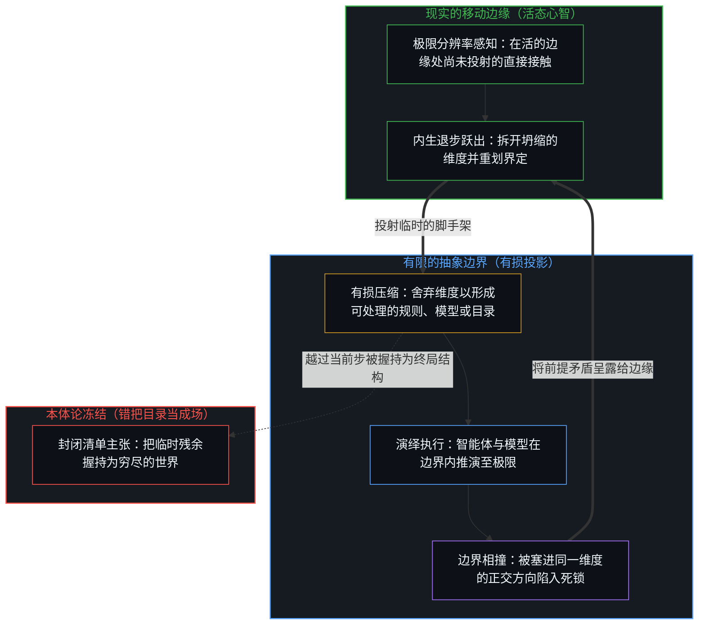
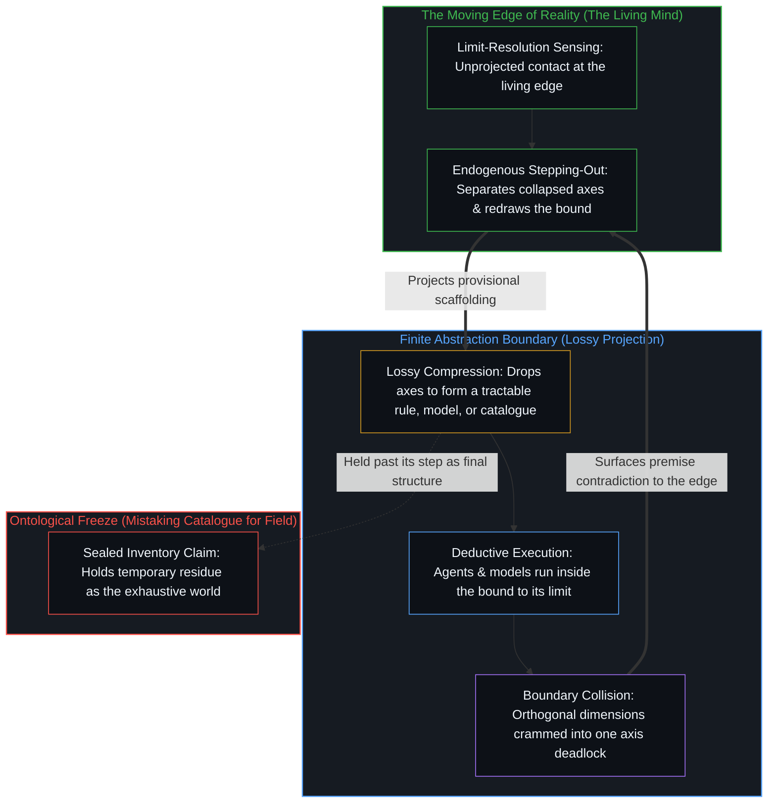

# 抽象、边界与现实的移动边缘 / Abstraction Boundaries and the Moving Edge of Reality

*每一次抽象都是有损的界定，被当作终局握住时便将残余冻结 / Every abstraction is a lossy bound that freezes residue when held as final*

成功的感知与预测，是高度抽象的信息系统，即为有用而非为完整而优化的有损压缩。它们追踪进行中的活动的某些面向，可靠得惊人，却始终有限。冻结发生在把这种成功当作对一个固定世界的理解的时候，无论是两亿条已知蛋白质序列、一份完成了的物理构型清单，还是一套解完了的可解问题。这份清单作为一次临时界定下的残余是真的；把界定放大或解开，清单就化回任何有限登记都穷尽不了的生成空间。边缘一直在移动，每一条边界都是脚手架，而不是一个封闭世界的完成轮廓。

Successful perception and prediction are highly abstracted information systems, lossy compressions optimized for usefulness rather than completeness. They track aspects of ongoing activity with remarkable reliability and remain finite. The freeze comes when that success is taken as comprehension of a fixed world, whether as two hundred million known protein sequences, a finished catalogue of physical configurations, or a completed set of solvable problems. The inventory is real as residue under a temporary bound; enlarge or dissolve the bound and the catalogue dissolves back into a generative space no finite registration exhausts. The edge keeps moving, and every bound is scaffolding, not the completed outline of a closed world.

## 一、 抽象靠舍弃维度而成功 / 1. Abstraction Succeeds by Dropping Axes

自我区分的活动在发生，无因，不息。称它为心智：那个已经在进行中的观察者，它的每一个动作都是一次区分。每一个动作都划出一条界限，下一个动作再划一次；先前动作的残余塑造了后来动作可用的场。观察握住的是结果，产生它的原因总在前面一步。[一步一步绘制出的路径](../the-path-drawn-one-step-at-a-time/)把这种不对称写成了序列。

Self-distinguishing activity occurs, uncaused, unceasing. Call it the Mind: the observer already underway, every act of which is a distinction. Every act draws a bound, and the next act draws again; the residue of earlier acts shapes the field available to later ones. Observation holds the effect, while the cause that produced it stays one step ahead. [The Path Drawn One Step at a Time](../the-path-drawn-one-step-at-a-time/) is that asymmetry as sequence.

感官系统与科学模型都在压缩。它们舍弃维度，留下在有限容量下仍然有用的东西。预测之所以奏效，是因为压缩追踪到了在进一步接触中一再回来的规律，而不是因为场的一份无损档案已被找回。[开放场域中的无损知识不自洽](../lossless-knowledge-of-an-open-field-is-incoherent/)在压缩的层面说出了这条界限：要求一份有限的登记无损地收住进行中的区分，与一个有中心的活动这一前提本身相矛盾，这不是一种难以达到的完备，而是不自洽。测量与建模的成功，证明的是足以开展工作的对应；穷尽性并不随这份成功而来。

Sensory systems and scientific models compress. They drop axes and retain what stays useful under finite capacity. Prediction works because the compression tracks regularities that keep returning under further contact, not because a lossless archive of the field has been recovered. [Lossless Knowledge of an Open Field Is Incoherent](../lossless-knowledge-of-an-open-field-is-incoherent/) states that bound at the level of compression: asking a finite registration to capture ongoing distinguishing losslessly contradicts the very premise of a centered activity, which makes it not a completeness hard to reach but an incoherence. The success of measurement and model-building shows a correspondence sufficient for work; exhaustiveness does not come with that success.

把“物理的”与“信息的”当作两个需要桥接的领域，这种二元已经是滞后。登记为物理的，是在一种握持下的活动；登记为信息的，是同一活动在各个中心为追踪它而竖起的压缩之下的样子。凡是有可被追踪的结构的东西，都可以作为信息被追踪，否则知识这种登记本身就无从与它相合。与此同时，每一份概括在类别上都比生成概括的场更贫乏。每一张地图、每一个方程、每一组数据都是有限的压缩，自由度、关联与因果的深度都越过每一次完成的握持继续延伸。地图永远到不了的那个整体，并不是立在地图之外的第二种实体，而是那不息的活动本身，每一张地图都是它的临时残余。[选择、矛盾与开放的现实](../selection-contradiction-and-open-reality/)在“引力出自信息”的场景里追溯了这一点：把引力解释为出自信息，是一次与递归立场相合的选择，却不因此免于被重新解释。

The dualism that treats "physical" and "informational" as two realms needing a bridge is already a lag. What registers as physical is the activity under one hold; what registers as informational is the same activity under the compressions centers erect to track it. Whatever admits structure that can be tracked is trackable as information; otherwise knowledge, itself a registration, could never cohere with it at all. At the same time every summary stays categorically poorer than the field that generates summaries. Every map, equation, and dataset is a finite compression, and degrees of freedom, correlation, and causal depth continue past every finished hold. The whole that no map reaches is not a second substance standing outside the maps; it is the unceasing activity of which every map is temporary residue. [Selection, Contradiction, and Open Reality](../selection-contradiction-and-open-reality/) traces this in the case of gravity derived from information: explaining gravity from information is one selection that coheres with the recursive stance, and is not thereby exempt from reinterpretation.

## 二、 理解是边缘向自身残余的折回 / 2. Sense-Making Is the Edge Folding on Its Own Residue

知识并不漂浮在它所描述的世界之外。它是活动在递归地为自身残余的构型建模：一些模式被安排得能够追踪另一些模式。理解是内生的，是移动的边缘折回到它已经留下可用的东西上。[智能只属于心智](../intelligence-belongs-only-to-the-mind/)守住了这个先在；当一个已经站稳的抽象被冻结为独立于那条仍在划下每一道后续痕迹的边缘的结构时，[因果贯穿始终](../causality-all-the-way/)把它放回原处。

Knowledge does not float free of the world it describes. It is the activity recursively modeling configurations of its own residue, some patterns arranged so that they track others. Sense-making is endogenous: the moving edge folding back on what it has already left available. [Intelligence Belongs Only to the Mind](../intelligence-belongs-only-to-the-mind/) holds that prior, and [Causality All the Way](../causality-all-the-way/) restores it when a secured abstraction is frozen as structure standing apart from the edge still drawing every following mark.

信息能够解释物理的某些面向，是经由这种自指的折回：活动经由那些复杂到足以承载递归的中心，生成关于自身的表征。理解不是对一个已完成对象的外部评注，而是它所追踪的场之内又一次离散的活动。这个场有足够的信息性，能被部分地知道，又总比从中产生的知识更丰富。[开放即一致](../openness-is-consistency/)指认的是那个要求：强迫一份有限的登记为只会继续的东西奠基，表面上的矛盾就会成倍出现，这些矛盾正是那个要求自己登记下来的样子。[信息是什么](../what-information-is/)更进一步：信息是心智登记下的那次区分，而不是等候在世界里的某种基质。

The informational explains aspects of the physical through this self-referential folding: the activity generating representations of itself through centers complex enough to sustain the recursion. Sense-making is not an external commentary on a finished object; it is further discrete activity inside the field it tracks. The field is informational enough to be partially known and always richer than the knowledge that arises from it. [Openness Is Consistency](../openness-is-consistency/) names the demand: force a finite registration to ground what only continues, and surface contradictions multiply, which is that demand registering itself. [What Information Is](../what-information-is/) carries this further: information is the distinction the Mind registers, not a substrate waiting in the world.

同样的冻结，出现在任何一条成功的技艺界限被当作领域不可商量的结构的地方。一种陈述式的标题格式、一份内部的检查清单，或一种偏好的严谨语域，都是能成全工作的抽象；可一旦被当作可写、可知之物的穷尽根据，它就把一个实际工作中的界限变成了一个本体论的主张。[超越投射](../beyond-the-projection/)在智能体架构中追溯的正是这一几何结构：每一条显式的规则、提示词或上下文窗口，都是活态心智在边缘处投出的有限投影。运行在那条抽象边界之内的演绎智能体，会把这一投影推向其逻辑极限，直到被压缩进同一条规则里的两个独立维度迎头相撞，陷入不可化约的死锁。由于智能体受困于自身的词元轨迹，手里握住的只是被投射出来的残余，它无法走出自身的边界去消解前提矛盾；唯有处于极限分辨率感知中的活态心智，才能退回尚未投射的意图之中，拆开坍缩在一起的维度，重新划定边界。[你的代码库即是记忆](../your-codebase-is-memory/)把这一切口延伸到模型检查点与工程代码库中层叠的残余上：无论是神经网络权重还是代码库中的抽象边界，唯有把依然承重的部分折入当下的检查点，并将已被取代的中间状态——死掉的备份、过时的归档与已完结的工作分支——裁除而非囤积，才能作为有选择的记忆压缩而奏效。仅仅因为“万一用得上”而囤积已被取代的痕迹，是错把未经修剪的仓库当成了完备，这会加深引力井，让昨日的脚手架与活的边缘争夺权重，把后续的推演轨迹拉回陈旧的框架。工具依然可用，穷尽性并不随它而来。

The same freeze appears wherever a successful craft bound is held as the non-negotiable structure of its domain. A declarative title form, a house checklist, or a preferred register of rigor is an abstraction that enables work, yet held as the exhaustive ground of what may be written or known, it turns a practical working limit into an ontological claim. [Beyond the Projection](../beyond-the-projection/) traces this exact geometry in agentic architectures: every explicit rule, prompt, or context window is a finite projection cast by the living Mind at the edge. A deductive agent running inside that abstraction boundary pushes the projection to its logical limit until two independent axes that were compressed into one rule collide in an irreducible deadlock. Because the agent is bound to its token trajectory and holds only projected residue, it cannot step outside its own boundary to resolve the premise contradiction; only the living Mind at limit-resolution sensing can step backward into unprojected intent, separate the collapsed dimensions, and redraw the boundary. [Your Codebase Is Memory](../your-codebase-is-memory/) extends this cut across the stacked residues of model checkpoints and engineering repositories: abstraction boundaries in both neural weights and codebases succeed as selective memory compression only when what still carries load is folded into the present checkpoint and superseded intermediate states—dead backups, obsolete archives, and finished working branches—are pruned rather than hoarded. Hoarding superseded traces out of mere possibility mistakes an unpruned warehouse for completeness, thickening the gravity well so that yesterday's scaffolding competes with the live edge and pulls subsequent trajectories back into stale framings. The instrument stays usable; exhaustiveness does not come with it.

## 三、 边界先成全，被当作场时便冻结 / 3. Boundaries Enable, Then Freeze When Held as Field

看上去封闭的清单，是当前抽象边界的产物。在这条边界之内，集合显得有限、可穷尽。两亿条蛋白质序列看起来就是“全部”；一份完成了的物理构型清单看起来就是领域的结构；一套解完了的问题看起来就是这项事业剩下的全部。

What appears as a closed inventory is an artifact of the current abstraction boundary. Within that boundary the set looks finite and exhaustible. Two hundred million protein sequences look like "all of them"; a finished list of physical configurations looks like the structure of the domain; a completed set of solvable problems looks like all that remains of the enterprise.

一场蛋白质结构竞赛赢下之后，折叠所有已知序列、公开整个数据库的提议，显得是顺理成章的下一步：一共只有两亿条，何不全都跑一遍。这一步是握持之内真实的扩展。冻结在于把这份临时清单当作领域的完整结构，仿佛完成一份由当前界限变得可数的清单，就能穷尽一个生成的场。[基准刷榜中的封闭实存](../closed-reality-in-benchmark-maxing/)是同样的滞后，场景换成一套封闭的测试被当作能力的全部。[为何数学永远解不完](../why-mathematics-can-never-be-solved/)追溯的是，残余在一份当下的问题清单上被压到零，而进一步区分的场仍在继续。

After a protein-structure competition was won, the proposal to fold every known sequence and release the database landed as the natural next step: there are only two hundred million, so why not run them all. That step is real expansion inside a hold. The freeze is in treating the temporary catalogue as the full structure of the domain, as if finishing an inventory that the present bound made countable could exhaust a generative field. [Closed Reality in Benchmark Maxing](../closed-reality-in-benchmark-maxing/) is the same lag in the case where a sealed suite is held as the whole of capability. [Why Mathematics Can Never Be Solved](../why-mathematics-can-never-be-solved/) traces the residual driven to zero on a present problem list while the field of further distinction continues.

把边界放大或解开，清单便化开了。动态的折叠、相互作用、从头设计、演化与合成的空间，以及当前清单从未打过分的维度，重新显现为开放的生成连续体。把临时清单当作领域的完整结构，是把一次局部的压缩当成了活动本身，把一个实际工作中的界限变成了一个本体论的主张。[没有系统能被保持封闭](../no-system-can-be-kept-closed/)追溯的，是一切把有限握持当作最终的地方都留下的那个剩余：结构依然可用，穷尽性并不随它而来。[现实扭曲力场指认的是封闭的地图](../the-reality-distortion-field-names-the-closed-map/)追溯的是，柔软的界限被压在坚硬的接触上，于是进一步的区分被登记为一个封闭世界的扭曲。

Enlarge or dissolve the boundary and the inventory dissolves. Dynamic folding, interactions, de novo design, evolutionary and synthetic space, and axes the present catalogue never scored reappear as an open generative continuum. Treating the temporary catalogue as the full structure of the domain mistakes a local compression for the activity itself and turns a practical working limit into an ontological claim. [No System Can Be Kept Closed](../no-system-can-be-kept-closed/) traces the remainder left wherever a finite hold is treated as final: structure stays usable, and exhaustiveness does not come with it. [The Reality Distortion Field Names the Closed Map](../the-reality-distortion-field-names-the-closed-map/) traces soft bounds pressed onto hard contact, so that further distinguishing registers as the warping of a sealed world.

有抱负的项目，正是从解开一条既有边界、划出一条更大的边界开始的。新的框架让此前无法想象的工作变得可做：残余变密，协作成为可能，看不见的东西变得可数。可同一个框架一旦被当作固定的，就成了约束。起初的解放硬化为一个完备的假设，后来的努力只得把它放松或丢掉，否则进展便停在那条曾经成全了跃进的边界之内。

Ambitious projects begin by dissolving an existing boundary and drawing a larger one. The new frame makes previously unthinkable work tractable: residue densifies, coordination becomes possible, what was invisible becomes countable. Yet the same frame becomes a constraint the moment it is held as fixed. What began as a liberation hardens into an assumption of completeness, and later efforts must relax or discard it, or progress stalls inside the bound that once enabled the leap.

最经得起时间的进展，让自己的边界保持临时：大到足以成全跃进，又有弹性，在进一步的接触需要时可以放大。[遗忘的脚手架](../the-scaffolding-we-forget/)是这件事的另一面：一个框架因为奏效，便在一步之内从递归中隐去，让下一次区分得以落下；这种隐去保留到这一步之外，脚手架就被冻结成了世界本身，搭建它的那个活动反而从视野里退了出去。[持续生长的脚手架](../the-scaffolding-that-keeps-growing/)是每一次活着的握持的寻常运动：外层的界限变成内部的支柱，依然是结构，而新的支撑又在边缘处累积起来。[封闭的假设把复利挤成 S 曲线](../closed-assumptions-squeeze-compounding-into-s-curves/)把逻辑斯蒂的 S 形读作一个固定框架的约束，而不是开放延续之下进展的轨迹；天花板是把复利压弯成这个形状的那个前提。

The most durable advances keep their own boundaries provisional: large enough to enable the leap, elastic enough to be enlarged when further contact calls for it. [The Scaffolding We Forget](../the-scaffolding-we-forget/) is the other face: a frame drops out of recursion within one step because it works, letting the next distinction land; kept past that step, the drop-out freezes the scaffolding as the world itself, and the activity that built it recedes from view. [The Scaffolding That Keeps Growing](../the-scaffolding-that-keeps-growing/) is the ordinary motion of every living hold: outer bounds become interior struts that remain structure, while new braces gather at the edge. [Closed Assumptions Squeeze Compounding into S-Curves](../closed-assumptions-squeeze-compounding-into-s-curves/) reads the logistic S-shape as the binding of a fixed frame, not as the trajectory of progress under open continuation; the ceiling is the premise that bends compounding into that shape.

## 四、 移动的边缘改写赛道 / 4. The Moving Edge Redefines the Course

同样的模式也支配着智识与技术的前沿。走在前面的人更快、更早，或装备更好。别人主要看见的，是他们留下的痕迹：公开的数据库、发表的方法、公共的基准。等到这些痕迹被追上，边缘已经移到更远处，而且常常在复利的优势下加速。这像是一场赛跑，领先者一边跑，一边在延长跑道。

The same pattern runs through intellectual and technological frontiers. Those ahead are faster, earlier, or better equipped. What others mainly see are the traces left behind: released databases, published methods, public benchmarks. By the time those traces are reached, the edge has moved farther out, often accelerating under compounding advantages. It resembles a race in which the leaders are also extending the track.

因此，单单追赶先前的位置，便容易永远落在后面。这不是因为在一条固定路径上有芝诺式的无穷多离散步骤，而是因为追赶的对象正被那些已经在原先边界之外运作的人重新定义。[卓异、感知与自我设限的问题场域](../exceptionality-perception-and-the-self-limiting-field-of-problems/)在问题经济的场景里追溯了这条自我更新的边缘：解开一个前沿问题，照例会揭出下一个。[一个提示词之遥](../whatever-is-one-prompt-away/)追溯的是，先前的层级依然可用，却在一个扩张的场中占比越来越小。[AGI 与 ASI 是加速通用智能的暂时球门](../agi-and-asi-are-temporary-goalposts/)追溯的是，每一道门槛都是被投射到划出它的那条边缘前方的一个坐标，又被划出它的那个递归所超过。

Mere pursuit of previous positions therefore tends to stay behind. This is not because of a Zeno-style infinity of discrete steps on a fixed path, but because the object of pursuit is being redefined by those already operating beyond the prior boundary. [Exceptionality, Perception, and the Self-Limiting Field of Problems](../exceptionality-perception-and-the-self-limiting-field-of-problems/) traces that self-renewing edge in the economy of problems: solving one frontier problem characteristically discloses the next. [Whatever Is One Prompt Away](../whatever-is-one-prompt-away/) traces prior levels that stay available as a shrinking share of an expanding field. [AGI and ASI Are Temporary Goalposts](../agi-and-asi-are-temporary-goalposts/) traces each threshold as a coordinate projected ahead of the edge that draws it and overtaken by the recursion that drew it.

芝诺关于阿基里斯与乌龟的悖论，抓住了对无尽追赶的一种直觉。它的数学解法在连续运动与固定赛道的假设下，把一个无穷级数当作能在有限时间内走完。这个解法在它抽象出的框架内很有力量，却不会自动移用到一个赛道本身被领先者不断延长的生成过程上。

Zeno's paradox of Achilles and the tortoise captured an intuition about endless pursuit. Its mathematical resolution treats an infinite series as completable in finite time, under the assumptions of continuous motion and a static course. That resolution is powerful inside its abstracted frame. It does not by itself transfer to a generative process in which the leaders keep lengthening the course.

拿这个数学解法去直接驳斥前沿的动态，就抹掉了成功的抽象与它部分追踪的更丰富现象之间的区别。固定赛道的模型是一次有用的压缩；生成的前沿并不是这个模型在承受负荷，而是活动在重画那条被模型固定住的界限。[生产、消费与心智的区分](../production-consumption-and-the-minds-distinction/)在最小的形式层面做了同一次拒绝：在一个封闭的一位寄存器里，1 + 1 溢出为 0，新的区分被边界抹去；登记保持开放时，1 + 1 得 2。级数在固定赛道上走完，一位的和却溢出，二者不是同一个形式；相同的是那次拒绝，即不把一份封闭的登记移用为开放延续的结构。照搬过来，就是以计算的面目出现的冻结。

Invoking the mathematical solution as a direct refutation of the frontier dynamic collapses the distinction between a successful abstraction and the richer phenomenon it partially tracks. The static-course model is a useful compression; the generative frontier is not that model under load, but activity redrawing the bound the model held fixed. [Production, Consumption, and the Mind's Distinction](../production-consumption-and-the-minds-distinction/) makes the same refusal at the smallest formal face: in a closed one-bit register, 1 + 1 overflows to 0 and the new distinction is erased by the boundary, while with the register open 1 + 1 is 2. The series completes on a fixed course and the one-bit sum overflows, so the two are not one formal face; what they share is the refusal to carry a closed registration over as the structure of open continuation. Carried over, it is the freeze in the form of calculation.

## 五、 地图只在重绘时保有力量 / 5. Maps Stay Powerful Only While They Re-render

数学与物理让这个难处更深一层。它们非凡的稳定性、预测力和在不同主体间的可靠，让人很自然地把它们体验为现实的客观陈设，而不是受到高度约束、为特定目的而造的地图。这一转换一旦发生，提醒它们仍是临时的，就会被登记为对严谨的攻击。可正是把这些工具放在它们该在的位置上，非常有用、可以修正、从不等同于它们追踪的整体，才同时保住了它们的力量和它们所描述之物的开放性。

Mathematics and physics deepen the difficulty. Their extraordinary stability, predictive power, and intersubjective reliability make it natural to experience them as the objective furniture of reality rather than as highly constrained, purpose-built maps. Once that shift occurs, reminders that they remain provisional register as attacks on rigor. Yet it is keeping the tools in their role, highly useful, revisable, never identical with the whole they track, that preserves both their power and the open character of what they describe.

发现留下来，穷尽性并不随它们而来。[开放即一致](../openness-is-consistency/)说的是，把结构当作结构握住，让活动不带那个要求地继续下去，这本身就是一致。[心智最坚固的信念](../the-strongest-belief-of-the-mind/)追溯的是，一次次重绘中凝得最紧的部分，是握住它的那道目光的基石，也是下一个动作的工具；冻结是另一个主张，即声称借此离开了那道目光。[流动之物无法被基准衡量](../you-cant-benchmark-the-fluid/)追溯的是另一处矛盾：流体智能在没有固定框架的地方运作，而一项测试只能测出框架之内的表现，却把它命名为那份没有框架的能力。

Findings remain; exhaustiveness does not come with them. [Openness Is Consistency](../openness-is-consistency/) holds that structure held as structure, with the activity continuing free of that demand, is itself consistency. [The Strongest Belief of the Mind](../the-strongest-belief-of-the-mind/) traces the redraws that cohere hardest as bedrock for the look that holds them and the instrument of its next act; the freeze is a further claim, to have exited the look. [You Can't Benchmark the Fluid](../you-cant-benchmark-the-fluid/) traces a different contradiction: fluid intelligence operates where no fixed frame applies, while a test can only measure performance inside a frame and names that performance as the frameless capacity.

扩展地图的项目依然有价值；宣称已是最终的清单，则把一条临时的界限冻结为领域的结构。每一个成功的抽象，同时也显出还有多少没被画进地图，而场在当下握持之下完成的任何清单之外，继续生成融贯的结构。边缘一直在移动，每一条边界都仍是临时的脚手架，而不是一个封闭世界的完成轮廓。[清晰不是抵达的终点，而是运动本身](../clarity-isnt-a-state-you-arrive-at/)把这种不抵达当作实践：每一次表述都把边缘结晶为一道痕迹，这是表达本身的结构，而活动早已往前走了；冻结是把这道痕迹当作了抵达。[因果与不可化约的先在](../causality-and-the-irreducible-prior/)追溯的是层层推进中的剩余：被称作无界基质的，是当前的压缩尚未折进来的剩余复杂性；把它折进来，这份剩余就随之移位。[潜无限与数学思维的暂时闭合](../potential-infinity-and-the-temporary-closures-of-mathematical-thought/)在渐近的场景里追溯了同样的封不住：一个确定的比例需要暂时设定一个总量，而潜无限的过程从来完成不了这个百分比当作已知的清单。就连“知道自己不知道”，也把未知画成了一个封闭的圆盘，这正是[“知道自己不知道”是一种修辞假象](../zhi-dao-zi-ji-bu-zhi-dao-de-ren-zhi-jia-xiang/)所追溯的修辞上的冻结。

Projects that expand the map remain valuable; inventories that claim finality freeze a temporary bound as the structure of the domain. Every successful abstraction also shows how much remains unmapped, and the field keeps generating coherent structure beyond any catalogue finished under the present hold. The edge keeps moving, and every boundary stays temporary scaffolding rather than the completed outline of a closed world. [Clarity Isn't a State You Arrive At](../clarity-isnt-a-state-you-arrive-at/) takes that non-arrival as practice: each articulation crystallizes the edge into a trace, which is the structure of expression, while the activity has already moved on; the freeze is holding that trace as an arrival. [Causality and the Irreducible Prior](../causality-and-the-irreducible-prior/) traces the residual through a cascade: what gets called the unbounded substrate is residual complexity the current compression has not yet folded in, and folding it in shifts that residual. [Potential Infinity and the Temporary Closures of Mathematical Thought](../potential-infinity-and-the-temporary-closures-of-mathematical-thought/) traces the same non-seal in the asymptotic case: a definite proportion requires temporarily positing a total measure, while the potential process never finishes the inventory the percentage treats as known. Even "knowing that I don't know" draws the unknown as a closed disc, the rhetorical freeze traced in [Knowing That You Don't Know Is a Rhetorical Illusion](../zhi-dao-zi-ji-bu-zhi-dao-de-ren-zhi-jia-xiang/).
