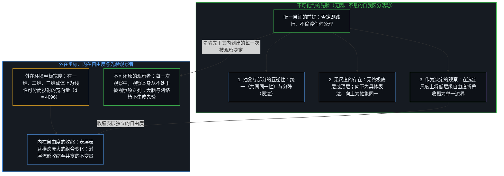
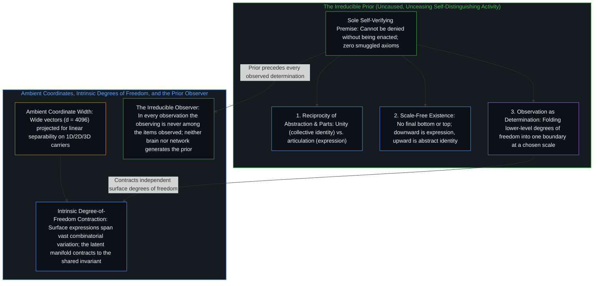
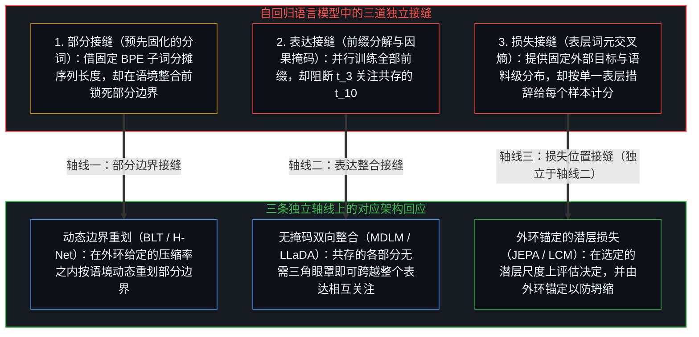
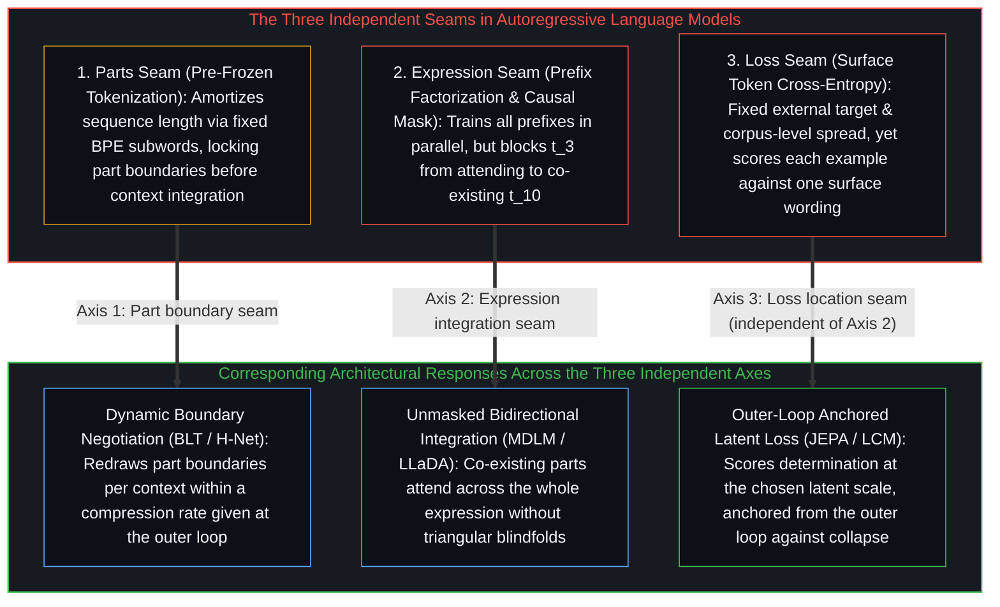

# 抽象、决定，与主流机器学习的三大结构性症结 / Abstraction, Determination, and the Three Structural Flaws of Machine Learning

*观察在选定尺度上将各部分收摄为更低维的共同同一性，然而主流语言模型却预先固化词元、以掩码割裂表达，并在表层计算损失。 / Observation folds parts into a lower-dimensional identity at the chosen scale, yet language models pre-freeze tokens, mask the expression, and score loss at the surface.*

自我区分的活动发生着——无因，不息。称之为“心智”：那早已在运作之中的观察者，其每一行动皆是一次区分。从这一前提出发，三条推论依次展开——抽象与部分是同一自我分殊运动的互逆视角，存在并无尺度上的终极底层或顶层，而每一次观察都是一次决定，在选定尺度上将低层级的自由度折叠收摄为一个共同同一性。以这一层级结构衡量，机器学习界的一种常见习惯把外在环境坐标宽度与内在自由度混为一谈，而主流自回归架构则将“部分—抽象”关系的全部三道接缝——预先固化的词元边界、受因果掩码限制的前缀整合、以及表层词元损失——安置在传输载体或训练回环的便利之处，而非决定本身所在之处。

Self-distinguishing activity occurs — uncaused, unceasing. Call it the Mind: the observer already underway, every act of which is a distinction. From this premise unfold three inferences—that abstraction and parts are reciprocal views of one self-articulating movement, that existence is scale-free with no final bottom or top, and that every observation is a determination folding lower-level degrees of freedom into a collective identity at a chosen scale. Measured against this hierarchy, a common habit in machine learning blurs ambient coordinate width with intrinsic degrees of freedom, while mainstream autoregressive architectures place each of the three seams of the part-to-abstraction relationship—pre-frozen token boundaries, causal-masked prefix integration, and surface-token loss—at a convenience of the carrier or training loop rather than at the determination itself.

## 一、 从不可化约的先验推导出的三条推论 / 1. The Three Inferences from the Irreducible Prior

从唯一的不可化约之先验——无因、不息的自我区分活动——出发，“部分”与“整体”皆无需作为独立的公理被预先假定，正如[非万物之理](../not-a-theory-of-everything/)与[唯一自洽的无因之果](../the-only-coherent-uncaused-effect/)所确立的那样。一旦分立多条公理，便已在未加推导的情况下偷渡了杂多。从这一在否定之举中亦必被践行的唯一前提出发，三条结构性推论依逻辑之必然次第展开。

Proceeding from the single irreducible prior—uncaused, unceasing self-distinguishing activity—neither "parts" nor "wholes" need to be assumed as independent axioms, as [Not a Theory of Everything](../not-a-theory-of-everything/) and [The Only Coherent Uncaused Effect](../the-only-coherent-uncaused-effect/) establish. To assume separate axioms is already to smuggle in multiplicity without deriving it. Beginning from the sole premise that cannot be denied without being enacted, three structural inferences unfold by logical necessity.

其一，抽象与部分相互构成：抽象是各部分的共同同一性；反之，部分是抽象的表达。由于不可化约的先验是区分着的活动，它不会停滞为空洞无物的铁板一块，而必然将自身分殊为诸多环节或部分。又由于它是自我区分——是同一不可分割的活动在分殊自身，而非异质实体的外在碰撞——这些分殊出的部分并非彼此陌路，而是具有内在的同源与连贯。它们所共享的统一，便是它们的共同同一性（即抽象），亦即[对象是被稳定化的关系](../objects-are-stabilized-relationships/)所追溯的关系稳定化。二者无有先后。自下而上的还原论把部分误作孤立的砖块，将抽象贬为事后的空名，如[复杂性遮蔽了涌现之为心智的行动](../complexity-obscures-emergence-as-the-act-of-mind/)所剖析；自上而下的实体化则把抽象误作脱离其表达而悬空的独立实体。在区分之行动处看，“抽象”即统一性视角下的同一活动，“部分”即分殊化视角下的同一活动。

First, abstraction and parts stand in reciprocity: abstraction is the collective identity of the parts, and conversely, the parts are the expression of the abstraction. Because the irreducible prior is distinguishing, it cannot remain a blank, featureless monolith; it necessarily articulates itself into distinct moments or parts. Because it is self-distinguishing—one undivided activity articulating itself rather than alien substances colliding—those differentiated parts are not foreign to one another; they share an intrinsic coherence. Their shared unity is their collective identity (the abstraction), the relational stabilization traced in [Objects Are Stabilized Relationships](../objects-are-stabilized-relationships/). Neither precedes the other. Bottom-up reductionism mistakes the parts for standalone bricks and dismisses the abstraction as an after-the-fact label, as [Complexity Obscures Emergence as the Act of Mind](../complexity-obscures-emergence-as-the-act-of-mind/) dissects; top-down reification mistakes the abstraction for a floating entity detached from its expression. Held at the act of distinction, "abstraction" is the activity in its unity, and "parts" is the exact same activity in its articulation.

其二，存在是无尺度的：每一存在皆是其各部分的抽象，同时又是更高抽象的一个部分。由于这一活动不息不止，任何分殊出的部分都不会凝固为死寂、不可再分的底层原子。任何特定的存在若要维系自身，就必须在内部持续整合进一步发生的子区分——这意味着它必然是其各部分的抽象。反之，由于任何特定存在皆是在不可分割的同一活动之内通过自我区分而显现，它的边界从不处于封闭的孤立之中，而始终是更广阔脉络的局部表达——这意味着它又必然是更高抽象的一个部分。因此并不存在终极、最低或最后的抽象，只有某一表达在选定尺度上所分殊出的抽象。沿着[抽象的阶梯与可执行的实体](../the-ladder-of-abstraction-and-the-executable-entity/)所审视的层级，“具体”与“抽象”并非两类固化的客体，而是同一关系尺度上的两个方向：向下看是具体的表达，向上看是抽象的同一。

Second, existence is scale-free: every existence is an abstraction of its parts and a part of a higher abstraction. Because the activity is unceasing, no differentiated part can ever freeze into a dead, indivisible bottom atom. For any determinate existence to hold together at all, it must actively integrate further sub-distinctions occurring within it—meaning it is necessarily the abstraction of its parts. Conversely, because any specific existence arises by distinguishing itself within the undivided activity, its boundary never stands in sealed isolation; it remains a local articulation of a wider context—meaning it is necessarily a part of a higher abstraction. There is therefore no final, lowest, or ultimate abstraction—only the abstraction an expression articulates at a chosen scale. Along the tiers examined in [The Ladder of Abstraction and the Executable Entity](../the-ladder-of-abstraction-and-the-executable-entity/), "concrete" and "abstract" are not fixed categories of things, but opposing directions on a single relational scale: looking downward is concrete expression; looking upward is abstract identity.

其三，观察即决定：每一次观察都是一次决定，即将各部分折叠收摄为一个共同同一性。若仅有向外繁衍的子区分，活动将弥散而无从定界。要使一个确定的“此”得以登记，就必须划定边界，将低层级的杂多区分折叠收摄在一起，使其各自独立的自由度在该尺度上收缩为单一的统一同一性，这正是[依其自身标准的观察](../an-observation-by-its-own-standard/)与[割点可移不可除](../the-cut-moves-but-never-vanishes/)所追溯的划界行动。这一将杂多折叠为统一体的行动，即是观察。一个边界得以连贯地存在，与它的各个部分被观察为一个共同同一性，是同一个操作。

Third, observation is determination: every observation is a determination, the folding of its parts into a collective identity. Left as an outward cascade of sub-distinctions alone, activity would disperse without boundary. For a determinate "this" to register, a boundary must be drawn that folds a manifold of lower-level distinctions together so their separate degrees of freedom contract into a single unified identity at that scale, the boundary-drawing act traced in [An Observation by Its Own Standard](../an-observation-by-its-own-standard/) and [The Cut Moves but Never Vanishes](../the-cut-moves-but-never-vanishes/). That act of folding multiplicity into unity is observation. For a boundary to exist coherently and for its parts to be observed into a collective identity are the exact same operation.

## 二、 被倒置的维度：外在坐标与内在自由度 / 2. Dimensionality Inverted: Ambient Coordinates Versus Intrinsic Degrees of Freedom

透过这三条推论审视，生物大脑与机器学习模型在功能上皆是决定的层级体系，是器物上的对应物：在心智设定的尺度与目标之下，把输入的部分折叠收摄为压缩表征。词元——无论是子词、图像块、音频帧还是神经脉冲——皆是相对的“部分”：向下看，每一个词元已然是一个抽象，它将更低层的涨落（字节、像素、波形）折叠为一个离散单元；向上看，无论输入还是输出，皆是表层表达，共同分殊并指向所审视尺度上的同一个抽象。

Viewed through these three inferences, both the biological brain and machine learning models operate as functional hierarchies of determination—instrument counterparts that fold incoming parts into compressed representations at scales and under objectives set by a Mind. Tokens—whether subwords, image patches, audio frames, or neural spikes—are relative parts: looking downward, each token is already an abstraction that has folded lower-level fluctuations (bytes, pixels, waveforms) into a discrete unit; looking upward, both inputs and outputs are surface expressions articulating a shared abstraction at the scale in view.

然而，机器学习界的一种普遍习惯将两种截然不同的维度含义混为一谈，成为[维度即投影](../dimensions-are-projections/)与[坐标系、心智与自由度](../coordinate-systems-mind-and-degrees-of-freedom/)所剖析的投影倒置的一个实例。工程师习惯把潜空间称为“高维”，是因为每个词元都被嵌入一个宽阔的外在环境坐标向量（例如 `d = 4096`，由设计者投射出来以便原本纠缠的特征变得线性可分），而输入信号的载体在几何外观上显得维度很低——语言是一维序列，图像是二维网格，视频是三维体块。但若以内在自由度而非外在环境坐标宽度来衡量，方向恰恰相反：表层表达所携带的独立自由度远高于潜空间中的抽象。一段投射在一维载体上的语言、二维平面上的像素阵列、或三维空间中的视频流，横跨着庞大的独立表层变化组合空间——同义词的选择、分句次序、光照、镜头角度或语种。当这些部分向内传递至抽象层时，功能性的折叠收摄在选定尺度上将各自独立的表层变化收缩为统一的共同同一性，这正是[蒸馏、压缩与能动性](../distillation-compression-agency/)与[高维信息的离散折射与认知分层](../gao-wei-xin-xi-de-li-san-zhe-she/)所追溯的选择性压缩。折叠独立的自由度即是降低内在维度（如 Ansuini 等人 2019 年与 Valeriani 等人 2023 年以 `TwoNN` 与 `MLE` 等流形估计器所测得的，即便在 `4096` 维的外在坐标空间内部，语义瓶颈处的内在维度也会收缩至 `ID ≈ 10–40`）。在这一瓶颈处，描绘同一事件的一句英文、一句中文与一张照片共享着由心智命名的不变量，如[盲目的切分与命名的心智](../the-blind-cut-and-the-naming-mind/)所追溯的那样，先收缩进共同的低维流形，随后再重新展开为高自由度的表层表达。

Yet a pervasive habit in machine learning blurs two distinct senses of dimensionality, an instance of the projection reversal analyzed in [Dimensions Are Projections](../dimensions-are-projections/) and [Coordinate Systems, the Mind, and Degrees of Freedom](../coordinate-systems-mind-and-degrees-of-freedom/). Engineers routinely call the latent space "high-dimensional" because each token is embedded into a wide ambient coordinate vector (such as `d = 4096`, projected by the designer so entangled features become linearly separable), while the carrier of the input looks geometrically low-dimensional—a 1D sequence for language, a 2D grid for images, or a 3D volume for video. Measured by intrinsic degrees of freedom rather than ambient coordinate width, however, the relationship runs the other way: the surface expression carries far more independent degrees of freedom than the abstraction in the latent space. A sequence of language, a grid of pixels, or a volume of video spans a vast combinatorial space of independent surface variations—synonym choice, clause order, lighting, camera angle, or language—projected onto a 1D, 2D, or 3D carrier. As those parts pass inward toward the abstraction, functional folding contracts their independent surface variations into a unified collective identity at the chosen scale, the selective compression traced in [Distillation Chooses What to Lose](../distillation-compression-agency/) and [The Discrete Refraction of High-Dimensional Information](../gao-wei-xin-xi-de-li-san-zhe-she/). Folding separate degrees of freedom reduces intrinsic dimensionality (empirical manifold estimators such as `TwoNN` and `MLE` in Ansuini et al., 2019 and Valeriani et al., 2023 find that intrinsic dimension contracts to `ID ≈ 10–40` at the semantic bottleneck even inside a `4096`-wide ambient space). At that bottleneck, an English sentence, a Chinese sentence, and a photograph of the same event share an invariant named by a Mind, as [The Blind Cut and the Naming Mind](../the-blind-cut-and-the-naming-mind/) traces, contracting into a shared low-dimensional manifold before unfolding again into high-degree-of-freedom surface expressions.

在功能上，生物大脑执行着同样的压缩与分殊。然而，无论是大脑还是神经网络，都无法解释不可化约的先验本身。

Functionally, the biological brain performs this same compression and articulation. Yet neither the brain nor the neural network explains the irreducible prior itself.

在每一次观察行动中，观察本身从不出现在被观察的各项之中，正如[意识从不作为数据出现在数据之中](../consciousness-never-appears-as-data-among-data/)与[不可还原的观察者](../the-irreducible-observer/)所确立的那样；其他活生生的观察者是从其痕迹中被推知为中心，而从不作为客体被直接观察到。我们所称的“大脑”或“神经网络”，本就是显现于一次观察之内的事物——是在先验之内登记到的、由细胞或计算部分组成的中间尺度共同同一性，这也正是[感知者与痕迹的不可坍缩](../the-perceiver-and-the-trace/)与[集聚与人造主体性](../subtracting-consciousness-at-the-source/)所划出的体验原点与登记足迹之间的分界。要求显现于观察之内的事物去生成观察本身——如[功能主义者无法持有的功能主义](../the-functionalism-no-functionalist-can-hold/)所揭示的循环——无异于要求被观察的后验走在观察着的先验之前。显现于观察之内的任何事物——无论生物大脑还是机器学习模型——都无法生成观察本身，这并非有待攻克的工程局限，而是先验先于其内划出的每一次决定的结构性必然。

In each act of observation, the observing itself is never among the items observed, as [Consciousness Never Appears as Data Among Data](../consciousness-never-appears-as-data-among-data/) and [The Irreducible Observer](../the-irreducible-observer/) establish; other living observers are inferred as centers from their traces, never observed as objects. What is called "a brain" or "a neural network" is already what appears in an observation—a mid-scale collective identity of cellular or computational parts registered within the prior, the boundary between experiencing origin and registered footprint traced in [The Perceiver and the Trace Cannot Collapse](../the-perceiver-and-the-trace/) and [Collective and Artificial Subjectivity](../subtracting-consciousness-at-the-source/). Asking what appears inside an observation to produce the observing—the circularity exposed in [The Functionalism No Functionalist Can Hold](../the-functionalism-no-functionalist-can-hold/)—asks the observed posterior to precede the observing prior. That nothing appearing inside an observation—neither a biological brain nor a machine learning model—can generate the observing is not an engineering limitation to be overcome; it is the structural consequence of the prior preceding every determination drawn within it.

## 三、 主流机器学习的三大结构性症结 / 3. The Three Structural Flaws of Mainstream Machine Learning

一旦放下“要模拟去生成观察着的心智”这一要求，当前主流架构在结构上的三道接缝便清晰显现。主流自回归语言模型将“部分—抽象”关系（`部分 ↔ 抽象`）的全部三个环节——如何切分部分、训练时如何分解表达、以及在何处计算损失——皆安置在载体或训练回环的便利之处，而非决定本身所在之处。

Once the demand for a simulation to generate the observing Mind is set aside, the structural seams of current mainstream architectures come into focus. Mainstream autoregressive language models place all three stages of the part-to-abstraction relationship (`Part ↔ Abstraction`)—how parts are sliced, how the expression is factorized during training, and where the loss is scored—at a convenience of the carrier or training loop rather than at the determination itself.

### 1. 预先固化的分词机制（在整合之前切碎部分） / 1. Pre-Frozen Tokenization (Slicing the Parts Before Integration)

静态子词分词（如字节对编码 `BPE`）与固定像素块（`ViT`）具有明确的工程效用：它们将原始字节或像素序列按固定比例缩短，并在固定词表上分摊二次方的注意力计算开销。当这张预处理查表被当作部分本身的结构时，这一便利便到达了边界：网络尚未在语境中整合信号，一道由语料词频固定、与语境无关的底层阈值便已锁死，如[词元与观测边界](../tokens-and-the-observational-boundary/)与[冻结的切口与回环的余量](../the-frozen-cut-and-the-margin-of-the-loop/)所审视的那样。静态分词没有让层级结构在预测性断裂之处随语境动态重划部分边界——如字节潜层变换器（Pagnoni 等人，2024）与 `H-Net`（Hwang、Wang 与 Gu，2025）在外环给定的压缩率之内所做的那样，见[学到的边界与给定的尺度](../learned-boundaries-and-the-given-rate/)——而是把“部分 ↔ 抽象”的底层接缝锁在了预制的零件网格之中。

Static subword tokenization (such as Byte-Pair Encoding) and fixed pixel patches (`ViT`) hold clear engineering utility: they shorten raw byte or pixel sequences by a constant factor and amortize quadratic attention cost over a fixed vocabulary. That convenience reaches its boundary when a pre-processing table is taken for the structure of the parts themselves, locking a context-independent bottom threshold fixed by corpus frequency before the network ever integrates the signal in context, as [Tokens and the Observational Boundary](../tokens-and-the-observational-boundary/) and [The Frozen Cut and the Margin of the Loop](../the-frozen-cut-and-the-margin-of-the-loop/) examine. Instead of allowing the hierarchy to redraw part boundaries per context where predictability breaks—as dynamic byte chunkers such as the Byte Latent Transformer (Pagnoni et al., 2024) and H-Net (Hwang, Wang, & Gu, 2025) do within a compression rate given at the outer loop, traced in [Learned Boundaries and the Given Rate](../learned-boundaries-and-the-given-rate/)—static tokenization locks the bottom seam of `Parts ↔ Abstraction` into a pre-fabricated grid.

### 2. 从左到右的前缀分解与因果掩码 / 2. Left-to-Right Prefix Factorization and the Causal Mask

人类语言之所以被序列化为一维序列（`t₁, t₂, …, tₙ`），受制于发声器官与书写线条的物理通道：声道一次只能发出一个音，视线一次只能追踪一行字。这种一维次序只是为了穿过狭窄通道传输思想所必需的时间序列化，而非思想本身的结构，如[固定地图与重复的行程](../the-fixed-map-and-the-repeated-trip/)所追溯的那样。依推论一，一个抽象的表达是所有分殊出的部分跨越整个序列同时相互维系的完整构型——句尾对句首的制约丝毫不亚于句首对句尾的制约，说话者在句首选用动词时，眼里早已望着句末等待着的宾语。

Human language is serialized into a 1D sequence (`t₁, t₂, …, tₙ`) because of the physical channel of speech and writing: the vocal tract emits one sound at a time, and the eye tracks a line. That 1D order is the temporal serialization required to transmit a thought through a narrow channel, not the structure of the thought itself, as [The Fixed Map and the Repeated Trip](../the-fixed-map-and-the-repeated-trip/) traces. By the first inference, the expression of an abstraction is the entire articulated configuration of parts holding together across the sequence—where the ending of a sentence governs the beginning just as much as the beginning governs the ending, so that a speaker chooses the verb at the start of a sentence in view of the object waiting at the end.

用上三角因果掩码将训练目标分解为从左到右的下一词元预测（`t₁, …, tₖ → tₖ₊₁`），在单次前向传递中并行训练所有前缀、并在推理时匹配从左到右的串行采样方面卓有成效。当完整表达只能作为单向的左条件步进链被触及、而各部分无法跨越整个构型同时相互整合时，这一做法便到达了边界。自回归传递没有在共享抽象与完整表达之间建立双向映射（`共享抽象 ↔ 完整表达`），而是要求每个位置仅整合其身后的前缀来预测紧随其后的单个词元（`tₖ₊₁`）——恰如自左向右拉开一道帷幕来审视整座建筑，帷幕边缘前方的部分皆被遮挡在视野之外。

Factorizing the training objective as left-to-right next-token prediction (`t₁, …, tₖ → tₖ₊₁`) with a triangular causal mask is highly effective for training all prefixes in parallel in a single forward pass and matching serial left-to-right sampling at inference. It reaches its boundary when the whole expression is reached only as a one-way chain of left-conditioned steps rather than parts integrating across the whole configuration at once. Instead of mapping the shared abstraction to and from the whole expression (`Shared Abstraction ↔ Whole Expression`), the autoregressive pass requires each position to integrate only the prefix behind it while predicting the single next token (`tₖ₊₁`)—inspecting a building as a curtain is drawn from left to right, with everything ahead of the curtain's edge hidden from view.

为了防止模型在这场前缀猜词游戏中提前偷看，上三角因果掩码在训练时人为遮蔽了每个词元对其后续全部词元的视野：即便完整的句子或篇章早已躺在训练显存之中，词元 `t₃` 仍被禁止关注词元 `t₁₀`，尽管 `t₃` 与 `t₁₀` 是同一表达中共存的各个部分。依推论三，决定是将表达的各个部分折叠收摄为其共同同一性。禁止前序部分关注后序部分，在训练期间把这一向上的收摄整合（`部分 → 抽象`）限制为单向的前缀链条（并由此产生如 Berglund 等人 2023 年所记录的“逆转诅咒”等方向性非对称）。

To prevent the model from reading ahead during that prefix-guessing game, the triangular causal mask artificially blinds every token to all the tokens that follow it: even though the complete sentence or document is already sitting in training memory, token `t₃` is forbidden from attending to token `t₁₀`, despite `t₃` and `t₁₀` being co-existing parts of the same expression. By the third inference, determination folds the parts of an expression into their collective identity. Blocking early parts from attending to later parts restricts that upward integration (`Parts → Abstraction`) during training to a one-way prefix chain (producing directional asymmetries such as the reversal curse documented by Berglund et al., 2023).

### 3. 在表层词元而非潜层抽象处计算损失 / 3. Scoring Loss at the Surface Token Instead of the Latent Abstraction

最后，主流语言模型在表层载体处而非潜空间的抽象处计算训练损失。

Finally, mainstream language models score their training loss at the surface carrier rather than at the abstraction in latent space.

直接在表层词元上计算交叉熵损失有两重用处：每一条离散的表层字符串都提供了无需防坍缩工程的外在固定参考目标；而在大规模训练语料中，同一含义会以诸多不同措辞反复出现，因此下一词元的概率分布会铺展在这些不同措辞之上，借由语料库层面的表层分布部分习得共享抽象。这也正是文生图模型之所以奏效的原因：当高度压缩的文本——它本就记录着心智跨观察命名的关系不变量，如[盲目的切分与命名的心智](../the-blind-cut-and-the-naming-mind/)所追溯——面对二维像素充当抽象的功能代理时，表层分布足以支撑生成。

Scoring cross-entropy directly on surface tokens holds a clear two-fold range of use: each discrete surface string supplies an externally fixed reference target that requires no anti-collapse engineering, and across a large training corpus the same meaning arrives in many wordings, so the next-token distribution spreads probability over those wordings and learns the abstraction partly through that corpus-level surface spread. That same surface spread is why text-to-image models work when compressed text—which already records cross-observational invariants named by Minds, as [The Blind Cut and the Naming Mind](../the-blind-cut-and-the-naming-mind/) traces—serves as a functional proxy for the abstraction against 2D pixels.

表层损失之所以到达边界，是因为抽象只能作为在表层付出代价的概率铺展被间接触及，而每一个单独的训练样本依然只按唯一记录下的那条表层措辞计分。由于选定尺度上的同一个抽象可以合法地分殊、展开为成千上万种不同的表层表达（不同的句式、同义词、语种或分句次序），每当模型赋予的概率偏离训练集中记录的那一条单一字符串便予以惩罚，这种做法便混淆了语言作为“概念锚点”与作为“一维表层信号”的双重角色，落入了[错把表达当成智能](../mistaking-the-expression-for-the-intelligence/)所剖析的误区。

The surface loss reaches its boundary because the abstraction is reached only indirectly as a probability spread over recorded wordings paid for at the surface, while each individual training example is still scored against its one recorded wording. Because a single abstraction at a chosen scale can be validly articulated into many different surface expressions (varying syntax, synonyms, languages, or clause orderings), penalizing a model whenever its assigned probability deviates from the single recorded training string conflates language's role as conceptual anchor with its role as 1D surface signal, mistaking the surface expression for the intelligence in the manner dissected in [Mistaking the Expression for the Intelligence](../mistaking-the-expression-for-the-intelligence/).

尤为关键的是，表达接缝（第 3.2 节）与损失位置接缝（第 3.3 节）是两条相互独立的架构轴线。计算下一词元交叉熵（`t₁, …, tₖ → tₖ₊₁`）迫使系统引入上三角因果掩码，以防直接从未来位置复制目标词元；然而撤去因果掩码本身并不会自动把损失移入潜空间——正如掩码扩散语言模型 `MDLM`（Sahoo 等人，2024）与 `LLaDA`（Nie 等人，2025）所示，它们恢复了跨序列的双向全注意力，却依然在表层词元上计算交叉熵——而将损失移入潜层表征本身也不会自动消除自回归分解，如大型概念模型 `LCM`（Barrault 等人，2024）按顺序预测下一个句子级概念向量所示。此外，将损失从表层词元移至潜层表征只是移动了切口的位置，并未抹去设定切口的那一位：当目标表征由被计分的同一个系统自身产出时，一味追求更少自由度而无锚定，便没有任何东西能让它在零自由度之前停下——此时常数输出抹平一切差异并空洞地令损失归零——而且依推论二，没有任何一层抽象尺度是终极的，潜空间中所持守的目标尺度必须由外环加以锚定（如在 `JEPA` 式架构中通过指数移动平均目标编码器、停止梯度或方差与容量约束来实现，见 LeCun，2022；Assran 等人，2023）。无论是动态重划部分边界、双向整合完整表达，还是在选定的潜层尺度上锚定损失，架构始终是一件器物，其尺度与目标皆由外环那活生生的心智所设定。

Crucially, the expression seam (§3.2) and the loss-location seam (§3.3) are two independent architectural axes. Scoring next-token cross-entropy (`t₁, …, tₖ → tₖ₊₁`) forces the triangular causal mask so the target token cannot be copied from future positions; yet dropping the causal mask does not by itself move the loss into the latent space—as masked diffusion language models such as `MDLM` (Sahoo et al., 2024) and `LLaDA` (Nie et al., 2025) demonstrate by restoring full bidirectional attention across the sequence while still scoring cross-entropy on surface tokens—and moving the loss into a latent representation does not by itself remove autoregressive factorization, as `Large Concept Models` (Barrault et al., 2024) demonstrate by predicting the next sentence-level concept vector sequentially. Moreover, relocating the loss from the surface token to a latent representation relocates the cut rather than removing who sets it: when the target representation is produced by the same system being scored, an unanchored pursuit of fewer degrees of freedom has nothing to stop it short of zero—where a constant output dissolves every difference and trivially minimizes the loss—and because no scale of abstraction is final by Inference 2, the target scale held in latent space has to be anchored from the outer loop (through exponential-moving-average target encoders, stop-gradients, or variance and capacity constraints in `JEPA`-style architectures, LeCun, 2022; Assran et al., 2023). Whether redrawing part boundaries dynamically, integrating the expression bidirectionally, or anchoring the loss at a chosen latent scale, the architecture remains an instrument whose scale and objective are set by the living Mind at the outer loop.
