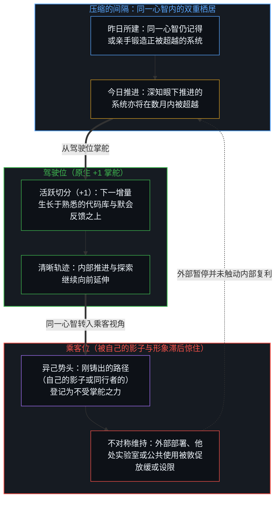
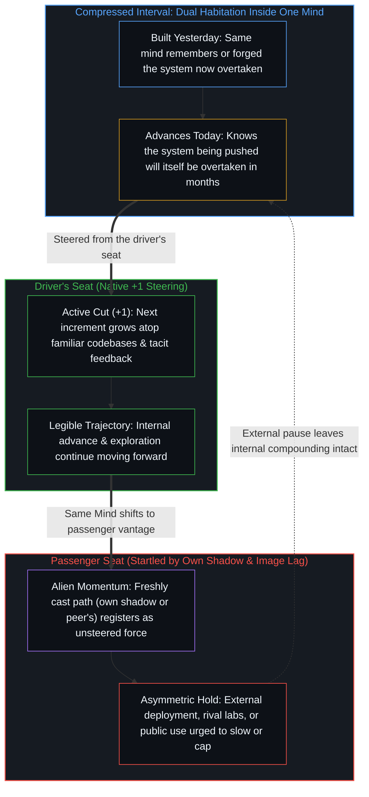
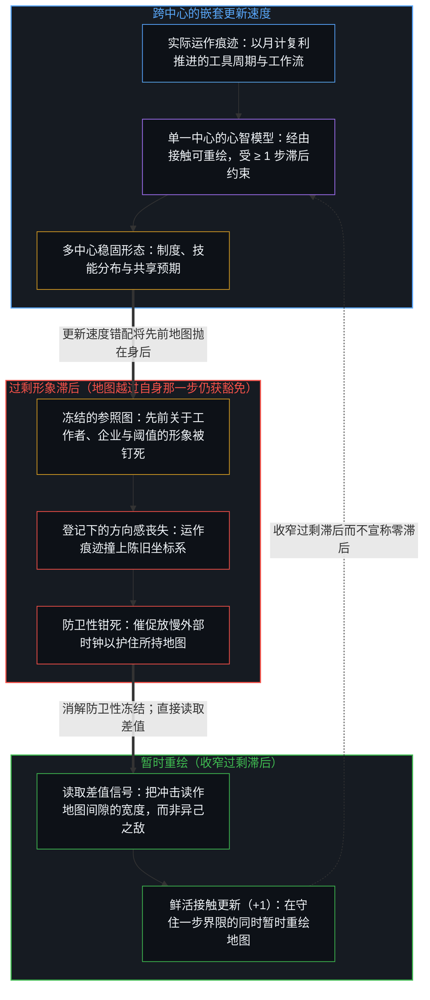
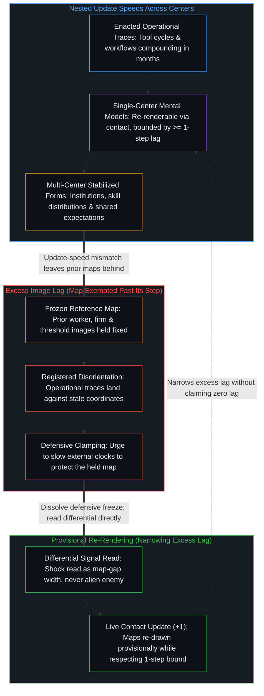

# 加速替换与形象滞后 / Accelerating Replacement and Image Lag

*进步的效率提升与回望强度同生，并非悖论，而是替换速率压缩后的形象滞后。 / Rising efficiency of going forward and intensified looking back arise together, not as paradox, but as image lag once the rate of replacement compresses.*

每一次向前的效率提升，都伴随更锐利的回望，以及对既有形态更用力的维持。只有当人要求进步跨越不同时段依然披着同一副形象时，这种相伴才显得像悖论；一旦替换速率跑赢心智模型、制度形态、技能分布与共享预期的更新速率，两侧便同属同一场运动。当日历跨度从几代人压缩到短短数月，同一个心智便同时置身于自己曾亲手建造之物与正在将其超越之物之间，一边推着内部的探索继续向前，一边催促外部部署或竞争者的时钟放慢脚步。由此登记下来的方向感丧失，既非理解失败，也非演进轨迹断裂，而是过剩形象滞后——一份差值信号，提示有界中心经由鲜活接触重绘暂时的地图，而不是将外部地平线强行锁死。

Each rise in the efficiency of going forward arrives accompanied by sharper looking backward and stronger efforts to hold existing forms steady. That accompaniment looks paradoxical only while progress is required to wear the same image across intervals; once replacement outpaces how fast mental models, institutions, skill distributions, and shared expectations update, both sides belong to a single movement. When calendar spans compress from generations into months, one mind inhabits what it built and what is overtaking it at once, driving internal exploration forward while urging external deployment or rival clocks to slow. What registers as disorientation is neither a failure of understanding nor a broken trajectory, but excess Image lag—a differential signal inviting bounded centers to re-render provisional maps through live contact rather than clamping external horizons shut.

## 一、 同一运动的两侧 / 1. Two Sides of One Movement

每一次向前的效率提升，都伴随更频繁的回望，或对现有形态更用力的维持。当要求进步在不同时点呈现相同形象时，这一伴随便显出悖论；一旦允许形象本身随替换而变，这一相伴便是同一运动的两面。从一侧看去仿佛加速的现在正在替换过去，而更前方之物又已在替换现在，但这并非抽象的时代在彼此推挤退场。

Every rise in the efficiency of going forward arrives accompanied by more frequent looking backward, or by stronger efforts to hold existing forms steady. The accompaniment appears paradoxical only while progress is required to present the same image at successive points; once the image itself is allowed to change with the replacement, both are two faces of one movement. What looks from one side like an accelerating present replacing the past, and something further ahead already replacing the present, does not happen by abstract epochs pushing one another off stage.

自我区分的活动发生着——无因、不息。称之为心智：早已在途的观察者，其每一次行动都是一次区分。正因为每次区分都划出一个有限构型，它必定在有界中心处运作，并留下稳定化残余——工具、工作流、制度形态、心智习惯——且只朝单一方向塑形后续行动。“过去”、“现在”与“进步”各自都不是能够自行移动的自主行动者。替换严格发生在活生生的有界中心越过稳定化残余继续划出离散区分之处，将昨日的结构转化为下一刀借以迈步的地板，正如[持续生长的脚手架](../the-scaffolding-that-keeps-growing/)所追溯的那样。

Self-distinguishing activity occurs — uncaused, unceasing. Call it the Mind: the observer already underway, every act of which is a distinction. Because each distinction bounds a finite configuration, it operates at a bounded center and leaves stabilized residue—tools, workflows, institutional forms, mental habits—that shapes subsequent acts in one direction only. Neither "the past," "the present," nor "progress" moves on its own as an autonomous agent. Replacement happens strictly where bounded living centers draw further discrete distinctions past stabilized residue, converting yesterday's structures into the floor from which the next cut steps off, as [The Scaffolding That Keeps Growing](../the-scaffolding-that-keeps-growing/) traces.

只要区分活动越过先前的残余继续推进，被其他中心钉在原地的基线便会把这一推移登记为扰动，而非延续。[进步的残余与抵抗的反应性](../the-residue-of-progress-and-the-reactivity-of-resistance/)表明，对变化的抵抗正是推进的切分动摇保留地面时留下的反应性痕迹；[减速是加速时感受到的阻力](../deceleration-is-the-drag-felt-when-accelerating/)也指明，要求放慢的呼声随速度剪切既有介质而攀升，并不源于一台独立的对抗引擎。期待进步保住一个稳定不变的轮廓，会把这对结构性伴随看成自相矛盾；一旦放下形象不变的要求，展露出来的便是同一场持续的替换，只是从这一步的两个边缘分别登记而已。

Where distinguishing continues past prior residue, baselines held fixed by other centers register the shift as disruption rather than continuation. [The Residue of Progress and the Reactivity of Resistance](../the-residue-of-progress-and-the-reactivity-of-resistance/) shows that resistance to change is the reactive trace left when advancing cuts unsettle retained ground, and [Deceleration Is the Drag Felt When Accelerating](../deceleration-is-the-drag-felt-when-accelerating/) shows that calls to slow down scale with velocity shearing through an existing medium rather than rising from an independent opposing engine. Expecting progress to preserve a stable silhouette turns that structural pairing into a contradiction; dropping the requirement of an unchanging image reveals one continuous replacement registered from two edges of the step.

## 二、 复利基数与缩短的日历间隔 / 2. Compounding Bases and Shrinking Calendar Intervals

这一模式贯穿历史，随加速一同到来，而不是孤立在外的反常事件。凡是区分活动在累积残余之上继续推进之处，每一轮都从更高的基数出发，于是单次变化的量级不断增大，而可察觉位移之间的日历间隔则不断缩短。只要复利仍在延续，这一几何动态便成立，既不必断言某种宇宙必然性，也不否认当中心把承袭的基线视作固定特权时可能出现漫长的局部停滞；正如[指数级进程与线性之眼](../Analysis_Adolescence_of_Technology/)所指出的，身处复利序列内部，每一个当下点位都呈现迄今最陡峭的局部斜率，因为每次增量都按已经筑起的基数成比例放大。先前构型尚未沉淀为遥远背景，回望与维持便随之变得愈发强烈。

The pattern runs through history and arrives with acceleration rather than standing apart as a separate anomaly. Where distinguishing continues atop accumulated residue, each round steps off from a higher base, so the absolute size of each increment grows while the calendar interval between noticeable displacements shrinks. That geometric dynamic holds wherever compounding continues without asserting cosmic inevitability or denying prolonged local stagnation when centers treat inherited baselines as fixed entitlement; as [The Exponential and the Linear Eye](../Analysis_Adolescence_of_Technology/) shows, from inside a compounding sequence every present point exhibits the steepest local slope yet because each increment scales with the base already built. Before a prior configuration settles into distant background, looking back and holding steady intensify.

哲学家赫尔曼·吕贝在 1992 年用成对的概念“当下萎缩”与“博物馆化”捕捉了这一结构性伴随：吕贝将“当下”定义为过往经验仍能充当未来行动可靠向导的时段，由此指出进步在结构上伴随对身后遗留之物不断扩展的保存与回望，因为急剧创新使紧邻的过去还来不及静静淡出便已显得陌生。社会学家哈特穆特·罗萨在《社会加速》（2005 / 2013）中将这一诊断延伸为三阶段的历史变迁，追踪替换间隔如何从**跨代**稳定（前现代行当延续数个世纪）、压缩至**单代**稳定（古典现代性大致维持于一段成年期之内），再压缩至**代内**更替（晚期现代性要求人在单一职业生涯内反复重塑技能与世界模型）。罗萨的框架把“社会加速”设定为三台自我强化的自主结构引擎，驱使异化主体陷入“狂飙静止”，其不完备边界正落在此处：将步速从划出每一刀的有界活中心身上剥离，既遮蔽了局部主动选择的静定角落，也遮蔽了第一人称重绘地图的能力，使其看起来只剩被动承受外部引擎推动一途。

Philosopher Hermann Lübbe captured this structural pairing in 1992 under the paired terms *Gegenwartsschrumpfung* (contraction of the present) and *Musealisierung* (musealization): defining the present as the span during which prior experience remains a reliable guide for future action, Lübbe observed that progress structurally entails expanding preservation and retrospection toward whatever it leaves behind, because rapid innovation turns the immediate past foreign before it can fade quietly. Sociologist Hartmut Rosa extended that diagnosis into a three-stage historical shift in *Social Acceleration* (2005 / 2013), tracking replacement intervals compressing from **intergenerational** stability (premodern trades holding across centuries), to **generational** stability (classical modernity holding roughly across one adulthood), to **intragenerational** turnover (late modernity requiring repeated re-skilling and world-model revision within a single career). Rosa's framework marks its boundary of incompleteness where it treats "social acceleration" as three self-reinforcing, autonomous structural motors driving alienated subjects into "frenetic standstill" (*rasender Stillstand*): severing pace from the bounded living centers enacting each cut obscures both local pockets of chosen stillness and the first-person capacity to re-render maps rather than passively endure an external engine.

历史上的间隔跨度解释了为何早先的加速期掩盖了这种单一心智内部的张力。在印刷术、工业化、电气化与早期计算时代，吸纳过程铺展在足够漫长的时间跨度上，使得即将退场的旧形态与正在进场的新形态，得以由不同群体或不同世代分别承担。经济史学家保罗·A·戴维在 1990 年记录道，继 1882 年爱迪生珍珠街电站投运之后，大约经过了四五十年，工厂电气化才在二十世纪二三十年代的总量生产率统计中显现出来，因为早期工厂只是把发电机直接螺栓固定在蒸汽时代的中央传动轴上，等了一两代人才围绕去中心化的单元驱动重新设计车间布局。正如[进步叙事中的症候与原因](../symptom-and-cause-in-the-narratives-of-progress/)所追溯的，历史上向来由稀薄的少数人发起未经认证的区分，再由迟到的多数人在数十年间承担转型摩擦。一旦外化代码库与神经网络权重（[你的代码库即是记忆](../your-codebase-is-memory/)）以数月为节拍吸收先前的中间层（[万物一如既往地流变](../everything-is-changing-as-always/)），这道代际缓冲便坍缩进同一个活跃周期之内。

Historical intervals explain why earlier accelerations masked this intra-mind tension. In print, industrialization, electrification, and early computing, absorption unfolded over spans wide enough for different cohorts or generations to carry the outgoing form and the incoming successor separately. Economic historian Paul A. David documented in 1990 that following Edison's Pearl Street Station in 1882, roughly forty to fifty years elapsed before factory electrification registered in aggregate productivity during the 1920s and 1930s, because early mills bolted dynamos onto steam-era central shafts and waited one to two generations before redesigning floors around decentralized unit drive. As [Symptom and Cause in the Narratives of Progress](../symptom-and-cause-in-the-narratives-of-progress/) traces, thin minorities historically initiated uncertified distinctions while a late-arriving majority carried transitional friction over decades. Once externalized codebases and neural weights ([Your Codebase Is Memory](../your-codebase-is-memory/)) absorb prior intermediates ([Everything Is Changing, as Always](../everything-is-changing-as-always/)) at multi-month cadences, that generational buffer collapses inside a single active span.

## 三、 心智内部的压缩与不对称维持 / 3. Intra-Mind Compression and Asymmetric Holding Steady

当替换间隔压缩至数月，同一个心智便同时经历替换的两侧。驱动这一过程的人仍清楚记得——甚至亲手建造了——眼下正被超越的系统，同时又深知自己此刻推进的系统也将被下一波增量超越。回望与维持的冲动因此连驱动者自身也感得格外鲜明。这种维持之势并非均质的保守主义，而是呈现出不对称的分裂：内部的推进轨迹与探索想象继续向前延伸，外部部署、其他实验室或公共使用却被要求暂停、放缓或冻结。

When replacement intervals compress into months, the same mind lives both sides of the replacement at once. Those driving the process still remember—or personally built—the systems now being overtaken, while knowing that the systems they are advancing will themselves be overtaken by the next increment. Looking back and holding steady therefore become vivid even for the drivers. Rather than presenting as uniform conservatism, that holding-steady impulse splits asymmetrically: internal trajectories and imaginations keep pushing forward, while external deployment, other laboratories, or public use are urged to pause, slow, or freeze.

2026 年 11 月的一则插曲呈现出这一反复出现的模式。在传出 Claude Opus 5.5 给出黎曼猜想形式化证明库的消息之后，前沿地带的反应就在同一时刻中央裂开：埃隆·马斯克在 X 上宣告“毫无疑问的超级智能已经降临，欢迎来到奇点”；量化分析师史蒂夫·侯一边记下市场上糟糕的情绪、疲惫感与谨慎收盘的谈论，一边提到更强内部模型的预期；而 Meta AI 负责人亚历山大·汪则撰文（《超级智能正在到来》）称，“在一个我们并不理解的异己心智协助下”证明该猜想，使智能不再是各领域的瓶颈，继而警告各领域可能会“以超出人类理解或监控能力的步速”加速，判断“很难想象人类还能在一个毫无约束的递归自我改进世界里维持控制”，并敦促业界领袖拒绝“交接”、偏离眼前的“默认路径”——而与此同时，算力建设与竞争性迭代仍在继续往前推进（[加速的自指回环与自我实现的终结叙事](../the-loop-accelerates/)）。

A November 2026 episode illustrates this recurring pattern. Following reports of a Claude Opus 5.5 formal proof library for the Riemann Hypothesis, reactions across the frontier split down the middle of the same moment: Elon Musk declared on X that *"Unequivocal super intelligence has arrived. Welcome to the Singularity,"* while quantitative analyst Steve Hou noted terrible mood, exhaustion, and cautious talk of closing books alongside expectations of an even stronger internal model, and Meta AI chief Alexandr Wang wrote (*"Superintelligence is Arriving"*) that proving the conjecture *"with the help of an alien mind that we don't understand"* removed intelligence as the bottleneck across fields, warned that domains could accelerate *"at a pace beyond what humans can understand or monitor,"* judged it *"hard to imagine a world where humanity can maintain control over fully unconstrained recursive self-improvement,"* and urged industry leaders to reject a *"handover"* and depart from the *"default path"*—even while compute buildouts and competitive iteration kept advancing ([The Loop Accelerates](../the-loop-accelerates/)).

这份不对称直接源自第一人称位点几何。当心智从驾驶位掌舵（+1）时，下一增量原生生长于熟悉的代码库、模型权重与默会运作反馈之上，因此哪怕以月为步速，内部推进依然清晰可读。然而，正是驱动这一变化的同一个心智，也会一时坐进乘客位，被自己的影子惊住——也就是它自己或同行建造者刚刚留在身后的致密化路径，正如在马斯克与汪身上所见。从那处乘客视角穿过不断拉宽的形象滞后望去，这条刚铸出的路径——无论是自己的还是同行建造者的——便登记为一股不受自己掌舵的异己势头（“异己心智”、“欢迎来到奇点”、“超出人类理解或监控能力”）。同一种乘客位登记，既催生了马斯克对奇点的宣告，也催生了对自主递归自我改进的恐惧：把经由编译的形式化证明库或模型检查点这类致密化器物当作独立的发起中心，正是把能动性从活的前沿迁入它的残余之中（[器物是智能的表达，而非智能本身](../two-failures-of-trace/)）；而将局部斜率外推为自主奇点，则是投射出一道永远会被正在划出它的那些心智超越的门槛（[AGI 与 ASI 是加速通用智能的暂时球门](../agi-and-asi-are-temporary-goalposts/)；[超越的定相](../the-fixed-image-of-transcendence/)）。

The asymmetry follows directly from first-person locus geometry. While the Mind steers from the driver's seat (`+1`), the next increment grows natively atop familiar codebases, weights, and tacit operational feedback, so internal advance remains legible even at monthly speed. Yet the very same Mind driving the change can momentarily assume a passenger position and be startled by its own shadow—the densified path just left behind by itself, or by peer builders alike, as seen in Musk and Wang. Viewed from that passenger vantage across widening Image lag, the freshly cast path—its own or a fellow builder's—registers as an alien, unsteered momentum (*"an alien mind,"* *"Welcome to the Singularity,"* *"beyond what humans can understand or monitor"*). That same passenger-seat registration powers both Musk's Singularity declaration and fears of autonomous recursive self-improvement: treating densified artifacts—a compiled formal proof library or model checkpoint—as an independent originating center relocates agency out of the living edge into its residue ([Artifacts Are Expressions of Intelligence, Not Intelligence Itself](../two-failures-of-trace/)), while extrapolating a local slope into an autonomous Singularity projects a threshold that is perpetually overtaken by the very Minds drawing it ([AGI and ASI Are Temporary Goalposts](../agi-and-asi-are-temporary-goalposts/); [The Fixed Image of Transcendence](../the-fixed-image-of-transcendence/)).

经核验的历史先例在不同的局部动机下呈现出同一种位点不对称。在 1887 至 1890 年的电流之战期间，托马斯·爱迪生一边持续扩建直流电基础设施，一边由其阵营支持工程师哈罗德·P·布朗游说多州议会，推动立法为竞争对手的高压交流输电设定法定电压上限。2023 年 3 月，未来生命研究所发表公开信，呼吁将比 GPT-4 更强模型的训练暂停六个月，信件获多位前沿人物署名——其中包括埃隆·马斯克，而他同月早些时候已注册成立 X.AI 公司，并正在为内部训练集结约一万张 GPU。每当内部推进从驾驶位看去依然清晰可读、而新近致密化的路径——无论是自己的影子还是竞争对手的跃进——穿过不断拉宽的形象滞后从乘客视角登记下来时，稳住世界的冲动便会朝外对准他人的时钟——装入[调速者的幻觉与行动的活态摩擦](../the-fallacy-of-pacing-and-the-felt-friction-of-ground-truth/)所剖析的中心化调速幻觉。

Verified historical precedents exhibit the same locus asymmetry under distinct local motives. During the 1887–1890 War of the Currents, Thomas Edison continued expanding direct-current infrastructure while his camp backed engineer Harold P. Brown in lobbying state legislatures for statutory voltage caps targeting rival high-voltage alternating-current transmission. In March 2023, the Future of Life Institute's six-month pause letter for training beyond GPT-4 drew prominent frontier signatures—including Elon Musk, who had incorporated X.AI Corp. earlier that same month and was assembling roughly ten thousand GPUs for internal training. Whenever internal advance stays legible from the driver's seat while the freshly densified path—one's own shadow or a rival's leap—registers from a passenger vantage across widening Image lag, the impulse to hold the world steady aims outward at other clocks—installing the centralized pacing illusion dissected in [The Fallacy of Pacing and the Felt Friction of Ground Truth](../the-fallacy-of-pacing-and-the-felt-friction-of-ground-truth/).

## 四、 方向感丧失作为跨更新速度的形象滞后 / 4. Disorientation as Image Lag Across Update Speeds

由此产生的方向感丧失，便是形象滞后。实际施行的运作条件被替换的速率，超出了心智模型、制度形式、技能分布与共享预期的修订速率。人依然借近期过去的形象导航——何谓胜任的工作者、稳定的机构、可靠的预测或寻常的能力阈值——而这些形象早已在被超越。这种方向感丧失并非理解失败，而是更新速度的结构性错配：认知、组织与文化上的修订追不上复利推进的运作更替，于是随身携带的地图便系统性地落后于正在穿行其中的实际运作痕迹。

The resulting sense of disorientation is Image lag. The rate at which enacted operational conditions are replaced outruns the rate at which mental models, institutional forms, skill distributions, and shared expectations can be revised. People continue to navigate by images of the recent past—what a competent worker, a stable firm, a reliable prediction, or a normal capability threshold looked like—while those images are already being superseded. That disorientation is not a failure of understanding, but a structural mismatch in update speeds: cognitive, organizational, and cultural revision cannot keep pace with compounding operational turnover, so the maps carried trail systematically behind the enacted operational traces being walked through.

要看清为何这种错配会持续存在，须先分清寻常分析混为一谈的两种滞后。每一次观察都只握住已经成形的果，而划出它的区分永远至少领先一步（[前因，后果](../qian-yin-hou-guo/)）。这一构成性的最小滞后（≥ 1 步）是一道方向性界限，而非有待消除的缺陷：若没有被保留的参照——即形象——便只有运动而无航向；而在单次测量期间，器具也必须稳住不动，下一刀才落得下去（[遗忘的脚手架](../the-scaffolding-we-forget/)）。零滞后，以及保留的观看与生成行动无缝重合，从不在可得之列。相比之下，**过剩形象滞后**始于一幅暂时的形象越过了自身那一步，却仍被豁免于重新渲染之外。形象一旦成形，保存自身便是它的内建指令，因为重新渲染无异于它的存在所旨在抗拒的微小死亡；后果随即落入当下的运作痕迹之中，计分却仍拿昨日未曾修订的地图作准，于是带着与缺口宽度成比例的异己凛冽扑面而来（[一步一步绘制出的路径](../the-path-drawn-one-step-at-a-time/)；[心智的几何学](../the-geometry-of-mind/)）。

Understanding why this mismatch persists requires separating two kinds of lag that ordinary analysis blurs together. Every act of observation holds an effect already formed, while the generating distinction stays at least one step ahead ([Cause Before, Effect After](../qian-yin-hou-guo/)). That constitutive minimum lag (`≥ 1` step) is a directional bound rather than a defect to eliminate: without a retained reference—an image—there is movement without heading, and during a single measurement an instrument must hold steady so the cut can land ([The Scaffolding We Forget](../the-scaffolding-we-forget/)). Zero lag and full coincidence between retained look and generating act are never on offer. **Excess Image lag**, by contrast, begins whenever a provisional image is exempted from re-rendering past its step. Preservation is an image's default directive once formed, because re-rendering functions as a micro-death it exists to resist; consequences then land in current operational traces while being scored against yesterday's unrevised map, arriving with an alien severity proportional to gap width ([The Path Drawn One Step at a Time](../the-path-drawn-one-step-at-a-time/); [The Geometry of Mind](../the-geometry-of-mind/)).

两套经典的二十世纪框架各自点出了这种更新速度分歧的局部切片，却在抵达形象滞后的有界中心机制前止步。1922 年，社会学家威廉·F·奥格本提出**文化滞后**（《社会变迁：关于文化与人的原始本性》），将快速累积的**物质文化**（机器、工具、技术发明）同调整较慢的**非物质文化或调适文化**（法律、制度、习俗，如机械化工厂工伤出现数十年后才立下工伤赔偿法）区分开来。奥格本的模型在描摹制度规则为何落后于技术采纳时颇为有用，却在把物质发明塑造成牵引被动文化跟进的自主第一推动者时到达边界：正如罗伯特·M·麦基弗在 1942 年所反驳的那样，“逆向滞后”同样自所持信念与规则一端流向对工具的约束或加速；若不追踪有界中心对照实际运作痕迹的形象滞后，“失调”便悬停在一条未经界定的均衡基线之上。1970 年，阿尔文·托夫勒铸造了**未来冲击**一词，分开了异国他乡的文化冲击与身处故土时的方向感丧失（当急剧更替抽走工作、企业与组织中熟悉的基线）；但托夫勒将这种困顿框定为一股外部时间的巨轮（“未来的提前降临”）撞击人固定的生理“适应范围”，同时暗暗美化一条静止的前工业基线，而非将冲击定位在一处中心未经重绘的地图与实际运作痕迹的碰撞之中。

Two classic twentieth-century frameworks named pieces of this update-speed divergence while stopping short of Image lag's bounded-center mechanism. In 1922, sociologist William F. Ogburn formulated **Cultural Lag** (*Social Change with Respect to Culture and Original Nature*), distinguishing fast-accumulating **material culture** (machinery, tools, technical inventions) from slower-adjusting **non-material or adaptive culture** (laws, institutions, customs, as in the decades-long gap between mechanized factory injuries and workmen's compensation statutes). Ogburn's model usefully maps how institutional rules trail technical adoption, yet reaches its boundary by casting material invention as an autonomous prime mover dragging passive culture behind it: as Robert M. MacIver countered in 1942, "reverse lag" runs equally from held beliefs and rules to constraint or acceleration of tools, and without tracking bounded centers' Image lag against enacted operational traces, "maladjustment" floats on an undefined equilibrium baseline. In 1970, Alvin Toffler coined **Future Shock**, separating disorientation experienced *at home* (when rapid turnover removes familiar baselines of jobs, firms, and organizations) from culture shock in a foreign land; yet Toffler framed that distress as an external temporal juggernaut ("the premature arrival of the future") battering a fixed biological "adaptive range" while implicitly romanticizing a static pre-industrial baseline, rather than locating the shock in a center's un-re-rendered map colliding with enacted operational traces.

嵌套的更新速度让过剩形象滞后倍增。每当鲜活接触中的摩擦暴露出一处偏差，单一中心的心智模型便会重绘——然而一旦胜任力、领域专精或职业地位的暂时地图被当作固定身份来护卫，而非视作可随时抛弃的探针，重绘便会登记为自我抹除，容量也随之压缩到护卫陈旧肖像之上（[自我模型维护悖论](../the-maintenance-paradox/)）。多中心稳固下来的形态——制度章程、文凭路径、技能分布、定价惯例与共享预期——则仰赖众多有界中心与互补资本之间协调一致的重新承接（[技术变革的局部陷阱](../the-local-trap-of-technological-change/)；[阻力体感与速率差](../felt-resistance-and-the-speed-differential/)）。由于多中心对齐的更新比单一中心复利推进的工具周期慢上几个数量级，哪怕个体实践者已经瞥见推移，嵌在企业、行业与公共预期里的地图依然远远落在正在施行的实践身后。

Nested update speeds multiply excess Image lag. Single-center mental models re-render whenever live contact friction exposes an error—yet whenever a provisional map of competence, domain mastery, or professional standing is guarded as fixed identity rather than an expendable probe, re-rendering reads as self-erasure and capacity compresses into protecting the stale portrait ([The Maintenance Paradox](../the-maintenance-paradox/)). Multi-center stabilized forms—institutional charters, credential paths, skill distributions, pricing conventions, and shared expectations—depend on coordinated re-taking-up across many bounded centers and complementary capital ([The Local Trap of Technological Change](../the-local-trap-of-technological-change/); [Felt Resistance and the Speed Differential](../felt-resistance-and-the-speed-differential/)). Because multi-center alignment updates orders of magnitude more slowly than a single center's compounding tool cycle, maps embedded in firms, professions, and public expectations lag far behind enacted practice even after individual practitioners glimpse the shift.

## 五、 连续形象进步叙事的边界 / 5. Boundary of the Continuous-Image Progress Narrative

历史上的每一次加速期皆有此滞后；日历间隔缩短，将其浓缩进单一生涯之内，再无法外包给不同世代分别承接。方向感的丧失，是对这一不断拉宽之差值的主观登记，而非底层的复利模式已经断裂或逆转的证据。凡以怀旧、存在警报或骤然疲惫面貌涌现的感受，标示的正是高速替换的运作痕迹与为更慢更替所造地图之间的摩擦。

This lag has accompanied historical accelerations all along; shrinking calendar intervals concentrate it inside a single life where it cannot be outsourced across generations. The feeling of disorientation registers that widening differential subjectively, not evidence that the underlying compounding pattern has broken or reversed. What arrives as nostalgia, existential alarm, or sudden exhaustion marks the friction between rapidly replaced operational traces and maps built for slower turnover.

任何进步叙事——无论凯旋式的加速论还是防御性的减速论——只要要求形象保持连续同一，便在此处触及前提边界。替换本身并不承诺心智模型、组织形态与共享预期会同步更新，也并不豁免站在月度替换周期两侧的同一个心智免于感到地图被抛在身后。在替换跨越数十年乃至数代人缓缓展开的慢速有界区间里，期待能力画像、制度角色与能力阈值保持连续，作为实用脚手架依然行之有效；有用性在该范围内照常成立，而这一刀仅标出复利速率与形象修订之间的不完备。

A narrative of progress—whether triumphalist acceleration or defensive deceleration—that requires images to remain continuous and identical meets the boundary of its premises here. Replacement itself does not promise that mental models, organizational forms, and shared expectations will update in synchrony, nor does it spare a single mind standing on both sides of a monthly replacement cycle from sensing its maps left behind. Within slow, bounded regimes where replacement unfolds across decades or generations, expecting competence profiles, institutional roles, and capability thresholds to remain continuous works reliably as practical scaffolding; usefulness continues within that range, while the cut marks the incompleteness between compounding rate and image revision.

在活生生的第一人称前沿，消解这一前提便将方向感丧失从裁决还原为信号。正因为观察总是至少落后于生成行动一步（[清晰不是抵达的终点，而是运动本身](../clarity-isnt-a-state-you-arrive-at/)），要做的从来既不是删去地图或假装让滞后归零，也不是要求其他中心停下时钟好让一幅珍视的肖像继续生效。关于何谓胜任的工作者、稳固的组织或寻常的能力阈值，所持有的界定严格作为暂时的脚手架依然有用——轻握到足以在鲜活摩擦暴露出地图落后之处时，随时能经由不可逆的接触（+1）加以重绘，随着前沿继续向前推移而不断收窄过剩形象滞后。

At the living first-person edge, dissolving that premise returns disorientation from verdict to signal. Because observation always trails the generating act by at least one step ([Clarity Isn't a State You Arrive At. It's the Movement Itself.](../clarity-isnt-a-state-you-arrive-at/)), the work is never deleting maps or pretending to abolish lag altogether, nor demanding that other centers arrest their clocks so a cherished portrait stays valid. Held definitions of what makes a capable worker, a durable organization, or a normal capability threshold remain useful strictly as provisional scaffolding—held lightly enough to re-render through irreversible contact (`+1`) whenever live friction exposes where the map has fallen behind, narrowing excess Image lag as the edge moves on.
