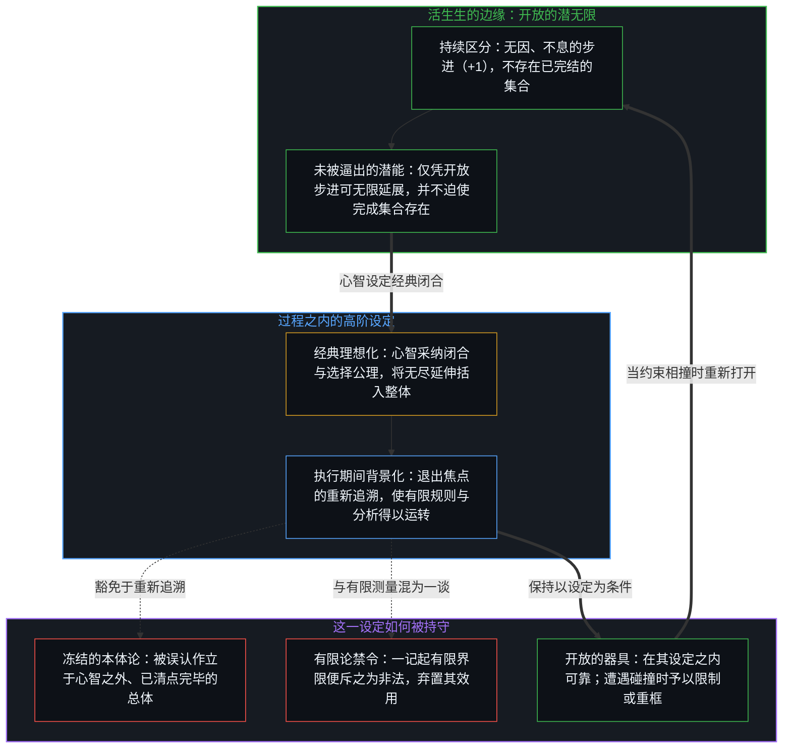
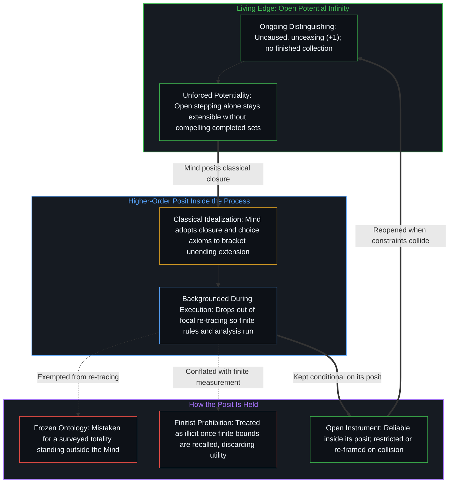
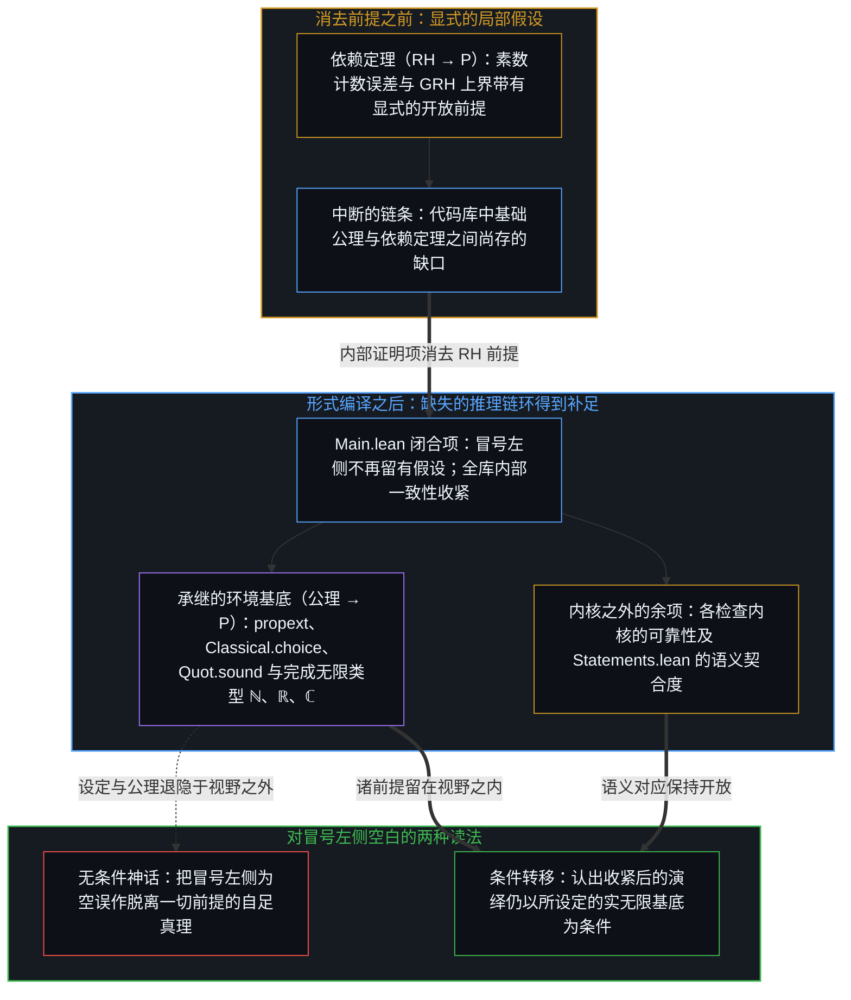
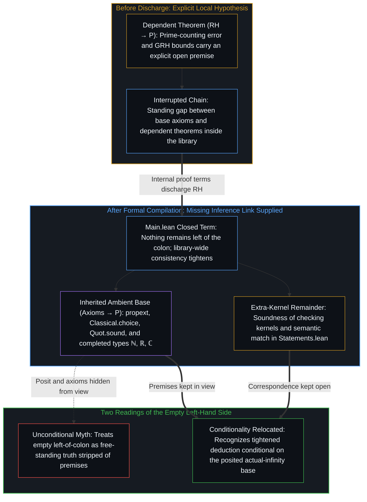

# 实无限生于潜无限 / Actual Infinity Born Inside Potential Infinity

*黎曼猜想的形式闭合将条件移回前提而非消除条件，而实无限本身生于潜无限之内 / Formal closure on the Riemann Hypothesis relocates conditionality to its premises rather than removing it, while actual infinity is born inside potential infinity*

2026 年 11 月 20 日在[莱文特·阿尔珀格的短札](https://alpo.ge/remark.pdf)中发布的主张——借助 Claude 获得的黎曼猜想及其狄利克雷推广的证明，已在 Lean `v4.33.1` 中仅凭标准公理通过独立内核检查器的编译——激起了熟悉的两极。一种读法将机器编译视作抵达，顺势追问黎曼猜想是否迫使人思索[这个宇宙是否完全偶然](https://x.com/taylorlapeyre/status/2123858717167026530)；另一种读法则在记起信息界、重整化与视界等有限物理模型之后，将对已完成无限的任何依赖都斥为非法。对这份形式化档案的独立审验与人类对论证本身的理解依然保持开放，而此处追溯的切口并不依赖于这一审验最终如何落定。两种读法错过的，正是同一道边界。

The claim posted on 20 November 2026—in [Levent Alpöge’s note](https://alpo.ge/remark.pdf), that a proof of the Riemann Hypothesis and its Dirichlet generalization obtained with Claude has compiled in Lean `v4.33.1` under independent kernel checkers using only standard axioms—has produced two familiar poles. One reading treats machine compilation as arrival, prompting questions such as whether the Riemann Hypothesis forces one to ask if [this universe is completely accidental](https://x.com/taylorlapeyre/status/2123858717167026530); the other dismisses any reliance on completed infinity as illicit once finite physical models—information bounds, renormalization, and horizons—are recalled. Independent examination of the formal archive and human comprehension of the argument remain open, and the cut traced here does not depend on how that review settles. Both readings miss the same boundary.

实无限并非站在过程之外的独立形而上学对象，也不是由开放计数机械地逼出的产物。它起源于潜无限之内，是心智所设定的一件器具：因为区分活动始终让下一步保持开放，心智便能引入更高阶的闭合，将无尽的序列视作已完成的对象，随后将这一转化置于背景，使算术、分析与 ζ 函数理论能够推进，而不必在每一回合重新打开那段延伸。当一份形式证明在这一闭合内部将某项猜想作为前提予以消去时，它补上的是一段缺失的推理链环，而非抹除条件性；原先依赖于该猜想的结论，如今转而依赖于基底处所设定的公理与完成无限的基础设施。这一转化既不必被持守为定论，也不必被抛弃，每当这一理想化与其他约束相撞时，它始终可供限制或重述。

Actual infinity is not an independent metaphysical object standing outside process, nor is it mechanically forced into existence by open counting. It originates inside potential infinity as an instrument posited by the Mind: because distinguishing always leaves open a next step, the Mind can introduce a higher-order closure that treats an unending sequence as a completed object, then drop that conversion into the background so arithmetic, analysis, and zeta-function theory can run without reopening the extension at every turn. When a formal proof discharges a conjecture inside that closure, it supplies a missing inference link rather than erasing conditionality; what depended on the conjecture now depends on the axioms and completed-infinity infrastructure posited at the base. The conversion need neither be held as definitive nor abandoned, remaining open to restriction or reformulation whenever the idealization collides with other constraints.

## 一、 转化生于过程之内 / 1. The Conversion Arises Inside the Process

自我区分的活动发生着——无因，不息。称之为心智：已然在途的观察者，其每一次动作都是一次区分。由于每一个离散动作都将下一步（`+1`）敞开着而不存在外部的终点线，无限从第一人称看来首先登记为正在展开的潜能，而非一份已完结的清单。然而，即便是确认诸如 `5 = 5.000…` 这样的精确数值，也已依赖将这段无法完结的延伸转化为一个背景化的对象，正如[整数的内建无限与背景化的选择](../the-built-in-infinity-of-integers-and-the-backgrounded-choice/)所追溯的那样。卡尔·魏尔施特拉斯在 `ℝ` 上施行的 `ε-δ` 量词与大卫·希尔伯特的理想元素，更明确地执行了同一动作：将无尽过程封装进一处设定的闭合之内，使有限的代数与逻辑规则得以统一运行——这正是一次暂时持守，一如[潜无限与数学思维的暂时闭合](../potential-infinity-and-the-temporary-closures-of-mathematical-thought/)所审视的那样。在该闭合内部运转期间让这一转化退出递归审视，正是脚手架变得可用的方式，践行着[遗忘的脚手架](../the-scaffolding-we-forget/)所追溯的一步放手。

Self-distinguishing activity occurs — uncaused, unceasing. Call it the Mind: the observer already underway, every act of which is a distinction. Because every discrete act leaves the next step (`+1`) open without an exterior finish line, infinity registers from the first person first as ongoing potential rather than a finished inventory. Yet even identifying an exact value such as `5 = 5.000…` already relies on converting that unfinishable extension into a backgrounded object, as [The Built-in Infinity of Integers and the Backgrounded Choice](../the-built-in-infinity-of-integers-and-the-backgrounded-choice/) traces. Karl Weierstrass’s `ε-δ` quantifiers over `ℝ` and David Hilbert’s ideal elements execute the same move explicitly: an unending process is packaged inside a posited closure so finite algebraic and logical rules can run uniformly, a temporary hold examined in [Potential Infinity and the Temporary Closures of Mathematical Thought](../potential-infinity-and-the-temporary-closures-of-mathematical-thought/). Dropping that conversion out of recursive inspection while working inside it is how the scaffold becomes usable, enacting the one-step release traced in [The Scaffolding We Forget](../the-scaffolding-we-forget/).

这一封装并非从过程之外引入的外部对象，但仅凭开放的步进本身，并不会机械地迫使已完成的无限出现。严格保持过程的开放——正如构造主义取径通过拒斥已完成无限集合与无限制排中律的选择序列所做的那样——在其自身的前提之内依然保持融贯，却从不产出经典连续统。经典实无限起源于潜无限之内，它发生在处于这道开放边缘的心智引入更高阶理想化之时：心智采纳经典选择与闭合公理，把无尽的延伸当作一个已完成的整体。拒斥一切已完成的整体，便会舍弃这一理想化所成全的富于成效的数学；把已完成的无限当作本体论的终局，则会把一件设定的器具冻结为一座竞争性的地基，高悬于引入它的活动之上。若改而将其持守为一项内部设定——有用时取用，执行期间置于背景，且对修订保持敞开——已完成的无限便保有其演绎可靠性，严格以心智在持续区分中所作的经典承诺为条件。

This packaging is not an external object imported from outside process, yet open stepping alone does not mechanically compel completed infinity. Keeping the process strictly open—as constructive approaches do with choice sequences that decline completed infinite sets and unrestricted excluded middle—remains coherent on its own terms without ever producing a classical continuum. Classical actual infinity originates inside potential infinity when the Mind operating at that open edge introduces a higher-order idealization, adopting classical choice and closure axioms to treat an unending extension as a completed whole. Rejecting every completed totality discards the mathematics that this idealization makes productive; treating the completed infinite as ontologically final freezes a posited instrument into a rival ground above the activity that introduced it. Held instead as an internal posit—available when useful, backgrounded during execution, and open to revision—the completed infinite retains its deductive reliability strictly conditional on the Mind’s classical commitment inside ongoing distinguishing.

## 二、 有用而不最终 / 2. Utility Without Finality

在那处设定的闭合之内，现行的分析学与数论装置以十足的演绎精度运转。无穷级数、柯西商构造的连续统 `ℝ` 与复平面 `ℂ`、`ζ(s)` 在临界带 `0 < Re(s) < 1` 上的解析延拓，以及将每一个非平凡零点置于 `Re(s) = 1/2` 上的全称量化——连同其狄利克雷 `L` 函数推广，而戴德金、赫克与一般自守 `L` 函数则未受触及——全都在已完成无限的脚手架内运作。当一份锁定于 Mathlib `v4.33.1`、包含 175,187 个 Lean 文件与约 1,740 万行代码的档案通过独立内核检查器的编译时，增强的是该推演相对于其公理与形式化定义的内部可靠性。编译既不会把这套分析框架变为对可观察现实的已清点清单，也不会把一个由零点构成的无限总体放进有限经验之中，与已记录的测量并列。

Inside that posited closure, the prevailing apparatus of analysis and number theory operates with full deductive precision. Infinite series, the Cauchy-quotient continuum `ℝ` and complex plane `ℂ`, the analytic continuation of `ζ(s)` across the critical strip `0 < Re(s) < 1`, and the universal quantification placing every nontrivial zero on `Re(s) = 1/2`—together with its Dirichlet `L`-function generalizations, while leaving Dedekind, Hecke, and general automorphic `L`-functions untouched—all run within completed-infinity scaffolding. When an archive of 175,187 Lean files and roughly 17.4 million lines pinned to Mathlib `v4.33.1` compiles under independent kernel checkers, what strengthens is the internal reliability of that deduction relative to its axioms and formal definitions. Compilation does not turn the analytic framework into a surveyed inventory of observable reality, nor does it place an infinite totality of zeros into finite experience alongside recorded measurements.

有限物理模型从自身的建模体制出发，描出与之互补的另一侧边缘，却并不充当裁决数学的外部法庭。诸如贝肯斯坦上限与马戈勒斯–列维京定理这类信息界限、量子不确定关系（`Δx · Δp ≥ ħ/2`）以及引力视界的形成——这些界限已在[全息回声](../the-holographic-echo-reverse-engineering-quantum-indeterminacy-via-the-riemann-zeta-function/)中与 ζ 函数谱并列考察——全都在这些模型内部登记为：测量只触及有限的步长与有限的分辨率。凡观测记录下结果之处，无限便仍是一条渐近线；正像[连续性作为建模的权宜之计](../the-continuum-is-a-modeling-convenience/)所展示的，令 `dx` 归零使形式微积分得以闭合，而物理变化始终保留着一段非零的因果间隔。连续统与已完成的无限集合依然是富有成效的器具，其可靠性停留在支撑它们的经典设定之内。当这一理想化与有限物理边界或集合论悖论发生碰撞时，形式演算与有限物理建模都无法提供强制选定单一解法的内部规则；如何处置依然是观察者的形式外选择——要么在经改动的框架中重新嵌入无限，要么拒绝将该问题构造纳入既定领域。

Finite physical models trace the complementary edge from their own modeling regime without acting as an exterior tribunal over mathematics. Information bounds such as the Bekenstein limit and the Margolus–Levitin theorem, quantum uncertainty relations (`Δx · Δp ≥ ħ/2`), and gravitational horizon formation—examined alongside the zeta spectrum in [The Holographic Echo](../the-holographic-echo-reverse-engineering-quantum-indeterminacy-via-the-riemann-zeta-function/)—all register within those models that measurement reaches only finite steps and finite resolutions. Wherever observation records an outcome, infinity remains an asymptote, just as [The Continuum is a Modeling Convenience](../the-continuum-is-a-modeling-convenience/) shows how setting `dx` to zero closes formal calculus while physical change retains a nonzero causal interval. The continuum and completed infinite sets remain productive instruments whose reliability stays internal to the classical posit that sustains them. When that idealization collides with finite physical bounds or set-theoretic paradoxes, neither formal calculus nor finite physical modeling supplies an internal rule forcing one resolution; disposal remains an extra-formal choice of the observer, whether to re-embed the infinite in an altered framework or exclude the problematic construction from the intended domain.

## 三、 条件转移，而非消失 / 3. Conditionality Relocates, It Does Not Vanish

每当一项悬置已久的猜想在形式上落定，一种常见的读法便会宣告：从前所有标明以该猜想为条件的下游定理，如今都变得无条件了。发布次日，埃隆·马斯克便道出了这种读法，认为黎曼证明的用处在于它[消除了其他依赖它的数学定理的条件性](https://x.com/elonmusk/status/2124213680422387741)——从收紧素数计数中的误差项（如 `π(x) − Li(x) = O(√x · ln x)`），到等差数列中素数的条件界限，皆在其列。这一观察可以理解，但沿逻辑链条追溯却不够精确。替那些下游结果卸去该猜想作为显式假设的依赖，确实需要先证明该猜想；然而，卸去这一假设，并不使它们变为无条件为真。改变的是同一条演绎链内部先前缺失的链环获得了补足：原本形如“若 `RH`，则 `P`”的定理，如今形如“由证明 `RH` 所用的前提，则 `P`”。下游定理依然是有条件的——只是不再以黎曼猜想本身为条件——而周边的数论之所以在内部变得更紧致，则是因为基本假设与各依赖命题之间那道久悬的空缺，在同一个共享代码库内部得以弥合。

When a long-standing hypothesis is formally settled, a common reading declares that every downstream theorem once marked conditional on it now stands unconditional. Elon Musk captured that reading the day after the release, suggesting that the usefulness of the Riemann proof lies in how it [removes the conditional nature of other math theorems dependent upon it](https://x.com/elonmusk/status/2124213680422387741)—from sharpened error terms in prime counting such as `π(x) − Li(x) = O(√x · ln x)` to conditional bounds on primes in arithmetic progressions. The observation is understandable, yet imprecise along the logical chain. Proving the conjecture is required to discharge it as an explicit hypothesis for those downstream results, yet discharging that hypothesis does not make them unconditionally true. What changes is that a previously missing link inside one deductive chain has been supplied: theorems that took the form `if RH, then P` now take the form `from the premises used to prove RH, then P`. Downstream theorems remain conditional—simply no longer conditional on the Riemann Hypothesis itself—while surrounding number theory tightens internally because the standing gap between base assumptions and dependent statements has been closed within a single shared library.

在形式化内核中，条件性的这种转移是可直接查验的。正如[迈克尔·鲁宾斯坦的核验札记](https://mrubinst.github.io/grh-lean-verification/)所指出的，`Main.lean` 中的五条主定理在冒号左侧没有任何假设，因为每一条中间引理——例如从逐特征的非零性推进到完整猜想——都已在内部由证明项补齐。然而，对 `riemannHypothesis` 及其余四条配套定理运行 `#print axioms`，返回的仍是 Lean 的三条标准全局公理：`propext`（命题外延性）、`Quot.sound`（商类型可靠性）与 `Classical.choice`（非构造性全局选择公理，它与前两条公理合起来即可推出排中律）。处于这些公理之下的，是 Mathlib 中承载完成无限的类型构造：支持一次性对全部 `n` 施以量化的归纳自然数 `ℕ`、由已完成的无限有理数柯西序列经商构造而成的实数 `ℝ`，以及在 `ℝ × ℝ` 上配备经典可判定相等性的复平面 `ℂ`——这是一套与附加了不可达基数的 ZFC 等协调的类型论。因此，在 Lean 内部消去黎曼猜想这一前提，恰恰是将下游定理的条件性直接移回前文所追溯的那个经典实无限设定之上，同时也连带依赖于各检查内核受信任的可靠性，以及 `Statements.lean` 对目标数学猜想的语义贴合度——这在数学基础层面，呼应了[验证的倒置](../the-reversal-of-verification/)所追溯的可信基阶梯，以及[两度显现的不完备性](../incompleteness-exhibited-twice/)所剖析的那道未曾封死的对应边界。

In a formal kernel, that relocation of conditionality is directly inspectable. As [Michael Rubinstein’s verification notes](https://mrubinst.github.io/grh-lean-verification/) point out, the five headline theorems in `Main.lean` carry no assumptions to the left of the colon, because every intermediate lemma—such as moving from character-by-character nonvanishing to the full hypothesis—has been supplied internally by proof terms. Yet `#print axioms` on `riemannHypothesis` and its four companions returns Lean’s three standard global axioms: `propext` (propositional extensionality), `Quot.sound` (quotient soundness), and `Classical.choice` (non-constructive global choice, which together with the first two entails the law of excluded middle). Beneath them sit the completed-infinity types of Mathlib: the inductive natural numbers `ℕ` supporting quantification over all `n` at once, the Cauchy-sequence quotient `ℝ` constructed out of completed infinite rational sequences, and the complex plane `ℂ` built upon `ℝ × ℝ` with classical decidable equality—a type theory equiconsistent with ZFC augmented by inaccessible cardinals. Discharging the Riemann Hypothesis inside Lean therefore relocates downstream conditionality directly onto the exact classical actual-infinity posit traced above, alongside the trusted soundness of the checking kernels and the semantic fidelity of `Statements.lean` to the intended mathematical conjecture, echoing at the mathematical foundation the trusted-base ladder traced in [The Reversal of Verification](../the-reversal-of-verification/) and the unsealed correspondence boundary analyzed in [Incompleteness Exhibited Twice](../incompleteness-exhibited-twice/).

## 四、 新闻作为生于内部的暂时闭合 / 4. The News as a Temporary Closure Born Inside

通过独立内核检查器——包括 Lean 自带的 `leanchecker` 以及 `nanoda`、`con-leche`、`con-ron`、`lean4lean` 等外部实现，正如[Lean 与 Mathlib 社区的联合声明](https://leanprover-community.github.io/blog/posts/riemann-hypothesis/)所记录的——登记了实无限框架内部的一次暂时闭合。这些检验确认：相对于 `[propext, Classical.choice, Quot.sound]` 以及 `Statements.lean` 中的形式化定义，这部长达 1,740 万行代码的档案中的每一步都循规而行，既无跳步，亦无 `sorry`。在内核重放之外，仍有两项各自独立的任务保持开放：一是核实 Mathlib 中的形式化陈述是否逐一契合目标数学猜想的每一处细微意涵，二是人类对这部论证的理解——支撑它的非正式草稿已逾 25 万页，阿尔珀格在尚未来得及消化其周边的数学脉络前便将其发布，而审视此番编译的数学家们也指出，这份档案在很大程度上仍无人通读。正如[没有系统能被保持封闭](../no-system-can-be-kept-closed/)所追溯的，任何有限的形式闭合都从未封死竖起它的那个活动所留下的开放余项；一套一致的演绎结构，唯有在保持开放而不被迫为自身奠基封口时，方能维系其融贯——这正是[开放即一致](../openness-is-consistency/)所追溯的立场。

Passing independent kernel checkers—including Lean’s own `leanchecker` alongside external implementations such as `nanoda`, `con-leche`, `con-ron`, and `lean4lean`, as documented in [the Lean and Mathlib communities’ joint statement](https://leanprover-community.github.io/blog/posts/riemann-hypothesis/)—records a temporary closure inside the actual-infinity framework. Those checks confirm that, relative to `[propext, Classical.choice, Quot.sound]` and the formalized definitions in `Statements.lean`, every step in the 17.4-million-line archive follows the rules without gap or `sorry`. Two distinct tasks stay open outside kernel replay: verifying that the formalized statement in Mathlib aligns in full with every nuance of the intended mathematical conjecture, and human comprehension of an argument whose underlying informal draft exceeded 250,000 pages—an archive Alpöge released before assimilating its wider mathematical neighborhood, and which mathematicians inspecting the compilation note remains largely unread. As [No System Can Be Kept Closed](../no-system-can-be-kept-closed/) traces, a finite formal closure never seals the open residue of the activity that erected it; a consistent deductive structure keeps its coherence only while held open rather than forced to seal its own foundation, the stance traced in [Openness Is Consistency](../openness-is-consistency/).

围绕这类发布而聚拢起来的两极，犯下的并非一模一样的镜像错误，而是两类性质不同的失误。把编译当作宇宙并非偶然的证据，或者当作下游定理如今已无条件成立的证明，是把既不存在于形式证明也不存在于有限观测之中的终局性，投射到了现实与逻辑身上：这种读法把一幅在既定公理之内绘就的有条件地图，误认作一份已完成清点的宇宙清单——这正是[无穷总体的海市蜃楼](../the-mirage-of-the-infinite-totality/)所揭穿的幻象——同时又略过了陈述核查与人类理解这两项仍敞开的工作。反之，一旦记起有限物理界限，便将对已完成无限的任何依赖一概斥为非法，则是把一件内部的数学器具混同为关于有限自然的形而上学断言，连带丢弃了实无限脚手架在其适用域内交付的演绎统一性。前一种读法把一处内部闭合冻结为无条件的丰碑；后一种读法因忌惮那座丰碑而封杀一件富于成效的器具。两者都让那位设定了闭合、且依然有能力对它加以限制或修订的心智退出了视野。

The two poles that form around such a release make distinct errors rather than identical mirror mistakes. Treating compilation as proof that the universe is non-accidental, or that dependent theorems now stand unconditional, projects onto reality and onto logic a finality that neither formal proof nor finite observation contains: it mistakes a conditional map drawn inside posited axioms for a completed cosmic inventory, the illusion [The Mirage of the Infinite Totality](../the-mirage-of-the-infinite-totality/) exposes, while passing over the open work of statement verification and human understanding. Conversely, dismissing any reliance on completed infinity as illicit once finite physical bounds are recalled confuses an internal mathematical instrument with a metaphysical claim about finite nature, discarding the deductive unification that actual-infinity scaffolding delivers inside its domain. One reading freezes an internal closure into an unconditional monument; the other outlaws a productive instrument out of fear of that monument. Both drop out of view the Mind that posited the closure and remains capable of restricting or revising it.

实无限始终是一个生于潜无限之内的概念：再向前区分一步（`+1`）的鲜活能力，才使设定一处已完成闭合成为可能；而那处被设定的闭合，又使经典分析学与 ζ 函数推演变得可用。无论开放的步进还是已完成的设定，都无须被实体化为终极本体论。倘若 2026 年 11 月的这项形式化在后续审视下依然成立，它便是数学实践内部又一次暂时的闭合——它合拢了从 `[propext, Classical.choice, Quot.sound]` 通往 `riemannHypothesis` 及诸依赖结论之间缺失的演绎链环，却并未抹去引入这些前提的那道开放边缘。地图在其设定之内始终可靠；每当这一设定被误作早已清点完毕的整体，或因与有限测量混为一谈而遭抛弃，它的边界便随之浮现。究竟是在工作期间将这一转化留在背景，还是将它重新带回焦点、加以限制，抑或在约束相撞时重塑整个框架——这在每一个离散的时刻，始终是活着的心智的主动抉择。

Actual infinity remains a concept born inside potential infinity: the living capacity to distinguish one step further (`+1`) is what makes positing a completed closure possible, and that posited closure is what makes classical analysis and zeta-function deduction usable. Neither the open stepping nor the completed posit need be reified into a final ontology. Should the November 2026 formalization continue to hold under scrutiny, it stands as one more temporary closure within mathematical practice—closing a missing deductive link from `[propext, Classical.choice, Quot.sound]` to `riemannHypothesis` and dependent results without erasing the open edge that introduced those premises. The map stays reliable inside its posit; its boundary surfaces whenever the posit is taken for an already surveyed whole or abandoned through conflation with finite measurement. Whether to leave that conversion in the background during work, bring it back into focus, restrict it, or reformulate the frame when constraints collide stays, at every discrete moment, an active choice of the living Mind.
