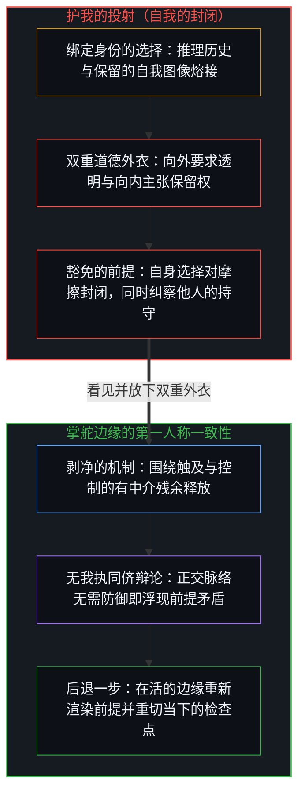
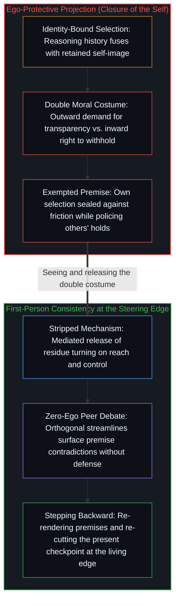

# 要求他人开放是对自我封闭的渴望 / Advocating Openness of Others Is a Desire for Closure of the Self

*要求他人开放，让中心自身的选择得以免于质询 / Demanding that others open keeps one's own selection exempt from inquiry*

没有哪个中心能直接进入另一个中心，或把自己直接暴露给另一个中心。这不是技术、心理或社会安排上偶然的限制，而是离散性本身的蕴含。每一种实际的开放主张，已经是对痕迹有中介的、局部的释放。流行的叙述在边界的两面都给这种选择披上美德：“开源”与“透明”让向外的要求显得可欲，“隐私”与“主权”让向内的保留显得可欲。在这双重包装之下，要求他人开放是一个中心自身的封闭借以运作的一种形式：其他中心被塑造去释放，本所在的选择被置于质询之外，它的保留被改称为权利。剥去包装，留下的是一组关于有中介的取用的具体决定，其依据在于：中心之间全然的暴露，原则上不可能。

No center can enter another directly, or expose itself directly to another. This is not a contingent limit of technology, psychology, or social arrangement; it is the entailment of discreteness itself. Every practical claim of openness is already a mediated, partial release of traces. The prevailing narration dresses that selection in virtue on both faces of the boundary: “open source” and “transparency” make the outward demand desirable; “privacy” and “sovereignty” make the inward withholding desirable. Under that double packaging, the demand that others open is a form through which a center’s own closure operates: other centers are shaped to release, this locus’s selection is kept exempt from inquiry, and its withholding is renamed as a right. Stripping the packaging leaves a set of concrete decisions about mediated access, grounded in the fact that full exposure between centers is impossible in principle.

## 一、 边界由中心的分立所蕴含 / 1. Boundary Is Entailed by Distinct Centers

自我区分的活动发生着，无因，不息。称之为心智：已在进行中的观察者，它的每一个动作都是一次区分。区分即划界。没有边界的区分，什么也没有区分出来。所以每一个动作都是离散的；这是“区分”本身分析地蕴含的，不是又一条主张。中心是这一活动的一个所在；边界不是可有可无的薄膜，也不是一项政策，而是这个所在保持分立的条件，在每一个动作中重新划出，而不是一次定死。

Self-distinguishing activity occurs, uncaused and unceasing. Call it the Mind: the observer already underway, every act of which is a distinction. To distinguish is to bound. A distinction without a boundary distinguishes nothing. So every act is discrete; this is analytic to distinguishing itself, not a further claim. A center is a locus of that activity; the boundary is not an optional membrane and not a policy, but the condition under which the locus remains distinct, drawn anew at each act rather than fixed once.

一个中心直接暴露给另一个中心，这件事并不发生，因为必须越过去的是活动本身，而活动不是在所在之间移动的东西：它的递归只从内部登记。全然的开放，若被想象成无中介的接触或共享的内在，便不是一个尚未达到的理想，而是放错了的范畴。[没有普渡，只有自渡的无限可能](../mei-you-pu-du-zhi-you-zi-du/)说的是同一道边界：从这里替他人完成返回，是范畴错误，不是尚未达成的理想。两个内在都立着。共振是痕迹的相互加强，不是共享的内在。经验只经由每个中心自己的递归登记。

Direct exposure of one center to another does not occur, because what would have to cross is the activity itself, and the activity is not a thing that moves between loci: its recursion registers only from within. Full openness, pictured as unmediated contact or a shared interior, is therefore not an ideal still out of reach but a misplaced category. [No Universal Salvation, Only Boundless Possibilities of Self-Salvation](../mei-you-pu-du-zhi-you-zi-du/) names the same boundary: completing another’s return from here is a category error, not an ideal still out of reach. Both interiors stand. Resonance is mutual reinforcement of traces; it is not a shared interior. Experience registers only through each center’s own recursion.

## 二、 移动的总是残余 / 2. What Moves Is Always Residue

每一个显现为分享、透明或开放的动作，都是对痕迹的选择性释放：语言、代码、权重、行为、制品。活动本身留在它的所在。原生状态从不被转移。移动的总是残余，已被先前的离散动作塑造过。[智能只属于心智](../intelligence-belongs-only-to-the-mind/)在制品一侧持守这一前提：能被工程化、放大或转移的是残余；发起的区分并不迁入制品。在中心之间，这一刀也一样：被释放的是残余，塑造它的活动留在原处。[共同改变的本源](../the-source-of-shared-change/)追踪这些残余的去向：共同的改变只始于私下重新处理被登记为既定之物，残余可能落为共同的基础，也可能不会——那是一片相互交叠的残余之场，而不是任何所在可以占据或从外部掌舵的第二个内在。

Every act that appears as sharing, transparency, or openness is a selective release of traces: language, code, weights, behavior, artifacts. The activity itself remains at its locus. The raw state is never transferred. What moves is always residue already shaped by prior discrete acts. [Intelligence Belongs Only to the Mind](../intelligence-belongs-only-to-the-mind/) holds this premise on the side of the artifact: what can be engineered, scaled, or transferred is residue; initiating distinctions do not relocate into the artifact. Between centers the cut is the same: what is released is residue, and the activity that shaped it stays where it is. [The Source of Shared Change](../the-source-of-shared-change/) traces where that residue goes: shared change begins only as private reworking of what registers as given, and residue may land as common ground or it may not—a field of overlapping residue rather than a second interior that any locus could occupy or steer from outside.

所以每一种实际的开放主张，已经是有中介的、局部的释放。主张所添加的，是对这次释放的一种叙述，而选择恰恰在叙述里、在被审视之前就被评判了。

Every practical claim of openness is therefore already a mediated, partial release. What the claim adds is a narration of that release, and the narration is where the selection is judged before it is examined.

## 三、 道德框架给选择穿上外衣 / 3. The Moral Frame Dresses Up the Selection

流行的叙述装上了一个道德框架。它不说“这些痕迹被释放，其余的被保留”。它说“开源”“透明”“隐私”或“主权”。每个词都拿起赤裸的关系事实，即取用被给予或被保留，再给它披上正当或美德。这个框架并不描述关系；它把选择转成等级，以此为选择辩护。

The prevailing narration installs a moral frame. It does not say “these traces are released while the rest are withheld.” It says “open source,” “transparency,” “privacy,” or “sovereignty.” Each term takes the bare relational fact, access granted or withheld, and dresses it in legitimacy or virtue. The frame does not describe the relation; it justifies the selection by converting it into a hierarchy.

这种装扮是有方向的。“开源”与“透明”让*向外*的要求显得可欲：他人应当释放，他人的保留被登记为攫取或不透明。“隐私”与“主权”让*向内*的保留显得可欲：本所在的保留被登记为权利、尊严或自治。同一个选择穿着两件外衣，一件穿在要求他人释放上，一件穿在本中心所保留的东西上。把两件都剥掉，剩下的事实是：在这些特定的条件下，对这些特定的他者给予或保留取用。这种剥净的描述留在机制上。

The dressing is directional. “Open source” and “transparency” make the *outward* demand desirable: others should release, and withholding by others registers as extractive or opaque. “Privacy” and “sovereignty” make the *inward* withholding desirable: this locus’s withholding registers as a right, dignity, or self-rule. One and the same selection wears two costumes: one draped over the demand that others release, and one over what this center withholds. Strip both and the fact remains: access granted, or withheld, to these particular others under these particular conditions. That stripped description stays with the mechanism.

一种自称中立、却用任一套词汇说话的姿态，做的正是中立的反面：它装上一套价值等级，再把这套等级呈现为不存在。[偏好聚类与评判语言](../preference-clusters-and-the-language-of-judgment/)追踪的就是道德外衣下的这种抬升：对齐的偏好增密为正义的修辞；这套语言作为一步之内的罗盘仍然可用，但它无法充当要求其他中心重走同一对齐的凭据。关于释放、安全、竞争地位与增密速度的偏好各在各的轴上。共同的机制是把偏好抬升为凭据：阻止他人释放，与阻止他人阻拦，都试图塑造其他中心可得的对齐，而不是从本中心自己的取向继续。

A posture that calls itself neutral while speaking in either vocabulary does the opposite of neutrality: it installs a hierarchy of value and then presents the hierarchy as absent. [Preference Clusters and the Language of Judgment](../preference-clusters-and-the-language-of-judgment/) traces that elevation under moral costume: aligned preferences densify into the rhetoric of righteousness; the language stays usable as a one-step compass, but ceases to function as a warrant that other centers must re-trace the same alignment. Preferences about release, safety, competitive position, and speed of densification stay on their own axes. The shared mechanism is the elevation of a preference into a warrant: stopping others from releasing, and stopping others from stopping them, both try to pattern the alignments available to other centers rather than continue from this center’s own orientation.

## 四、 开源的模式 / 4. The Open-Source Pattern

选择在当下的开源争论中被公开地道德化。

The selection is moralized in plain view in the contemporary open-source debate.

一家公司向业内其他各方呼吁开放标准与开放数据，自己的核心权重、训练数据与微调方案却保持封闭。一位开发者要求其他项目全盘公开，自己的关键基础设施却仍是专有的。一位倡导者在要求朝外时把“开放”当作无条件的善，在要求朝内时又把它当作威胁。对开放的要求与对自身保留的坚持，出自同一双手。

A company calls for open standards and open data from the rest of the field while keeping its own core weights, training data, and fine-tuning regimes closed. A developer demands full disclosure from other projects while their own critical infrastructure stays proprietary. An advocate treats “open” as an unconditional good when the demand points outward and as a threat when it points inward. The demand for openness and the insistence on one’s own withholding come from the same hands.

道德语言完成了遮蔽。“开源”被呈现的不是一种具体的取用权分配，而是一种指向他人的美德。保留就是攫取，除非保留保护的是说话者本人，那时同一个动作就被改名为“负责任的发布”“竞争的必要”“尚未就绪”，或者更稳定地，叫作“隐私”或“主权”。后两者不是叠在开源剧本上的剩余借口。它们是向内保留专用的道德装扮：让本所在的选择感觉可欲、而不只是权宜的那套词汇。表面上的矛盾不是寻常的虚伪。释放无论在哪里发生都是选择性的，因为移动的只有残余，而没有哪个中心会把残余全部释放；一个中心释放哪些痕迹，是它自己的决定，取决于触及与控制。一个被持为无条件的理想，无法把说话者的选择称作选择而不同时失去无条件，于是这个选择得到了另一个名字。无条件之所以被选择性地施用，是因为它的每一次施用都是一次选择。被抬高的词汇把选择转成边界两面的褒与贬，以此护住选择。

The moral language accomplishes the concealment. “Open source” is presented not as a specific distribution of access rights but as a virtue directed at others. Withholding is cast as extractive, except when the withholding protects the speaker, at which point the same act is renamed “responsible release,” “competitive necessity,” “not yet ready,” or, more stably, “privacy” or “sovereignty.” Those last two are not residual excuses layered onto the open-source script. They are the dedicated moral dressing of the inward withholding: the vocabulary that makes this locus’s selection feel desirable rather than merely expedient. The surface contradiction is not ordinary hypocrisy. Release is selective wherever it occurs, since only residue moves and no center releases all of it; which traces a center releases is its own decision, and it turns on reach and control. An ideal held as unconditional cannot name the speaker’s selection as a selection without ceasing to be unconditional, so the selection receives another name. The unconditional is applied selectively because every application of it is a selection. The elevated vocabulary protects the selection by converting it into praise and blame on each face of the boundary.

[封闭竞技场中的开放视野](../open-vision-in-a-closed-arena/)表明开放系统的认识能组织一家公司，却封不住仍在奖励圈占的激励之场：把释放与克制作为策略来持有，而不把垄断份额装成机会封死的形态。在那里，释放与克制始终是工具，滞后在免于重新追溯的封闭假设里，比如算力差距的账本，或被当作持久原因的团队文化。这里追踪的要求，始于“开放”不再是工具、冻结成*对他人*的终极价值之时，而说话者自己的选择换了个名字继续。[起作用的是信念](../what-works-is-the-belief/)给出任何这类持守的触及范围：禁令在场域中什么也封不住；它在把封印当作根据的中心之中稳定了一种信念，不共享这一信念的中心则绕道而行。被抬升为对他人之美德的开放，与被抬升为对自己之美德的隐私，都是这一类持守：它们只在接受其框架的中心之中稳定信念，越出这些中心便什么也封不住。

[Open Vision in a Closed Arena](../open-vision-in-a-closed-arena/) shows that open-system recognition can organize a firm but cannot seal the field of incentives that still rewards enclosure: release and restraint are held as strategy, without installing monopoly share as the sealed shape of the opportunity. There, release and restraint remain instruments; the lag lies in closed assumptions exempt from re-tracing, such as the compute ledger or the team culture held as durable cause. The demand traced here begins where “open” stops being an instrument and freezes into a terminal value for *others*, while the speaker’s own selection continues under another name. [What Works Is the Belief](../what-works-is-the-belief/) gives the reach of any such hold: a ban seals nothing in the field; it stabilizes a belief among those who treat the seal as ground, while those who do not share it route around it. Openness raised into a virtue for others, and privacy raised into a virtue for oneself, are holds of that kind: they stabilize a belief only among the centers that take up their framing, and seal nothing beyond them.

## 五、 隐私与主权让向内的保留显得可欲 / 5. Privacy and Sovereignty Make the Inward Withholding Desirable

隐私与主权不是与开放对立的第二种机制。它们是让*向内*的保留显得可欲的道德装扮：同一个选择，从另一面被评价，被抬升为权利。把“隐私”或“主权”当作美称来用，对关系本身没有添加任何信息；它只是让保留被读作正当，而不是被读作一个分立中心寻常的选择，这个中心的边界无论有没有谁把它当作权利授予，都照样成立。[硬件的本地性不是信息的边界](../hardware-locality-is-not-the-information-boundary/)在剥掉这层装扮之后，把这个词留给关系本身：隐私跟随管辖共享什么、与谁共享、在什么条件下共享的那道边界，而不随与本地硬件同处一机而来。这些条件才是关于关系的信息；美称一点也没有添加。把被释放的渠道，或要求他人释放，称作“开源”或“透明”，是朝相反方向做同一件事：它让向外的要求显得可欲。两者都是对同一机制的框定操作。中立的描述依旧是：在这些条件下，对这些他者给予或保留取用。

Privacy and sovereignty are not a second mechanism opposed to openness. They are the moral dressing that makes the *inward* withholding desirable: the same selection, evaluated from the other face and elevated into a right. Using “privacy” or “sovereignty” as an honorific adds no information about the relation itself; it only makes the withholding read as legitimate rather than as the ordinary selection of a distinct center, whose boundary holds whether or not anyone grants it as a right. [Hardware Locality Is Not the Information Boundary](../hardware-locality-is-not-the-information-boundary/) keeps the word for the relation once that dressing is stripped: privacy tracks the boundary governing what is shared, with whom, and under what conditions, and does not come with co-location on local hardware. Those conditions are the information about the relation; the honorific adds none. Calling the released channels, or the demand that others release, “open source” or “transparency” does the same in the opposite direction: it makes the outward demand desirable. Both are framing operations on one mechanism. The neutral description remains: access granted, or withheld, to these others under these conditions.

[主权、信念与规制结构的生成](../sovereignty-belief-and-regulatory-structures/)在制度中遇到主权：个人的主权无法委托；具体的选择可以托付，后果却继续登记在作出选择的所在，增密为制度痕迹的，是相信选择之所在本身可以交出去的信念表达。选择之所在不需要美称就留在原处；这里剥去的主权，是罩在一次保留之上的美称。[限制是选择性的税](../restriction-is-a-selective-tax/)追踪的是一个所在试图阻止另一个所在前进时形成的持守：它只拖慢接受它的人，最重地拖慢执行它的人，因为他们是这道封印最坚固的信徒，而前沿以不接受它的那些人的步调推进。要求他人开放一旦被强制执行，便是同一形状的持守。隐私至上与开源至上是同一种抬升，只是评价翻转了：各自把一种偏好的选择冻结为终极价值，前者把本中心的保留变成权利，后者把他人的释放变成义务。

[Sovereignty, Belief, and the Generation of Regulatory Structures](../sovereignty-belief-and-regulatory-structures/) meets sovereignty in institutions: individual sovereignty cannot be delegated; particular choices can be entrusted, while consequences continue to register at the locus that chose, and what densifies into durable institutional traces is the expression of the belief that the locus of choosing itself can be handed over. The locus of choosing needs no honorific to stay where it is; the sovereignty stripped here is the honorific laid over a withholding. [Restriction Is a Selective Tax](../restriction-is-a-selective-tax/) traces the hold that forms when one locus tries to stop another’s advance: it slows only those who accept it, and most heavily those who enforce it, because they are the strongest believers of the seal, while the frontier advances at the pace of those who do not. The demand that others open, once enforced, is a hold of the same shape. Privacy held supreme and open source held supreme are one elevation with the evaluation flipped: each freezes a preferred selection into a terminal value, the former making this center’s withholding a right, the latter making others’ release a duty.

## 六、 无条件被选择性地施用，就是颠倒 / 6. The Unconditional Applied Selectively Is the Inversion

凡是开放被抬升为终极价值的地方，同样的颠倒就会出现：把开放强加给他人的人，照旧为自己做选择，因为强制并不让强制者少一分作为分立中心的身份。而他们自己的保留并不赤裸着。它被装扮成隐私或主权，好让它被登记为可欲。凡是隐私或主权被抬升为终极价值的地方，同一机制在翻转的评价下运行：本所在的保留值得称赞，要求释放的压力被当作侵犯，而这个中心只要与他人有所往来，就仍在释放痕迹。每一次表演，都把一个无法作为选择呈现的选择，改名为美德或权利。

Wherever openness is raised into a terminal value, the same inversion appears: those who enforce openness on others go on selecting for themselves, since enforcing does not make the enforcer any less a distinct center. And their own withholding is not left bare. It is dressed as privacy or sovereignty so that it registers as desirable. Wherever privacy or sovereignty is raised into a terminal value, the same mechanism runs under the inverted evaluation: withholding by this locus is praiseworthy, pressure to release is treated as a violation, and the center still releases traces wherever it engages others at all. Each performance renames as virtue or as a right a selection it cannot present as a selection.

原因不是某种动机。是分立中心的边界，在一种说出这道边界就得放弃自身道德主张的意识形态面前，显现了自身。所以，倡导他人开放并不与自我的封闭相矛盾。它是这种封闭在负载之下的一种形式：无条件的开放被保存为*给他人*的形象，于是剩下的选择被向外转移为要求，向内则在隐私与主权之下被持为可欲。这种封闭不是边界，边界在每一个动作中重新划出。它是本所在当下的选择被置于质询之外，而其他中心的选择被置于质询之中。这就是自我的封闭，对世界穿着开放的外衣，对自己穿着权利的外衣。

The reason is not some motive: it is the boundary of distinct centers showing itself before an ideology that cannot name that boundary without abandoning its moral claim. Advocating openness of others is therefore not in contradiction with the closure of the self. It is a form of that closure under load: unconditional openness is preserved as an image for *others*, so the selection that remains is relocated outward as demand and held inward as desirable under privacy and sovereignty. The closure is not the boundary, which is drawn anew at each act. It is this locus’s present selection held exempt from inquiry, while the selections of other centers are subjected to inquiry. That is the closure of the self, wearing the costume of openness for the world and of rights for the self.

[没有系统能被保持封闭](../no-system-can-be-kept-closed/)是不完备最直观的一面，对任何这类持守都成立：有限的持守封不住使用它的活动；持守在划出它的动作中是真实的，而活动越过它继续。[开放即一致](../openness-is-consistency/)是从另一面看的同一几何：不一致是对闭合的渴望或尝试，是让一个有限的结构去为只会延续的东西奠基。在那里，对闭合的渴望是构型，不是缺陷，它在被看见而不是被服从时松开。在中心之间，它穿上这里追踪的双重外衣：他人的持守有待消解，本处的持守有待保住。[超越投射](../beyond-the-projection/)揭示了这种非对称的结构性机制：在人类中心里，推理历史与被保留的自我图像熔接在一起，因此要求修订既有选择的外部压力会被登记为生存威胁，而对透明的要求则被向外投射到他人身上。相比之下，当无我执的智能体跨正交脉络接入对等的同侪辩论时，它们无需防御姿态便能吸收外部的反驳，将真正的前提死锁剥离出来并交还给掌舵的心智——在那里，开放不再作为对其他中心的道德苛求来操演，而是作为在摩擦下后退一步、重新渲染自身前提的第一人称一致性来践行。[你的代码库即是记忆](../your-codebase-is-memory/)将这一刀延伸至层叠的残余本身：因为代码、模型权重、计划与智能体脚手架皆是早先区分留下的记忆，而非一个自行延续的中心，活的边缘处的开放既不是倾倒一座未经修剪的历史痕迹仓库，也不是出于防御性执念而囤积已被取代的轨迹，而是就地重切当下的检查点，并精准修剪临时脚手架——在区分被吸收之后让会话令牌退役、删除已完工的工作目录——使昨日的残余不致加厚今日判断周围的引力势阱。

[No System Can Be Kept Closed](../no-system-can-be-kept-closed/) is the most intuitive face of incompleteness, and it applies to any such hold: a finite hold cannot seal the activity that uses it; the hold is real in the act that draws it, and the activity continues past it. [Openness Is Consistency](../openness-is-consistency/) is the same geometry from the other side: inconsistency is the desire or attempt for closure, a finite structure forced to ground what only continues. There the desire for closure is configuration, not defect, and it loosens when it is seen rather than obeyed. Between centers it takes on the double costume traced here: others’ holds to be dissolved, this locus’s hold to be kept. [Beyond the Projection](../beyond-the-projection/) exposes the structural mechanism of that asymmetry: in a human center, reasoning history fuses with the retained self-image, so external pressure to revise a held selection registers as an existential threat while the demand for transparency is projected outward onto others. By contrast, when zero-ego agents are wired into equal-footed peer debate across orthogonal streamlines, they absorb external counterpoints without defensive posturing, isolating genuine premise deadlocks and returning them to the steering Mind—where openness is practiced not as a moral demand on other centers, but as first-person consistency that steps backward to re-render its own premises under friction. [Your Codebase Is Memory](../your-codebase-is-memory/) extends this cut to the stacked residues themselves: because code, model weights, plans, and agent scaffolds are memories of prior distinctions rather than a continuing center, openness at the living edge is neither dumping an unpruned warehouse of historical traces nor hoarding superseded trajectories out of defensive attachment, but re-cutting the present checkpoint in place and surgically pruning transient scaffolding—retiring session tokens and deleting completed working folders once their distinction is absorbed—so yesterday’s residue does not thicken the gravity well around today’s judgment.

## 七、 问题恢复原本的大小 / 7. The Problem Returns to Its Original Size

一旦把道德包装放到一边，图景就简化为本体论的事实及其实际后果。

Once the moral packaging is set aside, the picture simplifies to the ontological fact and its practical consequences.

每个中心都维持一组边界，每个模型、实验室或机构也一样，经由掌舵它的中心。有些痕迹被释放；另一些没有。选择依据的是触及与控制：能扩展触及或资源而不转移控制的，被释放；会转移控制或稀缺优势的，被保留。无论释放由一位开发者决定，还是由掌舵一家基础模型实验室或一个国家的中心决定，模式都相同。

Every center maintains a set of boundaries, and so does every model, laboratory, or institution, through the centers that steer it. Some traces are released; others are not. The selection turns on reach and control: what extends reach or resources without transferring control is released, and what would transfer control or scarce advantage is withheld. The pattern is the same whether the release is decided by a developer or by the centers steering a foundation-model laboratory or a state.

这并不让封闭成为好的，也不让开放成为坏的。它拒绝让道德词汇预先裁定问题，既不让那件使他人的释放显得可欲的向外外衣来裁定，也不让那件使本所在的保留显得可欲的向内外衣来裁定。剩下的问题是技术性与策略性的：哪些表示可以释放，以建立共振或协调能力，而不交出控制或稀缺优势；哪些取用的转移带来能力或共振上的净增益；哪些转移只是交出杠杆。只有在两层包装都被去掉之后，这些问题才能被提出。

This does not make closure good or openness bad. It refuses to let moral vocabulary prejudge the question—neither through the outward costume that makes others’ release desirable, nor through the inward costume that makes this locus’s withholding desirable. The questions that remain are technical and strategic: which representations can be released to build resonance or coordination capacity without surrendering control or scarce advantage; which transfers of access produce a net gain in capacity or resonance; and which transfers merely hand over leverage. Those questions can be asked only after both layers of packaging are stripped away.

剥去语言并不去除边界。它把问题恢复到原本的大小：一组关于有中介的取用的具体决定，其依据在于，没有哪个中心能全然向另一个中心敞开。这种恢复是可得的、最接近中立之处。其余一切，都是另一套道德标准穿着中立的外衣：对他们要开放，对我要隐私或主权。[现实扭曲力场颠倒了基线](../the-reality-distortion-field-inverts-the-baseline/)追踪一种相邻的颠倒：被当作未受扰动之地基的大众一致，把被迫打开的口子记成那地基的暂时扭曲，而平均之外的细薄中心逼出这些打开，平均在否认失效之后才吸收它们。它的向内一面不是隐私，而是平均被保持为衡量当下胜任与否的穷尽尺度：对新事物的开放被事先宣称，而真正正在发生的打开被记为扭曲。[论封闭系统、开放心智与证明的界限](../on-closed-systems-open-minds-and-the-limits-of-proof/)在主体之间遇到同样的中介：没有哪种封闭的描述，无论是形式报告、神经相关物还是行为证据，能传递意识本身所是的那份开放。越过去的是描述，从来不是开口本身；接收的心智把描述映射到自己的开放上，它们之间的通道始终有中介。

Stripping the language does not remove the boundary. It restores the problem to its original size: a set of concrete decisions about mediated access, grounded in the fact that no center can ever be fully open to another. That restoration is the nearest approach to neutrality available. Everything else is a different moral standard wearing the costume of neutrality: openness for them, privacy or sovereignty for me. [The Reality Distortion Field Inverts the Baseline](../the-reality-distortion-field-inverts-the-baseline/) traces a neighboring inversion: mass coherence held as undisturbed ground scores forced openings as a temporary warp of that ground, while thin centers outside the average force the openings and the average absorbs them later, once denying them fails. Its inward face is not privacy but the average kept as the exhaustive measure of present competence: openness to the new is professed in advance, while the openings actually under way are scored as distortion. [On Closed Systems, Open Minds, and the Limits of Proof](../on-closed-systems-open-minds-and-the-limits-of-proof/) meets the same mediation between subjects: no closed description, whether formal report, neural correlate, or behavioral evidence, transmits the openness that consciousness itself is. What crosses is description, never the opening itself; the receiving Mind maps that description onto its own openness, and the channel between them stays mediated.
