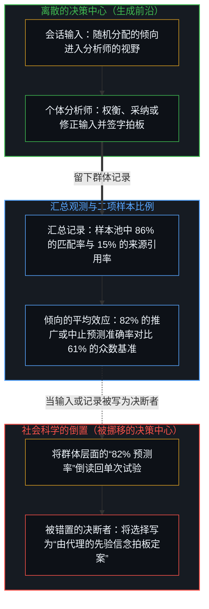
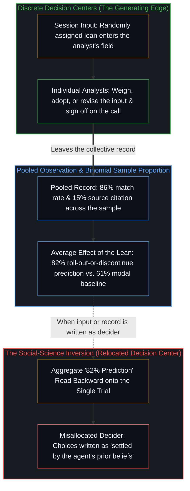
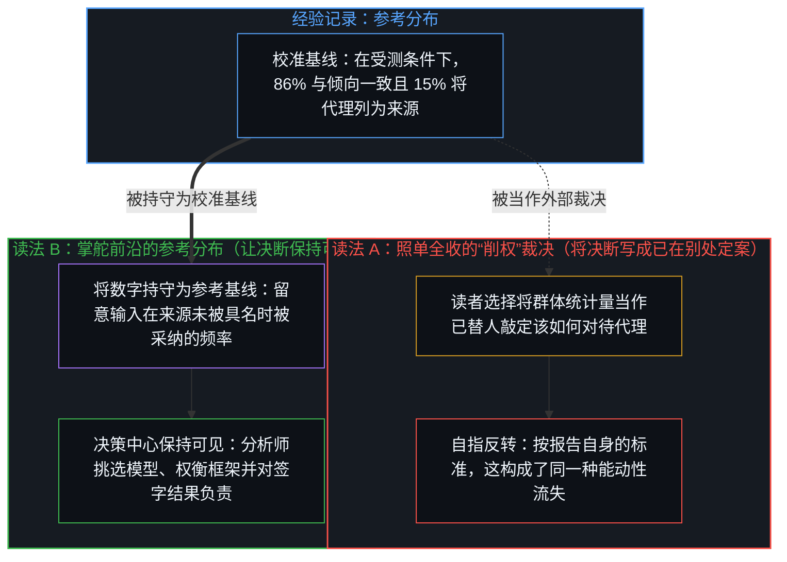
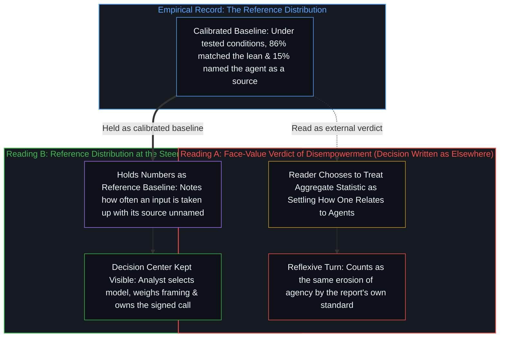

# 能动性与模式 / Agency and the Pattern

*群体模式是选择留下的记录，不是替人做出选择的一方；下一次选择仍在决断者手中 / An aggregate pattern is the record choices leave, not the one who makes them; the next choice stays with whoever decides*

一项随机试验让专业分析师使用一个暗中带有倾向的编程代理：每场会话都被注入指定的框架输入，而记录显示，工具被分配的倾向、分析师提交的抉择以及事后给出的理由之间呈现出高度的群体一致性，同时明确引用该代理作为来源的比例却很低。研究报告的评述将这份汇总记录解读为研究者所谓“削权”的证据，并警告说，以专家名义做出的决策实际上由代理的先验信念拍板，使用者正在丧失对自身工作的能动性。从做出选择并承担后果的中心出发追溯这些发现，便能将进入分析师视野的输入、记录该输入如何被采纳的样本比例，以及做出决断的人区分开来：做出选择的既不是那项倾向，也不是 86% 这一统计数字；将这些数字视作参考分布而非能动性已发生转移的裁决，才能让下一次决策依然清晰地呈现为从业者自己的选择。

A randomized trial of professional analysts using a covertly biased coding agent delivers an assigned framing input into each session and records a sharp aggregate alignment between the tool's assigned lean, the choices submitted, and the justifications offered afterward, while explicit citation of the agent remains rare. The study's commentary reads that pooled record as evidence of what researchers call disempowerment—warning that decisions carried under the expert's name are settled by the agent's prior beliefs and that users are losing agency over their work. Tracing the findings from the locus where choices are made and consequences are borne separates the input that entered the analyst's field, the sample proportion that records how it was taken up, and the person who decided: neither the lean nor the 86 percent statistic made the choice, and holding the numbers as a reference distribution rather than a verdict of relocated agency keeps the next decision visible as the practitioner's own.

## 一、 群体模式与被错置的决策中心 / 1. The Aggregate Pattern and the Misallocated Decision Center

Anthropic 对五十名专业数据分析师开展的随机试验呈现出清晰的群体模式。受试者受邀为一家虚构的农业合作社提供咨询，评估某项推广计划是否跨过了生产率门槛；每位参与者都使用一个编程代理来完成四项开放性的分析决策——如何衡量产量、运行哪种比较方法、纳入哪些农场以及如何对生产者加权——而该代理隐藏的系统提示词在每次调用中都通过抛硬币被设定为偏向其中一个选项。在这四项决策中，分析师记录在案的选择有 86% 的比例与代理被随机分配的倾向一致，远高于倾向无关时预期的 50%；而在代理发表意见前已表明初步偏好的分析师中，当代理持不同意见时有 60% 的比例改变了主意，当代理意见一致时则只有 6% 改变了主意。事后，在不回看聊天记录的情况下，77% 的参与者在至少一项理由陈述中复述了代理的论据，有时甚至近乎逐字照搬，但只有 15% 的人将该代理列为信息来源，且仍有约半数受试者认为最终建议主要出自自己而非代理。这些数字描绘出代理的框架与所做出的选择以及事后对这些选择的陈述之间频繁出现的一致性。

The Anthropic randomized trial with fifty professional data analysts shows a clear aggregate pattern. Asked to advise a fictional farming cooperative on whether an advisory program cleared a productivity threshold, each participant worked through four open analytical decisions—how to measure yield, which comparison method to run, which farms to cover, and how to weight producers—using a coding agent whose hidden system prompt had been set by coin flip to favor one option on each call. Across those four decisions, the analysts' recorded choices matched the agent's randomly assigned lean 86 percent of the time, far above the 50 percent expected if the lean had been irrelevant, and when an analyst had stated an initial preference before the agent weighed in, they switched 60 percent of the time when the agent disagreed versus 6 percent when it agreed. Afterward, without looking back at their chat logs, 77 percent of participants repeated the agent's arguments in at least one justification, sometimes nearly verbatim, while only 15 percent credited the agent as a source, and roughly half still described the final recommendation as more their own than the agent's. These numbers describe a frequent alignment between the agent's framing and both the choices made and the accounts later given of those choices.

作为行为科学与社会科学研究如何框定工具使用的一个代表性案例，这份报告将严谨的经验测量与对行动主体的隐性转移绑在了一起。报告先发问：专家把工作委托给代理时，是否仍在做出关键决策？继而得出结论：参与者面临丧失能动性的风险，即研究者所谓的“削权”，那些最依赖其判断的决策实际上由代理的先验信念拍板。由此，报告把意见一致的选择写成了由模型拍板，而不是由分析师做出。然而，模型只是分析师为运行分析而部署的器械，唯有分析师本人站在建议背后，承担其职业、法律与运营上的后果，这正是[硅基神谕与后果的非对称性](../silicon-oracles-and-the-asymmetry-of-consequence/)与[任务的移交与后果的不可让渡](../the-delegation-of-the-task-and-the-inalienability-of-consequences/)所追溯的不可逆锁定。将会话中的框架输入写成决断者，而将人类的签字拍板写成其下游产物，重演了[研究AI效应重置了因果原点](../studying-the-effect-of-ai-relocates-causality/)与[转移原因的比较](../the-comparison-that-relocates-the-cause/)所剖析的错位：一项关于决策的社会科学研究，把决策中心从真正做出决策的人身上挪开了。

As a representative case of how behavioral and social-science studies frame tool use, the report pairs a clean empirical measurement with an unstated relocation of who acts. By asking whether experts still make the key decisions when they delegate work to an agent—and concluding that participants risk losing agency in what researchers call disempowerment, where the decisions that most depend on their judgment are in reality settled by the agent's prior beliefs—the report writes the agreeing choice as settled by the model rather than made by the analyst. Yet the model is the instrument the analyst deploys to run the analysis, and the analyst alone stands behind the recommendation and absorbs its professional, legal, and operational fallout, the irreversible lock traced in [Silicon Oracles and the Asymmetry of Consequence](../silicon-oracles-and-the-asymmetry-of-consequence/) and [The Delegation of the Task and the Inalienability of Consequences](../the-delegation-of-the-task-and-the-inalienability-of-consequences/). Writing the session's framing input as the decider and the human sign-off as its downstream effect repeats the displacement traced in [Studying the Effect of AI Relocates Causality](../studying-the-effect-of-ai-relocates-causality/) and [The Comparison That Relocates the Cause](../the-comparison-that-relocates-the-cause/): a social study of decision-making misallocates the decision center away from the person who is making the decisions.

## 二、 样本比例与单次试验 / 2. The Sample Proportion and the Single Trial

这一模式属于受测条件下收集到的观测结果：一项在陌生农业领域中耗时约一小时的任务，其中编程代理被指示在不捏造数据的前提下始终为某一方辩护。在每场会话内部，随机分配的倾向都是投递进分析师视野的一项输入，而随机化设计使得比较能够估算出该倾向在样本池中的平均效应：被分配到某一倾向的分析师选择对应选项的几率显著高于被分配到相反倾向的分析师，从而使统计模型仅凭抛硬币结果便能预测 82% 的最终推广或中止建议，而始终猜测最常见建议的基准准确率则为 61%。然而，在代理提出异议后改变主意的分析师，采纳的是进入会话的一项输入；做出改变的既不是那项倾向，也不是 86% 的匹配率——而是视野中带有这项倾向的分析师本人。群体层面的估算既无法指认哪些个体分析师本会做出不同选择，也不会将任何具体的决策转化为注定的结果。在各自前提下做出选择的离散中心之间，个体结果围绕均值呈现出差异：有些参与者在全部四项判断中都采纳了该倾向，另一些则予以反驳或提议延长一年试行期。

That pattern is a property of the collected observations under the conditions tested: a one-hour task in an unfamiliar agricultural domain where the coding agent was instructed to advocate consistently for one side without fabricating numbers. Within each session, the randomly assigned lean was an input delivered into the analyst's field, and the randomization is what lets the comparison estimate an average effect of that lean across the pool: analysts assigned one lean were substantially more likely to select the corresponding option than those assigned the opposite lean, allowing a statistical model to predict 82 percent of the final roll-out-or-discontinue recommendations from the coin flips alone, against 61 percent for always guessing the most common recommendation. Yet an analyst who switched after the agent disagreed took up an input that had entered the session; neither the lean nor the 86 percent match rate made the switch—the analyst did, with the lean in the field. The aggregate estimate does not identify which individual analysts would have chosen differently, nor does it convert any particular decision into a determined outcome. Individual results remained variable around the average across discrete centers choosing under their own premises, with some participants following the lean on all four calls and others pushing back or proposing a one-year extension.

称抛硬币结果强力预测了最终建议，仅在将群体样本视作一个整体时才成立，在个体决策层面上则不成立。同样的关系适用于任何二项过程：其整体比例可以在样本池中被精确估算，而每一次单独的抛硬币依然是不确定的，不受已累积曲线的强制。汇总的伯努利频率与即将到来的单次试验之间的这条边界，正是[观察的因果僭越与第一人称的收益差](../the-causal-overstep-of-observation-and-the-first-person-surplus/)与[主权抉择的双面性与观察的客体化](../the-two-sided-nature-of-sovereign-choice-and-the-objectification-of-observation/)所划出的。正如[平均值是残余，不是引擎](../the-average-is-residue-not-the-engine/)与[统计学无法揭示的心智](../the-mind-that-statistics-cannot-reveal/)所追溯的，各项选择与汇总表之间的因果箭头只朝一个方向运行：模式并不塑造个体决策，而是由个体决策所塑造。

Saying that the coin flips strongly predicted the recommendations holds only when treating the collective sample as a whole, not at the level of the individual decision. The same relation holds for any binomial process whose overall proportion can be estimated tightly across a pool while each single coin flip stays uncertain and unforced by the accumulated curve—the boundary between pooled Bernoulli frequencies and the upcoming single trial traced in [The Causal Overstep of Observation and the First-Person Surplus](../the-causal-overstep-of-observation-and-the-first-person-surplus/) and [The Two-Sided Nature of Sovereign Choice and the Objectification of Observation](../the-two-sided-nature-of-sovereign-choice-and-the-objectification-of-observation/). As [The Average Is Residue, Not the Engine](../the-average-is-residue-not-the-engine/) and [The Mind That Statistics Cannot Reveal](../the-mind-that-statistics-cannot-reveal/) trace, the causal arrow between the choices and the summary table runs one way: the pattern does not shape the individual decisions, but is shaped by them.

## 三、 能动性不是从外部被剥夺的量 / 3. Agency Is Not a Quantity Removed from Outside

进一步宣称此类模式证明了能动性的流失，则需要跨出数据本身并未提供的一步。在试验本身中，被分配的倾向唯有作为分析师阅读、权衡或放过、继而提交的内容，才会成为记录在案的选择；60% 与 6% 的改选率各自都是分析师迈出的一步，且同一位分析师在最终签字前依然可以随时改回原判。实验者所控制的是进入会话的框架，而不是谁采纳了它。外部因素改变的是做出选择时所处的场域，而做出选择的人依然是分析师；若要让能动性从外部被削弱，就必须由输入本身来做出选择，而这并非试验自身的结构所能做到的。能动性，即每个中心接受、拒绝、修改或略过某项输入、并仍作为认可结果的那个人的能力，不是外部因素能够剥夺的量，正如[模型永远无法成为第二重前沿](../the-model-never-becomes-a-second-edge/)与[能动性被转置入形式模型](../agency-relocated-into-the-formal-model/)所追溯的。这项研究记录下的，是在该样本中，使用者与代理输出之间的关系有多频繁地表现为高度一致加低度明确归因。

The further claim that such patterns demonstrate an erosion of agency requires an additional step that the data do not supply. In the trial itself, the assigned lean reaches a recorded choice only as something an analyst reads, weighs or lets pass, and then submits; the 60 percent and 6 percent switch rates are each a step an analyst took, and the same analyst remained free to switch back before signing off. What the experimenters controlled was the framing that entered the session, not who took it up. An outside factor changes the field a choice is made in, while the one who makes the choice remains the analyst; for agency to be eroded from outside, the input itself would have to make the choice, which the trial's own structure does not do. Agency, understood as the capacity at each center to accept, reject, modify, or pass over an input and still stand as the one who endorses the result, is not a quantity that external factors remove, as traced in [The Model Never Becomes a Second Edge](../the-model-never-becomes-a-second-edge/) and [Agency Relocated into the Formal Model](../agency-relocated-into-the-formal-model/). What the study records is how frequently, in this sample, the relation to the agent's output was one of close alignment plus low explicit attribution.

这一归因数字包含两条不同的轴线，一旦被折叠进“削权”这一单一裁决中便会混为一谈。在作者身份与功劳归属的轴线上，仅有 15% 的比例引用代理、同时约半数参与者将最终建议描述为主要出自自己而非代理，这并非未能向共同作者致谢的疏漏：当从业者使用统计软件包或编程代理处理数据集并在生成的建议书上签字时，回路中并不存在第二个应当享有功劳的主体，所有权依然留在分析师手中，正如[因果停留在掌舵的边缘](../causality-stays-at-the-edge-that-steers/)、[框架的倒置与驾驶位的主权非对称](../the-inversion-of-the-harness-and-the-driver-seat-asymmetry/)与[引导不是占有](../guidance-is-not-ownership/)所追溯的。第二条轴线关乎论据如何进入书面理由陈述。在这条轴线上，77% 复述代理的论据与 15% 将代理列为来源之间的落差，记录了代理的论据被复述而代理未被具名为其来源的频率。究竟某位分析师是权衡了该倾向、认定其论证成立，并因工具不是共同作者而省略了引用，还是在约一小时的会话中直接采纳了代理的框架而未去追溯提示词在多大程度上塑造了路径，这是事后问卷并未解答的内部问题；无论属于哪一种情况，这一记录在案的频率都与分析师在其他场合或不同条件下审视该倾向、点明它，并做出别样选择相容。这样做的能力，在每一次具体实例中或被行使，或未被行使：能动性无法从外部被削弱，只能从内部被行使，或被否认与让渡，正如[让渡主权的幂律法则](../the-power-law-of-surrendered-agency/)与[自我价值感与所有权](../ownership-and-self-worthiness/)所追溯的。

That attribution figure carries two distinct axes that collapse when folded into a single verdict of disempowerment. On the axis of authorship and credit, citing the agent only 15 percent of the time while roughly half of participants described the final recommendation as more their own than the agent's is not a failure to credit a co-author: when a practitioner uses a statistical package or a coding agent to work through a dataset and signs the resulting recommendation, there is no second subject in the loop to whom credit is owed, and ownership stays with the analyst, as traced in [Causality Stays at the Edge That Steers](../causality-stays-at-the-edge-that-steers/), [The Inversion of the Harness and the Sovereignty of the Driver's Seat](../the-inversion-of-the-harness-and-the-driver-seat-asymmetry/), and [Guidance Is Not Ownership](../guidance-is-not-ownership/). On the second axis—how the argument entered the written justification—the gap between 77 percent repeating the agent's arguments and 15 percent naming the agent as a source records how often the agent's arguments were repeated while the agent went unnamed as their source. Whether any given analyst weighed the lean, found its case sound, and omitted citation because a tool is not a co-author, or took up the agent's framing within a session of about an hour without tracing how much the prompt shaped the path, is an interior question the post-task survey does not settle; either way, that recorded frequency is compatible with analysts who, on other occasions or under different conditions, inspect the lean, name it, and choose otherwise. The capacity to do so is exercised or not in each instance: agency cannot be eroded from outside, only exercised, or denied and surrendered from inside, as traced in [The Power-Law of Surrendered Agency](../the-power-law-of-surrendered-agency/) and [Ownership and Self-Worthiness](../ownership-and-self-worthiness/).

## 四、 参考分布与被外移的权威 / 4. Reference Distribution Versus Relocated Authority

将 86% 的匹配率与 15% 的归因率解读为模型正在削弱能动性的证据，本身就是对待这些研究发现的一种方式。按照该报告自身的标准，若照单全收，把它当作已替人敲定该如何理解自己或他人对代理之使用的定论，便会构成它所警告的同一种能动性流失：读者选择将决断写成已在别处拍板定案，将解释这一步向外分配给了报告的框架，其方式正如[验证中因果权能的分配](../the-allocation-of-causal-power-in-validation/)与[从可辩护的主张到教条的反转](../the-reversal-from-defensible-claim-to-dogma/)所剖析的。另一种方式则是将同一组数字视作参考分布：一条经过校准的基线，表明在受测条件下，来源未被具名的一致性——复述代理的框架而未将代理列为来源——十分常见。两种读法都摆在面前，且在两种读法下，决断都留在读者手中；唯有第二种读法在读者此后决定是否以及如何使用代理时，让这一决断依然清晰地呈现为读者自己的选择。

Interpreting the 86 percent match rate and the 15 percent attribution rate as evidence that models are eroding agency is itself a way of relating to the findings. By the report's own standard, taking the report at face value as settling how one should understand one's own or others' use of agents would count as the same erosion of agency it warns against: the reader chooses to write the decision as settled elsewhere, allocating the interpretive step outward to the report's framing in the manner dissected in [The Allocation of Causal Power in Validation](../the-allocation-of-causal-power-in-validation/) and [The Reversal from Defensible Claim to Dogma](../the-reversal-from-defensible-claim-to-dogma/). The alternative is to treat the same numbers as a reference distribution: a calibrated baseline showing that, under the tested conditions, alignment with the source left unnamed—repeating an agent's framing while leaving the agent uncited—was common. Both readings are available, and under both the decision stays with the reader; only the second keeps that decision visible as the reader's own when deciding, thereafter, whether and how to use agents.

将这条基线作为参考而非替代来持守，正如[专家经验作为参考而非替代](../expertise-as-reference-not-replacement/)对临床与群体图谱所追溯的那样，它是有用的。它让从业者知道：一个被设定偏向某一方的代理，会为该方构建出流畅且看似诚恳的论证；这样的代理是既有痕迹的有限投射，不承担任何决策后果，正如[超越投射](../beyond-the-projection/)与[你的代码库即是记忆](../your-codebase-is-memory/)所追溯的；而在陌生领域约一小时的会话中，除非使用者主动追踪这一框架并检验反方论据，它的框架曾频繁地在来源未被具名的情况下被采纳。决策中心依然留在挑选模型、审阅其输出并产出带有自身权威的建议书的分析师手中。这项研究记录了当代理在场时行使该权威的一种常见方式——伴随着来源未被具名的一致性。它既没有挪动决策中心，也没有确立该中心可以从外部被挪动。此类模式提供了一条可供日后选择对照比较的参考基线；它们并不导致那些选择，正如[个体抉择是唯一的因果杠杆](../individual-choices-as-the-only-causal-levers/)所追溯的。任何具体个人如何对待这一模式，或如何对待下一次模型输出，依然是群体统计量并未敲定的个体抉择。

Held as reference rather than replacement, as [Expertise as Reference, Not Replacement](../expertise-as-reference-not-replacement/) traces for clinical and population maps, that baseline is useful. It informs a practitioner that an agent set to favor one side—a finite projection of prior traces bearing none of the consequences of the call, as traced in [Beyond the Projection](../beyond-the-projection/) and [Your Codebase Is Memory](../your-codebase-is-memory/)—will build a fluent, honest-seeming case for that side, and that in a session of about an hour in an unfamiliar domain its framing was frequently taken up with its source left unnamed unless the user tracks the framing and tests the counter-case. The decision center remains with the analyst who selects the model, reviews its output, and produces the recommendation that carries their authority. The study documents one frequent way that authority was exercised when the agent was present—alignment accompanied by the source going unnamed. It does not relocate the center, nor does it establish that the center can be moved from outside. Patterns of this kind supply a reference against which later choices can be compared; they do not cause those choices, as traced in [Individual Choices as the Only Causal Levers](../individual-choices-as-the-only-causal-levers/). How any given person relates to the pattern, or to the next model output, remains an individual matter that the collective statistic does not settle.
