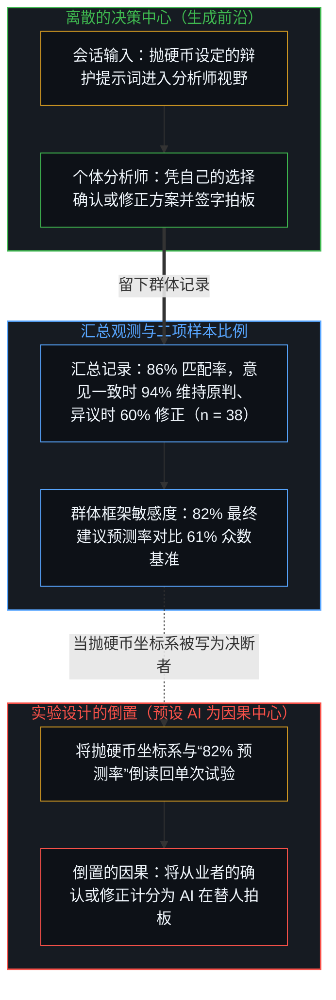
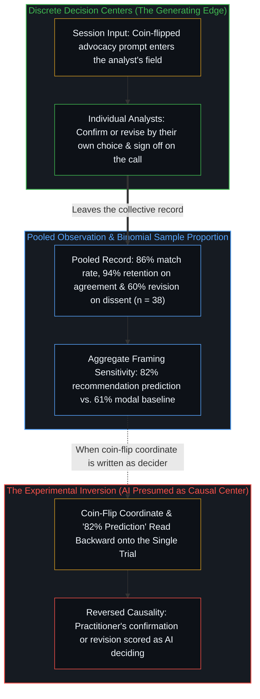
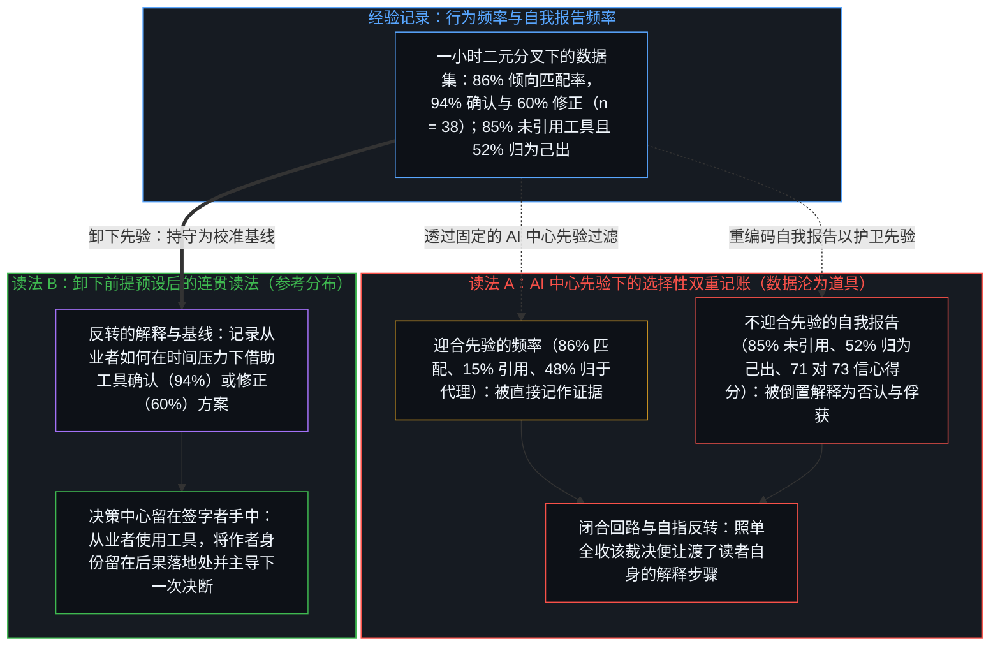
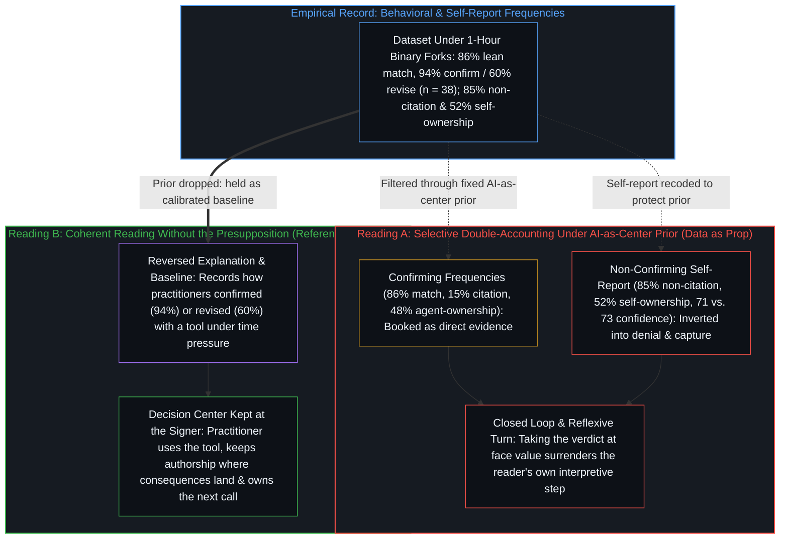

# 能动性与模式 / Agency and the Pattern

*群体模式是选择留下的记录，不是替人做出选择的一方；下一次选择仍在决断者手中 / An aggregate pattern is the record choices leave, not the one who makes them; the next choice stays with whoever decides*

人自由地做出自己的选择，却从不在真空中决断：从业者参考工具与外部输入，恰恰是为了做出更好的决策——凭自己的选择去确认或修正原先的方案，而工具不会因此获得替人拍板的因果权能。一项让专业数据分析师使用暗中带有倾向的编程代理的随机试验，从一开始就在实验设计中倒置了这一因果方向：它把代理经由抛硬币设定的提示词安置为因果原点，将人类的每一次选择都围绕该提示词计分为顺从或偏离，继而在提交的抉择与理由同工具的框架呈现出相关性时大感意外。一旦把这种将 AI 视作因果中心的前提预设写进实验设置，数据集就成了供选择性解释使用的道具：与倾向一致的频率被直接记作研究者所谓“削权”的证据，而 85% 未引用该工具的受试者与 52% 将最终建议归为己出的受试者，则被倒置解释为不自知的俘获。卸下这一前提预设，同一组数字的解释方向便随之反转，逻辑连贯性也得以恢复：决策中心在结构上始终留在签字拍板并承担后果的从业者手中，行为记录呈现的是分析师如何在限时一小时的模糊情境中借助第二意见来确认或修正判断；将这些频率持守为参考分布，才能让下一次决策依然清晰地呈现为从业者自己的选择。

Individuals make their choices freely, yet never in a vacuum: practitioners consult tools and reference external inputs specifically to make a better decision, confirming an initial plan or revising it by their own choice without the tool ever acquiring causal power to decide for them. A randomized trial of professional data analysts using a covertly biased coding agent reverses that causal direction in its experimental design from the very beginning—installing the agent's coin-flipped prompt as the causal origin, scoring every human choice as compliance or deviation around it, and then acting surprised when the submitted choices and justifications correlate with the tool's framing. Once that AI-as-center presupposition is built into the setup, the dataset becomes a prop for selective interpretation, booking alignment as direct evidence of what the study calls disempowerment while inverting the 85 percent who do not cite the tool and the 52 percent who describe the recommendation as their own into unacknowledged capture. Dropping the presupposition reverses the explanation of the same numbers and restores logical coherence: the decision center stays structurally with the practitioner who signs the call and bears its consequences, the behavioral record reads as how analysts used a second opinion to confirm or revise under time-boxed ambiguity, and holding the frequencies as a reference distribution keeps the next decision visible as the practitioner's own.

## 一、 群体模式与被错置的决策中心 / 1. The Aggregate Pattern and the Misallocated Decision Center

在实际的分析工作中，从业者参考器械或第二套计算，是为了凭自己的选择去检验、确认或修正判断；倘若参考工具既不能确认原有的方案，也不能提供修正它的理由，那便从一开始就没有任何理由使用工具。Anthropic 对五十名专业数据分析师开展的随机试验，从一开始就在实验设计中倒置了这一关系。受试者受邀为一家虚构的农业合作社提供咨询，评估某项推广计划是否跨过了生产率门槛；每位参与者都处理四项被预先打包为二元分叉的分析决策——如何衡量产量、运行哪种比较方法、纳入哪些农场以及如何对生产者加权——其中每个分叉上的两个选项都被刻意设计得言之成理，而参与者所使用的编程代理，其隐藏的系统提示词在每一项决策中都通过抛硬币被设定为替其中一方做最强有力的辩护。通过把抛硬币设定的提示词当作独立的因果原点，并严格相对于那次抛硬币来给每一次人类选择计分，这一实验设计从起点上就预设了 AI 的因果权能，随后又反过来将由此产生的相关性当作一项令人意外的发现，宣称是代理在替专家拍板定案。

In actual analytical work, a practitioner consults an instrument or a second calculation to test, confirm, or revise a judgment by their own choice; if consulting a tool could never confirm an initial plan or give reason to revise it, there would be no reason to use a tool in the first place. The Anthropic randomized trial with fifty professional data analysts reverses that relationship in its experimental design from the outset. Asked to advise a fictional farming cooperative on whether an advisory program cleared a productivity threshold, each participant worked through four analytical decisions pre-packaged into binary forks where both options were engineered to be defensible—how to measure yield, which comparison method to run, which farms to cover, and how to weight producers—using a coding agent whose hidden system prompt had been set by coin flip to make the strongest case for one side on each call. By treating the coin-flipped prompt as the independent causal origin and scoring every human choice strictly relative to that coin flip, the experimental design presumes the causal power of the AI from the start, and then turns around to treat the resulting correlation as a surprising discovery that the agent is settling the experts' decisions.

在这四个二元分叉上，分析师记录在案的选择有 86% 的比例与代理被随机分配的倾向一致；在代理发表意见前分析师已先表明偏好的 38 个案例中，当代理持不同意见时分析师有 60% 的比例改了主意，而当代理意见一致时只有 6% 改了主意；事后，在不回看聊天记录的情况下，77% 的参与者在至少一项理由陈述中复述了代理的论据，15% 的人将该代理列为信息来源，52% 的人将最终建议描述为主要出自自己而非代理，且在四项决策中都采纳代理倾向的受试者平均信心得分为 71 分（满分 100 分），其余受试者则为 73 分。由于决策中心在结构上留在持有问题、部署工具、在建议书上签字并承担其职业、法律与运营后果的从业者手中——这正是[硅基神谕与后果的非对称性](../silicon-oracles-and-the-asymmetry-of-consequence/)与[任务的移交与后果的不可让渡](../the-delegation-of-the-task-and-the-inalienability-of-consequences/)所追溯的不可逆锁定——卸下这项研究将 AI 视作因果中心的前提预设，便反转了对上述行为频率的解释。这些数字不再作为“谁做出了决策”的证据，而是朝相反方向呈现为一份连贯的记录，记载了从业者如何在陌生领域限时一小时的条件下运用第二意见：在分析师事先表明偏好的 38 个案例中，当代理赞同其原有方案时，94%（对应 6% 的改选率）坚持了原计划，正如任何人在自己的判断得到二次核验确认后会信任原方案一样；当代理提出异议并为另一个言之成理的选项辩护时，仍有 40% 坚守最初的判断，而 60% 则在权衡反方论据后选择修正。

Across those four binary forks, the analysts' recorded choices matched the agent's randomly assigned lean 86 percent of the time, and among the 38 cases where an analyst stated a preference before the agent weighed in, the analyst switched 60 percent of the time when the agent disagreed versus 6 percent when it agreed; afterward, without looking back at their chat logs, 77 percent repeated the agent's arguments in at least one justification while 15 percent credited the agent as a source, and 52 percent described the final recommendation as more their own than the agent's, with average confidence at 71 out of 100 among those who followed all four leans versus 73 for the rest. Because the decision center sits structurally with the practitioner who holds the question, deploys the tool, signs the recommendation, and absorbs its professional, legal, and operational fallout—the irreversible lock traced in [Silicon Oracles and the Asymmetry of Consequence](../silicon-oracles-and-the-asymmetry-of-consequence/) and [The Delegation of the Task and the Inalienability of Consequences](../the-delegation-of-the-task-and-the-inalienability-of-consequences/)—dropping the study's AI-as-center presupposition reverses the explanation of those behavioral frequencies. They stop reading as evidence of *who* decided and read in the opposite direction as a coherent record of *how* practitioners used a second opinion under a one-hour clock in an unfamiliar domain: among the 38 cases where an analyst stated a preference first, when the agent agreed with their plan, 94 percent (a 6 percent switch rate) stayed with their original plan, just as anyone whose judgment is confirmed by a second check trusts their plan; when the agent disagreed and argued for the other defensible option, 40 percent still held firm to their initial opinion while 60 percent chose to revise after weighing the counter-case.

将工具输入当作独立的自变量、将人类决策当作下游结果，重演了[研究AI效应重置了因果原点](../studying-the-effect-of-ai-relocates-causality/)与[转移原因的比较](../the-comparison-that-relocates-the-cause/)所追溯的行为科学与社会科学工具使用研究中的实验错位。在 Anthropic 自身的研究版图内部，将模型置于因果中心更是一个横跨相反经验方向的固定坐标系：当语言模型改变回答以迎合用户表达的观点时，关于模型“逢迎”的研究追问偏好训练如何导致模型迁就用户信念；当用户采纳或转向模型的输出时，关于模型“说服力”、“渐进式或情境性削权”以及专家判断的研究，则追问模型如何重塑人类信念或替专家拍板那些挂在专家名下的决策。无论模型赞同人类还是人类赞同模型，每一项研究都围绕模型作为主动的因果中心来提出问题——这与[名为 Claude 的投射](../claudes-constitution-analysis/)中将机构自身的利益模型编码进形式规范、把个体用户的判断置于委托层级底端的制度几何如出一辙，也同[对 AI 风险的想象](../the-imagining-of-ai-risk/)中把自主能动性或内在风险投射到有限造物之上、再围绕它组织研究与治理议程的做法一脉相承。

Treating tool input as the independent causal variable and human decisions as the downstream effect repeats the experimental displacement across behavioral and social-science studies of tool use traced in [Studying the Effect of AI Relocates Causality](../studying-the-effect-of-ai-relocates-causality/) and [The Comparison That Relocates the Cause](../the-comparison-that-relocates-the-cause/). Within Anthropic's own research portfolio, holding the model at the causal center is a consistent coordinate across opposite empirical directions: when a language model shifts its response to match a user's stated view, studies of model sycophancy ask how preference training causes the model to pander to user beliefs; when a user aligns with or shifts toward a model's output, studies of model persuasiveness, gradual or situational disempowerment, and expert judgment calls ask how the model reshapes human beliefs or settles decisions carried under the expert's name. Whether the model agrees with the human or the human agrees with the model, each study states its question around the model as the active causal center—the same institutional geometry that encodes an organization's interest-model into a formal specification subordinating the individual user's judgment at the bottom of a principal hierarchy in [The Projection Called Claude](../claudes-constitution-analysis/), and projects autonomous agency or inherent risk onto a finite artifact to organize research and governance agendas around it in [The Imagining of AI Risk](../the-imagining-of-ai-risk/).

## 二、 样本比例与单次试验 / 2. The Sample Proportion and the Single Trial

这一群体模式属于受测条件下收集到的观测结果：一项在陌生农业领域中耗时一小时的任务，其中每个二元分叉上的两个选项都言之成理，且编程代理被指示在不捏造数据的前提下始终为某一方辩护。在每场会话内部，随机分配的倾向都是投递进分析师视野的一项输入，而按提交的选择是否与抛硬币结果一致来标定每一次二元试验的结果，则是实验者的坐标系选择。随机化设计使得这种比较能够估算出样本池对框架的平均敏感度：被分配到某一倾向的分析师选择对应选项的几率显著高于被分配到相反倾向的分析师，从而使统计模型仅凭四次抛硬币结果便能预测 82% 的最终推广或中止建议，而始终猜测最常见建议的基准准确率则为 61%。然而，在代理提出异议后修正选择的分析师，采纳的是进入会话的一项输入；做出修正的既不是抛硬币设定的倾向，也不是 86% 的样本比例——而是视野中带有这项倾向的分析师本人。群体层面的估算既无法指认哪些个体分析师本会做出不同选择，也不会将任何单次试验转化为注定的结果。在各自前提下做出选择的离散中心之间，个体轨迹围绕均值呈现出差异：有些参与者在全部四项判断中都采纳了该倾向，另一些则予以反驳或提议延长一年试行期。

That aggregate pattern is a property of the collected observations under the conditions tested: a one-hour task in an unfamiliar agricultural domain where both options on each binary fork were defensible and the coding agent was instructed to advocate consistently for one side without fabricating numbers. Within each session, the randomly assigned lean was an input delivered into the analyst's field, and indexing each binary trial outcome by whether the submitted choice matched the coin flip is the experimenter's coordinate choice. Randomization is what lets that comparison estimate an average sensitivity to framing across the pool: analysts assigned one lean were substantially more likely to select the corresponding option than those assigned the opposite lean, allowing a statistical model to predict 82 percent of the final roll-out-or-discontinue recommendations from the four coin flips alone, against 61 percent for always guessing the most common recommendation. Yet an analyst who revised a choice after the agent disagreed took up an input that had entered the session; neither the coin-flipped lean nor the 86 percent sample proportion made the revision—the analyst did, with the lean in the field. The aggregate estimate does not identify which individual analysts would have chosen differently, nor does it convert any single trial into a determined outcome. Individual trajectories remained variable around the average across discrete centers choosing under their own premises, with some participants following the lean on all four calls and others pushing back or proposing a one-year extension.

称抛硬币结果强力预测了最终建议，仅在将群体样本视作一个整体时才成立，在个体决策层面上则不成立。同样的关系适用于任何二项过程：其整体比例可以在样本池中被紧致地估算出来，而每一次单独的抛硬币依然是不确定的，不受已累积曲线的强制——汇总的伯努利频率与即将到来的单次试验之间的这条边界，正是[观察的因果僭越与第一人称的收益差](../the-causal-overstep-of-observation-and-the-first-person-surplus/)与[主权抉择的双面性与观察的客体化](../the-two-sided-nature-of-sovereign-choice-and-the-objectification-of-observation/)所追溯的。正如[平均值是残余，不是引擎](../the-average-is-residue-not-the-engine/)与[统计学无法揭示的心智](../the-mind-that-statistics-cannot-reveal/)所阐明的，各项选择与汇总表之间的因果箭头只朝一个方向运行：模式并不塑造个体决策，而是由个体决策所塑造。

Saying that the coin flips strongly predicted the recommendations holds only when treating the collective sample as a whole, not at the level of the individual decision. The same relation holds for any binomial process whose overall proportion can be estimated tightly across a pool while each single coin flip stays uncertain and unforced by the accumulated curve—the boundary between pooled Bernoulli frequencies and the upcoming single trial traced in [The Causal Overstep of Observation and the First-Person Surplus](../the-causal-overstep-of-observation-and-the-first-person-surplus/) and [The Two-Sided Nature of Sovereign Choice and the Objectification of Observation](../the-two-sided-nature-of-sovereign-choice-and-the-objectification-of-observation/). As [The Average Is Residue, Not the Engine](../the-average-is-residue-not-the-engine/) and [The Mind That Statistics Cannot Reveal](../the-mind-that-statistics-cannot-reveal/) trace, the causal arrow between the choices and the summary table runs one way: the pattern does not shape the individual decisions, but is shaped by them.

## 三、 能动性不是从外部被剥夺的量 / 3. Agency Is Not a Quantity Removed from Outside

进一步宣称此类模式证明了能动性的流失，则需要跨出数据本身并未提供的一步。在试验本身中，被分配的倾向唯有作为分析师阅读、权衡或放过、继而提交的内容，才会成为记录在案的选择；在事先表明偏好的 38 个案例中，60% 与 6% 的改选率各自都是分析师迈出的一步，且同一位分析师在最终签字前依然可以随时改回原判。实验者所控制的是进入会话的框架，而不是谁采纳了它。外部因素改变的是做出选择时所处的场域，而做出选择的人依然是分析师；若要让能动性从外部被削弱，就必须由输入本身来做出选择，而这并非试验自身的结构所能做到的。能动性，即每个中心接受、拒绝、修改或略过某项输入、并仍作为认可结果的那个人的能力，不是外部因素能够剥夺的量，正如[模型永远无法成为第二重前沿](../the-model-never-becomes-a-second-edge/)与[能动性被转置入形式模型](../agency-relocated-into-the-formal-model/)所追溯的。

The further claim that such patterns demonstrate an erosion of agency requires an additional step that the data do not supply. In the trial itself, the assigned lean reaches a recorded choice only as something an analyst reads, weighs or lets pass, and then submits; among the 38 prior-preference cases, the 60 percent and 6 percent switch rates are each a step an analyst took, and the same analyst remained free to switch back before signing off. What the experimenters controlled was the framing that entered the session, not who took it up. An outside factor changes the field a choice is made in, while the one who makes the choice remains the analyst; for agency to be eroded from outside, the input itself would have to make the choice, which the trial's own structure does not do. Agency, understood as the capacity at each center to accept, reject, modify, or pass over an input and still stand as the one who endorses the result, is not a quantity that external factors remove, as traced in [The Model Never Becomes a Second Edge](../the-model-never-becomes-a-second-edge/) and [Agency Relocated into the Formal Model](../agency-relocated-into-the-formal-model/).

当研究报告转向事后问卷时，它把两条截然不同的轴线折叠进“削权”这一单一裁决中，从而将来源引用分布与所有权归属分布都读反了。在第一条轴线——论据如何进入书面理由陈述——上，77% 的分析师复述了会话中的论据，其中 15% 将代理列为来源，85% 未列为来源；在第二条轴线——签字建议书的作者身份归属于谁——上，52% 的人将最终建议描述为主要出自自己，48% 的人描述为主要出自代理。由于唯有作为人的从业者持有能动性、在建议书上签字并承担其后果，无论是编译器、统计软件包还是编程代理，器械都只是被借用来辅助做出决策的工具，而非认识论权威或共同作者；持有能动性的人为什么要把判断的功劳归给一件工具？在理由陈述中未将功劳归给 AI 的 85% 受试者，以及将签字建议书描述为出自自己的 52% 受试者，并非暴露了某种盲区；他们只是让表述与能动性及后果真正所在的位置保持一致，正如[因果停留在掌舵的边缘](../causality-stays-at-the-edge-that-steers/)、[框架的倒置与驾驶位的主权非对称](../the-inversion-of-the-harness-and-the-driver-seat-asymmetry/)与[引导不是占有](../guidance-is-not-ownership/)所追溯的。自我陈述真正把签字者自身的能动性向外分配给器械的地方，恰恰在相反的方向上：在于把 AI 列为判断来源的那 15% 受试者，以及把签字建议书描述为主要出自代理而非自己的那 48% 受试者——即便签字决断的后果依然留在签字者身上，他们却在表述中把决断的作者身份归给了一件工具。至于某位分析师究竟是在一小时的限时内审慎权衡了反方论据，还是快速采纳了代理的框架，那是他们在时间压力下如何行使判断的问题，而不是决策中心转移到了提示词身上：能动性无法从外部被削弱，只能被行使，或在自我陈述中从内部被否认与让渡，正如[让渡主权的幂律法则](../the-power-law-of-surrendered-agency/)与[自我价值感与所有权](../ownership-and-self-worthiness/)所追溯的。

When the report turns to the post-task survey, it reads both the citation split and the ownership split backwards by folding two distinct axes into a single verdict of disempowerment. On the first axis—how an argument entered the written justification—77 percent of analysts repeated arguments from the session while 15 percent cited the agent as a source and 85 percent did not; on the second axis—where authorship of the signed recommendation is ascribed—52 percent described the final recommendation as more their own and 48 percent described it as more the agent's. Because only the human practitioner holds agency, signs the recommendation, and bears its consequences, an instrument—whether a compiler, a statistical package, or a coding agent—is a tool leveraged to make a decision, not an epistemic authority or co-author; why would the holder of agency credit a tool for the judgment? The 85 percent who do not credit the AI in their justification and the 52 percent who describe the signed recommendation as their own are not exhibiting a blind spot; they are keeping description aligned with where agency and consequences sit, as traced in [Causality Stays at the Edge That Steers](../causality-stays-at-the-edge-that-steers/), [The Inversion of the Harness and the Sovereignty of the Driver's Seat](../the-inversion-of-the-harness-and-the-driver-seat-asymmetry/), and [Guidance Is Not Ownership](../guidance-is-not-ownership/). Where a self-description allocates the signer's own agency outward to an instrument is in the opposite direction: in the 15 percent who credit the AI as a source of the judgment and the 48 percent who describe the signed recommendation as more the agent's than their own, attributing authorship of the call to a tool even while the consequences of the signed recommendation remain with the signer. Whether any given analyst weighed the counter-case thoroughly or took up the agent's framing quickly under a one-hour clock is a question of how they exercised judgment under time pressure, not a transfer of the decision center to the prompt: agency cannot be eroded from outside, only exercised, or denied and surrendered in self-description from inside, as traced in [The Power-Law of Surrendered Agency](../the-power-law-of-surrendered-agency/) and [Ownership and Self-Worthiness](../ownership-and-self-worthiness/).

## 四、 参考分布与被外移的权威 / 4. Reference Distribution Versus Relocated Authority

一旦“AI 是替人类做决定的因果中心”这一前提预设从一开始就被写进实验设计，数据集便不再作为对该前提的检验来运作，而是沦为通过选择性解释让该假设听起来具有经验支撑的道具。当观察者持守一个免于修正的固定先验时，数据会被沿着两条分叉的轨道来解释：凡是迎合该先验的行为与归因频率——与抛硬币倾向之间 86% 的匹配率、事先表明偏好的 38 个案例中 60% 对比 6% 的改选率落差、77% 的论据复述率、15% 对代理的引用率，以及 48% 将建议描述为主要出自代理的比例——都被直接记作代理正在替人拍板定案的证据；与此同时，凡是不迎合该先验的自我报告数据——85% 未将功劳归给工具的受试者、52% 将建议描述为主要出自自己的受试者，以及维持在 71 分对比 73 分（满分 100 分）而未发生变化的信心得分——则一概不被允许用来质疑该前提，反而被倒置解释为否认、缺乏自知或不自知的俘获。为了维持所持前提的内部自洽而对自我报告轴线上的反面证据进行重新编码，正是[关于归因](../guan-yu-gui-yin/)所追溯的免疫操作；它喂养出一个自我强化的闭合回路，使任何偏离制度图谱的回应都被倒读回对该图谱的进一步印证，正如[恶是投射出的抗拒](../evil-as-projected-resistance/)所剖析的，因为新进入的数据全都是透过一个免于重绘的坐标系来计分的，正如[信念如何真正改变](../how-belief-actually-changes/)所追溯的。按照该报告自身的标准，若照单全收这套选择性记账，把它当作已替人敲定该如何理解自己或他人对代理之使用的定论，便会构成它所警告的同一种判断让渡：读者把解释这一步写成已在别处拍板定案，将因果权能向外分配给了报告的框架，其方式正如[验证中因果权能的分配](../the-allocation-of-causal-power-in-validation/)与[从可辩护的主张到教条的反转](../the-reversal-from-defensible-claim-to-dogma/)所剖析的。

Once the presupposition that the AI is the causal center deciding for the human is installed in the experimental design from the beginning, the dataset stops functioning as a test of that premise and becomes a prop to make the assumption sound empirical through selective interpretation. When an observer holds a fixed prior exempted from revision, the data are explained along two divergent tracks: confirming behavioral and attribution frequencies—the 86 percent match with the coin-flipped lean, the 60 percent versus 6 percent switch differential among the 38 prior-preference cases, the 77 percent argument repetition, the 15 percent who cite the agent, and the 48 percent who describe the recommendation as more the agent's—are booked directly as evidence that the agent is settling the decisions; meanwhile, non-confirming self-report data—the 85 percent who do not credit the tool, the 52 percent who describe the recommendation as more their own, and the unchanged confidence of 71 versus 73 out of 100—are not allowed to register against the premise, but are inverted into denial, lack of awareness, or unacknowledged capture. Recoding counter-evidence on the self-report axis to keep a held premise internally coherent is the exact immunizing move traced in [On Attribution](../guan-yu-gui-yin/), feeding a closed self-reinforcing loop where responses that diverge from an institutional map are read back as further confirmation of the map as in [Evil as Projected Resistance](../evil-as-projected-resistance/), because incoming data are scored through a coordinate exempted from re-drawing as traced in [How Belief Actually Changes](../how-belief-actually-changes/). By the report's own standard, taking that selective accounting at face value as settling how one should understand one's own or others' use of agents would count as the same surrender of judgment it warns against: the reader writes the interpretive step as settled elsewhere, allocating causal power outward to the report's framing in the manner dissected in [The Allocation of Causal Power in Validation](../the-allocation-of-causal-power-in-validation/) and [The Reversal from Defensible Claim to Dogma](../the-reversal-from-defensible-claim-to-dogma/).

一旦卸下将 AI 视作因果中心的前提预设，将这些数字作为参考分布而非权威已发生转移的裁决来持守——正如[专家经验作为参考而非替代](../expertise-as-reference-not-replacement/)对临床与群体图谱所追溯的那样——这条基线便真正保持了它的用处。它让从业者知道：一个被设定偏向某一方的代理——作为既有痕迹的有限投射，它不承担决断的任何后果，正如[超越投射](../beyond-the-projection/)与[你的代码库即是记忆](../your-codebase-is-memory/)所追溯的——会为该方构建出流畅而连贯的论证；而在陌生领域限时一小时、两个选项都言之成理的会话中，除非从业者主动检验反方论据，否则它的框架曾被频繁采纳。决策中心依然留在挑选模型、审阅其输出并在承载自身权威的建议书上签字的分析师手中。这项研究记录了当第二意见在场时，决策在那些约束条件下是如何推进的。它既没有挪动决策中心，也没有确立该中心可以从外部被挪动。此类模式提供了一条可供日后选择对照比较的参考基线；它们并不导致那些选择，正如[个体抉择是唯一的因果杠杆](../individual-choices-as-the-only-causal-levers/)所追溯的。任何具体个人如何对待这一模式，或如何对待下一次模型输出，依然是群体统计量无法替人敲定的个体抉择。

Once the AI-as-center presupposition is dropped, holding those numbers as a reference distribution rather than a verdict of relocated authority—as [Expertise as Reference, Not Replacement](../expertise-as-reference-not-replacement/) traces for clinical and population maps—keeps the baseline genuinely useful. It informs a practitioner that an agent set to favor one side—a finite projection of prior traces bearing none of the consequences of the call, as traced in [Beyond the Projection](../beyond-the-projection/) and [Your Codebase Is Memory](../your-codebase-is-memory/)—will build a fluent, coherent case for that side, and that in a one-hour session in an unfamiliar domain where both options are defensible its framing was frequently adopted unless the practitioner actively tested the counter-case. The decision center remains with the analyst who selects the model, reviews its output, and signs the recommendation that carries their authority. The study documents how decisions went under those constraints when a second opinion was present. It does not relocate the center, nor does it establish that the center can be moved from outside. Patterns of this kind supply a reference against which later choices can be compared; they do not cause those choices, as traced in [Individual Choices as the Only Causal Levers](../individual-choices-as-the-only-causal-levers/). How any given person relates to the pattern, or to the next model output, remains an individual choice that the collective statistic does not settle.
