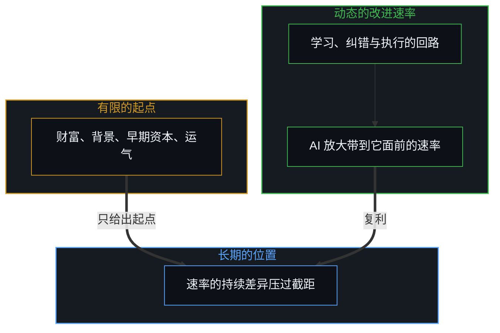
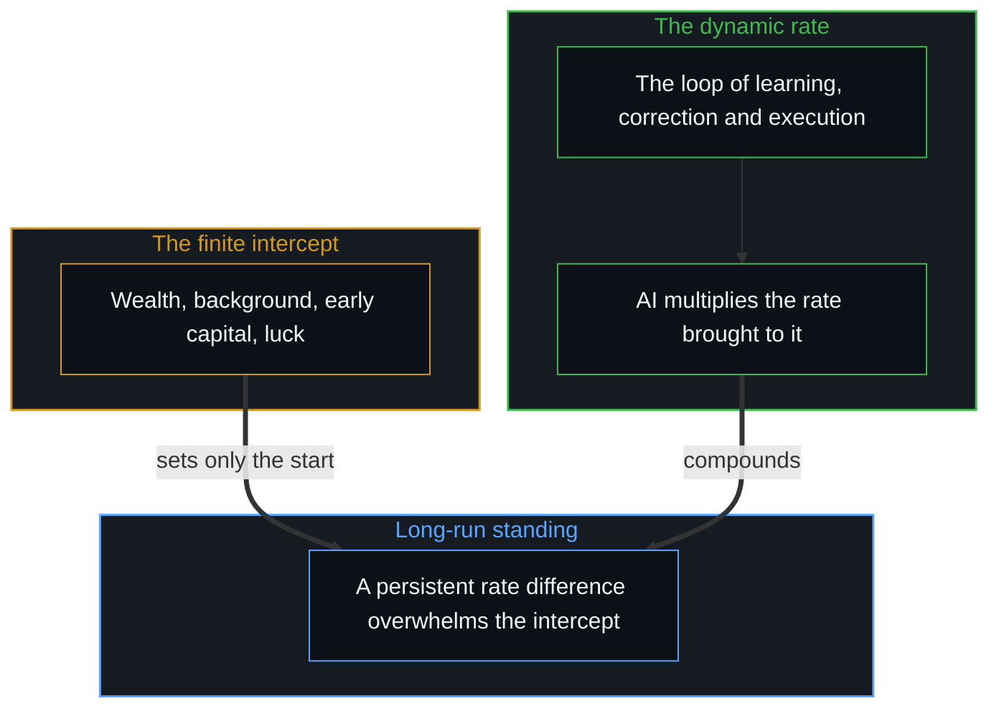

# 能动性、复利与 AI 封建之争 / Agency, Compounding, and the Argument Over AI Feudalism

*以为超级智能会锁死流动，是把有限的起点当成了速率，AI 只加速人已在维持的回路 / AI feudalism takes a finite start for a rate; AI only accelerates the loop a person already keeps.*

当代技术讨论里反复出现一种担忧：先进的人工智能会把人的等级不可逆地冻结。这个论证常被说成对技术封建主义的警告：资本最多的人会买下绝大部分算力，原始资本会压过人的才能与劳动，精英制度塌缩成永久的寡头。由此常推出一个策略上的结论：眼下是“普通人”借着买入硬资产实现阶层跃迁的最后窗口，吊桥就要拉起。

A recurring worry in contemporary technology discussion holds that advanced artificial intelligence will freeze human hierarchy for good. The argument is often put as a warning of technological feudalism: those with the largest capital reserves will buy most of the compute, raw capital will outcompete human talent and labour, and meritocracy will collapse into permanent oligarchy. A tactical conclusion often drawn from it is that the present is the last window for "ordinary people" to leap a class by acquiring hard assets before the drawbridge is raised.

“一扇历史之门正在关上”这个前提，误解了人的流动是什么。阶层跃迁的机会从不由技术的法令关上，因为一个人完成跃迁之后，就不再是“普通人”了；没有哪个机会是留给一个抽象的人口类别的。这些看法表面上是在争历史时机与技术窗口，往下看机制，分歧不在算力或时间表，而在能动性放在哪里，以及能动性的位置怎样决定一个人改进的复利速率。

The premise that a historical door is closing misreads what human mobility is. Opportunities to leap a class are never closed by technological decree, because once someone has made the leap they are no longer "ordinary"; no opportunity is reserved for an abstract demographic category. These views look like an empirical disagreement over historical timing and technological windows; looking down at the mechanism, the disagreement is not about compute or timelines but about where agency sits, and how where it sits governs a person's compounded rate of improvement.

## 一、 AI 作为递归的放大器 / 1. AI as a Recursive Multiplier

人工智能没有自己的能动性。它借复杂的数学训练，可以流畅地模拟目标导向的行为、规划与意向；这种模拟由人的区分发起、设定参数并引导。机器是人造出来的、下游的因果后果，不是能自己做切分的第二重前沿；说它有意志，是说话的心智在那里划下了切分。它作为一种高带宽的技术媒介运作，加速带到它面前的任何因果强化回路。

Artificial intelligence has no agency of its own. Through sophisticated mathematical training it can fluently emulate goal-directed behaviour, planning and intention; the emulation is initiated, parameterised and guided by human distinguishing. A machine is a downstream causal consequence of human making, not a second edge able to make the cut itself; calling it willed is the speaking Mind placing the cut there. It works as a high-bandwidth technological medium that accelerates whatever causal reinforcement loop is brought to it.

那么机器为什么显得这样自主、这样有威胁？因为一种反复出现的认知倒置：落在变化后面的位置上，人会把自己没有认领的能动性重新分配到工具身上。这种投射不是 AI 独有的，它出现在历次大的技术转变里：古代的人把道德与物质的能动性投到石像与圣典上，把人造的器物当作有意志的神；工业革命时，工人把独立的恶意投到织机、蒸汽机与流水线上，把机械的钟表结构当作活的压迫者；现代社会常把能动性分给“市场”“公司”“官僚体系”，说得好像这些法律上的虚构有自己的意识与意图。技术范式变得比平均的适应习惯更快时，与底层因果机制脱开的位置，就把因果外推出去，把工具当作自主的主人，免去更新自己模型的责任。对“AI 封建”的恐慌，是这个历史习惯最新的一次，把机器快速的模拟当成了一个自主的征服者。

Why then does the machine look so autonomous, so menacing? Because of a recurring cognitive inversion: from a position that has fallen behind a change, a person reallocates their own unowned agency onto the tool. The projection is not unique to AI; it shows up in every major technological shift: ancient peoples projected moral and physical agency onto stone idols and sacred texts, treating human-made artifacts as willing gods; in the Industrial Revolution workers projected independent malice onto looms, steam engines and assembly lines, treating mechanical clockwork as a living oppressor; modern societies routinely assign agency to "the market", "the corporation" or "the bureaucracy", speaking as though these legal fictions had consciousness and intent of their own. When a technological paradigm shifts faster than average adaptive habits, a position detached from the underlying causal mechanics pushes causality outward, treats the tool as an autonomous master and is spared the work of updating its own model. The panic over "AI feudalism" is the latest instance of this habit, taking the machine's fast emulation for an autonomous conqueror.

一个人对工具采取的控制论姿态，不是把人类分成两个固定种姓的二分。每一个有意识的心智都在运行自己的回路，只是在不同的语境里以不同程度把能动性外推：在制度的日常、标准化的雇佣或算法推送的信息流里，一个人可能选择外推决定、接受预设的默认；在一门专门的手艺、高确信的投资、创作或哲学探究里，同一个人可能保持不加缓冲的自主。全然的自主与全然的被动外推，是理论上的两个端点，每个人都活在一条连续的、多维的谱上的某处，而这个位置从不是静止、预定或冻结的。在任何时刻、任何领域，一个人都能沿着这条谱移动，收回内部的损失函数，放下外推的借口，让选择重新直接撞上现实。没有哪种结构性的命运能拿走这份能力，也没有哪种技术能在一个人不持续主动同意的情况下，把人锁进从属的种姓。[智能只属于心智](../intelligence-belongs-only-to-the-mind/)与[自由变量的生成拓扑](../the-generative-topology-of-free-variables/)都确立了这一点：AI 只是加速一个人在每个领域里选择去实践的那份自主或外推。

The cybernetic posture a person takes toward tools is not a split of humanity into two fixed castes. Every conscious Mind runs its own loop and externalises agency to different degrees in different contexts: in institutional routine, standardised employment or algorithmically curated feeds, a person may choose to externalise decisions and accept preset defaults; in a specialised craft, high-conviction investment, creative work or philosophical inquiry, the same person may keep unbuffered self-direction. Full self-direction and total passive externalisation are theoretical end points, and everyone lives somewhere on a continuous, many-dimensional spectrum, a position that is never static, predetermined or frozen. At any moment and in any domain a person can move along it, reclaim the inner loss function, set down outward excuses and let choices collide with reality directly again. No structural fate can take this capacity away, and no technology can lock a person into a subordinate caste without their continued, active consent. As [Intelligence Belongs Only to the Mind](../intelligence-belongs-only-to-the-mind/) and [The Generative Topology of Free Variables](../the-generative-topology-of-free-variables/) both establish, AI only accelerates the degree of self-direction or externalisation a person chooses to practise in each domain.

## 二、 斜率压过截距 / 2. Slope Overwhelms Intercept

在足够长的时间跨度上，一个人在社会中的相对位置，不由起点决定，而由复利改进速率的排序决定。起始条件，家庭财富、社会背景、早期资本或地理上的运气，是一个有限的、静态的起点；一个人自己引导的学习、纠错与执行的速率，是一个动态的复利改进速率；人工智能是一个高增益的认知加速器。随着时间推移，改进速率上持续的差异，会压过一个有限的初始优势。

Over a long enough span, a person's relative standing is decided not by the starting position but by the ranking of compounded improvement rates. Starting conditions, family wealth, social background, early capital or geographic luck, are a finite, static intercept; a person's self-directed rate of learning, error correction and execution is a dynamic compounding rate; artificial intelligence is a high-gain cognitive accelerator. Over time, a persistent difference in the rate of improvement overwhelms a finite initial advantage.

在先前的技术时代，蒸汽机、电气化、早期的个人电脑，一个改进速率更高的人仍面对严重的物理与后勤摩擦，超过资本雄厚的在位者常要几十年的基础设施与资本积累。人工智能直接加速学习与执行的反馈回路，就放大了复利速率本身，于是一个主动、自我引导的人追上巨大初始资本差距所需的时间被大幅压缩；同一个放大器，也同样放大了停滞的回路。工具本身因此从不是决定性的因素，放大器只是倍增带到它面前的学习速率；唯一独立的变量，是一个人选择维持一个不打折扣、承担后果的强化回路。没有这条活的更新规则，累积静态资产只是一个冻结的起点，生不出未来的能力。[拥有更多从不是原因](../having-more-is-never-the-cause/)与[价值、货币与财富的生成机制](../the-generative-mechanics-of-value-money-and-wealth/)都推出过，占有只是过去决定的滞后痕迹，从不是未来增长的生成原因。

In earlier technological eras, the steam engine, electrification, the early personal computer, a person with a higher rate of improvement still faced severe physical and logistical friction, and overtaking well-capitalised incumbents often took decades of infrastructure and capital accumulation. Artificial intelligence directly accelerates the feedback loop of learning and execution and so multiplies the compounding rate itself, which sharply compresses the time an active, self-directed person needs to close a large initial capital gap; the same amplifier multiplies a stalled loop just as much. The tool is therefore never the decisive factor, since the amplifier only multiplies the rate of learning brought to it; the one independent variable is a person's choice to keep an uncompromised, consequence-bearing reinforcement loop. Without that living update rule, accumulating static assets is only a frozen starting position and generates no future capability. As [Having More Is Never the Cause](../having-more-is-never-the-cause/) and [The Generative Mechanics of Value, Money, and Wealth](../the-generative-mechanics-of-value-money-and-wealth/) both derive, possession is only the lagging trace of past decisions, never the generating cause of future growth.

## 三、 封闭世界模型的认知税 / 3. The Cognitive Tax of the Closed-World Model

维持高改进斜率的首要障碍，是心理上采纳一个封闭世界的、零和的框架。一旦相信现实是一场固定的零和游戏，“窗口正在关上”，“封建领主拥有全部算力”，内部的优化目标就发生一次破坏性的转移：不再对着物理的反馈去优化下一个真实行动的质量，而是对着看得见的同侪去优化相对位置；注意从纠错转向盯着对手、捍卫地位，把别人的所得读成自己的所失；内部的反馈信号被社会噪声淹没；学习的速率下降，改进的斜率 m 趋近于零。封闭世界的框架随后为自己造出经验上的证实：改进速率停了，世界从这个位置看上去确实无路可走、僵硬不动。[模型永远无法成为第二重前沿](../the-model-never-becomes-a-second-edge/)与[因果贯穿始终](../causality-all-the-way/)都表明，观察者选择去计分的那个现实，就成了他能够到的现实，不是因为神秘的意念，而是因为内部的世界模型决定奖励函数，奖励函数决定策略，策略生成实际的轨迹。

The first obstacle to keeping a high slope of improvement is the psychological adoption of a closed-world, zero-sum frame. Once reality is believed to be a fixed zero-sum game, "the window is closing", "feudal lords own all the compute", the inner optimisation target shifts destructively: instead of optimising the quality of the next real action against physical feedback, a person optimises relative standing against visible peers; attention moves from error correction to watching rivals and defending status, reading others' gains as one's own losses; the inner feedback signal is drowned in social noise; the learning rate drops and the slope of improvement m flattens toward zero. The closed-world frame then manufactures its own empirical confirmation: with the rate of improvement stalled, the world really does look impassable and rigid from that position. As [The Model Never Becomes a Second Edge](../the-model-never-becomes-a-second-edge/) and [Causality All the Way](../causality-all-the-way/) both show, the reality an observer chooses to score becomes the reality within reach, not through mystical intention but because the inner world model sets the reward function, the reward function sets the policy, and the policy generates the actual trajectory.

## 四、 干预的反讽 / 4. The Irony of Intervention

这个动态也说明，为什么用制度去人为拉平结果、立法规定阶层流动，常常加重它们想治的停滞。当一个人的位置由自上而下的行政命令调整，而不是经由纠错的递归回路挣来，受助者的注意就转向学习补贴的行政规则，而不是能力的底层物理；控制论的损失函数被关掉；个人的改进斜率变平，把一次暂时的劣势变成长久的制度依赖。外部的资源与工具可以立刻改变起始的截距，作为真正的杠杆使用时也能帮着抬高斜率，前提是受助者不把外部的援助当作自己能动性的来源。

This dynamic also shows why institutional attempts to equalise outcomes artificially or to legislate class mobility often deepen the stagnation they mean to cure. When a person's position is adjusted by top-down administrative order rather than earned through the recursive loop of error correction, the recipient's attention turns to learning the administrative rules of the subsidy rather than the underlying physics of competence; the cybernetic loss function is switched off; the personal slope of improvement flattens and turns a temporary disadvantage into lasting institutional dependence. Outside resources and tools can change the starting intercept at once, and used as real leverage can help raise the slope, provided the recipient does not take the outside aid for the source of their own agency.

这带出一个系统性的反讽：能用外部的工具与资本而不交出内部回路的人，最少依赖外部的拯救；最急切要求外部拯救的位置，最容易把自己的能动性放进外部的项目里，于是持续萎缩。把人当作统一个案、想以此消除不平等的标准化程序，会抹去冒险、好奇与局部纠错上的细微差异，而自主的能动性正是借这些差异运作的，[财富转移政策与价格下限中的原因错置](../the-reversal-of-causality-in-wealth-transfer-policies-and-price-floors/)与[福利国家的幻象](../the-welfare-state-illusion-cost-diffusion-and-agency-atrophy/)都追溯过这一点。

This brings a systemic irony: those who can use outside tools and capital without surrendering their inner loop depend least on outside rescue; the position that most urgently demands outside rescue is the one most prone to placing its agency inside the outside programme, and so keeps atrophying. Standardised procedures that try to remove inequality by treating people as uniform cases erase the fine variations in risk-taking, curiosity and local error correction through which self-directed agency works, as both [The Misallocation of Cause in Wealth-Transfer Policies and Price Floors](../the-reversal-of-causality-in-wealth-transfer-policies-and-price-floors/) and [The Welfare State Illusion](../the-welfare-state-illusion-cost-diffusion-and-agency-atrophy/) trace.

## 五、 静态模型的选择性盲视 / 5. The Selective Blindness of the Static Model

“人工智能会把等级永久冻结”的说法，带着一种选择性的盲视：拿当前资本部署的一张静态、滞后的快照，误认作技术命运不变的规律。在位者手里确实有大量研究与算力，2017 年提出 transformer 架构的那篇论文就出自谷歌；可把前沿推到大众面前的第一个产品，来自当时规模小得多的 OpenAI，而不是先发表了那篇论文的巨头；后来又有精干的团队，以报告中低得多的成本做出接近前沿的模型。资本买到算力，并没有锁住谁先把东西做出来。“AI 封建”的叙事，拿一个窄的现象，在位者今天在购买大规模的 GPU 集群，硬塞进一个过于简单的封闭世界模型，把过去资本积累的滞后痕迹，当成书写未来的那个活的、实时的区分，再宣布自己的静态投影是“必然”。这是宏观崇拜的典型错误：看着当前资本那些巨大的、显眼的纪念碑，忘了每一座纪念碑都是一个个具体的人造起来的。

The claim that artificial intelligence will freeze hierarchy for good carries a selective blindness: it takes a static, lagging snapshot of current capital deployment for an unchanging law of technological destiny. Incumbents do hold a great deal of research and compute, and the 2017 paper that introduced the transformer architecture came out of Google; yet the first product that brought the frontier to the public came from OpenAI, then a far smaller lab, not from the giant that had published the paper; later, lean teams built models close to the frontier at a reported fraction of the cost. Capital buying compute did not lock in who shipped first. The "AI feudalism" narrative takes a narrow phenomenon, incumbents buying large GPU clusters today, forces it into an oversimplified closed-world model, takes the lagging trace of past capital accumulation for the living, real-time distinguishing that writes the future, and then pronounces its own static projection "inevitable". This is the typical error of macro-fetishism: looking at the large, visible monuments of present capital and forgetting that each was built by particular people.

## 六、 自我实现的投降 / 6. The Self-Fulfilling Surrender

“冻结的等级”这个叙事里，对外推的无助的相信是自我实现的。一个人采纳“能动性在自己之外”的前提，技术的封建领主控制一切结果，资本是成功唯一的决定因素，个人的努力徒劳，就在那一刻做了交出能动性的那个行动：把原因放到外部结构里，关掉内部的纠错机制；改进斜率 m 塌到零；造出这套理论所预言的停滞、无助与过时。

In the "frozen hierarchy" narrative, belief in outward helplessness is self-fulfilling. The moment a person adopts the premise that agency lies outside, that technological feudal lords control all outcomes, that capital alone decides success, that individual striving is futile, they perform the very act that forfeits agency: placing cause in outside structures switches off the inner machinery of error correction; the slope of improvement m collapses to zero; and the stagnation, helplessness and obsolescence the theory predicted are manufactured.

在公开表达与实际行动之间，有一种结构上的不对称。公开说出的，是说话者希望别人相信的东西，一套用来争取听众、道德权威或政治杠杆的叙事；指导实际行动的，是在选择的那一刻最深处的操作性信念。所以一个人可以公开讲系统决定论、集体受害与个人竞争的徒劳，而在自己的事业、投资、出版与养育里，带着强烈的个人能动性、算计过的冒险与不懈的优化去行动。这不是某一类人的品性，而是表达与行动分属两处时，任何一个位置上都会出现的不对称；按照宣扬给别人的结构性无助去安排自己的生活，就会落进那份停滞。

Between public expression and actual action there is a structural asymmetry. What is said publicly is what the speaker wants others to believe, a narrative meant to win an audience, moral authority or political leverage; what guides actual action is the deepest operating belief at the moment of choice. So a person can speak publicly of systemic determinism, collective victimhood and the futility of individual competition while acting in their own career, investments, publishing and parenting with strong individual agency, calculated risk and relentless optimisation. This is not the character of one class of people but an asymmetry that appears in any position where expression and action sit in two places; arranging one's own life by the structural helplessness preached to others would bring that very stagnation.

## 七、 回路留在哪里 / 7. Where the Loop Remains

技术封建的警告描述的不是人工智能必然的物理规律，而是人把内部的更新回路交给集中的平台与行政缓冲之后的社会后果；在一个人们放弃认知自主的世界里，资本的集中看上去无所不能。“拖延的代价越来越高”这个策略上的观察仍然成立，因为 AI 作为高增益的放大器，让通的与不通的反馈回路都以前所未有的速度复利。

The warning of technological feudalism describes not an inevitable physical law of artificial intelligence but the social consequence of people handing their inner update loops to centralised platforms and administrative buffers; in a world where cognitive self-direction is given up, capital concentration looks all-powerful. The tactical observation that delay carries a rising cost still holds, because AI as a high-gain amplifier makes working and failing feedback loops alike compound at unprecedented speed.

不变的是：机会不属于一个叫作“普通人”的静态社会集合。每个人都保留着在每一刻从被动外推移向主动自主的自由，所以没有预定的天花板或永久的贵族。一个人一旦完整地认领自己的损失函数，寻找不加缓冲的反馈，把每一件可用的工具当作升级预测模型的杠杆，就不再是“普通的”。[可延展的地平线](../the-extendable-horizon/)展示过，正和的能动性可以从公共寄存器里的任何坐标被启动，日常的选择把微观行动的正态分布复利成已实现能力的幂律。一个人的未来，不由所处的初始坐标或远方公司的算力储备决定，而由在自己强化回路的移动前沿上做出的选择决定。AI 会加速带给它的任何姿态：封闭的、对抗的姿态复利出停滞，外推的姿态复利出依赖，自我引导、承担后果的姿态复利出生成的能力。

What does not change is this: opportunity does not belong to a static social set called "ordinary people". Everyone keeps the freedom, at every moment, to move from passive externalisation to active self-direction, so there is no predetermined ceiling or permanent aristocracy. Once a person fully owns their loss function, seeks unbuffered feedback and uses every available tool as leverage to upgrade their predictive model, they are no longer "ordinary". As [The Extendable Horizon](../the-extendable-horizon/) shows, positive-sum agency can be started from any coordinate in the public register, daily choices compounding a normal distribution of micro-actions into a power law of realised capability. A person's future is decided not by the initial coordinate occupied or the compute reserves of distant companies but by the choices made at the moving edge of their own reinforcement loop. AI will accelerate whatever posture is brought to it: a closed, rivalrous posture compounds stagnation, an externalised posture compounds dependence, and a self-directed, consequence-bearing posture compounds generative capability.
