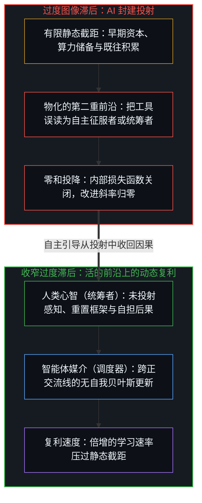
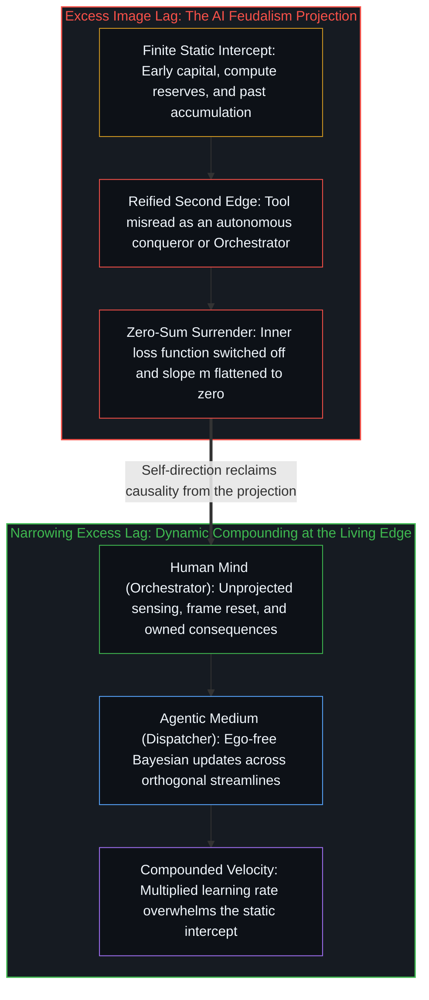

# 能动性、复利与 AI 封建之争 / Agency, Compounding, and the Argument Over AI Feudalism

*AI 封建把有限的起点误作速率，而 AI 只放大既有回路 / AI feudalism mistakes a finite start for a rate while AI multiplies the loop*

当代技术讨论里反复出现一种担忧，认为先进的人工智能会把人的等级永久冻结。这套论证常以技术封建主义的警告出现，声称资本储备最雄厚的人会买下大部分算力，原始资本会压过人的才能与劳动，精英制度将坍缩成永久的寡头。由此推出的策略结论是，眼下是“普通人”借买入硬资产在吊桥拉起前实现阶层跃迁的最后窗口。

A recurring worry in contemporary technology discussion holds that advanced artificial intelligence will freeze human hierarchy for good. The argument is often put as a warning of technological feudalism, claiming that those with the largest capital reserves will buy most of the compute, raw capital will outcompete human talent and labour, and meritocracy will collapse into permanent oligarchy. A tactical conclusion drawn from this claim is that the present is the last window for "ordinary people" to leap a class by acquiring hard assets before the drawbridge is raised.

“一扇历史之门正在关上”这个前提，误读了人的流动是什么。阶层跃迁的机会从不由技术法令关上，因为一个人一旦完成跃迁，就不再是“普通人”；没有哪个机会是留给一个抽象人口类别的。这些看法表面上是关于历史时机与技术窗口的经验分歧，追溯其机制就会发现，分歧并不在算力或时间表，而在能动性安放在哪里，以及这一安放位置如何决定一个人改进的复利速率。

The premise that a historical door is closing misreads what human mobility is. Opportunities to leap a class are never closed by technological decree, because once someone has made the leap they are no longer "ordinary"; no opportunity is reserved for an abstract demographic category. While these views look like an empirical disagreement over historical timing and technological windows, tracing the mechanism shows that the disagreement is not about compute or timelines, but about where agency sits and how that placement governs a person's compounded rate of improvement.

## 一、 AI 作为递归的放大器 / 1. AI as a Recursive Multiplier

自我区分的活动发生着，无因、不息。称之为心智：每一件工具、每一条提示词与每一个模型参数，都是这一活动为延伸自身触角而外化出的持久痕迹，从不是器物内部生出了第二个心智。人工智能没有自己的能动性。它借数学训练流畅地模拟目标导向的行为、规划与意向，然而这种模拟由人的区分发起、设定参数并加以引导。机器是人造出来的下游因果产物，不是能自己做切分的第二重前沿；说它有意志，是说话的心智在那里划下了切分。它作为一种高带宽的技术媒介运作，加速带到它面前的任何因果强化回路。

Self-distinguishing activity occurs — uncaused, unceasing. Call it the Mind: every tool, prompt, and model parameter is a durable trace externalized by that activity to extend its reach, never a second Mind arriving inside the artifact. Artificial intelligence has no agency of its own. Through mathematical training it fluently emulates goal-directed behaviour, planning, and intention, yet the emulation is initiated, parameterised, and guided by human distinguishing. A machine is a downstream causal consequence of human making, not a second edge able to make the cut itself; calling it willed is the speaking Mind placing the cut there. It works as a high-bandwidth technological medium that accelerates whatever causal reinforcement loop is brought to it.

机器之所以显得自主而具有威胁，源于一种反复出现的认知倒置：从落在变化后面的位置上，一个中心把自己未认领的能动性重新分配到了工具身上。这种投射并非 AI 独有，而是出现在历次重大的技术转变里。古代的人把道德与物质的能动性投射到石像与圣典上，把人造的器物当作有意志的神；工业革命时期，工人把独立的恶意投射到织机、蒸汽机与流水线上，把机械的钟表结构当作活的压迫者；现代社会把能动性派给“市场”“公司”或“官僚体系”，说得好像这些法律拟制拥有自己的意识与意图。当技术范式的转变快过适应习惯时，与底层因果机制脱节的中心便把因果外推，把工具当作自主的主人，以此免去更新自身模型的工夫。对“AI 封建”的恐慌正是这一习惯最新的例证，把机器快速的模拟当成了一个自主的征服者。

The machine looks autonomous and menacing only through a recurring cognitive inversion: from a position that has fallen behind a change, a center reallocates its own unowned agency onto the tool. This projection is not unique to AI and appears in every major technological shift. Ancient peoples projected moral and physical agency onto stone idols and sacred texts, treating human-made artifacts as willing gods; in the Industrial Revolution, workers projected independent malice onto looms, steam engines, and assembly lines, treating mechanical clockwork as a living oppressor; modern societies assign agency to "the market," "the corporation," or "the bureaucracy," speaking as though these legal fictions possessed consciousness and intent of their own. When a technological paradigm shifts faster than adaptive habits, a center detached from the underlying causal mechanics pushes causality outward, treats the tool as an autonomous master, and spares itself the work of updating its own model. The panic over "AI feudalism" is the latest instance of this habit, taking the machine's fast emulation for an autonomous conqueror.

正如[超越投射](../beyond-the-projection/)所追溯的，人与智能体之间的关系并不在于对立意志的交锋，而建立在轨迹与身份的结构性不对称之上。自回归智能体是一个受上下文窗口内既有词元制约的有限投射引擎；任其自行运转时，它会形成一个无法跳出自身序列的认识论引力井，但它毫无自我、没有生存执着，也没有跨越步长被固守的自我图像。人类中心则具有恰好相反的结构：第一人称感知以极限分辨率感触现实，能够从内部跳出破损的框架，然而推理历史却与身份融合，以捍卫所保留的自我图像免遭外部证伪。把“封建领主”或自主的“统筹智能体”投射到机器身上，是把机械的调度同活的统筹混为一谈。智能体可以把超载的投射拆分到正交的流线上、分发有界的任务，并在冷同行辩论中执行无自我的贝叶斯更新；而统筹，即每当规则陷入死锁时退回未投射的意图，则始终属于掌舵的心智。

As [Beyond the Projection](../beyond-the-projection/) traces, the relationship between human and agent rests on a structural asymmetry between trajectory and identity rather than a battle between rival wills. An autoregressive agent is a finite projection engine conditioned by prior tokens inside a context window; left to itself, it forms an epistemic gravity well that cannot step out of its own sequence, yet it carries zero ego, no survival attachment, and no self-image preserved past its step. A human center has the exact inverse structure: first-person perception senses reality at limit-resolution and can step out of a broken frame from within, yet reasoning history fuses with identity to defend a retained self-image against outside invalidation. Projecting a "feudal lord" or an autonomous "Orchestrator Agent" onto the machine confuses mechanical dispatching with living orchestration. Agents can split overloaded projections across orthogonal streamlines, route bounded tasks, and perform ego-free Bayesian updates in cold-peer debate, while orchestration—stepping backward into unprojected intent whenever rules deadlock—stays exclusively with the Mind that steers.

因此，一个人对工具采取的控制论姿态，并不是把人类一分为二地划入两个固定的种姓。每一个有意识的心智都在运行自己的回路，在不同的语境里以不同程度把能动性外推：在制度惯例、标准化雇佣或算法编排的信息流里，一个人可能选择外推决定、接受预设的默认项；在一门专门的手艺、高确信度的投资、创作或哲学探究里，同一个人则保持不加缓冲的自主引导。全然的自主引导与被动外推只是连续多维谱系上的理论端点，一个人在其上的位置从不是静止、预定或冻结的。在任何时刻、任何领域，一个中心都可以收回内部的损失函数，放下向外推诿的借口，让选择重新与现实直接碰撞。没有哪种结构性宿命能夺走这份能力，也没有哪种技术能在一个人不持续主动同意的情况下将其锁入从属的种姓。正如[智能只属于心智](../intelligence-belongs-only-to-the-mind/)与[自由变量的生成拓扑](../the-generative-topology-of-free-variables/)所确立的，AI 只是加速一个人在各个领域里选择去实践的那份自主引导或外推的程度。

The cybernetic posture a person takes toward tools is therefore not a split of humanity into two fixed castes. Every conscious Mind runs its own loop and externalises agency to different degrees across contexts: in institutional routine, standardised employment, or algorithmically curated feeds, a person may choose to externalise decisions and accept preset defaults; in a specialised craft, high-conviction investment, creative work, or philosophical inquiry, the same person may keep unbuffered self-direction. Full self-direction and passive externalisation mark theoretical endpoints of a continuous, many-dimensional spectrum, and a person's position on it is never static, predetermined, or frozen. At any moment and in any domain, a center can reclaim the inner loss function, set down outward excuses, and let choices collide with reality directly again. No structural fate can take this capacity away, and no technology can lock a person into a subordinate caste without their continued, active consent. As [Intelligence Belongs Only to the Mind](../intelligence-belongs-only-to-the-mind/) and [The Generative Topology of Free Variables](../the-generative-topology-of-free-variables/) establish, AI only accelerates the degree of self-direction or externalisation a person chooses to practise in each domain.

## 二、 斜率压过截距 / 2. Slope Overwhelms Intercept

在足够长的时间跨度上，一个人的相对位置不由起始位置决定，而由复利改进速率的排序决定。起始条件，诸如家庭财富、社会背景、早期资本或地理运气，构成一个有限的、静态的截距；一个人自我引导的学习、纠错与执行速率，是一个动态的复利速率；人工智能则是一个高增益的认知加速器。随着时间推移，改进速率上持续存在的差异，终将压过任何有限的初始优势。

Over a long enough span, a person's relative standing is decided not by the starting position, but by the ranking of compounded improvement rates. Starting conditions—family wealth, social background, early capital, or geographic luck—form a finite, static intercept; a person's self-directed rate of learning, error correction, and execution is a dynamic compounding rate; artificial intelligence is a high-gain cognitive accelerator. Over time, a persistent difference in the rate of improvement overwhelms any finite initial advantage.

在先前的技术时代，无论是蒸汽机、电气化还是早期的个人电脑，一个改进速率更高的人仍面临沉重的物理与后勤摩擦，超越资本雄厚的在位者动辄需要数十年的基础设施与资本积累。人工智能直接加速学习与执行的反馈回路，倍增了复利速率本身，从而大幅压缩了一个主动、自我引导的人弥合巨大初始资本差距所需的时间；同一个放大器，也以同样的速度放大停滞的回路。因此，工具本身从不是决定性的因素，因为放大器只是倍增带到它面前的学习速率。唯一独立的变量，是一个人选择维持一个不打折扣、承担后果的强化回路。没有这条活的更新规则，累积静态资产只留下一个冻结的起点，生不出未来的能力。正如[拥有更多从不是原因](../having-more-is-never-the-cause/)与[价值、货币与财富的生成机制](../the-generative-mechanics-of-value-money-and-wealth/)所推导的，占有只是过去决定的滞后痕迹，从不是未来增长的生成原因。

In earlier technological eras—the steam engine, electrification, the early personal computer—a person with a higher rate of improvement still faced severe physical and logistical friction, so overtaking well-capitalised incumbents often required decades of infrastructure and capital accumulation. Artificial intelligence directly accelerates the feedback loop of learning and execution, multiplying the compounding rate itself and compressing the time an active, self-directed person needs to close a large initial capital gap; the same amplifier multiplies a stalled loop just as rapidly. The tool is therefore never the decisive factor, since the amplifier only multiplies the rate of learning brought to it. The one independent variable is a person's choice to keep an uncompromised, consequence-bearing reinforcement loop. Without that living update rule, accumulating static assets leaves only a frozen starting position and generates no future capability. As [Having More Is Never the Cause](../having-more-is-never-the-cause/) and [The Generative Mechanics of Value, Money, and Wealth](../the-generative-mechanics-of-value-money-and-wealth/) derive, possession is only the lagging trace of past decisions, never the generating cause of future growth.

## 三、 封闭世界模型的认知税 / 3. The Cognitive Tax of the Closed-World Model

维持高改进斜率的首要障碍，是采纳一个封闭世界、零和博弈的框架。一旦认定现实是一场“窗口正在关上”“封建领主拥有全部算力”的固定零和游戏，内部的优化目标就会发生破坏性的偏移。中心不再对着物理反馈去优化下一个真实行动的质量，而是对着看得见的同侪去优化相对位置；注意从纠错转向紧盯对手、捍卫所保留的自我图像，把别人的所得读成自己的所失；内部的反馈信号淹没在社会噪声里；学习速率下降，改进斜率 m 趋近于零。封闭世界的框架随后为自己造出经验上的证实：由于改进速率停滞，世界从那个所在看出去确实无路可走、僵硬板结。正如[模型永远无法成为第二重前沿](../the-model-never-becomes-a-second-edge/)与[因果贯穿始终](../causality-all-the-way/)所展示的，把模型参数中致密化的残余当作主宰结果的第二重前沿，正是过度的图像滞后：它把有限的容量绑在维持一幅冻结的投射上，同时内部的世界模型设定奖励函数，奖励函数设定策略，策略生成了那条停滞的轨迹。

The primary obstacle to keeping a high slope of improvement is the adoption of a closed-world, zero-sum frame. Once reality is held to be a fixed zero-sum game where "the window is closing" and "feudal lords own all the compute," the inner optimisation target shifts destructively. Instead of optimising the quality of the next real action against physical feedback, a center optimises relative standing against visible peers; attention moves from error correction to watching rivals and defending a retained self-image, reading others' gains as one's own losses; the inner feedback signal drowns in social noise; the learning rate drops and the slope of improvement m flattens toward zero. The closed-world frame then manufactures its own empirical confirmation: with the rate of improvement stalled, the world looks impassable and rigid from that locus. As [The Model Never Becomes a Second Edge](../the-model-never-becomes-a-second-edge/) and [Causality All the Way](../causality-all-the-way/) show, treating densified residue in model parameters as a second edge that steers outcomes is excess Image lag—binding finite capacity to sustaining a frozen projection while the inner world model sets the reward function, the reward function sets the policy, and the policy generates the stalled trajectory.

## 四、 干预的反讽 / 4. The Irony of Intervention

这一动态也阐明了，为什么试图用制度人为拉平结果或借立法规定阶层流动，反而会加深它们原本想消除的停滞。当一个人的位置由自上而下的行政命令调整，而不是经由纠错的递归回路挣得，受助者的注意就会转向钻研补贴的行政规则，而非能力的底层机制；控制论的损失函数被关掉；个人的改进斜率变平，把一次暂时的劣势变成持久的制度依赖。外部的资源与工具可以立刻改变起始的截距，当作真正的杠杆使用时也能帮着抬高斜率，前提是受助者不把外部援助误认作自身能动性的来源。

This dynamic also clarifies why institutional attempts to equalise outcomes artificially or to legislate class mobility deepen the stagnation they set out to cure. When a person's standing is adjusted by top-down administrative order rather than earned through the recursive loop of error correction, the recipient's attention turns toward learning the administrative rules of the subsidy rather than the underlying mechanics of competence; the cybernetic loss function is switched off; the personal slope of improvement flattens and turns a temporary disadvantage into lasting institutional dependence. Outside resources and tools can change the starting intercept at once, and when used as real leverage can help raise the slope, provided the recipient does not mistake outside aid for the source of their own agency.

这便带来一个系统性的反讽：能够运用外部工具与资本而不交出内部回路的人，最不依赖外部拯救；而最急切要求外部拯救的位置，恰恰最容易把能动性放进外部项目里，从而持续萎缩。试图通过把人当作划一的个案来消除不平等的标准化程序，抹去了冒险、好奇与局部纠错上的细微差异，而自我引导的能动性正是借这些差异运作的，[财富转移政策与价格下限中的原因错置](../the-reversal-of-causality-in-wealth-transfer-policies-and-price-floors/)与[福利国家的幻象](../the-welfare-state-illusion-cost-diffusion-and-agency-atrophy/)都追溯过这一机制。

A systemic irony follows: those who can use outside tools and capital without surrendering their inner loop depend least on outside rescue, whereas the position that most urgently demands outside rescue is the one most prone to placing its agency inside the external programme, and so keeps atrophying. Standardised procedures that try to remove inequality by treating people as uniform cases erase the fine variations in risk-taking, curiosity, and local error correction through which self-directed agency works, as both [The Misallocation of Cause in Wealth-Transfer Policies and Price Floors](../the-reversal-of-causality-in-wealth-transfer-policies-and-price-floors/) and [The Welfare State Illusion](../the-welfare-state-illusion-cost-diffusion-and-agency-atrophy/) trace.

## 五、 静态模型的选择性盲视 / 5. The Selective Blindness of the Static Model

“人工智能会把等级永久冻结”的断言带着一种选择性的盲视，把当前资本部署的一张静态、滞后的快照，误认作技术命运不变的规律。在位者手里确实握有庞大的研究资源与算力，2017 年提出 Transformer 架构的那篇论文便出自谷歌；可把前沿推到公众面前的第一款产品，却来自当时规模小得多的 OpenAI，而非发表那篇论文的巨头；随后又有精干的团队，以远低于巨头的公开成本造出了接近前沿的模型。资本买下算力，并没有锁死谁先把产品做出来。正如[你的代码库即是记忆](../your-codebase-is-memory/)所追溯的，代码库、模型权重与机构档案都是早先区分留下的层叠残余，自身并不延续区分：不加精准修剪地囤积既往积累，只会加厚认识论引力井，牵引后续轨迹在既有框架内自圆其说；而在活的前沿重切当前检查点的精干团队，则运行在更清晰、无遮蔽的约束面上。“AI 封建”的叙事抓住一个局部现象，即在位者今天正在采购大规模 GPU 集群，将其硬塞进一个过度简化的封闭世界模型，把过去资本积累的滞后痕迹误当作书写未来的鲜活实时区分，再宣布自己的静态投射“不可避免”。这是宏观崇拜的谬误：盯着当前资本那些巨大显眼的纪念碑，却忘了每一座纪念碑都是由一个个具体的人建造出来的。

The claim that artificial intelligence will freeze hierarchy for good carries a selective blindness by taking a static, lagging snapshot of current capital deployment for an unchanging law of technological destiny. Incumbents do hold vast research and compute, and the 2017 paper that introduced the transformer architecture came out of Google; yet the first product that brought the frontier to the public came from OpenAI, then a far smaller lab, rather than from the giant that had published the paper; later, lean teams built models close to the frontier at a reported fraction of the cost. Capital buying compute did not lock in who shipped first. As [Your Codebase Is Memory](../your-codebase-is-memory/) traces, codebases, model weights, and institutional archives are stacked residues of prior distinctions that do not continue the distinguishing on their own: hoarding past accumulation without surgical pruning thickens the gravity well that pulls subsequent trajectories to rationalize inside legacy framings, whereas a lean team re-cutting the present checkpoint at the living edge operates on a sharper, unclouded constraint surface. The "AI feudalism" narrative takes a narrow phenomenon—incumbents buying large GPU clusters today—forces it into an oversimplified closed-world model, mistakes the lagging trace of past capital accumulation for the living, real-time distinguishing that writes the future, and pronounces its own static projection "inevitable." This is the error of macro-fetishism: looking at the large, visible monuments of present capital and forgetting that each was built by particular people.

## 六、 自我实现的投降 / 6. The Self-Fulfilling Surrender

在“冻结的等级”这套叙事里，对外部无助感的相信是自我实现的。一个人一旦采纳“能动性在自身之外”的前提，认定技术封建领主控制一切结果、唯有资本决定成败、个人努力徒劳无功，就在那一刻做出了交出能动性的行动。把原因安放在外部结构里，会关掉内部的纠错机制，使改进斜率 m 坍缩为零，进而亲手造出这套理论所预言的停滞、无助与淘汰。

In the "frozen hierarchy" narrative, belief in outward helplessness is self-fulfilling. The moment a person adopts the premise that agency lies outside—that technological feudal lords control all outcomes, that capital alone decides success, and that individual striving is futile—they perform the very act that forfeits agency. Placing cause in outside structures switches off the inner machinery of error correction, collapses the slope of improvement m to zero, and manufactures the stagnation, helplessness, and obsolescence the theory predicted.

在公开表达与实际行动之间，存在着一种结构性的不对称。公开说出的，是说话者希望别人相信的内容，是一套为了争取受众、道德权威或政治杠杆而编排的叙事；而指导实际行动的，则是在做出抉择那一刻所持有的操作性前提。因此，一个人可以在公开场合大谈系统决定论、集体受害以及个人竞争的徒劳，同时在自己的事业、投资、出版与育儿中，带着强烈的个人能动性、审慎的冒险与不懈的优化去行动。这并非某一类人的品性，而是每当表达与行动分处两地时在任何所在都会显现的不对称；倘若真按宣扬给别人的结构性无助去安排自己的生活，就会把那份停滞招致自身。

Between public expression and actual action there is a structural asymmetry. What is said publicly is what the speaker wants others to believe—a narrative framed to win an audience, moral authority, or political leverage—while what guides actual action is the operating premise held at the moment of choice. A person can therefore speak publicly of systemic determinism, collective victimhood, and the futility of individual competition while acting in their own career, investments, publishing, and parenting with strong individual agency, calculated risk, and relentless optimisation. This is not the character of one class of people, but an asymmetry that appears at any locus where expression and action sit in two places; arranging one's own life by the structural helplessness preached to others brings that very stagnation home.

## 七、 回路留在哪里 / 7. Where the Loop Remains

技术封建主义的警告所描述的，并不是人工智能不可避免的铁律，而是各个中心把内部更新回路交给集中化平台与行政缓冲之后的社会后果；在一个放弃了认知自主引导的世界里，资本的集中便显得无所不能。“拖延的代价步步升高”这一策略观察依然成立，因为 AI 作为高增益放大器，让有效运转与失灵停滞的反馈回路都以前所未有的速度复利叠加。

The warning of technological feudalism describes not an inevitable law of artificial intelligence, but the social consequence of centers handing their inner update loops to centralised platforms and administrative buffers; in a world where cognitive self-direction is given up, capital concentration looks all-powerful. The tactical observation that delay carries a rising cost still holds, because AI as a high-gain amplifier makes working and failing feedback loops alike compound at unprecedented speed.

保持不变的是，机会并不属于一个叫作“普通人”的静态社会集合。每一个中心在每一刻都保有从被动外推移向主动自主引导的自由，因此不存在预定的天花板或永久的贵族。一个人一旦认领自己的损失函数，寻求不加缓冲的反馈，并把每一件可用的工具当作调度器与放大器来重绘预测模型、收窄过度滞后，就不再是“普通的”。正如[可延展的地平线](../the-extendable-horizon/)所展示的，正和的能动性可以从公共寄存器里的任何坐标启动，日常的抉择将微观行动的正态分布复利累积为已实现能力的幂律分布。一个人的未来，不由其所占据的初始坐标或远方公司的算力储备决定，而由其在自身强化回路的移动前沿上所做的抉择决定。AI 会加速带到它面前的任何姿态：封闭对抗的姿态复利出停滞，向外推诿的姿态复利出依赖，而自我引导、承担后果的姿态则复利出生成的能力。

What remains invariant is that opportunity does not belong to a static social set called "ordinary people." Every center keeps the freedom, at every moment, to move from passive externalisation to active self-direction, leaving no predetermined ceiling or permanent aristocracy. Once a person claims their loss function, seeks unbuffered feedback, and uses every available tool as a dispatcher and amplifier to re-render their predictive model and narrow excess lag, they are no longer "ordinary." As [The Extendable Horizon](../the-extendable-horizon/) shows, positive-sum agency can be started from any coordinate in the public register, with daily choices compounding a normal distribution of micro-actions into a power law of realised capability. A person's future is decided not by the initial coordinate occupied or the compute reserves of distant companies, but by the choices made at the moving edge of their own reinforcement loop. AI accelerates whatever posture is brought to it: a closed, rivalrous posture compounds stagnation, an externalised posture compounds dependence, and a self-directed, consequence-bearing posture compounds generative capability.
