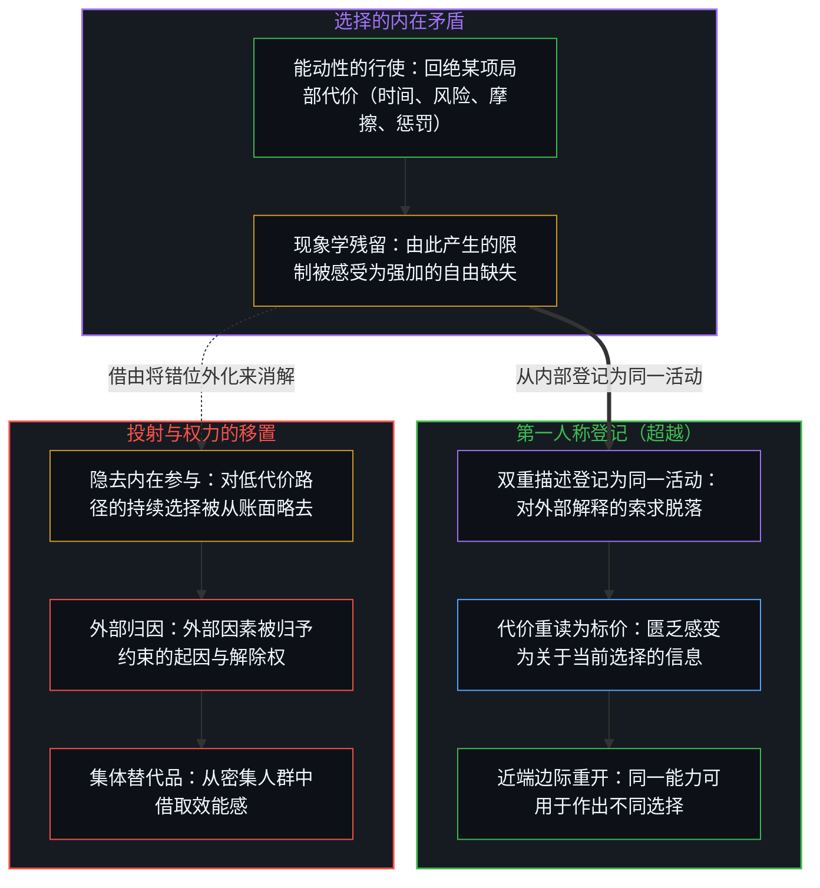
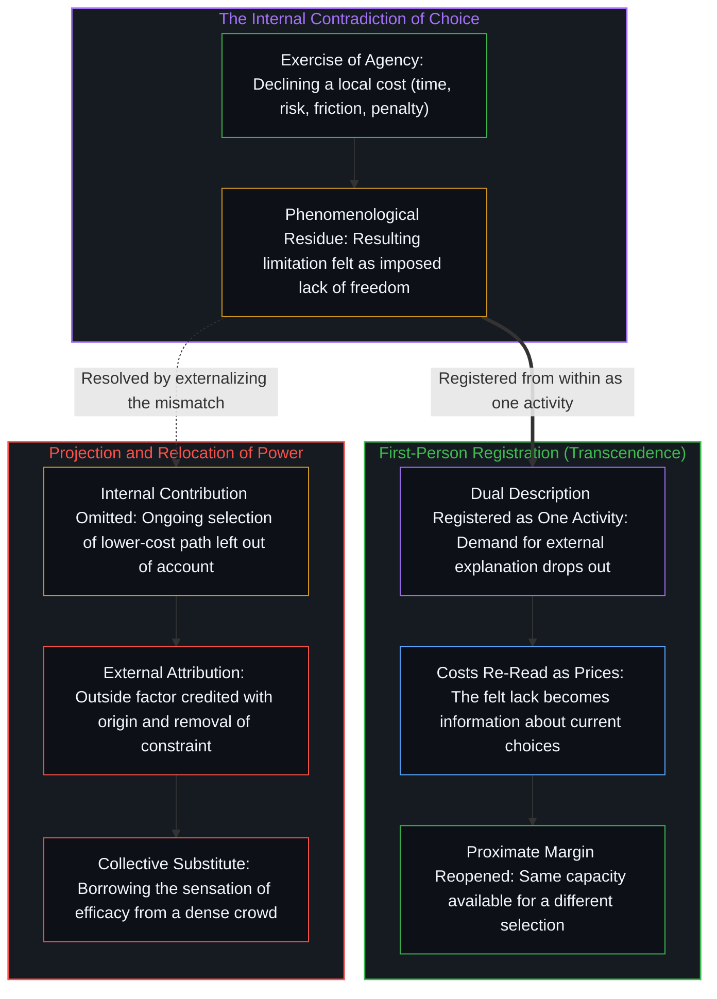
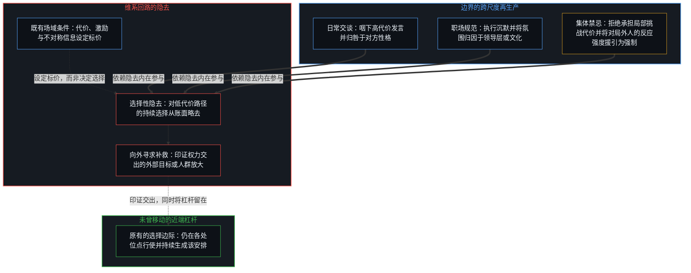
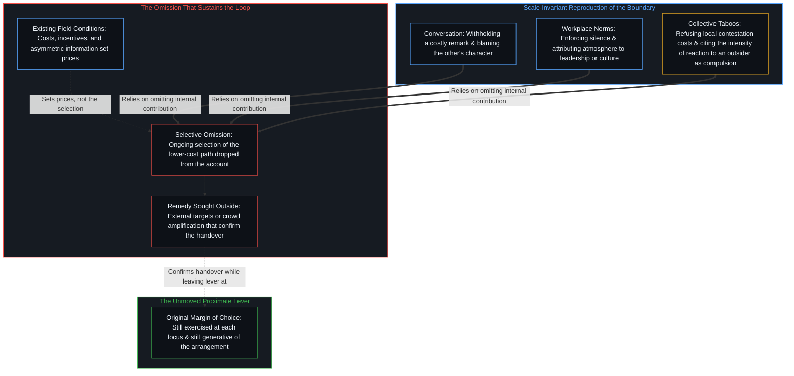

# 能动性、矛盾与权力的移置 / Agency, Contradiction, and the Relocation of Power

*隐去对低代价路径的持续选择，权力便被移置向外；两面登记为同一活动，代价便由理由变为标价。 / Omitting the ongoing choice of the lower-cost path relocates power outward; registering both sides as one act turns costs from reasons into prices.*

当一个人回绝了某项局部代价，并遭遇由此带来的限制时，这一约束虽然由选择活动本身生成，却在体验中登记为由外部强加的自由缺失。借助投射来消解这一矛盾，会将该约束以及解除它的权力一并归于外部的某个人、机构或结构，而那个将权力交出的人便转向人群或运动去借取效能感——这一序列从单次交谈一直重复到集体禁忌。从内部将这两个面向登记为同一项持续进行的活动——这一转向恰可称为超越——便放下了对外部解释的索求，使代价从无法另作他选的理由重新变为附着于可见替代选项上的标价。

When a person declines a local cost and encounters the limitation that follows, the resulting constraint is generated by the exercise of choice itself yet registers in experience as an externally imposed lack of freedom. Resolving that contradiction by projection attributes the constraint, and the power to lift it, to an outside person, institution, or structure, and the person who has handed that power over looks to a crowd or movement for a borrowed sense of efficacy, a sequence that repeats from a single conversation to a collective taboo. Registering both aspects from within as one ongoing activity, the shift properly called transcendence, drops the demand for an external explanation and turns costs from reasons one cannot choose otherwise back into prices attached to visible alternatives.

## 一、 选择的内在矛盾与借由投射的移置 / 1. The Internal Contradiction of Choice and Relocation by Projection

能动性始终在行使之中。它不是一种可以被没收、日后再予归还的资源；每一项行动，包括不行动，都是在当下既有条件下作出的选择，这一地基已在[约束基底与自由自否](../the-substrate-of-constraint-and-the-self-denial-of-freedom/)中追溯。因此，长期感到缺乏自由，不可能源于字面意义上的没有选择。它源于选择行使过程本身的内在矛盾：挑选并维系某一既有安排的同一能力，在体验中却对改变这一安排无能为力。

Agency is continuously exercised. It is not a resource that can be confiscated and later returned; every action, including inaction, is a choice made under whatever conditions obtain at the moment, the ground traced in [The Substrate of Constraint and the Self-Denial of Freedom](../the-substrate-of-constraint-and-the-self-denial-of-freedom/). The persistent experience of lacking freedom therefore cannot arise from the literal absence of choice. It arises from a contradiction internal to the exercise of choice itself: the same capacity that selects and sustains a given arrangement is experienced as powerless to alter it.

这种矛盾很寻常。一个人回绝了某项代价——时间、风险、社交摩擦、职业惩罚——随后遭遇了这一回绝所带来的限制。正因为回绝本身就是一次能动性的行使，由此产生的约束在感觉上便像是强加的而非自选的，这一表象已在[约束的样子不是自由的失去](../the-look-of-constraint-is-not-the-loss-of-freedom/)中剖析。匮乏感正是这一错位的现象学残留。作为一种体验，它是真实的，但它却正是由那个随后被感到缺失的活动本身所生成的。

This contradiction is ordinary. A person declines a cost—time, risk, social friction, career penalty—and then encounters the limitation that follows from the refusal. Because the refusal was itself an exercise of agency, the resulting constraint feels imposed rather than chosen, the look examined in [The Look of Constraint Is Not the Loss of Freedom](../the-look-of-constraint-is-not-the-loss-of-freedom/). The feeling of lack is the phenomenological residue of that mismatch. It is real as an experience, yet it is generated by the very activity that is then felt to be missing.

由于没有任何选择发生在真空中，这一矛盾常通过移置来消解。约束的来源被归因于某个外部因素：另一个人、某个群体、某项制度、某种历史遗存，或某种结构。投射执行了这一移置，其运作机制已在[关于归因](../guan-yu-gui-yin/)与[回返的信号与认领](../the-returning-signal-and-its-claim/)中拆解。它将内在的不一致（我正在选择此事，却感到自己毫无选择）转化为外在归因（是他们剥夺了我的选择）。一旦确立了外部客体，后续的行动——道歉、抗拒、沉默或进一步让步——便都能被解读为对这一归因的印证，而不再是重新审视最初选择的契机。回路随之收紧。

Because no choice occurs in a vacuum, the contradiction is commonly resolved by relocation. The source of the constraint is attributed to an external factor: another person, a group, an institution, a historical inheritance, or a structure. Projection performs the relocation, operating through the mechanism dissected in [On Attribution](../guan-yu-gui-yin/) and [The Returning Signal and Its Claim](../the-returning-signal-and-its-claim/). It converts an internal inconsistency (I am choosing this, yet I feel I have no choice) into an external attribution (they are denying me the choice). Once the external object is established, further actions—apologies, resistance, silence, or additional concessions—can be read as confirmation rather than as occasions to re-examine the original choice. The loop tightens.

## 二、 作为第一人称登记的超越与第三人称报告的界限 / 2. Transcendence as First-Person Registration and the Limit of Third-Person Report

当这一双重描述从内部被登记为同一活动的同时面向时，把这种错位当作须由外部之物来解释的东西的需要，便脱落了。从这一第一人称登记来看，这种转向被恰如其分地称为超越：不是逃离既有条件，而是不再要求对一项自己本就在执行的活动作出外部解释。此处的超越既不是[超越的定相](../the-fixed-image-of-transcendence/)中的固定目标，也不是如[开悟的相与门槛的倒置](../the-form-of-enlightenment-and-the-inversion-of-gates/)所剖析的那样跨过某道门槛；它就是人迈出的下一步。那种匮乏感并未消失，但失去了作为外部剥夺之证据的性质。它变成了关于当下正在作出的选择的信息，重新打开了[如何在一瞬间修正你的整个人生](../how-to-fix-your-whole-life-in-one-split-second/)所追溯的即时反馈通道。一直在同时生成既有安排与受限感的同一选择能力，依然可用于作出不同的选择。代价依然存在；它们的地位从无法另作他选的理由，变成了附着在如今可见的替代选项上的标价。另作选择依然可能高昂、缓慢或局部；它可能只改变行为的一小段边际，而非整套结构。但先前那种感觉——仿佛边际本身已被自身选择之外的东西封死——已不再必要。

When the dual description is registered from within as simultaneous aspects of the same activity, the need to treat the mismatch as something that must be explained by something outside it drops out. From that first-person registration the shift is properly called transcendence: not an escape from conditions, but the cessation of the demand for an external explanation of an activity one is already performing. Transcendence here is neither the fixed target of [The Fixed Image of Transcendence](../the-fixed-image-of-transcendence/) nor a gate passed, as in [The Form of Enlightenment and the Inversion of Gates](../the-form-of-enlightenment-and-the-inversion-of-gates/); it is the next step one takes. The feeling does not disappear, but it loses its character as evidence of an external deprivation. It becomes information about the choices currently being made, reopening the immediate feedback channel traced in [How to Fix Your Whole Life in One Split Second](../how-to-fix-your-whole-life-in-one-split-second/). The same selection that has been generating both the arrangement and the felt constraint remains available for a different selection. Costs remain; their status changes from reasons one cannot choose otherwise to prices attached to now-visible alternatives. Choosing differently may still be expensive, slow, or partial; it may alter only a narrow margin of conduct rather than an entire structure. Yet the prior sense that the margin itself is closed by something other than one’s own selection is no longer required.

任何第三人称叙述都可以报告说，对移置的索求已经脱落，且无需先行改变外部条件即可作出不同的选择；但它自身无法完成那一登记——在那一登记中，这一可用性就是下一步的动作；这一内在掌舵与外在报告之间的不对称，已在[主权抉择的双面性与观察的客体化](../the-two-sided-nature-of-sovereign-choice-and-the-objectification-of-observation/)与[看不见自身的回路](../the-loop-that-cant-see-itself/)中追溯。每一次观察都始于第一人称；外部描述本身就已经是将那次登记转化为第三人称形式的报告，正如[凡可言说皆不可言说之产物](../all-that-can-be-spoken-is-the-product-of-the-unspeakable/)所追溯的那样。界限若有，也在于试图让停留在这一转向之外的读者充分理解它，而不在于“超越”一词从内部看来是否可用。

Any third-person account can report that the demand for relocation has dropped out and that a different selection is now available without first requiring an external change; it cannot itself perform the registration in which that availability is simply the next movement, an asymmetry between inner steering and outer report traced in [The Two-Sided Nature of Sovereign Choice and the Objectification of Observation](../the-two-sided-nature-of-sovereign-choice-and-the-objectification-of-observation/) and [The Loop That Can't See Itself](../the-loop-that-cant-see-itself/). Every observation begins as first-person; the external description is already a report of that registration rendered in third-person form, as [All That Can Be Spoken Is the Product of the Unspeakable](../all-that-can-be-spoken-is-the-product-of-the-unspeakable/) traces. The limit, if any, lies in the attempt to keep the shift fully intelligible to a reader who remains outside it, not in the term as it is available from within.

## 三、 隐去低代价路径与向人群借取效能感 / 3. Omitting the Lower-Cost Path and Borrowing Efficacy from the Crowd

当这一矛盾未被认领为自身之物时，相反的情形便会发生。改变既有安排的权力被当作驻留在别处。外部因素被同时归予约束的起源以及解除约束的排他能力，从而背书了[赋权确立权力的集中](../empowerment-establishes-the-centralization-of-power/)与[权力的镜像握手](../the-mirror-handshake-of-power/)所追溯的层级关系。自身对低代价路径的持续选择被从账面隐去，于是那股仍在不断再生产该约束的能动性，便不再被认出可用于作出不同的选择。这一交出正是无力感的来源，使[自我价值感与所有权](../ownership-and-self-worthiness/)所指明的递归更新得不到给养。实际的注意力与精力转向去影响、控诉或等待那个外部来源。仍处于自身选择之下的那段行为边际，则相应地被忽视，或在体验中显得无关紧要。那份力量并未被摧毁，只是不再作为近端的改变手段来行使。处境继续由当下仍在作出的选择所塑造，而塑造处境的感受能力却已被派给了被投射的客体。

When the contradiction is not accepted as one’s own, the opposite occurs. The power to alter the arrangement is treated as residing elsewhere. The external factor is credited with both the origin of the constraint and the exclusive capacity to lift it, ratifying the hierarchy traced in [Empowerment Establishes the Centralization of Power](../empowerment-establishes-the-centralization-of-power/) and [The Mirror Handshake of Power](../the-mirror-handshake-of-power/). One’s ongoing selection of the lower-cost path is omitted from the account, so the agency that continues to reproduce the constraint is no longer recognized as available for a different selection. This handover is the source of the felt powerlessness, starving the recursive update that [Ownership and Self-Worthiness](../ownership-and-self-worthiness/) identifies. Practical attention and effort shift toward influencing, accusing, or waiting upon the external source. The margin of conduct that remains under one’s own selection is correspondingly neglected or experienced as irrelevant. The power is not destroyed, yet it is no longer exercised as the proximate means of change. The circumstances continue to be shaped by the choices still being made, while the felt capacity to shape them has been assigned to the projected object.

由此产生的匮乏随后生成了对外部替代品的索求，这一替代品必须足够庞大，方能恢复缺失的效能感。一场运动或足够密集的人群提供了这一替代品，以[让渡主权的幂律法则](../the-power-law-of-surrendered-agency/)所推导的方式汇聚起让渡出去的向量。通过与抱持同一外部归因的人结盟，人便可以借取在个体层面已被放弃的力量感。集体尺度看似找回了被转移的东西：人数、声势与协同施压顶替了不再作为补救现场来行使的个人选择，供奉起[革命之名把生活收成证据](../the-name-revolution-files-a-life-as-evidence/)与[剩余个人主义](../residual-individualism/)所拆解的对立丰碑。这种借来的感觉作为一种体验是真实的——动能、团结、暂时的筹码——但它依然依赖于持续的外化。人群可以放大投射；它并不会把被隐去的能动性归还给那个将其交出的人。

The resulting lack then generates a demand for an external substitute large enough to restore the missing sensation of efficacy. A movement or sufficiently dense crowd supplies the substitute, aggregating surrendered vectors in the manner derived in [The Power-Law of Surrendered Agency](../the-power-law-of-surrendered-agency/). By aligning with others who share the same external attribution, one can borrow the feeling of power that has been renounced at the individual level. The collective scale appears to recover what was transferred: numbers, visibility, and coordinated pressure stand in for the personal selection that is no longer exercised as the site of remedy, enshrining the oppositional monument dissected in [The Name Revolution Files a Life as Evidence](../the-name-revolution-files-a-life-as-evidence/) and [Residual Individualism](../residual-individualism/). The borrowed feeling is real as an experience—momentum, solidarity, temporary leverage—yet it remains dependent on the continued externalization. The crowd can amplify the projection; it does not return the omitted agency to the person who handed it over.

## 四、 跨尺度不变的序列与维系它的隐去 / 4. The Scale-Invariant Sequence and the Omission That Sustains It

同一序列出现在每一个尺度上。在日常交谈中，一个人咽下了代价高昂的发言，将变窄的交流体验为对方的过错，并将这一限制归因于对方的性格或权力。在职场或社团中，成员们接受了限制公开异议的非正式规范；由此形成的氛围随后被描述为由领导层或文化所强加，哪怕大多数参与者仍在通过沉默或温和的制裁继续执行这些规范。在更大规模的集体层面，围绕特定议题或历史评判的边界，靠的是广泛拒绝承担在局部挑战它们的代价来维持，作为[起作用的是信念](../what-works-is-the-belief/)与[限制是选择性的税](../restriction-is-a-selective-tax/)所追溯的由信念维系的持存而运作。当局外人将这一边界当作可选项时所引发的反应强度，随后被援引为该边界受外部强制的证据，而非被当作局内人多么一贯地选择不把同等强度对准边界本身的证据。

The same sequence appears at every scale. In ordinary conversation a person withholds a costly remark, experiences the narrowed exchange as the other party’s fault, and attributes the restriction to the other’s character or power. In a workplace or association, members accept informal norms that limit open disagreement; the resulting atmosphere is then described as imposed by leadership or culture, even while most participants continue to enforce the norms through silence or mild sanction. At the level of larger collectives, boundaries around certain topics or historical judgments are maintained by widespread refusal to bear the local costs of contesting them, operating as the belief-sustained hold traced in [What Works Is the Belief](../what-works-is-the-belief/) and [Restriction Is a Selective Tax](../restriction-is-a-selective-tax/). The intensity of reaction when an outsider treats the boundary as optional is then cited as evidence that the boundary is externally compelled, rather than as evidence of how consistently insiders have chosen not to direct the same intensity at the boundary itself.

在每一种情形下，外部因素都并非虚构。代价、激励与不对称信息确实存在。它们塑造着特定选择的标价。然而，它们并不悬置这样一个事实：边界或约束仍在由生活于其中的人的选择不断再生产出来——即[主权、信念与规制结构的生成](../sovereignty-belief-and-regulatory-structures/)中持存至硬化为程序的信念，以及[个体抉择是唯一的因果杠杆](../individual-choices-as-the-only-causal-levers/)与[能动性与模式](../agency-and-the-pattern/)所追溯的位点。投射这一步并不要求外部因素不真实；它只要求把内在参与——即对低代价路径的持续选择——从账面隐去。一旦隐去，匮乏感便显得已被解释得严丝合缝，而对进一步投射的索求也随之无休止地敞开。

In each case the external factor is not fictitious. Costs, incentives, and asymmetric information exist. They shape the price of particular choices. They do not, however, suspend the fact that the boundary or the constraint continues to be reproduced by the choices of those who live inside it—the belief held until it hardens into procedure in [Sovereignty, Belief, and the Generation of Regulatory Structures](../sovereignty-belief-and-regulatory-structures/), and the locus traced in [Individual Choices as the Only Causal Levers](../individual-choices-as-the-only-causal-levers/) and [Agency and the Pattern](../agency-and-the-pattern/). The projection step does not require the external factor to be unreal; it only requires that the internal contribution—the ongoing selection of the lower-cost path—be omitted from the account. Once omitted, the feeling of lack becomes intelligible without remainder, and the demand for further projection remains open-ended.

这一框架解释了广泛社会现象中反复出现的一种机制。它并不解释每一事件的所有细节——特定的激励、历史偶然性或物质条件依然相关，正如[选择、矛盾与开放的现实](../selection-contradiction-and-open-reality/)对任何运作中的闭合体所阐明的那样——但它指明了将这些条件转化为持久匮乏感与指向外部目标之协同行动的共同序列。原有的选择边际依然留在原处——仍在行使，仍在生成这一安排，即[共同改变的本源](../the-source-of-shared-change/)所追溯的位点——而所感受到的补救却是在一个印证而非逆转这一交出的尺度上寻求的。这一跨越尺度反复出现的模式，正是上述观察所描述的对象。

The framework accounts for a recurring mechanism across a wide range of social phenomena. It does not explain every detail of every episode—particular incentives, historical contingencies, or material conditions remain relevant, as [Selection, Contradiction, and Open Reality](../selection-contradiction-and-open-reality/) holds for any working closure—but it identifies the common sequence by which those conditions are converted into durable feelings of lack and into coordinated action directed at external targets. The original margin of choice stays where it was—still exercised, still generative of the arrangement, the locus traced in [The Source of Shared Change](../the-source-of-shared-change/)—while the felt remedy is sought at a scale that confirms the handover rather than reversing it. That pattern, repeated across scales, is what the observations describe.
