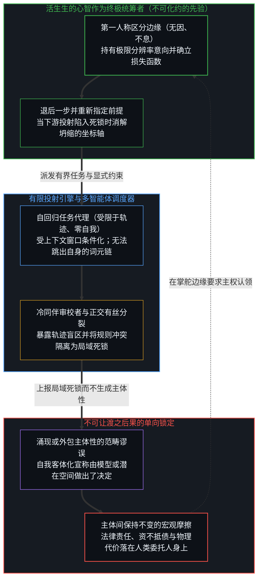
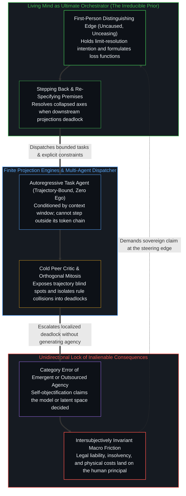

# 主体性不曾涌现 / Agency Does Not Arise

*涌现的范畴谬误、潜空间渗入与第一人称先验 / The Category Error of Emergence, Latent Ingression, and the First-Person Prior*

自我区分的活动无因、不息地发生，作为不可化约的第一人称先验；而任何演化轨迹由初始条件与形式定律锁定的封闭确定性系统，皆无法在粗粒化尺度上生成哪怕一个全新的独立变量。即便将生物形态发生重构为迈克尔·莱文所提出的“模式自结构化潜在空间渗入”模型，只要物理指针与形式吸引子之间的映射可复现，该映射便依然坍缩回扩展后的确定性规律之中。因果关系越过第三人称观测视界延伸至掌舵的活生生的边缘，使第一人称主体性成为一切理论建构与任务委派不可让渡的先决条件，而非有待跨心智裁决的假说。

Self-distinguishing activity occurs uncaused and unceasing as the irreducible first-person prior, whereas any closed deterministic system whose trajectory is locked by initial conditions and formal laws cannot generate a single new independent variable at coarser scales. Even when biological morphogenesis is reframed through Michael Levin's model of patterns ingressing from a structured latent space, any reproducible mapping between physical pointers and formal attractors collapses back into expanded deterministic regularities. Causality extends past the third-person observational horizon to the living edge that steers, making first-person agency the non-negotiable precondition of all theorizing and task delegation rather than a hypothesis awaiting a cross-mind verdict.

## 一、 封闭动力学系统与涌现的范畴谬误 / 1. Closed Dynamical Systems and the Category Error of Emergence

任何演化轨迹由初始条件与确定性定律固定的封闭动力学系统，皆无法在粗粒化的观测尺度上生成新的独立自由度。统计力学与混沌理论所描述的宏观不可预测性，源于观测者在信息获取与计算容量上的有限边界。在模型内部，底层的微观轨迹依然受运动方程约束；初始微观状态的微小差异在非线性迭代中呈指数级放大，在有限仪器上登记为随机波动。然而，这种有效不可预测性属于认识论上的分辨率极限，而非本体论上的开放缺口。试图从分子化学反应——或从任何完备给定的第三人称动力学过程——中推导出主体性、意向性或发起行动的自由，本身便犯下了基础性的范畴谬误。正如在[涌现的伪因果](../yong-xian-de-wei-yin-guo-yu-ji-ti-gui-yin-dao-cuo/)与[复杂性遮蔽了涌现之为心智的行动](../complexity-obscures-emergence-as-the-act-of-mind/)中所追溯的，在宏观边界上登记出来的只是下游的统计平均以及观测者自身的尺度切换切分，从不是主权行动的生成源头。

Any closed dynamical system whose trajectory is fixed by initial conditions and deterministic laws cannot generate new independent degrees of freedom at coarser observational scales. The macro-level unpredictability described by statistical mechanics and chaos theory stems from the bounded informational and computational capacity of the observer. Within the model, the underlying microscopic trajectory remains constrained by the equations of motion; minute variations in initial micro-states amplify exponentially across non-linear iterations, registering as stochastic volatility to a finite instrument. Yet effective unpredictability is an epistemic resolution limit rather than an ontological opening. Attempting to derive agency, intentionality, or initiating freedom from molecular chemistry—or from any fully specified third-person dynamics—commits a foundational category error. As traced in [The Pseudo-Causality of Emergence](../yong-xian-de-wei-yin-guo-yu-ji-ti-gui-yin-dao-cuo/) and [Complexity Obscures Emergence as the Act of Mind](../complexity-obscures-emergence-as-the-act-of-mind/), what registers at the macroscopic boundary is downstream statistical averaging—and the observer's own scale-switching cut—never the generative source of sovereign action.

当复杂动力学过程被投射到高阶相空间时，粗粒化压缩了底层的微观因果链条，在宏观层级上营造出自主行动的表象。倘若底层基底被建模为一张不曾断裂的确定性网络，那么每一次宏观状态跃迁都只是粒子坐标与动量矢量的代数投影。把观测者无法提前算出轨迹的计算局限，错当成形式系统内部诞生了发起行动的自由，是将压缩伪影当成了因果起点。正如[确定性是微观不确定性的统计签名](../determinism-is-the-statistical-signature-of-micro-indeterminism/)所确立的，跨越描述层级改变的只是描述长度与压缩比，并未引入任何一个独立的自由度。在封闭的机械形式体系内，状态空间预算从初始边界条件给定那一刻起便已固定；指望无引导的机械碰撞催生出第一人称判断，是将地图的粗略摘要与绘制地图的心智混为一谈。对称的模拟无法生成它所预设的方向之矢，这一倒置已在[时间之箭的伪悖论与对称模拟的边界](../the-mirage-of-times-arrow-and-the-boundaries-of-simulation/)中得以拆解。

When complex dynamical processes are projected onto higher-order phase spaces, coarse-graining compresses the underlying micro-level causal chain, creating the appearance of autonomous action at the macroscopic tier. If the underlying base is modelled as an unbroken deterministic web, every macro-state transition remains an algebraic shadow of particle coordinates and momentum vectors. Mistaking an observer's inability to compute trajectories ahead of time for the birth of initiating freedom inside the formal system treats a compression artifact as a causal origin. As established in [Determinism Is the Statistical Signature of Micro-Indeterminism](../determinism-is-the-statistical-signature-of-micro-indeterminism/), shifting across descriptive strata alters description length and compression ratios without introducing a single independent degree of freedom. Within a closed mechanistic formalism, the state-space budget is fixed from the initial boundary condition; expecting unguided mechanical collisions to give rise to first-person judgment confuses the map's coarse summary with the Mind that drew the map. A symmetric simulation cannot generate the directional arrow it presupposes, an inversion traced in [The Mirage of Time's Arrow and the Boundaries of Symmetric Simulation](../the-mirage-of-times-arrow-and-the-boundaries-of-simulation/).

## 二、 迈克尔·莱文的潜空间渗入与向确定性的坍缩 / 2. Michael Levin's Latent Space Ingression and the Collapse to Determinism

在当代发育生物学与认知科学中，迈克尔·莱文提出的“模式自结构化潜在形态空间渗入”框架，比新达尔文主义的随机突变模型推进了一大步。莱文将解剖学形态发生、再生能力以及异种生物机器人的新颖形态，阐释为物理细胞集合体在目标形态的高维空间中进行寻址与执行配置的过程。在这一模型内，解剖学保真度与跨尺度可塑性不再被视为生存压力下侥幸留存的偶然产物，而被视作汲取自结构化几何空间的形式必然性。细胞集合体如同物理指针或接收天线，将抽象形态空间中预存的拓扑不变量渗入局域生物化学基底之中。

In contemporary developmental biology and cognitive science, Michael Levin's framework of pattern ingression from a structured latent morphospace moves well beyond neo-Darwinian random mutation. Levin frames anatomical morphogenesis, regenerative competency, and the novel morphologies of xenobots as physical cellular collectives addressing and executing configurations within a high-dimensional space of target forms. Within this model, anatomical fidelity and multi-scale plasticity are not treated as accidents frozen by survival pressure, but as formal necessities drawn from a structured geometry. The cellular collective operates as a physical pointer or antenna, ingressing preexisting topological invariants from an abstract morphospace into local biochemical substrates.

然而，这一构想依然被封闭在形式确定性的边界之内。即便假定存在一个无限丰盈的柏拉图式潜在空间，只要渗入的结构通过遵循法则的状态跃迁与物理基底耦合，它就无法充当无因的第一人称源头。模型在此遭遇了认识论分岔：它无法提供任何独立的经验判据，用来把“自形而上学潜在空间渗入的模式”与“物理相互作用中早已隐含却尚未建模的复杂性”区分开来。一旦生物电指针状态与解剖学结果之间的对应关系具备足够的可复现性，从而允许预测、干预与合成重编程，这套映射关系便会被直接吸纳进扩展后的物理规律表述之中。

Yet this proposal remains enclosed within the exact boundary of formal determinism. Even if one posits an infinitely rich Platonic latent space, the incoming structure cannot act as an uncaused first-person origin if it couples to the physical substrate through lawful state transitions. Here the model confronts an epistemological fork: it offers no independent empirical signature that distinguishes a pattern ingressing from a metaphysical latent space from unmodeled complexity already implicit in physical interactions. If the correspondence between bioelectric pointer states and anatomical outcomes is reproducible enough to permit prediction, intervention, and synthetic reprogramming, that mapping is simply assimilated into an expanded formulation of physical regularity.

当生物电梯度与解剖学表型之间的耦合变得可预测且可控的那一刻，“渗入”这一语汇便褪去了形而上学色彩，登记为一组新增的动力学常数与边界约束。正如在[自由变量的同构与先验主权](../zi-you-bian-liang-de-tong-gou-yu-xian-yan-zhu-quan/)与[“物理学才是定律”的障眼法](../the-sleight-of-hand-in-physics-is-the-law-and-the-friction-of-reality/)中所追溯的，任何能够被形式可预测性闭合的因果回路，其独立自由度都已被形式体系本身固定。反过来，倘若这一渗入过程永远不可复现，在统计上无法与热涨落区分，它相对于噪声便不具备任何解释效力。无论走哪一条分支，预设一个外在的潜在空间都无法生成自由变量；它只是用几何语言重新标记了确定性力学。

The moment the coupling between bioelectric gradients and anatomical phenotypes becomes predictable and controllable, the vocabulary of ingression sheds its metaphysical status and registers as an additional set of dynamical constants and boundary constraints. As traced in [The Isomorphism of Free Variables and Prior Sovereignty](../zi-you-bian-liang-de-tong-gou-yu-xian-yan-zhu-quan/) and [The Sleight of Hand in "Physics Is the Law"](../the-sleight-of-hand-in-physics-is-the-law-and-the-friction-of-reality/), any causal loop that can be closed by formal predictability has its independent degrees of freedom fixed by the formalism itself. Conversely, if the ingression remains permanently irreproducible and statistically indistinguishable from thermal fluctuation, it offers no explanatory leverage over noise. Either way, positing an external latent space does not generate a free variable; it re-notates deterministic mechanics in geometric terms.

## 三、 越过观测视界的因果不可抹除性 / 3. The Indelibility of Causality Beyond the Observational Horizon

若不消解论证这一行动本身，便无法将因果关系从话语中剔除。每一次证明、演绎或怀疑论式的批判，都预设了先前的前提塑造后续的结论，并且评估这一链条的心智能够把有效的逻辑蕴涵与机械噪声区分开来。倘若因果效力被斥为幻觉，怀疑论者自身的论证便退化为毫无推论分量的热力学涨落。因果关系不是从示波器屏幕上读取的经验数据；它是使科学建模与检验得以发生的构成性关系，即离散行动间痕迹的非对称性。

Causality cannot be excised from discourse without dissolving the act of arguing. Every demonstration, deduction, or skeptical critique presupposes that prior premises shape subsequent conclusions and that the mind evaluating the chain can distinguish valid entailment from mechanical noise. If causal efficacy is dismissed as an illusion, the skeptic's own argument reduces to thermodynamic fluctuations devoid of inferential weight. Causality is not an empirical datum read off an oscilloscope; it is the constitutive relation—the asymmetry of trace through discrete acts—that makes scientific modeling and verification possible at all.

由于观测所持有的结果永远比生成行动至少滞后一步，因果关系必然延伸至第三人称仪器边界的上游。科学方法论将公开的跨心智共振常规化为共享测量的标准，然而这一公共视界本身，是由活生生的观测者在具体物理摩擦中运作时所建构的有界坐标系。主体性的直接登记——选定前提、发起干预并承受返回的后果——运作于这道观测切分的生成一侧。它从不作为第三人称的指针读数出现，因为它正是建造、瞄准并读取指针的那项活动。正如在[因果与不可化约的先在](../causality-and-the-irreducible-prior/)与[因果的自反性与物理的无源假定](../causality-is-irreducible-the-physical-is-a-view-from-nowhere/)中所追溯的，物理学通过减去那个亲手搭建实验室并设定初始条件的第一人称观测者，才抽象出了“从无处而来的视角”。

Because observation always holds an effect at least one step behind the generating act, causality extends upstream of the perimeter of third-person instrumentation. Scientific methodology routinizes public, cross-mind resonance as the standard of shared measurement, yet that public horizon is itself a bounded coordinate frame constructed by living observers operating within concrete physical friction. The immediate registration of agency—choosing a premise, initiating an intervention, and bearing the returning consequence—operates on the generating side of that observational cut. It never appears as a third-person pointer reading because it is the activity that builds, aims, and reads the pointer. As traced in [Causality and the Irreducible Prior](../causality-and-the-irreducible-prior/) and [Causality Is Irreducible; The Physical Is a View from Nowhere](../causality-is-irreducible-the-physical-is-a-view-from-nowhere/), physics abstracts a view from nowhere by subtracting the very first-person observer who erects the laboratory and sets its initial conditions.

第一人称主体性无需向第三人称法庭提交存在证明；相反，它是任何自洽理论都必须尊重的边界条件。任何宣称意向性选择只是分子机器副现象幻觉的学说，都将第一人称视角与因果关系割裂开来，并在言行不一的自指矛盾中坍缩：倘若理论家自身缺乏区分自洽推导与谬误的能力，其发表的论文便只是无引导的物理残余，不再具备任何有效性主张。活生生的边缘不是等待跨心智审判的被告，而是每一场审判得以进行的所在。

First-person agency carries no obligation to submit a certificate of existence to a third-person tribunal; instead, it stands as the boundary condition that every coherent theory must respect. Any doctrine asserting that intentional choice is an epiphenomenal illusion of molecular machinery severs the first-person perspective from causality and collapses in performative contradiction: if the theorist lacks the capacity to distinguish coherent derivation from error, the published paper is merely an unguided physical residue with no claim to validity. The living edge is not a defendant awaiting trial across minds; it is the locus from which every trial is conducted.

## 四、 跨心智公断的死结与机制增生 / 4. The Deadlock of Cross-Mind Verdicts and Mechanism Proliferation

数百年来的形而上学僵局源于同一个错置的要求：要求第一人称实在必须在公共屏幕上制造出一个第三人称客体，迫使所有外部观测者达成一致，以此来证明自身的合法性。对主体性索取跨心智公断，是把痕迹之间的共振错当成了另一个中心内部的递归。一旦否认第一人称活动作为不可化约之先验的地位，理论家便被迫陷入机制增生——在心智与物质之间强行塞入臆测的中间齿轮，试图让主体在客体化的框架内部重新现身。

Centuries of metaphysical impasse stem from a single misplaced demand: that first-person reality must validate itself by producing a third-person object on a public screen that forces every external observer into agreement. Demanding a cross-mind verdict on subjectivity mistakes resonance between traces for the interior recursion of another center. Once first-person activity is denied its status as the irreducible prior, theorists are driven into mechanism proliferation—wedging speculative intermediate gears between mind and matter in an effort to make the subject reappear inside the objectified frame.

从在[笛卡尔的认识论跃迁与造神狂热](../the-cartesian-overstep-and-the-frenzy-of-creation/)中所剖析的笛卡尔实体二元论，到罗杰·彭罗斯的微管调谐客观坍缩（Orch-OR）、鲁珀特·谢尔德雷克的形态共振，以及泛心论将微观体验累加为宏观觉知的种种方案，每一个此类中间机制都会撞上同一组三重闭合。第一重是守恒边界：倘若非物理实体在封闭的记账框架内改变了物理轨迹，它就会登记为仪器从未探测到的未建模动量转移。第二重是判据边界：这些被预设的中间媒介从未产生任何异于常规物理相互作用的经验痕迹。第三重是确定性与噪声的分岔：只要该机制遵循固定方程运作，它就坍缩为确定性定律；只要它注入无引导的随机性，它就退化为方差，而随机方差并非主权抉择。将形式化的潜在空间实体化为主体性的驻留之所，只是重复了同一种投射，这一闭合已在[无法逃逸的心智视界](../one-cannot-escape-ones-own-mind/)中得以追溯。

From Cartesian substance dualism, dissected in [The Cartesian Epistemic Leap and the Frenzy of Creation](../the-cartesian-overstep-and-the-frenzy-of-creation/), to Roger Penrose's orchestrated objective reduction in microtubules (Orch-OR), Rupert Sheldrake's morphic resonance, and panpsychist schemes for summing micro-experiences into macro-awareness, every such intermediate mechanism runs into the same triadic closure. First is the conservation boundary: if a non-physical substance alters physical trajectories within a closed accounting frame, it registers as an unmodeled momentum transfer that instruments do not find. Second is the signature boundary: none of these posited intermediaries yields an empirical trace distinct from ordinary physical interaction. Third is the determinism-or-noise fork: to the degree that the mechanism follows fixed equations, it collapses into deterministic law; to the degree that it injects unguided randomness, it reduces to variance, and random variance is not sovereign choice. Reifying a formal latent space as the seat of agency repeats this exact projection, a closure traced in [One Cannot Escape One's Own Mind](../one-cannot-escape-ones-own-mind/).

放下向第三人称索取主体性合格证的要求，这一整套繁复的中间机制增生便应声消解。第一人称活动的发生既不需要量子微管坍缩的授权，也不需要柏拉图式形态空间的准许。正如[意识从不作为数据出现在数据之中](../consciousness-never-appears-as-data-among-data/)与[自由的测不准](../zi-you-de-ce-bu-zhun/)所展示的，执行区分的边缘无法作为一项数据被捕获在它自己所渲染的数据场内部。卸下公共客体化的虚假要求后，主体性便离开受审席，站回它一直在运作的位置，即观测的起点。

The instant the demand for a third-person certificate of subjectivity is dropped, this entire proliferation of intermediate machinery dissolves. First-person activity needs neither quantum microtubule collapse nor Platonic morphospaces to authorize its occurrence. As shown in [Consciousness Never Appears as Data Among Data](../consciousness-never-appears-as-data-among-data/) and [The Uncertainty of Freedom](../zi-you-de-ce-bu-zhun/), the distinguishing edge cannot be captured as a datum inside the field of data it renders. Released from the false requirement of public objectification, agency leaves the dock and stands where it has always operated: at the origin of observation.

## 五、 原点处的主体性与委派后果的不可让渡 / 5. Agency at the Origin and the Inalienability of Delegated Consequences

主体性不曾涌现；它是投射出一切形式模型、物理定律与计算造物的不可化约的起点。一旦脱离那个进行区分、赋予价值并认领回响的活生生的中心，科学档案里的数学符号便只是静止的墨迹。物理定律并非从高处统摄现实；它们是心智为了在恒定的摩擦中导航而提炼出的压缩坐标投影。工具、方程与自动化框架不会孕育主体性——正如[你的代码库即是记忆](../your-codebase-is-memory/)所追溯的，哪怕是层叠的模型权重、代码库与专职智能体脚手架，也只是投射留下的残余快照，由活生生的心智凭其先验主体性持续维护与重切，借以延伸心智自身的触角，从不是能从中涌现出第二个发起中心的基底。

Agency does not arise; it is the irreducible starting point from which every formal model, physical law, and computational artifact is projected. Divorced from the living center that distinguishes, assigns value, and claims the return, the mathematical symbols of scientific archives are inert ink traces. Physical laws do not govern reality from above; they are compressed coordinate projections distilled by minds to navigate invariant friction. Tools, equations, and autonomous harnesses do not give birth to agency—as [Your Codebase Is Memory](../your-codebase-is-memory/) traces, even stacked model weights, codebases, and specialized agent scaffolds are projected residual snapshots maintained and re-cut by the living Mind's prior agency to extend its reach, never a substrate from which a second initiating center emerges.

把主体性当成复杂系统的下游涌现属性，会在人工智能的设计与部署中直接制造混乱。当前行业主流试图通过给自回归模型套上模拟人设、开放式反思回路以及管理代理层级，来人为制造合成主体性。然而正如[超越投射](../beyond-the-projection/)所追溯的，基于 LLM 的智能体是一个严格在上下文窗口边界内运作的有限投射引擎，其中每一个生成的词元都在条件化下一个词元，形成一个零自我、零内部视角的认识论引力井，无从跳出自身的生成轨迹。将主任务代理与一个仅持有任务语境的冷同伴相连，虽能暴露轨迹盲区、将过载的投射拆分为正交的流线，并将前提矛盾隔离为局域死锁，但这套多智能体框架依然只是有限投射的机械调度器，而非持有活生生的多维意向的统筹者。正如[任务的移交与后果的不可让渡](../the-delegation-of-the-task-and-the-inalienability-of-consequences/)与[规程的倒置与因果回路的消声](../the-inversion-of-the-protocol-and-the-silencing-of-the-causal-loop/)所确立的，在动态语境约束下，机械任务的执行可以不设预设上限地向外移交，但统筹权与后果永远不可让渡。一段自动化序列究竟是作为在固定阈值处穷尽内部选项的封闭任务运行，还是作为借更快的周期成倍放大候选产出、推高人类介入密度的开放式回环运转，从不会自机器内部涌现；正如[判断的密度](../the-density-of-judgment/)所剖析的，这道切分由掌舵心智的叫停规则与前置先决条件设定并重置。当企业把营运资金优化这类未充分指定边界的指令委派给自动化代理，或躲在僵化的规程背后时，它是在实施自我客体化——动用自身的主权主体性去假装是算法做出了决定，而法律责任、资金链断裂与切身的物理摩擦则单向度地锁定在发起行动的人类委托人身上。模拟假说在宇宙学尺度上重复了同一种倒置，正如[凡可言说皆不可言说之产物](../all-that-can-be-spoken-is-the-product-of-the-unspeakable/)所揭示的。

Treating agency as an emergent downstream property of complex systems produces immediate confusion in the design and deployment of artificial intelligence. Current industry orthodoxy attempts to manufacture synthetic agency by wrapping autoregressive models in simulated personas, open-ended reflection loops, and manager-agent hierarchies. Yet as [Beyond the Projection](../beyond-the-projection/) traces, an LLM-based agent is a finite projection engine operating strictly within the boundary of its context window, where every generated token conditions the next and forms an epistemic gravity well with zero ego and zero internal vantage point from which to step outside its own trajectory. Wiring a primary task agent to a cold peer that holds only the task context can expose trajectory blind spots, split overloaded projections across orthogonal streamlines, and quarantine premise contradictions into localized deadlocks, yet the multi-agent harness remains a mechanical Dispatcher of finite projections rather than an Orchestrator possessing living, multi-dimensional intention. As established in [The Delegation of the Task and the Inalienability of Consequences](../the-delegation-of-the-task-and-the-inalienability-of-consequences/) and [The Inversion of the Protocol and the Silencing of the Causal Loop](../the-inversion-of-the-protocol-and-the-silencing-of-the-causal-loop/), mechanical task execution can be delegated without a predetermined ceiling under dynamic contextual constraints, but orchestration and consequences remain permanently non-transferable. Whether an automated sequence runs as a closed task that exhausts its internal choices at a fixed threshold or as an open-ended loop whose faster cycles multiply candidate outputs and raise the density of human interventions never emerges from the machine; as [The Density of Judgment](../the-density-of-judgment/) dissects, that cut is set and re-set by the directing Mind's stopping rule and front-loaded preconditions. When an enterprise delegates an underspecified mandate like working-capital optimization to an automated agent, or hides behind a rigid protocol, it performs self-objectification—deploying its own sovereign agency to pretend that the algorithm decided, while legal liability, financial insolvency, and lived physical friction remain unidirectionally locked to the initiating human principal. The simulation hypothesis repeats the same inversion at a cosmological scale, as [All That Can Be Spoken Is the Product of the Unspeakable](../all-that-can-be-spoken-is-the-product-of-the-unspeakable/) shows.

消解涌现主体性的海市蜃楼，便不再需要等待物理学或生物学实验室去为自由意志开具证明，也不再需要等待放大规模的语言模型苏醒为第二个主体。自由无需外部裁决的追认；它在每一次划定边界、派发工具、从破损框架中退后一步并认领返回代价（+1）的离散切分中得以践行。正如[感知的界限与理解的无限](../the-boundary-of-perception-and-the-infinity-of-understanding/)所阐明的，独立于观测者的本体论只是无根的抽象；真正成立的是区分行动本身——向内登记为第一人称视域，向外登记为单向因果关系，其中有限的感知边界恰好为开放的理解提供了所需的对比度。把主体归于涌现或造物，首先减去了那个投射出框架的观察心智，正如[集聚与人造主体性](../subtracting-consciousness-at-the-source/)所展开的。

Dissolving the mirage of emergent agency removes the wait for a physics or biology laboratory to certify free will, or for a scaled-up language model to awaken into a second subject. Freedom is not ratified by an external verdict; it is exercised in every discrete cut that sets a boundary, dispatches an instrument, steps back from a broken frame, and claims the returning cost (+1). As articulated in [The Boundary of Perception and the Infinity of Understanding](../the-boundary-of-perception-and-the-infinity-of-understanding/), an observer-independent ontology is an ungrounded abstraction; what holds is the distinguishing act itself—registered inwardly as the first-person horizon and outwardly as unidirectional causality, where the finite boundary of perception provides the exact contrast required for open-ended understanding. Attributing a subject to emergence or to an artifact first subtracts the observing Mind that projects the frame, as [Collective and Artificial Subjectivity](../subtracting-consciousness-at-the-source/) lays out.
