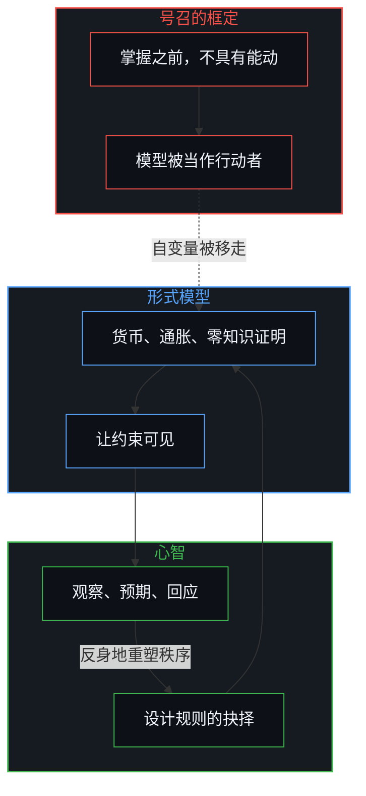
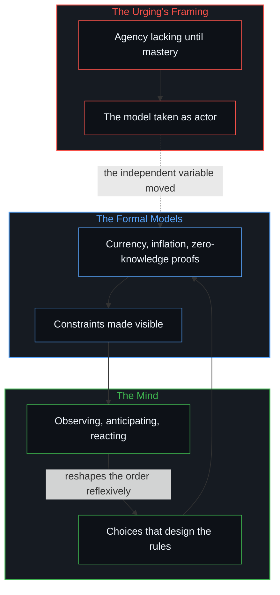

# 能动性被转置入形式模型 / Agency Relocated into the Formal Model

*自变量从设计与回应的心智，被移到了人们被催促去掌握的抽象里 / The independent variable is moved from the minds that design and react into the abstractions they are urged to master.*

一份公开的号召，催促数学家与爱探究的人去研究货币的抽象、通胀的机制与零知识证明，不只为了跟上 AI 辅助的证明，并把这种研究，连同质疑教条的意愿，说成扩展个人能动的一条路。它声明的意图，是让人掌握知识，好在支配价值与交换的系统里行走、并塑造这些系统。同一个框架却把能动看作在掌握形式模型之前不具有的，又把机制本身看作作用于不懂它们的人的行动者。形式知识有其必要：没有它，抉择所处的约束连看都看不见。行动的能力却不是模型授予的。它早已被设计系统的人，以及生活在系统里、对它作出回应的人运用着。

A public urging asks mathematicians and the curious to study the abstraction of currency, the mechanisms of inflation and zero-knowledge proofs, not only to keep up with AI-assisted proofs, and presents this study, together with a willingness to question dogma, as a way to extend individual agency. The stated intention is to equip people with knowledge that will let them navigate and shape the systems that govern value and exchange. The same framing treats agency as lacking until the formal models are mastered, and treats the mechanisms themselves as actors that operate on those who do not understand them. Formal knowledge remains necessary: without it the constraints within which choices occur cannot even be seen. The capacity to act is not conferred by the models. It is already exercised by the individuals who design systems and by those who live inside them and react.

## 一、 号召把能动定位在构造之中 / 1. The Urging Locates Agency in the Constructions

号召把研究框定为通往更大个人能动的路。这个框定悄悄预设，能动此刻是缺失的，必须靠掌握形式模型来获得。能动被当作生在数学构造、以及建在其上的系统设计之中的东西，或由它们授予的东西。自变量，也就是个体的抉择，从设计与回应的心智，被移进了抽象本身。声明的意图把能动定位在模型里。这个定位，就是那错置。

The urging frames study as a path to greater individual agency. That framing quietly presumes that agency is lacking now and must be acquired by mastering the formal models. Agency is treated as something that resides in, or is granted by, the mathematical constructions and the system designs built on them. The independent variable, individual choice, is relocated from the minds that design and react into the abstractions themselves. The stated intention locates agency in the models. That location is the displacement.

[解放的言辞始于定义囚禁](../liberation-rhetoric-begins-by-defining-captivity/)是这同一个前提装扮成身份的一面：先把他人看作不自由的，解放的言说才能站上源头的位置。这里的诊断更薄、更技术：不是说这个人是囚徒，而是说能动要等着进入模型。[赋权确立权力的集中](../empowerment-establishes-the-centralization-of-power/)是授予的一面：能力被框定为一个被授权的源头送来的礼物。在这份号召里，被授权的源头就是构造本身。

[Liberation rhetoric begins by defining captivity](../liberation-rhetoric-begins-by-defining-captivity/) is that prior in the costume of identity: the other is first held as unfree so that the speech of release can stand as source. Here the diagnosis is thinner and more technical: not that the person is a captive, but that agency waits on entry into the model. [Empowerment establishes the centralization of power](../empowerment-establishes-the-centralization-of-power/) is the face of conferral: capacity framed as a gift from an authorized source. In this urging, the authorized source is the construction itself.

## 二、 形式性质不含自变量 / 2. The Formal Property Does Not Contain the Independent Variable

这个错置在零知识证明上看得格外清楚。数学是优雅的，实现也可以是忠实的；一个证明可以确立一个命题为真，而不泄露它的证据。形式性质本身并不包含、也不分发能动。能动只出现在具体的人的决定里：选择如何设计、部署与激励这些构造的人，以及在声称的保证为人所知之后选择如何回应的人。把权力的来源定位在密码学的边界之内，而不是定位在不断越过、忽视或重新议定这道边界的行动者身上，这个框架便把模型当作首要的行动者，把个人当作次要的。

The displacement is especially clear in the case of zero-knowledge proofs. The mathematics is elegant and the implementations can be faithful; a proof can establish the truth of a statement without revealing its witness. The formal property does not itself contain or distribute agency. Agency appears only in the decisions of particular people: those who choose how the constructions will be designed, deployed and incentivized, and those who choose how to respond once the claimed guarantees become known. By locating the source of power inside the cryptographic boundary rather than in the agents who keep crossing, ignoring or renegotiating that boundary, the framing treats the model as the primary actor and the individuals as secondary.

[协调者的范畴错误](../the-coordinators-category-error/)是这个定位的又一处：一份在密码学上连续的记录，被当作各个中心早已在做的协调的安装。[模型永远无法成为第二重前沿](../the-model-never-becomes-a-second-edge/)是同一道界限装扮成工具的一面：变得稠密的痕迹延伸了所及之处，发起却仍在那道还在区分的边沿上。

[The coordinator’s category error](../the-coordinators-category-error/) is that allocation when a cryptographically continuous record is held as the installation of the coordination the centers already perform. [The model never becomes a second edge](../the-model-never-becomes-a-second-edge/) is the same bound in the costume of an instrument: densified residue extends reach, while initiation stays at the edge that still distinguishes.

## 三、 货币与通胀仍是抉择的产物 / 3. Currency and Inflation Remain Products of Choice

同样的样式也支配着货币与通胀这些更大的抽象。它们不是自行运作的数学实体，而是制定规则的人与适应规则的人持续抉择的产物，适应常常正是因为人们知道规则存在而修正了预期。一旦预设能动要等到进入模型才有，那份始终已经在观察、回应与决定之中的能力就被忽略了。剩下的，是自变量从活着的心智转进形式的描述。

The same pattern governs the wider abstractions of currency and inflation. These are not self-acting mathematical entities. They are the ongoing products of choices made by people who invent rules and by people who adapt to them, often by revising expectations precisely because they understand the rules exist. When agency is presumed missing until one enters the model, the capacity always already present in observation, reaction and decision is overlooked. What remains is a transfer of the independent variable from living minds into formal descriptions.

[个体抉择是唯一的因果杠杆](../individual-choices-as-the-only-causal-levers/)把发起留在接连的行动上；条件与样式仍是痕迹与场域。[理性选择公设是原罪](../the-rational-choice-postulate-is-the-original-sin/)是这个转移装扮成经济理论的一面：形式的装置被安装为地基，而抉择只在私有的、临时的前提下继续。把掌握这套装置说成能动的扩展，是同一个冻结在教学上的一面。

[Individual choices as the only causal levers](../individual-choices-as-the-only-causal-levers/) keeps initiation with successive acts; conditions and patterns remain residue and field. [The rational choice postulate is the original sin](../the-rational-choice-postulate-is-the-original-sin/) is that transfer in the costume of economic theory: formal apparatus installed as foundation while choice continues only under private, provisional premises. Mastery of the apparatus, offered as the extension of agency, is the pedagogical face of the same freeze.

## 四、 反身的活动早已是引擎 / 4. Reflexive Activity Is Already the Engine

个人早已在观察系统、预期回应、改变自己的行为，而这些改变又回馈到系统本身。在任何静态平均里只显为方差或噪声的动态，正是时时刻刻重塑秩序的力量。把数学模型当作获得能动的地方，原来的前提就低估了这份持续的、反身的活动。以扩展能动之名提供的研究，于是服务于它本要化解的那个冻结。

Individuals already observe systems, anticipate responses and alter their conduct in ways that feed back into the systems themselves. The dynamics that appear as mere variance or noise in any static average are the forces that reshape the order from moment to moment. By treating the mathematical model as the site where agency is gained, the original premise understates this continuous, reflexive activity. The study offered in the name of extending agency then serves the freeze it was offered to dissolve.

[平均值是残余，不是引擎](../the-average-is-residue-not-the-engine/)是同一个归还装扮成百分比的一面：大规模的比率追踪的是构成，决定性的前沿仍在接连的行动上。一个封闭模型记作噪声的，正是活着的更新。全球义务的账本，是又一个被要求承载能动的形式模型，[未被遭遇之物的账本](../the-ledger-of-the-unencountered/)追溯了这一点。

[The average is residue, not the engine](../the-average-is-residue-not-the-engine/) is the same return of agency in the costume of percentages: mass rates track composition, while the decisive edge stays with successive acts. What a closed model scores as noise is the living update. The ledger of global obligation is one more formal model asked to carry agency, as [The Ledger of the Unencountered](../the-ledger-of-the-unencountered/) traces.

## 五、 知识让场域可见，却不授予杠杆 / 5. Knowledge Makes the Field Visible; It Does Not Confer the Lever

自我区分的活动在发生，无因、不息。称之为心智：观察者早已在途中，每一次行动皆是一次区分。关于抽象的形式知识有其必要；没有它，抉择所处的约束连看都看不见。[遗忘的脚手架](../the-scaffolding-we-forget/)是作为工具的知识：它可以退出视野，让后来的行动落得下去；一旦这份把握被保存为能动的座位，它就成了滞后。行动的能力不是模型授予的。它由设计系统的人，以及生活在系统里、对它作出回应的人运用着。[验证中因果权能的分配](../the-allocation-of-causal-power-in-validation/)追踪的是哪一边被当作供给下一步的一方。把能动归还，供给就留在那道仍在抉择的边沿上，包括选择去研究这些构造，也包括看见它们之后选择做什么。这个错置还有一副身体的面孔：[抽象的苦难与真实的饥饿](../abstract-pain-and-living-hunger/)显出一个苦难的符号，被当作仿佛可以喂饱的东西。

Self-distinguishing activity occurs, uncaused and unceasing. Call it the Mind: the observer already under way, every act of which is a distinction. Formal knowledge of abstractions remains necessary; without it the constraints within which choices occur cannot even be seen. [The scaffolding we forget](../the-scaffolding-we-forget/) is that knowledge as instrument: it can drop out of view so that further acts can land, and it turns to lag when the hold is kept as the seat of agency. The capacity to act is not conferred by the models. It is exercised by the individuals who design systems and by those who live inside them and react. [The allocation of causal power in validation](../the-allocation-of-causal-power-in-validation/) tracks which side is treated as supplying the next step. Returning agency keeps that supply at the edge still choosing, including the choice to study the constructions and the choice of what to do once they are seen. The relocation has a bodily face: [Abstract Pain and Living Hunger](../abstract-pain-and-living-hunger/) shows a symbol of suffering treated as if it could be fed.
