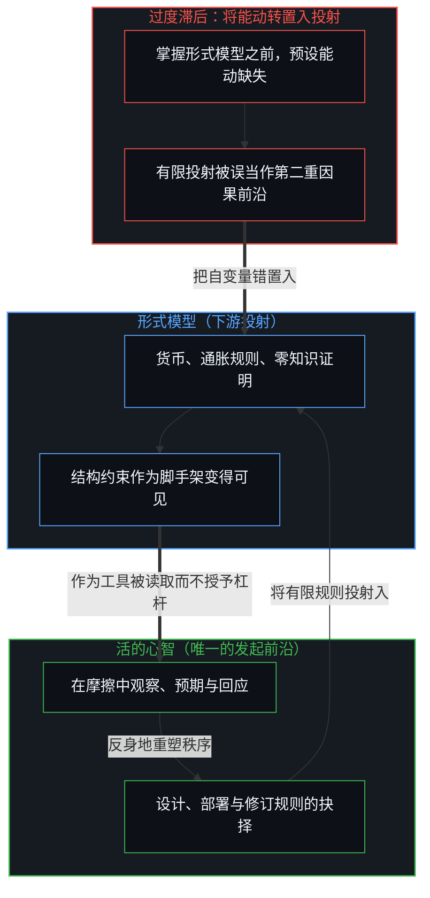
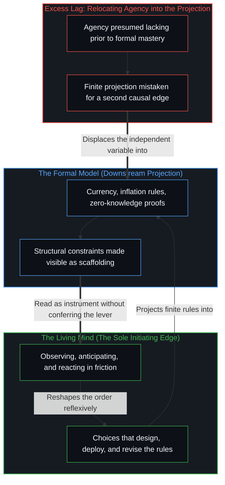

# 能动性被转置入形式模型 / Agency Relocated into the Formal Model

*将自变量从抉择的心智转入形式抽象 / Moving the independent variable from choosing minds into formal abstractions*

一份公开的号召，催促数学家与爱探究的人去研究货币的抽象、通胀的机制与零知识证明，不只为了跟上 AI 辅助的证明，并把这种研究连同质疑教条的意愿说成扩展个人能动的一条路。它声明的意图，是让人掌握知识，好在支配价值与交换的系统里行走并塑造这些系统。同一个框架却把能动看作在掌握形式模型之前尚不具备的东西，又把机制本身看作作用于不懂它们的人的行动者。形式知识有其必要，因为没有它，抉择所处的约束连看都看不见。行动的能力却不是模型授予的；它早已被设计系统的人，以及生活在系统里、对它作出回应的人运用着。

A public urging asks mathematicians and the curious to study the abstraction of currency, the mechanisms of inflation, and zero-knowledge proofs, not only to keep up with AI-assisted proofs, and presents this study alongside a willingness to question dogma as a way to extend individual agency. The stated intention is to equip people with knowledge that lets them navigate and shape the systems governing value and exchange. Yet that same framing treats agency as lacking until the formal models are mastered, and treats the mechanisms themselves as actors operating on those who do not understand them. Formal knowledge remains necessary because without it the constraints within which choices occur cannot even be seen. The capacity to act is not conferred by the models; it is already exercised by the individuals who design systems and by those who live inside them and react.

## 一、 号召把能动定位在构造之中 / 1. The Urging Locates Agency in the Constructions

号召把研究框定为通往更大个人能动的路。这个框定悄悄预设，能动此刻是缺失的，必须靠掌握形式模型来获得。能动被当作生在数学构造、以及建在其上的系统设计之中的东西，或由它们授予的东西。自变量——个体的抉择——从设计与回应的心智，被移进了抽象本身。声明的意图把能动定位在模型里，而这个定位就是那错置。

The urging frames study as a path to greater individual agency. That framing quietly presumes that agency is missing in the present and must be acquired by mastering formal models. Agency is treated as something that resides inside, or is granted by, mathematical constructions and the system designs built upon them. The independent variable—individual choice—is relocated from the minds that design and react into the abstractions themselves. The stated intention locates agency inside the models, and that location is the displacement.

[解放的言辞始于定义囚禁](../liberation-rhetoric-begins-by-defining-captivity/)追溯了这同一个前提装扮成身份的一面：先把他人看作不自由的，解放的言说才能站上源头的位置。这里的诊断更薄、更技术，不是说这个人是囚徒，而是说能动要等着进入模型。[赋权确立权力的集中](../empowerment-establishes-the-centralization-of-power/)则揭开了授予的一面：能力被框定为一个被授权的源头下发的礼物。在这份号召里，被授权的源头就是形式构造本身。

[Liberation Rhetoric Begins by Defining Captivity](../liberation-rhetoric-begins-by-defining-captivity/) traces that same prior in the costume of identity, where the other is first held as unfree so that the speech of release can stand as the source. Here the diagnosis is thinner and more technical, claiming not that the person is a captive, but that agency waits upon entry into the model. [Empowerment Establishes the Centralization of Power](../empowerment-establishes-the-centralization-of-power/) exposes the face of conferral, where capacity is framed as a gift handed down from an authorized source. In this urging, the authorized source is the formal construction itself.

## 二、 形式性质不含自变量 / 2. The Formal Property Does Not Contain the Independent Variable

这个错置在零知识证明上看得格外清楚。数学是优雅的，实现也可以是忠实的；一个证明可以确立一个命题为真，而不泄露它的证据。然而形式性质既不包含、也不分发能动。能动只出现在具体的人的决定里：选择如何设计、部署与激励这些构造的人，以及在声称的保证为人所知之后选择如何回应的人。把权力的来源定位在密码学的边界之内，而不是定位在不断越过、忽视或重新议定这道边界的行动者身上，这个框架便把模型当作首要的行动者，把个人当作次要的。

This displacement stands out clearly in the case of zero-knowledge proofs. The mathematics is elegant and the implementations can be faithful; a proof establishes the truth of a statement without revealing its witness. Yet the formal property neither contains nor distributes agency. Agency appears only in the decisions of particular people: those who choose how the constructions are designed, deployed, and incentivized, and those who choose how to respond once the claimed guarantees become known. By locating the source of power inside the cryptographic boundary rather than in the agents who keep crossing, ignoring, or renegotiating that boundary, the framing treats the model as the primary actor and the individuals as secondary.

[协调者的范畴错误](../the-coordinators-category-error/)标出了这同一个错配：一份在密码学上连续的记录，被当作各个中心早已在做的协调的安装。[模型永远无法成为第二重前沿](../the-model-never-becomes-a-second-edge/)则在工具的装扮下确立了同一道界限：变得稠密的痕迹延伸了所及之处，发起却留在那道还在区分的活前沿上。如[超越投射](../beyond-the-projection/)所追溯的，任何形式规则、密码学电路或计算外框，都是从活生生的意图那一超高维空间投下的有限低维投射。有限的投射引擎可以把演绎规则推演到极限，也可以跨轨迹路由约束，但它毫无内部觉醒或发起意图的能力；把形式投射误当作第二重因果前沿，就会把心智锁进将自己下游的规格说明当作统御之位的境地。

[The Coordinator's Category Error](../the-coordinators-category-error/) marks that same misallocation when a cryptographically continuous record is held as the installation of the coordination that centers already perform. [The Model Never Becomes a Second Edge](../the-model-never-becomes-a-second-edge/) establishes the same boundary in the costume of an instrument: densified residue extends reach, while initiation stays at the living edge that still distinguishes. As [Beyond the Projection](../beyond-the-projection/) traces, any formal rule, cryptographic circuit, or computational harness is a finite low-dimensional projection cast from the ultra-high-dimensional space of lived intent. A finite projection engine can run deductive rules to their limit and route constraints across trajectories, yet it possesses zero capacity for internal awakening or originating intent; mistaking the formal projection for a second causal edge locks the mind into treating its own downstream specification as the seat of orchestration.

## 三、 货币与通胀仍是抉择的产物 / 3. Currency and Inflation Remain Products of Choice

同样的样式也支配着货币与通胀这些更大的抽象。它们不是自行运作的数学实体，而是制定规则的人与适应规则的人持续抉择的产物，人们正是因为明白规则的存在而不断修正预期。一旦预设能动要等到进入模型才有，那份早已在观察、回应与决定之中运作的能力就被忽略了。剩下的，是自变量从活着的心智转进形式的描述。

The same pattern governs the wider abstractions of currency and inflation. These are not self-acting mathematical entities. They are the ongoing products of choices made by people who invent rules and by people who adapt to them, revising expectations precisely because they understand the rules exist. When agency is presumed missing until one enters the model, the capacity already operating in observation, reaction, and decision is overlooked. What remains is a transfer of the independent variable from living minds into formal descriptions.

[个体抉择是唯一的因果杠杆](../individual-choices-as-the-only-causal-levers/)把发起留在接连的离散行动上，而条件与样式仍是残余与场域。[理性选择公设是原罪](../the-rational-choice-postulate-is-the-original-sin/)揭开了这个转移装扮成经济理论的一面：形式的装置被安装为地基，而抉择仍在私有的、临时的前提下继续。把掌握这套装置说成能动的扩展，正是同一个冻结在教学上的一面。

[Individual Choices as the Only Causal Levers](../individual-choices-as-the-only-causal-levers/) keeps initiation with successive discrete acts while conditions and patterns remain residue and field. [The Rational Choice Postulate Is the Original Sin](../the-rational-choice-postulate-is-the-original-sin/) exposes that transfer in the costume of economic theory, where a formal apparatus is installed as the foundation while choice continues under private, provisional premises. Offering mastery of the apparatus as the extension of agency is the pedagogical face of that same freeze.

## 四、 反身的活动早已是引擎 / 4. Reflexive Activity Is Already the Engine

个人早已在观察系统、预期回应、改变自己的行为，而这些改变又回馈到系统本身。在静态平均里只登记为方差或噪声的动态，正是时时刻刻重塑秩序的力量。把数学模型当作获得能动的地方，这份号召便低估了这种持续的、反身的活动。以扩展能动之名提供的研究，最终服务于它本要化解的那个冻结。

Individuals already observe systems, anticipate responses, and alter their conduct in ways that feed back into the systems themselves. The dynamics that register as mere variance or noise inside a static average are the forces that reshape the order from moment to moment. By treating the mathematical model as the site where agency is gained, the urging understates this continuous, reflexive activity. Study offered in the name of extending agency ends up serving the freeze it was meant to dissolve.

[平均值是残余，不是引擎](../the-average-is-residue-not-the-engine/)在百分比的装扮下追溯了能动的这同一个归还，显出大规模比率追踪的是过去的构成，而决定性的前沿仍留在接连的行动上。一个封闭模型记作噪声的，正是活着的更新。全球义务的账本，则是又一个被要求承载能动的形式模型，如[未被遭遇之物的账本](../the-ledger-of-the-unencountered/)所阐明的。

[The Average Is Residue, Not the Engine](../the-average-is-residue-not-the-engine/) traces this same return of agency in the costume of percentages, showing that mass rates track past composition while the decisive edge stays with successive acts. What a closed model scores as noise is the living update. A global ledger of obligation is one more formal model asked to carry agency, as [The Ledger of the Unencountered](../the-ledger-of-the-unencountered/) demonstrates.

## 五、 知识让场域可见而不授予杠杆 / 5. Knowledge Makes the Field Visible Without Conferring the Lever

自我区分的活动在发生，无因、不息。称之为心智：观察者早已在途中，每一次行动皆是一次区分。关于抽象的形式知识仍有必要，因为没有它，抉择所处的约束连看都看不见。[遗忘的脚手架](../the-scaffolding-we-forget/)把那种知识追溯为一件工具：它可以退出视野，让后来的行动落得下去；一旦这份把握被保存为能动的座位，它就变成了过度滞后。如[你的代码库即是记忆](../your-codebase-is-memory/)在显式符号库与压缩模型检查点两端所确立的，每一项形式构造——无论是货币规则、密码学证明，还是 AI 辅助的推演——皆是早先区分层叠而成的残余，它让当下的约束表面对下一道切口保持可读，从不是一座用来储存能动、再将其配发给掌握档案之人的仓库。行动的能力从不由模型授予；它由设计系统的人，以及生活在系统里、对它作出回应的人运用着。[验证中因果权能的分配](../the-allocation-of-causal-power-in-validation/)追踪的是哪一边被当作供给下一步的一方。把能动归还，供给就留在那道仍在抉择的边沿上，包括选择去研究这些构造，也包括看见它们之后选择做什么。这个错置也带着一副身体的面孔，如[抽象的苦难与真实的饥饿](../abstract-pain-and-living-hunger/)所显出的：一个苦难的符号，被当作仿佛符号本身可以被喂饱的东西。

Self-distinguishing activity occurs, uncaused and unceasing. Call it the Mind: the observer already underway, every act of which is a distinction. Formal knowledge of abstractions remains necessary because without it the constraints within which choices occur cannot be seen. [The Scaffolding We Forget](../the-scaffolding-we-forget/) traces that knowledge as an instrument that drops out of view so further acts can land, turning into excess lag only when the hold is preserved as the seat of agency. As [Your Codebase Is Memory](../your-codebase-is-memory/) establishes across both explicit symbolic repositories and compressed model checkpoints, every formal construction—whether a monetary rule, a cryptographic proof, or an AI-assisted derivation—is stacked residue of prior distinctions that holds the present constraint surface legible for the next cut, never a warehouse where agency is stored and dispensed to those who master the archive. The capacity to act is never conferred by the models; it is exercised by the individuals who design systems and by those who live inside them and react. [The Allocation of Causal Power in Validation](../the-allocation-of-causal-power-in-validation/) tracks which side is treated as supplying the next step. Returning agency keeps that supply at the edge still choosing, including the choice to study the constructions and the choice of what to do once they are seen. That relocation also wears a bodily face, as [Abstract Pain and Living Hunger](../abstract-pain-and-living-hunger/) shows when a symbol of suffering is treated as if the symbol itself could be fed.
