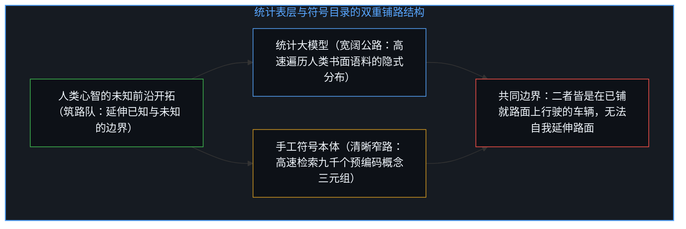
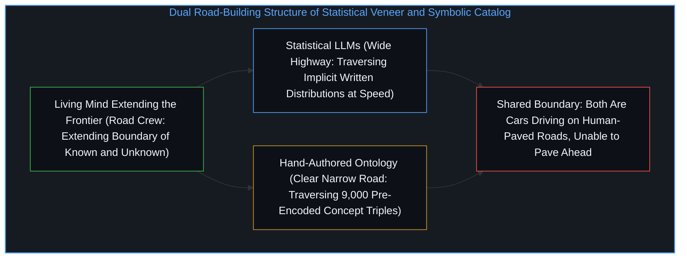
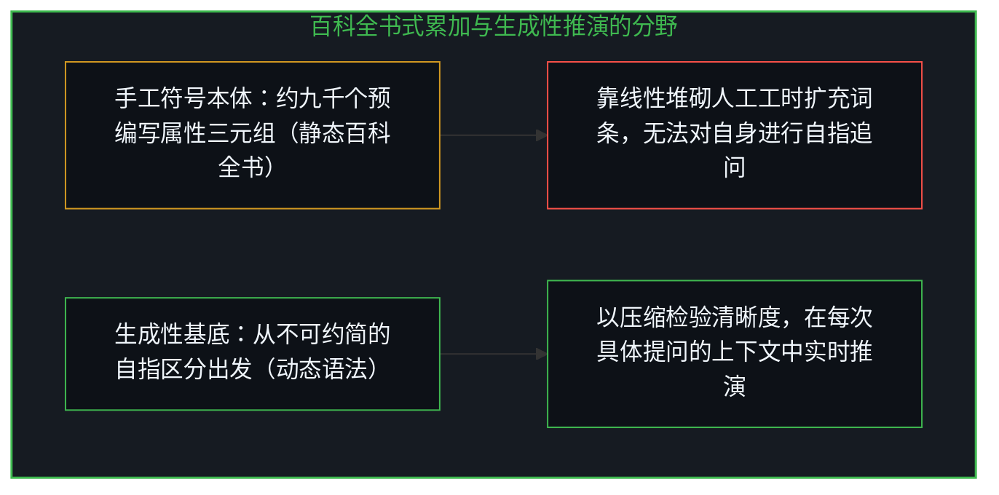
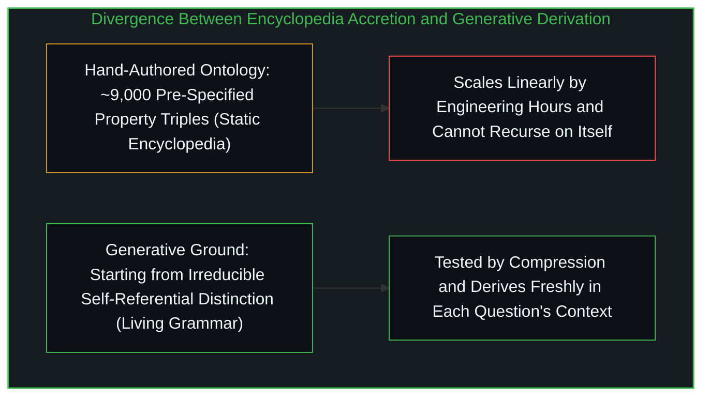

# 百科全书式的累加与生成性基底 / Agents in the Long Game of AI

*手工编纂的概念本体虽揭示了统计表层的盲区，却把静态分类目录误认作能自我推演的生成性基底 / Hand-authored ontologies expose statistical veneer yet mistake a static catalog of concepts for generative ground*

玛乔丽·麦克셰恩（Marjorie McShane）与谢尔盖·尼伦伯格（Sergei Nirenburg）在《人工智能长局中的智能体》（*Agents in the Long Game of AI*）中，阐述了建立在“存在论语义学”之上的语言赋能智能体（LEIAs）：一套结合符号知识表征与数据驱动方法的混合认知架构。作者旨在打破纯数据驱动 AI 的主流范式，主张智能系统的根基应当是结构化的意义，而非统计层面的词元共现匹配。正如[你的代码库即是记忆](../your-codebase-is-memory/)所揭示的，任何外部符号架构都是心智过往切分留下的晶体；作者敏锐地诊断出了当代统计模型的表层坍缩，却在追溯至大约九千个手工编纂的概念节点时停下了脚步，把一座人工修筑的静态分类目录当成了生成性基底本身。

In *Agents in the Long Game of AI*, Marjorie McShane and Sergei Nirenburg present Language-Endowed Intelligent Agents (LEIAs): hybrid cognitive architectures built on Ontological Semantics that combine symbolic knowledge representation with data-driven methods. Positioning their program against the dominant data-driven paradigm, the authors argue that structured meaning rather than statistical word co-occurrence must ground intelligent systems. As [Your Codebase Is Memory](../your-codebase-is-memory/) demonstrates, every external symbolic architecture is a crystal of past cognitive cuts; the authors diagnose the surface collapse of statistical models with precision, yet stop tracing at roughly nine thousand hand-authored concepts and treat a human-curated catalog as generative ground itself.

## 一、 他们看清的机制：表层光泽、重定义坍缩与隐喻越界 / 1. What They Diagnose Clearly: Veneer, Redefinition, and Metaphor

这本书开篇便切中肯綮地指出，大型语言模型依靠海量语料中的词元共现概率生成了一层“智能的表层光泽”，而整个领域则把两个彼此正交的维度压扁在了一起：其一是形式语言能力，即生成听起来符合特定语言习惯的文本；其二是功能性能力，即在真实世界语境中理解并运用语言。全书的努力都试图建立在可追溯的机制一侧，而非统计表层一侧。

The book opens by observing that large language models generate a veneer of intelligence from word co-occurrence probabilities across massive corpora, collapsing two orthogonal dimensions: formal linguistic competence, which produces text that sounds like a given language, and functional competence, which understands and uses language in the world. Their entire architectural effort seeks to build on the traceable mechanistic side rather than the statistical surface.

作者同样敏锐地捕捉到了“可解释人工智能（XAI）”中的重定义坍缩：当黑箱数据驱动系统无法解释自身的推理过程时，学界并没有承认这一方法的结构性边界，而是修改了“解释”的定义——用事后算法生成的合理化托词冒充决策背后的真实因果路径。不仅如此，作者还剖析了 AI 术语体系中的系统性隐喻越界：诸如“神经网络”“机器学习”“机器推理”等词汇与人类心智体验建立了隐喻关联，尤其是“自动学习”这一说法，掩盖了背后庞大的人类数据标注劳作，把需要海量人工预处理数据集的统计优化过程包装成了自主的知识习得。

The authors also identify the redefinition collapse in explainable AI (XAI): when black-box data-driven systems could not explain their own operations, the field redefined explanation itself, substituting post hoc algorithmically generated rationales for the actual causal path behind predictions. Furthermore, they expose how AI terminology systematically misleads through metaphor—terms like neural networks, machine learning, and machine reasoning borrow human experiential authority, while the phrase "automatic learning" hides the massive human labor of data annotation by conflating statistical optimization over human-prepared datasets with autonomous knowledge acquisition.

与此同时，作者指出了简化问题的解决方案并不具备可加性：把帐篷技术、木屋技术与两层住宅技术直接相加，并不能拼出摩天大楼技术。在他们的混合认知架构（OntoAgent）中，外围的信号感知与动作渲染适合采用数据驱动方法，而中间的感知诠释、审慎推理与行动规划则需要结构化的意义表征。这一区分基于不同层级对可追溯性的真实结构需求，而非门派之争。

At the same time, the book notes that solutions to simplified problems are not additive: skyscraper technology does not equal tent technology plus log cabin technology plus two-story suburban home technology. Within their OntoAgent cognitive architecture, peripheral perception recognition and action rendering naturally suit data-driven methods, whereas the cognitive core of interpretation, deliberation, and planning requires structured meaning representation. That division rests on the structural requirements of each layer rather than ideological allegiance.

## 二、 自我意识幻象与筑路队和汽车的范畴错位 / 2. The Self-Awareness Illusion and the Car Versus Road-Crew Boundary

然而，当作者声称其智能体能够通过“独立评估自身的置信度与覆盖范围”来具备某种“自我意识”时，他们却在自己的系统上重演了他们刚刚批评过的隐喻越界。首先，该系统的所谓“自我评估”只是知识工程师预先编写的一组启发式规则，用来核对工程师早已预料到的已知故障模式；系统并不是自己发现了盲区，而是在按人类设计的清单打勾，正如[当模型在表演一套框架而非从基底推演](../grok-420-framework-drift/)所示，按预设清单核对规则永远无法越出规则的制定者。其次，凡是你已经意识到自己不知道的事物，就已经属于“已知的未知”；真正攸关重大的未知，按定义就位于任何既有评估框架之外，没有任何有限系统能从内部圈定自身无知的边界。

Yet when the authors claim that their agents resolve evaluation blind spots by independently assessing their own confidence and coverage through "self-awareness," they repeat in their own system the exact metaphor collapse they critique in others. First, a LEIA's confidence estimation is a set of heuristics pre-authored by knowledge engineers who anticipated known failure modes; the system does not discover its gaps, it checks against human-designed criteria—just as [When an AI Performs a Framework Instead of Operating From It](../grok-420-framework-drift/) shows that checking against pre-authored rules never steps outside the rule-maker. Second, whatever a system is aware of not knowing is already a known unknown; genuine unknowns lie outside any existing assessment framework, and no finite system can bound its own ignorance from within.

真正属于活体心智的独特能力，从来不是对未知的全知式预判，而是延伸已知与未知之间边界的能力——正如[智能只属于心智](../intelligence-belongs-only-to-the-mind/)与[模型永远无法成为第二重前沿](../the-model-never-becomes-a-second-edge/)所阐明的，心智向尚未绘制地图的领地推进，而包括符号智能体与统计大模型在内的一切人工系统，都在人类已经拓出的边界内部运行。汽车在公路上奔驰的速度远快于当年筑路工人铺设公路的速度，但这并不会让汽车变成筑路队。统计大模型以超人速度遍历人类书面语言的统计规律，手工本体系统以超人速度遍历工程师编写的概念图谱；前者的路面极其宽阔却隐晦，后者的路面狭窄却清晰可查，但两者都是行驶在已铺就路面上的汽车。所谓的“知识工程瓶颈”之所以永无止境，正是因为知识工程本身就是铺路工作，而任何在本体内部运行的系统都无法自我延伸本体的边界。

What is uniquely human is not advance awareness of the unknown, but the capacity to extend the boundary between known and unknown—as [Intelligence Belongs Only to the Mind](../intelligence-belongs-only-to-the-mind/) and [The Model Never Becomes a Second Edge](../the-model-never-becomes-a-second-edge/) establish, living Minds push into unmapped territory while all engineered systems, symbolic and statistical alike, operate inside boundaries humans have already extended. A car travels faster on a paved road than the speed at which workers paved it, yet that speed does not make the car a road crew. Statistical models traverse the regularities of existing written language at superhuman speed, while hand-authored ontologies traverse explicit concept graphs at superhuman speed; the first road is vast and implicit while the second is narrow and explicit, yet both are cars on human-paved roads. The knowledge-engineering bottleneck never ends because knowledge engineering is the road-building itself, and no system operating inside the ontology can extend the ontology.

## 三、 把停驻点当成基底：百科全书式的累加对抗语法式的推演 / 3. Claiming a Stopping Point as Ground: Encyclopedia Accretion Versus Grammatical Derivation

作者追溯得很准：统计表层不等于理解，真正的解释需要通达推理过程的因果链条。但他们随后把系统锚定在了一个由大约九千个手工编纂概念组成的多重继承层次图谱上，宣称“一个概念的意义就是其属性、切面与填充项三元组的清单”。在这里，他们把一个极其有用的人工策展坐标系当成了生成性基底本身。每一个三元组都是一次人为判断，每一条继承路径都是一项设计取舍；这套本体能够描述与检索，却无法生成，这与[索求万物理论是在将当下冻结为清单](../demanding-a-toe-freezes-time-into-a-catalog/)中把开放的生成过程冻结为静态目录的做法如出一辙。

The authors trace accurately when they note that surface output is not understanding and that explanation requires causal access to reasoning. They then anchor their system in a multiple-inheritance hierarchy of roughly nine thousand hand-engineered concepts, declaring that the meaning of a concept is its inventory of property-facet-filler triples. Here they mistake a useful human-curated coordinate system for ontological ground. Every triple is a judgment call and every inheritance link is a design choice; the ontology describes and retrieves without generating, mirroring the move dissected in [Demanding a Theory of Everything Freezes Time into a Catalog](../demanding-a-toe-freezes-time-into-a-catalog/), where an open generative process is frozen into a static inventory.

检验一个停驻点是否抵达了生成性基底，标准在于压缩与扩展的方向：如果抵达了生成性基底，向其压缩会让结构越来越清晰，面对新情境时靠的是从原理推演（derivation）；而停留在非生成性的描述层面上，扩展覆盖面就只能靠线性堆砌工程工时，每一个新领域、新现象或新语种都需要手工增补新的微理论（microtheories）。作者坦承“没有瓶颈，只有需要继续完成的工程量”，这句话无意间道出了真相：工程量永不收敛，恰恰是因为他们建造了一部需要逐条增补词条的“百科全书”，而不是一套能生成未见语句的“语法”。

The diagnostic test for whether a stopping point has reached generative ground is whether it scales by compression and derivation or by linear accretion. If a framework reaches generative ground, compressing toward it sharpens clarity and new contexts are met by deriving from principles; when a system stops at a non-generative descriptive layer, coverage grows linearly with engineering hours, demanding new hand-specified microtheories for every domain, phenomenon, or language. When the authors remark that there is no bottleneck, only work that needs to be done, they inadvertently state the structural tell: the work never converges because they built an encyclopedia that grows entry by entry rather than a grammar that generates unseen sentences by derivation.

更进一步看，生成性基底必须经得起自指检验——正如[令人彻夜难眠的四个追问与投射的边界](../four-night-questions/)所展示的，追问投射装置自身的结构能够揭示认知的边界；而问“默认施事者为外科医生的‘外科手术’概念对它自身说了什么”在符号图谱里甚至不构成一个有意义的问题。静态目录只负责规定答案，而建立在生成性基底上的桥梁则提供推演条件，使心智能够在每一次面对具体提问时从头展开鲜活的上下文推演。承认手工符号本体与统计大模型各自作为有限正交投影的真实工程价值，同时释放将任何静态目录奉为终极基底的执念，才能看清两者之间真正运转的源头始终是那个不断向未知前沿切分的活体心智。

Furthermore, generative ground withstands self-reference—as [Four Questions That Keep You Up at Night](../four-night-questions/) illustrates, turning inquiry back onto the projection apparatus itself reveals its structural boundaries—whereas asking what a static concept node like `SURGERY` with default agent `SURGEON` says about itself is meaningless inside a lookup graph. A static catalog specifies fixed answers for anticipated users, whereas bridging from generative ground enables fresh derivation in the context of each actual question. Recognizing both hand-authored ontologies and statistical models as valuable, orthogonal finite projections while releasing the claim that any catalog is foundational keeps the true source in view: the living Mind that continually cuts into the unknown between the edges.

