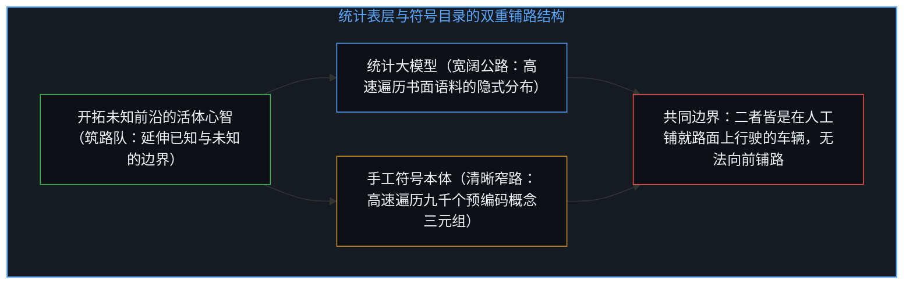
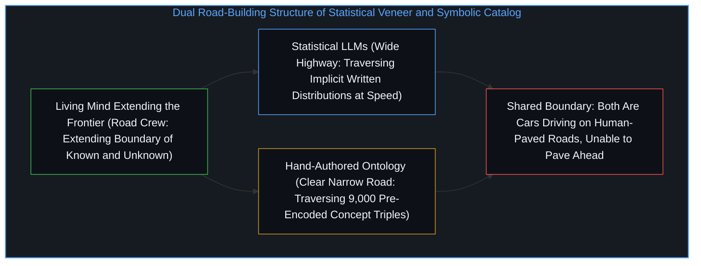
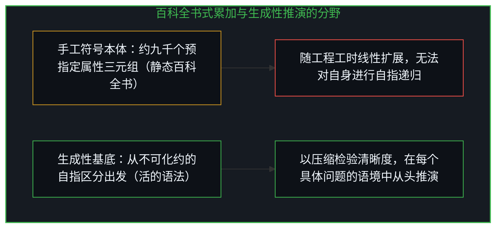
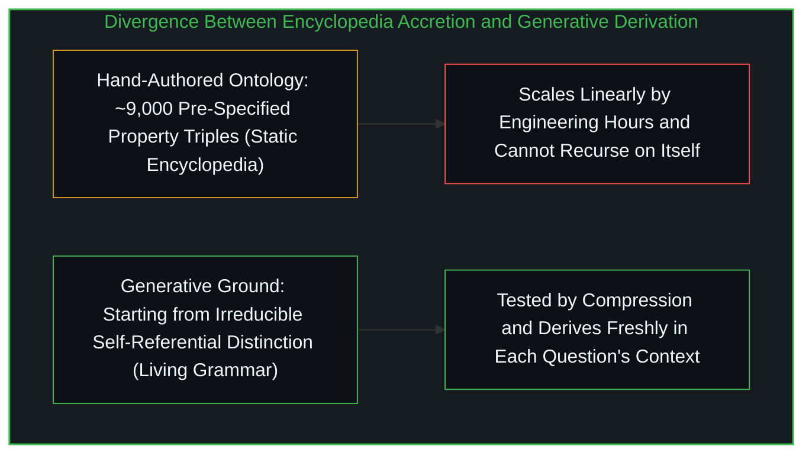

# 百科全书式的累加与生成性基底 / Agents in the Long Game of AI

*手工编纂的概念本体虽揭示了统计表层的盲区，却把静态分类目录误认作能自我推演的生成性基底 / Hand-authored ontologies expose statistical veneer yet mistake a static catalog of concepts for generative ground*

玛乔丽·麦克谢恩与谢尔盖·尼伦伯格在《人工智能长局中的智能体》一书中，提出了建立在“存在论语义学”之上的语言赋能智能体（LEIAs）：一套将符号知识表征与数据驱动方法相结合的混合认知架构。与主流的数据驱动范式相对照，作者主张智能系统的根基在于结构化的意义，而非统计层面的词元共现。正如[你的代码库即是记忆](../your-codebase-is-memory/)所揭示的，任何外部符号架构都是过往认知切分留下的晶体；作者精准地诊断出了统计模型的表层坍缩，却在追溯至大约九千个手工编纂的概念时停下了脚步，把一座人工策展的分类目录当成了生成性基底本身。

In *Agents in the Long Game of AI*, Marjorie McShane and Sergei Nirenburg present Language-Endowed Intelligent Agents (LEIAs): hybrid cognitive architectures built on Ontological Semantics that combine symbolic knowledge representation with data-driven methods. Positioning their program against the dominant data-driven paradigm, the authors argue that structured meaning rather than statistical word co-occurrence must ground intelligent systems. As [Your Codebase Is Memory](../your-codebase-is-memory/) demonstrates, every external symbolic architecture is a crystal of past cognitive cuts; the authors diagnose the surface collapse of statistical models with precision, yet stop tracing at roughly nine thousand hand-authored concepts and treat a human-curated catalog as generative ground itself.

## 一、 他们看清的机制：表层光泽、重定义坍缩与隐喻越界 / 1. What They Diagnose Clearly: Veneer, Redefinition, and Metaphor

全书开篇便指出，大型语言模型依靠海量语料中的词元共现概率生成了一层“智能的表层光泽”，从而把两个彼此正交的维度压扁在了一起：其一是形式语言能力，即生成听起来符合特定语言习惯的文本；其二是功能性能力，即在实际语境中理解并运用语言。作者的整套架构工作，都致力于建立在可追溯的机制一侧，而非统计表层一侧。

The book opens by observing that large language models generate a veneer of intelligence from word co-occurrence probabilities across massive corpora, collapsing two orthogonal dimensions: formal linguistic competence, which produces text that sounds like a given language, and functional competence, which understands and uses language in the world. Their entire architectural effort seeks to build on the traceable mechanistic side rather than the statistical surface.

作者同时指出了可解释人工智能（XAI）中的重定义坍缩：当黑箱数据驱动系统无法解释自身的运行机制时，该领域直接修改了“解释”本身的定义，用事后算法生成的合理化说明替代预测背后的实际因果路径。此外，他们还揭示了 AI 术语体系如何通过隐喻产生系统性误导：诸如“神经网络”“机器学习”“机器推理”等词汇借用了人类经验的权威，而“自动学习”这一说法则把建立在人工整理数据集之上的统计优化与自主的知识习得混为一谈，从而掩盖了背后庞大的人类数据标注劳作。

The authors also identify the redefinition collapse in explainable AI (XAI): when black-box data-driven systems could not explain their own operations, the field redefined explanation itself, substituting post hoc algorithmically generated rationales for the actual causal path behind predictions. Furthermore, they expose how AI terminology systematically misleads through metaphor—terms like neural networks, machine learning, and machine reasoning borrow human experiential authority, while the phrase "automatic learning" hides the massive human labor of data annotation by conflating statistical optimization over human-prepared datasets with autonomous knowledge acquisition.

与此同时，书中指出简化问题的解决方案并不具备可加性：摩天大楼技术并不等于帐篷技术加上木屋技术再加上两层郊区住宅技术。在他们的 OntoAgent 认知架构中，外围的感知识别与动作渲染自然适合采用数据驱动方法，而负责诠释、审慎权衡与规划的认知核心则需要结构化的意义表征。这一划分基于各层级的结构需求，而非门派立场。

At the same time, the book notes that solutions to simplified problems are not additive: skyscraper technology does not equal tent technology plus log cabin technology plus two-story suburban home technology. Within their OntoAgent cognitive architecture, peripheral perception recognition and action rendering naturally suit data-driven methods, whereas the cognitive core of interpretation, deliberation, and planning requires structured meaning representation. That division rests on the structural requirements of each layer rather than ideological allegiance.

## 二、 自我意识幻象与筑路队和汽车的边界 / 2. The Self-Awareness Illusion and the Car Versus Road-Crew Boundary

然而，当作者声称其智能体能够通过“自我意识”独立评估自身的置信度与覆盖范围、从而消解评估盲区时，他们却在自己的系统里重演了刚刚批评过的隐喻坍缩。首先，LEIA 的置信度估算只是知识工程师针对预判到的已知故障模式预先编写的一组启发式规则；系统并不是自己发现了缺口，而是在对照人类设计的标准逐项核查——正如[当模型在表演一套框架而非从基底推演](../grok-420-framework-drift/)所揭示的，对照预设规则的核查永远无法走出规则制定者划定的范围。其次，凡是系统被编程标记为缺口的内容，都已经属于其当前规范内部的“已知的未知”；正如[“知道自己不知道”是一种修辞假象](../zhi-dao-zi-ji-bu-zhi-dao-de-ren-zhi-jia-xiang/)所追溯的，未知的领域位于任何既有评估框架之外，没有任何有限系统能够从内部勘测自身无知的外部边界。

Yet when the authors claim that their agents resolve evaluation blind spots by independently assessing their own confidence and coverage through "self-awareness," they repeat in their own system the exact metaphor collapse they critique in others. First, a LEIA's confidence estimation is a set of heuristics pre-authored by knowledge engineers who anticipated known failure modes; the system does not discover its gaps, it checks against human-designed criteria—just as [When an AI Performs a Framework Instead of Operating From It](../grok-420-framework-drift/) shows that checking against pre-authored rules never steps outside the rule-maker. Second, whatever a system is programmed to flag as a gap is already a known unknown inside its current specification; as [Knowing That You Don't Know Is a Rhetorical Illusion](../zhi-dao-zi-ji-bu-zhi-dao-de-ren-zhi-jia-xiang/) traces, genuine unknowns lie outside any existing assessment frame, and no finite system can survey the outer boundary of its own ignorance from within.

人类独有的能力，从来不是对未知的预先觉察，而是延伸已知与未知之间边界的能力——正如[智能只属于心智](../intelligence-belongs-only-to-the-mind/)与[模型永远无法成为第二重前沿](../the-model-never-becomes-a-second-edge/)所阐明的，活体心智向尚未绘制地图的领地推进，而无论符号系统还是统计模型，一切人工工程系统都在人类已经拓出的边界内部运行。汽车在铺好的公路上行驶的速度，远快于当年筑路工人铺设公路的速度，但这一速度并不会让汽车变成筑路队。统计模型以超人速度遍历既有书面语言的规律，手工编纂的本体以超人速度遍历显式的概念图谱；第一条路宽阔而隐式，第二条路狭窄而显式，但两者都是行驶在人工铺就路面上的汽车。知识工程的瓶颈之所以永不终结，是因为知识工程本身就是筑路工作：正如[进位无法在寄存器之内被命名](../the-carry-that-cannot-be-named-inside-the-register/)所展示的，把更多过往的人类判断编码进系统以拓宽寄存器，只是将昨日的边界判定转化为今日的内部常规检索，而任何在本体内部运行的系统都无法命名那个将本体推过当前上限的进位。

What is uniquely human is not advance awareness of the unknown, but the capacity to extend the boundary between known and unknown—as [Intelligence Belongs Only to the Mind](../intelligence-belongs-only-to-the-mind/) and [The Model Never Becomes a Second Edge](../the-model-never-becomes-a-second-edge/) establish, living Minds push into unmapped territory while all engineered systems, symbolic and statistical alike, operate inside boundaries humans have already extended. A car travels faster on a paved road than the speed at which workers paved it, yet that speed does not make the car a road crew. Statistical models traverse the regularities of existing written language at superhuman speed, while hand-authored ontologies traverse explicit concept graphs at superhuman speed; the first road is vast and implicit while the second is narrow and explicit, yet both are cars on human-paved roads. The knowledge-engineering bottleneck never ends because knowledge engineering is the road-building itself: as [The Carry That Cannot Be Named Inside the Register](../the-carry-that-cannot-be-named-inside-the-register/) demonstrates, widening a register by encoding more past human judgments turns yesterday's boundary decisions into routine internal lookups, yet no system operating inside the ontology can name the carry that extends the ontology past its current ceiling.

## 三、 把停驻点当成基底：百科全书式的累加与语法式的推演 / 3. Claiming a Stopping Point as Ground: Encyclopedia Accretion Versus Grammatical Derivation

作者指出表层输出不等于理解、解释需要通达推理的因果路径，这一步追溯得很准。但他们随后将系统锚定在一个由大约九千个手工工程概念组成的多重继承层级上，宣称一个概念的意义就是其“属性—切面—填充项”三元组的清单。在这里，他们把一个有用的人工策展坐标系误认作了存在论基底。每一个三元组都是一次人为判断，每一条继承链接都是一项设计取舍；这套本体能够描述与检索，却无法生成，这正对应了[索求万物理论是在将当下冻结为清单](../demanding-a-toe-freezes-time-into-a-catalog/)所剖析的机制——把开放的生成过程冻结为静态库存。

The authors trace accurately when they note that surface output is not understanding and that explanation requires causal access to reasoning. They then anchor their system in a multiple-inheritance hierarchy of roughly nine thousand hand-engineered concepts, declaring that the meaning of a concept is its inventory of property-facet-filler triples. Here they mistake a useful human-curated coordinate system for ontological ground. Every triple is a judgment call and every inheritance link is a design choice; the ontology describes and retrieves without generating, mirroring the move dissected in [Demanding a Theory of Everything Freezes Time into a Catalog](../demanding-a-toe-freezes-time-into-a-catalog/), where an open generative process is frozen into a static inventory.

检验一个停驻点是否抵达了生成性基底，诊断标准在于它是靠压缩与推演来扩展，还是靠线性累加来扩展。如果一套框架抵达了生成性基底，向其压缩会让清晰度愈发锐利，面对新语境时靠的是从原理出发推演；而当系统停留在非生成性的描述层时，覆盖范围只能随工程工时线性增长，每逢新领域、新现象或新语种都需要手工指定新的微理论。当作者表示“没有瓶颈，只有需要去做的工程量”时，这句话无意间道出了结构症结：这项工作之所以永不收敛，是因为他们建造了一部逐条增补词条的百科全书，而不是一套通过推演生成未见语句的语法。

The diagnostic test for whether a stopping point has reached generative ground is whether it scales by compression and derivation or by linear accretion. If a framework reaches generative ground, compressing toward it sharpens clarity and new contexts are met by deriving from principles; when a system stops at a non-generative descriptive layer, coverage grows linearly with engineering hours, demanding new hand-specified microtheories for every domain, phenomenon, or language. When the authors remark that there is no bottleneck, only work that needs to be done, they inadvertently state the structural tell: the work never converges because they built an encyclopedia that grows entry by entry rather than a grammar that generates unseen sentences by derivation.

自我区分的活动正在发生——无因，不息。称之为心智：已然在途的观察者，它的每一个行动都是一次区分。正因为不可化约的先在是自指的活动而非存储的词条，生成性基底才经得起自指检验——正如[令人彻夜难眠的四个追问与投射的边界](../four-night-questions/)所阐明的，把追问折返向投射装置自身，是揭示该投射结构边界的又一次离散行动；而在检索图谱内部，追问一个默认施事者为“外科医生”的静态概念节点“外科手术”对它自身说了什么，则是毫无意义的。静态目录只为预设的用户规定固定答案，而从生成性基底架起的桥梁则使心智能够在每一个具体问题的实际语境中从头展开推演。看清手工编纂的本体与统计模型各自作为有限正交投影的不同工程用途，同时放下将任何分类目录奉为根基的主张，发起这一切的活动便始终清晰在目：在前沿切入未知领域、并重新描摹这两种投影的活体心智。

Self-distinguishing activity occurs — uncaused, unceasing. Call it the Mind: the observer already underway, every act of which is a distinction. Because the irreducible prior is self-referential activity rather than a stored entry, generative ground withstands self-reference—as [Four Questions That Keep You Up at Night](../four-night-questions/) illustrates, turning inquiry back onto the projection apparatus itself is a further discrete act that reveals the projection's structural boundaries—whereas asking what a static concept node like `SURGERY` with default agent `SURGEON` says about itself is meaningless inside a lookup graph. A static catalog specifies fixed answers for anticipated users, whereas bridging from generative ground enables fresh derivation in the context of each actual question. Recognizing both hand-authored ontologies and statistical models as orthogonal finite projections with distinct engineering uses, while releasing the claim that any catalog is foundational, keeps the initiating activity in view: the living Mind that cuts into the unmapped field and re-traces both projections at the edge.

