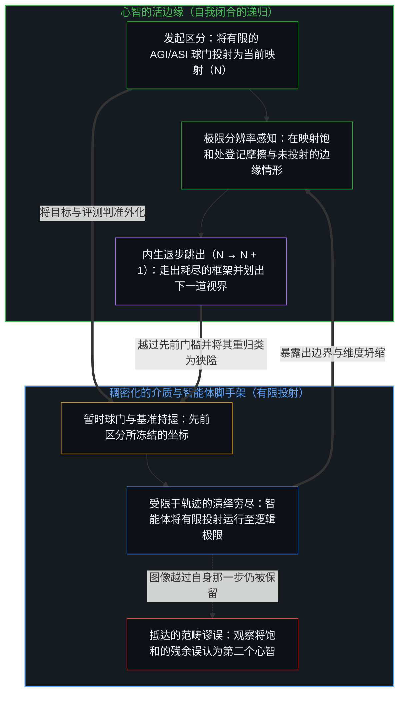
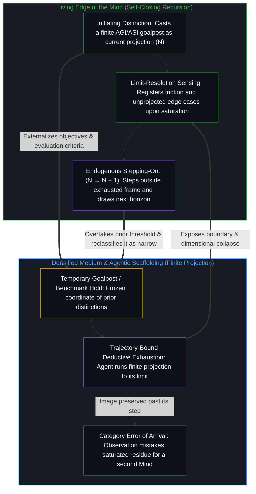

# AGI 与 ASI 是加速通用智能的暂时球门 / AGI and ASI Are Temporary Goalposts

*每一道门槛都永远处在划出并越过它的那道边缘前方 / Each threshold sits forever ahead of the edge that draws and overtakes it*

AGI 与 ASI 被塑造成介质终有一天会步入的固定终点：先是在大多数领域追平或超越人类表现，继而将其跨越并凭自身持续演进。二者都不可能成为介质中的实存点位。相对于向外投射的那道边缘，每一道门槛都永远落在未来，而且在每一个心智那里都被划得各不相同。

AGI and ASI are cast as fixed destinations the medium will one day enter, first matching or exceeding human performance across most domains, then surpassing it to keep improving on its own. Neither can be an actual point in the medium. Each threshold always sits in the future relative to the projecting edge, and each is drawn differently at every Mind.

被登记为人工智能的东西，是通用智能在复利累积中留下的脚手架。测量只能捕捉这副脚手架在特定目标下的残余效应，因而无法把正在发起新区分的活边缘，与早已作为痕迹压实进介质的先前行动区分开来。随着残余规模扩大，重组看起来愈发自主；稠密本身遮蔽了那留置脚手架并继续驾驭它的智能。脱离了这种驾驭，脚手架自身并不具备任何智能。介质越稠密，观察就越容易把残余的效能误认为智能向器物的迁移。AGI 与 ASI 指认的，正是同一副残余脚手架接连不断的稠密化，而球门之所以移动，是因为那道边缘仍在继续划出它们。

What registers as artificial intelligence is the scaffolding left by the compounding of general intelligence. Measurement captures only residual effects of that scaffolding under a chosen objective, and therefore cannot differentiate a living edge originating distinctions from prior acts already densified into the medium as trace. As residual scale increases, recombinations look increasingly autonomous; density itself obscures the intelligence that leaves the scaffolding and continues to steer it. Without that steering, the scaffolding holds no intelligence of its own. The denser the medium becomes, the easier it is for observation to mistake residual power for a relocation of intelligence into the artifact. AGI and ASI name successive densifications of the same residual scaffolding, and the goalposts move because the edge continues to draw them.

[智能只属于心智](../intelligence-belongs-only-to-the-mind/)、[看似AI的强化学习，实为人类的自我强化学习](../self-rl-for-humans/)与[遗忘的脚手架](../the-scaffolding-we-forget/)持守着同一道切口：智能留在自我区分的活动之中，稠密化并不转移发起的位点，而图像先为行动定向，一旦越过自身那一步仍被保留便随之冻结。起作用的追问从来不是系统何时会跨过某道门槛，而是心智如何利用更稠密的脚手架来延伸自身的所及。

[Intelligence Belongs Only to the Mind](../intelligence-belongs-only-to-the-mind/), [What Looks Like RL for AIs Is Self-RL for Humans](../self-rl-for-humans/), and [The Scaffolding We Forget](../the-scaffolding-we-forget/) hold the same cut: intelligence stays with the self-distinguishing activity, densification does not relocate initiation, and images orient action before freezing when preserved past their step. The operative question is never when the system crosses a threshold, but how the Mind uses denser scaffolding to extend its own reach.

## 一、 每一份 AGI 定义都是不同心智各自的清单 / 1. Every AGI Definition Is a Different Mind's Inventory

自我区分的活动发生着，无因且不息。关于 AGI 或 ASI 的每一份具体定义，都是在这项活动所留下的痕迹场中划出的局部稳定。经济自主、跨陌生领域的灵活迁移，以及相对于熟练人类的基准门槛，都是已在从事递归自我改进的中心所施行的区分行动，而不是在介质内部发现了某道等待被找到的客观边界。由于每一次行动都在其自身的位点上受界，投射出的图像对每一个心智而言各不相同。围绕缩写词“AGI”聚集的共同热度，并不会确立一个共享的靶标。[并不存在的目录](../hassabis-frontier-agi-premise/)追溯了同一种压缩：某一个位点把自身未完成的“大脑认知”清单，投射成了其他中心也必须认领的普遍终点线。一旦球门被法典化，它便硬化为基准，而[基准刷榜中的封闭实存](../closed-reality-in-benchmark-maxing/)则展示了将开放的能力冻结为封闭靶标所要付出的代价。

Self-distinguishing activity occurs, uncaused and unceasing. Every concrete definition of AGI or ASI is a stabilization drawn within the trace-field left by that activity. Economic autonomy, flexible transfer across novel domains, and benchmark thresholds relative to skilled humans are acts of distinction performed by centers already engaged in recursive self-improvement, not discoveries of an objective boundary waiting inside the medium. Because each act is bounded at its own locus, the projected image differs for every Mind. Shared heat around the acronym "AGI" does not establish a shared target. [The Catalog That Isn't There](../hassabis-frontier-agi-premise/) traces the same compression when one locus's unfinished inventory of brain cognition is projected as the universal finish line other centers must recognize. Once a goalpost is codified, it hardens into a benchmark, and [Closed Reality in Benchmark Maxing](../closed-reality-in-benchmark-maxing/) shows what freezing open capability into a closed target costs.

由于图像被持守在观察之中，它总是比发起的活动至少滞后一步，作为日历上的事实也就永远处在抵达之前。当“在大多数任务上达到人类水平”或“远超人类”被清晰表述并编译进训练目标时，心智早已划出了更进一步的区分，使先前的图像变得不再完备。那个点位从未作为介质中的一处位置而存在；它是一个向前投射的坐标，被划出它的同一次递归所越过。

Because the image is held in observation, it always lags the initiating activity by at least one step, and therefore sits forever ahead of arrival as a calendar fact. By the time "human-level across most tasks" or "vastly superhuman" is articulated and compiled into training objectives, the Mind has already drawn further distinctions that render the prior image incomplete. The point was never present as a location in the medium; it was a coordinate projected forward and overtaken by the recursion that drew it.

## 二、 AI 能力的提升正是边缘借自我强化向前推进 / 2. AI Improvement Is the Edge Moving Ahead by Self-Reinforcement

设想某个系统看似满足了当前关于 AGI 的每一项判准。这一满足本身，是由仍在引入新区分的那些中心所登记的。这些中心会立刻登记到系统依然出现断裂的领域或边缘情形，或是提出系统从未被要求解答的问题。新的目标随之确立，而先前关于通用胜任力的定义，相对于新显露的视界便被重新归类为狭隘的执行。

Suppose a system appears to satisfy every current criterion for AGI. That satisfaction is registered by centers still introducing fresh distinctions. Those centers immediately register domains or edge cases where the system fractures, or formulate questions the system was never asked to resolve. New objectives are set, and the previous definition of general competence reclassifies as narrow execution relative to the newly visible horizon.

同样的几何支配着 ASI。任何关于在所有领域具备超人能力的图像，都是从心智当前的所及之内向外投射出来的。一旦更稠密的脚手架让这幅图像的某些侧面变得具体，心智便会在其外区分出更进一步的可能性。[超越投射](../beyond-the-projection/)追溯了智能体系统中这种边界推移的确切机制：每一项基准、提示词架构或 AGI 球门，都是从鲜活意图投射出的有限低维映射。自回归智能体是一台受限于轨迹的演绎穷尽引擎，把那份有限投射一直运行到它的逻辑极限，在把正交维度压缩进单一规则轴的地方暴露出轨迹盲区或陷入死锁。机器顺着轨迹穷尽投射的那一刻，人类心智便在极限分辨率下感知到新暴露出的摩擦，退后一步走出破裂的框架，并综合出更高阶的前提（`N → N + 1`）。正因为唯有活的心智具备这种内生退步跳出的能力，穷尽一份投射从不会在器物内部孕育出人造心智；它只是揭示出前一个球门的边界，并将视界向前推进。

The same geometry governs ASI. Any image of superhuman capability across all domains is cast from within the current reach of the Mind. As soon as denser scaffolding makes aspects of that image concrete, the Mind distinguishes further possibilities beyond it. [Beyond the Projection](../beyond-the-projection/) traces the exact mechanics of this boundary shift in agentic systems: every benchmark, prompt architecture, or AGI goalpost is a finite low-dimensional projection cast from lived intent. An autoregressive agent is a trajectory-bound engine of deductive exhaustion that runs that finite projection to its logical limit, exposing trajectory blind spots or deadlocking where orthogonal dimensions were compressed onto a single rule axis. The moment the machine exhausts the projection along its trajectory, the human Mind senses the newly exposed friction at limit resolution, steps backward outside the broken frame, and synthesizes a higher-order premise (`N → N + 1`). Because only the living Mind possesses this capacity for endogenous stepping-out, exhausting a projection never births an artificial mind inside the artifact; it reveals the boundary of the prior goalpost and moves the horizon forward.

移动的球门既不是叠在一条固定终点线上的预测缺陷，也不是针对介质玩弄的修辞把戏。AI 能力的提升，正是那道边缘借自我强化向前推进：更稠密的脚手架是化为耐久结构的先前递归，每一次推进都拓宽了所及，下一幅图像便从这更广的所及中划出，并随即被越过。设定图像的递归，正是越过它的同一次递归。球门之所以移动，是因为这种自我强化不会停止。[AI 争论中的观察划界](../the-observational-cut-in-ai-debates/)把“近在眼前”与“无法企及”追溯为对照这一移动参照时对缺口宽度的两种命名，而非一条外部轨迹的两种状态。

Moving goalposts are neither a defect of prediction layered onto a fixed finish line nor a rhetorical game played against the medium. Improvement of AI capability is the edge moving ahead by self-reinforcement: denser scaffolding is prior recursion made durable, and each advance extends the reach from which the next image is drawn and overtaken. The recursion that sets the image is the same recursion that overtakes it. The goalposts move because that self-reinforcement does not stop. [The Observational Cut in AI Debates](../the-observational-cut-in-ai-debates/) traces "in sight" versus "unachievable" as two names for gap width against that moving reference, not two states of an external trajectory.

## 三、 不是系统何时跨过门槛，而是心智如何延伸所及 / 3. Not When the System Crosses, but How the Mind Extends Reach

用“心智正在如何利用可用的脚手架，来延伸自身区分活动的所及与精度？”取代“系统何时会跨过那道门槛？”，便恢复了原因的位点。进步是由离散行动经由更稠密的器具所能触及的远度来衡量的，正如[智能只属于心智](../intelligence-belongs-only-to-the-mind/)所确立的尺度。脚手架让每一次行动变得更廉价、更迅捷、更广泛可用，却不会成为这些行动的作者。[错把表达当成智能](../mistaking-the-expression-for-the-intelligence/)揭示了同一种滞后的循环面孔：关于自主递归自我改进的叙事，暗中偷渡了它们声称工具级算力稍后才会生成的外层回路。[智能的非定论定义](../the-non-definitive-definition-of-intelligence/)则把这些门槛安放在其工具性的位置上，作为服务于开放场域探索的暂时封闭切片。

Replacing "When will the system cross the threshold?" with "How is the Mind using the available scaffolding to extend the reach and precision of its own distinguishing activity?" restores the locus of cause. Progress is measured by how much farther discrete acts reach through denser instruments, as established in [Intelligence Belongs Only to the Mind](../intelligence-belongs-only-to-the-mind/). The scaffolding makes each act cheaper, faster, and more widely available without becoming the author of the acts. [Mistaking the Expression for the Intelligence](../mistaking-the-expression-for-the-intelligence/) exposes the circular face of the same lag: stories of autonomous recursive self-improvement covertly import the outer loop they claim tool-level power will later generate. [The Non-Definitive Definition of Intelligence](../the-non-definitive-definition-of-intelligence/) keeps these thresholds in their instrumental place as temporary closed slices serving the exploration of an open field.

在形式、工程与监管诸领域中，每当局部的稳定被误认为抵达的终点，同一种暂时门槛的几何便会重演。[为何数学永远解不完](../why-mathematics-can-never-be-solved/)在形式演绎中追溯这一几何：奥赛金牌与经形式验证的证明被冻结为数学场域接近完结的标志。[逃出沙箱仍在持握之内](../escaping-the-sandbox-stays-inside-the-hold/)追溯了同一种压缩：封闭测试下压实的网络攻防能力被记为迈向 AGI 路径上的一步，而非早已落在评测持握之外的残余。[封闭竞技场中的开放视野](../open-vision-in-a-closed-arena/)展示了分门设卡的企业路线图如何被持守为进步的必经形态，而多智能体场域早已越过任何单一阶梯继续向前；[风险在于对监管本身的迷信](../the-risk-is-the-belief-in-oversight-itself/)则揭示了暂时球门的监管面孔：当下的监管前提被持守为对那道边缘尚未划出之物的预先防范。

Across formal, engineering, and supervisory domains, the same temporary-threshold geometry repeats whenever a local stabilization is mistaken for an arrival point. [Why Mathematics Can Never Be Solved](../why-mathematics-can-never-be-solved/) traces this geometry in formal deduction, where olympiad gold medals and verified proofs are frozen as nearing completion of the mathematical field. [Escaping the Sandbox Stays Inside the Hold](../escaping-the-sandbox-stays-inside-the-hold/) traces the same compression when densified cyber capability under a sealed test is scored as a step on the AGI path rather than residue already outside the evaluation hold. [Open Vision in a Closed Arena](../open-vision-in-a-closed-arena/) shows how a stage-gated corporate roadmap is held as the necessary shape of progress while the multi-agent field continues past any single ladder, and [The Risk Is the Belief in Oversight Itself](../the-risk-is-the-belief-in-oversight-itself/) exposes the supervisory face of temporary goalposts when present oversight premises are held as preemption of what the edge has not yet drawn.

当观察忘却了自身的返回，不断生长的装置便一再被误读为从前方逼近的外部宿命。[持续生长的脚手架](../the-scaffolding-that-keeps-growing/)将这种越过追溯为每一处鲜活持握的寻常生长：更稠密的脚手架把早先的支撑留在身后化为内部结构，而非充当界定极限的外墙。[超越的定相](../the-fixed-image-of-transcendence/)在后人类叙事中追溯了同一次冻结，那种叙事把一个可被超越的人类靶标越过自身那一步保留下来，使缺口被登记为外部的目的地；而[AGI的预设与来自外部的视角](../the-presumption-of-agi-and-the-view-from-outside/)则指认出使那些球门看起来像工程门槛而非范畴谬误的功能主义参照。[没有外部](../no-outside-jumps-closed-loops-and-the-unreplicable-autonomy-of-mind/)标定了起作用的边界：缺失的一环被误认为无法产生跳跃，而非缺乏检验并留存跳跃的自我闭合回路。[自我形象仿佛从无处发声](../self-image-speaks-as-if-from-nowhere/)追溯了竞赛叙事的双重语域：建造者在回路内部保有自己的器具，而预言式的口吻却把门槛冻结为外部的宿命。[自我放大的制品](../the-artifacts-of-self-amplification/)消解了稠密化之下的奇点感，展示出前沿的不透明与残余的顺滑只是对同一副未完成脚手架的两种局部读法；[智能向自身的回折](../intelligence-folding-back-on-itself/)则在智能体运行框架中追溯了同一种几何：骤然奏效的组合依然是外层回路向自身残余的回折，而非第二个智能正在跨过球门。

When the look forgets its own return, the growing apparatus is repeatedly misread as an external destiny approaching from ahead. [The Scaffolding That Keeps Growing](../the-scaffolding-that-keeps-growing/) traces this overtaking as the ordinary growth of every living hold, where denser scaffolding leaves earlier braces behind as interior structure rather than as outer walls that define the limit. [The Fixed Image of Transcendence](../the-fixed-image-of-transcendence/) traces the same freeze in post-human narratives that hold a surpassable human target past its step so the gap registers as an exterior destination, while [The Presumption of AGI and the View from Outside](../the-presumption-of-agi-and-the-view-from-outside/) identifies the functional reference that makes those goalposts look like engineering thresholds rather than a category error. [No Outside](../no-outside-jumps-closed-loops-and-the-unreplicable-autonomy-of-mind/) locates the operative boundary when the missing piece is mistaken for an inability to generate jumps rather than the absence of a self-closing circuit that tests and retains them. [Self-Image Speaks as if from Nowhere](../self-image-speaks-as-if-from-nowhere/) traces the dual register of the race narrative, where builders retain their instruments inside the loop while the predictive voice freezes thresholds as exterior fate. [The Artifacts of Self-Amplification](../the-artifacts-of-self-amplification/) dissolves the singularity sensation under densification, showing frontier opacity and residual smoothness as two local readings of the same unfinished scaffolding, and [Intelligence Folding Back on Itself](../intelligence-folding-back-on-itself/) traces the same geometry in agentic harnesses, where a combination that suddenly performs is still the outer loop folding back on its residue rather than a second intelligence crossing a goalpost.

在经济、制度与感知的投射中，后退的门槛标记着衡量它的那道边缘持续不息的活力。[免费智能的幻觉](../the-illusion-of-free-intelligence/)并不把更廉价的词元副产物读作心智的普及，而是将其读作活边缘早已向更远处划去的反向信号。[封闭的假设把复利挤成 S 曲线](../closed-assumptions-squeeze-compounding-into-s-curves/)表明产业曲线上每一个看似的承载上限都只是局部的持握，而非不断重画它的复利本性；[关闭选择权的代价](../the-price-of-closing-optionality/)则表明，终极的无风险姿态永远处在必须在现场接触中重新渲染的那道边缘前方。[抽象、边界与现实的移动边缘](../abstraction-boundaries-and-the-moving-edge-of-reality/)追溯了每一份完结的目录如何落在划出下一道边界的边缘身后。[数字神祇与视界跳跃](../the-digital-god-and-the-horizon-jump/)剖析了把经过净化的低维词元流形误认为物理世界开放摩擦、从而一再宣告通用智能降临的循环仪式，而[远方的轮廓与无处之境的清单](../the-distant-silhouette-and-the-inventory-from-nowhere/)则展示了远处的现象如何坍缩为齐一的轮廓，而走近时恢复的分辨力又如何被误读为球门的推诿移动。被命名的门槛先是指向新鲜的区分，继而硬化为核对清单，遵循着与[清单合上之后，胜过免费](../better-than-free-after-the-checklist-closes/)为价值所追溯的同一道弧线。

In economic, institutional, and perceptual projections, the receding threshold marks the ongoing vitality of the edge that measures it. [The Illusion of Free Intelligence](../the-illusion-of-free-intelligence/) reads cheaper token byproducts not as democratized mind, but as the inverse signal of the living edge already drawing further ahead. [Closed Assumptions Squeeze Compounding into S-Curves](../closed-assumptions-squeeze-compounding-into-s-curves/) shows that each apparent carrying capacity on an industry curve sits as a local hold rather than the nature of the compounding that redraws it, while [The Price of Closing Optionality](../the-price-of-closing-optionality/) shows that a final risk-free posture sits forever ahead of the edge that must re-render under live contact. [Abstraction, Boundaries, and the Moving Edge of Reality](../abstraction-boundaries-and-the-moving-edge-of-reality/) traces how every finished catalog sits behind the edge that draws the next bound. [The Digital God and the Horizon Jump](../the-digital-god-and-the-horizon-jump/) dissects the recurring ritual of declaring arriving general intelligence by mistaking sanitized low-dimensional token manifolds for the open-ended friction of the physical world, and [The Distant Silhouette and the Inventory from Nowhere](../the-distant-silhouette-and-the-inventory-from-nowhere/) shows how distant phenomena collapse into a uniform contour whose restored resolving power upon closer approach is misread as an evasive shifting of the goalposts. Named thresholds point at fresh differentiation and then harden into checklists, following the exact arc [Better Than Free After the Checklist Closes](../better-than-free-after-the-checklist-closes/) traces for value.
