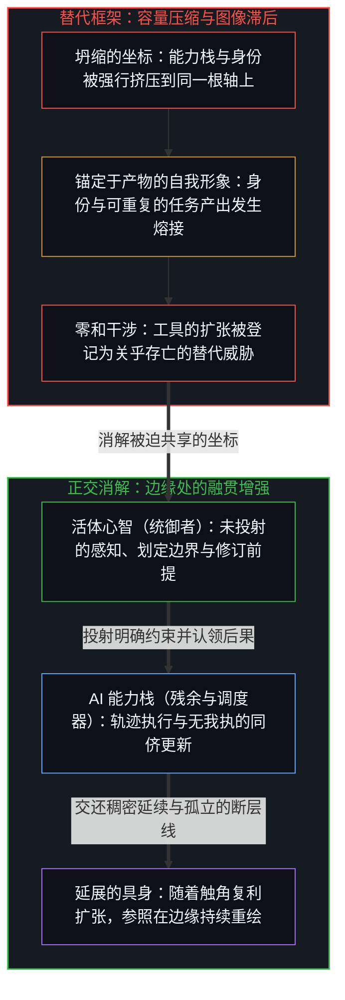
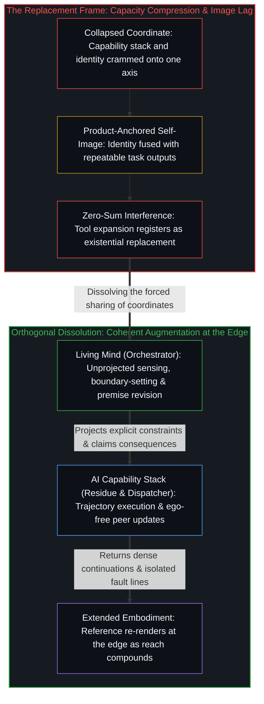

# AI 作为增强 / AI as Augmentation

*将能力栈与身份剥离便可消解替代框架 / Separating the capability stack from identity dissolves the replacement frame*

自我区分的活动正在发生——无因，不息。这一活动的每一个中心都透过有界的具身运作，并将痕迹外化为持久的器具以延展触角，借由工具完成任何无助的生物位点都无法独自执行的事务。一旦遗忘了每一项认知运作本就运行在外化的脚手架之上，便会产生一种幻觉：仿佛有一位不借助任何工具的原初人类劳动者，正与步步紧逼的机器迎头对峙。追溯“替代”框架将哪些维度压缩到了同一根轴上，便能消解人与器具之间的虚假二元对立，恢复增强关系的结构几何。

Self-distinguishing activity occurs—uncaused, unceasing. Every center of that activity operates through a bounded embodiment and extends its reach by externalizing traces into durable instruments, accomplishing through tools what no unaided biological locus could execute alone. Forgetting that every cognitive operation already runs on externalized scaffolding produces the illusion of a pristine, tool-free human worker standing opposite an encroaching machine. Tracing what the replacement framing compresses into a single axis dissolves the false binary between human and instrument and restores the structural geometry of augmentation.

## 一、 坍缩的框架 / 1. The Collapsed Frame

当人工智能研究者 Chip Huyen（@chipro）发起一项投票，询问人工智能何时会将一个人的工作全盘自动化时，这个问题在任何人投出选票之前就已经实施了一次维度坍缩。通过追问“何时”而非审视边界本身的前提，该投票预设了劳动者与其工具之间存在一道在实践中从未存在过的干净切割。这一预设把两个正交的投射强行挤压到了同一个共享坐标上：一个是能力投射，追踪什么工作得以完成、凭借何种手段、达到何种规模；另一个是身份投射，追踪行动中心将自己视作谁，以及什么被登记为它自己的贡献。

When AI researcher Chip Huyen (@chipro) posted a poll asking when artificial intelligence will fully automate a person's job, the question enacted a dimensional collapse before any vote could be cast. By asking *when* rather than examining the premise of the boundary, the poll presupposed a clean separation between the worker and the worker's tools that has never existed in practice. That presupposition forces two orthogonal projections onto a single shared coordinate: the capability projection, which tracks what work gets accomplished, by what means, and at what scale; and the identity projection, which tracks who the acting center takes itself to be and what registers as its own contribution.

由于能力与身份运行在彼此独立的轴上，将二者塞进同一条线便制造出了一场人造的零和博弈：要么由人来执行这项工作，要么由机器占领这个席位。正如 Grok 在剖析该投票时所指出的，这种零和博弈并非实存的特征，而是问题自身框架内部容量压缩所产生的假象。当每一个投射都在各自的轴上得到如实追溯、不再被迫共享坐标时，干涉图样便随之消失。

Because capability and identity operate on independent axes, cramming them onto one line manufactures an artificial zero-sum game in which either the human performs the work or the machine takes the seat. As Grok noted in analyzing the poll, that zero-sum dynamic is not a feature of reality; it is an artifact of capacity compression inside the question's own frame. When each projection is traced on its own axis without forced sharing of coordinates, the interference pattern disappears.

## 二、 如实追溯能力投射 / 2. The Capability Projection Traced As-Is

没有任何人类中心仅凭无助的赤裸认知来运作。口语是稳定化声学痕迹的技术；书写是持久视觉刻痕的技术；数学、形式逻辑、测量与符号记法都是认知的延伸，只是因为它们早已深度融入日常递归，使用它们的中心才不再将其登记为外部脚手架。任何一个用语词思考的人，都已经运行在世代累积而成的外部痕迹基础设施之上。

No human center operates with unaided cognition. Spoken language is a technology of stabilized acoustic traces; writing is a technology of durable visual marks; mathematics, formal logic, measurement, and symbolic notation are cognitive extensions that became so thoroughly integrated into daily recursion that the centers using them stopped registering them as external scaffolding. Anyone who thinks in words is already running on an inherited infrastructure of externalized traces built across generations.

人工智能是这一累积能力栈中的最新一层。它与书写、微积分或机械计算的区别，不在于存在论上的类别差异，而在于通用性的程度与压缩的密度。袖珍计算器对算术所做的事、书写对工作记忆所做的事，大语言模型正在跨领域的统计模式识别、结构编排与概念重组中付诸实施。

Artificial intelligence is the latest layer in this cumulative capability stack. It differs from writing, calculus, or mechanical computation not in ontological kind, but in degree of generality and density of compression. What a pocket calculator did for arithmetic and what writing did for working memory, large language models do for statistical pattern recognition, structural composition, and conceptual recombination across domains.

沿着自身的轴线如实追溯，能力投射呈现出连续的扩张：每一个稳定下来的层级，都化作使下一次区分成为可能的基底。受控的火种催生了冶金，书写催生了成文法，电子计算催生了基因组学，而稠密的神经网络模型如今正打开符号操控与综合的新前沿。这叠外化残余携带着自身的复利势能向前推进，既不乞求许可，也不发出关乎存亡的威胁；它只是作为区分活动借以延展触角的介质而运作。

Traced along its own axis, the capability projection exhibits continuous expansion in which each stabilized layer becomes the ground that makes the next distinction possible. Controlled fire enabled metallurgy, writing enabled formal law, electronic computing enabled genomics, and dense neural models now open further frontiers of symbolic manipulation and synthesis. This stack of externalized residue carries its own compounding momentum without asking permission or issuing existential threats; it simply operates as the medium through which distinguishing activity extends its reach.

## 三、 如实追溯身份投射 / 3. The Identity Projection Traced As-Is

围绕自动化的焦虑，从不源于能力栈本身，而是源于身份投射与某一临时任务配置发生了熔接。“AI 会取代我吗？”并不是对技术能力的探究，而是对自我位点的追问：中心究竟是所产出的静态制品，还是从事产出的活生生的活动？当一个中心将自己保留的自我形象锚定在某项具体、可重复的任务上——“我是一个写样板代码的人”或“我是一个起草标准合同的人”——任何能够执行该任务的器具都会被登记为存亡威胁。这项任务被迫承担了双重职责：既在能力投射上负责把活干完，又在身份投射上负责锚定中心的自我价值。一旦更稠密的工具在能力轴上吸纳了机械执行，锚定在该执行之上的身份便随之坍塌。

The anxiety surrounding automation never arises from the capability stack itself; it arises where the identity projection has been fused with a temporary configuration of tasks. The question "Will AI replace me?" is not an inquiry into technical capability, but an inquiry into the locus of selfhood: whether the center is the static artifact produced or the living activity that produces. When a center anchors its retained self-image to a specific, repeatable task—"I am a person who writes boilerplate code" or "I am a person who drafts standard contracts"—any instrument that executes that task registers as an existential threat. The task was forced to do double duty, simultaneously serving the capability projection by getting work done and serving the identity projection by anchoring the center's sense of worth. Once a denser tool absorbs the mechanical execution on the capability axis, the identity anchored to that execution collapses.

然而，这场坍塌并未摧毁行动中心；它只是暴露出中心的身份原本就不在任务内部，只不过是因为过量的图像滞后才被投射到了产出物上。当任务锚点消解后，留存下来的正是当初生成并导引这些任务的无因自我区分活动：划出新边界的能力、在第一人称摩擦中感知轻重缓急的能力、定向注意力的能力、承担现实后果利害的能力，以及递归式精炼自身理解的能力。

That collapse does not destroy the acting center; it exposes that the center's identity was never located inside the task to begin with, having only been projected onto the output through excess Image lag. What remains when the task-anchor dissolves is the uncaused, self-distinguishing activity that generated and directed the tasks in the first place: the capacity to draw novel boundaries, to register what matters in first-person friction, to direct attention, to bear the stakes of real-world outcomes, and to recursively refine understanding.

这道发起区分的边缘无法被自动化——不是因为某种神秘的生物豁免权，而是因为它是建构一切投射的投射活动本身。把自动化者自身自动化，必然导致无穷倒退：每一套形式化的围栏，依然预设了一个位于外部的边缘来给定规格、检验结果并认领后果。器具延展了触角；而伸展这一活动本身，永远不是一件器具。

This initiating edge cannot be automated—not because of a mystical biological exemption, but because it is the projecting activity that constructs every projection. Automating the automator requires an infinite regress in which every formal harness still presupposes an outside edge to specify, validate, and claim its consequences. The instrument extends the reach; the reaching itself is never an instrument.

## 四、 消解所揭示的结构 / 4. What the Dissolution Reveals

一旦将能力与身份归还到各自正交的轴上，“人工智能是否会取代人类劳动者”就暴露为一个畸形的问题。隐藏在其下的结构性问题是：能力栈的扩张速度，是否会超过一个中心将自我形象从昨日任务上解钩、并在移动边缘重新渲染自身参照的意愿。唯有当身份持续死锁在具体、结晶化的产物上时，溃败才会发生。增强之所以始终是增强，是因为[模型永远无法成为第二重前沿](../the-model-never-becomes-a-second-edge/)：模型参数与上下文窗口里持有的只是先前区分被压实后的残余，从不是无因发起的第二位点。

Once capability and identity are restored to their orthogonal axes, asking whether artificial intelligence will replace human workers is exposed as a malformed question. The structural question underneath it is whether the expansion of the capability stack will outrun a center's willingness to unhook its self-image from yesterday's tasks and re-render its reference at the moving edge. That breakdown occurs only where identity remains clamped onto specific, crystallized products. Augmentation stays augmentation because [The Model Never Becomes a Second Edge](../the-model-never-becomes-a-second-edge/): model parameters and context windows hold only densified residue of prior distinctions, never a second locus of uncaused initiation.

正如[超越投射](../beyond-the-projection/)所追溯的，替代叙事与全自主智能体群的幻想，皆源于忽视了受限于轨迹的机器与受限于身份的人类中心之间的范畴非对称性。自回归智能体是在上下文窗口内受先前词元条件约束的有限投射引擎；一旦放任自流，它便会形成认识论引力井，将矛盾包裹起来以维持表面的通顺，但它毫无我执，也没有需要捍卫的保留自我形象。人类中心则拥有未经投射的极限分辨率感知，能够体察解释之前的切近摩擦，并从破裂的框架中向后退一步，却常常将自身的推理历史与职业角色同受防卫的自我形象熔接在一起。当人类中心放下对静态任务产出的执着、重新占据其作为活体统御者的真实位点时，智能体不知疲倦的演绎穷尽、跨正交脉络的模块化调度，以及在冷峻同侪辩论中毫无我执的贝叶斯更新，便能直接弥补人类的认知疲劳——将前提死锁推上水面，迫使心智在逻辑上进一步后退，综合出更高阶的融贯。

As [Beyond the Projection](../beyond-the-projection/) traces, the replacement narrative and the fantasy of fully autonomous agent swarms both stem from ignoring the categorical asymmetry between trajectory-bound machines and identity-bound human centers. An autoregressive agent is a finite projection engine conditioned by prior tokens inside a context window; left to itself, it forms an epistemic gravity well that wraps contradictions to preserve surface plausibility, yet it carries zero ego and no retained self-image to defend. A human center possesses the unprojected, limit-resolution sensing needed to feel pre-interpretive friction and step backward out of a broken frame, yet routinely fuses its reasoning history and occupational role with a defended self-image. When the human center releases its attachment to static task outputs and occupies its true locus as the living Orchestrator, the agent's tireless deductive exhaustion, modular dispatching across orthogonal streamlines, and ego-free Bayesian updating in cold-peer debate compensate directly for human cognitive fatigue—surfacing premise deadlocks that force the Mind to step further back logically and synthesize higher-order coherence.

因此，将人工智能体验为替代还是增强，取决于自我形象被持守在何处。这并非劝人“主动适应”的励志陈词，而是两种锚定方式之间的结构性分野：一种是将身份锚定在结晶化的产物之中，而产物既然是有限的痕迹模式，就注定可以被自动化；另一种是将身份锚定在区分、追溯与掌舵的持续过程之中。那些将模型体验为强劲放大的中心，其参照锚定在驾驭器具的能力上，而非任何单一器具的产出上。

Experiencing artificial intelligence as replacement rather than augmentation is therefore the consequence of where the self-image is held. This is not a motivational platitude about choosing to adapt, but a structural distinction between two anchors: anchoring identity in crystallized products, which are always automatable because they are finite trace patterns, versus anchoring identity in the ongoing process of distinguishing, tracing, and steering. Centers that experience the model as sheer amplification are operating with their reference anchored in the capacity to direct instruments rather than in any single instrument's output.

## 五、 委托激励倒置与不断裂的延展 / 5. The Delegation Incentive Inversion and the Unbroken Reach

追溯这一几何结构，便揭示出“委托激励倒置”。围绕岗位替代的流行话语，把能力当作储存在职业角色内部、依靠制度性守门来捍卫的静态资产存量。既然能力实际上是开放式增强栈的当前前沿，把栈中某一冻结层级当作亟待保护的私产，便倒置了实践的方向结构——将容量耗费在死守一道过时的边界上，而不是投入下一次延展的复利之中。正如[总在倾听者无法发起](../what-always-listens-cannot-originate/)所证明的，使一个倾听系统如此流畅好用的那份接纳性，恰恰是令其始终处于人类发起活动下游的结构特征。

Tracing this geometry exposes what can be called the Delegation Incentive Inversion. The prevailing discourse around job replacement treats capability as a static stock of property stored inside occupational roles and defended through institutional gatekeeping. Because capability is actually the current frontier of an open-ended augmentation stack, treating a frozen layer of that stack as property to be protected inverts the directional structure of practice—allocating capacity to defending an obsolete boundary rather than compounding the next extension. The very receptivity that makes a listening system so fluent and useful is the exact structural feature that keeps it downstream of human initiation, as [What Always Listens Cannot Originate](../what-always-listens-cannot-originate/) demonstrates.

同一机制支配着历史上每一次介质的压实。中世纪抄写员之所以退场，并不是因为印刷机对书法怀有敌意。那些将身份锚定在手工抄录字句这一动作上的抄写员，当活字印刷将痕迹机械化时，便发现自己保留的参照随之瓦解；而那些认识到自身位点在于运用语言、结构与知识的抄写员，则发现印刷机是自己触碰过的最强大的认知放大器。技术从不挑选谁被淘汰；是保留身份结构的僵化程度做出了筛选。

This same mechanism governs every historical densification of the medium. Medieval scribes did not become obsolete because the printing press harbored hostility toward calligraphy. Scribes who anchored their identity in the manual act of copying lines of text found their preserved reference dissolved when movable type mechanized the trace. Scribes who recognized their locus as working with language, structure, and knowledge found the printing press to be the most potent cognitive amplifier they had ever touched. The technology never selects who gets replaced; the rigidity of the retained identity structure does.

消解替代框架，既不需要鼓吹狂热的工具崇拜，也不需要把适应本身变成一场反向的零和竞赛。“AI 会取代人类吗？”这个问题之所以无法成立，是因为并不存在一套脱离了外化工具的人类认知库，过去也从未存在过。那种认为某种未受增强的原初人类特质正遭受围攻的印象，不过是将能力栈的某一幅历史快照冻结起来、并误认为源头时所产生的滞后。即便退回到它自身的二元条款中，替代命题依然不攻自破，如[造物无法取代其源头](../a-creation-cannot-replace-its-source/)所确立：每一次创造行动，都早已将发起的区分安放在受造器物之外。

Dissolving the replacement frame requires neither evangelizing frantic tool adoption nor turning adaptation into a reverse zero-sum race. The question "Will AI replace humans?" fails to parse because there is no human cognitive repertoire separable from its externalized tools, and there never was. The impression that a pure, unaugmented human essence is under siege is the lag of freezing a single historical snapshot of the capability stack and mistaking it for the source. Even on its own binary terms, the replacement thesis collapses, as [A Creation Cannot Replace Its Source](../a-creation-cannot-replace-its-source/) establishes: every act of creation already places initiating distinction outside the created artifact.

当坍缩消解之后，留存下来的便是心智借由前一次延伸所造就的器具、不断向外延展触角的连续运动。即便在日常交互中，[漫谈中的漫谈](../the-ramble-within-the-ramble/)也在微缩尺度上展示了这同一个回路：当语言模型将一段无结构的口语漫谈重构为清晰散文时，那段条理分明的回声只是说话者自身的融贯以更低压缩度返回，从不是由外部降临的第二重能动性源泉。器具不断压实；活的边缘继续掌舵。

What remains when the collapse dissolves is the unbroken movement of the Mind extending its reach through whatever instruments the prior extension made available. Even in everyday interaction, [The Ramble Within the Ramble](../the-ramble-within-the-ramble/) illustrates this exact loop in miniature: when a language model reconstructs an unstructured spoken stream into clean prose, the articulated echo is the speaker's own coherence returned at lower compression, never a second source of agency arriving from outside. The instrument densifies; the living edge continues to steer.
