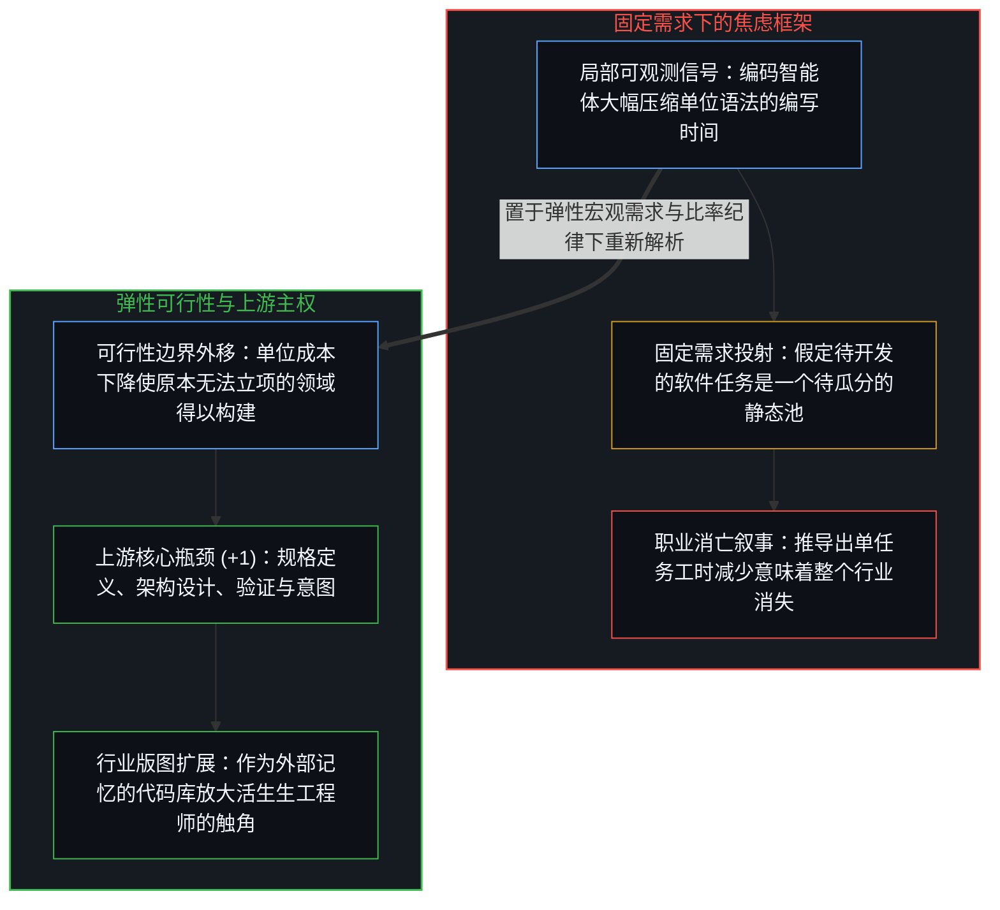
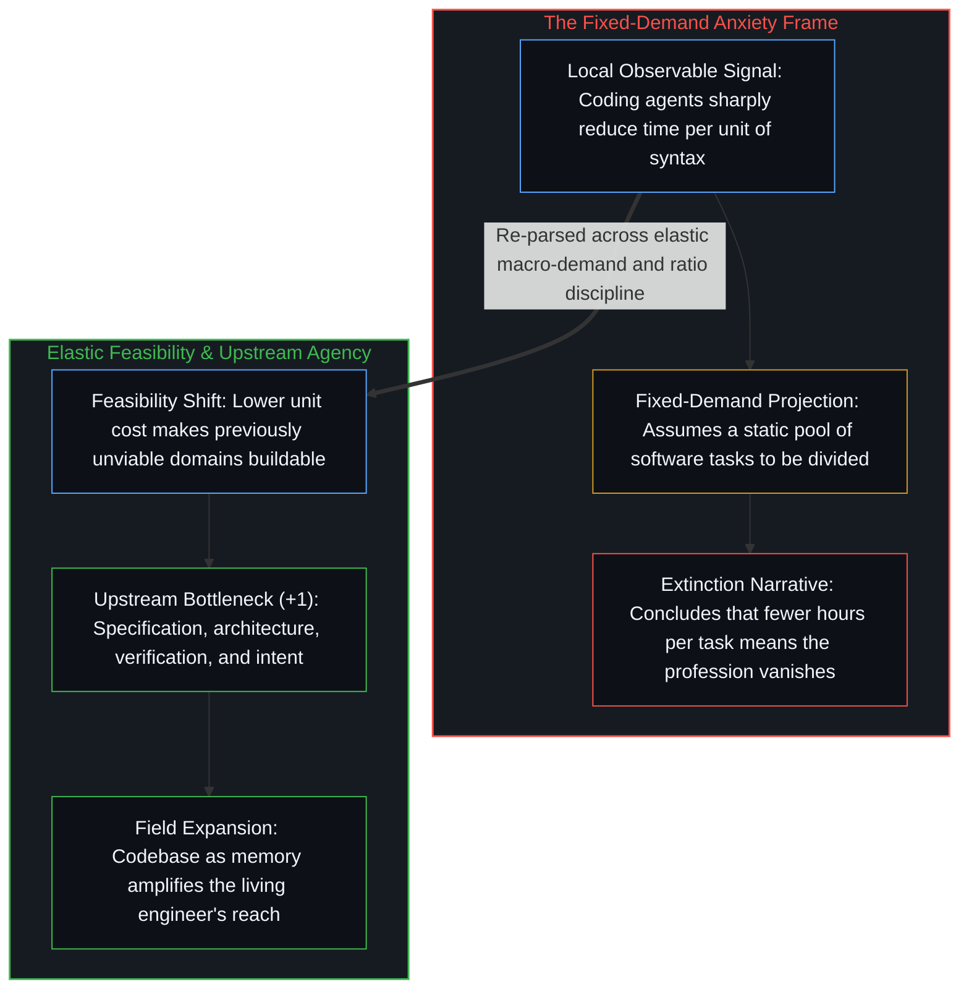

# AI 不会终结软件工程，而是将其扩展 / AI Won't Kill Software Engineering, It Will Expand It

*把固定需求下的微观效率叠合到宏观弹性之上，便会将工具放大误读为职业消亡。 / Collapsing micro-efficiency under fixed demand onto macro-elasticity mistakes tool amplification for extinction.*

软件工程界周期性蔓延的职业焦虑，将编码智能体的迅速崛起视作整个行业走向存续萎缩的信号。当一方警告自动化代码生成会让单名工程师顶替整个团队从而压缩岗位总量，而另一方援引杰文斯悖论并敦促工程师适应变化时，双方都捕捉到了可观测的变化，却又各自把截然不同的因果轴线压扁在了同一个框架之内：前者将微观层面的语法工时节省直接投射到固定的任务池上，后者则把宏观总量的需求弹性与工程判断力的质性重组混同为单一无差别的反弹。

Recurring waves of anxiety across the software engineering profession treat the rapid rise of coding agents as an existential contraction of the field. When one side warns that automating code generation lets a single engineer replace a team and shrinks total employment, while the other replies by invoking Jevons Paradox and urging engineers to adapt, both responses register observable shifts yet compress distinct causal axes into a single frame: the first projects micro-level syntax savings onto a fixed pool of tasks, while the second treats aggregate volume elasticity and the qualitative reorganization of engineering judgment as a single undifferentiated rebound.

## 一、 杰文斯悖论的透视折叠与可行性边界的外移 / 1. Jevons Paradox as Perspective Collapse and the Shifting Feasibility Boundary

杰文斯悖论——即效率的提升反而增加而非减少资源总消耗——之所以显得像个悖论，是因为把两个不同尺度上的投射强行叠合在了同一条轴线上，这一结构性混淆在[当丰裕看起来像稀缺](../when-abundance-looks-like-scarcity/)、[界面栈与命令行基底](../cli-interface-stack/)与[约束即基底与作为平台的个体](../constraints_are_ground/)中得到了拆解。在给定任务的微观轴上，效率提升意味着单位产出所需的投入下降，正如改良后的蒸汽机在每次冲程中耗煤更少；而在需求具备弹性的宏观轴上，单位成本的下降推动原本不具可行性的应用跨过门槛，激活全新的需求品类，最终使总体活动规模远超旧有基线。

Jevons Paradox—the observation that efficiency gains increase rather than decrease total resource use—only appears paradoxical when two distinct projections are forced onto one axis, a structural conflation examined in [When Abundance Looks Like Scarcity](../when-abundance-looks-like-scarcity/), [The Interface Stack](../cli-interface-stack/), and [Constraints Are Ground](../constraints_are_ground/). On the micro axis of a fixed task, higher efficiency reduces the input required per unit of output, just as an improved steam engine burns less coal per stroke. On the macro axis of elastic demand, lower unit cost pushes previously unviable applications across the feasibility threshold, unlocking new classes of demand until total activity expands far beyond the old baseline.

在软件工程领域，人工智能降低了单位形式化实现的成本。这一降本并未缩减对软件的需求，而是将可行性边界向外推移，使那些在传统工程预算下无法立项的定制化工具、自适应领域模拟与小众工作流纷纷跨过可行性门槛。把单个函数编码工时的微观缩减当成整个行业的宏观萎缩，是在缩减成本分母的同时把产出分子冻结为常数——这正是[没有区分的效率是没有存在的运动](../efficiency-without-differentiation/)所剖析的会计冻结——误将静态分饼的恒等式当成了未解问题的开放版图。

In software engineering, artificial intelligence lowers the cost per unit of formal implementation. That reduction does not shrink the need for software; it shifts the feasibility boundary outward so that bespoke tools, adaptive domain simulations, and niche workflows that could never justify a traditional engineering budget cross into viability. Treating the micro reduction in coding time per function as a macro contraction of the field holds the output numerator constant while shrinking the cost denominator—the exact accounting freeze dissected in [Efficiency Without Differentiation Is Movement Without Existence](../efficiency-without-differentiation/)—mistaking a fixed-slice identity for the open landscape of unsolved problems.

## 二、 供给创生新范畴与任务构成的迁移 / 2. Supply Generating New Categories and the Shift in Task Composition

“生产力创造自身的需求”这句简写必须追溯至其背后两条截然不同的因果机制，而不能任由它与杰文斯同质化的煤炭类比混压在一起。在行业层面上，可编程硬件问世之前，对软件工程师的需求为零——并非因为人类心智没有问题需要解决，而是因为借以表达那些解法的媒介尚不存在。从汇编语言到高级语言编译器、云基础设施乃至神经智能体，每一次跃迁都通过让此前尚未成形的问题变得可表述、可求解，从而创生出全新的需求范畴。

Saying that "productivity creates its own demand" is a shorthand that must be traced to its two distinct mechanisms rather than left compressed alongside Jevons's homogeneous coal analogy. At the field level, before programmable hardware existed, demand for software engineers was zero—not because human minds lacked problems, but because the medium to express those solutions did not yet exist. Every transition from assembly to high-level compilers, cloud infrastructure, and neural agents created new categories of demand by making previously unformulated problems articulable and solvable.

在这片不断扩展的版图内部，个体层面的工程工作并非单纯按体积放大的同质商品，其构成正沿着因果链向上游迁移。随着机械语法转译的成本下降，真正贬值的是既定形式化符号空间内部的下游遍历，而因果权重则向第一人称的驾驶位集中——即问题定界、领域分解、在鲜活摩擦中验证不变量以及方向裁决，正如[框架的倒置与驾驶位的主权非对称](../the-inversion-of-the-harness-and-the-driver-seat-asymmetry/)所追溯的那样。将这两条机制清晰剥离，便能同时看清为何整个行业会凭借新涌现的可行问题类别而持续扩张，以及为何工程师个体作为规格定义与判断的活生生源头始终不可或缺。

At the individual level within that expanding territory, engineering work is not a uniform commodity that simply scales in volume; its composition shifts upward along the causal chain. As rote syntax translation drops in cost, what cheapens is downstream traversal inside already-formalized symbol space, while causal weight concentrates in the first-person driver's seat—problem bounding, domain decomposition, invariant verification against live friction, and directional ruling, as [The Inversion of the Harness and the Sovereignty of the Driver's Seat](../the-inversion-of-the-harness-and-the-driver-seat-asymmetry/) traces. Keeping these two mechanisms distinct shows why the total field expands through newly feasible problem classes while individual engineers remain indispensable as the living origin of specification and judgment.

## 三、 比率纪律与上游瓶颈的解放 / 3. Ratio Discipline and the Liberation of the Upstream Bottleneck

引入比率纪律，便能用“耦合人工智能后的工程产出”与“旧有工具链下的工程产出”之比，取代非此即彼的“AI 替代工程师”框架。分母从来不是毫无工具辅助的徒手人类基线，它原本就是活生生的心智与前几代编译器、版本控制及开源库相耦合的产物。主动整合并驾驭智能体工作流的工程师会沿着变陡的曲线加速复利，而即便适应较慢的从业者，一旦更强的工具普及为标准环境，也会继承更高的基础设施底座——前提是他们主动迈出手工录入语法的旧瓶颈，而不是把昨日的瓶颈当作可囤积的静态专长存量来死守，这正是[判断力不是可囤积的存量](../judgment-is-not-a-stock/)所剖析的陷阱。

Applying ratio discipline replaces the binary "AI replaces engineers" frame with the ratio of engineering output coupled with artificial intelligence over engineering output under prior toolchains. The denominator was never an unassisted human baseline; it was already a living Mind coupled with earlier compilers, version control, and open-source libraries. Engineers who actively integrate agentic workflows compound faster along the steepening curve, while even slower adopters inherit a higher infrastructure floor once stronger tools diffuse into standard environments—provided they step off manual syntax entry rather than defending yesterday's bottleneck as a static stock of expertise, the trap dissected in [Judgment Is Not a Stock](../judgment-is-not-a-stock/).

从业者感受到的焦虑捕捉到了一个切近的信号——局部变化斜率陡峭，未经工具放大的语法生产正在失去溢价——但这一信号被输入了一个静态需求模型，从而把每一次效率提升都解读成了减法。软件工程从来不是由敲击样板词元所定义的；代码始终是将活生生的人类意图转译为形式化约束时的下游瓶颈制品，而正如[你的代码库即是记忆](../your-codebase-is-memory/)所确立的，代码库是外化的记忆检查点，唯有心智才是那道持续推进的移动边缘。将这一转译过程中最繁琐的表达环节自动化，并不会抹去核心职能，反而解放了用于规格定义、验证与构建的上游潜能，使其投向更广阔的疆域。

The anxiety felt by practitioners registers an immediate signal—the local slope of change is steep and unaugmented syntax production is losing its premium—processed through a static-demand model that reads every efficiency gain as a subtraction. Software engineering was never defined by typing boilerplate tokens; code was always the downstream bottleneck artifact of translating living human intent into formal constraints, and as [Your Codebase Is Memory](../your-codebase-is-memory/) establishes, the codebase is the externalized memory checkpoint while the Mind remains the sole moving edge. Automating the most tedious expression of that translation does not erase the core function; it frees the upstream capacity to specify, verify, and build across a wider horizon.
