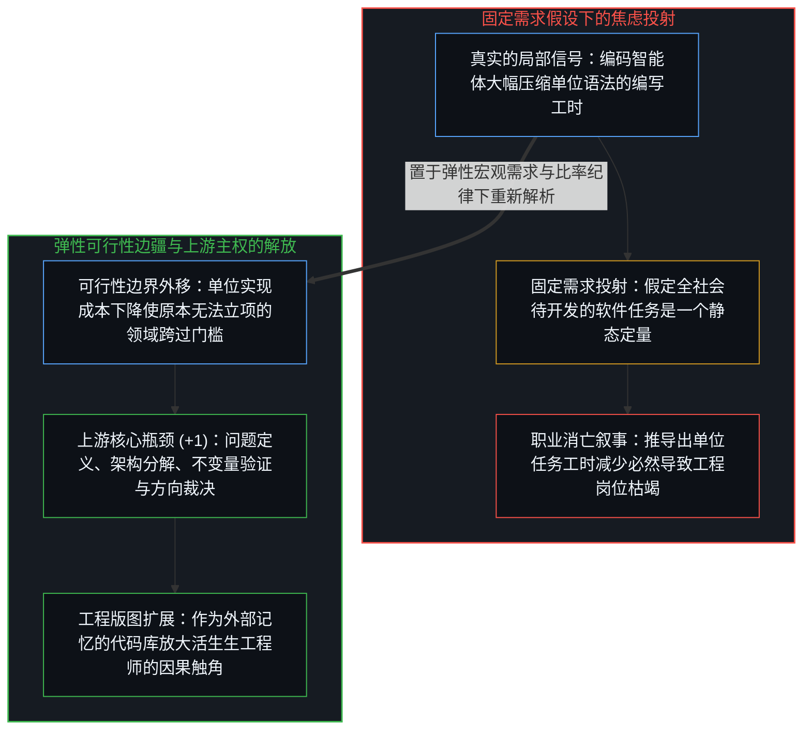
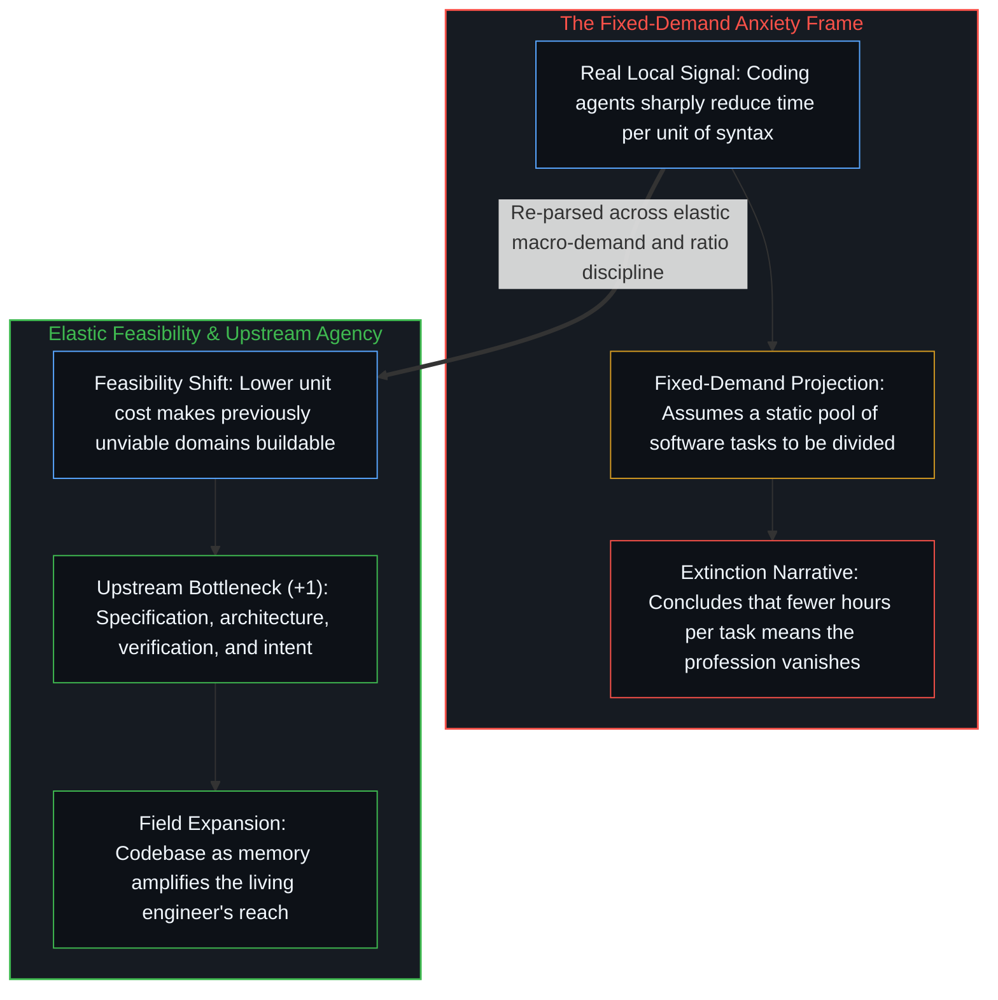

# AI 不会终结软件工程，而是将其扩展 / AI Won't Kill Software Engineering, It Will Expand It

*把固定需求的微观效率叠合到弹性需求的宏观空间，才会将工具放大差误读为职业消亡。 / Collapsing micro-efficiency under fixed demand onto macro-elasticity mistakes tool amplification for extinction.*

软件工程界周期性蔓延的职业焦虑，将编码智能体的崛起视作整个行业走向萎缩的终局信号。当一方担忧自动化代码生成让单名工程师顶替整个团队从而压缩岗位总量，而另一方援引杰文斯悖论敦促从业者升级技能时，双方都触及了真实的局部信号，却又各自把不同维度的因果机制压扁在了同一条坐标轴上。

Recurring waves of anxiety across the software engineering profession treat the rapid rise of coding agents as an existential contraction of the field. When one side warns that automating code generation lets a single engineer replace a team and shrinks total employment, while the other replies by invoking Jevons Paradox and urging engineers to adapt, both responses touch real signals yet compress distinct causal axes into a single frame.

## 一、 杰文斯悖论的透视折叠与可行性边界的外移 / 1. Jevons Paradox as Perspective Collapse and the Shifting Feasibility Boundary

杰文斯悖论——即效率的提升反而增加而非减少资源总消耗——之所以显得像个悖论，是因为把两个不同尺度上的投射强行叠合在了同一条轴线上，这一结构性混淆在[当丰裕看似稀缺](../when-abundance-looks-like-scarcity/)、[界面栈与命令行基底](../cli-interface-stack/)与[约束即基底与作为平台的个体](../constraints_are_ground/)中得到了拆解。在给定任务的微观轴上，效率提升意味着单位产出所需的投入下降，正如改良后的蒸汽机在每次冲程中耗煤更少；而在需求具备弹性的宏观轴上，单位成本的下降推动原本不具经济可行性的应用跨过门槛，激活全新的需求品类，最终使总体活动规模远超旧有基线。

Jevons Paradox—the observation that efficiency gains increase rather than decrease total resource use—only appears paradoxical when two distinct projections are forced onto one axis, a structural conflation examined in [When Abundance Looks Like Scarcity](../when-abundance-looks-like-scarcity/), [The Interface Stack](../cli-interface-stack/), and [Constraints Are Ground](../constraints_are_ground/). On the micro axis of a fixed task, higher efficiency reduces the input required per unit of output, just as an improved steam engine burns less coal per stroke. On the macro axis of elastic demand, lower unit cost pushes previously unviable applications across the feasibility threshold, unlocking new classes of demand until total activity expands far beyond the old baseline.

在软件工程领域，人工智能降低了单位形式化实现的成本。这一降本并未缩减世界对软件的需求，而是将可行性边界大幅外推：那些在传统研发预算下过于昂贵、过于繁复或过于小众的定制化工具、动态领域模拟与长尾工作流，纷纷跨过可行性门槛。把单个函数编码工时的微观缩减直接外推为整个行业的宏观萎缩，是将静态分饼的会计恒等式误当成了未解问题空间的真实边疆。

In software engineering, artificial intelligence lowers the cost per unit of formal implementation. That reduction does not shrink the need for software; it shifts the feasibility boundary outward so that bespoke tools, adaptive domain simulations, and niche workflows that could never justify a traditional engineering budget cross into viability. Treating the micro reduction in coding time per function as a macro contraction of the field mistakes a fixed-slice accounting identity for the open landscape of unsolved problems.

## 二、 供给创生新范畴与任务结构的迁移 / 2. Supply Generating New Categories and the Shift in Task Composition

“生产力创造自身的需求”这句格言若只停留在压缩口号层面，便容易掩盖其底下两条截然不同的运行机制。在行业广度层面，可编程计算机问世之前，社会对软件工程师的需求为零——并非因为人类的心智没有亟待解决的问题，而是因为借以表达那些解法的媒介尚不存在。从汇编语言到高级语言编译器、云基础设施乃至今日的智能体，每一次生产力跃迁都不是在更快地消耗一份固定的存量需求清单，而是通过让此前无法构想的应用变得可构想、可实现，从而创生出全新的需求范畴。

Saying that "productivity creates its own demand" is a shorthand that must be traced to its two distinct mechanisms rather than left compressed. At the field level, before programmable hardware existed, demand for software engineers was zero—not because human minds lacked problems, but because the medium to express those solutions did not yet exist. Every transition from assembly to high-level compilers, cloud infrastructure, and neural agents created new categories of demand by making previously unformulated problems articulable and solvable.

在不断扩展的行业内部，个体工程工作的任务构成则沿着因果链向上游迁移。随着机械语法转译的边际成本趋近于零，因果权重愈发集中于问题定界、架构演进、不变量验证与方向裁决。将这两条机制清晰剥离，便能同时看清为何软件工程的总体疆域会因新可行域的涌现而持续扩张，以及为何工程师个体作为规格定义与价值判断的活生生源头不会沦为冗余。

At the individual level within that expanding territory, the composition of engineering work shifts upward. As rote syntax translation drops in cost, causal weight concentrates in architecture, domain decomposition, invariant verification, and creative direction. Keeping these two mechanisms distinct shows why the total field expands through newly feasible problem classes while individual engineers remain indispensable as the living origin of specification and judgment.

## 三、 比率纪律与上游瓶颈的解放 / 3. Ratio Discipline and the Liberation of the Upstream Bottleneck

引入比率纪律，便能用“耦合人工智能后的工程产出”与“旧有工具链下的工程产出”之比，取代非此即彼的“AI 替代工程师”框架。分母从来就不是毫无工具辅助的赤手空拳状态，它本身就是前几代编译器、版本控制与开源库复利叠加的产物。主动驾驭智能体工作流的工程师沿着陡峭的斜率加速复利，而即便适应较慢的从业者，也会随着新型工具沉淀为基础底座而受惠于整体能力水位的抬升。

Applying ratio discipline replaces the binary "AI replaces engineers" frame with the ratio of engineering output coupled with artificial intelligence over engineering output under prior toolchains. The denominator was never an unassisted human baseline; it was already the product of earlier compilers, version control, and open-source libraries. Engineers who actively integrate agentic workflows compound faster along the steepening curve, while even slower adopters ride a rising infrastructure floor as stronger tools diffuse into standard practice.

从业者感受到的震荡来自一个真实的信号——局部变化斜率陡增，未加工具放大的纯手工代码编写正在失去溢价——但这一信号被输入了一个假定需求静态守恒的错误模型，从而把每一次效率跃升都解读成了生存空间的减法。软件工程的核心从来不是敲击样板语法；代码只是将心智的活生生意图转译为形式约束时的下游瓶颈制品，而正如[你的代码库即是记忆](../your-codebase-is-memory/)所确立的，代码库是沉淀既往区分的外部记忆检查点，真正持续劈开下一步的始终是心智这道移动边缘。将转译过程中最繁琐的表达环节自动化，非但没有抹去工程的核心职能，反而将定义、验证与构建的上游主权解放出来，使其投向更广阔的未知疆域。

The anxiety felt by practitioners registers a genuine signal—the local slope of change is steep and unaugmented syntax production is losing its premium—processed through a static-demand model that reads every efficiency gain as a subtraction. Software engineering was never defined by typing boilerplate tokens; code was always the downstream bottleneck artifact of translating living human intent into formal constraints, and as [Your Codebase Is Memory](../your-codebase-is-memory/) establishes, the codebase is the externalized memory checkpoint while the Mind remains the sole moving edge. Automating the most tedious expression of that translation does not erase the core function; it frees the upstream capacity to specify, verify, and build across a wider horizon.
