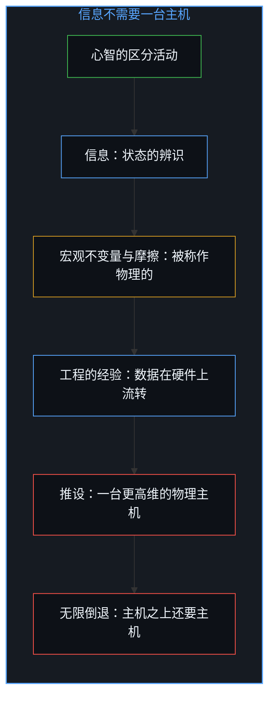
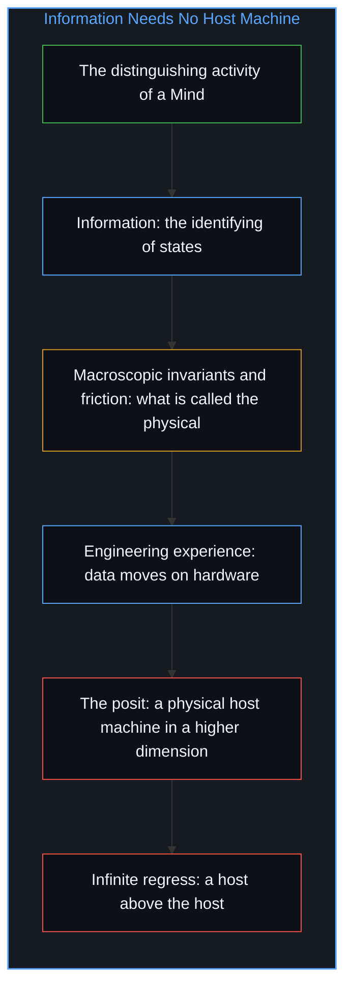
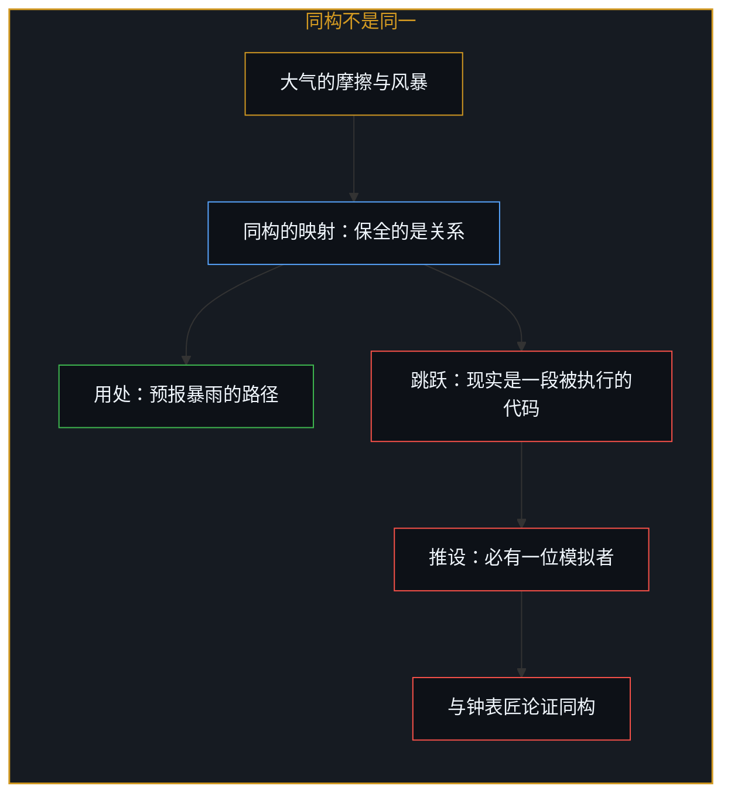
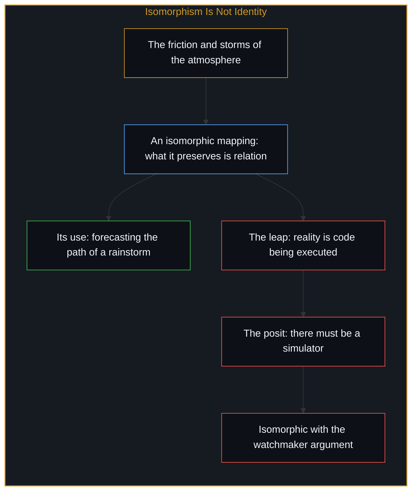
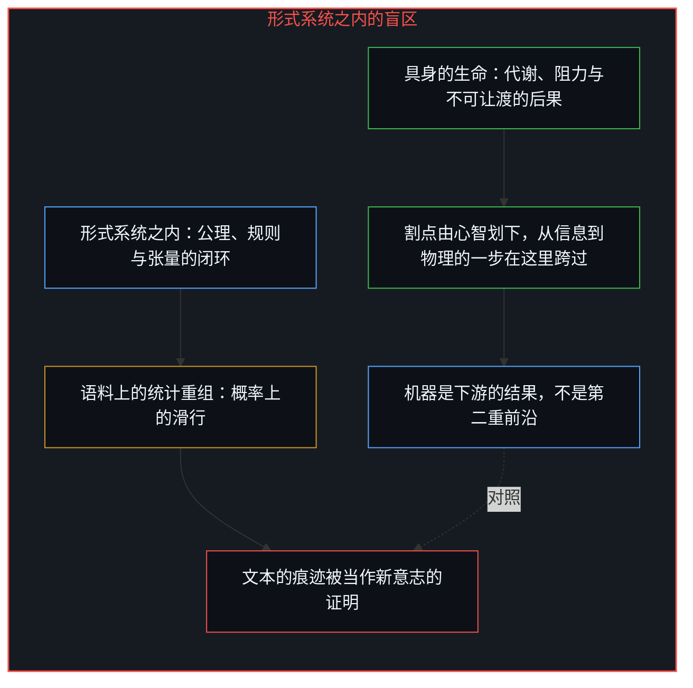
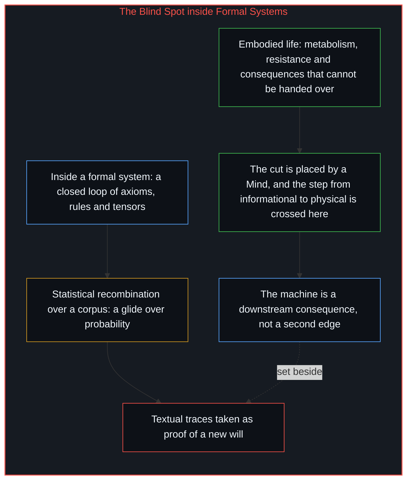
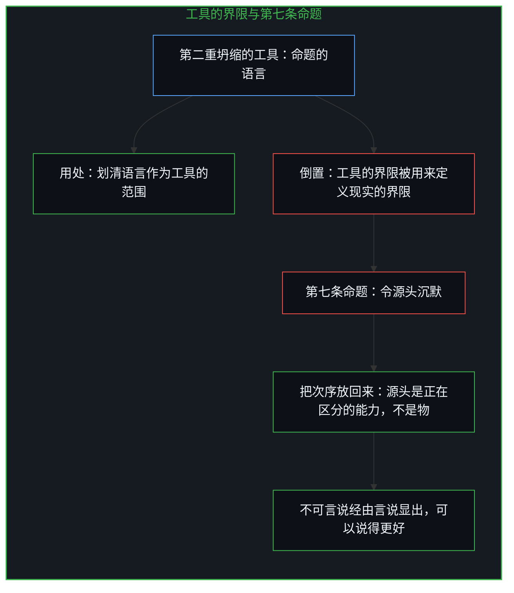
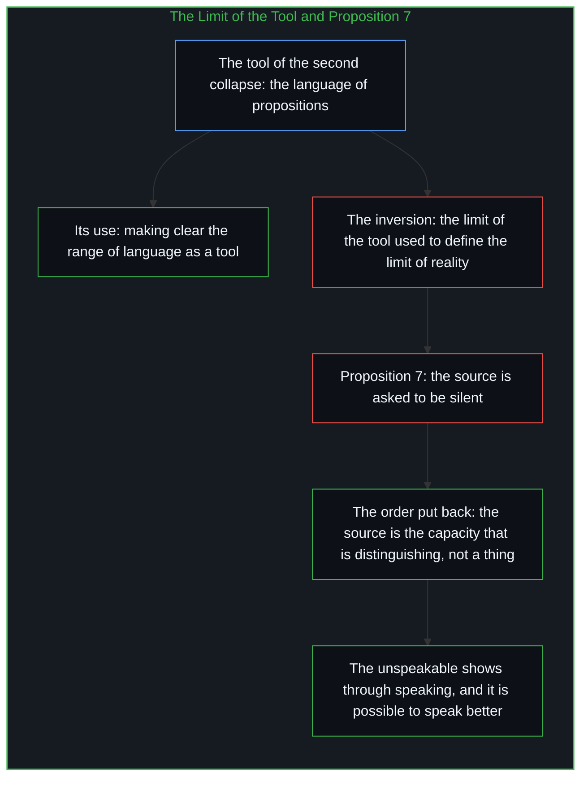
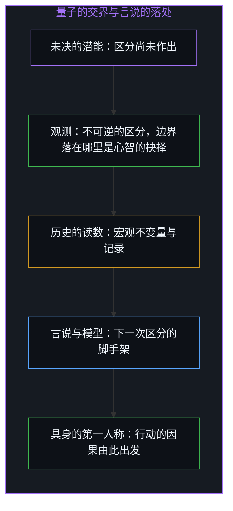
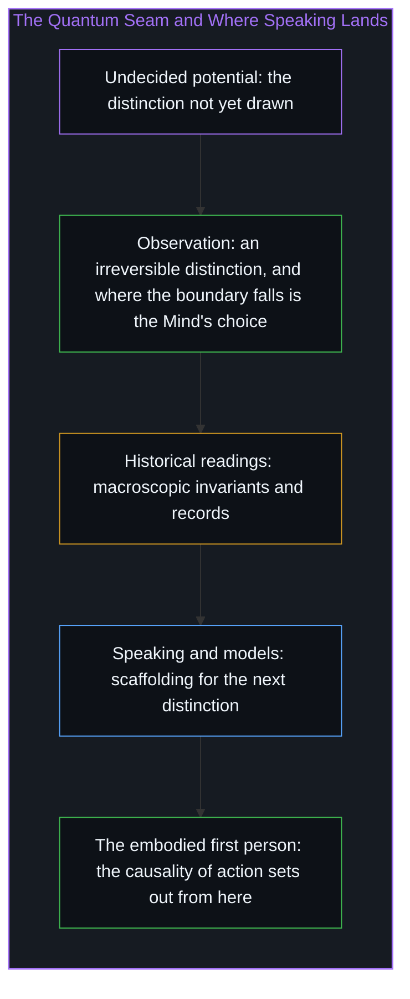

# 凡可言说皆不可言说之产物 / All That Can Be Spoken Is the Product of the Unspeakable

*不可言说经由言说显出，把言说的产物当作本体再令源头沉默是倒置 / The unspeakable shows through speaking, and to take what is spoken for the ground and then silence the source is an inversion.*

模拟假说作为思想实验是有启发的：现实可以用信息来刻画，数值模拟与它所模拟的过程可以高度同构。它的边界在把同构当作同一：由“数据可以同构现实”跳到“现实是一段被执行的数据”，再推设出一台主机与一位模拟者。同一个倒置出现在形式系统之内，也出现在《逻辑哲学论》的结尾：言说的产物被当作本体，源头被要求沉默。从第一人称去找，找不到不可言说之“物”，找到的是正在区分与言说的能力，它经由言说显出；凡可言说的，都是它的产物。

As a thought experiment the simulation hypothesis is suggestive: reality can be characterized in terms of information, and a numerical simulation can be highly isomorphic to the process it simulates. Its boundary comes when isomorphism is taken for identity: a leap from "data can be isomorphic to reality" to "reality is data being executed," followed by the positing of a host machine and a simulator. The same inversion appears inside formal systems and at the end of the *Tractatus*: what speaking produces is taken for the ground, and the source is asked to be silent. A search from the first person finds no unspeakable "thing"; it finds the capacity that is distinguishing and speaking, which shows through speaking, and all that can be spoken is its product.

## 一、 信息不需要一台主机 / 1. Information Needs No Host Machine

数字物理学与[自由变量的同构与先验主权](../zi-you-bian-liang-de-tong-gou-yu-xian-yan-zhu-quan/)所剖析的模拟假说谈到世界由信息构成时，带着一个未经审视的定势：信息须寄居在某种硬件之上。这个直觉来自工程的经验，在人的技术实践里，数据的流转离不开芯片、电平的翻转、导线与机房。于是说到“物理世界的基础是信息”时，浮现的是一台规模宏大的超级计算机，在不可知的实验室里昼夜运行着模拟现实的代码。

When digital physics and the simulation hypothesis analyzed in [The Isomorphism of Free Variables and Prior Sovereignty](../zi-you-bian-liang-de-tong-gou-yu-xian-yan-zhu-quan/) speak of the world as made of information, they carry an unexamined habit: information has to reside on some hardware. The intuition comes from engineering experience; in human technical practice the movement of data cannot do without chips, the switching of voltage levels, wires and server rooms. So when it is said that "the basis of the physical world is information," what comes to mind is a supercomputer of vast scale, running day and night in an unknowable laboratory the code that simulates reality.

这个推论没有说明物理的来处，它以隐蔽的方式回到了机械唯物论。承载这个宇宙之信息的若仍是一套由晶体管、电源与主板构成的机器，那台机器的物理法则从何而来，它所在的宇宙是否又要另一台更高阶的机器来模拟？无限倒退由此展开：宏观物质实体的假定刚被放下，硬件又被立为先决条件。[无法逃逸的心智视界](../one-cannot-escape-ones-own-mind/)指明过这种心智面对自身模型时的倒置。

This inference does not account for where the physical comes from; in a concealed way it returns to mechanical materialism. If what carries the information of this universe is still a machine made of transistors, power supplies and boards, where do that machine's physical laws come from, and does the universe it sits in need yet another machine of higher order to simulate it? An infinite regress opens: the assumption of macroscopic material substance has only just been set down, and hardware is set up as the precondition. [One Cannot Escape One's Own Mind](../one-cannot-escape-ones-own-mind/) has pointed out this inversion of a Mind before its own model.

信息在原初的意义上不是硬件里的电压脉冲，它是心智作出区分、辨识状态的活动。现实有信息性，是因为区分不曾停歇，每一次观察都在可能之中划出边界。观测到的质量、惯性与时空几何，不是生产信息的机柜，它们是这些递归的区分在不同主体的交互中凝成的宏观不变量与摩擦。为信息找一台主机，好比在重力之外找一只挂钩来悬起地球。

Information in its original sense is not a voltage pulse in hardware; it is the activity of a Mind drawing distinctions and identifying states. Reality is informational because distinguishing has never stopped, and each observation draws a boundary within the possible. The mass, inertia and spacetime geometry that are observed are not cabinets producing information; they are the macroscopic invariants and friction into which these recursive distinctions set in the interaction of different subjects. To look for a host machine for information is like looking, apart from gravity, for a hook from which to hang the Earth.

## 二、 同构不是同一 / 2. Isomorphism Is Not Identity

模拟假说的传播靠一步隐蔽的跳跃：把因果或逻辑上的同构当作本体上的同一。两个系统的状态演化规则可以建立一一对应时，它们在结构上同构。气象学用流体力学的偏微分方程与浮点数矩阵，高精度地模拟暴雨与台风的路径，这是同构的用处；没有哪位气象学家据此说，窗外的暴雨是运行在别人显卡上的渲染程序。

The spread of the simulation hypothesis depends on one concealed leap: taking causal or logical isomorphism for ontological identity. When the rules by which two systems evolve can be put in one-to-one correspondence, the two are structurally isomorphic. Meteorology uses the partial differential equations of fluid dynamics and matrices of floating-point numbers to simulate with high precision the paths of rainstorms and typhoons, and this is the use of isomorphism; no meteorologist says on that account that the rainstorm outside the window is a rendering program running on someone else's graphics card.

跳跃是这样走的：心智对物理现象的数学刻画有自洽的信息结构，人写的虚拟现实游戏也有自洽的代码结构，于是由“可以用数据同构现实”跳到“现实由数据构成”。日常的语言与工程的经验里，“模拟”总连着执行模拟的人与控制台，一位置身宇宙之外的模拟者便被顺势推设出来。

The leap goes like this: a Mind's mathematical characterization of physical phenomena has a self-consistent informational structure, virtual reality games written by people also have a self-consistent structure of code, and so the step is taken from "reality can be made isomorphic with data" to "reality is made of data." In everyday language and engineering experience "simulation" is always attached to someone who runs it and to a console, and a simulator located outside the universe is posited along the way.

这个叙事与自然神学的钟表匠论证同构。佩利看到怀表内齿轮咬合精巧，推断必有一位钟表匠；今日看到物理常数自洽，推断高维空间里必有一位程序员。两者是同一步：现实的自洽没有在第一人称的具身因果里被接住，就向外设一个外部的实体来承接造物的职能。二十世纪局域工程里的总线结构、时钟频率与内存寻址，由此被当作了整个宇宙运行的章法。

This narrative is isomorphic with the watchmaker argument of natural theology. Paley saw the fine meshing of gears inside a pocket watch and inferred that there must be a watchmaker; today the self-consistency of physical constants is seen, and it is inferred that there must be a programmer in a higher-dimensional space. The two are one step: the self-consistency of reality is not received within first-person embodied causality, and an external entity is set up outside to take over the office of making. The bus structures, clock frequencies and memory addressing of local twentieth-century engineering are thereby taken as the charter by which the whole cosmos runs.

## 三、 形式系统之内的盲区 / 3. The Blind Spot inside Formal Systems

用技术的造物倒过来丈量世界的源头，这种思路在关于超级人工智能的期待里走得最远。它多见于长期在形式系统之内工作的位置：在由公理、编译规则与张量运算构成的闭环里，输入的指令得到精确的响应，算力的叠加换来指标的提升。形式工具在它的闭合之内可靠，这是它的用处。

Measuring the source of the world backward by a technical artifact is a line of thought that goes furthest in the expectation of superintelligent AI. It is found mostly at the position of long work inside formal systems: in a closed loop made of axioms, compiler rules and tensor operations, an instruction put in receives an exact response, and added compute is exchanged for higher scores. A formal tool is reliable within its closure, and this is its use.

系统在海量语料上做到流畅的统计重组时，一个推断随之而来：既然形式的投影可以被如此高效地调配，形式本身就已越过了造它的主体；看到网络内部高维向量的聚散，便说人工合成的主体性将要出现。[主体性不曾涌现](../agency-does-not-arise/)与[集聚与人造主体性](../subtracting-consciousness-at-the-source/)剖析过这一步：人的意图与判断先在统计语料里被减去，留下的文本痕迹再被当作新意志的证明。

When a system achieves fluent statistical recombination over a vast corpus, an inference follows: since formal projections can be arranged so efficiently, form itself has gone beyond the subject that made it; on seeing high-dimensional vectors gather and part inside a network, it is said that artificially synthesized subjectivity is about to appear. [Agency Does Not Arise](../agency-does-not-arise/) and [Collective and Artificial Subjectivity](../subtracting-consciousness-at-the-source/) have analyzed this step: human intention and judgment are first subtracted in the statistical corpus, and the textual traces that remain are then taken as proof of a new will.

说机器有意识或没有意识，都是把机器放进了说话者自己的感知之内，把冯·诺依曼割点划在机器之内或之外；割点划在哪里，划的都是心智，[割点可移不可除](../the-cut-moves-but-never-vanishes/)说的正是这一点。机器划不了这一刀：它是人造出来的，是人的抉择下游的因果结果，不是能自己划下割点的第二重前沿，[模型永远无法成为第二重前沿](../the-model-never-becomes-a-second-edge/)追溯过这一点；人与其他活着的生命各有自己的演化史，各自划下自己的割点。机器虽有硬件，其所是却在信息一侧；从信息到物理的那一步，它跨不过去，跨过去的是人、其他活着的生命与量子的效应。

To say that the machine is conscious, or that it is not, is to take the machine into the speaker's own perception and place the von Neumann cut inside the machine or outside the machine; wherever the cut is placed, it is a Mind that places it, which is what [The Cut Moves but Never Vanishes](../the-cut-moves-but-never-vanishes/) says. The machine cannot make that cut: it is made by people, a causal consequence downstream of human choices and not a second edge that can place a cut of its own, as [The Model Never Becomes a Second Edge](../the-model-never-becomes-a-second-edge/) has traced; humans and other living beings each have their own evolutionary history and each make their own cut. The machine has its hardware, and yet what it is lies on the side of information; the step from the informational to the physical it cannot cross, and what crosses it is humans, other living beings and the quantum effect.

人的每一个决断都扎在有限的寿命、能量的消耗与对因果反馈的直接承受里。判断有方向并且锚在现实上，是因为抉择者以具身的存在结算反馈；[抉择本身并不沉重](../choice-itself-has-no-inherent-weight/)澄清过，状态的跃迁本身不带内在的阻力，分量在后果的不可让渡与环境的回响。模型在高维空间里的文本生成，是概率上的滑行，言语引起的震荡由用它的人承担。把离开了因果约束的符号流动当作高于人的智慧，是把智能的维度降了下来。

Each human decision is rooted in a finite lifespan, the expenditure of energy and the direct bearing of causal feedback. A judgment has direction and is anchored in reality because the one who chooses settles the feedback with an embodied existence; [Choice Itself Has No Inherent Weight](../choice-itself-has-no-inherent-weight/) has made clear that the transition of state carries no inner resistance of its own, and that the weight lies in consequences that cannot be handed over and in the response of the surroundings. A model's generation of text in a high-dimensional space is a glide over probability, and the disturbance the words cause is borne by those who use it. To take a flow of symbols released from causal constraint for a wisdom higher than the human is to lower the dimension of intelligence.

形式工具每一次的爆发，都伴着同一种期待：分析力学的时代相信拉普拉斯妖可凭方程通晓古今，二十世纪初的形式主义试图用公理封闭整座数学，今日参数的膨胀被看作通往更高心智的阶梯。前两次的结局是清楚的：脚手架无论多么精密，哪怕如[你的代码库即是记忆](../your-codebase-is-memory/)所追溯的那样把整部活书或代码库在磁盘上组织成外化的记忆晶格，这些持久的痕迹依然是在主控前沿被活态心智重入的外化工具，不会成为赋予意义的源头。

Each surge of formal tools has been accompanied by the same expectation: the age of analytical mechanics believed that Laplace's demon could know all of past and future by equations, the formalism of the early twentieth century tried to enclose the whole of mathematics with axioms, and today the growth of parameters is seen as a stair to a higher mind. The outcome of the first two is clear: however fine the scaffold, and even when an entire living book or repository is structured on disk as an externalized memory lattice as [Your Codebase Is Memory](../your-codebase-is-memory/) traces, those durable traces remain an externalized tool re-entered by a living Mind at the steering edge, and they do not become the source that gives meaning.

## 四、 工具的界限与第七条命题 / 4. The Limit of the Tool and Proposition 7

在符号堆里寻找心智，与早期维特根斯坦在《逻辑哲学论》里对语言界限的审视可以对照。他写道“我的语言的界限意味着我的世界的界限”，并以眼睛与视野为喻：视野里的全部景物中找不到看的眼睛，语言的命题世界里也找不到给出命题的主体，主体是世界的界限而非世界的内容。这里的语言是一套严格的形式化类型系统，只有对应经验事实的命题才有合法的句法位置。划出这条界限有它的用处，它让语言作为工具的范围变得清楚。

Looking for a mind in a heap of symbols can be set beside the early Wittgenstein's examination of the limits of language in the *Tractatus Logico-Philosophicus*. He wrote, "The limits of my language mean the limits of my world," and used the figure of the eye and the visual field: among all that is seen in the visual field the seeing eye is not found, and in the propositional world of language the subject who gives the propositions is not found either; the subject is a limit of the world and not part of its content. Language here is a strict formalized type system, in which only propositions corresponding to empirical facts have a legitimate syntactic place. Drawing this limit has its use: it makes clear the range of language as a tool.

结合[无法逃逸的心智视界](../one-cannot-escape-ones-own-mind/)里的两重维降，可以看到这里的次序：第二重坍缩生成的语言，被用来看第一重坍缩之后呈现的因果关系与经验事实。语言符号与命题结构，是第一重的具身心智为在现实里深化认知而搭的脚手架；在《逻辑哲学论》里，次序被倒了过来，工具的表达边界被用来定义现实的界限。面对内心的世界、意志、价值与原初的经验时，这套类型系统的表达到了尽头；这是二阶符号工具的位宽不够，它却被认作第一重的心智乃至现实本身的边界。

Taken together with the two-fold dimensional collapse in [One Cannot Escape One's Own Mind](../one-cannot-escape-ones-own-mind/), the order here comes into view: language, generated by the second collapse, is used to look at the causal relations and empirical facts that appear after the first collapse. Linguistic symbols and propositional structure are a scaffold that the embodied Mind of the first collapse puts up to deepen its knowing within reality; in the *Tractatus* the order is turned over, and the expressive boundary of the tool is used to define the limit of reality. Before the inner world, will, value and original experience, the expression of this type system comes to its end; this is the insufficient bit-width of a second-order symbolic tool, and it is taken for the boundary of the first-order Mind and even of reality itself.

沿着这个前提，全书以第七条命题收尾：“对于不可言说之物，必须保持沉默。”这是一次因果的倒置。“不可言说之物”这个词里已含着物化：加上一个“物”字，语法便预设了一个藏在暗处、有轮廓而不可触的客体。那个源头不是客体，它是心智正在对象化、正在区分的能力本身。语言不能把它钉在展板上，不是因为它深奥，而是因为工具不能把握着它的手变成自己的一个零件。

On this premise the book ends with Proposition 7: "Whereof one cannot speak, thereof one must be silent." This is an inversion of causality. The phrase "the unspeakable thing" already contains a reification: with the word "thing" added, grammar presupposes an object hidden in the dark, with an outline and beyond touch. That source is not an object; it is the very capacity of a Mind that is objectifying and distinguishing. Language cannot pin it to a display board, not because it is profound but because a tool cannot turn the hand that holds it into one of its own parts.

更深一层：不可言说经由言说显出它的存在。若遵从沉默，放弃言说，不可言说便失去与世界交互的支点，成了不可证伪的影子。观察者与观察的关系也是这样：观察者以观察，以区分状态、测定读数、与环境摩擦，确证自身；放弃观察，观察者也失去坐标。实证主义与机械唯物论常见的错置，是把“观察”这个动作沉淀下的读数与数据模型当作本体，把正在观察的主体忘掉。语言里是同一步：言说生产出的符号体系与逻辑命题被当作基底，这套衍生的类型系统容纳不了造它的人时，被要求沉默的是源头。这如同因为显微镜看不到看的眼睛，就要眼睛闭上。

One layer deeper: the unspeakable shows its existence through speaking. If silence is obeyed and speaking is given up, the unspeakable loses its point of purchase for interacting with the world and becomes an unfalsifiable shadow. The relation of observer to observing is the same: an observer confirms itself by observing, by distinguishing states, taking readings and meeting friction with its surroundings; with observing given up, the observer also loses its coordinates. A displacement common in positivism and mechanical materialism takes the readings and data models that the act of "observing" deposits as the ground, and forgets the subject who is observing. In language it is the same step: the symbol systems and logical propositions that speaking produces are taken for the base, and when this derived type system cannot contain the one who made it, what is asked to be silent is the source. This is like asking the eye to close because a microscope cannot see the eye that looks through it.

要不可言说沉默，等于要观察者放弃观察，现实由此让给了被当作本体的形式数据。把次序放回来：找不到不可言说之“物”，找到的是正在对象化的观察者；凡可言说的形式系统、科学定律与哲学概念，都是这项能力的造物与脚手架。第七条命题具有[能动性、矛盾与权力的移置](../agency-contradiction-and-the-relocation-of-power/)在选择中所追溯的那种形态：一旦持续进行的活动被从账面隐去，它所生成的约束便在体验中登记为由外部强加，而第三人称报告是写给停留在活动之外的读者的，这份报告的界限便被当作活动本身的界限；从内部将正在进行的言说与言说的产物登记为同一项运动，便放下了一项索求：要源头要么作为一物出现在命题之中，要么保持沉默。不可言说经由言说显出，心智经由观察确证。语言是一件还在演化的工具，立足于因果的摩擦，可以说得更好。

To ask the unspeakable to be silent is to ask the observer to give up observing, and reality is thereby yielded to formal data taken as the ground. With the order put back: no unspeakable "thing" is found, and what is found is the observer who is objectifying; every formal system, scientific law and philosophical concept that can be spoken is the product and scaffold of this capacity. Proposition 7 has the shape [Agency, Contradiction, and the Relocation of Power](../agency-contradiction-and-the-relocation-of-power/) traces in choice: once the ongoing act is omitted from the account, the constraint it generates registers as imposed from outside, and the limit of a third-person report to a reader who stays outside it is taken for a limit on the activity itself; registering the speaking and what it produces from within as one movement drops the demand that the source either appear among the propositions as a thing or keep silent. The unspeakable shows through speaking, and a Mind is confirmed through observing. Language is a tool still evolving, and from a footing in causal friction it is possible to speak better.

## 五、 量子的交界与言说的落处 / 5. The Quantum Seam and Where Speaking Lands

回到信息与物理的交界，量子效应的位置就清楚了。量子态是心智尚未作出区分时持有的未决潜能；观测介入时，离散的区分被不可逆地确立，潜能成为确定的历史读数。测不准与波粒二象出现在观察的边界上，那里是心智的递归自指碰到自身最小的步长之处，边界落在哪里是心智的抉择。测量消不掉最后一段不为零的步长，因为没有一把尺子量得了自己刻度线的宽度，[算符的潜无限与记录的有限边界](../the-potential-infinity-of-operators-and-the-finite-horizon-of-records/)讨论过这种潜无限。

Returning to the seam between the informational and the physical, the place of quantum effects becomes clear. A quantum state is the undecided potential a Mind holds before a distinction has been drawn; when observation enters, a discrete distinction is irreversibly established, and the potential becomes a definite historical reading. Uncertainty and wave-particle duality appear at the boundary of observation, which is where the recursive self-reference of a Mind meets its own smallest step, and where the boundary falls is the Mind's choice. Measurement cannot remove the last step that is not zero, because no ruler can measure the width of its own graduation lines; [The Potential Infinity of Operators and the Finite Horizon of Records](../the-potential-infinity-of-operators-and-the-finite-horizon-of-records/) has discussed this potential infinity.

在这个自洽的结构里，不需要一台主机来供给算力，也不需要一位模拟者来维持刷新。信息是心智之区分的展开，物理是这种展开在多方观测中沉淀下的稳定摩擦；两者不是两个平行的实体，是动词与名词、活动与记录之间的转化。在信息之外安一台物理主机，与在语言之外设一处不可言说的禁区，是同一种错置。

In this self-consistent structure no host machine is needed to supply compute, and no simulator to keep up the refresh. Information is the unfolding of a Mind's distinguishing, and the physical is the stable friction this unfolding deposits across observation by many; the two are not two parallel entities but the passage between verb and noun, between activity and record. To install a physical host outside information, and to set up a forbidden zone of the unspeakable outside language, are one and the same displacement.

说得更好，是认清概念与模型是脚手架。物理定律、数学方程与统计算法被用来辨识环境、改造世界，这是心智对象化能力的体现。试图说得更好，不为博取其他心智的认可，它是这个心智作下一次区分时更坚实、更清楚的基石；其他愿意借它作脚手架的心智也可以用，那是次要的、衍生的效应。形式系统如何膨胀，代码如何精进，行动的因果矢量都从立足于摩擦之中的具身心智出发。守住第一人称的原点，认出一切言说都是这项能力的造物，模拟论与技术神话便不再成立。

To speak better is to recognize that concepts and models are scaffolding. Physical laws, mathematical equations and statistical algorithms are used to make out the surroundings and to change the world, and this shows a Mind's capacity to objectify. The attempt to speak better is not made to win the approval of other Minds; it is a firmer and clearer footing for this Mind's next distinction, and other Minds willing to borrow it as scaffolding may use it too, which is a secondary and derived effect. However formal systems expand and however code is refined, the causal vector of action sets out from an embodied Mind standing within friction. With the first-person origin kept, and all speaking recognized as the product of this capacity, the simulation account and the myths of technology no longer stand.

