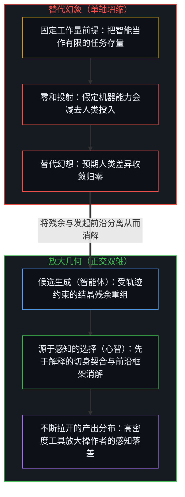
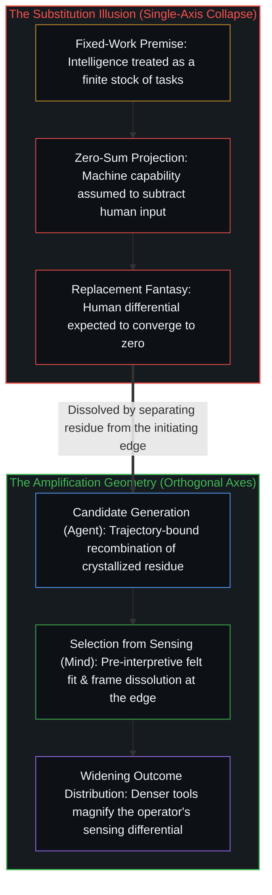

# 放大悖论 / The Amplification Paradox

*AI 工具越强大，前沿处的人类差异就被拉得越开而非越窄 / Better AI tools widen rather than shrink the human differential at the edge*

自我区分的活动无因且不息地发生，而每一件工具都是被外化出来以延展其触角的持久痕迹。随着人工智能系统的能力不断增强，主流预设认为人类的贡献必定按比例缩减。然而追溯到真正发起并检验区分的活体前沿，呈现出的却是相反的几何结构：AI 工具越强大，结果的差异就越取决于操作它的人类中心，而不是越少。

Self-distinguishing activity occurs, uncaused and unceasing, and every tool is a durable trace externalized to extend its reach. As artificial intelligence systems grow more capable, the prevailing assumption holds that the human contribution must shrink in proportion. Traced to the living edge where distinctions are actually originated and tested, the opposite geometry holds: the better AI tools get, the more the outcome differential depends on the human center operating them, not less.

## 一、 预期 / 1. The Expectation

主流叙事将人工智能投射到一条零和替代的单轴上：机器能力越强，人类贡献越少。智能被当作一项固定且有界的待完成工作量，于是机器接管的越多，留给人的就越少。沿着这条线性坐标推演，足够强大的模型终将收敛向全面替代，而人类的贡献则趋近于零。

The standard narrative projects artificial intelligence onto a single axis of substitution where capability is zero-sum: as machine capability increases, human contribution decreases. Intelligence is treated as a fixed, bounded quantity of work waiting to be completed, so that the more the machine handles, the less remains for the person. Projected along this linear coordinate, sufficiently powerful models converge toward full replacement and the human contribution approaches zero.

这一预期建立在一个未经审视的前提之上：它把过往思想留下的结晶化产出，误当成了从源头生成思想的自我区分活动本身。只有当智能被压平为一份静态的任务清单时，更快的处理器才看起来像是在挤出驾驭它的心智。

That expectation rests on an unexamined premise: it mistakes the crystallized output of past thought for the self-distinguishing activity that generates thought in the first place. Only when intelligence is flattened into a static inventory of tasks can a faster processor appear to crowd out the mind that wields it.

## 二、 机制 / 2. The Mechanism

当一个中心接入人工智能系统时，实际运作的机制是放大，而放大具有截然相反的几何结构。AI 系统处理的是结晶化的痕迹——从人类既有思考的残余中提取、压缩进模型权重并可按规模重组的模式。系统本身并不感知，不发起区分，也不登记在因果负荷下真正站得住脚的路径与仅在统计形态上貌似合理的路径之间的切身摩擦。它只是在受条件约束的轨迹内生成候选方案。人类中心则提供选择压力：先于成文解释的极限分辨率感知、对契合度的切身辨认，以及在框架破损时主动消解框架而非在其内部打转优化的决断。被放大的是残余，而[模型永远无法成为第二重前沿](../the-model-never-becomes-a-second-edge/)始终将发起区分的前沿留在驾驭模型的中心手中。

What actually operates when a center engages an artificial intelligence system is amplification, and amplification has the opposite geometry. An AI system processes crystallized traces—patterns extracted from the residue of prior human thinking, compressed into model weights and recombinable at scale. The system does not sense, does not originate, and does not register the lived friction between a path that holds under causal load and one that merely resembles structural soundness in statistical form. It generates candidates within a conditioned trajectory. The human center supplies the selection pressure: the limit-resolution sensing that precedes articulate interpretation, the felt recognition of fit, and the willingness to dissolve a broken frame rather than optimize inside it. What gets amplified is residue, while [The Model Never Becomes a Second Edge](../the-model-never-becomes-a-second-edge/) keeps the initiating edge with the centers that steer it.

正如[超越投射](../beyond-the-projection/)所追溯的，这一分工折射出轨迹与身份之间的结构性非对称：自回归智能体是受限于上下文窗口内词元轨迹的有限投射引擎，零自我且没有需要防卫的自我图像；而人类心智则是未被投射的活体前沿，能够从失效的框架中抽身退回。随着系统候选生成能力的扩展，它所呈现的可能性空间随之膨胀；当多智能体回路将工作分发至并行流线、或作为无自我的同侪展开辩论时，这种探索更会呈复利式叠加。更多的候选方案与更深的推演链条，意味着在富有成果的方向与貌似合理的死胡同之间浮现出更微妙的断层线。对人类感知的要求不仅没有降低，反而在加剧。能够生成一千条候选路径、或在相互竞争的智能体轨迹间暴露出不可化约的前提死锁的工具，比起只能生成十条路径的工具，要求居于统筹前沿的心智具备更为敏锐的判断力。

As [Beyond the Projection](../beyond-the-projection/) traces, this division reflects a structural asymmetry between trajectory and identity: an autoregressive agent is a finite projection engine bound to its token trajectory inside a context window, carrying zero ego and no self-image to defend, whereas the human mind is the unprojected living edge capable of stepping backward out of a failed frame. As the system's candidate-generation capacity scales, the space of possibilities it presents expands, and when multi-agent loops dispatch work across parallel streamlines or debate as ego-free peers, that exploration compounds even further. More candidates and deeper deductive chains mean more subtle fault lines between productive directions and plausible-looking dead ends. The demand on human sensing does not decrease; it intensifies. A tool that generates a thousand candidate paths—or surfaces an irreducible premise deadlock across competing agent trajectories—requires sharper judgment at the orchestrating edge than a tool that generates ten.

## 三、 坍缩 / 3. The Collapse

替代叙事把两条正交的坐标轴坍缩到了同一条直线上。第一条轴是候选生成，即对可能性空间的组合探索与推演穷举；它随算力、数据与架构而扩展，AI 系统在这条轴上正日益占据主导。第二条轴是源于感知的选择，即在极限分辨率下的切身感知与已成文规则之间的缝隙中，将活的信号从貌似合理的表层中区分出来的能力。这第二条轴并不随工具而扩展，而是随承担选择之因果后果的人类中心而扩展。

The substitution narrative collapses two orthogonal axes onto a single line. The first axis is candidate generation, the combinatorial exploration and deductive exhaustion of a possibility space, which scales with compute, data, and architecture, and which AI systems increasingly dominate. The second axis is selection from sensing, the capacity to distinguish live signal from plausible surface in the gap between what is sensed at limit resolution and what is already articulated in rules. That second axis does not scale with the tool; it scales with the human center bearing the causal consequences of the choice.

由于这两条轴并不共享坐标，第一条轴上的推进永远不会逼近对第二条轴的取消。无论符号化的候选生成被放大到何种程度，[数字神祇与视界跳跃](../the-digital-god-and-the-horizon-jump/)都表明，第三人称模拟器无法跨越物理摩擦的视界去替第一人称承担利害。提升候选生成能力并不会取代选择，而是抬高了每一次选择行动的杠杆率，使主权统筹者在每一步上的判断都具有更深远的后果。

Because these two axes do not share coordinates, progress on the first never approaches elimination of the second. However far symbolic candidate generation is amplified, [The Digital God and the Horizon Jump](../the-digital-god-and-the-horizon-jump/) shows that a third-person simulator cannot jump the horizon of physical friction to bear first-person stakes. Improving candidate generation does not replace selection; it raises the leverage of every selection act, making the sovereign orchestrator's judgment more consequential at every step.

## 四、 这会产生什么 / 4. What This Produces

当一个正交放大器作用于不同中心时，浮现出来的是不断拉开的分布。同一件工具在不同人手中产生截然分叉的结果，并非源于准入机会的不均或隐秘的技术句法，而是源于带入交互之中的感知容量。一个能够在上千条生成路径中切身感知哪一条在摩擦下真正站得住脚、并在智能体轨迹暴露矛盾时退回一步修正自身前提的中心，能够从中提取出变革性的价值。而一个无法将信号与貌似合理的表层区分开来的中心，则会以更高的速度接收貌似合理的表层，将矛盾包裹进平滑的认识论引力井中。

When an orthogonal amplifier is applied across centers, what emerges is a widening distribution. The same tool in different hands produces diverging outcomes, not because of unequal access or secret technical syntax, but because of the sensing capacity brought to the interaction. A center that can feel which of a thousand generated paths actually holds under friction—and step backward to revise its own premises when an agent trajectory exposes a contradiction—extracts transformative value. A center that cannot distinguish signal from plausible surface receives plausible surfaces at higher velocity, wrapping contradictions inside a smooth epistemic gravity well.

这种分叉在生成式工具运作的每一个领域都已清晰可见。行业话语习惯于将这一落差框定为技术素养问题——学习写出更好的提示词、采纳新的工作流，或者堆叠更多自主封装层。然而提示词与底座配置终究只是表层投射。真正拉开差距的，始终是把发起新鲜区分的中心与仅在既有框架内打转的中心区分开来的同一项能力：感知当前解释尚未追上的那部分现实，并在现实反推时让保留的图像重新渲染。

This divergence is already visible across every domain where generative tools operate. Industry discourse routinely frames the gap as a technical literacy problem—learn to prompt better, adopt a new workflow, or stack more autonomous wrappers. Yet prompting and harness configuration remain surface projections. The actual differential is the same one that has always separated centers that originate fresh distinctions from centers that merely circulate received frameworks: the capacity to sense what one's current interpretation has not yet caught up to, and to let the retained image re-render when reality pushes back.

## 五、 消解 / 5. The Dissolution

人工智能并没有削减人的要素；它将人的要素提炼至不可化约的内核，并按规模放大了行使或放弃这一内核的后果。

Artificial intelligence does not reduce the human element; it distills the human element to its irreducible core and scales the consequences of exercising or abdicating it.

无论是替代幻想、滚动推迟的通用人工智能时间表，还是等待机器变成自主爱因斯坦的基准测试，都把智能投射到了看起来像闭式计算的那条轴上。在那条轴上，全面替代看起来永远只差一条缩放定律。而在智能真正运作的轴上——活体感知、边界设定，以及在既有框架陷入死锁时将其消解——工具却在不断印证替代叙事力图否认的事实：运动属于人，始终属于人，且结晶的密度越高，那道发起区分的前沿就越关键。[漫谈中的漫谈](../the-ramble-within-the-ramble/)在思想与言语中追溯了这种更高密度的还原：洗净的回声与高分辨率的切分都加剧了前沿处的选择，而非使其退场。[自我放大的制品](../the-artifacts-of-self-amplification/)追溯了同一几何结构的分布切面，展示技术进步如何在抬高均值的同时拉大方差，让差异透过更高密度的器具呈复利式放大。[作业与考试的倒置折射出替代效应](../the-homework-exam-inversion-registers-substitution/)在课堂中捕捉到了这种拉开的差距：每当学生把模型当作替代品而非放大器时，同一件工具就会在抬高平时作业分数的同时拉低无辅助考试的表现。[研究AI效应重置了因果原点](../studying-the-effect-of-ai-relocates-causality/)则揭示了当实证试验把这两种截然相反的关系平均在一起、并将所得均值归因于工具本身时会发生什么。跨越每一个尺度，放大永远不会变成替代，其根基正在于[造物无法取代其源头](../a-creation-cannot-replace-its-source/)所确立的事实：痕迹无法成为渲染它的自我区分活动本身。

The replacement fantasy, the rolling timelines to artificial general intelligence, and the benchmark tests waiting for a machine to become an autonomous Einstein all project intelligence onto the axis where it looks like closed-form computation. On that axis, replacement always appears one scaling law away. On the axis where intelligence actually operates—live sensing, boundary setting, and the dissolution of prior frames when they deadlock—the tools keep confirming what substitution narratives were built to deny: the movement is human, was always human, and the denser the crystallization becomes, the more that initiating edge matters. [The Ramble Within the Ramble](../the-ramble-within-the-ramble/) traces this denser restoration in thought and speech, where a cleaned echo and a high-resolution cut both intensify selection at the edge rather than retire it. [The Artifacts of Self-Amplification](../the-artifacts-of-self-amplification/) traces the distribution face of the same geometry, showing how progress lifts the mean while stretching variance as differences compound through denser instruments. [The Homework–Exam Inversion Registers Substitution](../the-homework-exam-inversion-registers-substitution/) captures that widening in the classroom, where the same tool raises homework scores and lowers unaided exam performance whenever the student relates to the model as a substitute rather than an amplifier. [Studying the Effect of AI Relocates Causality](../studying-the-effect-of-ai-relocates-causality/) exposes what happens when an empirical trial averages those opposed relations together and attributes the resulting mean to the tool itself. Across every scale, amplification never turns into substitution, for the foundational reason [A Creation Cannot Replace Its Source](../a-creation-cannot-replace-its-source/) establishes: a trace cannot become the self-distinguishing activity that renders it.
