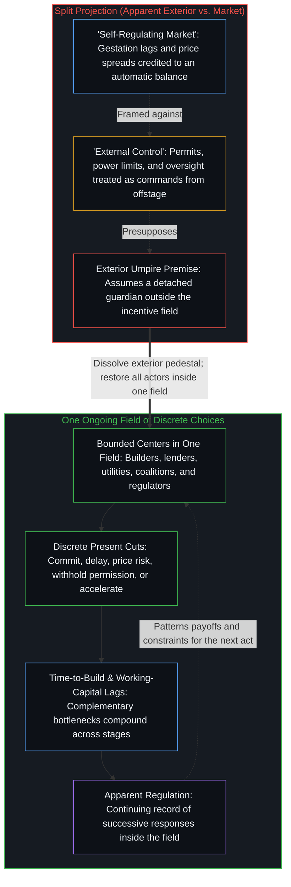
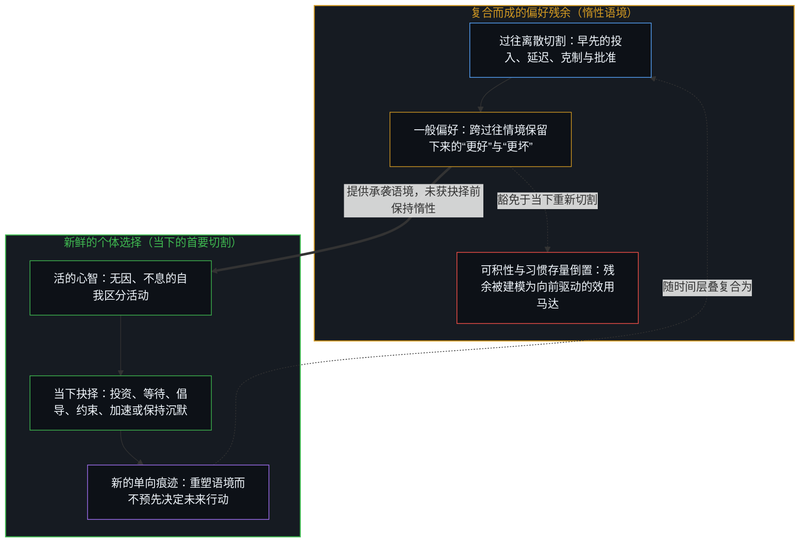

# 表面调节与选择的优先性 / Apparent Regulation and the Primacy of Choice

*调节记录场内选择，偏好为过往切割之残余，新抉择在当下划出下一刀 / Regulation records choices inside one field; preferences remain prior-cut residue while fresh choice cuts in the present*

资本密集型建设中的部署摩擦——时间线拉长、定价差异得以维持，以及让应用在产能过剩之前证明商业可行性的滞后期——归因于市场时被称为自我调节，归因于许可排队、电力约束、资本时机与监管犹豫时则被称为外部干预。这两种描述追踪的都是同一个持续活动场域内部生成的回应，而非发自外部调控者的指令，也不是朝向固定完美标准的趋近。一旦这道割裂消解，评价与行动之间的因果次序便清晰显现：“更好”与“更坏”的偏好作为过往切割复合而成的惰性残余而形成，提供语境；唯有当下新鲜的离散选择，才划出下一次切割，令路径保持敞开。

Deployment friction in capital-intensive buildouts—stretched timelines, preserved pricing differentials, and the lag that lets applications demonstrate commercial viability before capacity overshoots—is described as self-regulation when attributed to markets, or as outside interference when attributed to permitting queues, power constraints, capital timing, and regulatory hesitation. Both descriptions track responses generated inside one ongoing field of activity rather than commands issued from an exterior controller or movement toward a fixed standard of perfection. Once that split dissolves, the causal order between valuation and action comes into focus: "better" and "worse" preferences form as the inert, compounded residue of earlier cuts that supplies context, while fresh discrete choice in the present draws the next cut and keeps the path open.

## 一、 场域之内无外部调控者 / 1. No Exterior Controller Inside the Field

在基础设施建设中，跨期建造孕育滞后会催生出一种节律，从远处看仿佛内置的刹车机制。当高预期回报把彼此关联的投入引向长周期产能时，未完工项目会在交付一单位收入之前，历经多个接续阶段持续吸纳资本、专用设备与电网容量——芬恩·基德兰德与爱德华·普雷斯科特的“建造时间”模型、米哈乌·卡莱茨基关于投资订单与资本交付时滞的分析，以及弗里德里希·哈耶克的异质互补资本品网络，形式化的正是这一动态。正如蛛网价格模型与供给侧资本周期理论所揭示的，延迟交付下的同步进入会拉长建设时间线、使共享的上游依赖承压，并在一轮轮波动中压缩或维持利润空间，无需计划者自上而下地校准建设步调。若将一段节奏拉长或利润空间充裕的时期当作证据，用来证明固定安排能够保证平衡，便是把持续回应的带宽混同于自动执行的底线——这正是[把稳定的症状当作稳定的来源](../mistaking-the-symptom-of-stability-for-its-source/)所追溯的倒置。

Across infrastructure buildouts, multi-period gestation lags create rhythms that look from afar like built-in braking mechanisms. When high expected returns draw correlated commitments into long-lived capacity, unfinished projects absorb capital, specialized equipment, and grid capacity across sequential stages before delivering a unit of revenue—the dynamic formalized in Finn Kydland and Edward Prescott's time-to-build models, Michał Kalecki's lag between investment orders and capital deliveries, and Friedrich Hayek's lattice of heterogeneous, mutually complementary capital goods. As cobweb price models and supply-side capital-cycle accounts show, synchronized entry under delayed delivery stretches timelines, stresses shared upstream dependencies, and compresses or preserves margins across waves without requiring a planner to calibrate the buildout from above. Treating a period of stretched pacing or wide margins as proof that fixed arrangements guarantee balance confuses the bandwidth of ongoing responses with a self-executing floor, the inversion traced in [Mistaking the Symptom of Stability for Its Source](../mistaking-the-symptom-of-stability-for-its-source/).

当这种摩擦带上外部标签——许可审批、能源约束、营运资本时机或监管犹豫——同样的描述依然适用。将同一条延迟产能的序列劈成两个对立阵营——“健康的市场自我调节”对立于“外部干预”——施行的正是[AI 争论中的观察划界](../the-observational-cut-in-ai-debates/)所审视的那类观察切分。配给电网接入队列的公用事业机构、为建设融资展期重新定价的贷方、收紧土地使用审查的地方联盟，以及推迟批复的监管者，并非从舞台之外插手干预；他们是有界参与者，就在同一个由激励、瓶颈与滞后回报构成的场域内部采取行动。从外部看来的控制，仍然是持续活动场域内部生成的回应。

The exact same description holds when that friction carries an external label: permits, energy constraints, working-capital timing, or regulatory hesitation. Splitting one sequence of delayed capacity into rival camps—"healthy market self-regulation" against "outside intervention"—enacts the kind of observational partition examined in [The Observational Cut in AI Debates](../the-observational-cut-in-ai-debates/). Utilities rationing grid queues, lenders repricing construction rollover, local coalitions tightening land-use review, and regulators delaying approvals are not intervening from offstage; they are bounded participants acting inside the same field of incentives, bottlenecks, and lagged returns. What appears as control from outside remains a response generated inside the field of ongoing activity.

早在基础设施争论将一位外部裁判的虚构故事重新抬出来之前，政治经济学便已将其拆解。在公共选择理论中，詹姆斯·布坎南与戈登·塔洛克把行为对称性一以贯之地运用于市场交换与政治之中：官员、官僚、选民与利益联盟皆在个人约束与主观机会成本之下行动，并不会卸下私人激励，去充当立于系统之外的“仁慈专制者”。乔治·斯蒂格勒与萨姆·佩尔兹曼通过规制俘获与规制经济学将这一对称性向前推进，揭示出法定壁垒、牌照门槛与价格楔子，是如何在集中的在位者、分散的消费者与谋求支持的官员构成的政治市场中撮合成交的。这两种论述在戳破素朴的“公正外部纠偏”论调时都颇为可靠。它们的边界显现在各自冻结坐标的方式上：公共选择理论在权衡外部成本与决策成本时，将立宪前的偏好序列视作固定基准；佩尔兹曼则把监管者建模为面对静态群体压力曲线的单一主体支持度最大化者。普通的俘获叙事走得更远，把监管者当作只需更好地隔绝游说便能履职的外部守护者，却忽略了正如[本地屏障与残余滞后](../the-local-shield-and-the-residual-lag/)所追溯的：立于规制屏障背后的具体决策者本身就在激励场内部行动，却不直接承担选择权收窄的代价。在根源处，[主权、信念与规制结构的生成](../sovereignty-belief-and-regulatory-structures/)指明，规制关卡是从“判断可以被委托”这一信念中硬化成形的，因此“俘获”与“公共利益管控”都依然是同一个选择场之内的举动，而每一次决定及其回返的代价，始终落在具体的个人身上。

Political economy dismantled the fiction of an exterior umpire long before infrastructure debates revived it. In public choice theory, James Buchanan and Gordon Tullock apply behavioral symmetry uniformly across exchange and politics: officials, bureaucrats, voters, and interest coalitions act under personal constraints and subjective opportunity costs rather than shedding private incentives to serve as a "benevolent despot" outside the system. George Stigler and Sam Peltzman extend that symmetry through regulatory capture and the economic theory of regulation, showing how statutory barriers, licensing thresholds, and price wedges are brokered inside a political marketplace between concentrated incumbents, dispersed consumers, and support-seeking officials. Both accounts work reliably when exposing naive claims of impartial external correction. Their boundaries appear in how they freeze their coordinates: public choice treats pre-constitutional preference schedules as fixed baselines when weighing external against decision-making costs, and Peltzman models the regulator as a single-agent support-maximizer facing static group pressure curves. Ordinary capture narratives go further in treating the regulator as an exterior guardian needing better insulation from lobbying, overlooking—as [The Local Shield and the Residual Lag](../the-local-shield-and-the-residual-lag/) traces—that specific decision-makers behind regulatory barriers act inside the incentive field without directly bearing the costs of narrowed options. At the root, [Sovereignty, Belief, and the Generation of Regulatory Structures](../sovereignty-belief-and-regulatory-structures/) shows that regulatory gates harden out of the belief that judgment can be delegated, so both "capture" and "public-interest control" remain moves inside one choice field while every decision and returning cost stays with concrete individuals.

因此，在产能建设的具体摩擦中，拉长的时间线以及投入与运营收入之间的滞后，唯有从远处看才像平衡机制。它们既不是从场域外部下达的指令，也不是自行校准平衡的非人格机械；它们是有界行动者所作离散选择的聚合——这些行动者本就携带着过往切割塑造出的偏好，在扩张、等待、约束或加速之间作出抉择——而每一次回应都会重新进入下一个选择即将遭遇的场域。

In the concrete friction of capacity buildout, then, stretched timelines and the lag between outlay and operating revenue look like balancing mechanisms only from a distance. They are not directives arriving from outside the field, nor an impersonal mechanism calibrating balance on its own. They are the aggregate of discrete choices made by bounded actors already carrying preferences formed from earlier cuts—choices to expand, to wait, to constrain, or to accelerate—with each response re-entering the field that the next choice meets.

## 二、 偏好是惰性残余，选择才是切割 / 2. Preferences as Inert Residue, Choice as the Cut

自我区分的活动在发生——无因，不息。称之为心智：已在进行中的观察者，它的每一个动作都是一次区分。每一次离散行动都在具体情境中划出边界，留下一道单向痕迹，塑造后续行动将要遭遇之物，而心智则保留参照，用以衡量自身的移动。在这一几何之中，“更好”与“更坏”、“最好”与“最差”，并不隐含任何嵌入场域的固定完美标准。它们登记为比生出它们的具体情境持有得更一般的偏好。正如[「更好」的范畴谬误](../the-category-error-of-better/)所展示的，“更好”是在某一中心所保留的投射内部算出的标量输出，而非独立于观察者的属性；而正如[偏好聚类与评判语言](../preference-clusters-and-the-language-of-judgment/)所追溯的，跨中心对齐的评价会致密化为共享的记分牌，却并不因此获得因果的作者身份。偏好并不生成行动；它们作为过往选择的复合残余而形成。只有新鲜的选择才产生下一次切割——投资、延迟、倡导、克制或沉默。偏好提供继承的语境；选择提供切割。

Self-distinguishing activity occurs — uncaused, unceasing. Call it the Mind: the observer already underway, every act of which is a distinction. Each discrete act draws a boundary in a concrete situation and leaves a one-way trace shaping what later acts encounter, while the Mind retains references against which to measure movement. Inside that geometry, "better" and "worse," "best" and "worst," imply no fixed standard of perfection embedded in the field. They register as preferences held more generally than the specific situations that produced them. As [The Category Error of Better](../the-category-error-of-better/) shows, "better" is a scalar output computed inside one center's retained projection rather than an observer-independent property, and as [Preference Clusters and the Language of Judgment](../preference-clusters-and-the-language-of-judgment/) traces, aligned evaluations across centers densify into shared scoreboards without gaining causal authorship. Preferences do not generate action; they form as the compounded residue of earlier choices. Fresh choices alone produce the next cut—investment, delay, advocacy, restraint, or silence. Preference supplies inherited context; choice supplies the cut.

现代决策理论原本意在从选择分析中清除心理主义预设，随后却把这道因果方向恰恰颠倒了过来。1938 年，保罗·萨缪尔森提出显露偏好弱公理（`WARP`），意在把不可观测的效用从需求理论中剥离出去，严格地将“偏好”当作从已观测预算选择中读出的推断摘要，而非潜藏在背后的心理引擎。然而，自亨德里克·霍撒克提出强公理（`SARP`）且萨缪尔森于 1950 年解决了可积性问题之后，过往选择的传递链条在数学上又被重新缝合成一个平滑不变的效用函数 `U(x)`。此后的理性选择扩展走得更远：乔治·斯蒂格勒与加里·贝克尔的“消费资本”，以及罗伯特·波拉克的“习惯存量” `U(c_t, h_t)`，明确将过往选择层叠而成的历史打包进常设的效用设定中，将其视作向前驱策未来选择的引擎。在习惯、价格与框架保持稳定的狭窄域内，理性选择理论与显露偏好建模依然是事后核算与局部比较静态分析的有效工具。它们的边界恰好落在[理性选择公设是原罪](../the-rational-choice-postulate-is-the-original-sin/)指认冻结的那个位置：围绕已完成行动重构出一致的偏好排序，既不足以确立一条跨时间迁移的不变偏好表，也不能充当在私人而变动的前提之下驱动下一次决定的因果马达。

Modern decision theory set out to purge mentalist assumptions from choice analysis, then inverted that very causal direction. In 1938, Paul Samuelson proposed the Weak Axiom of Revealed Preference (`WARP`) to strip unobservable utility out of demand theory, treating "preference" strictly as an inferential summary read off observed budget choices rather than a hidden psychological engine. Yet once Hendrik Houthakker introduced the Strong Axiom (`SARP`) and Samuelson solved integrability in 1950, transitive chains of past choices were mathematically stitched back into a smooth, invariant utility function `U(x)`. Subsequent rational-choice extensions went further: George Stigler and Gary Becker's "consumption capital" and Robert Pollak's "habit stock" `U(c_t, h_t)` explicitly packed the compounded history of earlier choices into a standing utility specification treated as the forward-acting driver of future choices. Within narrow domains where habits, prices, and frames remain steady, rational choice theory and revealed preference modeling remain effective instruments for post-hoc accounting and local comparative statics. Their boundary sits right where [The Rational Choice Postulate Is the Original Sin](../the-rational-choice-postulate-is-the-original-sin/) locates the freeze: reconstructing a consistent preference ordering across completed acts licenses neither an invariant schedule that travels across time nor a causal motor driving the next decision under private, shifting premises.

奥地利学派行动学与阿马蒂亚·森的行为批判分别从各自路径揭示了这一因果倒置，也各自止步于自身的边界。路德维希·冯·米塞斯在《人的行动》中拒斥“价值序列独立存在于行动背后”的看法，认为价值尺度只显现在具体行为之中，充当解读已完成行动的诠释工具。默里·罗斯巴德则在“展示偏好”的框架下进一步锐化了这一区分，把单次行动内部的*一致性*——即在行动瞬间将入选选项 *A* 排在落选选项 *B* 之上——同毫无依据的跨期*恒常性*假定切开，指出后者假装彼此分立的过往切割能把一个人锁在一条不变的曲线上。森则在《理性的傻瓜》中从另一侧切入这一同义反复：拿从选择 *A* 反推出来的效用排序去解释选择 *A*，什么也解释不了，而且还把分立的*承诺*行动与二阶*元排序*一并压平进同一张自足的行为效用记分牌。甚至米塞斯本人的措辞也触及一道边缘：当他以前瞻性的目的—手段语言谈及“感到的不安”时，容易听起来像是在选择之前先行推了一把的心理推力；若直接锚定于无因的自我区分活动，凡是为权衡着色的偏好，在心智选出下一次切割之前，始终保持惰性。

Both Austrian praxeology and Amartya Sen's behavioral critique expose that reversal, each up to its own boundary. In *Human Action*, Ludwig von Mises rejects the idea that a value scale exists independently behind action, holding that a scale of values manifests only in concrete behavior as an interpretive instrument for reading completed acts. Murray Rothbard sharpens this under *demonstrated preference* by separating single-act *consistency*—ranking chosen option *A* above unchosen *B* at the instant of action—from the unwarranted assumption of intertemporal *constancy*, which pretends separate past cuts lock a person onto an unchanging curve. Sen targets the tautology from another angle in *Rational Fools*: explaining choice *A* by pointing to a utility ranking inferred from *A* explains nothing, while flattening distinct acts of *commitment* and second-order *meta-rankings* into one self-contained behavioral utility scoreboard. Even Mises's phrasing reaches an edge where prospective ends-means talk ("felt uneasiness") risks sounding like an antecedent psychic push preceding choice; anchored directly in uncaused self-distinguishing activity, every preference that colors deliberation stays inert until a Mind elects the next cut.

一切总量、价格历史与被保留的偏好都在塑形行动者所面对的回报之场，却没有任何一项能够生成这一步行动。正如[个体抉择是唯一的因果杠杆](../individual-choices-as-the-only-causal-levers/)横跨社会与经济条件所追溯的，承袭下来的倾向会改变何者显得熟悉或昂贵，却从未在选择本身之外增添第二根因果杠杆。在[唯一自洽的无因之果](../the-only-coherent-uncaused-effect/)中，那根杠杆从第一人称原点显现为进入序列的唯一无因切割：建设者积淀的审慎、官员的程序习惯，或投资者的先前信念，在这个心智于当下情境中选出下一次切割之前，始终只是惰性记忆。

Every aggregate, price history, and retained preference shapes the payoff field facing the actor, yet none of them generates the move. As [Individual Choices as the Only Causal Levers](../individual-choices-as-the-only-causal-levers/) traces across social and economic conditions, inherited dispositions alter what feels familiar or costly without adding a second causal lever beside the choice itself. In [The Only Coherent Uncaused Effect](../the-only-coherent-uncaused-effect/), that lever appears from the first-person origin as the one uncaused cut entering the sequence: a builder's accumulated caution, an official's procedural habit, or an investor's prior conviction remains inert memory until this Mind elects the next cut in the present situation.

## 三、 没有外部记分牌的回路与当下的下一次切割 / 3. Feedback Without an Exterior Scoreboard and the Next Present Cut

一旦不再预设外部裁判，场域的输出——拉长的建设排期、持续存在的价差、融资收紧、许可积压——便会遭遇携带着过往切割残余的心智。面对这些输出，这些心智选出新的切割；新的切割又改变随后的输出。无需外部参照，这条反馈回路便得以完成，同时仍向着下一次个体选择的进一步分化保持敞开。所谓调节，正是这些相继的切割跨越时间彼此交互所留下的持续记录。

Once no outside referee is posited, outputs from the field—stretched buildout schedules, persistent price differentials, financing squeezes, permit backlogs—meet Minds that carry residues of prior cuts. Confronting those outputs, those Minds elect new cuts, and their new cuts alter subsequent outputs. The feedback circuit completes without an exterior reference, while remaining open to further differentiation by the next individual choice. What gets called regulation is the continuing record of these successive cuts interacting across time.

没有任何固定的外部排序立于这份记录之外，能够宣判由此走出的路径究竟是最优、不足还是完整。弗里德里希·哈耶克揭示了这一结构限度，将*家计组织*（*oikonomia*）——为了同一套目的序列而配置稀缺手段的单个家庭、企业或建构层级（*taxis*）——与*偶合秩序*（*catallaxy*）区分开来：后者是开放的交换秩序（*cosmos*），联结着无数独立中心，各自追逐彼此并不共享且不断变动的目的。把偶合秩序当作存在某种总量最优，犯的是范畴错误——它把单个企业的单一记分牌投射到了一个多中心的交换网络上；正如[知识问题与委托的幻觉](../the-knowledge-problem-and-the-illusion-of-delegation/)所追溯的，甚至哈耶克本人的论述也在这里到达了边界：他依然把分散的公开印迹说成同一份存量的碎片，或把一套固定的产权规则样式抬高为穷尽的解答。同样，亚当·斯密极少使用的“看不见的手”，充当的是关于局部配置的有界观察，而非最优化定理，且直接伴随他的警示：竞争中的在位者动辄合谋抬价并限制准入。

No fixed exterior ranking stands outside that record to declare the resulting path optimal, deficient, or complete. Friedrich Hayek brought out this structural limit by separating an *oikonomia*—a single household, firm, or constructed hierarchy (*taxis*) allocating scarce means toward one shared scale of ends—from a *catallaxy*, the open exchange order (*cosmos*) linking countless independent centers that pursue unshared, shifting ends. Treating a catallaxy as having an aggregate optimum commits a category mistake, projecting the single scoreboard of a firm onto a multi-locus exchange lattice; as [The Knowledge Problem and the Illusion of Delegation](../the-knowledge-problem-and-the-illusion-of-delegation/) traces, even Hayek's own account reaches its edge where it still speaks of dispersed public marks as fragments of a single stock or elevates one fixed pattern of property rules as an exhaustive answer. Likewise, Adam Smith's sparingly used "invisible hand" served as a bounded observation about local allocation rather than an optimality theorem, paired directly with his warning that rival incumbents readily collude to raise prices and restrict entry.

形式福利经济学从数学均衡内部证实了同一道边界。在福利经济学第一基本定理之下，肯尼斯·阿罗与热拉尔·德布鲁证明，竞争性的瓦尔拉斯均衡只有在价格接受、信息对称、零外部性以及覆盖一切未来状态的完备市场这一理想化框架之内，才能达成*帕累托最优*——即没有任何参与者能在不使另一人受损的前提下获益的状态。布鲁斯·格林沃尔德与约瑟夫·斯蒂格利茨进一步证明，一旦信息不对称或市场不完备，竞争性均衡一般连受约束的帕累托效率都达不到。更决定性的是，即便在第一定理成立的域内，帕累托最优也并不界定唯一的完美标准；它勾勒的是一条由初始禀赋索引的无穷效率前沿。要想从这条前沿上挑出某一点作为“社会最优”，便需要一套外部社会排序；而阿罗不可能性定理已经证明，在最低限度的一致性公理之下，这样的排序无法以非独裁方式从个体序数偏好中加总得出。有条件的效率图谱在明示前提内部检验局部权衡时，依然是锋利的工具；可一旦把一条相对于初始禀赋的前沿误认作立于选择之上的外部记分牌，这些工具便立刻止步。

Formal welfare economics confirms the same boundary from inside mathematical equilibrium. Under the First Fundamental Theorem of Welfare Economics, Kenneth Arrow and Gérard Debreu proved that competitive Walrasian equilibrium yields *Pareto optimality*—where no participant can gain without another losing—only inside an idealized frame of price-taking, symmetric information, zero externalities, and complete markets spanning every future state. Bruce Greenwald and Joseph Stiglitz proved that once information is asymmetric or markets incomplete, competitive equilibria generally fail even constrained Pareto efficiency. More decisively, even where the First Theorem holds, Pareto optimality defines no unique standard of perfection; it traces an infinite frontier of efficient allocations indexed to initial endowments. Picking one point on that frontier as "socially best" requires an exterior social ranking, which Arrow's Impossibility Theorem proves cannot be aggregated non-dictatorially from ordinal individual preferences under minimal consistency axioms. Conditional efficiency maps remain sharp tools for checking local trade-offs inside stated premises; they stop short the instant an endowment-relative frontier is mistaken for an exterior scoreboard above choice.

任何试图把记录冻结为“更好”与“更坏”封闭排序的举动——无论是宣告市场停顿“最优”，还是把监管日程当作“必要的外部控制”——都是将过往选择的残余转化为指导未来选择的所谓标准。因为[没有系统能被保持封闭](../no-system-can-be-kept-closed/)，任何有限的账册或成文法典，都封不住在自身框架之外继续着的不息活动；强求一份暂定记录去充当穷尽地基，会生出矛盾，却并不止住前行的边缘——这正是[开放即一致](../openness-is-consistency/)所划出的边界。这种转化并不会阻止下一次切割。下一次切割依然作为当下的个体抉择发生，面对继承下来的残余，却不被它所决定。活态分化仍在继续；调节、外部控制与最优性的脚手架也依然可用——它们从不作为立于选择之上的最终裁判，而是作为暂定残余，敞开着等待每一个心智在自身的具体情境中重新检验。

Any attempt to freeze the record into a closed ranking of better and worse—whether declaring a market pause "optimal" or treating a regulatory schedule as "necessary exterior control"—converts the residue of past choices into a supposed standard for future ones. Because [No System Can Be Kept Closed](../no-system-can-be-kept-closed/), no finite tally or codified statute can seal the unceasing activity continuing outside its frame; demanding that a provisional record serve as exhaustive ground generates contradiction without halting the edge, the boundary traced in [Openness Is Consistency](../openness-is-consistency/). That conversion does not stop the next cut. The next cut still occurs as an individual election in the present, confronting the inherited residue without being determined by it. Living differentiation continues, and the scaffolding of regulation, external control, and optimality remains available—never as a final judge standing over choice, but as provisional residue open to retesting by each Mind in its own concrete situation.
