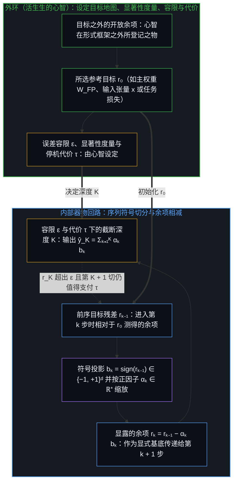
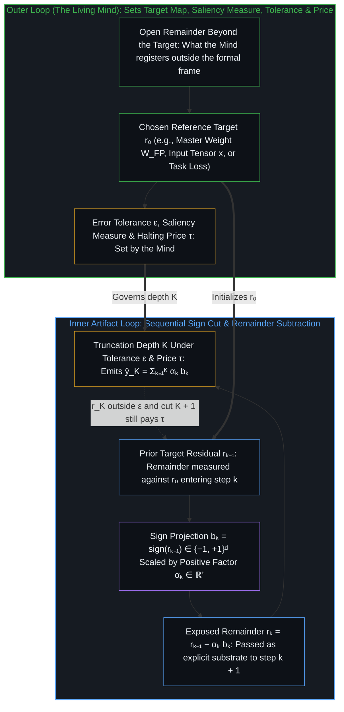
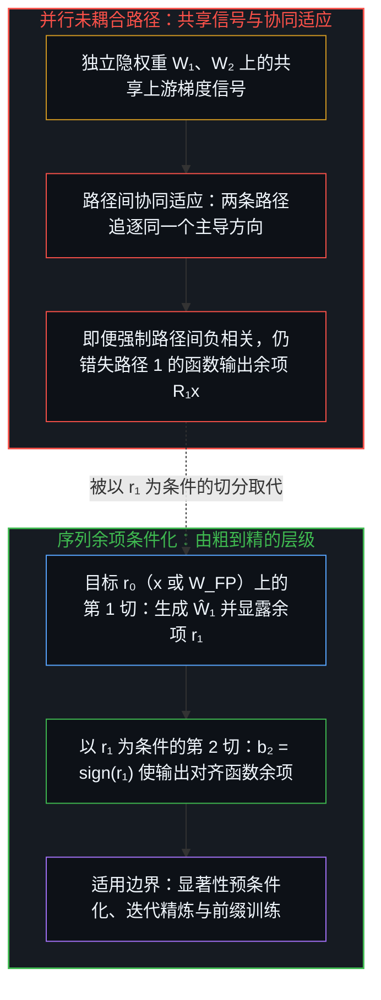
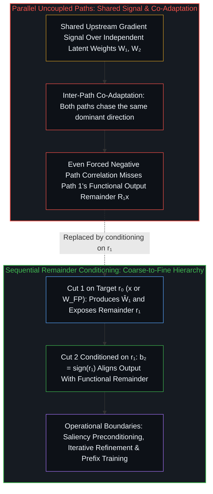

# 递归区分的架构 / The Architecture of Recursive Distinction

*每一次二元切分都留下未捕获的余项，下一次切分以它为条件，而非重复上一次 / Each binary cut leaves an uncaptured remainder, and the next cut conditions on it instead of repeating the last*

关于人工智能的通俗论述，常将全精度神经网络视为平滑、自足的流形，而把低比特量化、梯度提升与自适应回路贬为拼接在连续理想模型之上的次级近似。从唯一前提追溯这些架构，便能把主流讨论压在同一个词下的两种余项分开：在以有限目标 `r₀` 初始化的形式回路内部，每一次按 `αₖ ∈ ℝ⁺` 缩放的离散符号切分 `bₖ = sign(rₖ₋₁)`，都会留下相对于 `r₀` 测得的数值残差 `rₖ = rₖ₋₁ − αₖ bₖ`；而在回路外部，则是这一所选目标与心智在它之外所登记之物之间的开放余项。在内环之中，当第 `k` 次切分以第 `k − 1` 次切分留下的余项 `rₖ₋₁` 为条件，且各次切分彼此迭代精炼、每一个前缀都被训练得能够独立成立时，切分序列便能由粗到精地逼近目标；反之，在共享信号下并行训练的多条切分则会发生协同适应，坍缩向同一个主导方向。由此可见，数值精度是在误差容限 `ε` 与算力及能量代价 `τ` 之下所选定的截断深度 `K`；跨量化、残差块、自适应停机门控与闭环优化追溯同一以余项为条件的步骤，既能标定各形式体系得以成立的正则条件，也能指明活生生的心智在何处作为外环设定目标与代价。

Popular accounts of artificial intelligence treat a full-precision neural network as a smooth, self-contained manifold and relegate low-bit quantization, boosting, and adaptive loops to secondary approximations bolted onto a continuous ideal. Tracing these architectures from the premise separates two remainders that standard discussions compress onto one word: inside a formal loop initialized at a finite target `r₀`, each discrete sign cut `bₖ = sign(rₖ₋₁)` scaled by `αₖ ∈ ℝ⁺` leaves a numerical residual `rₖ = rₖ₋₁ − αₖ bₖ` measured against `r₀`, whereas outside the loop sits the open remainder between that chosen target and what the Mind registers beyond it. Within the inner loop, a sequence of cuts in which cut `k` is conditioned on the remainder `rₖ₋₁` left by cut `k − 1` resolves the target coarse-to-fine where cuts are refined against one another and each prefix is trained to stand on its own, while parallel cuts trained on a shared signal co-adapt onto the same dominant direction. Numerical precision then shows itself to be a truncation depth `K` chosen under an error tolerance `ε` and a compute and energy price `τ`, and tracing the same remainder-conditioning step across quantization, residual blocks, adaptive halting gates, and closed-loop optimization locates both the regularity conditions under which each formalism holds and the outer loop where the living Mind sets the target and the price.

## 一、 回路内的目标与回路外的余项 / 1. The Target Inside the Loop and the Remainder Outside It

自我区分的活动发生着——无因、不息。称之为心智：已在途中的观察者，其每一次活动都是一次区分。人工智能领域的流行叙事颠倒了这一出发点，将平滑的全精度函数当作首要现实，而把离散量化、决策树或迭代精炼回路视为有损的工程妥协。将激活与权重曲面当作平滑可微流形有着明确的适用域：在训练期间，令微分步长趋近于零能使微积分得以闭合，并在数以百万计的参数上提供解析梯度，这正是[连续性作为建模的权宜之计](../the-continuum-is-a-modeling-convenience/)所追溯的形式捷径。而一旦把平滑的全精度张量误认为自我成立的基底，而非为特定目的构建的又一张有限地图，这一前提便到达了它的边界。

Self-distinguishing activity occurs — uncaused, unceasing. Call it the Mind: the observer already underway, every act of which is a distinction. Popular narratives in artificial intelligence invert this starting point by treating a smooth, full-precision function as the primary reality and viewing discrete quantization, decision trees, or iterative refinement loops as lossy engineering compromises. Treating activation and weight surfaces as smooth differentiable manifolds has a clear operational domain: during training, letting the differential step approach zero allows calculus to close and supplies analytical gradients across millions of parameters, the formal shortcut traced in [The Continuum is a Modeling Convenience](../the-continuum-is-a-modeling-convenience/). That premise reaches its boundary when a smooth full-precision tensor is mistaken for a self-standing ground rather than one more finite map constructed for a purpose.

要让地图不越出它的位置，就必须把常被混为一谈的两种余项分开。在工程化的回路内部，一次离散切分会留下相对于某个固定、有限参考 `r₀` 测得的目标残差 `rₖ`——例如 16 位主权重矩阵 `W_FP`、某一层的输入激活张量 `x`，或有界数据集上的经验损失。由于这一参考是有限的，内部目标残差可以在有限深度 `K` 处被压向零；对定点权重做精确的 `{0, 1}` 位平面展开，只需固定步数即可达到 `r_K = 0`。而在回路外部，则是截然不同的另一种余项：所选目标或损失与心智在它之外所登记之物之间的开放场域裂隙；正如[开放场域中的无损知识不自洽](../lossless-knowledge-of-an-open-field-is-incoherent/)所确立的，没有任何有限的形式投影能够闭合这一余项。将开放余项置入有限回路，是同一种坍缩的两面：把 `r_K = 0` 读作外部裂隙的闭合，是将有限参考地图当作开放场域；而在损失中写入下限使 `rₖ` 永不归零，则是要求内部残差去承载任何有限投影都不具备的开放性——正如[冻结的切口与回环的余量](../the-frozen-cut-and-the-margin-of-the-loop/)所追溯的，这会迫使后续切分在先前切分已匹配 `r₀` 之处把容量耗费在人工合成的噪声上，而非让该处的 `rₖ` 归零，从而使下一次切分仅以仍未捕获之物为条件。这两种余项都不是自行驱动下一步的自主施动者；完整的因果性属于心智，余项则是在下一步被读取的痕迹信号——要么作为算法内部传递给第 `k` 次切分的代数差值 `rₖ₋₁`，要么作为促使外环心智修订目标地图本身的摩擦。

Keeping the map in its place requires separating two remainders that are routinely conflated. Inside an engineered loop, a discrete cut leaves a target residual `rₖ` measured against a fixed, finite reference `r₀`—such as a 16-bit master weight matrix `W_FP`, a layer's input activation tensor `x`, or an empirical loss over a bounded dataset. Because that reference is finite, the inner target residual can be driven toward zero at finite depth `K`; an exact `{0, 1}` bit-plane expansion of a fixed-point weight reaches `r_K = 0` in a fixed number of passes. Outside the loop sits a different remainder altogether: the open-field gap between the chosen target or loss and what the Mind registers beyond it, which, as [Lossless Knowledge of an Open Field Is Incoherent](../lossless-knowledge-of-an-open-field-is-incoherent/) establishes, no finite formal projection ever closes. Placing the open remainder inside the finite loop is one collapse with two faces: reading `r_K = 0` as the outer gap closed takes the finite reference map for the open field, while writing a floor into the loss so `rₖ` never vanishes asks the inner residual to carry an openness no finite projection holds, forcing later cuts to spend capacity on synthetic noise where earlier cuts already matched `r₀` instead of letting `rₖ` reach zero there so the next cut conditions only on what remains uncaptured, as [The Frozen Cut and the Margin of the Loop](../the-frozen-cut-and-the-margin-of-the-loop/) traces. Neither remainder is an autonomous agent that drives the next step on its own; full causality belongs to the Mind, and the remainder is the trace signal read at the next step—either as the algebraic discrepancy `rₖ₋₁` handed to cut `k` inside the algorithm, or as the friction that prompts the Mind at the outer loop to revise the target map itself.

## 二、 符号切分与作为所选深度的精度 / 2. The Sign Cut and Precision as Chosen Depth

正如[维度即投影](../dimensions-are-projections/)与[信息是什么](../what-information-is/)所追溯的，心智自身的感知场域是开放、可无限延展的二元超空间；而器物的二值向量 `bₖ = sign(rₖ₋₁) ∈ {−1, +1}ᵈ` 则是由设计者固定的有限 `d` 维下投影。从目标 `r₀` 出发，序列量化器或残差逼近器在第 `k` 步提取符号取向 `bₖ = sign(rₖ₋₁)`，以正因子 `αₖ ∈ ℝ⁺` 缩放该超立方体顶点，再减去缩放后的切分以显露 `rₖ = rₖ₋₁ − αₖ bₖ`，由此组装出深度为 `K` 的重构 `ŷ_K = Σₖ₌₁ᴷ αₖ bₖ`，并留下残差 `r_K = r₀ − ŷ_K`。

While the Mind's own perceptual field is an open, indefinitely extendable binary hyperspace, as [Dimensions Are Projections](../dimensions-are-projections/) and [What Information Is](../what-information-is/) trace, an artifact's binary vector `bₖ = sign(rₖ₋₁) ∈ {−1, +1}ᵈ` is a finite `d`-dimensional down-projection fixed by a designer. Initialized at a target `r₀`, a sequential quantizer or residual approximator at step `k` extracts a sign orientation `bₖ = sign(rₖ₋₁)`, scales that vertex by a positive factor `αₖ ∈ ℝ⁺`, and subtracts the scaled cut to expose `rₖ = rₖ₋₁ − αₖ bₖ`, assembling the depth-`K` reconstruction `ŷ_K = Σₖ₌₁ᴷ αₖ bₖ` with residual `r_K = r₀ − ŷ_K`.

这一序列回路中的每一项都承担着各自不同的结构角色，将它们合在一起追溯，便能厘清二元展开做到了什么、又没有做到什么。符号向量 `bₖ ∈ {−1, +1}ᵈ` 选出 `d` 维超立方体的一个角点：当激活保持浮点表示时，它将浮点乘法替换为受符号控制的加法；当权重与激活均被二值化时，则将其替换为按位的 `XNOR-popcount` 运算。然而，级数累加 `ŷ_K = Σₖ₌₁ᴷ αₖ bₖ` 并没有借由符号提取抹除连续统：正缩放因子 `αₖ ∈ ℝ⁺`（无论是整层共享的标量还是逐通道缩放向量）依然承载着连续的度量幅度，而固定 `αₖ = 2⁻ᵏ` 则在数位的仿射重参数化（`bₖ = 2dₖ − 1`）之下恢复了以 2 为底的基数展开。逐步相减 `rₖ = rₖ₋₁ − αₖ bₖ` 所揭示的，并非连续尺度凭空消失，而是模型内部的数值精度是在预算之下选定的分辨率深度 `K`，这为[精度与分辨率](../precision-and-resolution/)所追溯的“固定精确度”与“处境化粒度”之分给出了落地机制。

Each term in this sequential loop plays a distinct structural role, and tracing them together clarifies what binary expansion does and does not do. The sign vector `bₖ ∈ {−1, +1}ᵈ` selects a corner of the `d`-dimensional hypercube, replacing floating-point multiplies with sign-controlled additions when activations stay in floating point, or with bitwise `XNOR-popcount` operations when both weights and activations are binarized. Yet the telescoping sum `ŷ_K = Σₖ₌₁ᴷ αₖ bₖ` does not banish the continuum through sign extraction: the positive scale factor `αₖ ∈ ℝ⁺` (whether a layer-wide scalar or per-channel scaling vectors) still carries the continuous metric magnitude, and fixing `αₖ = 2⁻ᵏ` recovers base-2 radix representation up to an affine reparameterization of the digits (`bₖ = 2dₖ − 1`). What the step-by-step subtraction `rₖ = rₖ₋₁ − αₖ bₖ` reveals is not that continuous scales vanish, but that numerical precision inside a model is a resolution depth `K` chosen under a budget, grounding the distinction between fixed exactness and situated grain size traced in [Precision and Resolution](../precision-and-resolution/).

因此，在深度 `K` 处终止展开，是跨越两条外环轴线的预算决断——其一是残差上的目标误差容限 `ε`，其二是每增加一次切分所支付的算力、内存与能量代价 `τ`——而非在本体论上消除了误差。正如[学到的边界与给定的尺度](../learned-boundaries-and-the-given-rate/)所追溯的，从字节到片段的习得切分需要外部给定的压缩率，方能避免碎裂为单字节或坍缩为均质模糊；同样，`ε` 与 `τ` 均由构建并部署模型的心智在外环设定。内环度量的是 `K` 次切分之后，固定目标 `r₀` 还有多少余留在 `r_K = r₀ − ŷ_K` 中；外环的心智则判断 `r_K` 何时已落入容限 `ε` 之内，抑或第 `K + 1` 次切分带来的边际缩减何时不再值得支付代价 `τ`。

Terminating the expansion at depth `K` is therefore a budget decision across two outer-loop axes—a target error tolerance `ε` on the residual and a compute, memory, and energy price `τ` per additional cut—rather than an ontological elimination of error. Just as learned byte-to-span segmentation requires a compression rate given from the outside to keep from fragmenting into single bytes or collapsing into uniform blurs, as [Learned Boundaries and the Given Rate](../learned-boundaries-and-the-given-rate/) traces, both `ε` and `τ` are set at the outer loop by the Mind that builds and deploys the model. The inner loop measures how much of the fixed target `r₀` remains in `r_K = r₀ − ŷ_K` after `K` cuts; the outer-loop Mind judges when `r_K` is within tolerance `ε` or when the marginal reduction from cut `K + 1` no longer pays the price `τ`.

## 三、 以余项为条件与并行协同适应 / 3. Conditioning on the Remainder Versus Parallel Co-Adaptation

一旦将精度理解为针对目标的一连串 `K` 次二元切分，一个结构性问题便随之浮现：为什么第 `k` 次切分必须等待第 `k − 1` 次切分的余项 `rₖ₋₁`，而不是从各自独立的隐权重出发并行训练 `K` 条二元路径，再将它们的输出相加？当多条二元路径在共享的上游梯度下并行训练时，每一条路径都会收到相同的误差信号，并朝着目标的同一个主导分量适应。未耦合的并行路径非但不会相互抵消量化误差，反而会发生协同适应，重复第一条粗糙近似。尤为关键的是，正如 [RaBiT](https://arxiv.org/abs/2602.05367) 针对并行双二值化拆分（`DB-LLM`）所证明的，单靠强制两条并行路径之间呈负相关依然不够：两个符号向量可以在夹角上被推开，却依然无法对齐第一条路径留下的函数输出残差 `R₁x = (W_FP − Ŵ₁)x`。当第 `k` 次切分直接以第 `k − 1` 次切分留下的余项为条件时，误差抵消便得以成立——无论该余项是在 [ReBNet](https://arxiv.org/abs/1711.01243) 与 [HORQ](https://arxiv.org/abs/1708.08687) 中借以提取 `bₖ = sign(rₖ₋₁)` 的未决激活或输入张量 `rₖ₋₁ = x − Σⱼ₌₁ᵏ⁻¹ γⱼ bⱼ`，还是主权重残差 `R₁ = W_FP − Ŵ₁`：`RaBiT` 在每次训练前向传播中从单一共享权重依序由它衍生 `B₂ = sign(R₁)`，使第二条路径的输出先与 `R₁x` 对齐，再在推理阶段让锁定后的各条路径并行运行。

Once precision is understood as a sequence of `K` binary cuts against a target, a structural question arises: why must cut `k` wait for the remainder `rₖ₋₁` of cut `k − 1`, rather than training `K` binary paths in parallel from independent latent weights and summing their outputs? When multiple binary paths are trained in parallel under a shared upstream gradient, every path receives the same error signal and adapts toward the same dominant components of the target. Instead of canceling one another's quantization error, uncoupled parallel paths co-adapt and duplicate the first coarse approximation. Crucially, as [RaBiT](https://arxiv.org/abs/2602.05367) demonstrates against parallel dual-binarization splits (`DB-LLM`), merely forcing two parallel paths to be negatively correlated with each other is still not enough: two sign vectors can be pushed apart in angle and still fail to align with the functional output residual `R₁x = (W_FP − Ŵ₁)x` left by the first path. Error cancellation holds where cut `k` is conditioned directly on the remainder that cut `k − 1` left behind—whether that remainder is the unresolved activation or input tensor `rₖ₋₁ = x − Σⱼ₌₁ᵏ⁻¹ γⱼ bⱼ` from which `bₖ = sign(rₖ₋₁)` is extracted in [ReBNet](https://arxiv.org/abs/1711.01243) and [HORQ](https://arxiv.org/abs/1708.08687), or the master-weight residual `R₁ = W_FP − Ŵ₁` from which `RaBiT` derives `B₂ = sign(R₁)` sequentially from a single shared weight during each training forward pass so the second path's output aligns with `R₁x` before the locked paths run in parallel at inference.

以前序切分的余项为条件同样有其自身的适用边界，追溯这些边界能避免将序列相减当作无条件的灵丹妙药。首先，单遍贪心的序列切分是短视的：如果在冻结第 1 切时不考虑第 2 切的表征容量，或者在忽略重尾输入激活与梯度敏感度的情况下跨坐标均匀地最小化原始权重误差，早期切分就会锁定在次优取向上，其残差会在层间逐层放大。要避开这一贪心陷阱，就需要在所选的通道显著性度量（如校准激活与梯度的均方根范数）下对目标做预条件化，并在锁定二元路径之前针对彼此的残差做迭代精炼（`RaBiT`）。其次，堆叠 `K` 个残差阶段并不会自动保证在部署阶段将级数截断于 `k < K` 时，精度能沿着由粗到精的帕累托前沿平滑退化。正如神经编解码器中的多阶段残差向量量化器所示，当 `K` 阶堆叠仅在完整深度 `K` 下训练时，后续阶段会相互协同适应，以抵消所有阶段同时激活时才出现的伪影，导致提前截断时出现陡峭的精度断崖；当各个前缀被训练得能够独立成立（例如通过量化器随机丢弃），使每一个部分和 `ŷₖ = Σⱼ₌₁ᵏ αⱼ bⱼ` 都构成自足的粗粒度表征时，平滑的由粗到精截断便得以成立。

Conditioning on the predecessor's remainder has its own operational boundaries, and tracing them keeps sequential subtraction from being treated as an unconditional cure-all. First, a single greedy pass of sequential cuts is myopic: if Cut 1 is frozen without accounting for Cut 2's representational capacity, or if raw weight error is minimized uniformly across coordinates while ignoring heavy-tailed input activation and gradient sensitivities, early cuts lock into a suboptimal orientation whose residual amplifies across layers. Avoiding that greedy trap requires preconditioning the target under a chosen channel-saliency measure (such as calibration activation and gradient root-mean-square norms) and iteratively refining the binary paths against one another's residuals before locking them (`RaBiT`). Second, stacking `K` residual stages does not automatically guarantee that truncating the series at `k < K` during deployment will degrade smoothly along a coarse-to-fine Pareto frontier. As multi-stage residual vector quantizers in neural codecs demonstrate, when a `K`-stage stack is trained exclusively at full depth `K`, later stages co-adapt to cancel artifacts that arise when all stages fire together, creating a sharp accuracy cliff upon early truncation; smooth coarse-to-fine truncation holds when prefixes are trained to stand on their own—such as through quantizer dropout—so that each partial sum `ŷₖ = Σⱼ₌₁ᵏ αⱼ bⱼ` forms a self-contained coarse representation.

## 四、 跨尺度的递归残差回路及其边界 / 4. Recurring Residual Loops and Their Boundaries Across Scales

同一步骤——在前一步留下的余项上施加下一次修正——在机器学习的其他尺度上反复重现；然而，复用这一模式并不会把位平面量化、深度残差网络、决策树、自适应路由与智能体工作流坍缩为单一的一元论方程，每一种实现都在各自不同的数学前提下运作，并在各自的边界处失效。单棵符号决策树沿着硬性的坐标轴对齐切分划分输入坐标，而梯度提升树则让每一棵新树以这些离散划分上留下的残差误差为条件。与之相对，深度残差网络（`yₗ₊₁ = yₗ + fₗ(yₗ)`）在反向传播沿着[不知去向何方的梯度下降](../the-descent-that-doesnt-know-where-its-going/)所检视的预区分损失曲面推进的同时，让每一次加法修正以连续的习得特征流为条件；正如 [Siu（2019）](https://arxiv.org/abs/1909.11790)、[Huang 等人（2018）](https://arxiv.org/abs/1706.04964)与 [Nitanda 与 Suzuki（2018）](https://proceedings.mlr.press/v80/nitanda18a.html)所确立的，在残差块范数与跳跃连接收缩率受到恰当约束之处，这一加法特征更新表现为函数梯度提升。

The same step—taking the next correction on what the previous step left behind—recurs across other scales of machine learning, yet reusing the pattern does not collapse bit-plane quantization, deep residual networks, decision trees, adaptive routing, and agentic workflows into a single monistic equation; each realization operates under distinct mathematical preconditions and breaks at its own boundary. A single symbolic decision tree partitions input coordinates along hard axis-aligned splits, and gradient-boosted trees condition each new tree on the residual error left across those discrete partitions. Deep Residual Networks (`yₗ₊₁ = yₗ + fₗ(yₗ)`), by contrast, condition each additive correction on a continuous learned feature stream while backpropagation follows the pre-distinguished loss surface examined in [The Descent That Doesn't Know Where It's Going](../the-descent-that-doesnt-know-where-its-going/); as [Siu (2019)](https://arxiv.org/abs/1909.11790), [Huang et al. (2018)](https://arxiv.org/abs/1706.04964), and [Nitanda and Suzuki (2018)](https://proceedings.mlr.press/v80/nitanda18a.html) establish, this additive feature update behaves as functional gradient boosting where residual block norms and skip-connection shrinkage are properly bounded.

当递归扩展至动态算力深度与闭环优化时，同样需要留意各自的边界。在[空间自适应计算时间（SACT）](https://arxiv.org/abs/1612.02297)与[动态递归神经网络（DRNN）](https://openaccess.thecvf.com/content_CVPR_2019/html/Guo_Dynamic_Recursive_Neural_Network_CVPR_2019_paper.html)中，计算并非通过对原始量化残差设阈值来停机，而是由习得的参数化或离散门控分支在外部思考惩罚之下读取累积的特征状态——这是在外环给定的尺度之内按语境路由的一例——而当提前退出改变跨循环迭代的存留批次统计量，或在静态硬件上造成参差不齐的执行图时，它们便遇到了各自的边界。在闭环优化尺度上，[递归决策导向学习（R-DFL）](https://arxiv.org/abs/2511.08035)将受决策 `xₖ₋₁` 偏移后的状态分布反馈回第 `k` 步的参数预测，通过展开轨迹或不动点均衡对轨迹做微分。这一隐式微分在下游求解器平滑、凸且满足压缩映射的范围内成立。而在离散组合分支或多步智能体工作流打破可微性之处，求解器梯度便不再适用；此时，以余项为条件的机制从连续雅可比求逆转向跨越隔离的语境交接传递经校验的制品与显式的失败痕迹——即[模块化反馈回路与动态残差网络](../dynamic-resnet-of-skill-loops/)与[交接残余](../handing-off-residue/)所追溯的磁盘主干架构——从而让无需捍卫自身既有轨迹的全新冷对位能够如[超越投射](../beyond-the-projection/)中那样检验交接过来的制品，并让保留下来的记录能够如[递归形式系统中作为记忆与控制的边界条件图](../boundary-condition-graphs-as-memory-and-control-in-recursive-formal-systems/)中那样作为显式的边界条件引导后续回路。

The same attention to boundaries applies when recursion is extended to dynamic compute depth and closed-loop optimization. In [Spatially Adaptive Computation Time (SACT)](https://arxiv.org/abs/1612.02297) and [Dynamic Recursive Neural Networks (DRNN)](https://openaccess.thecvf.com/content_CVPR_2019/html/Guo_Dynamic_Recursive_Neural_Network_CVPR_2019_paper.html), computation does not halt by thresholding a raw quantization residual; instead, learned parametric or discrete gating branches read the accumulated feature state under an external ponder penalty—an instance of per-context routing inside an outer rate—and encounter their own boundaries when early exits shift surviving batch statistics across loop iterations or create ragged execution graphs on static hardware. At the closed-loop optimization scale, [Recursive Decision-Focused Learning (R-DFL)](https://arxiv.org/abs/2511.08035) feeds the state distribution shifted by decision `xₖ₋₁` back into parameter prediction at step `k`, differentiating through the trajectory via unrolling or fixed-point equilibrium. That implicit differentiation holds where the downstream solver is smooth, convex, and contractive. Where discrete combinatorial branching or multi-step agentic workflows break differentiability, solver gradients cease to apply; conditioning on the remainder shifts from continuous Jacobian inversion to passing verified artifacts alongside explicit failure traces across isolated context handoffs—the disk-highway architecture traced in [Modular Feedback Loops and Dynamic Residual Networks](../dynamic-resnet-of-skill-loops/) and [Handing Off Residue](../handing-off-residue/)—so that a fresh cold counterpoint, holding no prior trajectory of its own to defend, can test the handed-off artifact as in [Beyond the Projection](../beyond-the-projection/) and retained records can serve as explicit boundary conditions steering subsequent loops as in [Boundary-Condition Graphs as Memory and Control in Recursive Formal Systems](../boundary-condition-graphs-as-memory-and-control-in-recursive-formal-systems/).

## 五、 目标、停机代价与外环 / 5. The Target, the Halting Price, and the Outer Loop

将这些不同尺度并置考察而不抹平它们之间的差异，便能分离出序列余项条件化做到了什么、又有哪些东西是它未曾触及的。在多路径二值化与多阶段量化（`ReBNet`、`HORQ`、`RaBiT` 与残差向量量化器）中，令第 `k` 次切分以第 `k − 1` 次切分留下的余项 `rₖ₋₁` 为条件，能够防止并行路径协同适应到同一个主导方向上；当各次切分针对彼此做迭代精炼而非贪心锁定、且每一个前缀都被训练得能够独立成立时，数值精度便转化为可沿由粗到精前沿截断的深度 `K`。在相邻尺度上，同一递归相减在各自特定的前提下显现：ResNet 各阶段在受约束的模块范数下于特征流上累积函数提升修正，习得的停机门控在外部思考惩罚下分配循环深度，而 `R-DFL` 则在下游求解器保持平滑与压缩映射的条件下迭代逼近决策不动点。

Holding these scales side by side without flattening their differences isolates what sequential remainder-conditioning accomplishes and what it leaves untouched. In multi-path binarization and multi-stage quantization (`ReBNet`, `HORQ`, `RaBiT`, and residual vector quantizers), conditioning cut `k` on the remainder `rₖ₋₁` left by cut `k − 1` prevents parallel paths from co-adapting onto the same dominant direction, turning numerical precision into a depth `K` that truncates along a coarse-to-fine frontier where cuts are refined against one another rather than locked greedily and every prefix is trained to stand on its own. Across adjacent scales, the same recursive subtraction appears under domain-specific preconditions: ResNet stages accumulate functional boosting corrections on a feature stream under bounded module norms, learned halting gates allocate loop depth under an external ponder penalty, and `R-DFL` iterates toward a decision fixed point where the downstream solver remains smooth and contractive.

然而，每一个内部残差 `rₖ` 都是相对于初始化该回路的目标地图 `r₀` 测得的。相对于 16 位权重矩阵或凸代理目标收敛至 `r_K ≈ 0`，只表明内部展开匹配了它的参考地图，并不表明这张参考地图捕获了形式框架之外的事物。正如[智能只属于心智](../intelligence-belongs-only-to-the-mind/)与[多智能体协作的幻象](../the-illusion-of-multi-agent-collaboration/)所确立的，器物在缓冲痕迹上执行确定性的状态转移并消耗硬件能量；它并不发起参考目标 `r₀`，不选择依何种度量将某些通道或结果计为显著，也不将能量消耗相对于某个目的登记为停机代价 `τ`。设定目标、判断进一步的深度 `K` 何时不再值得支付其代价，以及在目标滞后于心智当下所登记之物时迈入正交框架，始终留在外环那活生生的心智手中。

Yet every inner residual `rₖ` is measured against the target map `r₀` that initialized the loop. Converging to `r_K ≈ 0` against a 16-bit weight matrix or a convex surrogate objective shows that the inner expansion has matched its reference map, not that the reference map captures what lies beyond the formal frame. As [Intelligence Belongs Only to the Mind](../intelligence-belongs-only-to-the-mind/) and [The Illusion of Multi-Agent Collaboration](../the-illusion-of-multi-agent-collaboration/) establish, the artifact executes determinate transitions over buffered traces and consumes hardware energy; it does not originate the reference target `r₀`, choose the measure under which some channels or outcomes count as salient, or register energy expenditure as a halting price `τ` against a purpose. Setting the target, judging when further depth `K` stops paying its price, and stepping into an orthogonal frame when the target lags what the Mind now registers remain with the living Mind at the outer loop.
