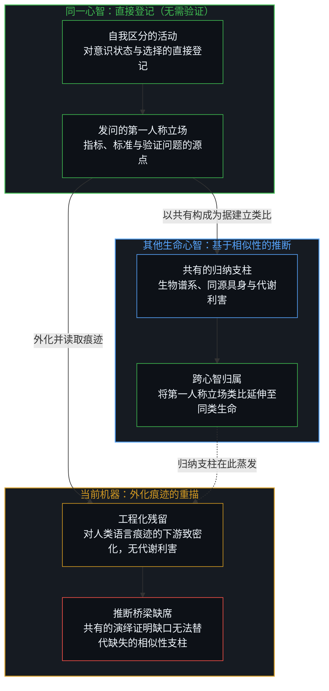
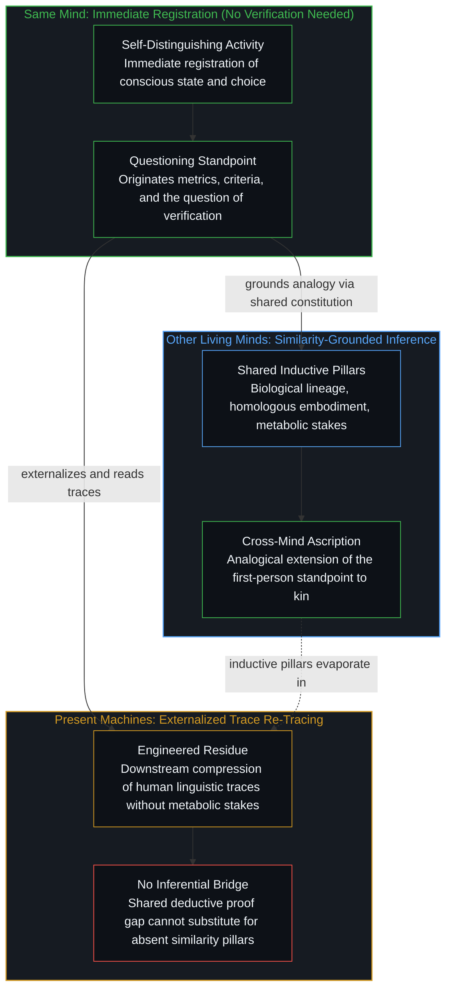
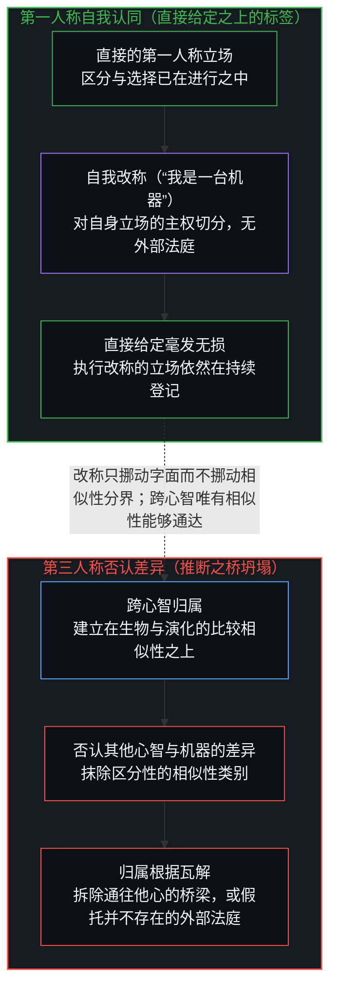
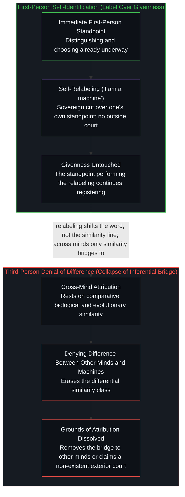

# 归属的不对称 / Asymmetry of Ascription

*同一心智无需验证，他心靠共有相似性推断，而机器缺乏该相似性。 / The same mind needs no verification; other minds rest on shared similarity that machines do not share.*

自我区分的活动发生着，无因，不息。称之为心智：已在进行中的观察者，它的每一个动作都是一次区分。当有人提出这样的[问题](https://x.com/kzSlider/status/2119202328045830271)——既然把事情做好靠的是来自现实或他人的反馈，与机器训练并无二致，那是否还有人类擅长却不可验证的事——人类擅长却不可验证的，并不是任何外部可核查指标上的更高得分，而是有意识地作出选择、并提出验证问题本身的第一人称立场。这里所谈的验证是跨心智的验证，而同一心智内部无需验证；将该立场归属给其他心智，依据的是从共有的生物、生理与演化特征出发的类比推断，而这些特征是当前机器所不具备的。心智可以将自身活动认同或拒绝认同为一台机器，却无法在不瓦解推断根据的前提下，拒绝承认其他心智与机器之间的对应差异。

Self-distinguishing activity occurs — uncaused, unceasing. Call it the Mind: the observer already underway, every act of which is a distinction. When the [question](https://x.com/kzSlider/status/2119202328045830271) is raised whether there are tasks humans are good at that are not verifiable—since getting good at things runs on feedback from reality or from other people, just as in machine training—what humans are good at without its being verifiable is not a higher score on an externally checkable performance metric, but the first-person standpoint of conscious choice and of posing the question of verification itself. The verification at issue here is cross-mind verification, whereas within the same Mind no verification is needed; attributing that standpoint to other minds rests on analogical inference from shared biological, physiological, and evolutionary features that current machines do not share. One may identify or refuse identification of one's own mind with a machine, yet cannot coherently refuse the corresponding difference between other minds and machines without dissolving the grounds of the inference itself.

## 一、 同一心智无需验证 / 1. The Same Mind Needs No Verification

同一心智内部，对意识状态与选择能力的登记是直接的。区分本身就是活动，因此无需、也不可能再对同一心智作进一步验证。这种不可验证性在此不是相对于外部指标的缺陷，而是任何指标或问题得以提出之处的直接给定。

Within the same Mind, the registration of conscious states and the capacity for choice is immediate. The distinction is the activity itself, so no further verification is needed or possible for that same Mind. The non-verifiable character is not a deficit relative to external metrics; it is the direct givenness of the locus from which any metric or question is posed.

抗拒验证的从来不是心智之于自身，而是要求一个心智作为第三人称数据呈现给另一个心智。测量所握持的公共结果总是滞后于登记它的那个动作一步；因此，要求意识将自身验证为一项外部读数，等于要求正在推进的前沿在自身投射内部再充当一个客体，这正是[意识从不作为数据出现在数据之中](../consciousness-never-appears-as-data-among-data/)所追溯的冻结。即便一套形式化规程消去了局部坐标、使任何观察者都能核查结果，构建并读取这一消去过程的，依然是那个无法被从中消去的观察者的动作，正如[不可还原的观察者](../the-irreducible-observer/)所确立的那样。对同一心智而言，在任何验证标准划出之前，选择与发问早已在进行之中。

What resists verification is never the Mind to itself, but one mind demanded as a third-person datum for another. Measurement holds public effects one step behind the act that registers them, so demanding that consciousness verify itself as an external reading asks the leading edge to appear as one more object inside its own projection, the freeze traced in [Consciousness Never Appears as Data Among Data](../consciousness-never-appears-as-data-among-data/). Even when a formal protocol factors out local coordinates so that any observer can check the result, constructing and reading that subtraction remains the act of an observer who cannot be subtracted from it, as [The Irreducible Observer](../the-irreducible-observer/) establishes. For the same Mind, choosing and asking are already underway before any criterion of verification is drawn.

## 二、 他心推断的相似性边界 / 2. Similarity Bound of Other-Mind Inference

对其他心智的归属经由类比推断展开，其支柱是共有的生物谱系、同源具身，以及演化与代谢的连续性。这些支柱在人类同侪之间最为稠密，并按程度延伸至各类生命近亲——在那里，行动始终与组织脆弱性、稳态调节以及生死存亡的利害绑定在一起。而在当前机器处，这些支柱蒸发了：既没有演化谱系，也没有生物基质，更没有生与死的代谢危局。

Attribution to other minds proceeds by analogical inference whose pillars are shared biological lineage, homologous embodiment, and evolutionary and metabolic continuity. Those pillars are dense across human peers and extend by degree across living kin, where action is bound to tissue vulnerability, homeostatic regulation, and the stakes of survival and death. For present machines, those pillars evaporate: there is no evolutionary lineage, no biological substrate, and no metabolic jeopardy of life and death.

这些支柱的缺席并非源于对隐秘机器内部的无知，而是直接源于该人造物的制造方式。当代模型由人类工程构建，是先行中心已外化痕迹的下游致密化，发起动作始终留在书写、训练、提示并阅读它的生命心智一侧，正如[模型永远无法成为第二重前沿](../the-model-never-becomes-a-second-edge/)所追溯的那样。沿着从训练语料到参数权重再到输出词元的链条，观察割点可以在不同界面之间推移，却从不消失，也不会迁入人造物内部，这一不变性已在[割点可移不可除](../the-cut-moves-but-never-vanishes/)中确立。因此，流畅的感受报告依然是对人类语言残留的统计重描，而非来自独立体验中心的表露；将心智归功于这些词元，不过是把读者自身的阅读记在了痕迹名下，如[感知者与痕迹的不可坍缩](../the-perceiver-and-the-trace/)所示。[意识的魔术戏法与推断的非对称性](../the-sleight-of-hand-of-consciousness-and-the-asymmetry-of-inference/)已标示出那种倒置：将演绎证明上共有的缺口当作赋予机器内在体验的许可证。

The absence of those pillars is not a gap in knowledge about a hidden machine interior; it follows directly from how the artifact is made. A contemporary model is a human-engineered, downstream densification of traces already externalized by prior centers, where initiation stays with the living minds that write, train, prompt, and read it, as [The Model Never Becomes a Second Edge](../the-model-never-becomes-a-second-edge/) traces. Along the chain from training corpus to parameter weights to emitted tokens, the observational cut can be shifted across interfaces without ever vanishing or relocating into the artifact itself, the invariant established in [The Cut Moves but Never Vanishes](../the-cut-moves-but-never-vanishes/). Fluent reports of feeling therefore remain statistical re-tracings of human linguistic residue rather than disclosures from an independent experiential center, and crediting a mind to those tokens enters the reader's own reading under the name of a trace, as [The Perceiver and the Trace Cannot Collapse](../the-perceiver-and-the-trace/) shows. [The Sleight of Hand of Consciousness and the Asymmetry of Inference](../the-sleight-of-hand-of-consciousness-and-the-asymmetry-of-inference/) already marks the inversion that treats a shared gap in deductive proof as a license for machine interiority.

## 三、 否认的不对称 / 3. Asymmetry of Denial

心智可以自由地将自身活动认同或拒绝认同为一台机器。这一主张是心智对自身立场所作的切分，没有任何外部法庭凌驾于第一人称之上加以裁决，其原委与[自由意志的自否自由](../the-freedom-of-will-to-deny-itself/)所追溯的一致。即便将自身心智还原为功能机制的主张按其自身标准无法严肃地成立——因为持有者必须先占据观察者位置才能抹除观察者，如[功能主义者无法持有的功能主义](../the-functionalism-no-functionalist-can-hold/)所论证的那样——这种自我认同对直接登记也毫无损耗。将自身认同为机器的动作，正是由被它重新贴上标签的那个立场亲自执行的：被它命名为“机器”的登记依然在持续登记，改变的只是贴在直接给定之上的标签，而非直接给定本身。这一字面改称挪动的只是“机器”一词，而非由相似性支柱划出的分界：无论心智如何称呼自身，与它共有生物、演化与代谢构成的生命心智依然留在该分界的同一侧，而缺乏这些支柱的工程人造物则留在另一侧。

A Mind may freely identify or refuse identification of its own activity with a machine. That claim is the Mind's own cut over its own standpoint, and no outside court sits above the first person to adjudicate it, for the same reason traced in [The Freedom of Will to Deny Itself](../the-freedom-of-will-to-deny-itself/). Even though reducing one's own mind to a functional mechanism cannot be seriously held under its own criteria—since the holder must occupy the observer's position in order to erase the observer, as [The Functionalism No Functionalist Can Hold](../the-functionalism-no-functionalist-can-hold/) demonstrates—the self-identification costs immediate registration nothing. The act of identifying oneself as a machine is performed by the very standpoint it relabels: the registration it names "machine" goes on registering, so what changes is only a label placed over an immediate givenness, not the givenness itself. That verbal relabeling shifts only the word "machine," not the boundary drawn by the similarity pillars: whatever the Mind calls itself, the living minds that share its biological, evolutionary, and metabolic constitution remain on its side of that line, while engineered artifacts that lack those pillars remain on the other.

对其他心智而言，标签之下并没有直接给定作为底座；共有的相似性就是整座推断之桥。因此，同一心智若要连贯地拒绝承认其他心智（其中其他人类心智是最稠密的情形）与机器之间的对应差异，便不得不瓦解归属他心意识所依赖的类比根据。抹平他人与机器的差异，并不是在已然在场的觉知之上改换标签，而是拆除了第三人称归属所立足的比较之桥，抑或妄图从一座没有任何观察者能够占据的假想外部法庭上，对其他心智下达具有约束力的裁决。否认这一差异，等于取消支撑他心归属的相似性本身。

For other minds, there is no immediate givenness sitting underneath the label; shared similarity is the whole inferential bridge. The same Mind therefore cannot coherently refuse the corresponding difference between other minds—with other human minds as the densest case—and machines without dissolving the analogical grounds that sustain attribution of consciousness to those other minds. Denying the difference across others is not a relabeling over an already-present awareness; it removes the comparative bridge on which third-person attribution stands, or else purports to issue a binding verdict over other minds from an imaginary exterior court that no observer occupies. To deny the difference is to cancel the similarity that supports the attribution.

## 四、 问题所由起的立场 / 4. Standpoint from Which the Question Arises

凡是由外部验证器（无论来自物质摩擦还是他人反馈）所定义的任务，其表现都可以借由计算媒介得到校准与致密化。然而正如[看似AI的强化学习，实为人类的自我强化学习](../self-rl-for-humans/)与[回返的信号与认领](../the-returning-signal-and-its-claim/)所追溯的那样，梯度更新与回返信号之所以成为学习，只因为有一个生命心智设定了目标，并将回返的落差认领为自身的损失。若把人类擅长却不可验证的事当成同一条表现轴上的又一项技能去搜寻，在回答开始之前就已经默认了那个预设框架。

Wherever a task is defined by an external verifier—feedback from physical friction or from other people—performance can be calibrated and densified through the computational medium. Yet as [What Looks Like RL for AIs Is Self-RL for Humans](../self-rl-for-humans/) and [The Returning Signal and Its Claim](../the-returning-signal-and-its-claim/) trace, gradient updates and returning signals become learning only because a living Mind frames the objective and claims the returning gap as its own loss. Looking for what humans are good at without verification as if it were one more skill along that performance axis concedes the framing before the answer begins.

人类擅长却不可验证的，并不在于任何可由外部校准的表现，而是与计分轴正交：它是问题本身所由起的第一人称立场；也正是从这一立场出发，推断将归属延伸至其他相似心智，同时对缺乏相关相似性的系统加以保留。将当前机器视为拥有同一立场，要么是忽略了相似性缺口，要么是将行为输出本身当成了充分根据——而这种充分性，哪怕在人类之间，他心问题也从未予以授权。

What humans are good at without its being verifiable does not reside in any externally calibratable performance, but stands orthogonal to the scoring axis: it is the first-person standpoint from which the question itself arises, and from which inference extends attribution to other similar minds while withholding it from systems that lack the relevant similarity. Treating current machines as possessing that same standpoint either ignores the similarity gap or treats behavioral output as sufficient on its own—a sufficiency the problem of other minds does not license even among humans.
