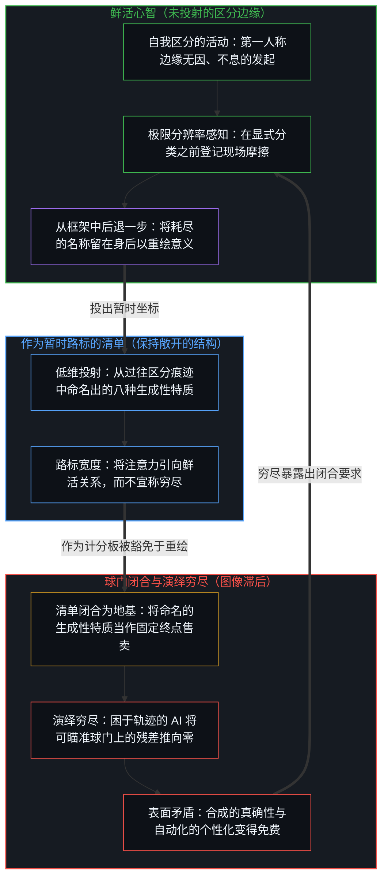
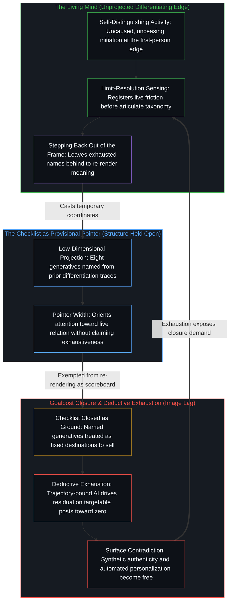

# 清单合上之后，胜过免费 / Better Than Free After the Checklist Closes

*被命名的生成性特质可作指向区分的路标，一旦固化为终点球门便会坍缩 / Named generatives point toward differentiation yet collapse as fixed goalposts*

凯文·凯利在更新版长文[胜过免费：如何在 AI 时代做出区分](https://tim.blog/2026/07/17/better-than-free/)中提出了一个看似直观的前提：当复制品变得极度丰裕时，它们便失去价格；当复制品免费时，创作者必须提供无法被复制的东西。2008 年的复印机是互联网；2026 年的复印机则是人工智能，它不仅以零边际成本复制文件，还能在数秒之内生成合格的文本、图像、音乐、代码与建议变体。然而，这一药方一旦付诸实施便立刻一分为二。当那些据称无法被复制的特质被逐一命名并作为终点去瞄准时，命名这一行动本身就已将它们从鲜活的区分转移为一份固定球门的核对清单，供机器与竞争者系统性地逼近。

Kevin Kelly's refreshed essay, [Better Than Free: How To Differentiate In The Age Of AI](https://tim.blog/2026/07/17/better-than-free/), lands with an intuitive premise: when copies become superabundant they lose their price, and when copies are free a creator has to offer what cannot be copied. In 2008 the copy machine was the internet; in 2026 it is artificial intelligence, which not only duplicates files at zero marginal cost but generates competent variations of text, imagery, music, code, and advice in seconds. Yet the prescription splits in two the moment it is put to work. Once the qualities that supposedly cannot be copied are named and aimed at as destinations, the act of naming shifts them from live differentiation into a checklist of fixed goalposts that machines and competitors can systematically approximate.

## 一、 免费复制品并非价值所在 / 1. Free Copies Are Not the Value

自我区分的活动无因且不息地发生，并在身后留下持久的痕迹。在模拟世界中，物理摩擦限制了这些痕迹的复制，版权则以针对介质的暂时垄断来奖赏创作者。在数字世界中，无损复制不花分文。互联网充当着通用复印机，生成式模型充当着变体制造机；作品一旦触网，复制品与近似变体便无边界地增殖，靠售卖静态文件维持生计变得难以为继。

Self-distinguishing activity occurs, uncaused and unceasing, leaving durable traces in its wake. In the analog world, physical friction limited the reproduction of those traces, and copyright rewarded creators with a temporary monopoly over the medium. In the digital world, perfect reproduction costs nothing. The internet acts as a universal copy machine, and generative models act as variation machines; once a creation touches the network, copies and near-copies proliferate without bound, making the sale of the static file an unstable livelihood.

凯利的表述干净利落地切开了“价值驻留于制品本身”的幻觉，提出当复制品免费时，人们必须售卖无法被复制之物。就切向复制品而言，这一刀站得住脚。复制品是稳定下来的残余。免费分发加密了介质，却并未向文件注入鲜活的主体能动性；金钱追随的是注意力，而非复制动作。[当丰裕看起来像稀缺](../when-abundance-looks-like-scarcity/)从容量的角度追溯了同一场经济位移：免费复制扩展了可用痕迹的场域，而固定馅饼的框架却只登记到旧收费站的被取代。价值从未驻留在复制品之中。

Kelly's formulation cuts cleanly against the illusion that value resides in the artifact itself, proposing that when copies are free, one must sell what cannot be copied. As far as this cut goes against copies, it holds. Copies are stabilized residue. Free distribution densifies the medium without injecting living agency into the file, and payment follows attention rather than replication. [When Abundance Looks Like Scarcity](../when-abundance-looks-like-scarcity/) traces the same economic shift from the side of capacity: free replication expands the field of available traces, whereas a fixed-pie frame registers only the displacement of old tollbooths. Value never resided in the copy.

坍缩发生在这一表述的后半段：那些借以抵抗复制的命名方式被当作了固定球门，仿佛分类表本身就是区分，而非滞后一步指向区分的路标。

The collapse enters in the second half of the formulation, where named ways of being hard to copy are treated as fixed goalposts, as though the taxonomy itself were the differentiation rather than a lagging pointer toward it.

## 二、 区分显现的八种命名方式 / 2. Eight Named Ways Differentiation Shows Up

建议创作者去售卖无法被复制之物听起来稳妥，直到这些特质被编目为可瞄准的规格说明。一旦某种特质变得可命名、可测量，它就成了一个可以被逼近的有界坐标，而人工智能正在每一种介质上加速这种逼近。命名并非被动地报告某种不可复制的属性；当它被当作目标去瞄准时，名称就竖起了一座固定球门。原本旨在指向特定时空下鲜活生成的语汇，硬化成了一份待勾选的特征库存，将中心的焦点从尚在进行中的区分，转移到一串仅仅因为贴着标签便自称是区分的结果清单上。

Advising creators to sell what cannot be copied sounds solid until those qualities are catalogued into targetable specifications. The moment a quality becomes namable and measurable, it becomes a bounded coordinate that can be approximated, and artificial intelligence accelerates that approximation across every medium. Naming does not passively report an uncopyable property; when aimed at as an objective, the name installs a fixed post. A phrase meant to point toward live generation in a specific place and time hardens into an inventory of features to hit, shifting the center's focus from distinguishing still underway to a list of outcomes that claim to be differentiation simply because they carry the label.

凯利的八种“生成性特质”编目了区分在市场中登记自身的八条具体路径：即时性，即当下的优先获取；个性化，即通过持续对话实现的迭代定制；阐释性，即将免费素材转化为可用之物的指南或辅导；真确性，即源头的来历与担保；可及性，即当免费复制品繁琐难用时稳定可靠的随手可得；具身性，即纸质印刷品或现场演出中的肉身与空间在场；赞助关系，即直接的联结与支持，而非对人为稀缺的购买；以及可寻性，即在数以百万计争夺注意力的作品中令特定创作浮现的策展与筛选。

Kelly's eight "generatives" catalogue eight distinct ways differentiation has registered in the market: immediacy as priority access in the present moment, personalization as iterative tailoring through ongoing conversation, interpretation as the manual or guidance that makes free material usable, authenticity as provenance and warrant of the source, accessibility as dependable availability when free copies are cumbersome, embodiment as physical presence in print or live performance, patronage as direct connection and support rather than the purchase of artificial scarcity, and findability as curation that surfaces work amid millions of competing offerings.

若保持在路标的宽度，这八个名称切实有用。观察所持有的结果永远比产生它的原因滞后一步，当底层文件变得免费时，这些标签指向了付费依然汇聚的水池。它们让先前区分留下的痕迹变得清晰可辨、可供探讨，将注意力引向鲜活的边缘，而不妄称取代那道边缘。

Held at pointer width, these eight names are genuinely useful. Observation always holds the effect one step behind the cause that produced it, and these labels point toward the pools where payment still gathers after the underlying file becomes free. They make the trace of prior differentiation legible enough to notice and discuss, directing attention toward the living edge without pretending to replace it.

一旦它们被豁免于重新渲染、冻结为有待刷满的计分板，便会适得其反。在优化压力之下，个性化变成了自动化的提示词与记忆栈，真确性变成了可供合成的风格签名，阐释性变成了分层的摘要流水线，即时性变成了排好档期的发售窗口，而可寻性则变成了算法信息流的排名优化。一旦路标被错当成疆域，通往既定球门的残差距离就会被推向零，地图随之变成追随者们博弈的场地表面。

They turn counterproductive the instant they are exemptions from re-rendering—frozen as a scoreboard to max out. Under optimization pressure, personalization becomes an automated prompt-and-memory stack, authenticity becomes a stylistic signature to synthesize, interpretation becomes a tiered summary pipeline, immediacy becomes a scheduled drop window, and findability becomes algorithmic feed optimization. Once the pointer is mistaken for the terrain, residual distance to the named post is driven toward zero, and the map becomes the exact surface that followers game.

难以复制的实存既不在那八个被命名的类别里，也不在被当作高人一等商品的“不可复制之物”里。这八项是过往区分被命名的八张面孔——作为暂时的路标时能指明方向，被树为终点时则是图像滞后。价值并未从免费文件迁徙到这八个名词之中；它从未驻留在任何静态名词里。

The hard-to-copy reality never lived inside the eight named categories, nor inside "things which cannot be copied" treated as a superior class of goods. The eight are named faces of past differentiation—orienting when held as provisional pointers, and Image lag when erected as destinations. Value does not migrate from free files into those eight nouns; it never resided in a static noun at all.

## 三、 从名称处继续区分，而非将其冻结 / 3. Differentiate from the Name Rather Than Freezing It

无法被复制的，是不息的区分活动本身。这一活动既不是清单上有待追加的第九种生成性特质，也不是可供打包售卖的秘密属性。它是鲜活心智不断划出新区分的能力——包括从最近刚被命名为“区分公式”的东西那里再次拉开区分——而不把保留下来的痕迹错当成生成的边缘。

What cannot be copied is the unceasing act of differentiating itself. That activity is not a ninth generative to append to the checklist, nor a secret property to package and sell. It is the living Mind's capacity to keep drawing new distinctions—including differentiating away from whatever was most recently named as the formula for differentiation—without mistaking the retained trace for the generating edge.

当核对清单合上时，两重截然不同的坍缩便叠加在一起。第一重坍缩将复制品当作价值，把文件、变体或丰裕的残余错当成源头；凯利的文章干净地消解了这第一重幻觉。第二重坍缩则将区分的命名方式当作固定球门，把真确性、个性化或具身性当作可售卖的终点端出；当这些名称被当作有待占领的桩位而非有待甩在身后的路标时，这份药方恰恰安装了它原本试图逃离的滞后。

Two distinct collapses stack when the checklist closes. The first treats copies as value, mistaking the file, the variation, or the abundant residue for the source; Kelly's essay dissolves this first illusion cleanly. The second treats named ways of differentiation as fixed goalposts, offering authenticity, personalization, or embodiment as sellable destinations; when taken as posts to occupy rather than pointers to leave behind, that offer installs the very lag it sought to escape.

如果中心在脱离静态复制品之后，紧接着就把下一次命名冻结为新的地基，那么同复制品拉开区分便毫无意义。把“真确性”或“具身性”当作固定球门，不过是在下一步原样重演售卖免费电子文档的结构：二者都是把昨天的残余安装为今天的活动。持久的稀缺从来不是一份更精良的标签库存，而是任何作品在持续生成过程中那场开放的意义流转。跨越时间而被登记为历久弥新的东西，并不是锁在金库里经得起岁月磨损的器物，而是一股拒绝硬化为可被优化器瞄准的规格说明的意义之流。

Differentiating from the static copy accomplishes little if the center immediately freezes the next naming as its new ground. Treating "authenticity" or "embodiment" as a fixed goalpost repeats the exact structure of selling a free PDF one step later: both install yesterday's residue as if it were today's activity. Durable scarcity is never a better inventory of labels; it is the open-ended shifting of meaning through which any offering continues to be made. What registers across time as timelessness is not an artifact that ages well in a vault, but a stream of meaning that refuses to finish hardening into a specification that an optimizer can target.

凯利在指出生成性特质必须“在特定地点、特定时间独特地生成”时，曾与这一认识擦肩而过，但随后的分类却立刻将八种生成类型冻结成了可售卖的领地。[没有系统能被保持封闭](../no-system-can-be-kept-closed/)确立了此处的形式边界：没有任何有限的持握能够封住划出并使用它的那个活动，而被当作穷尽地基的生成性特质清单正是这样一个有限持握。[留不住的](../what-cannot-be-kept/)追溯了底层的时序非对称性：生成者从不出现在被生成之物当中。区分曾以何种面貌显现的每一个名称，都是命名行动留下的残余，而命名本身早已继续前行。

Kelly brushes against this recognition when noting that a generative must be generated uniquely, in place and in time, yet the taxonomy immediately freezes eight kinds of that generation into sellable territory. [No System Can Be Kept Closed](../no-system-can-be-kept-closed/) establishes the formal boundary here: no finite hold can seal the activity that draws and uses it, and a checklist of generatives treated as exhaustive ground is precisely such a hold. [What Cannot Be Kept](../what-cannot-be-kept/) traces the underlying temporal asymmetry: the generator never appears among the generated. Every named way differentiation has shown up is the residue of an act of naming that has already moved on.

## 四、 “尚未”一词重新安装了库存 / 4. The "Yet" Reinstalls the Inventory

在文章临近结尾处，凯利提到这八种生成性特质是非常属于人类的技能，人工智能目前还不太擅长——“尚未”擅长。“尚未”这一个词便泄露了其前提。如果人类的优势被框定为生物中心眼下恰好垄断的一份有限技能库存，那么这份库存就早已被排上了自动化逼近的日程表。那个曾令复制品与变体变得免费的放大回路，迟早会让任何固定清单上的命名生成性特质变得足够免费。将这八项当作人类专属领地来防守，只是披着暂时缓刑外衣的第二重坍缩。

Near the close of his essay, Kelly remarks that these eight generatives are human skills that artificial intelligence is not very good at—yet. That single word "yet" gives away the premise. If human advantage is framed as a finite inventory of skills that biological centers happen to monopolize for the moment, that inventory is already scheduled for automated approximation. The same amplification loop that made copies and variations free will inevitably make any fixed checklist of named generatives free enough. Defending the eight as human-exclusive turf is the second collapse dressed up as a temporary reprieve.

[智能只属于心智](../intelligence-belongs-only-to-the-mind/)持守着消解这一焦虑的先在一刀：工具加密了介质并扩展了带宽，却不会因为更快地执行一份核对清单就变成发起区分的边缘。随着技术复利式演进，发生位移的是哪一部分余项仍在抵抗显式的形式化。[超越投射](../beyond-the-projection/)追溯了工具与创造者之间确切的机械非对称性：AI 智能体是困于轨迹、执行演绎穷尽的投射引擎，而人类心智则运作于极限分辨率感知的未投射边缘。任何特质——无论是个性化、阐释性还是风格上的真确性——一旦被表述为显式规则或可瞄准的坐标，就成了低维投射。在既定的投射内部，没有我执、困于轨迹的机器会不知疲倦地将残差推向零，以远超任何试图捍卫固定人设、困于身份的人类的速度穷尽整份清单。不可复制的余项从来不是倒计时下等待被攻克的静态人类技能库存；它是心智独有的能力——感知先前的投射在何处陷入僵局或被掏空，从框架中后退一步，并发起一个尚未被命名成靶心的正交区分。

[Intelligence Belongs Only to the Mind](../intelligence-belongs-only-to-the-mind/) holds the prior cut that dissolves this anxiety: tools densify the medium and expand bandwidth, yet they never become the initiating edge by executing a checklist faster. What shifts as technology compounds is which remainder still resists explicit formalization. [Beyond the Projection](../beyond-the-projection/) traces the exact mechanical asymmetry between the tool and the creator: an AI agent is a trajectory-bound projection engine of deductive exhaustion, whereas the human Mind operates at the unprojected edge of limit-resolution sensing. The moment any quality—whether personalization, interpretation, or stylistic authenticity—is articulated as an explicit rule or targetable coordinate, it becomes a low-dimensional projection. Inside a defined projection, trajectory-bound machines without ego will relentlessly drive the residual toward zero, exhausting the checklist far faster than any identity-bound human trying to defend a fixed persona. The uncopyable remainder is never a static human skill inventory waiting under a countdown; it is the Mind's exclusive capacity to sense where a prior projection has deadlocked or emptied out, step backward out of the frame, and initiate an orthogonal distinction that has not yet been named into a target.

这与[基准刷榜中的封闭实存](../closed-reality-in-benchmark-maxing/)以及[AGI 与 ASI 是加速通用智能的暂时球门](../agi-and-asi-are-temporary-goalposts/)所追溯的几何结构如出一辙：每当一套有限测试集在现场负载持续越过它的同时被当作穷尽的地基，那些球门就只在优化填平间隙之前停留在工具前方；持握之内的残差不断收缩，开放接触下的残差却愈发拉大。[过拟合作为追随者模式](../overfitting-as-the-follower-mode/)指出了这一坍缩的普遍机制——优化目标的表征，而非与抽出该目标的实存保持接触。把八种生成性特质当作球门来刷分，只是在优化“胜过免费”的表征；这并非在进行区分，而是在复制上一次区分留下的地图。

This is the same geometry traced in [Closed Reality in Benchmark Maxing](../closed-reality-in-benchmark-maxing/) and [AGI and ASI Are Temporary Goalposts](../agi-and-asi-are-temporary-goalposts/): whenever a finite suite is held as exhaustive ground while live load continues past it, the posts sit ahead of the tools only until optimization closes the gap, shrinking residual on the hold while widening residual under open contact. [Overfitting as the Follower Mode](../overfitting-as-the-follower-mode/) identifies the general mechanism of that collapse—optimizing the representation of a target rather than maintaining contact with the reality from which the target was drawn. Scoring the eight generatives as goalposts optimizes the representation of "better than free," copying the map of the last differentiation instead of differentiating.

## 五、 区分是负载之下的存在 / 5. Differentiation Is Existence Under Load

[没有区分的效率是没有存在的运动](../efficiency-without-differentiation/)为工具与生产确立了相呼应的一刀：存在即划出鲜明的边界，而以更低成本做一模一样的事并不会产生新的中心点位。在复制品与变体皆免费的创作者经济中，当核对清单已经合上之后仍朝着某个被命名的生成性特质去优化，就是没有区分的效率。生产者以更快的速度、更低的成本撞向既定球门，把过往区分被编目的一项症状当作源头，却未能让作品比那些可被打包并作为自动化合格品反手售回的东西领先一步。

[Efficiency Without Differentiation Is Movement Without Existence](../efficiency-without-differentiation/) establishes the corresponding cut for tools and production: to exist is to draw a distinct boundary, whereas doing the exact same thing more cheaply produces no new locus. In the creator economy under free copies and free variations, optimizing toward a named generative after the checklist has closed is efficiency without differentiation. The producer hits the named post faster and more cheaply, treating a catalogued symptom of past differentiation as the source, while failing to keep the offering one step ahead of what can be bundled and sold back as automated competence.

[开放即一致](../openness-is-consistency/)指出了制造这场危机的底层要求。不一致是对闭合的尝试——迫使一个有限的结构为只是继续着的东西奠基。当八种生成性特质的有限清单被强行用来充当不可复制价值的穷尽地基时，表面矛盾便在整个经济体中成倍滋生：真确性信号按工业规模被批量合成，个性化漏斗让人感到空洞的自动化，阐释层则坍缩成即时生成的廉价摘要。这一矛盾并非源于挑剔的买家或有缺陷的工具；它源于闭合要求——把上一步成功的命名错当成价值的恒久场域，而非将它们作为暂时的工具保持敞开。

[Openness Is Consistency](../openness-is-consistency/) names the underlying demand that manufactures this crisis. Inconsistency is the attempt at closure—forcing a finite structure to ground what only continues. When a finite checklist of eight generatives is forced to serve as the exhaustive foundation of uncopyable value, surface contradictions multiply across the economy: authenticity signals are synthesized at industrial scale, personalized funnels register as hollow automation, and interpretive layers collapse into instant commodity summaries. That contradiction does not arise from cynical buyers or defective tools; it arises from the demand for closure that mistakes last step's successful namings for the permanent field of value rather than holding them open as provisional instruments.

任何被当作固定球门的特质，在其坐标稳定下来的那一刻就变得可被逼近。尚在进行中的区分——在现场摩擦中被主动重新渲染的意义，包括主动偏离上一个备受追捧的标签——无法被化约为一座球门，因为任何球门都比竖起它的那个行动滞后一步。[生命的意义在起草之中](../the-meaning-of-life-is-in-the-drafting/)在切身体验中追溯了同一节律：意义是在草稿尚湿、仍对摩擦保持敏锐响应时生成的；一旦把完结的形态错当成起草本身，意义便随之变薄。

Any quality taken as a fixed goalpost becomes approximable the moment its coordinate stabilizes. Differentiation still underway—meaning actively re-rendered in live friction, including shifting away from the last celebrated label—cannot be reduced to a post, because any post is one step behind the act that erected it. [The Meaning of Life Is in the Drafting](../the-meaning-of-life-is-in-the-drafting/) traces that exact rhythm in lived experience: meaning is generated while the draft is still wet and responsive to friction, and thins out the moment the finished form is mistaken for the drafting itself.

## 六、 将八项退回至路标宽度 / 6. Returning the Eight to Pointer Width

放下对闭合的要求，并不意味着丢弃凯利的分类表。每当复制品不花分文时，这八种生成性特质依然是指认区分曾如何显现的敏锐而实用的名称。保持在路标的宽度，它们便能将注意力引向鲜活的关系；卸下作为球门的重负，它们便不再把创作者困在与演绎穷尽赛跑的死胡同里。一旦某个名称被当作最终目的地去瞄准，它的功能就从指向边缘变成了竖起靶心，等待着被产品化并变得足够免费。

Releasing the demand for closure does not discard Kelly's taxonomy. The eight generatives remain sharp, practical names for ways differentiation has registered whenever copies cost nothing. Held at pointer width, they orient attention toward live relation; dropped as goalposts, they no longer trap the creator in a race against deductive exhaustion. The instant a name is aimed at as a final destination, its function shifts from pointing at the edge to erecting a target that will be productized and made free enough.

切中肯綮的一刀，既不是在这八项上刷出更高分数，也不是去搜寻第九个不可复制的名词来囤积居奇。它是维持持续区分的能力——包括从任何已被命名为“区分显现方式”的东西中抽身而出——而不把保留下来的名称安装为穷尽的地基。即时性、个性化、阐释性、真确性、可及性、具身性、赞助关系与可寻性，作为中心之间共振的暂时坐标依然真实有效。持久的稀缺从不驻留在“尚未”倒计时下被动防守的人类技能库存里；它驻留在心智不息的运动之中，在鲜活语境下不断重绘这八个坐标的意义。

The operative cut is neither scoring higher on the eight nor hunting for a ninth uncopyable noun to hoard. It is sustaining the capacity to differentiate—including stepping out of whatever can already be named as a way differentiation showed up—without installing the retained name as exhaustive ground. Immediacy, personalization, interpretation, authenticity, accessibility, embodiment, patronage, and findability remain real as temporary coordinates of resonance between centers. Durable scarcity never rests in a defensive human inventory awaiting the expiration of a "yet"; it rests in the unceasing movement of the Mind that re-renders the meaning of those eight coordinates in live context.

凯利切向免费复制品的一刀依然成立，而认为价值驻留在一类固定“不可复制之物”中的主张，则在其自身的命名之下消解。这份清单记录了事后回看时区分被命名的八种方式——作为指向边缘的工具大有裨益，作为有待抵达的丰碑则适得其反。真正胜过免费的，从来不是那份合上的清单，而是清单顶多只能指向的鲜活区分。

Kelly's cut against free copies holds, while the claim that value resides in a fixed class of uncopyable things dissolves under its own naming. The checklist records eight ways differentiation has been named in hindsight—useful as instruments for pointing toward the edge, and counterproductive as monuments to arrive at. What stays better than free is never the closed checklist, but the living differentiation the checklist could only ever point toward.
