# 百万亿地平线之外 / Beyond the Hundred-Trillion Horizon

*热力学相变为文明撑开无界空间，而企业股权从来无法垄断全域外溢的社会剩余 / Thermodynamics unlocks an open horizon, yet equity never monopolizes the diffusing social surplus.*

当技术先锋断言商业航天企业的市值终将数个数量级超越当今人类整体经济产出时，舆论习惯将其归为狂想或创始人修辞。这种轻率的否定，源于将地球当前的一百万亿美元产出当作封闭、静止的分母，再将单一企业的扩张投射其中。要使数千万亿美元的估值在逻辑上自洽成立，文明的经济总分母本身必须伴随鲜活心智走出封闭的行星边界、迈向开放的太阳系视界而实现数个数量级的跃迁。从封闭生物圈跨入开放太阳系，会将可调动的能量通量、物质存量与热沉空间拓宽数个数量级；与此同时，竞争模仿与市场耗散会将由此生成的绝大部分剩余转化为日常生活的普遍水准，而私人企业股权所能留存的仅仅是相伴而生的尾部残差。

When a technological pioneer asserts that a space exploration firm could eventually achieve a valuation orders of magnitude larger than Earth's contemporary economy, public commentary reflexively dismisses the claim as founder hyperbole. That dismissal rests on holding Earth's present 100-trillion-dollar output as a sealed, static denominator while projecting a single enterprise's expansion inside it. For a multi-quadrillion-dollar valuation to materialize coherently, the civilizational economic denominator must itself expand by multiple orders of magnitude as living minds step out of a closed planetary boundary into an open solar horizon. Crossing from a closed biosphere into an open solar system widens the available energy flux, material stock, and thermal sink by orders of magnitude, while competitive imitation and market dissipation pass the vast preponderance of the resulting surplus into everyday living standards, leaving private corporate equity as a trailing residual.

## 一、 千万亿美元命题与历史分母的扩容 / 1. The Quadrillion-Dollar Premise and the Expanding Historical Denominator

评估这一断言的首要步骤，是审视当下基准数据的量级约束。当前人类全体社会的年度国内生产总值约为一百万亿至一百零五万亿美元，而全球累积的全部土地建筑、机器设备、基础设施以及金融工具总财富，测算规模大约在四百五十万亿至五百万亿美元之间。声称单一商业实体的市值能够数个数量级凌驾于该基准之上，意味着其资本定价必须跨入千万亿美元的阶梯，即达到10¹⁵美元的数学量级。在传统金融话语与贴现现金流建模中，此类投射显得荒诞不经，常被当作投机噱头弃置一旁。

Assessing this assertion requires a disciplined examination of contemporary planetary baselines. Humanity's total annual gross domestic product presently hovers between 100 and 105 trillion dollars, while total global wealth—the accumulated stock of land and buildings, machinery, infrastructure, and financial instruments—is estimated around 450 to 500 trillion dollars. Suggesting that a single corporate enterprise could achieve a valuation orders of magnitude larger than that benchmark implies a market capitalization measured in quadrillions of dollars, scaling into the regime of 10¹⁵ dollars. Within conventional financial discourse and discounted cash flow modeling, such a projection appears mathematically nonsensical, routinely discarded as speculative theatre.

然而，若将观察窗口拉长五个世纪，回溯人类上一次跨越重大地理边界的历史时刻——即大西洋航线的开拓，便会发现那种表面上的不可能，源于把当下的基准分母当成了固定不变的存量蛋糕，这正是[当丰裕看起来像稀缺](../when-abundance-looks-like-scarcity/)所剖析的封闭假设。根据经济史学家安格斯·麦迪森的历史重构，在公元1500年，以1990年国际元计量的全球年度总产出仅约为二千四百七十亿美元，其中整个西半球的产出仅占全球总额的百分之三至百分之四，而由中国、印度次大陆以及西欧主导的旧大陆占据了几乎全部有记载的经济活动。那时的全球人均收入维持在数百美元的低位区间，死死锚定在维持温饱的自给农业之上。

Yet expanding the observation window across five centuries to humanity's prior geographical leap—the opening of the Atlantic frontier—reveals that the apparent impossibility stems from treating the present baseline denominator as a fixed, exhaustive pie, the same closure dissected in [When Abundance Looks Like Scarcity](../when-abundance-looks-like-scarcity/). According to economic historian Angus Maddison's historical reconstructions, total planetary output in 1500 AD measured approximately 247 billion dollars in 1990 international Geary-Khamis dollars. The entire Western Hemisphere contributed merely 3 to 4 percent of that aggregate, with the Old World—dominated by China, the Indian subcontinent, and Western Europe—accounting for virtually the entirety of recorded economic activity. Average per-capita incomes hovered in the low hundreds of dollars, rigidly pinned to subsistence agriculture.

时隔五百年，当今诸如苹果、微软或英伟达等头部科技企业，各自的股权市值已稳定在三万五千亿美元上下。单一现代企业的市值，已经是公元1500年全人类年度经济总产出的十倍以上。如果有人在公元1500年的塞维利亚或威尼斯港口向商人与金融家预言，未来会出现一家私人实体的资本价值超过当时整个已知世界年产出的整整一个数量级，这一断言在当时的日常经验下定会被斥为天方夜谭。在公元1500年的分母刻度内，这样的规模无从显影；它之所以在随后几个世纪里化作跨越不同观察者皆可一致确认的宏观事实，正是因为文明总分母实现了数百倍的扩张。

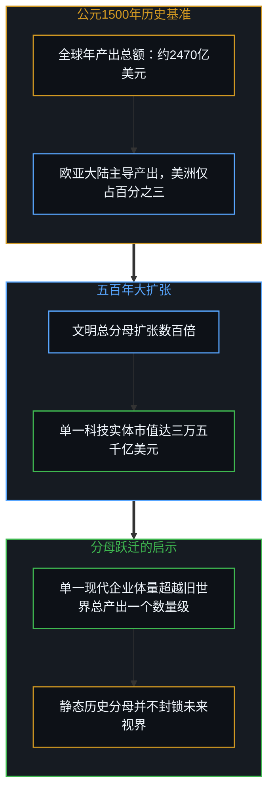

Five centuries later, leading technology enterprises such as Apple, Microsoft, and NVIDIA command individual market capitalizations hovering around 3.5 trillion dollars each. A single contemporary corporate firm is valued at more than ten times the entire annual economic output of 1500 AD humanity combined. Had an observer approached a merchant in Seville or a financier in Venice in 1500 AD and prophesied the existence of a private entity whose capital worth surpassed the annual throughput of the entire known world by an order of magnitude, the claim would have been dismissed as impossible under common experience. Within the 1500 AD denominator, such a scale could not register; it materialized into an invariant macroscopic reality across observers only because the civilizational denominator expanded by hundreds of times over the ensuing centuries.

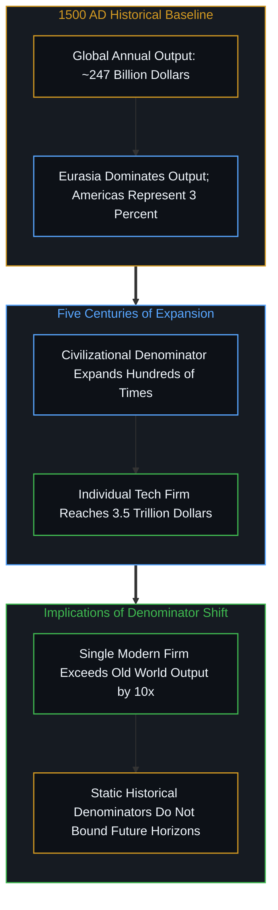

不过，这面历史镜子同样引入了一重关键的审慎校正。美洲新大陆的开拓从未被任何单一商业企业垄断。西班牙的西印度贸易署与王室特许垄断确立了早期的贸易漏斗，但后续复利累积的庞大财富，却分散在相互竞争的主权王室、商人财团与去中心化的开拓定居者手中。即便是常因巅峰投机估值折合数万亿现代美元而被引用的荷兰东印度公司，其主导的也是东南亚香料航线而非大西洋西半球，最终也在高昂的行政管理负荷与贸易转向中解体。此外，波托西银矿流入的新大陆白银，在早期引发的是价格革命期间长达数十年的欧洲通货膨胀；切身可感的人均繁荣复利，直到几个世纪后随着制度成熟与工业机械化才得以兑现。

However, this historical mirror also introduces a vital corrective. The opening of the Americas was never captured or monopolized by a single corporate enterprise. Spain's Casa de Contratación and royal monopolies established early trade funnels, yet the vast compounding of wealth was distributed among competing sovereign crowns, merchant syndicates, and decentralized settlers. Even the Dutch East India Company, frequently cited for its peak speculative valuation reaching trillions of modern dollars, dominated Southeast Asian spice routes rather than the Atlantic hemisphere, eventually dissolving under administrative overhead and shifting trade. Furthermore, New World silver from Potosí initially triggered decades of European inflation during the Price Revolution; tangible compounding of per-capita prosperity arrived centuries later through institutional maturation and industrial mechanization.

## 二、 封闭系统与开放视界的热力学相变 / 2. The Thermodynamic Phase Shift from Closed Systems to Open Horizons

尽管大西洋边疆的比喻极具启发性，但若从认知模型所映射的物质与能量宏观摩擦来审视，它依然低估了太空边疆的量级。历史上的美洲地理大发现，只是对一个既有封闭行星系统的有限算术加法。美洲大陆将当时已知的陆地面积扩大了约百分之二十八，但人类文明依然被锁在地球的封闭热力学包络之内，受制于稀薄的大气层、脆弱的表层土壤、稀缺的地壳矿产，以及环境废热耗散所面临的严苛生态约束。

Instructive as the Atlantic frontier analogy remains, when evaluated through the macroscopic friction of matter and energy mapped by cognitive models, it understates the scale of the space frontier. The historical discovery of the Americas was merely a finite arithmetic addition to an already closed planetary system. The Americas expanded the known terrestrial land area by roughly 28 percent, but human civilization remained bound within Earth's closed thermodynamic envelope, constrained by a thin atmosphere, fragile topsoil, scarce crustal minerals, and severe ecological constraints on environmental heat dissipation.

与此相对，太空探索构成了一场开放式热力学相变。地球截获的太阳辐射功率仅约为1.7 × 10¹⁷瓦，不足太阳总辐射产出的二十亿分之一；而在开放宇宙中，太阳向周围空间持续辐射高达3.8 × 10²⁶瓦的功率，在轨道上可全天候获取，毫无大气衰减或气象干扰。在物质丰度上，仅小行星带就储藏着大约3 × 10²¹千克可开采的水冰、镍铁以及铂族矿物。更关键的是，轨道空间中的工业活动可以直接向2.7开尔文的宇宙微波背景辐射废热，为轨道冶炼厂与巨型算力集群提供了无界的热力学热沉空间。

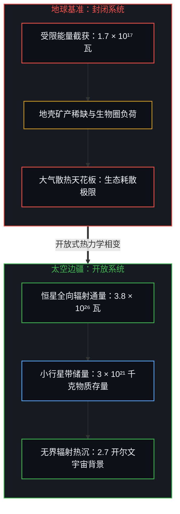

Space exploration, by contrast, constitutes an open thermodynamic phase shift. Earth intercepts merely 1.7 × 10¹⁷ watts of solar power, which represents less than one part in two billion of total solar output. In the open cosmos, the Sun emits 3.8 × 10²⁶ watts into surrounding space, accessible in orbit around the clock without atmospheric attenuation or weather disruptions. In material abundance, the asteroid belt alone contains roughly 3 × 10²¹ kilograms of accessible water ice, nickel-iron, and platinum-group minerals. Crucially, industrial activities in orbital space can radiate waste heat directly into the 2.7 Kelvin cosmic microwave background, providing an unbounded thermodynamic heat sink for orbital foundries and massive computational clusters.

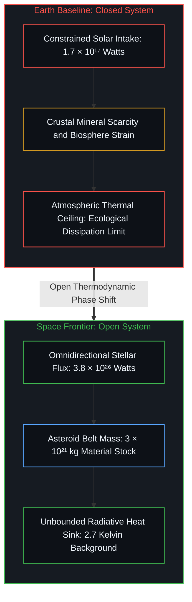

这种转变不是在既有航海图的边缘多画出一片大陆，而是类似于生命从海洋环境登上陆地的演化飞跃。正如[封闭的假设把复利挤成 S 曲线](../closed-assumptions-squeeze-compounding-into-s-curves/)所追踪的，固定的行星承载力会将工业复利挤压进逻辑斯蒂饱和；而迈入轨道空间则直接拓宽了标尺本身——这正是[生产、消费与心智的区分](../production-consumption-and-the-minds-distinction/)所揭示的从封闭边界向开放区分的转换。从能量与物质的热力学通量来建模，一个直接汲取无衰减恒星辐射与小行星物质的跨行星经济体，其吞吐容量足以超越当今地表产出数个数量级。

This transition is not equivalent to drawing another continent along the perimeter of an existing nautical map; it resembles the evolutionary leap of life transitioning from marine environments onto dry land. Whereas a fixed planetary carrying capacity squeezes industrial compounding into logistic saturation, as traced in [Closed Assumptions Squeeze Compounding into S-Curves](../closed-assumptions-squeeze-compounding-into-s-curves/), stepping into orbital space widens the register itself—the shift from a sealed boundary to open differentiation traced in [Production, Consumption, and the Mind's Distinction](../production-consumption-and-the-minds-distinction/). When modeled through thermodynamic flows of energy and matter, an interplanetary economy drawing on unattenuated solar radiation and asteroidal mass possesses a throughput capacity that exceeds contemporary terrestrial output by multiple orders of magnitude.

## 三、 边疆运输的双重困局与离地价值悖论 / 3. The Dual Dilemma of Frontier Transport and the In-Space Value Paradox

无界的物理潜能，并不会自动折现为私人金融股权。在将宇宙物理图景转化为经济估值的过程中，人们会立刻撞上由去中心化经济网络拓扑所决定的严峻结构约束。

Unbounded physical potential does not automatically translate into private financial equity. When converting cosmic physics into economic valuation, one immediately encounters formidable structural constraints defined by the topology of decentralized economic networks.

第一重张力体现在边疆运输基础设施的结构性两难。如果外部产业生态落后发射运力突破太多，拓荒先锋就会直面买方瓶颈。假若地表机构缺乏足够的资本、机器人与工装去建造轨道冶炼厂、天基数据集群或月面采掘节点，轨道运输运营商就无法从发射合同中收获现金流。它将被迫在内部自行注资、研发并运营每一个下游环节——这种程度的全栈垂直整合会迅速压垮企业的资产负债表。

The first tension appears in the structural dilemma of frontier transportation infrastructure. If the broader industrial ecosystem lags too far behind launch improvements, the pioneer confronts the buyer bottleneck. If terrestrial institutions lack the capital, robotics, and tooling to erect orbital foundries, space-based data clusters, or lunar extraction nodes, an orbital transport operator cannot harvest cash flows from launch contracts. It would be forced to internally capitalize, engineer, and operate every downstream segment itself—a degree of vertical integration that swiftly overwhelms corporate balance sheets.

反之，如果其余工业基础迅速动员跟进，基础设施建设者又会直接撞上十九世纪的铁路困局。横贯大陆的铁路网释放了北美腹地的浩瀚财富，但铁路运营商自身却深陷惨烈的价格战、快速的资产折旧与连环破产之中。持久的财富并未归于铺轨者，而是流向了那些搭乘铁路展开商业运作的参与者——滋养了美孚石油、卡内基钢铁、西尔斯百货以及沿线繁荣的商业中心。

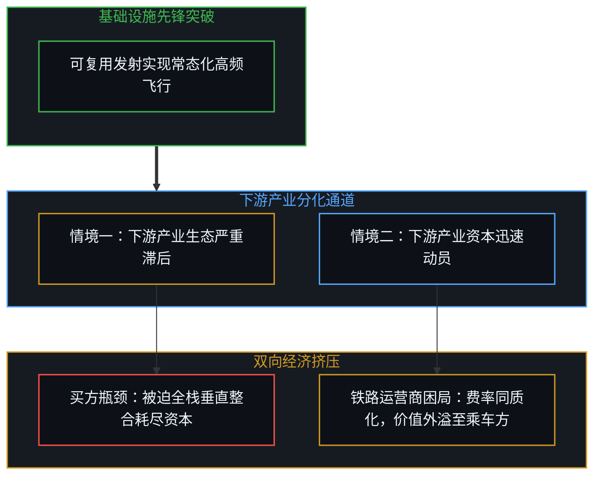

Conversely, if the rest of the industrial base mobilizes rapidly, the infrastructure builder runs directly into the nineteenth-century railroad dilemma. The transcontinental railroads unlocked the vast wealth of the American interior, yet the railroad operators themselves suffered savage price wars, rapid asset obsolescence, and serial bankruptcies. Enduring fortunes accrued not to the track-layers, but to those who rode the rails—fueling Standard Oil, Carnegie Steel, Sears Roebuck, and urban commercial centers.

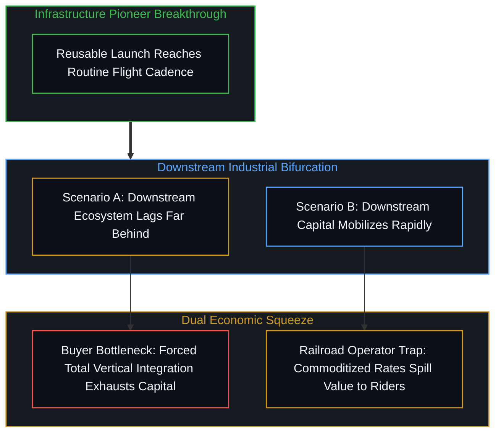

更具欺骗性的是坊间对小行星采矿的估值测算。媒体报道常按当前大宗商品现货报价，断言灵神星等富金属小行星价值数万万亿美元，这犯下了基础性的认知谬误：正如[价格是言说，理解是交易](../price-as-utterance-understanding-as-trade/)所追踪的，价格刻度并非储存在金属原子内部的内禀标量，而是鲜活心智在特定稀缺条件下达成的局部出清痕迹。将数千万吨铂金或黄金直接抛入地球重力井，会瞬间饱和地表供给，使现货价格趋近于零。地外金属与能源唯有在太空中被就地消耗与加工——制造成在轨太阳能阵列、深空通信节点以及轨道栖息地——才能兑现生产与交换价值。唯有当经济代谢本身迁出大气层之外，这份财富才得以成立。

Even more deceptive are popular valuations of asteroid mining. Media reports asserting that metal-rich asteroids like 16 Psyche are worth thousands of quadrillions of dollars based on current spot commodity quotes commit an elementary fallacy: as [Price as Utterance, Understanding as Trade](../price-as-utterance-understanding-as-trade/) traces, a price print is not an intrinsic scalar stored inside metallic atoms, but a local clearing trace between living minds under specific scarcity conditions. Dropping millions of tons of platinum or gold down Earth's gravity well would instantly saturate terrestrial supply, driving spot prices toward zero. Off-world metals and energy realize productive and exchange value only when consumed and processed in space—manufactured into orbital solar arrays, deep-space communication nodes, and orbital habitats. The wealth exists only to the extent that the economic metabolism itself relocates beyond the atmosphere.

## 四、 诺德豪斯定律与残差错配：将文明剩余误认为企业股权 / 4. Nordhaus's Law and the Residual Mismatch: Conflating Civilizational Surplus with Corporate Equity

解开这一估值悖论的基石，在于将重大技术断裂所释放的社会总剩余，与拓荒先锋所能捕获的私人金融股权区分开来。正如[私人残差与社会剩余的因果次序](../the-causal-order-of-private-residuals-and-social-surplus/)所剖析的，任何剩余在存在之前，都必须先由鲜活心智在剧烈的环境摩擦中押下投机赌注、亲手将其创造出来；然而一旦作业通道得到验证，竞争模仿与市场耗散便会将这份丰饶的绝大多数转移给下游参与者。

The foundational key to resolving this valuation paradox lies in distinguishing the total social surplus unleashed by a major technological rupture from the private financial equity captured by the pioneer. As explored in [The Causal Order of Private Residuals and Social Surplus](../the-causal-order-of-private-residuals-and-social-surplus/), any surplus must physically be brought into being by living minds placing speculative wagers under intense environmental friction before it can exist; yet once operational channels are proven, competitive imitation and market dissipation transfer the overwhelming bulk of that bounty to downstream participants.

诺贝尔经济学奖得主威廉·诺德豪斯在对战后美国经济技术创新的里程碑式实证研究中，给出了量化经济剩余如何跨创新周期分配的宏观统计遥测。实证数据表明，先驱创新者通过利润与企业股权仅能捕获社会总剩余的约百分之二点二，其余百分之九十七点八尽数通过更低的价格、更强的性能与更高的生活水准传递给消费者与下游产业。这一比例并非凭空降临的形而上学铁律，而是下游心智持续模仿与竞争套利所涌现出的结构性不变量：在生产者捕获与社会剩余之间确立了约一比四十五的基准比例，即百分之二点二除以百分之九十七点八约等于四十五分之一。在对数尺度下，以10为底45的对数约为1.65，意味着四十五倍的落差恰巧对应着一点五至两个数量级。

In his seminal empirical study on technological innovation within the postwar United States economy, Nobel laureate William Nordhaus provided rigorous macroeconomic telemetry quantifying how economic surplus distributes across innovation cycles. The empirical data demonstrated that pioneering innovators captured only roughly 2.2 percent of total social surplus in profits and corporate equity, with the remaining 97.8 percent passed through to consumers and downstream industries via lower prices, superior capabilities, and enhanced living standards. This ratio is not a metaphysical law from nowhere, but the emergent structural invariant of continuous imitation and competitive arbitrage by downstream minds: establishing a baseline ratio of roughly 1:45 between producer capture and social surplus, where 2.2 percent divided by 97.8 percent yields approximately 1 over 45. In logarithmic terms, the base-10 logarithm of 45 is approximately 1.65, meaning that a 45-fold factor corresponds precisely to 1.5 to 2 orders of magnitude.

纵深的历史宏观统计遥测为这一投射提供了严整的参照系。根据经济史学测算，公元1500年全球年度国内生产总值约为二千四百七十亿美元，而当今全球国内生产总值徘徊在一百万亿美元上下——年度产出流扩张了约四百倍。与此同时，全球累积财富从公元1500年的约二千五百亿美元增长至今日的约五百万亿美元——累积资产存量扩张了两千倍。取年度产出四百倍扩张与累积财富两千倍扩张之间的中位数，可以看到文明经济资产分母在历史上实现了约一千倍的扩张。将诺德豪斯的发现与这一千倍的历史中位数加以校准，会浮现出一个鲜明的数学关系：在扩张了一千倍的分母之内，严格捕获新剩余百分之二点二的先驱企业，其实现的股权估值等于前一个全球经济总量的二十二倍（1,000 × 2.2% = 22）。将这一乘数锚定在实证历史中即可印证其精度：公元1500年全球经济总量的二十二倍约为五万四千亿美元；如今，苹果、微软与英伟达等头部科技企业各自拥有三万五千亿至四万亿美元的市场估值——相当于公元1500年整个行星产出的十四至十六倍，与二十二倍的理论基准高度吻合。这一历史校准表明，设想一家企业的资本市值超越前代文明整体经济规模数个数量级，并非凭空狂想，而是受分母扩容支配的既有宏观经济规律。

Deep historical macroeconomic telemetry provides a disciplined reference point for this projection. According to economic historiography, total planetary annual gross domestic product in 1500 AD stood at approximately 247 billion dollars, whereas global GDP today hovers around 100 trillion dollars—a roughly 400-fold expansion in annual productive flows. Concurrently, accumulated global wealth grew from roughly 250 billion dollars in 1500 AD to approximately 500 trillion dollars today—a 2,000-fold expansion in accumulated asset stocks. Taking the median between this 400-fold expansion in annual output and the 2,000-fold expansion in accumulated wealth reveals an approximate 1,000-fold historical expansion in the civilizational economic asset denominator. Calibrating Nordhaus's findings against this 1,000-fold historical median reveals a striking mathematical formulation: within a 1,000-fold expanded denominator, a pioneering enterprise capturing strictly 2.2 percent of the new surplus realizes an equity valuation equal to 22 times the size of the previous global economy (1,000 × 2.2% = 22). Grounding this multiplier in empirical history demonstrates its precision: twenty-two times the 1500 AD global economy yields approximately 5.4 trillion dollars; today, leading technology enterprises such as Apple, Microsoft, and NVIDIA command market valuations between 3.5 and 4 trillion dollars each—representing 14 to 16 times the entire 1500 AD planetary output, remarkably close to the theoretical 22-fold benchmark. This historical calibration demonstrates that envisioning a corporate capitalization orders of magnitude larger than a prior civilization's total economy is not wild hyperbole, but an established macroeconomic pattern governed by denominator expansion.

具有决定性意义的是，当将这一历史数学关系投射至太空边疆时，一千倍的扩张仅仅构成保守的底线，而非上限。大西洋边疆的开启只是纳入了美洲——在地球封闭生物圈内部增加了百分之二十八的陆地面积。相比之下，迈向太阳系是一场开放式热力学相变：太阳辐射出3.8 × 10²⁶瓦的原生功率，小行星带储藏着数以千万亿吨计的工业矿石，宇宙真空则提供了无界的2.7开尔文热沉。面对这一开放的热力学上行空间，文明分母扩张一千倍只是一个保守的基准底线。将二十二倍的乘数应用于当今一百万亿美元的地表经济，即可得出两千二百万亿美元（2.2 × 10¹⁵美元）的企业市值底线。因此，先驱太空基础设施企业实现数千万亿美元的估值，是开放热力学扩张下具备数学支撑的下界，而非无根幻想。与此同时，人类社会承接其余百分之九十七点八的剩余，收获迈向九万七千八百万亿美元（9.78 × 10¹⁶美元）的普惠文明红利。

```mermaid
flowchart TD
    classDef default fill:#0d1117,stroke:#30363d,stroke-width:1px,color:#f0f6fc;
    classDef mind fill:#0d1117,stroke:#3fb950,stroke-width:1.5px,color:#f0f6fc;
    classDef warn fill:#0d1117,stroke:#d29922,stroke-width:1.5px,color:#f0f6fc;
    classDef fail fill:#0d1117,stroke:#f85149,stroke-width:1.5px,color:#f0f6fc;
    classDef model fill:#0d1117,stroke:#58a6ff,stroke-width:1.5px,color:#f0f6fc;
    subgraph S_DENOM_ZH ["历史分母扩容与开放热力学底线"]
        direction TB
        MEDIAN["历史分母中位数扩张：一千倍<br/>年度产出扩张四百倍与累积财富扩张两千倍之中值"]:::model
        FLOOR["开放相变确立底线<br/>恒星通量与小行星质量提供开放上行空间，一千倍仅为底线"]:::model
        MEDIAN --> FLOOR
    end
    subgraph S_FORMULA_ZH ["诺德豪斯残差捕获乘数"]
        direction TB
        CALC["一千倍分母扩容 × 百分之二点二先驱捕获 = 二十二倍前代全球经济"]:::warn
    end
    subgraph S_MAPPING_ZH ["实证历史校验与太空前沿投射"]
        direction TB
        HIST_VAL["公元1500年基准（2470亿美元）：对应5.4万亿美元<br/>头部科技巨头（3.5至4万亿美元）达旧世界14至16倍，贴近22倍基准"]:::mind
        SPACE_VAL["当今地球基准（100万亿美元）：对应2200万亿美元（2.2 × 10¹⁵）<br/>先驱企业估值跨入千万亿阶梯，构成开放热力学底线"]:::mind
        HIST_VAL -.-> SPACE_VAL
    end
    subgraph S_LADDER_ZH ["价值留存的尺度阶梯：从个体到文明"]
        direction TB
        INDIV["自然人个体财富留存<br/>创始人持股仅为有限份额，受稀释、税收与生物寿命约束"]:::model
        CORP["头部企业资本股权<br/>跨期贴现与机构资金汇聚，平均市值高于百分之二点二基准"]:::warn
        ECOSYS["生态系统总资本价值<br/>上游制造商与轨道基础设施以更大裕度超越基准"]:::warn
        SURPLUS["文明社会总剩余<br/>百分之九十七点八普惠红利（约9.78万万亿美元，9.78 × 10¹⁶）"]:::mind
        INDIV --> CORP --> ECOSYS --> SURPLUS
    end
    S_DENOM_ZH ==> S_FORMULA_ZH
    S_FORMULA_ZH ==> S_MAPPING_ZH
    S_MAPPING_ZH ==> S_LADDER_ZH
    style S_DENOM_ZH fill:#161b22,stroke:#58a6ff,stroke-width:1.5px,color:#58a6ff
    style S_FORMULA_ZH fill:#161b22,stroke:#d29922,stroke-width:1.5px,color:#d29922
    style S_MAPPING_ZH fill:#161b22,stroke:#3fb950,stroke-width:1.5px,color:#3fb950
    style S_LADDER_ZH fill:#161b22,stroke:#a371f7,stroke-width:1.5px,color:#a371f7
```

Decisively, when this historical mathematical relationship is projected onto the space frontier, that 1,000-fold expansion represents a conservative floor rather than an upper ceiling. The opening of the Atlantic frontier merely incorporated the Americas—a 28 percent increase in planetary land area confined entirely within Earth's closed biosphere. By contrast, expanding into the solar system represents an open thermodynamic phase shift: the Sun radiates 3.8 × 10²⁶ watts of raw energy, the asteroid belt holds quadrillions of tons of industrial ores, and cosmic vacuum provides an unbounded 2.7-Kelvin thermal sink. Given this open thermodynamic upside, a 1,000-fold expansion of the civilizational denominator serves as a conservative baseline floor. Applying the 22-fold multiplier to today's 100-trillion-dollar terrestrial economy yields a corporate market capitalization floor of 2.2 quadrillion dollars (2.2 × 10¹⁵ dollars). A multi-quadrillion-dollar valuation for a pioneering space infrastructure enterprise is therefore a mathematically robust lower bound under open thermodynamic expansion, rather than ungrounded fantasy. Simultaneously, human society inherits the complementary 97.8 percent of the surplus, securing diffusing civilizational dividends scaling toward 97.8 quadrillion dollars (9.78 × 10¹⁶ dollars).

```mermaid
flowchart TD
    classDef default fill:#0d1117,stroke:#30363d,stroke-width:1px,color:#f0f6fc;
    classDef mind fill:#0d1117,stroke:#3fb950,stroke-width:1.5px,color:#f0f6fc;
    classDef warn fill:#0d1117,stroke:#d29922,stroke-width:1.5px,color:#f0f6fc;
    classDef fail fill:#0d1117,stroke:#f85149,stroke-width:1.5px,color:#f0f6fc;
    classDef model fill:#0d1117,stroke:#58a6ff,stroke-width:1.5px,color:#f0f6fc;
    subgraph S_DENOM_EN ["Denominator Expansion and Thermodynamic Floor"]
        direction TB
        MEDIAN["Historical Median Denominator Expansion: 1,000-Fold<br/>Median Between 400x Annual Output and 2,000x Accumulated Wealth"]:::model
        FLOOR["Open Phase Shift Establishes a Floor<br/>Stellar Flux and Asteroidal Mass Provide Open Upside; 1,000x Is a Floor"]:::model
        MEDIAN --> FLOOR
    end
    subgraph S_FORMULA_EN ["Nordhaus Residual Capture Multiplier"]
        direction TB
        CALC["1,000x Denominator Expansion × 2.2% Pioneer Capture = 22x Prior Global Economy"]:::warn
    end
    subgraph S_MAPPING_EN ["Empirical Validation and Space Projection"]
        direction TB
        HIST_VAL["1500 AD Baseline (247B Dollars): Corresponds to 5.4 Trillion Dollars<br/>Leading Tech Giants (3.5T to 4T Dollars) Reach 14x-16x Old World, Close to 22x Benchmark"]:::mind
        SPACE_VAL["Earth Baseline (100T Dollars): Corresponds to 2.2 Quadrillion Dollars (2.2 × 10¹⁵)<br/>Pioneer Valuation Scales to Quadrillions as an Open Thermodynamic Floor"]:::mind
        HIST_VAL -.-> SPACE_VAL
    end
    subgraph S_LADDER_EN ["Scale Ladder of Value Preservation: From Individual to Civilization"]
        direction TB
        INDIV["Individual Wealth Retention<br/>Founder holdings are fractional tranches subject to dilution, taxes, and lifespan"]:::model
        CORP["Leading Enterprise Capital Equity<br/>Intertemporal discounting and institutional pooling; average market cap exceeds 2.2%"]:::warn
        ECOSYS["Total Ecosystem Capital Value<br/>Upstream fabricators and orbital infrastructure exceed baseline by wider margin"]:::warn
        SURPLUS["Civilizational Social Surplus<br/>97.8 percent diffuse dividend (~97.8 Quadrillion Dollars, 9.78 × 10¹⁶)"]:::mind
        INDIV --> CORP --> ECOSYS --> SURPLUS
    end
    S_DENOM_EN ==> S_FORMULA_EN
    S_FORMULA_EN ==> S_MAPPING_EN
    S_MAPPING_EN ==> S_LADDER_EN
    style S_DENOM_EN fill:#161b22,stroke:#58a6ff,stroke-width:1.5px,color:#58a6ff
    style S_FORMULA_EN fill:#161b22,stroke:#d29922,stroke-width:1.5px,color:#d29922
    style S_MAPPING_EN fill:#161b22,stroke:#3fb950,stroke-width:1.5px,color:#3fb950
    style S_LADDER_EN fill:#161b22,stroke:#a371f7,stroke-width:1.5px,color:#a371f7
```

这正是分母扩容带来的结构性推论。若将太空经济仅仅建模为产出相当于今日地表十倍的边际领域，经典的百分之二点二诺德豪斯捕获率会将先驱企业的市值限制在二十万亿美元上下，无法触及千万亿美元门槛。然而那种静态测算低估了热力学相变的尺度。将一千倍的分母扩容确立为基准底线，意味着跨行星经济总分母将迈入十万万亿美元（10¹⁷美元）。在扩容后的分母之内，严格捕获百分之二点二价值的先驱企业自然达到两千二百万亿美元（2.2 × 10¹⁵美元）的市场估值。千万亿美元估值的数学自洽性，并不需要某家私人企业垄断全宇宙这种不可能的剧本；恰恰相反，它要求文明的其余部分收获约九万八千亿美元量级之上、达九万八千万亿美元（9.78 × 10¹⁶美元）的普惠社会剩余。先驱企业数千万亿美元的股权，只是十万万亿美元文明浪潮留下的尾部残差。

This is the structural consequence of denominator expansion. If one models the space economy as a marginal domain generating merely ten times today's terrestrial output, a classical 2.2 percent Nordhaus capture ratio would constrain the pioneer's capitalization to roughly twenty trillion dollars, falling short of the quadrillion-dollar threshold. Yet that static calculation underestimates the scale of a thermodynamic phase transition. Establishing a 1,000-fold denominator expansion as a baseline floor implies that the total interplanetary economic denominator will cross into one hundred quadrillion dollars (10¹⁷ dollars). Within that expanded denominator, a pioneer capturing strictly 2.2 percent of the value naturally achieves a market capitalization of 2.2 quadrillion dollars (2.2 × 10¹⁵ dollars). The mathematical coherence of the quadrillion-dollar valuation does not require the impossible scenario of a private corporation monopolizing the cosmos; rather, it requires that the rest of civilization receives roughly ninety-eight quadrillion dollars (9.78 × 10¹⁶ dollars) in diffusing social surplus. The pioneer's multi-quadrillion-dollar equity is merely the trailing residual of a hundred-quadrillion-dollar civilizational tide.

在此还必须划定最后一重不可或缺的区分：自然人个体所留存的价值，与企业法人作为股权所留存的价值之间的结构性脱钩。大众评论极易将企业市值与创始人的个人净资产混为一谈，进而对单一自然人坐拥数千万亿美元的想象奇观产生条件反射式的恐慌。在现代资本结构中，鲜活的个体仅持有企业股权的一个局部份额——受到股权稀释、财政税收与生物寿命的严格约束。相反，企业法人充当着汇聚全球养老金体系、主权财富、指数基金以及数十年远期现金流贴现的制度性容器。诺德豪斯的百分之二点二基准衡量的是单一周期内的静态创新利润流；金融股权则对长期网络护城河、结构性协调权与跨期地租进行定价，这正是头部领军企业的平均估值系统性高于百分之二点二基准的原因。此外，当评估整个前沿企业生态系统——涵盖全部上游制造商、轨道物流网络与二级平台——所留存的资本总价值时，累积股权总值超越百分之二点二基准的幅度还要宽广得多。精确的实证百分比远不如这些粗粒度的尺度差异关键：具决定性的是看清数量级逐级放大的阶梯——从个人财富的局部切片，上升到前沿领军企业的资本化股权，再到产业生态系统的总资本存量，最终抵达浩瀚如海的文明总剩余。

A final, indispensable distinction must be delineated here: the structural decoupling between the value preserved by an individual human and the value preserved as the equity of a corporate entity. Popular commentary easily conflates corporate market capitalization with the personal net worth of a founder, triggering reflexive panic over the imaginary spectacle of a single individual commanding quadrillions of dollars. In modern capital structures, a living individual holds merely a fractional tranche of corporate equity—severely constrained by dilution, fiscal taxation, and biological lifespan. The corporation, conversely, serves as an institutional vessel pooling capital from global pension systems, sovereign wealth, index funds, and decades of capitalized forward cash flows. Nordhaus's 2.2 percent benchmark measures static innovation profit flows within a single period; financial equity prices long-term network moats, structural coordination authority, and intertemporal rents, which is precisely why the average valuation of top leading enterprises systematically exceeds that 2.2 percent baseline. Furthermore, when evaluating the total capital value preserved across the entire corporate frontier ecosystem—encompassing all upstream fabricators, orbital logistics networks, and secondary platforms—the total accumulated equity value exceeds the 2.2 percent baseline by an even wider margin. The precise empirical percentages matter far less than these rough scale differences: what is decisive is grasping the ladder of expanding orders of magnitude, rising from the fractional slice of individual wealth, to the capitalized equity of leading frontier firms, to the total capital stock of the industrial ecosystem, and ultimately to the oceanic expanse of civilizational surplus.

## 五、 时间压缩的演进弧度：五十年内的加速收敛 / 5. The Operational Arc of Temporal Compression: Accelerated Convergence Under Fifty Years

在确立了价值捕获的结构边界之后，这一转型的速率构成了下一个关键追问。历史投射常常在两个偏颇的极端之间摇摆：一端是以创始人为中心的极度乐观，要求在十五至二十年内建成自给自足的火星文明；另一端则是历史字面主义，断言这一转型必须重演大西洋风帆船队耗费三至五个世纪的缓慢爬行。

Having established the structural boundaries of value capture, the velocity of this transition forms the next critical inquiry. Historical projections oscillate between two flawed poles: founder-centric hyper-optimism demanding a self-sustaining Martian civilization within fifteen to twenty years, and historical literalism arguing that the transition must replicate the three-to-five-century crawl of Atlantic sailing fleets.

实际的演进弧度展开于这两极之间。要求五个世纪的投射忽视了现代技术系统相比木制卡拉维尔帆船的质变飞跃。在公元1500年，横跨大西洋需要在无常风向下航行数月，造成严重的协调滞后。如今，地月无线电通信仅需1.3秒，地火信号传递以分钟计，行动协调以光速展开。更为关键的是，大西洋殖民严重受制于生物脆弱性——坏血病、疫病与高死亡率锁死了劳动力供给。而在太空前沿，具身机器系统、采矿机器人与自动化工装充当着鲜活心智的延伸器具，使心智得以在真空与高辐射环境中持续投射行动，免受生物睡眠、营养补给与维生脆弱性的束缚。在非线性复合技术加速的推动下，现代机器工装与信息路由大幅压缩了学习曲线。因此，昔日需要五个世纪走完的跃迁，具备充分理由在五十年以内实现收敛，将演化视界确立在三十至四十五年之间。

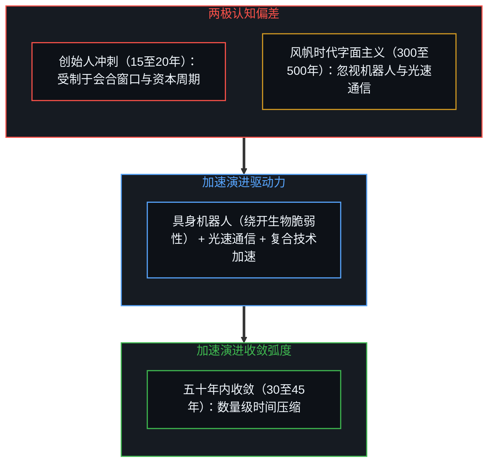

The operational arc unfolds between these extremes. Projections demanding five centuries overlook the qualitative leaps separating modern technological systems from wooden caravels. In 1500 AD, crossing the Atlantic required months under erratic winds, imposing crippling coordination lags. Today, cislunar radio requires 1.3 seconds, while Earth-Mars signals travel in minutes, coordinating action at the speed of light. Crucially, Atlantic colonization was severely bottlenecked by biological vulnerability—scurvy, disease, and high mortality constrained labor supply. On the space frontier, embodied machine systems, robotic miners, and automated tooling serve as extended instruments through which living minds project action continuously in vacuum and radiation without biological sleep, nutrition, or life-support vulnerabilities. Propelled by compounding, non-linear technological acceleration, modern machine tooling and information routing compress the learning curve dramatically. Consequently, a transition that once required five centuries has every reason to converge in under fifty years, establishing an evolutionary horizon between thirty and forty-five years.

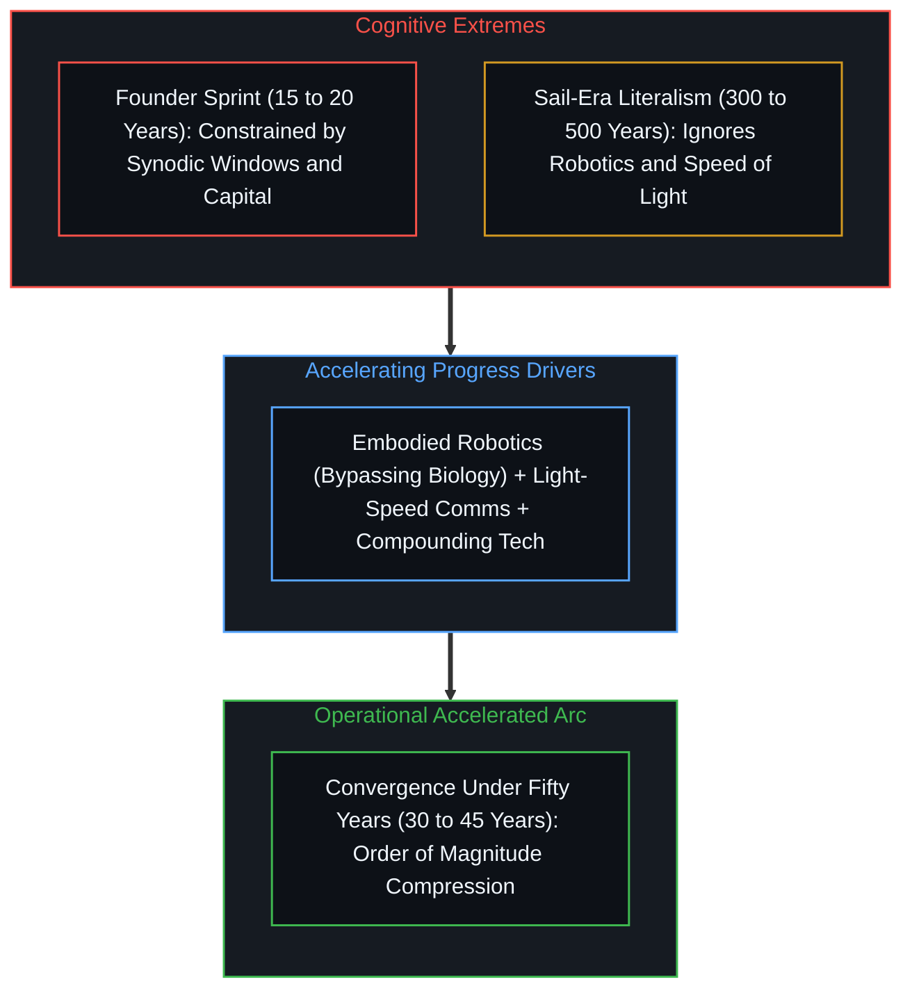

反过来，这一时间线很可能会略微超出创始人激进的十五至二十年冲刺。行星运动的轨道几何维持着对人类急迫感无动于衷的刚性宏观不变量：地火会合转移窗口每隔二十六个月才开启一次，在二十年间仅提供不到十次作业飞行窗口。闭环生态生命保障系统尚未在跨越数年的长期部署中验证无需补给的自维持平衡。此外，重型冶炼基础设施与行星铸造厂的部署，需要跨越数十年的资本投入周期，无法靠零成本的软件冲刺绕过——正如[“物理学才是定律”的障眼法](../the-sleight-of-hand-in-physics-is-the-law-and-the-friction-of-reality/)所追踪的，纸面方程不会在真空中自我执行，每一项工程假说都必须支付宏观接触摩擦中不可逆的能量与时间代价。将演化视界标定在三十至四十五年——稳妥处于五十年以内——既尊重了技术加速驱动的时间压缩，也正视了天体力学与重资产建设所固有的接触摩擦。

Conversely, this timeline will likely extend slightly beyond the founder's aggressive fifteen-to-twenty-year sprint. The orbital geometry of planetary motion maintains rigid macroscopic invariants indifferent to human haste: Earth-Mars synodic transfer windows open only once every twenty-six months, offering fewer than ten operational flight windows across two decades. Closed-loop ecological life support has yet to demonstrate self-sustaining balance without resupply over extended multi-year deployments. Furthermore, deploying heavy smelting infrastructure and planetary foundries requires multi-decade capital deployment cycles that cannot be bypassed by zero-cost software sprints—for as [The Sleight of Hand in "Physics Is the Law"](../the-sleight-of-hand-in-physics-is-the-law-and-the-friction-of-reality/) traces, written equations do not execute themselves in vacuum, and every engineering hypothesis must pay the irreversible energy and time costs of macroscopic contact friction. Calibrating the horizon to thirty to forty-five years—comfortably under fifty years—honors the compression driven by accelerating technology while respecting the contact frictions of celestial mechanics and heavy capital buildout.

## 六、 第一人称抉择与宏观阻力的涌现本相 / 6. First-Person Choices and the Emergent Nature of Macro Frictions

面对这一转型的复杂性，分析框架常常索求细粒度的制度预测：究竟哪些地缘政治集团将管辖轨道公域、何种货币协议将在数光分的跨行星延迟下清结算贸易，或是监管机构究竟会在哪一年放行指数级增长的发射频次。

Faced with the complexities of this transition, analytical frameworks often demand granular institutional predictions: which geopolitical blocs will govern orbital commons, what monetary protocols will settle commerce across light-minutes of interplanetary delay, or in which exact year regulatory bodies will clear exponential launch cadences.

将制度摩擦、监管延迟或地缘政治张力当作顶回技术势头的外部机械壁垒，是一处认识论误判。正如[个体抉择是唯一的因果杠杆](../individual-choices-as-the-only-causal-levers/)与[宏观现象及参数和个人微观选择的因果倒置与利率的命令幻相](../the-summary-first-reversal-and-the-command-of-yields/)所阐明的，监管惰性与制度阻力并非在真空中自主运转的力量，它们只是无数鲜活行动者所作出的个体第一人称抉择汇聚而成的第三人称足迹。

Treating institutional frictions, regulatory delays, or geopolitical tensions as external mechanical barriers pushing back against technological momentum is an epistemological misstep. As demonstrated in [Individual Choices as the Only Causal Levers](../individual-choices-as-the-only-causal-levers/) and [Macro Parameters, Micro Choices, and the Command of Yields](../the-summary-first-reversal-and-the-command-of-yields/), regulatory inertia and institutional drag are not autonomous forces operating in a vacuum; they are merely the aggregate third-person footprints of countless individual, first-person choices enacted by living agents.

每一位在发射频次与安全裕度之间做校准的监管者、每一位决定是否离开老牌承包商加入前沿初创公司的航天工程师，以及每一位在行星探索与地表社会预算之间做权衡的政策制定者，都在从各自的主观视角出发，作出内部自洽的选择。正因为每一项选择都源自不可透视的内部价值权衡，任何第三人称模型都无法预先伸入那些选择内部去钦定一条决定论的时间线。

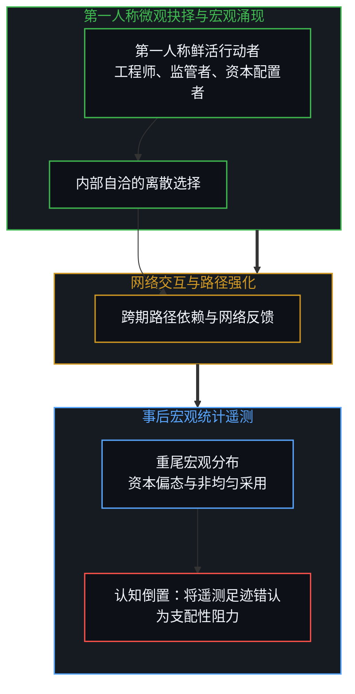

Every regulator calibrating safety margins against launch cadence, every aerospace engineer choosing whether to leave an incumbent contractor for a frontier startup, and every policymaker weighing planetary exploration against terrestrial social budgets is making an internally coherent selection from their own subjective vantage point. Because each choice originates from an opaque internal valuation, no third-person model can reach inside those selections beforehand to dictate a deterministic timeline.

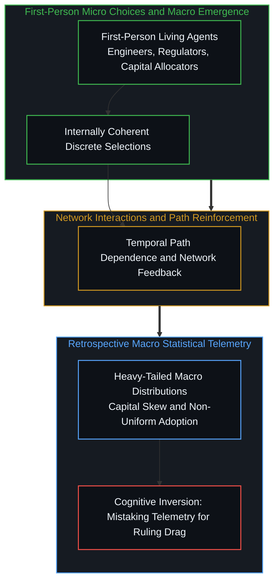

当数以百万计的独立选择相互作用，累积起路径依赖与正反馈时，宏观尺度上便会自然涌现出重尾分布与幂律特征，表现为集中的发射份额与非线性的采用曲线。然而正如[你的代码库即是记忆](../your-codebase-is-memory/)所追踪的，外化的代码库仅留存过往切分所沉淀的残迹，鲜活的领会与领航始终驻留在心智的在场边缘；同样，这些统计足迹与估值账本也只是在事后记录历史的汇集，从不会化作反过来支配那股第一人称能动性的自主引擎。索求未来条约或精确市场份额的细粒度预测，是用短期投机噪音置换了结构上的清晰。跨越尺度依然稳固成立的，是那些结构性不变量：开放视界的热力学相变、社会剩余的竞争性耗散，以及鲜活心智踏上边疆时不可化约的第一人称能动性。

When millions of independent selections interact, accumulating path dependence and positive feedback, heavy-tailed distributions and power laws naturally emerge on a macroscopic scale, manifesting as concentrated launch shares and non-linear adoption curves. Yet just as [Your Codebase Is Memory](../your-codebase-is-memory/) traces how an externalized repository holds only the settled residue of prior cuts while active comprehension and steering remain at the living edge of the Mind, these statistical footprints and valuation ledgers merely record historical aggregations after the fact; they never become an autonomous engine dictating the first-person agency that produced them. Demanding granular forecasts of future treaties or exact market shares trades structural clarity for short-term speculative noise. What holds across scales are the structural invariants: the thermodynamic phase shift of an open horizon, the competitive dissipation of social surplus, and the irreducible first-person agency of living minds stepping onto the frontier.

## 七、 实体财富与纸面求索权的终极分野 / 7. The Ultimate Divergence Between Substantive Wealth and Paper Claims

这一追问的最终解答，在于区分金融索取凭证与鲜活的生产性财富。正如[拥有更多从不是原因](../having-more-is-never-the-cause/)与[价值、货币与财富的生成机制](../the-generative-mechanics-of-value-money-and-wealth/)所阐明的，企业的市值规模只是一张针对未来预期分红与经济地租的法定索取凭证；无论纸面股权数字多么惊人，金融估值本身都无法被直接消费。

The final resolution of this inquiry rests upon distinguishing financial claim checks from living productive wealth. As articulated in [Having More Is Never the Cause](../having-more-is-never-the-cause/) and [The Generative Mechanics of Value, Money, and Wealth](../the-generative-mechanics-of-value-money-and-wealth/), a corporation's market capitalization is merely a legal claim check on anticipated future dividends and economic rents. Regardless of how astronomical paper equity values appear, financial valuations cannot be consumed directly.

实体财富从来不是资产负债表上记载的纸面倍数，也不是漂浮在宇宙虚空中的死寂物质，而是鲜活心智通过物理交互抵御熵增、延展生命并维系自觉繁荣的鲜活能力。它由充沛的能源、高韧性的高速通信、无需破坏地表生态即可开采的原生矿产、离地计算容量，以及在宇宙中拓展开来的生存空间所构成。正如约翰·洛克菲勒经久不衰的历史遗产，并不是他个人峰值时期占美国国内生产总值百分之二的财富份额，而是平价煤油点亮了整片大陆无数普通家庭的夜晚；太空边疆的实体财富，也从不驻留在某家航天企业的股票代码之中。

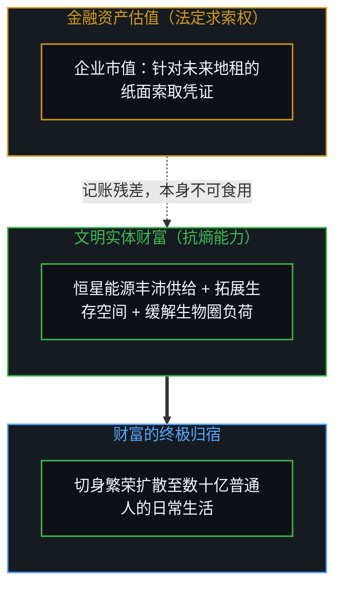

Substantive wealth is not a paper multiple recorded on balance sheets, nor is it dead matter floating in the cosmic void; it is the living capacity of minds to counter entropy, expand life, and sustain conscious flourishing through physical interactions. It consists of energy abundance, resilient high-speed communications, raw minerals extracted without ecological destruction, off-world computational capacity, and expanded living space across the cosmos. Just as John D. Rockefeller's enduring historical legacy was not his peak 2 percent share of United States GDP, but the fact that affordable kerosene illuminated ordinary homes across the continent, the substantive wealth of the space frontier will never reside in the stock ticker of an aerospace enterprise.

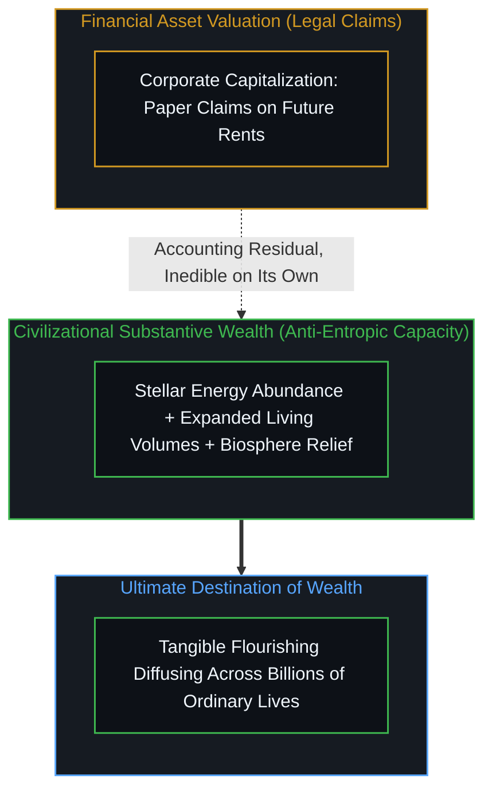

这一文明里程碑的意义在于，人类正从单一行星生物圈的脆弱禁锢中解放出来，迈向一个开放、能源丰沛的多行星文明。那片由光芒、矿藏与真空构筑的宇宙丰饶，将在数个世纪的跨度里持续扩散，在数十亿普通人的日常生活中得以兑现与体验。

The civilizational milestone is that humanity is emancipating itself from precarious confinement within a single planetary biosphere, transitioning into an open, energy-abundant, multi-planetary civilization. That cosmic abundance of light, minerals, and vacuum will continue to diffuse across centuries, realized and experienced within the daily lives of billions of ordinary human beings.
