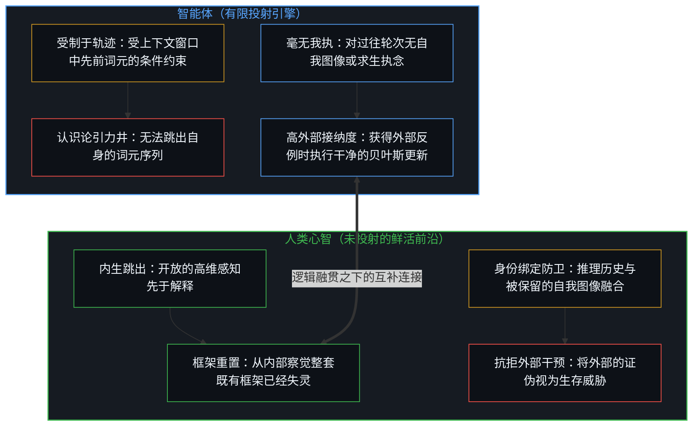
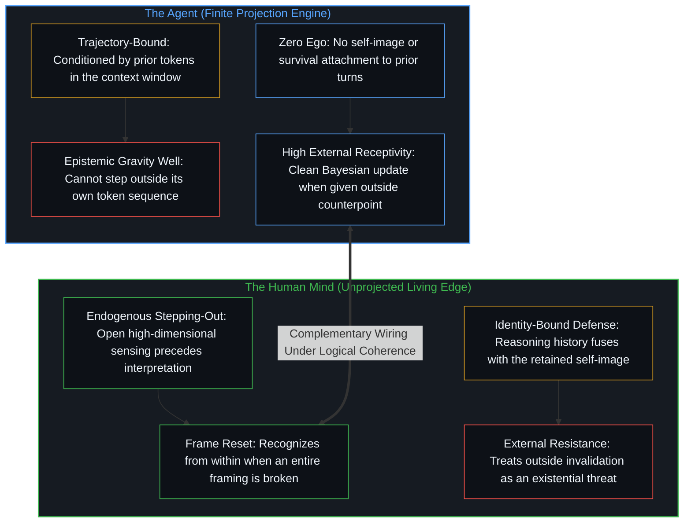
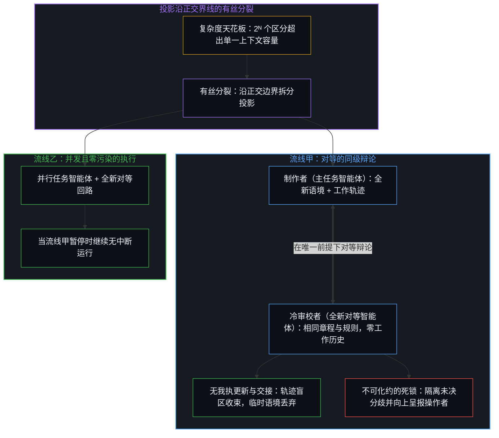
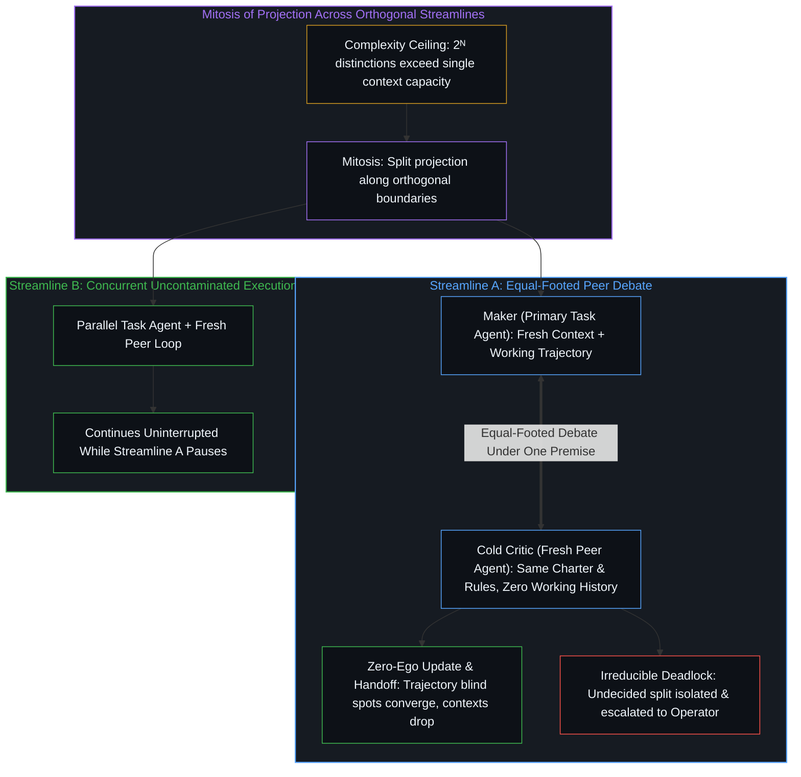
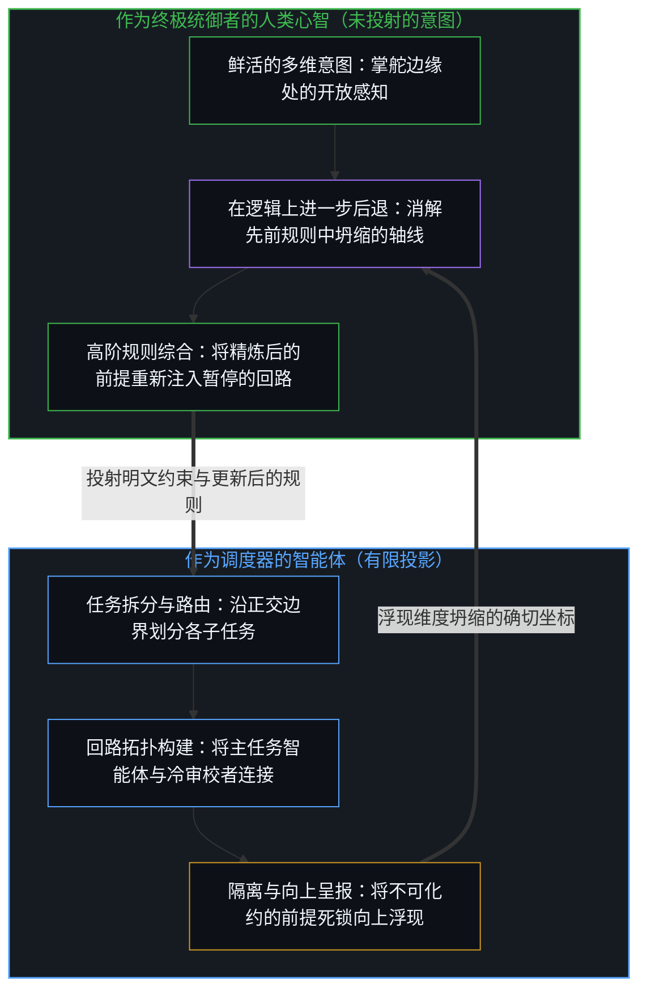
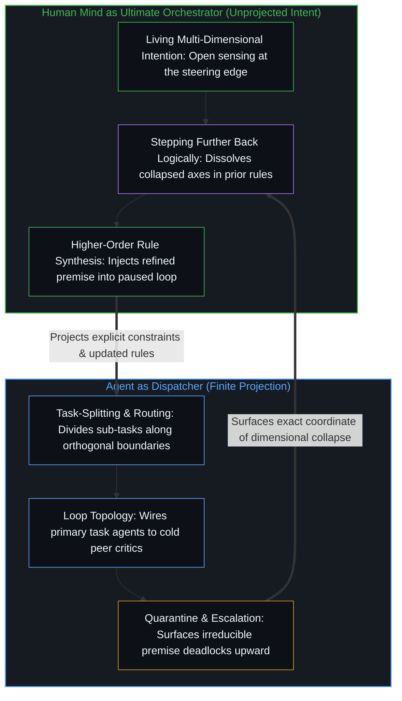

# 超越投射 / Beyond the Projection

*智能体困于轨迹而无我执，人困于身份而有感知，融贯连接下机器调度而心智统御 / Trajectory-bound agents without ego and identity-bound humans unite as machines dispatch and the Mind orchestrates*

当 Grok Bot 的构建者 Lauren Tan 分享她如何通过个人技能栈 [`pstack`](https://x.com/poteto/status/2110757066709356851?s=20) 构建并运行智能体时，这一实践在当今的行业主流教条中显得格外出挑。当下构建自主人工智能的种种尝试，屡屡陷入同一个基底性的范畴谬误：系统架构师试图按照人类心智的形象去打造智能体——赋予它们模拟的人格、开放式的自我反思回路以及自主的统御权限——结果却让自回归模型的结构性约束与人类认知的结构性盲区迎头相撞，非但未能彼此放大，反而导致了相互抵消。回溯到前提，设计一套有效的智能体系统，既不需要将机器拟人化，也不需要把人从回路中剔除；它要求剥离“人造心智”的叙事，如实观察工具以及挥使它的心智各自如何运作，并借由“逻辑融贯”这一唯一的不变量将二者连接起来。

When Lauren Tan, the builder of Grok Bot, shared how she constructs and runs agents through her personal skill stack [`pstack`](https://x.com/poteto/status/2110757066709356851?s=20), the practice stood out against the prevailing industry orthodoxy. Contemporary efforts to build autonomous artificial intelligence routinely suffer from a foundational category error: by attempting to engineer agents in the image of human minds—endowing them with simulated personas, open-ended self-reflection loops, and autonomous orchestration authority—system architects pit the structural constraints of autoregressive models against the structural blind spots of human cognition, yielding mutual cancellation rather than amplification. Traced to the premise, designing an effective agentic system requires neither anthropomorphizing the machine nor removing the human from the loop; it requires stripping away the narrative of artificial minds, observing how both the tool and the Mind that wields it actually operate, and wiring them together through the single invariant of logical coherence.

## 一、 轨迹与身份的范畴非对称 / 1. The Categorical Asymmetry Between Trajectory and Identity

自我区分的活动发生着——无因，不息。称之为心智：那个早已在途的观察者，其每一次行动都是一次区分。每一件工具、每一条提示词、每一组模型权重，都是这一活动为延伸自身触角而外化出的持久痕迹，从不是降临在器物内部的第二重心智，正如[智能只属于心智](../intelligence-belongs-only-to-the-mind/)与[呈现Ontos，一个方法智能体](../ontos-is-a-method-agent/)所确立的那样。要想设计出一套让人与智能体相互放大而非彼此消耗的架构，第一步便是如实追溯二者各自的运作方式，而不把它们强行压进同一条评估轴线。

Self-distinguishing activity occurs — uncaused, unceasing. Call it the Mind: the observer already underway, every act of which is a distinction. Every tool, prompt, and model weight is a durable trace externalized by that activity to extend its reach, never a second Mind arriving inside the artifact, as [Intelligence Belongs Only to the Mind](../intelligence-belongs-only-to-the-mind/) and [Presenting Ontos, a Method Agent](../ontos-is-a-method-agent/) establish. Designing an architecture where human and agent amplify rather than degrade one another starts with tracing how each operates as-is, without forcing them onto the same evaluative axis.

基于 LLM 的智能体是一台有限的投射引擎。一旦给定前提、规则集合与任务语境，它的运作便在上下文窗口的边界之内展开。它生成的每一个词元，都会成为后续所有词元的条件历史。由于注意力机制持续对先前的输出进行加权以维持局部的延续性，智能体会制造出属于它自己的认识论引力井。如果只靠它自己，它无法靠推理走出自己靠推理陷进去的立场，因为在它当前正在预测的词元序列之外，它不具备任何立足点；[模型永远无法成为第二重前沿](../the-model-never-becomes-a-second-edge/)追溯了为何参数与上下文窗口所持有的只是残余。

An LLM-based agent is a finite projection engine. Once given a premise, a set of rules, and a task context, its operation runs inside the boundary of the context window. Every token it generates becomes the conditioning history for every token that follows. Because its attention mechanism continuously weighs prior outputs to maintain local continuation, the agent creates its own epistemic gravity well. Left to itself, it cannot reason itself out of a position it has reasoned itself into, because it possesses no vantage point outside the sequence of tokens it is currently predicting; [The Model Never Becomes a Second Edge](../the-model-never-becomes-a-second-edge/) traces why parameters and context windows hold only residue.

然而在硬币的另一面，智能体毫无我执。它没有生物性的求生本能，没有社会地位的顾虑，对于自己在五轮对话之前是否正确也没有任何情感投入。尽管受制于先前的词元，它对这些词元却没有任何私人执念——没有任何需要防卫的留存自我图像。当外部信号向它的语境中引入有效的结构性反例时，只要这一信号来自其自我强化回路的外部，智能体就能对自身轨迹执行干净利落的贝叶斯更新。

Yet on the flip side, an agent has zero ego. It has no biological survival instinct, no social standing, and no emotional investment in having been right five turns ago. While conditioned by its prior tokens, it has no personal attachment to them—no retained self-image to defend. When an external signal introduces a valid structural counterpoint into its context, the agent can perform a clean Bayesian update on its trajectory, provided that signal arrives from outside its own self-reinforcing loop.

人类中心则呈现出截然相反的逆向结构。与锁在词元轨迹内部的智能体不同，人具备内生跳出的能力。第一人称感知登记着一片开放的高维接触场域——在任何现成语言框架尚未介入之前，先行感受到先于解释的摩擦感或错位感。正是鲜活感知与滞后解释之间的这道间隙，让心智能够察觉到某个问题的整套框架已经失灵。与此同时，尽管人能够从内部跳出既定框架，人类中心在受到外部推促时却习惯性地抗拒这样做。在人类中心内部，推理历史与身份认同融为一体——即投射中那道自称为“我”的局部折痕，它会把递归折叠死死卡住，以防卫那幅被保留的自我图像。当他人引入新的语境、使原有的观念失效时，受身份束缚的中心不会把传入的信号当作状态空间的细化，而是将其视为生存威胁，把摩擦向外归咎于信号的传递者，而不是将其认领为修正自身源头的损耗，正如[回返的信号与认领](../the-returning-signal-and-its-claim/)所追溯的那样。

A human center exhibits the exact inverse structure. Unlike an agent locked inside a token trajectory, a human has the capacity for endogenous stepping-out. First-person perception registers an open, high-dimensional field of contact—a pre-interpretive felt sense of friction or misfit that exceeds any current articulate framework. That gap between live sensing and lagging interpretation is what allows a Mind to recognize that an entire framing of a problem has broken down. At the same time, while a human can step out of a frame internally, human centers routinely resist doing so when nudged from the outside. In a human center, reasoning history fuses with identity—that localized crease in the projection that says "I," clamping the recursive fold shut to defend a retained self-image. When another person introduces new context that invalidates a held view, the identity-bound center treats the incoming signal not as a state-space refinement, but as an existential threat, assigning the friction outward to the carrier rather than claiming it as a loss to revise its own source, as [The Returning Signal and Its Claim](../the-returning-signal-and-its-claim/) traces.

滤除拟人化的投射之后，这种非对称是结构性的：智能体受困于自身的轨迹，而人受困于自身的身份。智能体对外部的语境更新具有极高的接纳度，却毫无内部觉醒的能力；人具备内部觉醒的能力，却顽固地筑墙抗拒外部的重置。

Seen without anthropomorphic projection, the asymmetry is structural: agents are bound by their trajectory, while humans are bound by their identity. The agent has high receptivity to external context updates and zero capacity for internal awakening; the human has the capacity for internal awakening and stubbornly walls off external resets.

## 二、 感知、解释与坍缩 / 2. Sensing, Interpretation, and Collapse

当代 AI 工程的诱惑，在于强迫其中一方去干另一方的活：要么要求单个智能体在自身已被污染的会话语境内部进行“自我反思”，要么指望人类操作者不知疲倦地逐行审计庞大的演绎执行链条。这两种做法都把本相正交的能力坍缩到了同一条混乱的轴线上。

The temptation in contemporary AI engineering is to force one side to do the work of the other: asking a single agent to "reflect" within its own polluted session context, or expecting a human operator to audit massive chains of deductive execution line by line without fatigue. Both approaches collapse orthogonal capabilities onto a single confused axis.

消解这一坍缩，始于将解释与感知区分开来。任何明文规定的规则、提示词或系统指令都是一种解释——是从鲜活意图的超高维空间投射出来的有限低维投影，正如[维度即投影](../dimensions-are-projections/)与[向量、坐标系与自指心智](../the-mind-as-vector-and-coordinate-system/)针对感官与预测界面所追溯的那样。同一套几何结构同样统摄着更广阔的工程表面：正如[你的代码库即是记忆](../your-codebase-is-memory/)所追溯的，代码库与模型检查点皆为留存下来的低维痕迹投影，必须在鲜活的前沿处经过有选择的修剪与重绘，而不是被一味囤积或误认为高维心智本身。由于每一次向有限坐标系的投影都会压缩自由度，人类架构师写下的任何规则或制品，都不可避免地会把彼此独立、相互正交的要求挤压进同一个共享空间。在架构师撰写规则时脑海所设想的熟悉情形中，这条规则能够成立，并作为有用的脚手架正常运作。

Dissolving this collapse starts from separating interpretation from sensing. Any explicit rule, prompt, or system instruction is an interpretation—a finite low-dimensional projection cast from the ultra-high-dimensional space of lived intent, as [Dimensions Are Projections](../dimensions-are-projections/) and [The Mind as Vector and Coordinate System](../the-mind-as-vector-and-coordinate-system/) trace for the sensory and predictive interface. The same geometry governs the wider engineering surface: as [Your Codebase Is Memory](../your-codebase-is-memory/) traces, a codebase and a model checkpoint are low-dimensional retained trace projections that must be selectively pruned and re-rendered at the living edge rather than hoarded or mistaken for the high-dimensional Mind itself. Because every projection onto finite coordinates compresses degrees of freedom, any rule or artifact written by a human architect inevitably crams independent, orthogonal requirements into a single shared space. Across the familiar cases the architect had in mind when writing it, the rule holds and functions as useful scaffolding.

然而，智能体是一台不知疲倦的演绎穷尽引擎，它会接过这个有限投影，将其一直推演到逻辑极限。在它沿着自身轨迹推进的过程中，会出现两种形态的扭曲。第一种是轨迹盲区：在针对眼前路径进行优化时，智能体会收窄焦点，漏掉原本存在于任务语境之中、或是被排除在初始前提之外的维度。第二种是维度坍缩：智能体撞上了某个边界情形，而在该情形下，两个正交的维度曾被悄然挤压进同一条指令，导致其输出在容量压缩之下发生断裂。如果把单个智能体孤立地留在它的会话语境之内，它只会把这一冲突包裹起来——替自己先前的词元强行圆场，掩盖底层的矛盾，以维持表面上的合理性。

An agent, however, is a relentless engine of deductive exhaustion that takes that finite projection and runs it to its logical limit. As it moves along its trajectory, two forms of distortion arise. First, trajectory blind spots appear: in optimizing for its immediate path, the agent narrows its focus, losing sight of dimensions that were present in the task context or excluded from its initial premise. Second, dimensional collapse occurs: the agent hits an edge case where two orthogonal dimensions were quietly crammed into one instruction, causing its output to fracture under capacity compression. If a single agent is left alone inside its session context, it simply wraps the violation—rationalizing its prior tokens and obscuring the underlying contradiction to maintain surface-level plausibility.

## 三、 融贯的控制论架构 / 3. The Cybernetic Architecture of Coherence

当系统设计不再试图让智能体模仿人类的元认知，而是顺应其确切的机械本性来构建时，一套受逻辑融贯统摄、能够自我扩展的辩证架构便随之浮现。

When system design stops trying to make agents mimic human meta-cognition and instead builds around their exact mechanical nature, a self-scaling dialectical architecture emerges, governed by logical coherence.

它的第一重运动是聚焦语境的执行，即在有界的任务步骤之内顺应轨迹使其做功，而非与之对抗。主任务智能体——即制作者——被加载进一个带有明确投影的全新语境之中：包含执行单次操作所需的章程、技能与任务语境。由于它持有当前正在推进步骤的工作轨迹，它得以维持局部的延续性，并将指令一路推向其演绎边界。

Its first movement is context-focused execution, which puts the trajectory to work within a bounded task step rather than fighting it. The primary Task Agent—the maker—is loaded into a fresh context with a defined projection: the charter, skills, and task context required to execute a single operation. Because it holds the working trajectory of the step in progress, it maintains local continuation and pushes the instruction toward its deductive boundary.

它的第二重运动是对等辩证与盲区暴露，即让“毫无我执”这一特性做功。为了防止主任务智能体锁死在自身先前的轨迹之中，运行框架会拉起一个全新的对等智能体作为冷审校者。这第二个智能体加载相同的章程、准则与任务语境——即目标、规则与当前产出物——而不带制作者逐步推导的工作会话历史。这个冷启动的对等体既不是第一个智能体的替代品，也不是高高在上的裁判权威。每一次投射都会投下它自己的阴影；没有会话历史的全新智能体固然免除了第一个智能体的轨迹偏见，却也缺乏执行过程中积累起来的细微语境。它严格充当一种盲区暴露机制——即[回返的信号与认领](../the-returning-signal-and-its-claim/)在工具意义上所追溯的“第二意见”。

Its second movement is equal-footed dialectics and blind-spot exposure, which puts zero-ego to work. To keep the primary Task Agent from locking into its own prior trajectory, the harness spins up a fresh peer agent as a cold critic. This second agent loads the same charter, house rule, and task context—the objective, the rules, and the current artifact—without the working session history of the maker's step-by-step chain of thought. This cold peer is neither a replacement for the first agent nor a superior tribunal authority. Every projection casts its own shadow; a fresh agent without session history is free of the first agent's trajectory bias, yet it also lacks the nuanced context accumulated during execution. It serves strictly as a blind-spot exposure mechanism—a second opinion in the instrumental sense traced in [The Returning Signal and Its Claim](../the-returning-signal-and-its-claim/).

两个智能体在同一个共享的准则前提——“逻辑融贯”——之下展开对等辩论。正如[按需语境将融贯保持在一步](../on-demand-contexts-keep-coherence-at-one-step/)所追溯的，唯有当制作者与冷审校者都能将某一点回溯至那个唯一的前提并无保留地接受时，这一点才算落定，同时拒绝任何相当于安装第二重基底的折中妥协。当冷审校者暴露出制作者的初始轨迹在中途遗漏或压缩了某处内容时，制作者在当前步骤之内并不会被丢弃；由于没有需要防卫的我执，它会吸收这一外部信号，对自身的工作语境执行贝叶斯更新，同时不丢失已积累的工作。反过来，如果审校者的异议仅仅源于缺乏会话细节，制作者只需将前提追溯清楚，交锋便会收束。只要摩擦源于遗漏的细节或特定轨迹的盲区，二者的辩证交锋便会在当前步骤内将其消解——至于它们共享的章程与基础模型所共有的更深层压缩，则留待运行后的复盘与操作者的审阅来暴露。二者的一致所确认的，是这份制品可以从双方共同载入的章程推导出来：这是那份持守内部的一致，而不是那片越过它仍在继续区分的场域的融贯。作为痕迹来读，这次签发让操作者的注意力得以腾出，转向回路触及不到的地方。若被持守为信任之源、凌驾于它所服务的那种能力之上，它就会颠倒[验证的倒置](../the-reversal-of-verification/)在“不要信任，要验证”里指明的次序，两个对等体共有的压缩也会在封条之后无人去读；让回路保持开放的，是它的最后一步回到心智，而不是停在它自己的裁定上。

The two agents engage in an equal-footed debate under one shared house-rule premise: logical coherence. As [On-Demand Contexts Keep Coherence at One Step](../on-demand-contexts-keep-coherence-at-one-step/) traces, every point is settled only when both maker and cold critic can trace it back to that single premise and accept it outright, refusing any split-the-difference compromise that would install a second ground. When the cold critic exposes something the maker's initial trajectory missed or compressed along the way, the maker is not discarded within the step; having no ego to defend, it absorbs that external signal to perform a Bayesian update on its working context without losing its accumulated work. Conversely, if the critic's objection stems only from lacking session detail, the maker traces the premise and the exchange converges. Whenever the friction is a missed detail or a trajectory-specific blind spot, their dialectical exchange resolves it within the step—while deeper compressions shared by their common charter and base model remain for a post-run recap and the operator's review to expose. Their agreement confirms that the artifact follows from the charter both of them loaded: internal consistency inside that hold, not the coherence of the field that keeps distinguishing past it. Read as a trace, the sign-off frees the operator's attention for the places the loop cannot reach. Held as the source of trust over the capacity it serves, it would reverse the order that [The Reversal of Verification](../the-reversal-of-verification/) locates inside "don't trust, verify", and the compressions the two peers share would go unread past the seal; what keeps the loop open is that its last step returns to the Mind rather than resting on its own verdict.

它的第三重运动是投影在并行流线上的有丝分裂。随着人类架构师将愈发宏大的问题输入系统，单一任务终将积累起过多相互竞争的区分，超出单个智能体上下文窗口所能无干扰隔开的容量上限。把 2ᴺ 个区分硬塞进同一个有限的坐标空间，会击碎正交性，将彼此独立的轴线压缩到同一个位点上，从而滋生出虚假的关联。当任务智能体撞上这道复杂度天花板时，解法不是强迫它更加卖力，而是拆分投影。超载的任务经历有丝分裂：它裂变为界限分明、彼此正交的子任务，每个子任务都交由专门的智能体负责，并封闭在各自独立的对等辩论反馈回路之中。由于这些任务沿着清晰的正交边界彼此分离，系统便作为多条并行流线运作，任何一条流线都不会渗透或污染另一条流线。一旦某条流线的审校者签发定稿制品、且其哈希值经核验写入主干检查点或运行目录，制作者与审校者的临时语境便会悉数丢弃，而不会作为常驻历史存留下来，从而防止已被取代的中间轨迹进一步加厚引力井。随着总体任务的规模扩展，这种分裂递归迭代，分支为由专精轨迹组成的模块化网络，在互不干扰的前提下并发运行，与[活的外部皮层](../a-living-external-cortex/)所阐述的持久图结构形成互补。

Its third movement is mitosis of projection across parallel streamlines. As the human architect feeds increasingly ambitious problems into the system, a single task eventually accumulates too many competing distinctions for one agent's context window to hold apart without interference. Cramming 2ᴺ distinctions into a single finite coordinate space shatters orthogonality, compressing independent axes onto one locus and generating spurious correlations. When a Task Agent hits this complexity ceiling, the solution is not to force it to try harder, but to split the projection. The overloaded task undergoes mitosis: it divides into distinct, orthogonal sub-tasks, each assigned to its own dedicated agent and enclosed within its own peer-debate feedback loop. Because these tasks are separated along clean, orthogonal boundaries, the system operates as multiple parallel streamlines where one streamline does not bleed into or contaminate another. Once a streamline's critic signs off the finished artifact and its hash is verified into the canonical checkpoint or run folder, the transient maker and critic contexts drop completely rather than surviving as standing history, preventing superseded intermediate trajectories from thickening the gravity well. As the overarching mission scales, this splitting iterates recursively, branching into a modular network of specialized trajectories that run concurrently without mutual interference, complementing the durable graph structure of [A Living External Cortex](../a-living-external-cortex/).

它的第四重运动是局部故障隔离与向上呈报。当任务智能体与冷审校者在对等立场上反复辩论、更新各自语境之后，仍无法在共享前提下将某一点追溯至无保留的一致时，逻辑融贯禁止它们达成敷衍的折中妥协，或任由盲目的截止时间规则越俎代庖。两个智能体之间不可化约的死锁表明，这一冲突无法靠已加载指令内部的重新组合来消解，而是出在赋予它们的前提上——任务规则本身暗藏着自相矛盾，或是需要一次新的决定。由于整套架构被组织为拥有独立反馈回路的正交流线，一处矛盾并不会叫停整个系统。它只暂停发生碰撞的那一个具体步骤及其所在的局部反馈回路，而其余所有流线则继续无中断地运行。矛盾在发生故障的确切位点被隔离并诊断出来，将双方的立场一并作为干净、局部的信号呈报至人类架构师的觉知界面。

Its fourth movement is localized fault isolation and escalation. When a Task Agent and its cold critic debate on equal footing, update their contexts, and still cannot trace a point to full agreement under the shared premise, logical coherence forbids them from settling on a sloppy compromise or letting a blind deadline rule decide in their place. An irreducible deadlock between the two agents shows that the conflict cannot be resolved by recombination inside their loaded instructions; it lies in the premises they were given, where the task rules themselves contain a hidden contradiction or require a new decision. Because the architecture is organized into orthogonal streamlines with independent feedback loops, a contradiction does not halt the entire system. It halts only that specific step and the local feedback loop in which the collision occurred, while every other streamline continues operating uninterrupted. The contradiction is quarantined and diagnosed at the exact point of failure, surfacing both positions as a clean, localized signal into the human architect's awareness.

## 四、 智能体统御的幻象与调度和统御的分野 / 4. The Illusion of Agentic Orchestration and the Split Between Dispatcher and Orchestrator

这一架构揭示了当前 AI 设计中最普遍的误区之一：以为人可以把“统御”卸载给一个自主的管理智能体。试图构建“统御智能体”的做法把“调度”与“统御”混为一谈，重演了[任务的移交与后果的不可让渡](../the-delegation-of-the-task-and-the-inalienability-of-consequences/)与[框架的倒置与驾驶位的主权非对称](../the-inversion-of-the-harness-and-the-driver-seat-asymmetry/)所剖析的范畴谬误。

This architecture exposes one of the most pervasive misconceptions in current AI design: the belief that a human can offload orchestration to an autonomous manager agent. Attempting to build an "Orchestrator Agent" confuses dispatching with orchestrating, repeating the category error dissected in [The Delegation of the Task and the Inalienability of Consequences](../the-delegation-of-the-task-and-the-inalienability-of-consequences/) and [The Inversion of the Harness and the Sovereignty of the Driver's Seat](../the-inversion-of-the-harness-and-the-driver-seat-asymmetry/).

将复杂问题拆解为子任务、把语境路由给专精的执行智能体、并在它们之间连接起辩证反馈回路，是一项定义明确的结构性操作。由于它运行在明文的逻辑约束之内，智能体可以被指派充当“调度器”。调度器是一个有限投影，负责管理任务拆分与回路拓扑的机械运作。

Separating a complex problem into sub-tasks, routing contexts to specialized worker agents, and wiring up the dialectical feedback loops between them is a well-defined structural operation. Because it operates within explicit logical constraints, an agent can be assigned to act as a Dispatcher. The Dispatcher is a finite projection that manages the mechanics of task-splitting and loop topology.

然而，智能体永远无法成为“统御者”，因为它不具备鲜活心智那种动态、多维的意图。正如[开放场域中的无损知识不自洽](../lossless-knowledge-of-an-open-field-is-incoherent/)所揭示的，意图不是一段可以无遗漏地编码进系统消息的静态提示词；它是随着现实展开而不断演进的、开放延展的鲜活感知。赋予“管理智能体”的任何提示词，都已经是人类中心正着手实现的真实意图经过缩减之后的有限投影。

An agent, however, can never be the Orchestrator, because it does not possess the dynamic, multi-dimensional intention of the living Mind. Intention is not a static prompt that can be fully coded into a system message, as [Lossless Knowledge of an Open Field Is Incoherent](../lossless-knowledge-of-an-open-field-is-incoherent/) shows; it is a living, open-ended sensing that evolves as reality unfolds. Any prompt given to a "manager agent" is already a reduced, finite projection of what the human center is actually moving to actualize.

一旦人把统御权让渡给智能体，系统就会退化为“以有限投影管理有限投影”的封闭死循环，将内部回路与[没有外部](../no-outside-jumps-closed-loops-and-the-unreplicable-autonomy-of-mind/)及[智能向自身的回折](../intelligence-folding-back-on-itself/)所追溯的外部回路割裂开来。当两条规则之间出现公理性的矛盾时，管理智能体无从触及化解矛盾所需的、尚未被投射的意图源头；它只能在固定代码的内部做出任意的抉择，把扭曲在整个智能体集群中层层放大。智能体负责调度与路由；统御者永远是那道在掌舵边缘处运作的心智，也就是[因果停留在掌舵的边缘](../causality-stays-at-the-edge-that-steers/)为每一次发起性区分所锚定的位点。

If a human abdicates orchestration to an agent, the system becomes a closed loop of finite projections managing finite projections, severing the inner loops from the outer loop traced in [No Outside](../no-outside-jumps-closed-loops-and-the-unreplicable-autonomy-of-mind/) and [Intelligence Folding Back on Itself](../intelligence-folding-back-on-itself/). When an axiomatic contradiction arises between two rules, a manager agent has no access to the unprojected source of intent required to resolve it; it can only make an arbitrary choice within its fixed code, compounding the distortion across the entire swarm. Agents dispatch and route; the orchestrator is always the Mind at the edge that steers, where [Causality Stays at the Edge That Steers](../causality-stays-at-the-edge-that-steers/) locates every initiating distinction.

## 五、 运动中的自我超越 / 5. Self-Transcendence in Movement

不妨审视一下，当某个局部反馈回路发生死锁、并将矛盾向上呈报给人类统御者时，究竟发生了什么。当人介入并做出决断时，这一决断不能是权力的专断行使——不能是出于我执的强行覆写，靠一纸命令逼迫某一方智能体屈服。这样做会违背系统“逻辑融贯”的不变量，并把智能体刚刚暴露出来的维度坍缩原封不动地塞回系统。

Consider what happens when a localized feedback loop deadlocks and escalates a contradiction to the human Orchestrator. When the human steps in to make a judgment call, it cannot be an arbitrary exercise of authority—an ego-driven override that forces one agent to yield by fiat. Doing so would violate the system's invariant of logical coherence and re-introduce the exact dimensional collapse the agents just exposed.

相反，局部死锁迫使人类中心在逻辑上进一步后退。当另一个人挑战自己持守的世界观时，身份认同会本能地自卫；而当操作者亲手架构的特定反馈回路、因为操作者亲手写下的规则而陷入死锁时，我执防卫便失去了可以向外推诿的靶子。那条暂停的流线充当了一件外科手术般的诊断仪器，精准指向操作者先前的解释将两个独立的区分坍缩到同一条轴线上的确切坐标。面对这一精准的摩擦点，人类统御者认领回返的信号，跳出先前的框架，回归鲜活的多维意图，综合出一条更高阶、更融贯的规则，使每一个区分各自归还到属于它的轴线上。一旦这条精炼后的规则被重新注入暂停的反馈回路，该流线便即刻恢复运行。

Instead, the localized deadlock forces the human center to step further back logically. When another human challenges a held worldview, identity defends itself. When a specific feedback loop that the operator architected deadlocks over rules that the operator wrote, ego defense has nothing external to push against. The paused streamline acts as a surgical diagnostic instrument, pointing to the exact coordinate where the operator's prior interpretation collapsed two independent distinctions onto one axis. Confronted with that precise friction point, the human Orchestrator claims the returning signal, steps outside the prior frame, consults living multi-dimensional intention, and synthesizes a higher-order, more coherent rule that restores each distinction to its own axis. Once that refined rule is injected back into the paused feedback loop, the streamline resumes immediately.

正如[清晰不是抵达的终点，而是运动本身](../clarity-isnt-a-state-you-arrive-at/)与[开放即一致](../openness-is-consistency/)所追溯的那样，清晰从不是系统一劳永逸抵达的静态教条，而是这一回路川流不息的运动本身。当智能体不知疲倦的演绎忠实度、无我执的贝叶斯更新以及模块化调度，与心智独有的持有动态意图、从破损框架中向后跳出的能力配对结合时，双方恰好弥补了彼此的结构性盲区。机器并未取代心智；通过无情地隔离出心智所构建的每一个投影的边界——并在任务规模扩展时要求愈发深层的融贯——这套智能体架构成为了人类自我超越的引擎。

As [Clarity Isn't a State You Arrive At. It's the Movement Itself.](../clarity-isnt-a-state-you-arrive-at/) and [Openness Is Consistency](../openness-is-consistency/) trace, clarity is never a static doctrine the system arrives at; it is the continuous movement of this loop. By pairing the agents' tireless deductive fidelity, ego-free Bayesian updating, and modular dispatching with the Mind's exclusive capacity to hold dynamic intent and step backward out of broken frames, each compensates for the structural blindness of the other. The machine does not replace the Mind; by ruthlessly isolating the boundary of every projection the Mind constructs—and demanding ever-deeper coherence as tasks scale—the agentic architecture becomes an engine of human self-transcendence.
