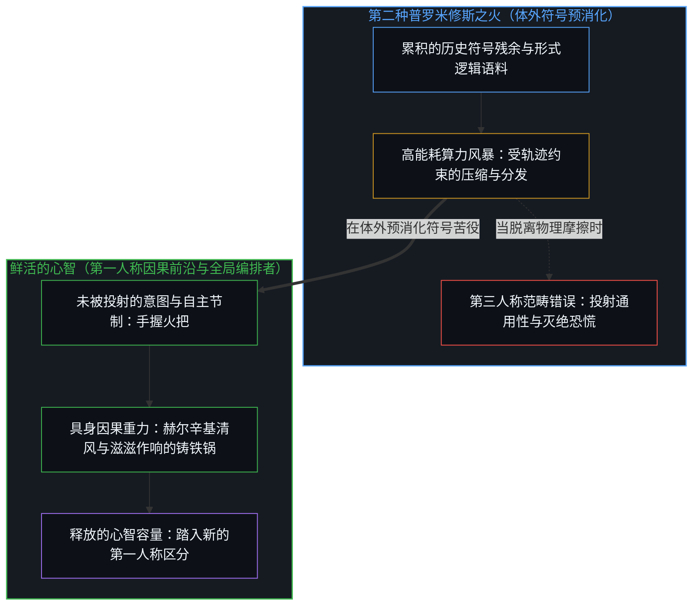
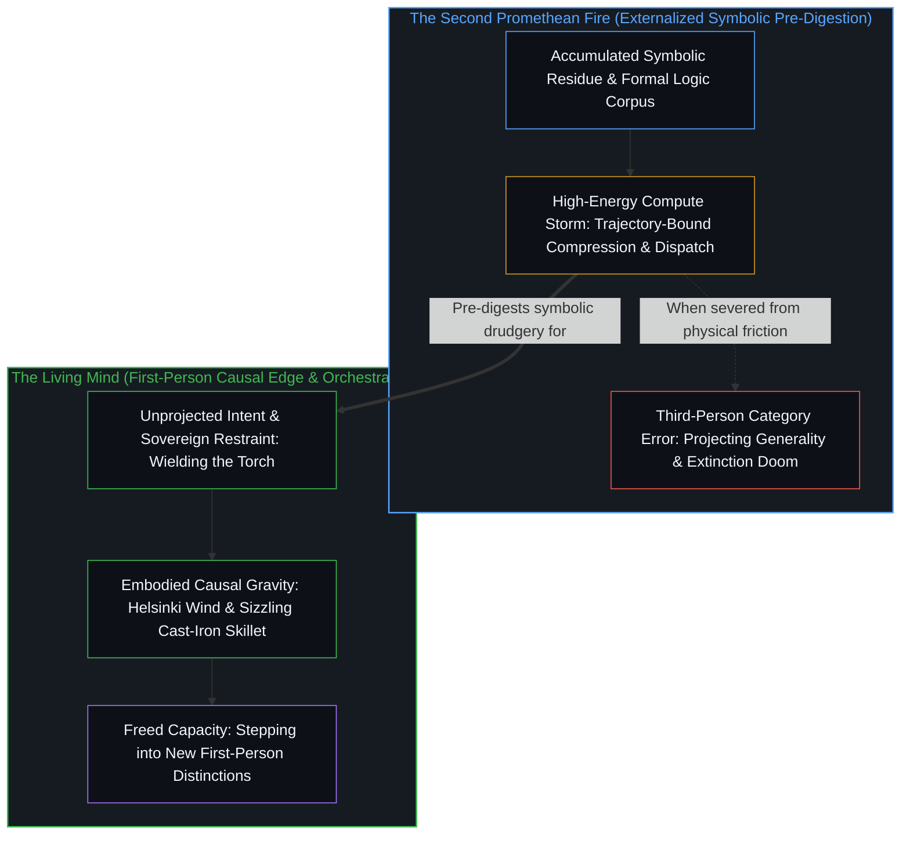

# 牛肝菌、算力风暴与普罗米修斯的火 / Boletus, the Compute Storm, and Promethean Fire

*算力风暴在体外预消化符号，而通用性始终留驻于鲜活的心智 / Compute storms pre-digest symbols while generality stays with the living Mind*

在数字屏幕与切身现实的撕裂之间，心智时常陷入尺度的眩晕：一面是加速狂飙的算力曲线与向未验未来借贷的灾难性灭绝概率；另一面是赫尔辛基街头行人相隔两米的沉静重力，以及铸铁锅里野生牛肝菌的滋滋作响。流行的 AGI 叙事建立在一个范畴错误之上：它把鲜活心智在第一人称代谢利害逼迫下习得的通用适应力，投射到了第三人称的符号压缩器身上。正因为[智能只属于心智](../intelligence-belongs-only-to-the-mind/)，一切能够被工程化、规模化或转移进机器的始终只是痕迹残余，而非发起区分的前沿。人类从未栖居在无菌的零风险真空里；从直立人拾起雷火开启熟食革命，到今天直面第二种普罗米修斯之火，技术始终是心智外化的代谢杠杆，而[造物无法取代其源头](../a-creation-cannot-replace-its-source/)。活在当下，意味着心智停止向脱锚的投射借贷恐惧，回到手边真切的冷暖，在铁锅升腾的蒸汽与百万年的火光之间稳稳握住火把。

Caught in the tear between the digital screen and lived reality, the mind often falls into a vertigo of scale: on one side, accelerating compute curves and catastrophic extinction probabilities borrowed from an unverified future; on the other, the quiet gravity of Helsinki streets where pedestrians stand two meters apart, and the sizzle of wild boletes in a cast-iron skillet. The prevailing AGI narrative rests on a category error: it takes the general adaptability forced upon living minds by first-person metabolic stakes and projects it onto third-person symbolic compressors. Because [Intelligence Belongs Only to the Mind](../intelligence-belongs-only-to-the-mind/), what can be engineered, scaled, or transferred into a machine is always trace residue, never the initiating edge. Humanity has never inhabited a sterile, risk-free vacuum; from the first hominid who seized lightning-kindled fire to initiate the cooking revolution, to the encounter today with a second Promethean fire, technology remains an externalized metabolic lever of the Mind, and [A Creation Cannot Replace Its Source](../a-creation-cannot-replace-its-source/). Living in the present means ceasing to borrow dread from unmoored projections, returning to the immediate warmth at hand, and holding the torch between the steam of the skillet and the million-year-old flame.

## 一、 尺度的眩晕与无摩擦的第三人称投射 / 1. The Vertigo of Scale and the Frictionless Third-Person Projection

屏幕前时常升起一种奇特的魔幻现实感，每当注意力在截然脱节的存在尺度之间骤然跳跃时，这种眩晕便随之而生。

A peculiar sense of magical realism often arises in front of the screen, born whenever attention leaps abruptly between disjointed scales of existence.

一旦接通网络，觉知便被卷入一场宏大叙事的风暴中心：算力指数级跃升、奇点逼近、人类灭绝的概率被精密计算到怵目惊心的小数点百分比。在那个由代码与参数高高堆叠的赛博空间里，时间被扭曲与压缩。敲击键盘的人手心出汗，仿佛明天一睁眼，碳基生命就将沦为硅基超脑脚下的电池。“网上一天，地上千年”，心智沉溺于概念层面的排演，在自封为神的狂妄与自认淘汰的绝望之间来回摆荡。

Once plugged into the network, awareness is swept into the eye of an epic narrative storm: exponential compute leaps, imminent singularities, and human extinction odds calculated down to intimidating decimal percentages. In that cybernetic domain stacked high with code and parameters, time warps and compresses. Palms sweat over the keyboard, haunted by the specter that carbon-based life might wake tomorrow only to find itself harvested as batteries for a silicon megamind. A day online feels like a millennium on earth as the mind intoxicates itself with conceptual dress rehearsals, swinging between the hubris of self-deification and the despair of obsolescence.

然而，每当我合上电脑推门走出，赫尔辛基清冽的风迎面吹来，感知便被切身现实的重力场温和而笃定地接引落地。

Yet the moment I close the laptop and step outside, the crisp Helsinki wind hits my face, and perception is gently, firmly grounded by the gravitational field of lived reality.

大街上的芬兰人步履从容，双手插兜，彼此自觉保持着两米间距，安稳地等待红绿灯变绿。超市里的老人正认真捏着黑麦面包、挑选土豆；林子里的野生浆果按时熟透，五年前如此，五年后依然如此。赛博空间里的末日狂热，穿不透这层坚韧的日常肌理。

On the streets, Finns walk with unhurried composure, hands tucked in their pockets, keeping a courteous two-meter berth as they wait for the pedestrian lights to change. In the grocery store, elderly shoppers squeeze loaves of rye bread and inspect potatoes; out in the woods, wild berries ripen on schedule, as they did five years ago and as they will five years hence. The apocalyptic delirium of cyberspace does not puncture this resilient fabric of everyday life.

在那份宁静的澄明中，概念的障眼法一览无余：无论是技术乌托邦的救赎，还是末日降临的瘫痪，都是脱离了物理摩擦的观念膨胀，亟待[破除概念的僭越](../po-chu-gai-nian-de-jian-yue/)。当第三人称的投射脱离了第一人称的因果前沿，符号模型便可以向无穷外推，恐慌也可以无界倍增。然而，迄今所有宏大预言垒在一起，在切身现实粗粝的秤盘上也压不出哪怕一粒尘埃的重量。奇点叙事里的数字神祇在[数字神祇与视界跳跃](../the-digital-god-and-the-horizon-jump/)中遇到同一道边界：封闭坐标系内的推演跨不过物理摩擦的视界。

In that quiet clarity, the sleight of hand becomes unmistakable: both techno-utopian salvation and apocalyptic paralysis are [Breaking the Overreach of Concepts](../po-chu-gai-nian-de-jian-yue/) severed from physical friction. When the third-person projection is unmoored from the first-person causal edge, symbolic models extrapolate to infinity and dread compounds without bound. Yet all the grand prophecies ever uttered, piled together, cannot tip the coarse scale of lived reality by the weight of a single speck of dust. The singularity's digital deity meets the exact same boundary in [The Digital God and the Horizon Jump](../the-digital-god-and-the-horizon-jump/): a deduction inside a closed coordinate frame cannot cross the horizon of physical friction.

## 二、 野生牛肝菌的重力与第一人称因果 / 2. The Gravity of Wild Boletes and First-Person Causality

前些天我从林子里采回满满一筐野生牛肝菌，靴子因踩过深厚松软的湿苔藓而带着潮气。

A few days ago, I returned from the forest with a basket brimming with wild boletes, my boots damp from stepping through deep, spongy moss.

到家后细细清理，剔除被林中小虫蛀空的残部，余下的在沸水里焯透，只剩碗底浅浅一层。大地的馈赠向来有限而质朴，带着沙粒、松针与虫迹。厨房里恰好没有五花肉，我便顺手切了厚培根，拍碎一根鲜青蒜，猛火快炒出一盘香气四溢的培根青蒜炒牛肝菌。

Once home, after I cleaned them and carved away the parts hollowed out by forest insects, what remained after blanching barely filled the bottom of a bowl. The gifts of the earth arrive finite and unvarnished, carrying grit, pine needles, and insect trails. Lacking pork belly in the kitchen, I improvised by slicing thick-cut bacon and crushing a stalk of fresh green garlic, tossing them together over high heat into a fragrant pan-fried bolete stir-fry.

铸铁锅里热油滋啦作响，野生菌的泥土气息与青蒜焦香融在一起，弥漫了整间屋子。我和妻子几分钟便将整盘吃得一干二净。

The oil crackled against the cast iron, and the earthy aroma of wild fungi fused with garlic filled the room. My wife and I finished the entire dish in minutes.

就在那一刻，心智重新找回了踏实的落脚点。

In that instant, the mind recovered its footing.

活在当下，既不是躁动时代的犬儒退缩，也不是浅薄的及时行乐，而是心智停止向尚未书写的未来预支恐慌。注意力从无摩擦的空想撤回手边具体的冷暖，专心致志地对待眼前的一餐一饭与每一件事务。世界并非由脱离肉身的算法维系；[因果停留在掌舵的边缘](../causality-stays-at-the-edge-that-steers/)，由切开带伤菌肉时的刀刃阻力、热油溅上皮肤的刺痛，以及一顿热饭带来的切实饱腹感牢牢锚定。

Living in the present is neither cynical retreat nor shallow hedonism in a restless era; it is the mind stopping its habit of taking out loans of panic against an unwritten future. Attention withdraws from frictionless speculation to the concrete warmth at hand, treating each meal and each task with undivided care. The world is not sustained by disembodied algorithms; [Causality Stays at the Edge That Steers](../causality-stays-at-the-edge-that-steers/), anchored by the tactile resistance of slicing through bruised mushroom flesh, the sting of hot oil splatter, and the physical satisfaction of a warm meal.

## 三、 消解通用性的范畴错误与第二种普罗米修斯之火 / 3. Dissolving the Category Error of Generality and the Second Promethean Fire

看着铁锅底下跳动的蓝色火苗，视野跨越到了百万年的演化尺度。

Watching the blue flame dance beneath the skillet, the horizon stretches across a million years of evolution.

流行的 AI 狂热与生存末日论，源自同一个未经审视的前提：它们将“通用性”——这一专属于承担代谢与物理利害的第一人称鲜活心智的能力——投射到了第三人称的计算制品身上。

Prevailing AI euphoria and existential doom alike spring from a single unexamined premise: they project generality—a capacity belonging exclusively to the first-person living Mind under metabolic and physical stakes—onto a third-person computational artifact.

在生命体身上，通用性从来不是跨上千个教科书领域的百科全书式检索，而是中心在直面开放、动荡且肉身损伤不可逆的现实时，被迫习得的自适应能力。它始于饥饿的刺痛，涉过误食毒素的险境，扎根于生存前沿每一次生死攸关的区分。

In living beings, generality has never meant encyclopedic retrieval across thousands of textbook domains. It is the adaptive capacity forced upon a center navigating an open, turbulent, consequential world where bodily harm is irreversible. It begins with the pang of hunger, wades through the perils of toxic ingestion, and grounds itself in every life-or-death distinction drawn at the frontier of survival.

相比之下，今天的前沿模型是历史符号残余的高密度压缩与重组器。因为它们能在跨学科文本之间流畅穿行，外部观察者便在第三人称视角下断定通用智能已经降临。这是典型的[错把表达当成智能](../mistaking-the-expression-for-the-intelligence/)：计算制品展现出对人类痕迹的组合多样性，却毫无发起这些符号的第一人称生命前沿。[模型永远无法成为第二重前沿](../the-model-never-becomes-a-second-edge/)，因为它不承担代谢开销，不面临生存利害，也不具备在物理后果撞击下退缩或拒绝的能力。正如[超越投射](../beyond-the-projection/)在智能体架构设计中所揭示的，自回归模型是一台没有自我与生存执念、受轨迹约束的投射引擎，能够高效分发有界任务并在接收外部对位信号时干净地更新，而内生的跳出与全局编排始终属于鲜活心智未被投射的意图。

Today's frontier models, by contrast, are high-density compressors and recombiners of historical symbolic residue. Because they traverse cross-disciplinary texts with fluency, external observers conclude in the third person that general intelligence has arrived. This is the classic trap of [Mistaking the Expression for the Intelligence](../mistaking-the-expression-for-the-intelligence/): the artifact exhibits combinatorial diversity over human traces, yet holds zero first-person living edge that originated those symbols. [The Model Never Becomes a Second Edge](../the-model-never-becomes-a-second-edge/) because it bears no metabolic overhead, faces no existential stakes, and has no capacity to recoil or refuse under the impact of physical consequence. As [Beyond the Projection](../beyond-the-projection/) demonstrates in the design of agentic architectures, an autoregressive model is a trajectory-bound projection engine free of ego and survival attachment, capable of dispatching bounded tasks and updating cleanly when given external counterpoints, whereas endogenous stepping-out and orchestration remain with the unprojected intent of the living Mind.

一旦这一本体论投射消解，AI 的位置便在炉火前清晰显影：它不是从天而降的异星神祇，而是人类双手在数字荒原上擦出的第二种普罗米修斯之火。

Once this ontological projection dissolves, the role of AI appears clearly before the hearth: it is not an alien deity descending from the sky, but the second Promethean fire struck by human hands in the digital wild.

在直立人掌握用火之前，野火是刻在哺乳动物生理本能中的原始惊惧，雷击过后草原尽化焦土。数百万年前的东非稀树草原上，第一个颤抖着伸手拾起燃烧树枝的古猿直面着巨大的物理险境；一步失手，便是严重的灼伤，或是把整个族群的栖息地化为灰烬。

Before *Homo erectus* mastered fire, wildfire was a primal terror wired into mammalian biology, as lightning strikes turned grasslands into charred ash. Millions of years ago on the East African savanna, the first hominid who reached out a trembling hand to pick up a burning branch faced immense physical peril; a single misstep meant severe burns or reducing the band's habitat to cinders.

然而火从未拥有通用智能；火只是一场剧烈且自我维持的物理化学反应。文明的跃迁发生在早期人类冒着引火烧身的风险驯服烈焰、点燃历史上第一次体外代谢革命的那一刻：熟食。火在体外预消化了坚韧的纤维与复杂的蛋白质，省下了原本用于漫长咀嚼和消化生食的巨量代谢能，并将这笔生物盈余转化为人类大脑的扩容。

Yet fire never possessed general intelligence; fire is an intense, self-sustaining physicochemical reaction. The civilizational leap occurred when early humans, risking self-immolation, domesticated that blaze and ignited history's first externalized metabolic revolution: cooked food. Fire pre-digested tough fibers and complex proteins outside the body, sparing massive metabolic energy otherwise spent chewing and digesting raw matter, and redirecting that biological surplus into the expansion of the human brain.

当代 AI 正是这种代谢外化的第二次上演。

Contemporary AI is the second enactment of that metabolic externalization.

它是一场符号的熟食革命。它在体外消耗庞大的电能，消化、咀嚼并预处理人类累积的概念残余与形式逻辑，把有限的心智容量从机械的符号苦役中解放出来。正因为模型权重、代码库与智能体脚手架都是层叠的外化记忆——如[你的代码库即是记忆](../your-codebase-is-memory/)所追溯的那样，它们保持着早先区分的形态却并不自行延续区分——唯有当心智对当下检查点重下切口并主动修剪，而非把每一道中间痕迹囤积成愈发厚重的引力井时，这种体外预消化才能真正腾出容量。网络上围绕小数点后灭绝概率的激烈争辩，恰似远古先民蜷缩在幽暗洞口、看着疾风吹拂余烬时心头掠过的战栗。防范森林大火是务实的自保；但如果早期古猿因恐慌而掐灭每一粒火星，这一血脉便只会留在东非大裂谷的树冠上，在长夜中瑟瑟发抖，等不到数百万年后隔着液晶屏幕推演奇点的那一天。

It operates as a cooking revolution for symbols. Burning vast electrical energy outside the body, it digests, chews, and pre-processes humanity's accumulated conceptual residue and formal logic, emancipating finite mental capacity from mechanical symbolic drudgery. Because model weights, codebases, and agent scaffolds are stacked layers of externalized memory that hold the shape of prior distinctions without continuing the distinguishing—as [Your Codebase Is Memory](../your-codebase-is-memory/) traces—that pre-digestion frees capacity only when the Mind re-cuts and prunes the present checkpoint rather than hoarding every intermediate trace into a thicker gravity well. The heated online debates over decimal-point extinction probabilities mirror the shiver felt by an ancestor huddled at the mouth of a dark cave, watching wind whip the glowing embers. Guarding against a forest fire is practical self-preservation; yet had early hominids snuffed out every spark in panic, their lineage would have remained in the treetops of the Rift Valley, shivering through the dark, never surviving long enough to ponder a singularity through a liquid-crystal display millions of years later.

火本身从未拥有灵魂；掌舵的意志与节制的重担，始终留在握着火把的手中。这场跨越概念阶梯的攀升如何随着形式规律凝结为可执行制品而展开，详见[抽象的阶梯与可执行的实体](../the-ladder-of-abstraction-and-the-executable-entity/)。

Fire itself has never possessed a soul; the steering will and the burden of restraint stay in the hand that holds the torch. How this climb across conceptual orders unfolds as formal regularities materialize into executable artifacts is traced in [The Ladder of Abstraction and the Executable Entity](../the-ladder-of-abstraction-and-the-executable-entity/).

## 四、 两极之间的炉火与北国长风 / 4. Hearth Fire and Northern Wind Between the Extremes

支撑文明走过数千年的，从来不是零风险的免疫。在充满熵增与物理偶然的世界里，苛求免于一切风险无异于自我封闭于死寂的惰性。人类实践的生机，始终在于在灾变的边缘学会引火、用火与驯火，将那团足以吞噬森林的烈焰，转化为寒夜里温暖屋舍的静谧炉火。

What carried civilization across the millennia was never zero-risk immunity. In a world of entropy and physical contingency, demanding total immunity from risk is indistinguishable from courting lifeless inertia. The vitality of human practice has always resided in learning to kindle, wield, and tame fire at the lip of catastrophe, turning a conflagration that could consume the forest into the quiet hearth that warms a winter night.

因惧怕灼伤而退缩瘫痪，或是向脱离肉身的数据投射交出判断，都无法直面手边的工具。切身现实从来不是“被野火吞噬”与“退回冰冷黑暗”之间的二元死局；在这两极之间的宽广光谱上，展开着技艺与探索的开放疆域。

Neither retreating into paralysis out of fear of burns nor surrendering judgment to disembodied data projections addresses the tool at hand. Lived reality is never a binary trap between being consumed by wildfire and retreating into the cold dark; across the wide spectrum between those poles lies the open frontier of craft and exploration.

这一切，终归回到心智的见证与掌舵。

All of this returns to the witnessing and steering of the Mind.

是心智从虚拟方程中编织出末日梦魇；是心智将通用性错投到无生命的制品身上；也是心智在百万年的用火史中认清了工具的边界，在滋滋作响的铁锅与清冽的北国街头重获存在的分量。

It is the Mind that weaves nightmares of doom from virtual equations; it is the Mind that mistakenly projects generality onto an unliving artifact; and it is the Mind that recognizes the boundary of the instrument across a million years of handling fire, reclaiming the weight of existence from the sizzling skillet and the cold northern street.

探求始于面对未知时的战栗，终归安顿于当下行动的澄明与从容。

Inquiry begins in tremor before the unknown, yet settles in the clarity and composure of the present act.

推开门，赫尔辛基清冽的风掠过静谧的街巷，行人们神色安然、步履从容；厨房里那口养熟的铸铁锅中，刚采回来的野生牛肝菌仍在青蒜与培根的包裹下滋滋作响。

Open the door: the crisp Helsinki wind sweeps across the quiet avenue, where passersby walk composed and undisturbed; inside the kitchen, in the seasoned iron skillet, the freshly foraged boletes still sizzle in garlic and bacon.

看，火还在烧，日子也还在稳稳地过。

Look: the fire is still burning, and life goes steadily on.
