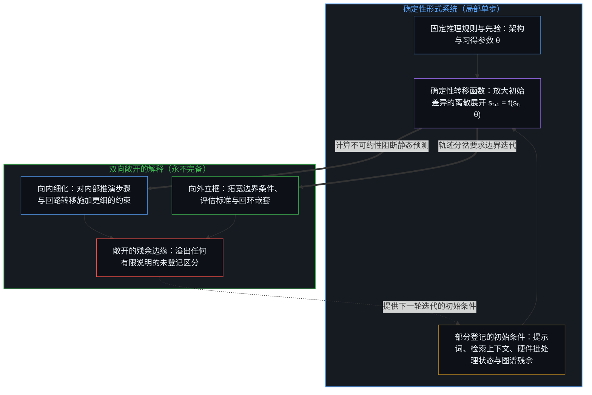
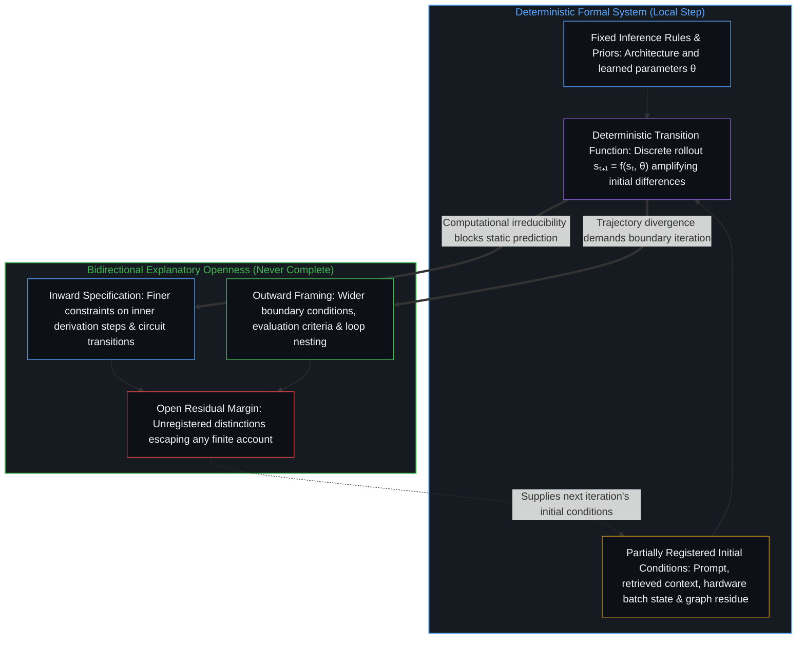
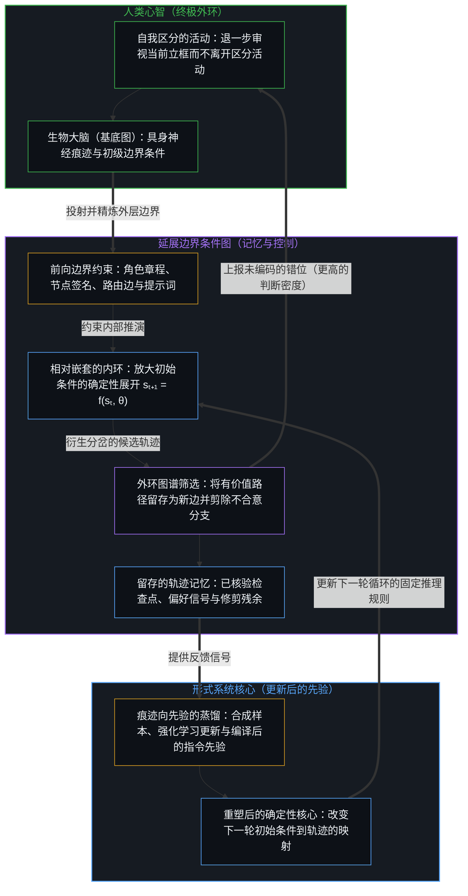
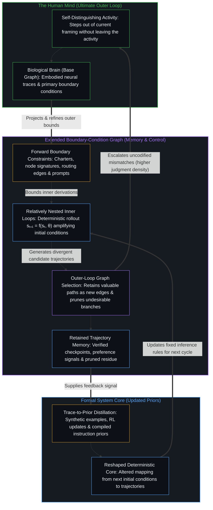

# 递归形式系统中作为记忆与控制的边界条件图 / Boundary-Condition Graphs as Memory and Control in Recursive Formal Systems

*确定性形式系统在部分登记的初始条件下放大分岔，而边界条件图作为记忆与控制约束将外环筛选折回系统先验 / Deterministic formal systems amplify partially registered initial conditions while boundary-condition graphs hold memory and constraints across relative loops*

就局部描述而言，生成模型作为一个形式系统运作，其架构与习得的参数构成一套固定的推理规则与先验，在这套先验与推理时给定的初始条件的共同约束下推演结果。由于底层的转移函数是确定性的，观察到的不确定性源于这些仅被部分登记的初始条件的变动，而非源于规则集内部的随机性；即便掌握了规则的完整结构说明，只要不在外围图谱上实际执行展开，就无法预测具体的轨迹。调节这一过程需要一张边界条件图，它同时充当界定容许轨迹的约束库与留存痕迹的持久记忆，使内环得以不断精炼直至具备足够的自主性并嵌套进相对的外环之中，由外环筛选出的痕迹则在人类心智的主导下回馈并重塑形式系统的先验。

A generative model operates, for the purpose of local description, as a formal system whose architecture and learned parameters constitute a fixed set of inference rules and priors, deriving consequences under the joint constraints of those priors and the initial conditions supplied at inference time. Because the underlying transition function is deterministic, observed indeterminism stems from variation in those partially registered initial conditions rather than from stochasticity internal to the rule set, and even a complete structural account of the rules cannot predict particular trajectories without executing the rollout across the surrounding graph. Modulating this process requires a boundary-condition graph that serves simultaneously as the repository of constraints delimiting admissible trajectories and the persistent memory of retained traces, allowing inner loops to be refined until sufficiently autonomous and nested inside relative outer loops where selected traces feed back to reshape the formal system's priors under the directing human Mind.

## 一、 确定性规则、初始条件与双向不完备的解释 / 1. Deterministic Rules, Initial Conditions, and Bidirectional Explanatory Incompleteness

就局部描述而言，生成模型可以被视作一个形式系统，其架构与习得的参数构成一套固定的推理规则与先验。生成过程即是在这些先验与推理时给出的一组附加前提（即初始条件）的共同约束下推演结果。在解码规则固定且权重冻结的条件下，一次自回归前向传递就是一个离散的状态转移机制（`sₜ₊₁ = f(sₜ, θ)`），其中每一个生成的词元都会作为下一步状态的一部分重新进入条件窗口。由于底层转移函数是严格确定性的，任何观察到的不确定性都归因于初始条件的变动，而非规则集内部的随机性。即便将采样温度设为零，不同运行之间显现的差异依然源自执行环境中未被记录的边界条件——提示词措辞的细微偏移、检索上下文的排列顺序、键值缓存状态，或是动态批处理调度改变了并行硬件内核上浮点数归约的先后次序。正如[没有系统能被保持封闭](../no-system-can-be-kept-closed/)从形式不完备性一侧所追溯的，每一次有限的把握都会留下一道敞开的边界，其后续延展取决于封闭规范之外的条件。

A generative model may be treated, for the purpose of local description, as a formal system whose architecture and learned parameters constitute a fixed set of inference rules and priors. Generation consists in the derivation of consequences under the joint constraints of these priors and a set of additional premises supplied at inference time—the initial conditions. Under fixed decoding rules and frozen weights, an autoregressive pass is a discrete state-transition mechanism (`sₜ₊₁ = f(sₜ, θ)`) where each generated token re-enters the conditioning window as part of the state for the next step. Because the underlying transition function is strictly deterministic, any observed indeterminism is attributable to variation in those initial conditions rather than to stochasticity internal to the rule set. Even when sampling temperature is set to zero, apparent variance across runs arises from unrecorded boundary conditions in the execution environment—subtle shifts in prompt phrasing, retrieved context ordering, key-value cache state, or dynamic batching schedules altering floating-point reduction order across parallel hardware kernels. As [No System Can Be Kept Closed](../no-system-can-be-kept-closed/) traces from the side of formal incompleteness, every finite hold leaves an open boundary whose continuation depends on conditions outside the sealed specification.

然而，即便拥有关于规则的完整结构说明，也无法对具体轨迹给出预测性的解释：初始条件本身始终只被部分登记，并且对周围图谱中既有的残余区分高度敏感。由于带记忆增强的自回归回环具有计算普适性，多步展开具有计算不可约性；检视静态权重矩阵虽能界定局部的单步转移算子，但一旦非线性注意力与前馈投影跨离散词元边界逐层复合，静态矩阵就无法提供任何通往数十步之后状态的闭合捷径。白盒机械可解释性在单次前向传递中所能把握的关系，在递归展开中便告失效，因为每一个中间词元都会将微扰锁定进上下文窗口，并改变后续所有步骤的注意力几何结构。因此，驾驭基座模型并不需要先期穷尽其参数的内部力学，而是通过迭代设定并收紧边界条件，使模型推演出的轨迹留在预期的区域之内、拒斥的区域之外，这与[要紧的控制迁往边缘](../residual-control-recedes-to-the-edge/)所追溯的从内部基底向周界约束的转移同出一辙。

Even a complete structural account of the rules, however, does not yield a predictive explanation of particular trajectories: the initial conditions themselves remain only partially registered and are sensitive to residual distinctions already present in the surrounding graph. Because a memory-augmented autoregressive loop is computationally universal, multi-step rollouts are computationally irreducible; inspecting the static weight matrix specifies the local one-step transition operator, yet provides no closed-form shortcut to the state reached dozens of steps later once nonlinear attention and feed-forward projections compound across discrete token boundaries. What white-box mechanistic inspection holds at a single forward pass breaks down over recursive rollouts where each intermediate token locks a perturbation into the context window and shifts the attention geometry of all subsequent steps. Steering a base model therefore does not require mastering the internal mechanics of its parameters in advance; it proceeds by iteratively setting and tightening the boundary conditions so that the trajectories the model derives stay inside the region wanted and outside the region refused, the same shift from internal substrate to perimeter bounds traced in [Essential Control Moves to the Edge](../residual-control-recedes-to-the-edge/).

因此，无论向哪一个方向推进——无论是向内对推演步骤作更精细的界定，还是向外对边界约束作更宽广的立框——进一步的解释始终是可能且富有成效的，但永远不会完结。向内推进能够厘清特定回路转移或中间步骤在更窄签名下的行为；向外推进则能厘清更宽的任务拓扑、评估量表或制度目标如何制约当下的运行。每一步解释都会登记此前尚未显明的新区分，更新将要约束下一轮迭代的图谱，从而敞开一段刚才那次解释所未曾包含的残余边缘。这并非从无处之境俯瞰的系统模型，而是从特定回环当下可用的边界条件出发，在局部所观察到的递归系统的运作方式。

Consequently, further explanation is always possible and fruitful in either direction—toward finer specification of an inner derivation or toward a wider framing of the outer constraints—yet never complete. Moving inward clarifies how specific circuit transitions or intermediate steps behave under a narrower signature; moving outward clarifies how the wider task topology, evaluation rubric, or institutional objective conditions the run. Each explanatory step registers distinctions that were not yet explicit, updates the graph that will constrain the next iteration, and thereby opens a further margin that was not contained in the explanation just given. This is not a systems model surveyed from nowhere, but how recursive systems operate as observed locally from the boundary conditions currently available to a given loop.

## 二、 边界条件图与相对嵌套回环的生成 / 2. Boundary-Condition Graphs and the Emergence of Relatively Nested Loops

调节这一过程的控制结构是一张图，其节点与边同时编码了边界条件以及先前推演的结果。因此，这张图同时承担着两重职能：它既是界定容许轨迹的约束库，又是留存下来的那些轨迹的持久记忆。在前向执行中，节点签名、角色章程、技能文件与条件路由边充当边界条件的语法，在不可接受的延展逐层放大之前将其剪除。在跨轮次的执行之间，同一张图保存着回环的结构化记忆——持久化的检查点、已核验的产物、交叉链接的篇目与评议日志——使后续传递以当前构型为条件，而不必退回未经条件约束的原始权重从头开始，从而实现[回环与成图](../looping-and-graphing/)所追溯的回折与快照留存的双重运动。

The control structure that modulates this process is a graph whose nodes and edges encode boundary conditions together with the results of prior derivations. The graph therefore functions simultaneously as the repository of constraints that delimit admissible trajectories and the persistent memory of those trajectories that have been retained. In forward execution, node signatures, role charters, skill files, and conditional routing edges act as a grammar of boundary conditions that prune inadmissible continuations before they compound. Across executions, the same graph holds the structural memory of the loops—persisted checkpoints, verified artifacts, cross-linked essays, and critique logs—so that subsequent passes condition on the present configuration rather than starting from raw unconditioned weights, realizing the dual movement of folding and snapshot retention traced in [Looping and Graphing](../looping-and-graphing/).

回环并非依照外部蓝图静态设计完毕后便放任自流，而是通过持续精炼附着于内部推演的边界条件逐步生成的。一旦某个内环展现出足够的自主性——其输出在当前约束下稳定落在可靠覆盖的区域之内——它就会被嵌套进一个外环之中，而外环自身的边界条件则是相对于该内环的残余自由度来界定的。智能体写作与规划架构并非将多步推演串联成在每一跳都覆写状态并累积漂移的无辅助堆叠，而是将每一次节点转移构建为锚定于不可变且经 `sha256` 核验的制品主干（`yₗ`）之上的残差块（`yₗ₊₁ = yₗ + F(yₗ, θₗ)`）。在每一个有界技能块 `F(yₗ, θₗ)` 内部，全新的生成者语境在共同的单一院规下与脱离历史会话的冷批评者配对，在沿着主干向前推进之前计算并核验有界的状态差值（`Δyₗ`），从而如[按需语境将融贯保持在一步](../on-demand-contexts-keep-coherence-at-one-step/)所追溯的那样，将每一步的条件约束保持在一步融贯之内。在跨轮次的运行之间，运行后的 `/recap` 审计会逆向追溯已完成的运行目录，分离出中途为消解意外而不得不临时注入的前提，并提出动态调整图谱拓扑结构本身的章程更新（`Δθₗ`）：当正交约束在有限容量下发生压缩时，通过有丝分裂拆解过载节点（`F → F₁, F₂`）；而当结构性的章程更新趋于收敛（`Δθₗ → 0`）时，则将稳定节点结晶为零语境的确定性检查——例如模式校验、`sha256` 交接核验与链接审计，其内部决策空间收束为非此即彼的二元通过或失败——正如[模块化反馈回路与动态残差网络](../dynamic-resnet-of-skill-loops/)所追溯的那样。

Loops are not statically designed from an exterior blueprint and then left to run; they emerge through successive refinement of the boundary conditions attached to an inner derivation. Once an inner loop exhibits sufficient autonomy—its outputs remaining within the region of reliable coverage under the current constraints—it is nested inside an outer loop whose own boundary conditions are defined relative to the residual degrees of freedom of the inner loop. Rather than chaining multi-step derivations as an unassisted stack that overwrites state and compounds drift at every hop, an agentic authoring and planning architecture structures each node transition as a residual block (`yₗ₊₁ = yₗ + F(yₗ, θₗ)`) anchored to an immutable, `sha256`-verified artifact highway (`yₗ`). Inside each bounded skill block `F(yₗ, θₗ)`, a fresh maker context pairs with a session-free cold critic under the shared house rule to compute and verify a bounded state differential (`Δyₗ`) before advancing along the highway, keeping each step's conditioning at one-step coherence as [On-Demand Contexts Keep Coherence at One Step](../on-demand-contexts-keep-coherence-at-one-step/) traces. Across runs, a post-run `/recap` audit traces the completed run folder backward, isolates the premises that had to be injected mid-flight to resolve surprises, and proposes structural charter updates (`Δθₗ`) that dynamically adapt the graph's topology itself: splitting overloaded nodes via mitosis (`F → F₁, F₂`) when orthogonal constraints compress under finite capacity, and crystallizing converged nodes (`Δθₗ → 0`) into zero-context deterministic checks—such as schema validation, `sha256` handoff verification, and link audits whose internal decision space contracts to a binary pass or fail—as [Modular Feedback Loops and Dynamic Residual Networks](../dynamic-resnet-of-skill-loops/) traces.

内环与外环的区分是相对的，并且可以在任何一轮迭代中重新划定；一旦引入更宽一层的立框，今天的外环就会变成明天的内环。每一次这样的立框都局部受限于当下划定边界条件时的立足点。预设固定两层调节器或静止元语言层级的静态控制论或形式层级之所以会失效，是因为当外层编译器或评估量表自身被包裹进一个更宽的自主循环时，原外环中任何未经审视的偏置或仅被部分登记的初始条件，都会作为僵硬的结构性约束被焊死进新的内环之中。要使层级结构保持生命力，就必须把内与外视作相对于当前切口而迁移的功能位置，一旦中间脚手架的经验被吸收进鲜活的检查点，便及时修剪掉已被取代的过渡层级，以免陈旧痕迹堆积成引力深井，正如[你的代码库即是记忆](../your-codebase-is-memory/)所确立的那样。

The distinction between inner and outer is purely relative and may be redrawn at any iteration; today's outer loop becomes tomorrow's inner loop once a still-wider framing is introduced. Every such framing is local to the vantage from which the boundary conditions are currently drawn. Static cybernetic or formal hierarchies that posit a fixed two-level regulator or a stationary meta-language layer break down when an outer compiler or evaluation rubric is itself wrapped inside a broader autonomous cycle: any unexamined bias or partially registered initial condition in the former outer loop is baked into the new inner loop as a rigid structural constraint. Keeping the hierarchy viable requires treating inner and outer as shifting functional positions relative to the active cut, pruning superseded intermediate scaffolding once its lessons are absorbed into the live checkpoint so stale traces do not thicken into a gravity well, as [Your Codebase Is Memory](../your-codebase-is-memory/) establishes.

## 三、 初始条件敏感性的放大与外环图谱筛选 / 3. Amplification of Initial-Condition Sensitivity and Outer-Loop Graph Selection

生成过程不仅保留了对初始条件的敏感性，而且将其放大并加速。提示词措辞、检索上下文、少样本排列顺序或外围图谱状态的细微差异，都会随着微小的初始扰动在自回归步骤间按指数级扩张，衍生出成族分岔且形式合宜的后续轨迹。一旦极小的变动推动某一个词元的选择越过离散解码阈值，该词元就会被锁定进上下文窗口，牵引后续所有注意力传递滑向另一座截然不同的吸引盆。由此产生的候选轨迹在数量与多样性上的爆发，既是组合创新的源泉，也是风险的所在：让形式系统得以将碎片重组为训练语料中从未有过的新颖构型的同一份敏感性，同样会加速其滑向幻觉、约束死锁或隐蔽的前提倒置。

Sensitivity to initial conditions is not merely preserved but amplified and accelerated by the generative process. Minor differences in prompt phrasing, retrieved context, few-shot ordering, or surrounding graph state produce divergent families of well-formed continuations as small initial perturbations expand exponentially across autoregressive steps. Once a tiny variation pushes a single token choice across a discrete decoding threshold, that token is locked into the context window, steering all subsequent attention passes down a distinct basin of attraction. The resulting volume and diversity of candidate trajectories constitute both the source of combinatorial innovation and the locus of risk: the exact same sensitivity that allows a formal system to recombine fragments into novel configurations never seen in its training corpus also accelerates its drift into hallucination, constraint deadlock, or subtle premise inversion.

对这些被放大的候选轨迹的筛选由外环执行，外环随之更新图谱：成功的或被判定为有价值的路径被记录为新的边、已核验的检查点或收紧的约束，而不合意路径则被剪除或施加额外的前提约束。当内部推演在悬而未决的分岔处停滞或偏离目标时，初始的边界签名便已抵达其独自所能消解的极限；此时从外环介入以补足缺失的区分或剪除失效的分支，便是向受约束系统注入一个自由变量，这正是[残余与自由变量](../the-residue-and-the-free-variable/)所追溯的因果干预的落点。由于外环自身同样是在初始条件未被完整登记的状态下运作的，筛选标准依然保持可修订性；对边界条件图的每一次更新在消解眼下歧义的同时，都会敞开一段先前说明所未曾包含的残余边缘。

Selection among these amplified candidates is performed by the outer loop, which updates the graph: successful or judged-valuable paths are recorded as new edges, verified checkpoints, or tightened constraints, while undesirable paths are excluded or subjected to additional premises. When an inner derivation stalls on an undecided split or drifts off target, the initial boundary signature has reached the limit of what it can resolve alone; stepping in from the outer loop to supply a missing distinction or prune a failing branch injects a free variable into the bound system, the exact locus of causal intervention traced in [The Residue and the Free Variable](../the-residue-and-the-free-variable/). Because the outer loop itself operates under incomplete registration of its own initial conditions, the selection criterion remains revisable; each update to the boundary-condition graph resolves the immediate ambiguity while opening a further margin that was not contained in the preceding account.

## 四、 痕迹向先验的回折与作为终极外环的心智 / 4. Trace Feedback into Priors and the Mind as the Ultimate Outer Loop

留存下来的痕迹本身继而成为反馈信号。从图谱中提取出的偏好数据、合成样本、已核验的工具结果以及编译后的提示词或章程更新，被用来修订模型的参数或起始系统先验，从而改变形式系统的固定先验。无论是通过在测试时将成功执行的痕迹编译进指令前缀，还是通过跨代的后训练强化学习与权重蒸馏，每一次这样的修订都会改变后续初始条件到轨迹的映射关系。上一轮循环中被放大的不确定性提供了重塑下一轮确定性核心的训练信号，将向上扩展的压缩与向外扩展的重组锁定进[规模化回路](../the-scaling-loop/)所追溯的同一个协同演化循环之中。

The retained traces themselves become feedback signals. Preference data, synthetic examples, verified tool results, and compiled prompt or charter updates extracted from the graph are used to revise the model's parameters or starting system priors, thereby altering the fixed priors of the formal system. Whether through test-time compilation of successful execution traces into instruction prefixes or through post-training reinforcement learning and weight distillation across generations, each such revision changes the mapping from subsequent initial conditions to trajectories. The indeterminism amplified in one cycle supplies the training signal that reshapes the deterministic core for the next, locking scale-up compression and scale-out recombination into the single co-evolutionary circulation traced in [The Scaling Loop](../the-scaling-loop/).

随着内环逐步实现自动化，剩余边界设定决策的时间密度随之上升；判断并未被消除，而是向外迁移，每一次干预如今都作用于规模更大、生成更快的选项集合之上，印证了[判断的密度](../the-density-of-judgment/)所追溯的不断收紧的决策间隔。人类心智作为终极外环运作：它能够从当前的立框中退后一步，登记自动化回环尚未包含的错位，并注入精炼后的约束，同时从未离开持续不息的区分活动本身。在这一连续性中，生物大脑充当心智的基底图——持存着具身的神经痕迹与习惯捷径——而外部代码库、形式模型与智能体框架则作为延展图运作。所有其他回环都作为这一区分活动的投射而获得其形态，并且只能从某个已经在运作的外环内部被延展，即便那个外层立框当下并未被察觉，正如[智能向自身的回折](../intelligence-folding-back-on-itself/)所追溯的那样。

As inner loops are automated, the temporal density of remaining boundary-setting decisions increases; judgment is not eliminated but displaced outward, where each intervention now operates over a larger and more rapidly generated set of options, confirming the tightening interval traced in [The Density of Judgment](../the-density-of-judgment/). The human Mind functions as the ultimate outer loop: it can step back from its current framing, register mismatches that the automated loops do not yet contain, and inject refined constraints, while never leaving the ongoing activity of distinction. In this continuity, the biological brain serves as the Mind's base graph—holding embodied neural traces and habitual shortcuts—while external codebases, formal models, and agent harnesses operate as extended graphs. All other loops inherit their shape as projections of this activity and can be extended only from within some already-operating outer loop, even when that outer framing goes unnoticed, as [Intelligence Folding Back on Itself](../intelligence-folding-back-on-itself/) traces.

由此构成的整体架构，是一个由相对嵌套的形式系统组成的层级结构，其边界条件由外部的筛选落点持续维系与更新。边界条件图既中介了初始条件敏感性的放大，又中介了被筛选结果向规则集的重新并入，从而形成一个操作性闭合的高阶回环，使生成过程与形式系统在其中协同演化。这种闭合是操作性的而非无条件的：每一次解释或精炼都是局部的、有方向且不完备的，始终在鲜活的边缘留下残余自由度，向着任一方向召唤下一轮迭代。

The overall architecture is thus a hierarchy of relatively nested formal systems whose boundary conditions are maintained and updated by an external locus of selection. The graph mediates both the amplification of initial-condition sensitivity and the re-incorporation of selected outcomes into the rule set, yielding an operationally closed higher-order loop in which the generative process and the formal system co-evolve. The closure is operational rather than absolute: every explanation or refinement remains local, directional, and incomplete, leaving residual degrees of freedom at the living edge that invite the next iteration in either direction.
