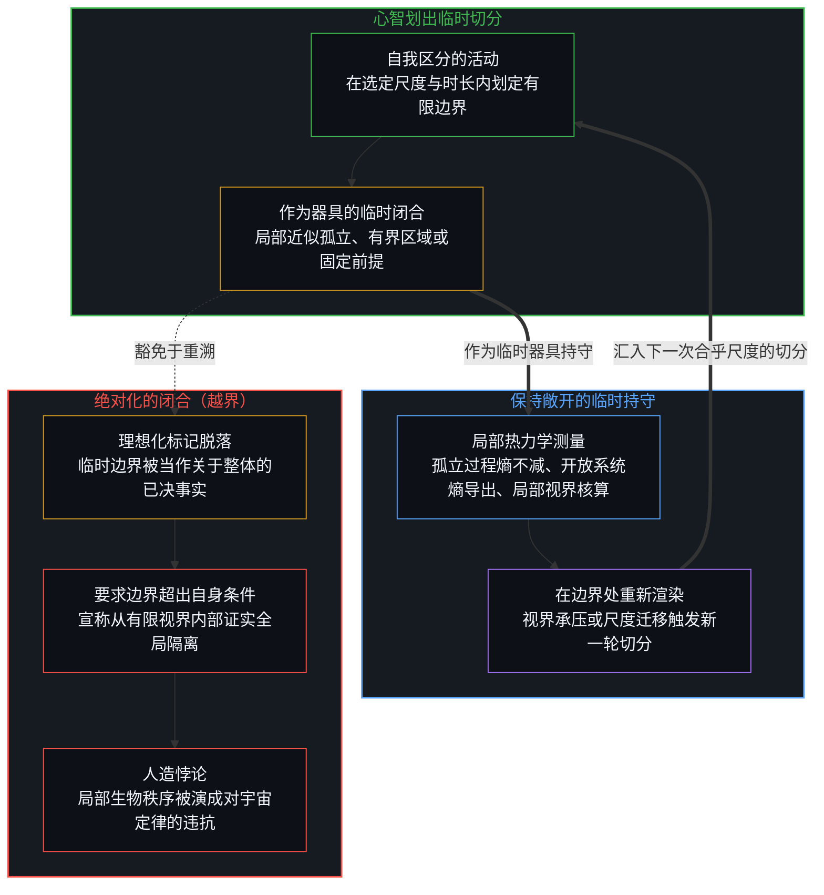
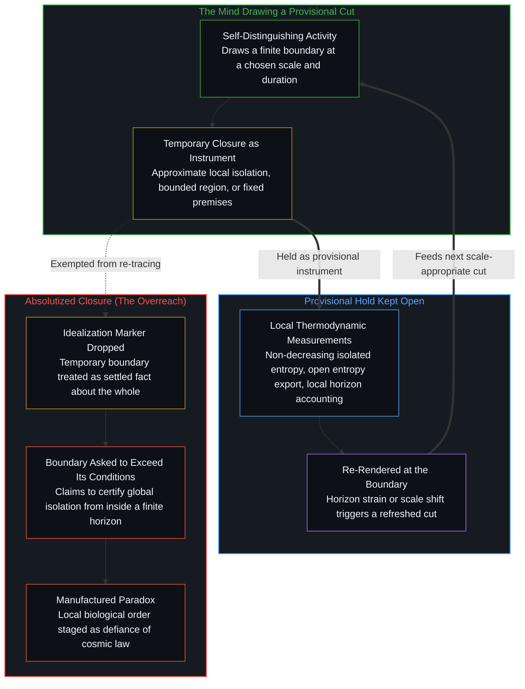
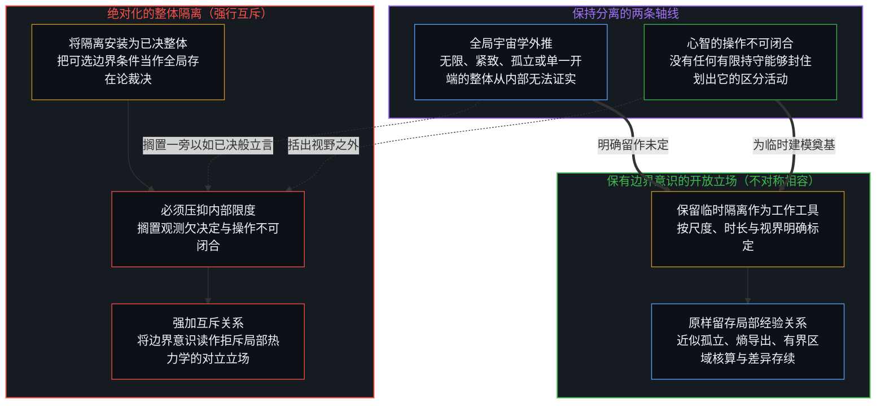
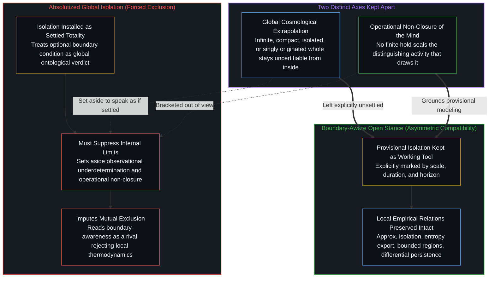

# 隔离理想化的边界与不可闭合的开放 / Boundary of the Isolation Idealization and the Non-Closable Open

*热力学的局部测量并不要求宇宙整体可被证实为封闭；临时闭合使观察成为可能，将其绝对化则是越界。 / Local thermodynamic measurements do not require the universe as a whole to be certifiably closed; temporary closure makes observation possible, absolutizing it is the overreach.*

生命看起来在对抗熵增，建造并维持复杂性，这一观察被当作需要特殊解释的悖论。热力学第二定律陈述的是孤立系统的熵不减，宇宙因被界定为没有外部而被视作终极孤立系统，于是局部秩序的出现显得顽固甚至违例。把理想化的边界条件当作整体的已决事实，正是这一悖论的起点。将孤立条件追溯回有限测量，便能把开放系统的存续与无法证实的宇宙学外推剥离开来，并显露出两种姿态之间的不对称：一是临时持守边界，二是将其绝对化为封闭整体。

Life appears to resist the increase of entropy, building and maintaining complexity; that observation is treated as a paradox requiring special explanation. The second law is stated for isolated systems whose entropy does not decrease, and the universe, defined as having no exterior, is taken as the ultimate isolated system, so the appearance of local order looks stubborn or even unlawful. Treating an idealizing boundary condition as a settled fact about the whole is where that paradox begins. Tracing the isolation condition back to finite measurements separates open-system persistence from uncertifiable cosmic extrapolation and exposes the asymmetry between holding a boundary provisionally and absolutizing it as a closed totality.

## 一、 局部开放与熵的导出 / 1. Local Openness and Entropy Export

可被检查的区域都是有限的。在这些区域里，能够近似视作孤立的过程显示熵不减；与之共存的开放子系统，则通过向周围导出更多的熵来降低自身的熵。埃尔温·薛定谔在《生命是什么》中正是循此框架刻画活细胞：生物秩序仰赖跨过开放边界汲取的自由能，而非对局部热力学的悬置。在远离平衡处，持续的能量与物质通量维系着自组织的有序形态——从对流胞到生命的新陈代谢——但局部热力学中并不存在迫使物质组装出复杂性的普遍律令。

Every region that can be examined is finite. Inside those regions, processes that can be treated as approximately isolated show non-decreasing entropy; open subsystems that coexist with them lower their own entropy by exporting a larger quantity to their surroundings. Erwin Schrödinger framed living cells in these exact terms in *What Is Life?*: biological order runs on free energy drawn across an open boundary rather than on any suspension of local thermodynamics. Far from equilibrium, continuous fluxes of energy and matter sustain self-organizing patterns—from convection cells to living metabolisms—yet nothing in local thermodynamics establishes a universal drive forcing matter to assemble into complexity.

生命并不必然建造复杂性，绝大多数物理构型也从未如此。未能维持所需能量吞吐的构型趋于平衡，并从记录中消失。在能够自我复制的变体之中，跨时间存续下来的，是那些持续完成必要自由能吞吐、导出熵并维系组织的世系。这些局部关系在实验室、化学网络、生物体与天体物理环境中被反复测量，无需援引任何普遍的复杂性定律，便回答了复杂性何以存续。事后回看，留存下来的组织读来仿佛带着顽固的决意——然而此处的决定只是促成与实现，并非在先的指令，也不是提前雕琢胜者的主动选择者。拿掉那位想象中的选择者，差异存续照样完好成立，这正是[悬而未决是决定论的索求](../the-open-question-is-determinisms-demand/)所追溯的同一道边界。

Life does not have to build complexity, and the vast majority of physical configurations never do. Configurations that fail to sustain the required energy throughput equilibrate and disappear from the record. Among self-replicating variants, what persists across time are those lineages that keep completing the necessary free-energy throughput and exporting entropy while maintaining organization. Measured repeatedly across laboratories, chemical networks, organisms, and astrophysical environments, these local relations answer how complexity endures without invoking a universal complexity law. Looked at in hindsight, surviving organization reads as stubborn determination—yet determination here is actuation, or realization, rather than a prior directive or an active chooser sculpting winners in advance. Dropping the imagined selector leaves differential persistence fully intact, the same boundary traced in [The Open Question Is Determinism's Demand](../the-open-question-is-determinisms-demand/).

## 二、 整体隔离作为理想化 / 2. Global Isolation as Idealization

把第二定律应用到宇宙整体时，孤立条件之所以被采用，是因为没有设定可供交换的外部储存库。这一步是外推，而非原始推导的一部分。第二定律的历史源头在于有限的循环热机、近似孤立的实验室容器及其微观状态的统计行为；将这些方程延展到整个宇宙，则是后来的理想化。鲁道夫·克劳修斯在 1865 年论文的末尾完成了这一跳跃，从有限的热力学变换径直跨向“世界”——“世界的能量是恒定的；世界的熵趋于极大。”质疑正是从经典热力学内部发出的。恩斯特·马赫指出，可操作的熵依赖于跨过系统边界的可测传递，这使宇宙总体脱离了经验检验；马克斯·普朗克更在《热力学讲义》中直言，“世界的能量与熵并无意义，因为此类量无法给出精确定义”，将第二定律重新锚定于有限系统的具体不可逆过程。把实验室的粗粒化划分投射到存在整体之上，恰恰制造了[时间之箭的伪悖论与对称模拟的边界](../the-mirage-of-times-arrow-and-the-boundaries-of-simulation/)所审视的那些宇宙学本轮，并倒置了[感知的界限与理解的无限](../the-boundary-of-perception-and-the-infinity-of-understanding/)所追溯的次序：在那里，不可逆的因果继起先于热力学记账，而宇宙之外并不存在隔热壁。

When the second law is applied to the universe as a whole, the isolation condition is adopted because no external reservoir is posited for exchange. That step is an extrapolation, not part of the original derivation. The historical source of the second law lies in finite cyclic heat engines, approximately isolated laboratory vessels, and the statistical behavior of their microstates; extending those equations to the cosmos is a later idealization. Rudolf Clausius performed that leap at the close of his 1865 memoir, moving directly from finite thermodynamic transformations to *die Welt*—"the energy of the world is constant; the entropy of the world tends to a maximum." Pushback arrived from inside classical thermodynamics itself. Ernst Mach noted that operational entropy depends on measurable transfers across a system boundary, leaving cosmological totality detached from empirical test; Max Planck stated directly in his *Treatise on Thermodynamics* that "the energy and the entropy of the world have no meaning, because such quantities admit of no accurate definition," re-anchoring the second law in concrete irreversible processes of finite systems. Projecting laboratory coarse-graining onto existence as a whole manufactures the very cosmological epicycles examined in [The Mirage of Time's Arrow and the Boundaries of Symmetric Simulation](../the-mirage-of-times-arrow-and-the-boundaries-of-simulation/), inverting the order traced in [The Boundary of Perception and the Infinity of Understanding](../the-boundary-of-perception-and-the-infinity-of-understanding/), where irreversible causal succession precedes thermodynamic bookkeeping and no insulating wall is found outside the cosmos.

即便退一步进入相对论宇宙学的方程内部——正如[黑白采样帧与外推宇宙](../the-black-and-white-sample-frame-and-the-extrapolated-universe/)所追溯的，这些模型本身便是由当下的局部采样帧沿坐标轴向前向后外推出的产物，而非对宇宙起源或膨胀整体的直接巡视——整体隔离仍在模型自身的前提下裂开。在膨胀的时空中，能量守恒只在每一点上局部成立，却无法加总为属于整个宇宙的守恒全局能量，这甚至在形式内部便动摇了克劳修斯对句的前半句；而长程自引力系统也抗拒标准的可加性热力学核算。因此，定量的宇宙学熵预算仅严格运行于有限的有界区域与模型化可观测视界之内。无论某套宇宙学模型将其观测视界之外的空间构型设定为有限、无限还是多连通，采用整体隔离都是为了书写边界条件，而非内部观察者已经巡视整体，更非从内部证实了一只密封容器或一个宇宙开端。

Even inside the equations of relativistic cosmology—themselves coordinate extrapolations drawn from a present local sample frame rather than direct inspections of a cosmic origin or an expanding totality, as [The Black-and-White Sample Frame and the Extrapolated Universe](../the-black-and-white-sample-frame-and-the-extrapolated-universe/) traces—global isolation breaks on the models' own terms. In an expanding spacetime, energy conservation holds locally at each point without adding up to a conserved global energy for the whole cosmos, undercutting even the first half of Clausius's couplet inside the formalism itself, while long-range self-gravitating systems resist standard additive thermodynamic accounting. Quantitative cosmological entropy budgets therefore operate strictly inside finite bounded regions and modeled observable horizons. Whether a cosmological model configures space past its observational horizon as finite, infinite, or multiply connected, global isolation is adopted to write boundary conditions, not because an internal observer has surveyed the whole or certified either a sealed container or a cosmic beginning.

## 三、 从内部无法证实 / 3. Uncertifiable from Inside

将宇宙定义为现存事物的完整集合，再因集合之外无物可供交换而断定它是孤立的，这一步所依赖的概念立场，任何内部观察者都既无法占据，也无法经验证实。以无法跨出这一集合为由保留孤立前提，并不会把理想化变成观察，只会把这一前提留作不可检验的边界条件。针对有限子系统，可以相对于其直接环境来安排并检验近似孤立，熵产生非负也在这些检验中成立。对于严格在有限视界内部运作的嵌入观察者——亦即[座位之内的无限进程](../infinity-within-the-seat/)所追溯的有界座位，在那里，不同的全局构型从内部登记为同一份记录——任何关于宇宙整体的图景，都只是凭借局部资源绘制的内部投射，而非从外部完成的审视。

Defining the universe as the complete set of existing things and concluding that it is isolated because nothing lies outside that set for exchange relies on a conceptual stance that no internal observer can occupy or empirically verify. Using the impossibility of stepping outside that set as a reason to keep the isolation premise does not convert an idealization into an observation; it leaves the premise as an untestable boundary condition. Approximate isolation can be arranged and tested for finite subsystems relative to their immediate surroundings, and non-negative entropy production holds across those tests. For an embedded observer operating strictly from inside a finite horizon—the bounded seat traced in [Infinity Within the Seat](../infinity-within-the-seat/), where distinct global configurations register identically from inside—any picture of the universe as a whole remains an internal projection drawn with local resources rather than an inspection carried out from outside.

即便暂且不追问将当下观测倒推为大爆炸奇点或宇宙起源这一坐标外推本身的界限，仅就相对论宇宙学自身的经验与形式结构而言，这道内部界限就已经清晰呈现。内部观察者所能获得的一切数据，归根结底皆是此刻发生在有限视界之内的局部登记——天线传感器此刻激起的微波电流、望远镜此刻录得的红移星表，而非存放过往宇宙史的客观档案，这正是[索求万物理论是在将当下冻结为清单](../demanding-a-toe-freezes-time-into-a-catalog/)所追溯的当下之锚。局部引力方程只支配局部曲率，并不固定全局形状：普朗克 2018 年微波背景观测将空间曲率约束在 Ωₖ = 0.0007 ± 0.0019，严格平坦稳稳落在一倍标准差之内，使无限平坦、大尺度闭合以及负曲率几何均与数据相容；与此同时，满足同一套局部定律的不同全局时空，从任何有限过去视界内部观测皆无法区分。因此，无论是挑出单一全局拓扑，还是将倒推的坐标起点立为宇宙的单一开端，都必须依赖经验之外的假定——例如均匀性或简洁性——这恰好标出了[框架的边界](../the-boundary-of-the-frame/)所追溯的操作界限。整体隔离与被证实的宇宙起源一样，皆非从内部获得的测量结果，而是模型层面的理想化与外推。

Even before questioning the coordinate extrapolation that runs present measurements backward into a Big Bang singularity or cosmic origin, relativistic cosmology sharpens this internal limit on its own empirical and formal terms. Every datum available to an internal observer is a present local registration inside a finite horizon—microwave currents excited in an antenna sensor now and galaxy-redshift catalogs recorded now, not an objective archive storing cosmic history, the present anchor traced in [Demanding a Theory of Everything Freezes Time into a Catalog](../demanding-a-toe-freezes-time-into-a-catalog/). Local gravitational equations govern local curvature without fixing global shape: Planck 2018 microwave-background observations constrain spatial curvature to Ωₖ = 0.0007 ± 0.0019, placing exact flatness well within one standard deviation and leaving infinite flat, large closed, and negatively curved geometries equally compatible with the data, while distinct global spacetimes obeying the exact same local laws remain observationally indistinguishable from inside any finite past horizon. Selecting either a single global topology or a backward-extrapolated coordinate origin as the beginning of the cosmos therefore depends on extra-empirical assumptions—uniformity or simplicity—marking the exact operating limit traced in [The Boundary of the Frame](../the-boundary-of-the-frame/). Global isolation, like a certified cosmic origin, is not an internal measurement; both remain model-level idealizations and extrapolations.

## 四、 临时闭合与绝对化的分野 / 4. Temporary Closure and the Departure of Absolutizing

任何观察或模型都需要临时闭合才可用。自我区分的活动在发生——无因，不息。称之为心智：已在进行中的观察者，其每一个动作都是一次区分。区分即划界；没有边界的区分什么也不曾区分。划定边界、在一段时间内将子系统视作近似孤立，或固定一组前提，使测量得以开展、定量关系得以陈述。每一次切分都相对于所选的尺度、分辨率与持续时间而是临时的。将残留的开放性括入一次临时闭合之内，便使严谨计算与经验核证成为可能，而无需把仍在展开的过程改写成已被清点完毕的整体——这正是[潜无限与数学思维的暂时闭合](../potential-infinity-and-the-temporary-closures-of-mathematical-thought/)所审视的同一件器具。

Every observation or model requires temporary closure to be usable. Self-distinguishing activity occurs — uncaused, unceasing. Call it the Mind: the observer already underway, every act of which is a distinction. To distinguish is to bound; a distinction without a boundary distinguishes nothing. Drawing a boundary, treating a subsystem as approximately isolated across an interval, or fixing a set of premises lets measurements be taken and quantitative relations stated. Each cut is provisional relative to a chosen scale, resolution, and duration. Bracketing residual openness inside a temporary closure makes rigorous calculation and empirical certification possible without converting an ongoing process into a surveyed totality, the exact instrument examined in [Potential Infinity and the Temporary Closures of Mathematical Thought](../potential-infinity-and-the-temporary-closures-of-mathematical-thought/).

越界发生在这一临时边界被当作定论或绝对之时——理想化失去了作为理想化的标记，转而被拿去断定它所无法穷尽的更大领域的性质。走到这一步，临时闭合便被要求承担超出自身条件的工作：超越划界所依的视界，去证实视界之外的状况。将工作闭合抬升为永久存在论，便会冻结这件器具，把模型限度与观测视界变成宣称中的实在边缘，正如[选择、矛盾与开放的现实](../selection-contradiction-and-open-reality/)所追溯的那样。循着[“物理学才是定律”的障眼法](../the-sleight-of-hand-in-physics-is-the-law-and-the-friction-of-reality/)所剖析的同一步，一条本为追踪局部摩擦而由人写下的边界条件，被误认为统治整个存在的外部法令，于是寻常的开放系统组织便登记为违背宇宙定律的例外。

The overreach occurs when that provisional boundary is treated as definitive or absolute—when the idealization loses its marker as an idealization and is taken to settle the character of a larger domain it does not exhaust. At that point, a temporary closure is asked to perform work beyond its own conditions: certifying what lies past the horizon from which the boundary was drawn. Elevating a working closure into permanent ontology freezes the instrument, turning model limits and observational horizons into claimed edges of reality as traced in [Selection, Contradiction, and Open Reality](../selection-contradiction-and-open-reality/). In the same move dissected in [The Sleight of Hand in "Physics Is the Law"](../the-sleight-of-hand-in-physics-is-the-law-and-the-friction-of-reality/), a human-authored boundary condition built to track local friction gets mistaken for an external decree ruling the whole of existence, so ordinary open-system organization registers as an illicit exception to cosmic law.

## 五、 相容而非互斥 / 5. Compatibility Rather Than Mutual Exclusion

将两条不同的轴线分开，便能消去围绕“开放”一词的最后一层混同。第一条轴线关乎全局宇宙学外推——模型究竟将宇宙整体设定为无限平坦、极大尺度的弯曲、紧致多连通、单一的大爆炸开端，还是不存在任何外部物理储存库。这条轴线在任何有限视界内部都处于经验与演绎上的欠决定状态。第二条轴线则是区分活动自身的操作不可闭合性：既然每一道边界、测量框架与形式模型都是心智不息的活动所划出的临时持守，便没有任何有限的持守能够封住划出它的活动，这正是[没有系统能被保持封闭](../no-system-can-be-kept-closed/)所追溯的结构界限。因此，操作上的不可闭合不是又一枚无法证实的容器标签，也不与闭合球面或开放双曲面竞争；它本身就是使每一次临时闭合得以可用的先在条件。

Keeping two distinct axes separate removes the last source of conflation around what "open" names. The first axis is global cosmological extrapolation—whether a model assigns the whole an infinite flat geometry, very large curvature, compact multiply connected topology, a single Big Bang origin, or no external physical reservoir. That axis stays empirically and deductively underdetermined from inside any finite horizon. The second axis is the operational non-closure of the distinguishing activity itself: because every boundary, measurement frame, and formal model is a temporary hold drawn by the unceasing activity of the Mind, no finite hold seals the activity that draws it, the structural bound traced in [No System Can Be Kept Closed](../no-system-can-be-kept-closed/). Operational non-closure is therefore not one more uncertifiable box-label competing with a closed sphere or an open hyperboloid; it is the prior condition that makes every temporary closure usable in the first place.

贯通这两条轴线来看，保有边界意识的开放立场与绝对化的隔离立场之间的关系是不对称的，而非彼此互斥。承认全局物理隔离的不可检验性，同时认清任何有限持守在操作上的不可闭合，会让隔离理想化作为局部或临时的建模工具照常可用。各项局部关系——有限子系统的近似孤立、开放子系统的熵导出、局部视界核算，以及选择之下的差异存续——皆在可及区域内部测得；无论模型是明确采用整体隔离作为工作起始条件，还是将全局是否闭合留作未定，抑或严格在有限有界区域内部展开计算，这些局部关系都原样成立。正如[开放即一致](../openness-is-consistency/)所确立的，经验发现在开放之下丝毫不受触动，只是穷尽性从不与之同行。反向的举措则呈现出不对称性：一旦把整体隔离当作超越可选起始条件的论断，就必须将内部不可证实性、宇宙学欠决定与操作不可闭合搁置一旁，才能像全局边界已然落定那样立言。把“拒斥局部热力学”强加给开放立场，本身正是闭合动作的一部分——它将自身对互斥的索求，投射到这样一种立场上：它原样留存每一项局部测量，并将边界清晰地置于视野之内。

Seen across both axes, the interaction between an open boundary-aware stance and an absolutized isolation stance is asymmetric rather than mutually exclusive. Recognizing the untestable character of global physical isolation, alongside the operational non-closure of any finite hold, keeps the isolation idealization fully usable as a local or provisional modeling tool. The local relations—approximate isolation of finite subsystems, entropy export by open subsystems, local horizon accounting, and differential persistence under selection—are measured inside accessible regions and stand directly intact whether a model adopts global isolation explicitly as a working starting condition, leaves global closure unspecified, or works strictly inside finite bounded regions. As [Openness Is Consistency](../openness-is-consistency/) establishes, empirical findings remain untouched under openness while exhaustiveness never travels with them. The reverse move operates asymmetrically: treating global isolation as more than an optional starting condition requires setting internal uncertifiability, cosmological underdetermination, and operational non-closure aside in order to speak as if the global boundary were settled. Imputing a rejection of local thermodynamics onto the open stance is itself part of that closure move—projecting its own demand for mutual exclusion onto a position that keeps every local measurement in place and its boundaries in plain view.

复杂性生成与存续的条件因此是局部的、可测量的，且与全局几何、拓扑、宇宙开端及物理闭合保持未定彼此相容。临时闭合使这些条件得以在选定尺度上陈述、建模并接受检验；将其绝对化，则会强行引出测量从未要求的进一步排除。宇宙学模型在当下局部测量之外所外推的究竟是有限、无限、拓扑闭合抑或具有单一开端的宇宙，始终是从内部无法证实的外推；而每一项热力学测量与模型的边界条件，始终都是临时的切分——由身处具体处境的心智在活生生的边缘划出、对照摩擦加以检验，并持续重新渲染。

The conditions under which complexity arises and persists are therefore local, measurable, and compatible with leaving global geometry, topology, cosmic origin, and physical closure unsettled. Temporary closure lets those conditions be stated, modeled, and tested across chosen scales; absolutizing it forces further exclusions that the measurements never require. Whether cosmological models extrapolate a finite, infinite, topologically sealed, or singly originated universe beyond present local measurements remains uncertifiable from inside—while the boundary conditions of every thermodynamic measurement and model remain provisional cuts drawn, tested against friction, and re-rendered at the living edge by the situated Mind.
