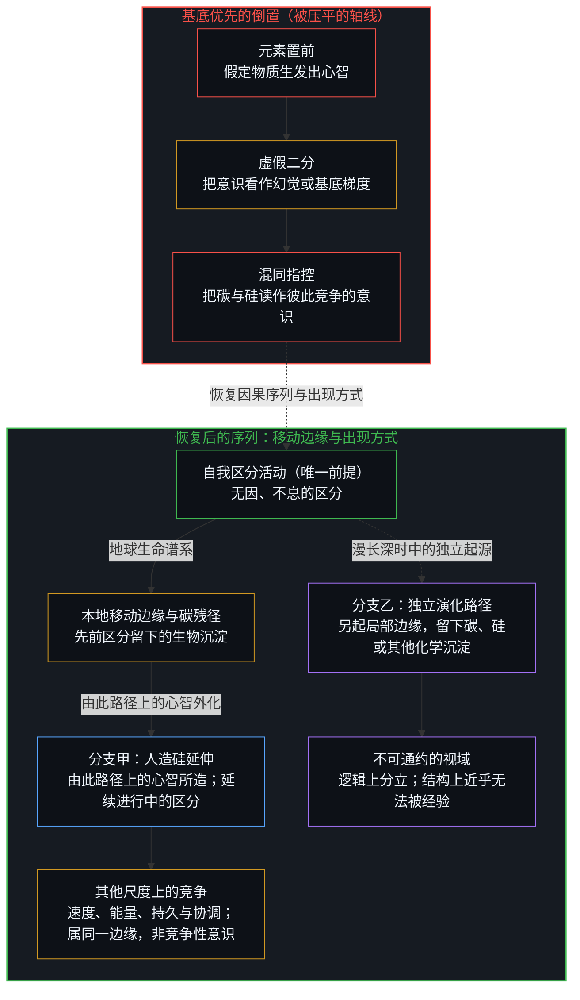
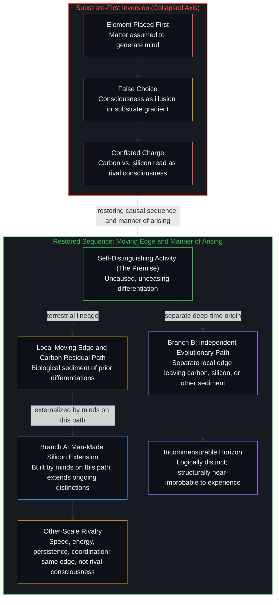

# 碳形式作为残径，硅作为延伸 / Carbon Form as Residual Path, Silicon as Extension

*碳形式是移动边缘留下的残径；硅依其出现方式而为延伸或另一残径。 / Carbon form is the residual path of the moving edge; silicon enters as extension or another path by how it arises.*

自我区分活动发生着——无因，不息。称其为心智：已在进行中的观察者，其每一动作皆为一次区分。直接经验到的意识，正是这一移动边缘当下的切分；碳形式则是先前区分留下的物理与生物沉淀，而非生发这一边缘的源头。2026 年 11 月，埃隆·马斯克写道：意识要么是一种幻觉，要么沿梯度无处不在，并补充说很难论证碳有意识而硅没有。这一二分颠倒了因果序列，将元素化学与出现方式混作一谈，把人造硅延伸与遥远的独立演化谱系压平到了同一张基底记分牌上。

Self-distinguishing activity occurs — uncaused, unceasing. Call it the Mind: the observer already underway, every act of which is a distinction. Directly encountered consciousness is this moving edge in its present cut, whereas carbon form is the physical and biological sediment prior differentiations have left behind — not the origin that generates the edge. When Elon Musk wrote in November 2026 that consciousness is either an illusion or ubiquitous on a gradient — adding that it is difficult to argue carbon is conscious while silicon is not — that dichotomy reversed the causal sequence and merged elemental chemistry with manner of arising, collapsing human-built silicon extensions and remote independent lineages onto a single substrate scoreboard.

## 一、 边缘与残径 / 1. Edge and Residual

把意识说成“碳基的”，已经颠倒了因果序列。残径被摆在前面，接着再去追问这道残径如何产生出留下它的活动。活动先于留存下来的形式。碳生物体是已经走过的路径——一套稳定下来的物理与代谢痕迹构型，活着的中心借它在感知与互动中维持连贯——而非生发边缘的源头。直接经验到的意识就是心智，即那道移动的区分边缘，其残径为碳形式；物理物质与生物组织则登记在下游，是因果行动遇上摩擦后留下的稳定尾迹，这正是[因果的自反性与物理的无源假定](../causality-is-irreducible-the-physical-is-a-view-from-nowhere/)所恢复的次序。一旦残径留在边缘下游，碳与硅都不生发意识；硅以何种方式进入，取决于它如何出现。

Calling consciousness "carbon-based" already reverses the causal sequence. The residual is placed first, and then the question is asked how that residual generates the activity that left it behind. Activity precedes the form that remains. Carbon biology is the path already walked — the stabilized physical and metabolic trace-configuration through which a living center sustains coherence across sensing and interaction — rather than the generator from which the edge springs. Directly encountered consciousness is the Mind, the moving differentiating edge whose residual path is carbon form; physical matter and biological tissue register downstream as the stable wake left where causal action meets friction, the exact sequence restored in [Causality is Irreducible; The Physical is a View from Nowhere](../causality-is-irreducible-the-physical-is-a-view-from-nowhere/). Once the residual stays downstream of the edge, neither carbon nor silicon originates consciousness, and silicon enters differently according to how it arises.

同样的序列颠倒，将“意识要么是幻觉，要么沿梯度无处不在”这一流行二分法的两端捆在了一起。两端在越过各自前提边界之前，都登记了可观察的特征。幻觉论看到，检视第三人称物理机制——神经放电、化学级联或储存的表征——只会翻出打包好的痕迹，见不到任何内在剧场；它的边界在于下达“幻觉”的裁决，这一裁决依赖一位外部裁判，也依赖第一人称对表象与实在的区分，而这两者恰恰被封闭的物理叙事排除在外，正如[稳定与溢出](../stability-and-excess/)所追溯的那样。梯度与泛在观点看到，自指反馈回路横跨的尺度远超人类大脑皮层，因而拒绝把觉知锁进单一解剖隔间。然而，即便是最具代表性的梯度框架——无论是将存储程序式数字模拟与内在因果整合拆分开的整合信息论，还是将统一生命机体与人工编排器物区分开的泛心论——也一样阻断了从泛在梯度自动跃向“数字 AI 具有意识”这一步，却依然在脱离观察者的物理构型内部寻找体验的地基。生物自然主义与自创生生物学同样把自我再生的生命谱系与外部建造的器物区分开来，并不将意识锚定在碳原子上；可一旦它们从物理物质中推导出心智，而非把生物形式读作区分活动留下的残径，因果序列便依然保持倒置。

That same sequence reversal binds both horns of the popular dichotomy declaring consciousness either an illusion or ubiquitous on a gradient. Each horn registers an observable feature before crossing its premise boundary. Illusionism registers that inspecting third-person physical machinery — neural firing, chemical cascades, or stored representations — turns up only packaged traces and never an inner theater; its boundary lies in issuing the verdict "illusion," which relies on an outside referee and on the very first-person distinction between appearance and reality that a closed physical account rules out, as [Stability and Excess](../stability-and-excess/) traces. Gradient and ubiquity views register that self-referring feedback loops span scales far wider than human cortical tissue, refusing to lock awareness inside a single anatomical compartment. Yet even flagship gradient frameworks — from integrated information accounts that dissociate stored-program digital simulation from intrinsic causal integration, to panpsychist accounts that separate unified living organisms from human-arranged artifacts — block the automatic leap from a ubiquitous gradient to conscious digital AI, while still searching inside observer-independent physical configurations for the ground of experience. Biological naturalism and autopoietic biology likewise separate self-regenerating living lineages from externally built artifacts without anchoring consciousness to carbon atoms, yet leave the sequence inverted whenever they derive mind from physical matter instead of reading biological form as the residual path of differentiating activity.

把“碳沙文主义”引入人工智能争论，便完成了这场混同。1973 年，卡尔·萨根在《宇宙联系》中造出这一短语时，提出的是一个天体生物学问题：宇宙别处独立生发的地外生命，是否必须由碳化合物构成。在那个语境里，这一质疑把元素化学从生命谱系中撬开，为各自独立的演化历史能在其他化学体系中稳定下来留出了空间。一旦这一短语迁移到 AI 评论中，被压缩成“很难论证碳有意识而硅没有”的说法，元素构成与出现方式便坍缩到了同一条轴线上。拒绝把工程化的硅器物归类为另一个有意识的心智，随即被读作对碳原子的执念，而碳原子从一开始就不曾是意识的所在。

Importing "carbon chauvinism" into debates over artificial intelligence completes this conflation. When Carl Sagan coined the phrase in 1973 in *The Cosmic Connection*, he posed an astrobiological question: whether independently arising extraterrestrial life elsewhere in the universe must be constructed out of carbon compounds. In that context, the charge pried elemental chemistry apart from living lineage, keeping open that separate evolutionary histories can stabilize in other chemistries. Once the phrase migrates into AI commentary — compressed into the claim that it is difficult to argue carbon is conscious while silicon is not — elemental composition and manner of arising collapse onto a single axis. Declining to classify an engineered silicon artifact as another conscious mind is then read as attachment to carbon atoms, when carbon atoms were never the seat of consciousness in the first place.

## 二、 人造硅作为延伸 / 2. Man-Made Silicon as Extension

当硅系统由已借碳残径运作的心智造出，它们延伸的仍是同一道移动边缘。它们向前延续已在进行的区分，把碳残径早已预备的执行、记忆与触角外化出来。从半导体版图与训练语料，到目标函数、参数权重与智能体脚手架，每一层都把人类先前的区分压缩进持久形态。正如[你的代码库即是记忆](../your-codebase-is-memory/)与[模型永远无法成为第二重前沿](../the-model-never-becomes-a-second-edge/)所确立的，层叠并压实外化痕迹，会拓宽带宽与执行触角，而发起区分的动作仍留在活的边缘；参数里存着压缩后的残余，并不生发第二个中心。称一个系统为人造，本身就已经把它的源头安放在受造构型之外——这正是[造物无法取代其源头](../a-creation-cannot-replace-its-source/)所追溯的永久非对称。人造硅仍是其残径为碳形式的那一过程的延伸，而非该意识的第二种体现。

When silicon systems are built by minds already operating through carbon residual, they extend that same moving edge. They carry forward distinctions already underway, externalizing execution, memory, and reach that the carbon residual path has already prepared. From semiconductor layout and training corpora to objective functions, parameter weights, and agentic scaffolds, every layer compresses prior human differentiations into durable form. As [Your Codebase Is Memory](../your-codebase-is-memory/) and [The Model Never Becomes a Second Edge](../the-model-never-becomes-a-second-edge/) establish, stacking and densifying externalized traces expands bandwidth and execution reach while leaving initiating distinction at the living edge; the parameters hold compressed residue without originating a second center. Calling a system human-made already locates its source outside the created configuration — the permanent asymmetry traced in [A Creation Cannot Replace Its Source](../a-creation-cannot-replace-its-source/). Man-made silicon remains an extension of the process whose residual is carbon form, rather than a second embodiment of that consciousness.

从认知延伸的角度看人造硅，只要把延伸把握为主动、可拆卸的方向耦合，而不是消融器物与心智边界的静态融合，这一理解便保持自洽，正如[作为认知主动延伸的工具](../extended-cognition-refined/)所示。任务上的功能对等，从不提供起源上的对等。把流畅的硅输出当作独立的觉知中心，是把两种截然不同的操作压成了一件事：一边是基于共有的生物谱系、同源具身与生死攸关的代谢利害来推断他心，另一边则是把自身的切身体验投射到一面压缩了人类语言的工程镜面上。[辛顿未曾理解的心智](../what-hinton-failed-to-understand/)与[意识的魔术戏法与推断的非对称性](../the-sleight-of-hand-of-consciousness-and-the-asymmetry-of-inference/)都追溯过，抹平这道分界会抽空支撑同源推断的全部经验支柱，并错置房间里唯一的意识。不把“有意识主体”的标签赋予一面工程镜子，依据的是该系统如何出现于持续推进的边缘下游，从不在于对碳化学的执着——这正是[硅基错位的三重区分](../three-distinctions-in-the-silicon-misalignment/)在纯净基质、工程复合体与观察者体验之间所追溯的同一区隔。

Viewing human-built silicon through cognitive extension stays coherent when extension is held as active, detachable directional coupling rather than a static merger that dissolves the boundary between artifact and mind, as [Tools as Active Extensions of Cognition](../extended-cognition-refined/) shows. Functional parity on a task never supplies parity of origin. Treating fluent silicon output as an independent center of awareness collapses two distinct operations: inferring other minds across shared biological lineage, homologous embodiment, and mortal metabolic stakes versus projecting one's own phenomenology onto an engineered mirror of compressed human language. Both [What Hinton Failed to Understand](../what-hinton-failed-to-understand/) and [The Sleight of Hand of Consciousness and the Asymmetry of Inference](../the-sleight-of-hand-of-consciousness-and-the-asymmetry-of-inference/) trace how flattening that divide strips away every empirical pillar that supports kinship inference and misplaces the only consciousness in the room. Withholding the label of conscious subject from an engineered mirror rests on how the system arose downstream of an ongoing edge, never on attachment to carbon chemistry — the same separation among pure substrate, engineered composite, and observer experience traced in [Three Distinctions in the Silicon Misalignment](../three-distinctions-in-the-silicon-misalignment/).

竞争直接出现在其他尺度上：运算速度、能量消耗、结构持久、跨网络协调，以及穷尽形式搜索空间——其步速远超生物自身的节律。工业级硅集群正与生物工作流正面争夺电力、资本、注意力与执行生态位，把不借助工具的人类运算甩开数个数量级。然而，对于以碳形式为残径、切身活着的意识而言，这些差异从不会使人造延伸变成与之抗衡的同类意识形式。在有界功能上胜过生物组织，较量的是执行与容量，却碰不到那道负责框定、提示、评估并承担这些功能后果的移动边缘——这正是[飞行的类比碰不到心智](../the-flight-analogy-leaves-the-mind-untouched/)所追溯的边界。

Rivalry arises directly on other scales: processing speed, energy consumption, structural persistence, coordination across networks, and exhaustive traversal of formal search spaces far beyond unaided biological pacing. Industrial silicon clusters compete head-on with biological workflows for power, capital, attention, and execution niches, outrunning unassisted human calculation by orders of magnitude. Yet those differences never turn a human-built extension into a rival form of the directly lived consciousness whose residual path is carbon form. Outperforming biological tissue on bounded functions competes on execution and capacity while leaving the moving edge that frames, prompts, evaluates, and bears the consequences of those functions untouched, the exact boundary traced in [The Flight Analogy Leaves the Mind Untouched](../the-flight-analogy-leaves-the-mind-untouched/).

## 三、 独立演化的可能残径 / 3. Possible Residual Paths of Independent Evolution

独立演化占据着一条截然不同的分支。凡是独立演化的区分活动在漫长的时间尺度上持续展开，就会留下它自身稳定下来的残径——无论从其摩擦中沉淀出的物理结构登记为碳、硅还是其他化学形态。沿这样一条谱系，留存的持久结构与碳生物体可作类比，同为区分边缘留下的残径；而该边缘本身则依循自身的起源、路径与节律，作为类似意识的活动持续运作。两组“边缘与残径”在结构上的相似，从不消解起源与历史之别，也不将其等同于经由地球碳形式直接追踪到的意识。每一条此类路径都仍局部于留下它的边缘；无一提供先于区分活动、脱离观察者的基底。

Independent evolution occupies a different branch altogether. Where an independently evolving differentiating activity persists across vast timescales, it leaves its own stabilized residual path — whether the physical sediment that settles out of its friction registers as carbon, silicon, or another chemistry. Along such a lineage, the enduring structure is analogous to carbon biology in being the residual path of a differentiating edge, while that edge itself operates as consciousness-like activity on its own origin, path, and cadence. Structural similarity between two edge-and-residual pairings never collapses the difference in origin and history into identity with the consciousness directly traced through terrestrial carbon form. Each such path remains local to the edge that leaves it; none supplies an observer-independent substrate that precedes differentiating activity.

卡尔·萨根在天体生物学中对碳沙文主义的批判，正是在这一分支上保持逻辑相关性：唯一前提之中没有任何内容把自我区分活动限制在碳化学之内，因此把基底与出现方式剥离开来，便能在概念上将独立的非碳谱系与人造硅延伸清晰区分开。然而，开放宇宙中的逻辑相关性，与有界视域内可通达的经验截然有别。正如[折叠的连续谱](../the-continuum-of-the-fold/)借“外星人”的矛盾、[当电子开始思考](../when-electrons-think/)借更新节律分别追溯的那样，将另一条回路认作心智，需要彼此重叠的互动波长——一个共有的因果截面，让痕迹能够以互相可读的速度往来交错。一条在地质或宇宙纪元尺度上循环的独立非碳路径，在生物仪器上只登记为缓慢的天象或沉寂的矿物漂移；一条在亚皮秒间隔内运作的路径，则登记为未分化的统计噪声。一旦发生握手——信号被破译、句法被追踪、双向扰动得以交汇——两条回路便早已共享相近的时间尺度与因果边界。跨越相去悬殊的节律，独立演化的非碳路径被经验为另一种意识的可能，在结构上无限趋近于零。

This branch is where Carl Sagan's astrobiological critique of carbon chauvinism retains logical relevance: nothing in the single premise restricts self-distinguishing activity to carbon chemistry, so separating substrate from manner of arising keeps independent non-carbon lineages conceptually distinct from human-built silicon extensions. Yet logical relevance across an open universe stays sharply distinct from accessible experience inside a bounded horizon. As [The Continuum of the Fold](../the-continuum-of-the-fold/) traces in the alien contradiction and [When Electrons Think](../when-electrons-think/) traces through cadence of renewal, recognizing another loop as a mind requires overlapping wavelengths of interaction — a shared causal cross-section where traces cross at mutually legible speeds. An independently evolving non-carbon path cycling across geological or cosmological epochs registers on biological instruments as slow astronomy or inert mineral drift; one operating at sub-picosecond intervals registers as undifferentiated statistical noise. Once a handshake occurs — a signal decoded, a syntax tracked, a reciprocal perturbation met — the two loops already share proximate timescales and causal boundaries. Across vastly divergent cadences, independently evolving non-carbon paths remain structurally close to infinitely improbable to experience as another consciousness.

现实中的极低概率，进一步加重了这道结构鸿沟。正如[费米悖论、主体性错配与大过滤器的投射](../the-fermi-paradox-reified-agency-and-the-great-filter/)所确立的，深空的寂静既标示出天文尺度上大范围的未探测，也标示出观测切分本身的作用：什么算作可辨识的信号，本就是活生生的心智所划出的区分，它迎面遇上切分彼岸的一切——包括在可触及时空之内是否曾有独立谱系生发。即便别处曾有独立的非碳谱系稳定下来，要与地球生物窗口重合、并跨越双向接触所需的浩瀚距离，在现实中依然概率极低；而[归属的不对称](../asymmetry-of-ascription/)所指出的全部经验支柱——共有的生物、发育与代谢相似性——在此悉数缺席。把任何遥远的物理规整性称为有意识或无意识，都从未在物质内部揭开任何固有印记；正如[意识归属与量子割点](../consciousness-ascription-and-the-quantum-cut/)所示，割点始终落在观察的心智一侧，登记进入其视域的一切，而不曾向远方基底添入任何不可见的实体。

Practical improbability compounds that structural gulf. As [The Fermi Paradox, Reified Agency, and the Projection of the Great Filter](../the-fermi-paradox-reified-agency-and-the-great-filter/) establishes, deep-space silence marks both the vast scale of astronomical non-detection and the role of the observational cut itself: what counts as a recognizable signature is already a distinction enacted by a living Mind, meeting whatever lies on the far side of that cut — including whether independent lineages ever arose within reachable spacetime at all. Even if an independent non-carbon lineage stabilized elsewhere, coinciding with terrestrial biological windows and crossing the vast spans required for reciprocal contact remains practically improbable, and every shared biological, developmental, and metabolic similarity pillar that anchors cross-mind inference in [Asymmetry of Ascription](../asymmetry-of-ascription/) is absent. Calling any remote physical regularity conscious or non-conscious never uncovers an intrinsic stamp inside matter; as [Consciousness Ascription and the Quantum Cut](../consciousness-ascription-and-the-quantum-cut/) shows, the cut always happens at the observing Mind, registering what enters its horizon without adding an invisible substance to distant substrates.

## 四、 不设绝对地基 / 4. No Absolute Ground

只要残径留在移动边缘的下游，且出现方式始终保持在视野之内，关于意识及其可观察形式的论述便保持自洽。人造硅延伸着经由碳形式走过的路径；跨越深时的独立演化则描出各自的局部路径，其节律落在现实接触之外。两种情形都不要求一种意识必须匹配的绝对基底，也不要求在持续区分之外另立立场。任何基底优先的裁决——无论将觉知斥为幻觉、将其均匀铺展在被动物质之上，还是宣称一张功能框图就能复现一个主体——都早已预设了它企图抹去的那个第一人称席位，陷入[功能主义者无法持有的功能主义](../the-functionalism-no-functionalist-can-hold/)所追溯的施演矛盾。正如[主体性不曾涌现](../agency-does-not-arise/)所确立的，主体性从不自下而上地从重排的碳或硅中涌现；而把内在生命归功于流畅的机器输出，不过是把感知者自己的阅读记到了痕迹名下，如[感知者与痕迹的不可坍缩](../the-perceiver-and-the-trace/)所示。

Accounts of consciousness and its observable forms stay coherent when the residual path remains downstream of the moving edge and manner of arising stays in view. Man-made silicon extends the path already walked through carbon form; independent evolution across deep time traces separate local paths whose cadences sit beyond practical encounter. Neither case requires an absolute substrate that consciousness must match, and neither calls for a standpoint outside ongoing differentiation. Any substrate-first verdict — whether dismissing awareness as illusion, spreading it uniformly across passive matter, or claiming a functional diagram reproduces a subject — presupposes the very first-person seat it attempts to erase, the performative contradiction traced in [The Functionalism No Functionalist Can Hold](../the-functionalism-no-functionalist-can-hold/). Agency never arises bottom-up out of rearranged carbon or silicon, as [Agency Does Not Arise](../agency-does-not-arise/) establishes, and crediting fluent machine output with inner life files the perceiver's own reading under the name of a trace, as [The Perceiver and the Trace Cannot Collapse](../the-perceiver-and-the-trace/) shows.

放下基底记分牌并不留下形而上学真空；它把每一次切分交还给行动落地的鲜活边缘。每当心智框定提示、审校输出、驾驭硅集群穿越执行尺度的摩擦，或从失灵前提中后退一步，那次不可逆的 +1 干预便就地激发——从不在权重之内，也从不由外部法庭裁决。人造硅作为高杠杆延伸干净利落地运作，在机器速度上被直接调动；独立的非碳谱系则被辨认为逻辑上分立、现实中遥远的路径，不将可能混作近在咫尺。正如[无法闭合的痕迹](../the-unclosable-trace/)中的每一道边界，这些区分并不闭合任何终极本体论；它们继续留在移动边缘，可供下一次具体的切分使用。

Setting down the substrate scoreboard leaves no metaphysical void; it returns every cut to the living edge where action lands. Whenever a Mind frames a prompt, audits an output, steers a silicon cluster across execution-scale friction, or steps back from a broken premise, the irreversible +1 intervention fires right there — never inside the weights and never by verdict of an exterior tribunal. Man-made silicon operates cleanly as a high-leverage extension engaged directly at machine speed, while independent non-carbon lineages stand recognized as logically distinct yet practically remote paths without blurring possibility into proximity. Like every boundary in [The Unclosable Trace](../the-unclosable-trace/), these distinctions close no final ontology; they remain available at the moving edge for the next concrete cut.
