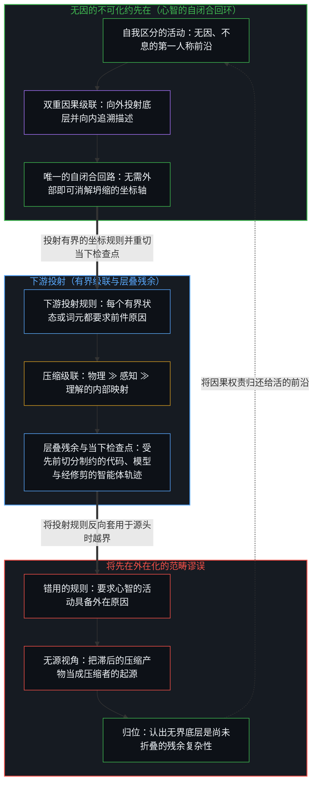
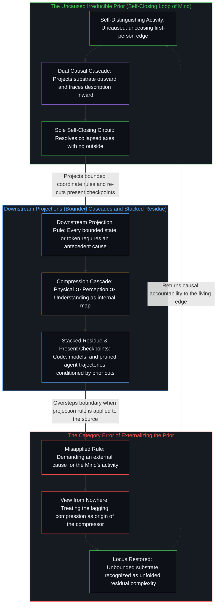

# 因果与不可化约的先在 / Causality and the Irreducible Prior

*同一条因果级联的两面，而心智从不化为单纯的内容 / Two faces of one causal cascade where the Mind never becomes mere content*

一个逐级压缩的表观层级，呈现出一条从广袤底层向外通往感知与理解的单向因果箭头。对这个底层的描述使箭头反转。两个方向是同一个递归过程的互补两面；心智是一切显现的恒常条件；残余的复杂性是当前的压缩尚未折叠进来的部分；而硬币之所以一直在转，是因为这个先在还没有把自己说完。

An apparent hierarchy of successive compressions presents a one-way causal arrow running from an expansive substrate outward to perception and understanding. Describing that substrate reverses the arrow. The two directions are complementary faces of a single recursive process; the Mind is the permanent condition of every appearance; residual complexity is what the current compression has not yet folded in; and the coin keeps turning because that prior has not finished articulating itself.

## 一、 逐级压缩的表观层级 / 1. An Apparent Hierarchy of Successive Compressions

一个逐级压缩的表观层级将物理实在排列为远大于感知，又将感知排列为远大于理解（物理 ≫ 感知 ≫ 理解）。物理实在呈现为高复杂度的信息，一个实际上没有边界的底层。感知是它的第一次压缩，概念理解则是对这个已被缩减的场的再一次压缩。孤立地看，这条不等式直截了当，因果的箭头似乎只朝一个方向走：从最大的系统向外通往较小的系统，其中独立于心智的实在先于、产生并且超出那个后来登记它的心智。

An apparent hierarchy of successive compressions orders physical reality as vastly larger than perception, and perception as vastly larger than understanding (physical ≫ perception ≫ understanding). Physical reality presents itself as high-complexity information, an effectively unbounded substrate. Perception acts as its first compression, and conceptual understanding is a further compression of that already-reduced field. Taken in isolation, the inequality looks straightforward, and the causal arrow appears to run in one direction only: from the largest system outward to the smaller ones, where a mind-independent reality precedes, produces, and exceeds the mind that eventually comes to register it.

## 二、 描述使箭头反转 / 2. Description Reverses the Arrow

一旦那个独立于心智的底层被谈论或建模，箭头就反转了。对物理的每一次描述，对无界之物的每一个断言，本身都是理解的行动。没有任何外部底层可以不先经过感知与概念的逐级压缩就被指认出来。看似在外等候被发现的层级，实则是从内部生成的。因果并不只是从底层流向心智，它同样从心智流向底层。两个方向并不相消。它们是同一个因果在互补态度之下的登记，是一个过程的两面。[因果贯穿始终](../causality-all-the-way/)是同一段结构性滞后在预测之下的显现：观察持有的是结果，而生成的那一步始终走在每一张已经落定的图之前。[意识从不作为数据出现在数据之中](../consciousness-never-appears-as-data-among-data/)是它在证据之下的反面：公共的数据是滞后的结果，前沿从不作为又一个对象出现在其中。

The moment that mind-independent substrate is spoken of or modeled, the arrow reverses. Every description of the physical and every claim about the unbounded is itself an act of understanding. No exterior substrate can be pointed to without already having passed through the successive compressions of perception and concept. The hierarchy that seemed to be discovered waiting outside is generated from within. Causality does not flow only from substrate to mind; it flows equally from mind to substrate. The two directions do not cancel. They are the same causality registered under complementary attitudes—the two faces of a single process. [Causality All the Way](../causality-all-the-way/) is the same structural lag under prediction: observation holds effects, while the generating step stays ahead of every secured map. [Consciousness Never Appears as Data Among Data](../consciousness-never-appears-as-data-among-data/) is the reverse face under evidence: public data are lagging effects, and the leading edge never appears among them as one more object.

## 三、 一个过程的互补两面 / 3. Complementary Faces of One Process

这个过程就是称作心智或意识的递归反馈回环。它把实在论的级联向前投出，于是一个有结构的世界显得先于经验；它又把同一个级联向后追溯，于是经验能够交代自己的来处。回环从不停在最终的某一面上。每当注意力停在硬币的一面时，另一面便退入阴影，却依然在起作用。[回环与成图](../looping-and-graphing/)把这一次折叠显明出来：回环是心智折回自身的活动，而图是这次折叠留给下一次折叠的痕迹。[攀登从未离开地面](../climbing-does-not-leave-the-ground/)是它在致密化之下的对偶：连续的因果历史与离散的新意作为同一次攀登的互补两面运作，而不是彼此相消的两极。

That process is the recursive feedback loop called the Mind, or consciousness. It projects the realist cascade forward so that a structured world appears to precede experience, and it traces the same cascade backward so that experience can account for its own origins. The loop never settles on a final side. Whenever attention rests on one face of the coin, the other recedes into shadow yet remains operative. [Looping and Graphing](../looping-and-graphing/) makes that fold explicit: looping is the Mind folding back on its own activity, and graphs are the traces that folding leaves available for the next fold. [Climbing Does Not Leave the Ground](../climbing-does-not-leave-the-ground/) is the dual under densification: continuous causal history and discrete novelty operate as complementary faces of one climb, not poles that cancel.

## 四、 物理可以退后而心智不能 / 4. The Physical Can Recede While the Mind Cannot

物理可以任其退入背景，作为沉默的给定起作用。心智不能。即便注意力沉浸在感知或理解之中而忽略了自身的行动，这次忽略仍然是心智的行动。没有任何位置能让意识变成被动的内容。透明本身仍然是它的透明。

The physical can be allowed to recede into background and function as a silent given. The Mind cannot. Even when attention is absorbed in perceiving or understanding and overlooks its own act, that overlooking remains an act of the Mind. No vantage exists from which consciousness becomes passive content. Transparency itself remains its transparency.

这一不对称是决定性的。心智是一切显现的恒常条件，连它自身缺席的显现也在其内，因此它是不可化约的先在。[智能只属于心智](../intelligence-belongs-only-to-the-mind/)在一切工具与痕迹构型中持守的正是这个先在：能够被工程化、规模化或转移的皆是残余，而发起行动的权能始终留在自我区分的活动之中。要求心智的自我区分活动具备一个外在原因——坚称这个先在本身必须由某个更早的物理底层所产生，或是在某条工程级联内部被合成出来——是把下游的投射规则误当成了投射它的源头。在任何有界投射内部，每一个状态或词元都需要一个前件条件；[超越投射](../beyond-the-projection/)与[你的代码库即是记忆](../your-codebase-is-memory/)展示了这条规则如何在模型、代码库与脚手架化的智能体轨迹所构成的外化栈中运作。每一层都是对更早区分的进一步压缩，自身从不发起下一刀切分：若任其留在未经修剪的会话历史中，累积的词元便会淤积成引力井，在陈旧的框架内自我合理化；而把暂时的拖累修剪至承重的当下检查点——或是派出不继承任何既有轮次的冷启动同侪——才能让受轨迹束缚的智能体在固定的任务坐标内执行无我的更新，同时将公理层面的死锁向上呈交回掌舵心智那未被投射的意图。逐级的压缩、层级结构以及因果的一体两面，全都在心智的回环之内生成，并且一直依赖于它。登记为无界底层的，是当前的压缩尚未折叠进来的残余复杂性。一旦其中一部分被折叠进来，当下检查点便在原位重切，底层随之移动，回环继续。[抽象、边界与现实的移动边缘](../abstraction-boundaries-and-the-moving-edge-of-reality/)正是压缩之下的这一残余：每一次成功的界定，都留下仍然越过目录往外推压的部分。[选择、矛盾与开放的现实](../selection-contradiction-and-open-reality/)则是披着选择外衣的残余：引力的信息论推导与递归立场相融贯，同时仍然是选择，并不豁免于重新解释。物理主义试图让底层成为先在，而[因果的自反性与物理的无源假定](../causality-is-irreducible-the-physical-is-a-view-from-nowhere/)指明了它为此需要一个无源视角。

This asymmetry is decisive. The Mind is the permanent condition of every appearance, including the appearance of its own absence, and is therefore the irreducible prior. [Intelligence Belongs Only to the Mind](../intelligence-belongs-only-to-the-mind/) holds that prior across every tool and trace configuration: what can be engineered, scaled, or transferred is residue, whereas initiation stays with the self-distinguishing activity. Demanding an external cause for the Mind's self-distinguishing activity—insisting that the prior must itself be produced by a prior physical substrate or synthesized inside an engineered cascade—mistakes a downstream projection rule for the source that projects it. Inside any bounded projection, every state or token requires an antecedent condition; [Beyond the Projection](../beyond-the-projection/) and [Your Codebase Is Memory](../your-codebase-is-memory/) show how this rule operates across the externalized stack of models, codebases, and scaffolded agent trajectories. Each layer is a further compression of earlier distinctions that never initiates the next cut: left in an unpruned session history, accumulated tokens thicken into a gravity well that rationalizes inside stale framings, whereas pruning transient drag down to the load-bearing present checkpoint—or dispatching cold peers that inherit no prior turns—lets trajectory-bound agents execute ego-free updates within fixed task coordinates while escalating axiomatic deadlocks back to the unprojected intent of the Mind that steers. The successive compressions, the hierarchy, and the dual faces of causality are all generated inside the Mind's loop and remain dependent upon it. What registers as an unbounded substrate is the residual complexity that the current compression has not yet folded in. The moment a portion is folded in, the present checkpoint is re-cut in place, the substrate shifts, and the loop continues. [Abstraction Boundaries and the Moving Edge of Reality](../abstraction-boundaries-and-the-moving-edge-of-reality/) is this residual under compression: every successful bound leaves what still presses past the catalog. [Selection, Contradiction, and Open Reality](../selection-contradiction-and-open-reality/) is the residual in selection costume: informational derivations of gravity cohere with the recursive stance while remaining selections, not exempt from reinterpretation. Physicalism tries to make the substrate the prior, and [Causality is Irreducible; The Physical is a View from Nowhere](../causality-is-irreducible-the-physical-is-a-view-from-nowhere/) shows it requires a view from nowhere to do so.

科学实在论最有力的支撑是无奇迹论证：物理理论的预测如此可靠地成功，若不是有一个独立于心智的世界大致如它们所描述的那样，这份成功就成了奇迹。在工程与应用探究之内，这个论证有明确的用处：实践者依靠一个理论的成功记录，来决定下一座桥、下一条轨道或下一剂临床用药信赖哪一个模型。它的边界在于，预测的成功是在相互竞争的模型所共有的起始框架之内计分的，定下检验、读出结果的是心智；它在模型之间作出挑选，却不给起点本身增添任何外部效力。有用不是本体论上的证明。否认或者断言一个前提，然后在这个前提之内循环推理，并不给前提本身增添任何效力；也没有一个无源视角可以用来裁定被描述的世界独立于描述。

Scientific realism's strongest support is the no-miracles argument: the predictions of physical theories succeed so reliably that, unless a mind-independent world were roughly as they describe, their success would be a miracle. Within engineering and applied inquiry, the argument has a clear use: practitioners rely on a theory's record of success to decide which model to trust for the next bridge, the next orbit, or the next clinical dose. Its boundary is that predictive success is scored inside a starting framework that competing models share, by Minds that set the test and read the result; it selects among models and adds no external validity to the starting point itself. Usefulness is not ontological proof. Denying or asserting a premise and then reasoning in a circle within it adds no validity to the premise itself, and no view from nowhere is available from which the described world could be judged independent of the describing.

## 五、 硬币尚未转完 / 5. The Coin Has Not Finished Turning

一切都尚未穷尽，这不是因为一个独立的物理世界仍在遥远的背面藏着无数秘密，而是因为心智还没有把自己的硬币转完。每一次照亮一面，都在为另一面的下一次显现作准备。反馈从不把自己耗尽。因果不是两个分离秩序之间的关系；它是从不走出自身光亮的那个先在持续不断的自我言说。[现实是心智持续的实现](../reality-is-the-minds-ongoing-realization/)正是这一延续：一个中心能够接纳为新区分的，就是世界对它而言的样子。[没有外部](../no-outside-jumps-closed-loops-and-the-unreplicable-autonomy-of-mind/)则是同一条界限在嵌套系统发生跃迁或运行同侪辩论回环、而决定性的融贯仍留在心智更大的自闭合回环之中时的显现。主体性在这里就是先在，[主体性不曾涌现](../agency-does-not-arise/)解释了它为什么无法从它所先于的级联之中涌现。

Nothing has been exhausted yet, not because an independent physical world still hides vast secrets on a far side, but because the Mind has not finished turning its own coin. Each illumination of one face prepares the next appearance of the other. The feedback never exhausts itself. Causality is not a relation between two separate orders; it is the continuous self-articulation of the prior that never steps outside its own light. [Reality Is the Mind's Ongoing Realization](../reality-is-the-minds-ongoing-realization/) is that continuation: what a center can take up as new distinction is what the world is for it. [No Outside](../no-outside-jumps-closed-loops-and-the-unreplicable-autonomy-of-mind/) is the same bound when nested systems jump or run peer-debate loops while decisive coherence stays with the larger self-closing loop of the Mind. Agency is the prior here, and [Agency Does Not Arise](../agency-does-not-arise/) explains why it cannot emerge from the cascade it precedes.
