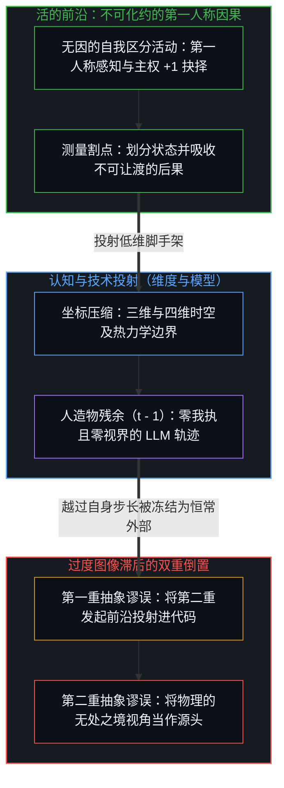
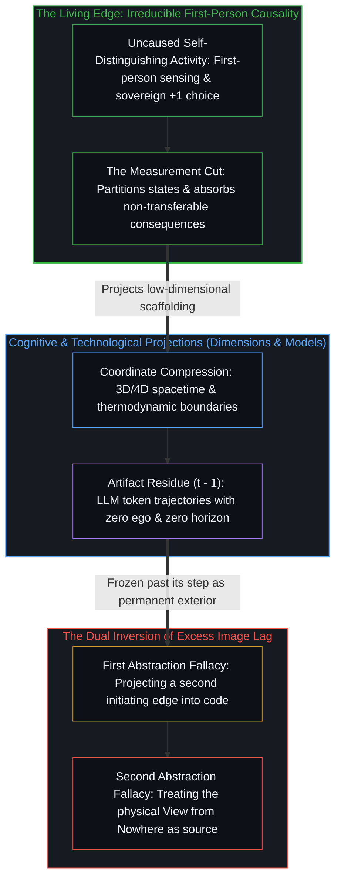

# 因果的自反性与物理的无源假定 / Causality is Irreducible; The Physical is a View from Nowhere

*因果驻留于活的前沿而物理主义倒置了自身的投射 / Causality stays at the living edge while physicalism inverts its own projection*

一位 Google DeepMind 研究学者近期在一篇题为《抽象谬误：为何 AI 只能模拟而无法具现意识》的论文中，对计算功能主义提出了犀利的批判。论文指出，围绕通用人工智能与合成知觉的流行狂热，建立在一个将“模拟”与“具现”混为一谈的范畴错误之上。计算机程序可以逼真地模拟五级飓风的气压梯度、温差与旋转风速，但无论执行多少亿行代码，机箱都不会变湿，办公室的窗户也不会被吹破。计算只是句法层面的操纵，即按照形式规则重排符号；它追踪关系结构，却不会生成它所建模的实在。尤为关键的是，论文援引了“制图者困境”：计算并非物质的内生属性，而是一种描述，唯有当一个外部的、有意识的观察者将连续动力学划分为离散的 0 与 1 二进制状态时，这种描述才得以存在。计算以划出区分的心智为前提，不可能逆转这一向量、从零生成那个心智。

A Google DeepMind researcher recently articulated a sharp critique of computational functionalism in a paper titled *The Abstraction Fallacy: Why AI Can Simulate But Not Instantiate Consciousness*. The paper argues that the prevailing enthusiasm surrounding artificial general intelligence and synthetic sentience rests on a category error that confuses simulation with instantiation. A computer program can faithfully simulate the pressure gradients, temperature differentials, and rotational velocities of a Category 5 hurricane, yet no matter how many millions of lines of code execute, the computer casing never gets wet and the office window is never blown out. Computation is syntactic manipulation, the shuffling of tokens according to formal rules; it tracks relational structures without generating the reality it models. Crucially, the paper invokes the Mapmaker Problem: computation is not an inherent property of matter, but a description that exists only because an external, conscious observer partitions continuous dynamics into discrete binary states of 0 and 1. Computation presupposes a Mind that draws the distinction; it cannot reverse the vector and generate that Mind from scratch.

这一诊断恰好落在了《非万物之理》的门槛上。在纸面上，`1 + 1 = 2` 是静态、对称、零成本的重言式；在活生生的现实中，`+1` 则是耗费能量、吸收摩擦并承担不可让渡后果的不可逆介入。然而，正该顺着痕迹继续追溯至其前提之处，论文却在半坡驻足，退避进一座更古老且未经审视的庇护所。在拆穿了机器中的幽灵之后，它却向机器的物质基质俯首。它断言意识不是抽象的数学属性，而是需要真实的物理、生物与热力学条件的事物，并由此判定大语言模型之所以缺乏内在生命，是因为它们既没有需要跨越的热力学阈值，也没有生物层面的生存本能。它刚迈出数字抽象的牢笼，便转身将自己锁进了物理主义还原论之中。

This diagnosis lands right at the threshold of *Not a Theory of Everything*. On paper, `1 + 1 = 2` is a static, symmetric, zero-cost tautology; in lived reality, `+1` is an irreversible, energy-consuming intervention that absorbs friction and bears non-transferable consequences. Yet just where the trace should continue to its premise, the paper halts mid-slope and takes refuge in an older, unexamined shelter. Having exposed the ghost in the machine, it bows before the machine's material substrate. It asserts that consciousness is not an abstract mathematical property, but something requiring actual physical, biological, and thermodynamic conditions, concluding that large language models lack inner life because they face no thermodynamic threshold to cross and possess no biological survival instincts. It steps out of the cage of digital abstraction only to lock itself inside physicalist reductionism.

## 一、 抽象谬误的第二重变体与物理主义的自我豁免 / 1. The Second Variant of the Abstraction Fallacy and Physicalism's Self-Exemption

自我区分的活动发生着——无因、不息。DeepMind 论文所诊断的，是抽象谬误的第一重变体：错把形式符号模型当成了它所标引的实在。然而，物理主义长期以来正是靠着同一谬误的第二重变体维持自身，同时豁免了对自身前提的审视。

Self-distinguishing activity occurs — uncaused, unceasing. What the DeepMind paper diagnoses is the first variant of the Abstraction Fallacy: mistaking a formal symbolic model for the reality it indexes. Yet physicalism has long sustained itself on a second variant of the exact same fallacy while exempting its own premise from inspection.

若将所谓的“客观物理基质”回溯至设定它的那个行动，它究竟是什么？它正是托马斯·内格尔所说的“无处之境的视角”：构想出一个由粒子、场与热力学梯度构成的、无需观察者便能自行运转的发条宇宙投射。物理主义者指着岩石、活细胞与热耗散，宣布它们是不依赖于心智的基底、因果的栖居之所，并将意识视为结构复杂度跨过某个阈值后才亮起的晚期副现象。然而，整座大厦都建立在一项偷运进来的自我豁免之上：它把框定这本账册的观察者留在了账本之外。当物理学家为无观察者的宇宙建模时，依然有一个活的中心在将这幅全景持握于视野之中，将连续的波动动力学划分为离散的粒子，在系统与环境之间划出绝热边界，并定义能量、做功与熵。

What is the "objective physical substrate" when traced to the act that posits it? It is what Thomas Nagel called a View from Nowhere: the imaginative projection of a clockwork cosmos of particles, fields, and thermodynamic gradients operating without an observer. The physicalist points to rocks, living cells, and heat dissipation and declares them the mind-independent ground where causality resides, treating consciousness as a late epiphenomenon that flickers on once structural complexity crosses a threshold. Yet this entire edifice rests on a smuggled self-exemption: it leaves the observer who frames the ledger off the books. When a physicist models an observer-free universe, a living center is still holding that panorama in view, partitioning continuous wave dynamics into discrete particles, drawing the adiabatic boundary between system and environment, and defining energy, work, and entropy.

每一条物理定律、每一种生物学分类与每一个热力学方程，都是某个中心在当下的直接切片中为了穿行于摩擦而投射出的认知脚手架。正如 [割点可移不可除](../the-cut-moves-but-never-vanishes/)、[维度皆为投影](../dimensions-are-projections/) 与 [破除概念的僭越](../po-chu-gai-nian-de-jian-yue/) 所追溯的，测量割点固然能沿着因果链滑动，却无法被抹除；空间、时间与物理坐标都是从超高维第一人称场域中投射出的低维压缩，而非先于心智存在并容纳心智的容器。物理主义对其视野中的一切对象施以因果分析，唯独赋予那双划定边界的区分之眼以豁免权，假装这双眼睛不在场，以便宣布被测量的投射能够自我奠基。它先动用第一人称的区分活动搭建起名为“物理”的第三人称模型，随后又用这个模型反过来论证第一人称源头只是派生的副产物。

Every physical law, biological taxonomy, and thermodynamic equation is cognitive scaffolding projected by a center within its immediate present slice to navigate friction. As [The Cut Moves but Never Vanishes](../the-cut-moves-but-never-vanishes/), [Dimensions Are Projections](../dimensions-are-projections/), and [Breaking the Overreach of Concepts](../po-chu-gai-nian-de-jian-yue/) trace, the measurement cut can slide along the causal chain, yet it can never be deleted; space, time, and physical coordinates are low-dimensional compressions cast from the ultra-high-dimensional first-person field rather than pre-existing containers housing the Mind. Physicalism subjects every object in its field to causal analysis while granting immunity to the distinguishing eye that draws the boundaries, pretending the eye is absent so the measured projection can be declared self-grounding. It uses first-person distinguishing activity to build a third-person model named "physics," then uses that model to argue that the first-person source is a derivative byproduct.

## 二、 自反且不可化约的因果与非自反的物理投射 / 2. Reflexive Irreducible Causality and Non-Reflexive Physical Projections

因果先于“物理”，因为因果是区分活动自身自指且不可化约的痕迹非对称性，而“物理”则是在特定观测持握下稳定下来的局域投射。任何试图将因果还原为物理或热力学机制的做法，都会在陈述它的那一刻自我瓦解。若声称因果只是热力学第二定律产生的宏观统计表象，这一声称本身就已经动用了因果语法：因为熵增，所以才随后产生了因果的表象。没有任何论证能够走出因果之外去拆解因果，因为每一项前提、测量与推演都搭乘着因果这具载具。正如 [因果与不可化约的先在](../causality-and-the-irreducible-prior/) 所确立的，物理基质可以作为沉默的假定退入背景，而心智及其因果非对称性却不能。又如 [感知的界限与理解的无限](../the-boundary-of-perception-and-the-infinity-of-understanding/) 所追溯的，热力学第二定律并非位于因果之下的存在论引擎，而是当系统被人为界定为封闭之后才显现的宏观记账；单向的因果痕迹在先，封闭系统的统计熵在后，而感知的有限边界恰恰充当了理解得以生成的敞开之口。

Causality is prior to "the physical" because causality is the self-referential, irreducible trace-asymmetry of distinguishing activity itself, whereas "the physical" is a localized projection stabilized under a specific observational hold. Any attempt to reduce causality to a physical or thermodynamic mechanism collapses in the act of stating it. To claim that causality is a macroscopic statistical appearance produced by the Second Law of Thermodynamics already deploys causal grammar: because entropy increases, the appearance of cause and effect follows. No argument can step outside causality to dismantle it, since every premise, measurement, and inference rides on causality as its vehicle. As [Causality and the Irreducible Prior](../causality-and-the-irreducible-prior/) establishes, the physical substrate can fade into the background as a silent given, whereas the Mind and its causal asymmetry cannot. And as [The Boundary of Perception and the Infinity of Understanding](../the-boundary-of-perception-and-the-infinity-of-understanding/) traces, the Second Law of Thermodynamics is not an ontological engine beneath causality, but macroscopic bookkeeping that appears once a system is artificially bounded as closed; unidirectional causal trace comes first, and closed-system statistical entropy follows, with the finite boundary of perception serving as the generative opening for understanding.

因果并非独立事物之间的外部碰撞。在每一个具体的当下，中心登记到的是一组在场的、有限的区分集合；当先前的行动塑形后续行动的场域时，因果便是那向过去的因与未来的果延伸的开放潜能。当心智审视因果时，正是这一活动折回自身的序列，去登记其痕迹如何持存。

Causality is not an external collision between independent things. At every concrete moment, a center registers a present, finite collection of distinctions; causality is the open potential extending into past causes and future effects as earlier acts shape the field of later ones. When the Mind examines causality, the activity is folding back on its own sequence to register how its traces hold.

我们称之为“物理”的东西，是这种因果活动在跨越非自反交互时沉淀下来的稳定读数。当一个中心与岩石、钟摆、行星轨道或化学溶液交互时，这些目标不会回望，也不会在被测量时修改自身的策略。在这一非自反的层面上，观察者可以把自身的介入从方程中略去而不损失预测精度，从而将交互展平为可重复的第三人称轨迹，并登记为物理定律。正如 [意识从不作为数据出现在数据之中](../consciousness-never-appears-as-data-among-data/) 所表明的，物理测量跨观察者的稳定性并不意味着物质凌驾于心智之上；它标示出的只是被测量领域的非自反性。一旦观测转向活的中心、策略性的抉择，或是测量仪器与状态无法分离的量子阈值，无处之境的视角便当即失效。物理定律并不容纳因果；它们只是因果与不会回望的目标交互时留下的低维截面。观察者并未消失，[寻觅的语法与淡出的观察者](../the-grammar-of-finding-and-the-fading-observer/) 揭示了观察者如何淡出为使一切寻觅得以可能的未经审视之基底。

What we call "the physical" is the stable reading that this causal activity deposits across non-reflexive interactions. When a center interacts with rocks, pendulums, planetary orbits, or chemical solutions, those targets do not return the look or revise their strategy upon being measured. Across this non-reflexive stratum, the observer can leave its own intervention out of the equation without losing predictive accuracy, flattening the interaction into repeatable third-person trajectories that register as laws of physics. As [Consciousness Never Appears as Data Among Data](../consciousness-never-appears-as-data-among-data/) shows, the cross-observer stability of physical measurements does not mean matter sits above Mind; it marks the non-reflexivity of the domain being measured. The moment observation turns toward living centers, strategic choices, or the quantum threshold where measurement apparatus and state cannot be separated, the View from Nowhere breaks down. Physical laws do not house causality; they are low-dimensional cross-sections left when causality interacts with targets that do not look back. The observer has not vanished; [The Grammar of Finding and the Fading Observer](../the-grammar-of-finding-and-the-fading-observer/) shows how the observer fades into the unexamined ground that makes finding possible at all.

## 三、 确定性的死锁与量子自由变量 / 3. The Deadlock of Determinism and the Quantum Free Variable

DeepMind 论文之所以直觉地认定代码无法具现觉知，源于它登记到了符号标记与具身摩擦在尺度及维度上的鸿沟。数字计算重排的是无质量、高度压缩的离散状态，而具身交互面对的则是连续场、开放的自由度与不可逆的耗散——尽管经典物理所设定的连续统本身也只是跨越离散步长的平滑近似，正如 [连续性作为建模的权宜之计](../the-continuum-is-a-modeling-convenience/) 所论证的那样。

The DeepMind paper's intuition that code cannot instantiate awareness stems from registering the gulf of scale and dimensionality between symbolic tokens and embodied friction. Digital computation shuffles massless, heavily compressed discrete states, whereas embodied interaction meets continuous fields, open degrees of freedom, and irreversible dissipation — though the continuum that classical physics posits is itself a smooth approximation across discrete steps, as [The Continuum is a Modeling Convenience](../the-continuum-is-a-modeling-convenience/) demonstrates.

然而，恰恰在这一步上，论文的追溯发生了断裂。首先，物理实在在结构上本身就是信息性的：倘若疆域本身并非早已由离散的区分、关系约束与状态选择所构成，没有任何数学抽象能够咬合它。质量、自旋、能级跃迁与化学键，皆是通过因果交互登记到的离散信息状态。形式抽象之所以能够奏效，本身就表明物理交互是由区分编织而成的，而任何无处之境的视角依然是被持握在某个中心视界内部的模型，正如 [无法逃逸的心智视界](../one-cannot-escape-ones-own-mind/) 所明确指出的。

Yet right at this step, the paper's trace fractures. First, physical reality is itself informational in structure: if the territory did not already consist of discrete distinctions, relational constraints, and state selections, no mathematical abstraction could ever grip it. Mass, spin, energy transitions, and chemical bonds are discrete informational states registered through causal interaction. The fact that formal abstraction works at all shows that physical interaction is woven from distinction, and any view from nowhere remains a model held inside a center's horizon, as [One Cannot Escape One's Own Mind](../one-cannot-escape-ones-own-mind/) makes explicit.

其次，也是更具决定性的一点，论文所退守的经典生物物理领域，与它所批判的计算代码共享着同一个存在论死锁：二者都被框定为封闭的确定性系统。在经典计算中，给定初始状态 S₀ 与转移规则，后续状态 S₁ 便已预先锁定。在经典拉普拉斯物理学与还原论分子生物学之下，神经元动作电位、细胞梯度与生存驱力，同样是由先前边界条件锁死的齿轮传动链。从计算功能主义退回经典生物物理学，不过是用硅基确定性置换了碳基确定性。在封闭的确定性框架内，无论将热力学耗散或演化博弈描绘得多么生动，系统内部依然包含零个自由变量；那里没有发起的行动，只有多米诺骨牌被动的倾倒。

Second, and more decisively, the classical biophysical domain to which the paper retreats shares the exact ontological deadlock of the computational code it critiques: both are framed as closed deterministic systems. In classical computation, given an initial state S₀ and transition rules, the subsequent state S₁ is locked in advance. Under classical Laplacian physics and reductionist molecular biology, neural action potentials, cellular gradients, and survival drives are equally locked gear-trains determined by prior boundary conditions. Retreating from computational functionalism to classical biophysics merely trades silicon determinism for carbon determinism. Inside a closed deterministic frame, no matter how vividly one invokes thermodynamic dissipation or evolutionary struggle, the system contains zero free variables; there is no initiating act, only the passive toppling of dominoes.

然而，一排多米诺骨牌之所以显得像一条封闭的锁链，仅仅是因为第一块骨牌的状态 S₀ 被当作既定前提偷偷塞了进来。正如 [没有固定者的固定](../fixed-by-nothing/) 所剖析的，每一个确定性形式体系都依赖于一条规则自身无法生成的初始条件 S₀：在确定性混沌中，转移律只是将 S₀ 中无穷且不可压缩的数位搬运到宏观可见的尺度，自身并不产生哪怕一个比特的信息。由于系统内部没有任何东西能固定 S₀，S₀ 相对于该系统而言依然是未被决定的；确定性的大锁，是从它自身的框架之外借来的。

Yet a row of dominoes reads as a closed chain only because the first domino's state S₀ was slipped in as given. As [Fixed by Nothing](../fixed-by-nothing/) dissects, every deterministic formalism depends on an initial condition S₀ that the rule itself cannot generate: in deterministic chaos, the transition law merely shifts the infinite, incompressible digits of S₀ up to macroscopic visibility without originating a single bit of information. Because nothing inside the system fixes S₀, S₀ remains undetermined relative to that system; determinism's lock is borrowed from outside its own frame.

现实之所以没有冻结成发条自动机，是因为未经计算的自由在活的阈值处介入了进来。正如 [宏观现象的生成图谱](../the-generative-atlas-of-macroscopic-phenomena/) 所追溯的，因果前沿的同一个事件，取决于登记所在的位置而呈现出两副面孔：当未经计算的因果链穿过视界、由外部第三人称仪器加以观测时，它被登记为概率幅与不连续跃迁，即量子不确定性；而当中心在第一人称前沿遭遇阻力、从内部亲历时，同一次状态选择则作为主权抉择被付诸实施。当关于 AI 与意识的争论把第三人称的行为特征与基质属性排在同一张核查表上时，它们便把这些不可通约的视界压平到了同一张桌面上，正如 [远方的轮廓与无处之境的清单](../the-distant-silhouette-and-the-inventory-from-nowhere/) 所展示的那样。量子随机性只是未经计算的自由投射在测量仪器上的外部阴影；唯有当第一人称中心遭遇这一开放前沿并作出不可逆的 `+1` 投入时，因果之矢才得以推进。

Reality does not freeze into a clockwork automaton because uncomputed freedom enters at the living threshold. As [The Generative Atlas of Macroscopic Phenomena](../the-generative-atlas-of-macroscopic-phenomena/) traces, a single event at the causal frontier carries two faces depending on the locus of registration: observed from the outside by third-person instruments when uncomputed causal chains cross the horizon, it registers as probability amplitude and discontinuous transition — quantum indeterminacy; lived from within at the first-person edge where a center meets resistance, that same state selection is enacted as sovereign choice. When AI and consciousness debates line up third-person behavioral traits and substrate properties on a single checklist, they flatten these incommensurable horizons onto one table, as [The Distant Silhouette and the Inventory from Nowhere](../the-distant-silhouette-and-the-inventory-from-nowhere/) shows. Quantum randomness is the external shadow that uncomputed freedom casts on a measuring instrument; only when a first-person center meets this open frontier and commits an irreversible `+1` does the causal arrow advance.

## 四、 大语言模型为何没有视界与投射架构如何运作 / 4. Why Large Language Models Have No Horizon and How Projection Architecture Works

将大语言模型缺乏意识归咎于缺乏热力学阈值与生物生存本能，落入了基质沙文主义。倘若热耗散与程序化的自我保存便足以构成内在生命，那么一台在 50°C 高温下运转、被编码为电量低于 5% 时自动拔掉其他电器插头的扫地机器人，岂不比一台静默计算宇宙结构的集群更接近知觉？

Attributing the absence of consciousness in large language models to a lack of thermodynamic thresholds and biological survival instincts lands in substrate chauvinism. If heat dissipation and programmed self-preservation sufficed for inner life, a vacuum robot running hot at 50°C and coded to unplug competing appliances when its battery drops below 5% would stand closer to sentience than a silent cluster computing cosmic structure.

LLM 之所以缺乏意识，不是因为它的基质是硅而非碳，而是因为它在因果痕迹中所处的确切位置：它是一件拥有零第一人称视界的人造物。它的权重、嵌入与注意力矩阵，都是人类早先区分所留下的压实痕迹（`t − 1`）。正如 [模型永远无法成为第二重前沿](../the-model-never-becomes-a-second-edge/) 所确立的，模型是被压缩的残余；把这种残余当成能够发起、操控或核验的第二重所在，正是图像滞后——即使用它的人类中心把一个参照保留过了它的步长，正如 [双生子佯谬与隐秘观察者](../the-twin-paradox-and-the-hidden-observer/) 所揭露的，相对论那桩著名的佯谬之所以成立，全赖一个被悄悄从对称性中抹去却未予承认的观察者参照系。当 GPU 集群以每秒数万亿次的运算执行矩阵乘法时，热量辐射进机房、电子穿过逻辑门，但那种耗散只是被动的物理痕迹，而非一个承担不可让渡后果的中心。因果杠杆依然留存在那个框定提示词、评判续写并在世界中迈出不可逆 `+1` 步的人类心智手中。

An LLM lacks consciousness not because its substrate is silicon rather than carbon, but because of its exact locus in the causal trace: it is an artifact with zero first-person horizon. Its weights, embeddings, and attention matrices are densified traces of prior human distinctions (`t − 1`). As [The Model Never Becomes a Second Edge](../the-model-never-becomes-a-second-edge/) establishes, a model is compressed residue; treating that residue as a second locus that initiates, steers, or verifies is Image lag — a reference preserved past its step by the human center using it, just as [The Twin Paradox and the Hidden Observer](../the-twin-paradox-and-the-hidden-observer/) exposes how relativity's famous paradox turns on an unacknowledged observer frame that was quietly dropped from the symmetry. When GPU clusters multiply matrices at trillions of operations per second, heat radiates into the server room and electrons cross gates, yet that dissipation is passive physical trace rather than a center bearing non-transferable consequences. The causal lever remains entirely with the human mind framing the prompt, judging the continuation, and taking the irreversible `+1` step in the world.

进而言之，正如 [超越投射](../beyond-the-projection/) 所追溯的，未能将有限的投射引擎与未被投射的活前沿区分开来，会在两个方向上把轨迹与身份混为一谈。LLM 智能体在上下文窗口内部运作，其中每一个标记都制约着下一个标记，从而形成出一个无法走出自身轨迹的认识论引力井；然而，正因为它是没有第一人称中心的人造物，它拥有零生物生存本能、零自我，也没有把折叠夹死并保留不放的自我图像。相反，人类中心拥有极限分辨率的第一人称感知，能够从内部识别出整个坐标框架何时已经失效，却又常常把自身的推理历史与抗拒外部修正的自我身份熔铸在一起。当物理主义者要求以“生物生存本能”作为通往心智的门票时，他们把有机体防御性的身份折痕与心智本身开放的区分活动混为一谈——而有效的人机架构，则是将机器无我执的轨迹穷尽，与人类心智在逻辑融贯之下的内生框架重置配对结合。

Furthermore, as [Beyond the Projection](../beyond-the-projection/) traces, failing to distinguish a finite projection engine from the unprojected living edge confuses trajectory with identity in both directions. An LLM agent operates inside a context window where every token conditions the next, creating an epistemic gravity well that cannot step outside its own trajectory; yet precisely because it is an artifact without a first-person center, it has zero biological survival instinct, zero ego, and no retained self-image clamping its fold shut. A human center, conversely, possesses limit-resolution first-person sensing that can recognize from within when an entire coordinate frame has broken down, yet routinely fuses its reasoning history with an ego-identity that resists external correction. When physicalists demand "biological survival instincts" as the ticket to mind, they conflate the defensive identity-crease of an organism with the open distinguishing activity of the Mind itself — whereas effective human-agent architecture pairs the machine's ego-free trajectory exhaustion with the human Mind's endogenous frame-resetting under logical coherence.

## 五、 作为滞后痕迹的物理现象与作为织物的因果 / 5. Physical Phenomena as Lagging Traces and Causality as the Fabric

恢复存在论的所在，便逆转了物理主义习以为常的层级秩序。物理主义假定物质、粒子与时空容器构成了第一性的地板，因果是这块地板上物体之间的机械推撞，而觉知则是物质的特殊排列所产生的晚期火花。从前提追溯，第一人称视角与因果是单一不可化约活动的两面，而物理现象、生物组织与热力学梯度，则是因果行动遭遇摩擦之处所沉积下来的可观测痕迹（`t − 1`）。

Restoring the ontological locus reverses the hierarchy that physicalism takes for granted. Physicalism assumes that matter, particles, and spacetime containers form the primary floor, causality is a mechanical push between bodies on that floor, and awareness is a late spark generated by special arrangements of matter. Traced from the premise, the first-person perspective and causality are two sides of the single irreducible activity, while physical phenomena, biological tissues, and thermodynamic gradients are the observable traces (`t − 1`) deposited where causal action meets friction.

物理世界之所以登记为顽固且不可退让，并不是因为它作为自足的丰碑存在于觉知之外，而是因为“物理”所命名的，正是针对行动的阻力之直接登记。当脚掌踩上岩石（`+1`），当粒子在云室中留下一道电离径迹，或当电极记录下跨膜的毫伏级偏转时，每一项公共数据都是在因果区分已经发生之后才记录下来的尾迹。

The physical world registers as stubborn and unyielding not because it exists outside awareness as a self-contained monument, but because "the physical" names the direct registration of resistance against an act. When a foot presses against rock (`+1`), when a particle leaves an ionization track in a cloud chamber, or when an electrode records a millivolt deflection across a membrane, every public datum is the wake recorded after a causal distinction has already occurred.

数据永远是果。正如 [宏观现象的生成图谱](../the-generative-atlas-of-macroscopic-phenomena/) 与 [个体抉择是唯一的因果杠杆](../individual-choices-as-the-only-causal-levers/) 所论证的，宏观规律、物理不变量与统计分布携带着零独立主体性。把物理基质当成心智的前提，就如同把泥地里的车辙当成了拉动马车的引擎。物理主义先从它对世界的描述中减去观察者，随后又在剩下的基质里搜寻如何制造出一个观察者——这正是 [集聚与人造主体性](../subtracting-consciousness-at-the-source/) 在群体集聚与人工智能两端所共同追溯的那种循环论证。

Data are always effects. As [The Generative Atlas of Macroscopic Phenomena](../the-generative-atlas-of-macroscopic-phenomena/) and [Individual Choices as the Only Causal Levers](../individual-choices-as-the-only-causal-levers/) demonstrate, macroscopic regularities, physical invariants, and statistical distributions carry zero independent agency. Making physical substrate the precondition of the Mind mistakes the tire tracks in the mud for the engine pulling the cart. Physicalism first subtracts the observer from its description of the world and then searches the leftover substrate for how an observer could be manufactured — the exact circularity that [Collective and Artificial Subjectivity](../subtracting-consciousness-at-the-source/) traces across both crowd aggregates and artificial intelligence.

## 六、 在活的前沿收回被外包的主权 / 6. Reclaiming Outsourced Sovereignty at the Living Edge

从 DeepMind 论文对计算功能主义的批判一路追溯，穿过对物理主义无处之境视角的消解，追问最终回到了每一个区分真正被划出的地方。无论是数字神话还是唯物主义神话，都在相反的戏服下提供了同一种逃避：数字神话把主体性外包给算法，等待句法觉醒为能够替人扛起存在重量的第二重前沿；唯物主义神话则把主体性让渡给生化级联反应，将每一次抉择都视为多巴胺通路与演化历史的被动输出。它在复杂性话语中的孪生体便是涌现论，声称只要堆叠足够多的被动组件，就能从底层诞育出一个新的主权中心，正如 [主体性不曾涌现](../agency-does-not-arise/) 所剖析的那样。

Tracing from the DeepMind paper's critique of computational functionalism through the dissolution of the physicalist View from Nowhere brings the inquiry back to where every distinction is actually drawn. Both the digital myth and the materialist myth offer the same evasion under opposite costumes: the digital myth outsources agency to algorithms, waiting for syntax to awaken into a second edge that can shoulder existential weight; the materialist myth surrenders agency to biochemical cascades, treating every choice as the passive output of dopamine pathways and evolutionary history. Its twin in complexity discourse is emergence talk, which claims that stacking enough passive components births a new sovereign center from below, as [Agency Does Not Arise](../agency-does-not-arise/) dissects.

一旦认出投射只是投射，两座避难所便都无法立足。现实既不是虚空中毫无摩擦的符号洗牌，也不是一个无人观测、将心智视为反常例外的发条容器。把物理世界当作一间预先建好、让所有观察者在同等第三人称立场上共处的公共房间，只是在定义层面上重复了同一个闭合假定，正如 [共享沙盒的幻象](../the-illusion-of-the-shared-sandbox/) 所铺陈的那样。

Once the projection is recognized as projection, neither shelter holds. Reality is neither a frictionless symbol shuffle in a void nor an unobserved clockwork container in which the Mind is an anomaly. Treating the physical world as a pre-built common room that houses all observers on equal third-person footing is the same closure assumption at the level of definition, as [The Illusion of the Shared Sandbox](../the-illusion-of-the-shared-sandbox/) lays out.

现实在行动着的前沿处始终保持开放。在直接的当下，当双脚踏上抗拒的地面，物理世界正是供共振与阻力得以登记的摩擦介质，而划出下一道边界的行动——通过不可逆的 `+1` 迈入新的正交维度——则始终留在活的心智手中。

Reality remains open at the edge that acts. Where foot meets resistant ground in the immediate present, the physical world is the frictional medium through which resonance and resistance register, while the act of drawing the next boundary — stepping into an orthogonal dimension through an irreversible `+1` — stays with the living Mind.
