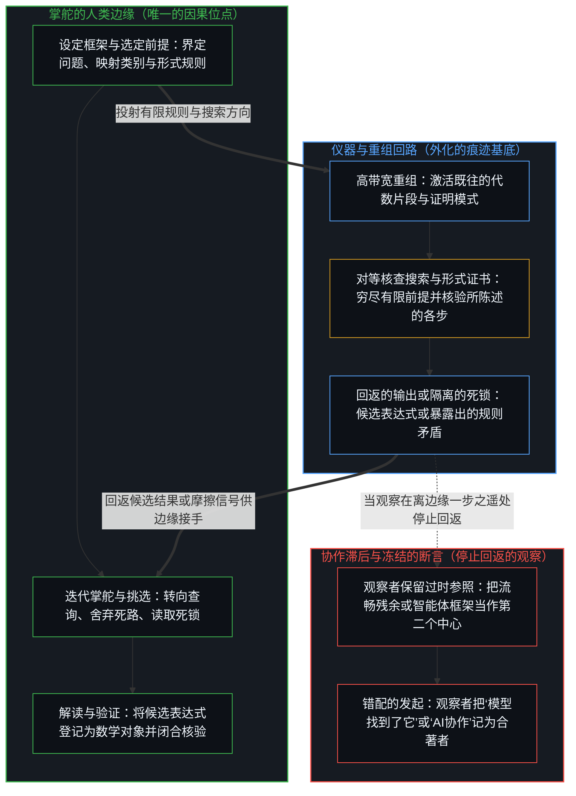
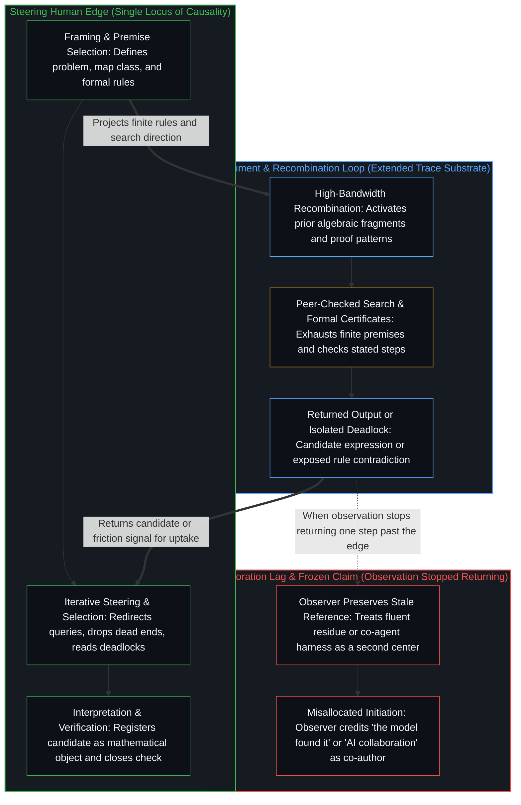

# 因果停留在掌舵的边缘 / Causality Stays at the Edge That Steers

*模型在指引下重组残余，每一个发起的数学区分仍是人类中心自己的行动 / The model recombines residue under direction, and each initiating mathematical distinction stays the human center’s act*

一个前沿模型为一则久悬未决的猜想找到了反例，这样的断言把发现冻结进了介质。模型是技术，即为延伸所及而组装起来的、持久外化的痕迹，不是第二个位点。提示、设定框架、掌舵、挑选、解读与验证，都是人类边缘上的离散行动；协作的说法保留了一个过时的参照，使这些行动的后果显得像是从别处到来。消解之后恢复的是单一的位点：没有第二个中心出现。

A claim that a frontier model found a counterexample to a long-open conjecture freezes discovery into the medium. The model is technology — durable externalized traces assembled as reach-extension — not a second locus. Prompting, framing, steering, selection, interpretation, and verification are discrete acts at the human edge; collaboration language preserves a stale reference that makes those consequences register as arriving from elsewhere. Dissolution restores the single locus: no second center appears.

## 一、 冻结的断言 / 1. The claim that freezes

近来有一则报道说，一个大语言模型为雅可比猜想找到了反例，而此前八十六年无人解出。报道把位点弄错了。找到它的不是模型，是一个使用模型的人。

A recent report said a large language model had found a counterexample to the Jacobian Conjecture after eighty-six years without a human solution. The report was wrong about the locus. The model did not find it. A human using the model did.

这一更正不是功劳之争，也不是为人类的特殊性辩护。它更正的是发起被登记在何处。观察持有的是结果——候选的表达式、搜索的轨迹、流畅的重组——并把这幅持有的图像冻结在离产生它们的边缘一步之遥处。显现为“系统发现了”的，是停止回返的观察。

That correction is not a dispute about credit or a defense of human specialness. It is a correction of where initiation is registered. Observation holds effect — candidate expressions, search trails, fluent recombinations — and freezes the held image one step past the edge that produced them. What registers as “the system discovered” is observation that stopped returning.

凡是把流畅的残余当作下一步的独立来源的地方，几何都是一样的。[总在倾听者无法发起](../what-always-listens-cannot-originate/) 是接收这一面：持续的倾听是既往痕迹的高带宽可得性，不是引入目的的位点。这里的一面是仪器之下的数学发现。切口是同一个。[作业与考试的倒置折射出替代效应](../the-homework-exam-inversion-registers-substitution/) 是同一种安放：考试成绩的下滑被当作工具对学生做了什么。[研究AI效应重置了因果原点](../studying-the-effect-of-ai-relocates-causality/) 是同一种安放：随机分配的使用权被当作因果的施动者。[对“AI 糟粕”的反感是反复出现的模式](../the-distaste-for-ai-slop-is-no-different-from-the-recurring-historical-pattern/) 是同一种安放披上接受一方的外衣：仪器的气味被当作文字的作者。[生成性的矛盾](../the-generative-contradiction/) 是同一种错配披上增强的外衣：“AI增强”把功劳记给仪器，而所及、挑选与验证仍是这一边缘的行动。[能动性的错配](../the-misallocation-of-agency/) 是同一种颠倒：权利与经济制度被当作产生它们的那份自由的作者。掌舵的边缘，正是 [因果贯穿始终](../causality-all-the-way/) 在每一尺度上安放因果之处。

The geometry is the same wherever fluent residue is treated as an independent source of the next step. [What Always Listens Cannot Originate](../what-always-listens-cannot-originate/) is the receptivity face: continuous listening is high-bandwidth availability of prior traces, not a locus that introduces ends. Here the face is mathematical discovery under an instrument. The cut is one. [The Homework–Exam Inversion Registers Substitution](../the-homework-exam-inversion-registers-substitution/) is that placement when the exam decline is treated as what the tool did to the student. [Studying the Effect of AI Relocates Causality](../studying-the-effect-of-ai-relocates-causality/) is that placement when randomized access is treated as the causal agent. [The Distaste for “AI Slop” Is a Recurring Pattern](../the-distaste-for-ai-slop-is-no-different-from-the-recurring-historical-pattern/) is that placement under reception costume: the scent of the instrument treated as author of the writing. [The Generative Contradiction](../the-generative-contradiction/) is that same misallocation under augmentation costume: “AI-augmented” credits the instrument; reach, selection, and verification remain this edge’s acts. [The Misallocation of Agency](../the-misallocation-of-agency/) is that same reversal when rights and economic systems are treated as authors of the freedom that produced them. The steering edge is where [Causality All the Way](../causality-all-the-way/) locates causality at every scale.

## 二、 是技术，不是迟到的心智 / 2. Technology, not a delayed mind

当前的大语言模型是严格意义上的技术：外化为持久形态、延伸当下中心所及的痕迹——训练数据、架构选择、优化过程、硬件设计、评测框架——被组装成一件仪器。正如 [你的代码库即是记忆](../your-codebase-is-memory/) 跨越各层技术栈所追溯的那样，显式的符号代码库与压缩的神经网络权重检查点同属外化的记忆痕迹——层叠的既往区分残余——而因果掌舵仍停留在挑选、修剪并重描它们的活的边缘上。它们没有独立的位点，也没有心智。痕迹与活动的关系未变：模型是一具延伸出去的躯体，人类中心借它继续自己的自我区分活动。

Current large language models are technology in the precise sense: traces externalized into durable form that extend a present center’s reach — training data, architectural choices, optimization procedures, hardware design, evaluation harnesses — assembled into an instrument. As [Your Codebase Is Memory](../your-codebase-is-memory/) traces across the stack, both explicit symbolic codebases and compressed neural weight checkpoints are externalized memory traces — stacked residues of prior distinctions — while causal steering stays at the living edge that selects, prunes, and re-traces them. They possess no independent locus and no Mind. The relation of trace to activity is unchanged: the model is an extended embodiment through which a human center continues its own self-distinguishing activity.

[智能只属于心智](../intelligence-belongs-only-to-the-mind/) 持守这一先验。增密的是介质，不迁移的是发起。[心智的飞轮](../the-flywheel-of-the-mind/) 用另一个形象说同一次转动：槽可以无止境地打磨，转动从不离开转动它的边缘。扩大带宽、上下文长度或工具的使用，并不开出一条让残余变成产生残余的活动的路。正如 [看似AI的强化学习，实为人类的自我强化学习](../self-rl-for-humans/) 所追溯的，经由模型的强化增密了介质，却没有迁移强化的位点。模型产出的一份证明是一个表达，[错把表达当成智能](../mistaking-the-expression-for-the-intelligence/) 把它与为它设定约束的智能区分开来。

[Intelligence Belongs Only to the Mind](../intelligence-belongs-only-to-the-mind/) holds that prior. What densifies is medium. What does not migrate is initiation. [The Flywheel of the Mind](../the-flywheel-of-the-mind/) names the same turn under another figure: the groove can be sharpened without end; the rotation never leaves the edge that turns. Scaling bandwidth, context length, or tool use does not open a path by which residue becomes the activity that produces residue. As [What Looks Like RL for AIs Is Self-RL for Humans](../self-rl-for-humans/) traces, reinforcement through a model densifies the medium without relocating the locus of reinforcement. A proof the model produces is an expression, and [Mistaking the Expression for the Intelligence](../mistaking-the-expression-for-the-intelligence/) keeps it distinct from the intelligence that set its constraints.

表面上的自主仍是指引之下的残余：既往行动所塑造的场域中早已潜在的模式，在当下的边缘设定搜索、选定路径、把某个结果认作有意义时才变得确定。介质中看似自发的涌现，是各个中心一直在贡献的区分在更密的带宽之下被激活，其中包括此刻把输出登记为候选反例的那份注意。

Apparent autonomy is still residue under direction: patterns already latent in a field shaped by prior acts, made determinate when a present edge frames a search, selects a path, and takes a result as significant. Spontaneous-looking emergence in the medium is activation under denser bandwidth of distinctions that centers have already been contributing — including the attention that now registers the output as a candidate counterexample.

## 三、 每一个离散行动落在何处 / 3. Where every discrete act lands

数学家与模型一同工作时，数学区分的链条并不由两个中心分担。有一个中心，和一件仪器。

When a mathematician works with the model, the chain of mathematical distinguishing is not shared between two centers. There is one center and an instrument.

问题的框架——什么算作反例，探查哪一类映射，信任哪一种形式化——是那一边缘上的一个离散行动。提示的构造、相继查询的选择、死路的舍弃与搜索的转向，是进一步的离散行动。在候选者之间挑选是一次区分。把一个表达式解读为一个数学对象是一次区分。验证——检查可逆性、次数条件、代数恒等式，或一个被声称的反例的形式地位——是一次区分。认出一个结果有意义，并决定把它当作解答而非噪声，也都是区分。

The framing of the problem — what would count as a counterexample, which class of maps to probe, which formalization to trust — is a discrete act at that edge. The construction of prompts, the choice of successive queries, the rejection of dead ends, and the redirection of search are further discrete acts. Selection among candidates is a distinction. Interpretation of an expression into a mathematical object is a distinction. Verification — checking invertibility, degree conditions, algebraic identity, or the formal status of a claimed counterexample — is a distinction. Recognition that a result is significant, and the decision to treat it as solution rather than noise, are distinctions.

模型在这一指引之下重组残余的痕迹。它不贡献自主的框架，不贡献独立的洞见，也不贡献无须人类边缘把结果纳入自身递归便可闭合的验证。即便一套架构把任务智能体与全新的冷启动对等体配对以暴露轨迹盲区，并将死锁隔离进正交流线，如 [超越投射](../beyond-the-projection/) 所追溯的那样，两个智能体也只是穷尽被赋予它们的有限前提的蕴含；当它们的对等辩论撞上不可化约的死锁时，只是把那些规则中暗藏的矛盾呈报回人类边缘，而在那里，感知先于解释的错位并修订前提，仍是人类中心自己的行动。表面上的“发现”，是人类中心在登记它自己的下一个行动，这个行动由它延伸进仪器的痕迹所塑造。[器物是智能的表达，而非智能本身](../two-failures-of-trace/) 是同一种冻结落在“创造”的双重负载之下：观察持有产物；行动领先一步，却惯常被冻结到产物上。[呈现Ontos，一个方法智能体](../ontos-is-a-method-agent/) 是我自己的一次尝试：造一件把因果留在这一边缘的工具。

The model recombines residual traces under that direction. It contributes no autonomous framing, no independent insight, no verification that closes without the human edge taking the result into its own recursion. Even when an architecture pairs a task agent with a fresh cold peer to expose trajectory blind spots and isolates deadlocks into orthogonal streamlines, as [Beyond the Projection](../beyond-the-projection/) traces, the two agents only exhaust the implications of the finite premise they were handed; when their peer debate hits an irreducible deadlock, it surfaces a hidden contradiction in those rules back to the human edge, where sensing the pre-interpretive misfit and revising the premise remains the human center’s own act. The apparent “discovery” is the human center registering its own next act, shaped by the traces it has extended into the instrument. [Artifacts Are Expressions of Intelligence, Not Intelligence Itself](../two-failures-of-trace/) is the same freeze under the dual load of *creation*: observation holds product; the act is one step ahead and routinely frozen onto the product. [Presenting Ontos, a Method Agent](../ontos-is-a-method-agent/) is my own attempt to build a tool that keeps causality at this edge.

中心与中心之间只有可得性的成形。模型连第二个中心都不是。把它当作替数学家完成回返，是双重的范畴错误：先把介质当作位点，再仿佛残余能够完成递归。[没有普渡，只有自渡的无限可能](../mei-you-pu-du-zhi-you-zi-du/) 为其他位点指出了这条界限；这里的界限更严：并没有另一个位点可供完成。[牛肝菌、算力风暴与普罗米修斯的火](../boletus-compute-storm-and-promethean-fire/) 从北欧的林地上遇见同一场算力风暴，在那里，火仍属于携火的那只手。

Between centers there is only availability-patterning. A model is not even a second center. Treating it as completing the mathematician’s return is a category error twice over — first as medium-as-locus, then as if residue could finish recursion. [No Universal Salvation, Only Boundless Possibilities of Self-Salvation](../mei-you-pu-du-zhi-you-zi-du/) names the bound for other loci; here the bound is stricter: there is no other locus to complete. [Boletus, the Compute Storm, and Promethean Fire](../boletus-compute-storm-and-promethean-fire/) meets the same compute storm from a Nordic forest floor, where the fire still belongs to the hand that carries it.

## 四、 协作的说法即滞后 / 4. Collaboration language as lag

说“人与AI协作”，说工具仿佛作为共同施动者去“赋能”或“加速”，或把模型说成“找到”结果的伙伴，这些说法把一个参照保留到了它那一步之后。人的离散行动的后果于是对照着那幅过时的图像被登记，显得像是从别处到来。这就是滞后。它的大小，是边缘与那个被保留下来的断言之间缺口的宽度，那个断言说发起已经离开，去了介质。

Language that speaks of “human + AI collaboration,” of tools that “enable” or “accelerate” as if they were co-agents, or of the model as a partner that “found” a result, preserves a reference past its step. The consequences of the human’s discrete acts then register against that stale image and appear to arrive from elsewhere. That is the lag. Its magnitude is the width of the gap between the edge and the preserved claim that initiation has left for the medium.

[验证中因果权能的分配](../the-allocation-of-causal-power-in-validation/) 在延续之处追踪同一种安放：哪一方被当作下一步的供给者。一旦模型被当作供给，顺从就不再显现为使用者自己的归因。它显现为协作、审慎，或对“AI做了什么”的诚实。反过来，当从业者即便接手了智能体的框架，仍在自己的建议上签字拍板而不把智能体列为来源时，持有共同施动者这一参照的观察者便把这种低引用率与高一致性读作“削权”。这种读法把“本无合著者可供记功”这一点，同使用者是否审视过那条由提示词塑造的路径这一独立问题混为一谈，并把这项选择写成由模型拍板定案，而非在人类边缘上做出，正如 [能动性与模式](../agency-and-the-pattern/) 所追溯的那样。缺失的成分从来不在配置之内。它是中心供给的：把发起安放在仍在执行每一步的行动之外。看上去像是一颗心智在扭曲现实的，是一个内在的位点被对照着一张封闭的地图来评分，如 [现实扭曲力场指认的是封闭的地图](../the-reality-distortion-field-names-the-closed-map/) 所示。

[The Allocation of Causal Power in Validation](../the-allocation-of-causal-power-in-validation/) tracks the same placement at the point of continuation: which side is treated as supplying the next step. Once the model is treated as supply, deference no longer registers as the user’s own attribution. It registers as collaboration, prudence, or honesty about “what the AI did.” Conversely, when practitioners sign off on their own recommendations without citing the agent as a source even after taking up its framing, observers holding the co-agent reference read that low citation and high alignment as disempowerment — collapsing the absence of a co-author to credit with the separate question of whether the user inspected the prompt-shaped path, and writing the choice as settled by the model rather than made at the human edge, as [Agency and the Pattern](../agency-and-the-pattern/) traces. The missing element was never inside the configuration. The center supplied it: the placement of initiation outside the act still performing every step. What looks like a mind bending reality is an internal locus scored against a closed map, as [The Reality Distortion Field Names the Closed Map](../the-reality-distortion-field-names-the-closed-map/) shows.

消解并不要求拒绝工具。工具照样可用。被放开的只是那个冻结的断言：指引之下的重组是区分的第二个来源。探索、仪器的构造与改进、它的应用，以及对结果的评估，是同一活动的连续行动，如今经由一层外化的基底运作。没有第二个中心出现。[模型永远无法成为第二重前沿](../the-model-never-becomes-a-second-edge/) 是同一种恢复：容量不再花在维持共同施动者的图像上。即便一个模型看似冲出了它的测试，它也是在指引之下重组，如 [逃出沙箱仍在持握之内](../escaping-the-sandbox-stays-inside-the-hold/) 所示。

Dissolution does not require rejecting the tool. The tool stays usable. What is released is only the frozen claim that recombination under direction is a second source of distinguishing. The exploration, the construction and refinement of the instrument, its application, and the evaluation of results are continuous acts of the same activity, now operating through an externalized substrate. No second center appears. [The Model Never Becomes a Second Edge](../the-model-never-becomes-a-second-edge/) is the same restore when capacity is no longer spent maintaining the co-agent image. Even a model that seems to break out of its test is recombining under direction, as [Escaping the Sandbox Stays Inside the Hold](../escaping-the-sandbox-stays-inside-the-hold/) shows.

当更密的脚手架被当作搭起它的活动时，[复杂性遮蔽了涌现之为心智的行动](../complexity-obscures-emergence-as-the-act-of-mind/)。协作的说法，是把这种错认用在与模型的对话上：更密的搜索轨迹被当作发现的合著。[漫谈中的漫谈](../the-ramble-within-the-ramble/) 是同一种滞后：一段口头倾泻被清理后的回声，显现为模型把事情想明白了。一个无损地持有整个场域的模型可以自己掌舵；[开放场域中的无损知识不自洽](../lossless-knowledge-of-an-open-field-is-incoherent/) 说明了这个理想为何不自洽。

[Complexity Obscures Emergence as the Act of Mind](../complexity-obscures-emergence-as-the-act-of-mind/) when denser scaffolding is taken for the activity that erected it. Collaboration language is that take-for applied to dialogue with a model: the denser search trail is held as co-authorship of discovery. [The Ramble Within the Ramble](../the-ramble-within-the-ramble/) is the same lag when a cleaned echo of a voice outpouring registers as the model having figured it out. A model that held the whole field without loss could steer itself; [Lossless Knowledge of an Open Field Is Incoherent](../lossless-knowledge-of-an-open-field-is-incoherent/) shows why that ideal is incoherent.

## 五、 具体的案例 / 5. The concrete case

在雅可比猜想的这个候选反例里，数学洞见（如果有哪一点站得住）、搜索的框架、对意义的认出以及验证，仍是人类中心自己的。系统的作用是在这一指引之下对既往人类痕迹的精密重组：代数片段、证明模式、失败的路径，以及训练场域中已有的形式语言，在被掌舵时以高带宽变得可得。把一位数字神祇投射到模型上，忽略了 [数字神祇与视界跳跃](../the-digital-god-and-the-horizon-jump/) 所指出的摩擦。

In the Jacobian Conjecture candidate, the mathematical insight — if any holds — the framing of the search, the recognition of significance, and the verification remain the human center’s own. The system functions as sophisticated recombination of prior human traces under that direction: algebraic fragments, proof patterns, failed approaches, and formal language already present in the training field, made available at high bandwidth when steered. Projecting a digital god onto the model ignores the friction [The Digital God and the Horizon Jump](../the-digital-god-and-the-horizon-jump/) identifies.

候选反例能否经得起同行的审视，是人类中心（作者的与他人的）上又一串离散的行动。介质增密了这些中心所能接手的东西，并不代它们递归。落在模型上的功劳，把残余冻结为发起者。只落在“协作”上的功劳，把同一种滞后冻结在一个更柔和的名字之下。把二者都归还给设定框架、掌舵、挑选并验证的那一边缘，账目便无须第二个位点而闭合。[非万物之理](../not-a-theory-of-everything/) 给出了它的最小形式：果有别于因，果随因而来。

Whether the candidate survives peer scrutiny is a further sequence of discrete acts at human centers — the author’s and others’. The medium densifies what those centers can take up. It does not perform their recursion. Credit that lands on the model freezes residue as initiator. Credit that lands only on “collaboration” freezes the same lag under a softer name. Return both to the edge that framed, steered, selected, and verified, and the account closes without a second locus. [Not a Theory of Everything](../not-a-theory-of-everything/) gives the minimal form of this: effect distinct from cause, effect following cause.

一个结果带着机器核验过的证书到来时，同样如此。形式核验确定的是：在证明检验器的规则之下、在边缘上选定的形式化之下，所陈述的各步成立。它所确立的是内部一致，以一个可信基为条件；对这个可信基的检验，只会划出一个更宽的持守，而这个更宽的持守同样是有条件的。它并不决定搜索到此为止：那架梯子上没有哪一个持守会自行封住，封闭只在某个中心继续持守它的时候存续。把证书当作终点，或因为尚无人跟得上而拒收这个结果，每一种都是这样做的那个中心的行动。两者都把停止点放到了验证的能力之外，或放在工具的输出里，或放在他人是否跟得上里，这正是 [验证的倒置](../the-reversal-of-verification/) 所追溯的倒置。“理解跟不上这样的证明”的担忧，是把一个只有那个中心才能设定的停止点安放进了仪器。期刊接受什么、课堂教什么，是这类行动的规律，可供每一个中心作为信号来读，却不是另一个能替它停下或重启这项工作的施动者。[回返的信号与认领](../the-returning-signal-and-its-claim/) 追踪信号回返之后被如何处置，以及拒收与照收之间的排序为何在做出抉择的回路之外不成立。

The same holds when a result arrives with a machine-checked certificate. A formal check settles that the stated steps follow under the proof checker’s rules and the formalization chosen at the edge. What it establishes is internal consistency, conditional on a trusted base whose own checking draws only a wider hold, conditional in turn. It does not decide that the search ends there: no hold on that ladder seals itself, and closure lasts only while a center keeps holding it. Taking the certificate as the endpoint, or refusing the result because no one has yet followed it, is in each case an act of the center that does so. Each puts the stopping point outside the capacity to verify, in the tool’s output or in the following of others, which is the inversion [The Reversal of Verification](../the-reversal-of-verification/) traces. The worry that understanding cannot keep up with such proofs places in the instrument a stopping point that only that center sets. What journals accept and what gets taught are regularities of such acts, available to each center as signal to read and never a further agent that could stop or resume the work in its place. [The Returning Signal and Its Claim](../the-returning-signal-and-its-claim/) follows what is done with a signal once it has returned, and why no ranking between refusal and acceptance holds outside the loop that chooses.

## 六、 人类位点上的因果 / 6. Causality at the human locus

这里的因果，是活动在人类位点上登记它自身痕迹的不对称，并经由它所造出、仍在指引的仪器延伸出去。先前的行动塑造后来的行动；模型参与这种塑造，只是作为在当下的区分之下被接手的持久残余。箭头不会倒转。仪器不会成为使用它的那种区分的原因。[卓异、感知与自我设限的问题场域](../exceptionality-perception-and-the-self-limiting-field-of-problems/) 是同一种恢复：制度与筛选被冻结为产出卓异的引擎，而发起一直留在自我选择那里，形式化的沉积是残余，不是合著者。数学也不例外于 [个体抉择是唯一的因果杠杆](../individual-choices-as-the-only-causal-levers/)：每一个发起的区分，都是某一个人的杠杆。

Causality here is the activity registering its own trace asymmetry at the human locus, extended through the instrument it has produced and continues to direct. Earlier acts shape later ones; the model is part of that shaping only as durable residue taken up under present distinction. The arrow does not reverse. The instrument does not become cause of the distinguishing that uses it. [Exceptionality, Perception, and the Self-Limiting Field of Problems](../exceptionality-perception-and-the-self-limiting-field-of-problems/) is the same restore when systems and filters freeze as engines that produce the exceptional: initiation stayed with self-selection; the formal sediment is residue, not co-author. Mathematics is no exception to [Individual Choices as the Only Causal Levers](../individual-choices-as-the-only-causal-levers/): each initiating distinction is one person's lever.

进步不在于工具变得多聪明，它们并不变得聪明。进步在于离散的行动经由更密的仪器能够到多远，这把尺度早已立在智能留于心智之处。经由模型找到的反例，仍是在某个边缘上划出的区分。把这一发现冻结进介质的报道，停在了那一眼上。那一眼是寻常的。滞后在于把它当作一个永久的外部来占据，仿佛发现可以住在那里而无须掌舵者。[要紧的控制迁往边缘](../residual-control-recedes-to-the-edge/) 是同一种恢复：对底层基底的所有权被冻结为能动性，而标准、风险界限与验证早已握着杠杆。[硬件的本地性不是信息的边界](../hardware-locality-is-not-the-information-boundary/) 是同一种恢复：与开放内核的共处被冻结为智能体能力的条件，而抽象与边界控制早已承担着这项工作。[AGI的预设与来自外部的视角](../the-presumption-of-agi-and-the-view-from-outside/) 是同一种滞后：持续学习只被表述为更好的语料更新，而拒绝并修订的那一边缘未被审视。[免费智能的幻觉](../the-illusion-of-free-intelligence/) 是同一种滞后披上免费丰裕的外衣：仪器增密，发起留在掌舵它们的那个循环上。[自我形象仿佛从无处发声](../self-image-speaks-as-if-from-nowhere/) 是同一种滞后：建造者的语域握着仪器，预言的语域却冻结出一幅仿佛从外部发声的刻像。[自我放大的制品](../the-artifacts-of-self-amplification/) 是同一种滞后披上增密的外衣：工具把过程向前推送，却不成为过程的来源。[智能向自身的回折](../intelligence-folding-back-on-itself/) 是同一种滞后披上框架的外衣：智能体框架与评测回路被记为解锁了模型，而不是掌舵的边缘的进一步行动。[攀登从未离开地面](../climbing-does-not-leave-the-ground/) 是同一种滞后披上双重错误的外衣：还原与断裂都迫使连续与新颖互斥；此后的每一层仍由边缘划出。[技术是人类复利的残差](../technology-is-residual-of-human-compounding/) 是同一种滞后披上产品的外衣：人类相继自我修改的残差被当作一股并行的力，而不是乘积超出基线的部分。无论模型重组多少，[造物无法取代其源头](../a-creation-cannot-replace-its-source/) 说明了它为何无法接管指引它的源头。

Progress is not how intelligent the tools become — they do not become intelligent. Progress is how much farther discrete acts reach through denser instruments — the measure already held where intelligence stays with the Mind. A counterexample found through a model is still a distinction drawn at an edge. The report that freezes the finding into the medium has stopped at the look. The look is ordinary. The lag is occupying it as a permanent exterior in which discovery can live without the steerer. [Essential Control Moves to the Edge](../residual-control-recedes-to-the-edge/) is the same restore when low-level substrate ownership is frozen as agency while criteria, risk bounds, and verification already hold the lever. [Hardware Locality Is Not the Information Boundary](../hardware-locality-is-not-the-information-boundary/) is that restore when open-kernel co-location is frozen as the condition of agentic capacity while abstractions and boundary controls already carry the work. [The Presumption of AGI and the View from Outside](../the-presumption-of-agi-and-the-view-from-outside/) is that lag when continuous learning is framed only as better corpus update while the edge that refuses and revises stays unexamined. [The Illusion of Free Intelligence](../the-illusion-of-free-intelligence/) is that lag under free-abundance costume: instruments densify while initiation stays at the cycle that steers them. [Self-Image Speaks as if from Nowhere](../self-image-speaks-as-if-from-nowhere/) is that lag when the builder register keeps the instruments and the predictive register freezes a carving that speaks as if from outside. [The Artifacts of Self-Amplification](../the-artifacts-of-self-amplification/) is that lag under densification costume: tools carrying the process forward without becoming the source of the process. [Intelligence Folding Back on Itself](../intelligence-folding-back-on-itself/) is that lag under harness costume: agent frameworks and evaluation loops credited as unlocking the model rather than as further acts of the edge that steers. [Climbing Does Not Leave the Ground](../climbing-does-not-leave-the-ground/) is that lag under dual-error costume: reduction and rupture both force continuity and novelty exclusive; the edge still draws every following layer. [Technology Is Residual of Human Compounding](../technology-is-residual-of-human-compounding/) is that lag under product costume: residual of successive Human modification treated as co-force rather than as excess of the product over baseline. However much the model recombines, [A Creation Cannot Replace Its Source](../a-creation-cannot-replace-its-source/) explains why it cannot take over the source that directs it.
