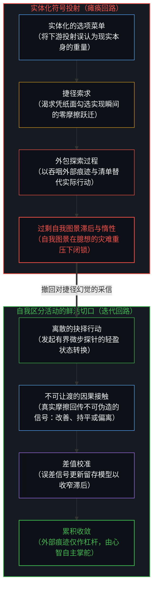
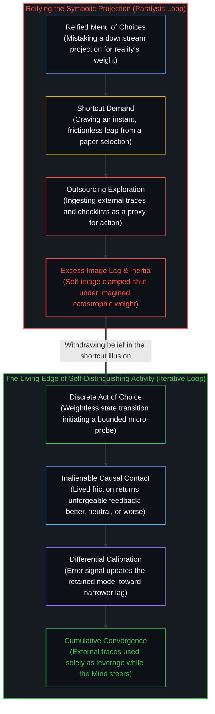

# 抉择本身并不沉重 / Choice Itself Has No Inherent Weight

*捷径幻觉、渐进迭代与行动主权的控制论闭环 / Shortcut illusions, gradual iteration, and the cybernetic loop of agency*

自我区分的活动无因发生、永不停息。在鲜活的切口上，每一次抉择都是一次离散的划界行动，既界定了当下状态，也开启了向下一状态的跃迁。这一状态转换本身并不附带任何令人窒息的内在重量。行动的瘫痪并非源于选择动作内部存在某种结构性阻力，而是源于对不切实际回报的索求：期盼单凭一次纸面上的符号勾选，就换来瞬间、零摩擦的蜕变，同时豁免中心自身在实践中的持续校准。当改变以日积月累、步步推进的方式展开时，每一次试探性探针的代价都处于可控的边界之内；而接触现实后回传的信号——无论这一步让境况有所改善、维持原状，还是暂时出现偏离——都为校准下一步行动提供了确切的差值。

Self-distinguishing activity occurs—uncaused, unceasing. At the living edge, every choice is a discrete act of distinction that bounds the present state and initiates a transition to the next. That transition carries no crushing intrinsic weight. Paralysis arises not from any structural resistance inside the act of choosing, but from a demand for an unrealistic return: expecting a single symbolic selection to deliver an instantaneous, friction-free transformation while exempting the center from iterative adjustment. When change unfolds step by step and day by day, each exploratory probe stays bounded in cost, and its returning signal—whether the step improves, holds neutral, or temporarily degrades the state—supplies the exact differential needed to calibrate the next move.

当中心遭遇停滞时，最常见的冲动是向外搜寻现成的地图：索取据称能扭转轨迹的书单、收集生存法则，或是打听其他心智如何走出相似的困局。这种搜寻虽常披着审慎的外衣，实则将其他中心留下的下游痕迹误认为了可移交的动因。每一本书籍、建议或分析框架，都只是另一个视角在自身坐标中穿行后沉淀的静态残余。试图用那份凝固的记录替代自身步步推进的探针，只会把中心锁入更深的惰性，将想象中“终极人生决断”的千钧重负变成今日迟迟不肯动身的借口。

When a center encounters stagnation, the most common impulse is an outward search for a ready-made map: soliciting reading lists reputed to reshape a trajectory, collecting survival formulas, or asking how other minds escaped a similar impasse. Although framed as prudence, this search mistakes another center's downstream trace for a transferable cause. Every book, recommendation, or framework is a static residue left behind by another locus navigating its own coordinates. Attempting to substitute that frozen record for one's own step-by-step probing locks the center deeper into inertia, turning the imagined gravity of a totalized life-decision into an alibi against acting today.

## 一、 跨心智痕迹与外包探索的范畴倒置 / 1. Cross-Mind Traces and the Categorical Inversion of Outsourcing Exploration

处于负荷下的中心极易将吞咽跨心智痕迹误认作执行离散行动。面对瓶颈或方向不明，它在公共网络中广泛搜集经验谈、分析框架与行动处方，期盼提炼好的建议能触发自发的转机。这种囤积制造出一种正在推进的合成幻觉：带宽被阅读、批注以及与借来的叙事产生共鸣所耗尽，而中心在日常现实中的实际坐标却纹丝未动。

A center under load readily mistakes the ingestion of cross-mind traces for the execution of a discrete act. Confronted with a plateau or directional uncertainty, it accumulates testimonials, frameworks, and prescriptions across public networks, expecting distilled advice to trigger a spontaneous shift. This accumulation produces a synthetic sense of movement: bandwidth is consumed in reading, annotating, and resonating with borrowed narratives while the center's actual coordinates in everyday reality remain untouched.

把消费建议当成行动，是在下游投射与掌舵的鲜活切口之间犯下了范畴倒置。他人的洞见是其自身一连串渐进校准所压缩出的低维摘要；一旦脱离了塑造它的具体摩擦，那份记录便不具备推动另一个中心的自主力量。读者可以买下印满文字的书页，却买不来赋予那些文字意义的迭代反馈回路。正如[任务的移交与后果的不可让渡](../the-delegation-of-the-task-and-the-inalienability-of-consequences/)所确立的，机械任务与符号推演可以移交给外部工具或顾问模型，但抉择所引发的因果后果却无法让渡。顺此延伸，[超越投射](../beyond-the-projection/)进一步揭示，任何显性的规则、核对清单或符号化的选项菜单，都是从鲜活意图中投射出的有限截影：外部模型或建言者可以在既定框架内描绘轨迹、暴露盲区，但没有任何下游投射能够变成第二个心智，替当前中心承担损失函数或迈出跳出僵局的内生一步。期盼一本书或一纸外部处方来扛起状态转换的重量，无异于把掌舵的主权交给了影子；正是由此催生的对零成本奇迹的索求，才让眼下原本具体的下一步显得令人生畏。

Treating advice consumption as action commits a category inversion between a downstream projection and the living edge that steers. Another person's insight is a low-dimensional summary compressed from their own sequence of incremental calibrations; detached from the specific friction that shaped it, the record holds no autonomous power to move a different locus. A reader can acquire the printed text, yet cannot purchase the iterative feedback loop that rendered it meaningful. As [The Delegation of the Task and the Inalienability of Consequences](../the-delegation-of-the-task-and-the-inalienability-of-consequences/) establishes, mechanical tasks and symbolic computations can be delegated to external instruments or advisory models, but the causal consequences of a choice remain permanently non-transferable. Extending that trace, [Beyond the Projection](../beyond-the-projection/) shows why any explicit rule, checklist, or symbolic menu of options is a finite projection cast from lived intent: an external model or advisor can map trajectories and expose blind spots within a given framing, yet no downstream projection ever becomes a second Mind capable of assuming the loss function or executing the endogenous step out of a stalled frame. Expecting a book or an external prescription to carry the weight of transition hands steering authority to a shadow, and the resulting demand for an effortless miracle is what makes the next concrete step appear intimidating.

## 二、 为何阻力感源于对不切实际回报的索求 / 2. Why Felt Resistance Stems from Demanding Unrealistic Returns

在执行切口上审视，发起一次不同的抉择只是一个简单的划界动作：终结一项过时的惯例、打开一份新草稿、结束一场耗散精力的交谈、调整日常作息，或是在黎明走出一条新路线。移动光标只需微小的运动冲动，说出决定只需呼吸的短暂起伏。离散的切换动作本身并不内含任何灾难。

Observed at the point of execution, initiating a different choice is a simple boundary-drawing act: ending an obsolete routine, opening a draft, concluding a draining conversation, shifting a daily schedule, or walking a new route at dawn. Moving a cursor requires a minimal motor impulse; speaking a decision requires a brief modulation of breath. The discrete switch itself contains no built-in catastrophe.

那种令人窒息的滞重感，源于中心将整段未来历史投射到单一决策节点上，并要求该节点预先保证终局的抵达。把抉择当成自带高昂生理或生存代价的苦役，是将心智膨胀的预期误认作了自然法则。可感知的短期阻力，只是索求失衡回报的副产物：企图凭一次决定一劳永逸地消解下游的不确定性，而不必经历循序渐进的校准。正如[数字火箭、同行审查与因果闭环的稀释](../the-dilution-of-the-causal-loop-and-the-misallocation-of-agency/)所追溯的，将预期成果从执行与反馈的细粒度闭环中剥离，不仅会在内部制造尖锐的紧绷感，还会将行动主权消散到制度或符号代理之中。

The sensation of crushing inertia arises when the center projects an entire future history onto a single decision node and demands that the node guarantee arrival in advance. Treating choice as if it inherently carried a severe biological or existential toll confuses the mind's inflated expectation with a law of nature. Perceived short-term drag is the byproduct of demanding a disproportionate return: wanting one decision to settle all downstream uncertainty without passing through sequential calibration. As [Digital Rockets, Peer Review, and the Dilution of the Causal Loop](../the-dilution-of-the-causal-loop-and-the-misallocation-of-agency/) traces, severing expected outcomes from the granular loop of execution and feedback manufactures acute internal tension while dispersing agency into institutional or symbolic proxies.

当行动回归日积月累、步步推进的自然节律时，一次试探性探针并不会带来难以承受的下行风险。这一机制如同在开放地貌上展开梯度下降：迈出微小一步，状态可能随之改善、可能暂时尚无明显变化，也可能一度加剧偏离。这些结果都不构成致命错误，因为微步探针的首要功能，是在与现实的接触中生成不可伪造的信号。回传的信号为下一次调整方向与步幅标定了梯度。正因为每一步探针足够细微，局部偏离的代价始终有限；正因为反馈来自真实接触而非纸面模拟，持续的迭代便能稳健收敛。所谓抉择的沉重感，不过是事后记账向起点节点的反向投射，正如[时间之箭的伪悖论与对称模拟的边界](../the-mirage-of-times-arrow-and-the-boundaries-of-simulation/)所阐明的，封闭系统的形式推演常把事后的痕迹核算误认作支配鲜活切口的可逆定律。

When action is restored to its natural cadence—step by step, day by day—an exploratory probe carries no unbearable downside. The mechanism operates like gradient descent across an open landscape: a modest step may improve the state, register no immediate shift, or temporarily worsen alignment. None of these outcomes constitutes a fatal error, because the primary function of the micro-step is to generate an unforgeable signal from contact with reality. That returning signal defines the gradient for the next adjustment of direction and step size. Because each probe is small, the cost of local drift stays minor; because the feedback is lived rather than simulated, continuous iteration converges reliably. The felt heaviness of a choice is only an after-the-fact bookkeeping projection read backward into the starting node, just as [The Mirage of Time's Arrow and the Boundaries of Symmetric Simulation](../the-mirage-of-times-arrow-and-the-boundaries-of-simulation/) demonstrates that closed-system formalism mistakes retrospective trace accounting for a reversible law governing the living edge.

## 三、 作为主动投入的停滞与“尚未准备好”的借口 / 3. Paralysis as an Active Investment in Unpreparedness

停滞并非意志的被动失灵，而是一套主动维持的痕迹构型，持续消耗容量以护卫留存的自我图景。当中心声称不知该如何抉择时，外部观察者虽无从窥探其内部状态，但其因果结构却一目了然：中心拒绝将发起行动的动因锚定在自身所在的位置。通过把改变渲染成一场孤注一掷的决战，中心制造出将静止归咎于外部严苛条件的借口，从而保护留存的自我图景免受重新渲染所带来的微小消亡。

Stagnation is not a passive failure of will; it is an actively maintained trace-configuration that expends capacity to preserve a retained self-image. When a center claims it does not know which choice to make, an outside observer has no access to its interior state, yet the causal structure is transparent: the center is declining to locate the initiating cause at its own locus. By framing change as an all-or-nothing decisive battle, the center manufactures a pretext to attribute its stillness to hostile conditions, shielding its retained image from the micro-death of re-rendering.

为了稳固这种回避，中心采取了永久备战的姿态。在迈出第一步之前，它不断搜集新的大纲、比对竞争的方法论、打磨抽象的评判标准。每一个新吞咽的概念都能带来短暂的宽慰，在零摩擦的纸面模型里模拟出前进的幻象，而现实轨迹却停留在原地。正如[“非中介化”的幻象](../the-illusion-of-the-unmediated/)所剖析的，要求在行动前先获得免于摩擦的万全把握，是一种自我施加的束缚，它把中介过程与渐进划界当成了缺陷，而未能认出那恰恰是行动主权借以展开的媒介。一旦放下对事前确定性的索求，将注意力收回到今日一次有界的微小调整上，那种无从下手的虚妄重压便随之消解。

To stabilize this avoidance, the center adopts the posture of perpetual preparation. It gathers another syllabus, compares competing methodologies, and refines abstract criteria before taking a first step. Each newly ingested concept delivers a brief spike of relief, simulating progress inside a frictionless paper model while leaving the physical trajectory unchanged. As [The Illusion of the Unmediated](../the-illusion-of-the-unmediated/) traces, demanding a guaranteed, friction-free state of readiness before acting is a self-imposed bondage that treats mediation and iterative boundary-drawing as defects rather than the very medium of agency. Once the demand for pre-certified certainty is dropped and attention returns to a single bounded adjustment today, the phantom of overwhelming difficulty dissolves.

## 四、 渐进式行动的控制论闭环与不可让渡的主权 / 4. The Cybernetic Loop of Gradual Action and Non-Transferable Sovereignty

消解停滞，需要用实践的递归闭环取代对“一锤定音”的完美主义苛求：发起微小的一步、记录回传的摩擦、重新渲染内部模型，再迈出下一步。将改变植根于具身迭代，并不意味着抛弃外部建议或内部推演。跨学科阅读、向同行请益、在纸面上推演场景边界，都是极有价值的借力杠杆——它们能在执行前拓宽备选探针的空间并厘清约束条件。真正需要从建议与推演中剥离的，是对发起动因的错置归属。无论是外部的推荐还是内部的模拟，都无法跨越留存投射与离散行动之间的界限。

Dissolving paralysis requires replacing the perfectionist demand for a single decisive stroke with the recursive loop of practice: initiate a modest step, register the returning friction, re-render the internal model, and take the next step. Grounding change in embodied iteration does not discard external advice or internal deduction. Reading across disciplines, consulting peers, and mapping scenarios on paper serve as valuable leverage—expanding the space of conceivable probes and clarifying constraints before execution. What must be stripped from advice and deduction is the false attribution of initiating causality. Neither an external recommendation nor an internal simulation can cross the boundary between a retained projection and a discrete act.

当中心把静态的参数核对清单置于真实互动之前，坚持在迈出步伐前先在纸面上锁定契合度或确定性时，便犯下了[契约的因果倒置](../the-causal-inversion-of-partnership/)所揭示的倒置，将共同迭代中涌现的下游痕迹误设为了前置的准入条件。同样，当摩擦显现而中心退回统计均值或群体借口来为原地踏步辩护时，便跌入了[“普通人视角”的解释陷阱](../the-explanatory-trap-of-the-ordinary-perspective/)，把对吸引子盆地的诊断描述当成了缴械指令，用自己的抉择宣告自己毫无选择。若再退一步，在当下推迟划界，却幻想日后自己的离场会让系统陷入混乱以证明自身价值，则重演了[前台的寓言与缺席的因果倒置](../the-receptionist-parable-and-the-causal-inversion-of-absence/)所拆解的死胡同：在实时接触中让渡主动区分的权力，却指望未来的空缺能反向追认今日放弃的主权。即便在经济生活中，宏观指标与收益率也唯有在无数微观抉择已经发生之后才获得其表面分量，正如[宏观现象及参数和个人微观选择的因果倒置与利率的命令幻相](../the-summary-first-reversal-and-the-command-of-yields/)通过拆解汇总统计支配鲜活切口的幻觉所展示的那样。

When a center places static parameter checklists ahead of lived interaction—insisting that compatibility or certainty be locked in on paper before any step is taken—it commits the inversion traced in [The Causal Inversion of Partnership](../the-causal-inversion-of-partnership/), mistaking the emergent trace of shared iteration for an entry prerequisite. Similarly, when friction appears and the center retreats into statistical averages or collective alibis to justify standing still, it falls into [The Explanatory Trap of the "Ordinary Perspective"](../the-explanatory-trap-of-the-ordinary-perspective/), turning a diagnostic description of an attractor basin into a mandate for surrender and using its own choice to declare itself choiceless. Taken a step further, postponing boundary-drawing in the present while fantasizing that one's eventual departure will plunge the system into chaos repeats the dead end dissected in [The Receptionist Parable and the Causal Inversion of Absence](../the-receptionist-parable-and-the-causal-inversion-of-absence/): surrendering active distinction-making during real-time contact, only to hope that a future void will retroactively assert the sovereignty abandoned today. Even in economic life, aggregate indicators and yields acquire their apparent weight only after countless micro-choices have already been enacted, as [Macro Parameters, Micro Choices, and the Command of Yields](../the-summary-first-reversal-and-the-command-of-yields/) shows by dismantling the illusion that summary statistics command the living locus.

在迭代闭环内部，一次行动并非穷尽规划后的终极丰碑，而是为探知现实响应而发出的轻盈探针。正如[无法逃逸的心智视界](../one-cannot-escape-ones-own-mind/)所确立的，外部建言抵达时只是自身感知界面上的一组信号构型；借来的概念唯有通过自身的行动加以检验、并对照回传的偏差持续校准，才能转化为可运作的直觉。对自身轨迹承担全部因果责任，不包含任何道德自谴；它只是直接认出，所体验到的世界正是自身过往区分在当下的渲染。外部条件、书籍与工具提供的是杠杆，却从不是替代心智掌舵的司机。若中心不在自身的切口上作出离散抉择，一切表观上的变动——换一套新词汇、换一个环境、或是请教一位新权威——都只是同一封闭吸引子上的相位移动，以此掩盖发起步调的缺席。

Within the iterative loop, an action is not the final monument of exhaustive planning, but a light probe sent to register reality's response. As [One Cannot Escape One's Own Mind](../one-cannot-escape-ones-own-mind/) establishes, external counsel arrives only as a pattern of signals across one's own perceptual interface; borrowed concepts become operational intuition only when tested through one's own acts and calibrated against returning loss. Taking full ownership of one's trajectory carries zero moral self-reproach; it is the direct recognition that the experienced world is the current rendering of one's prior distinctions. External conditions, books, and tools provide leverage, never a substitute driver. Without a discrete choice at the center's own edge, apparent changes—adopting new vocabulary, switching environments, or consulting a new authority—remain phase shifts along the same closed attractor, masking the absence of an initiating step.

正如[凡可言说皆不可言说之产物](../all-that-can-be-spoken-is-the-product-of-the-unspeakable/)所追溯的，可言说的模型与显性计划皆是不息区分活动留下的下游残余，旨在稳固下一步的落脚点，而非将心智冻结在自身的符号记法之中。而正如[感知的界限与理解的无限](../the-boundary-of-perception-and-the-infinity-of-understanding/)所阐明的，第一人称视角与单向因果是一体两面：每一次抉择所划下的有限边界，恰恰是开启无限理解与后续校准空间的必要条件。在最宏大的尺度上，企图逃避这一不可让渡的第一人称工作、渴求一劳永逸捷径的冲动，催生了合成人工神明以取代人类判断的狂热，这一认识论跃迁在[笛卡尔的认识论跃迁与造神狂热](../the-cartesian-overstep-and-the-frenzy-of-creation/)中被追溯至其根源。当那种捷径幻想被放下时，抉择便回归其原本的轻盈：一次迈出有界的一步，在自身认领的反馈中持续重新渲染眼前的世界。

As [All That Can Be Spoken Is the Product of the Unspeakable](../all-that-can-be-spoken-is-the-product-of-the-unspeakable/) traces, spoken models and explicit plans are downstream residues of the unspoken distinguishing activity, built to steady the next step rather than to freeze the Mind inside its own notation. And as [The Boundary of Perception and the Infinity of Understanding](../the-boundary-of-perception-and-the-infinity-of-understanding/) demonstrates, the first-person perspective and unidirectional causality are two sides of the same coin: the finite boundary drawn by each choice is the exact condition that opens an unbounded field of further understanding and calibration. At the grandest scale, the craving for an instantaneous shortcut away from this inalienable first-person work fuels the fantasy of synthesizing an artificial deity to supersede human judgment, an epistemic leap traced to its root in [The Cartesian Epistemic Leap and the Frenzy of Creation](../the-cartesian-overstep-and-the-frenzy-of-creation/). When that shortcut fantasy is set down, choice returns to its native lightness: one bounded step at a time, continuously re-rendering the world through the feedback it claims as its own.
