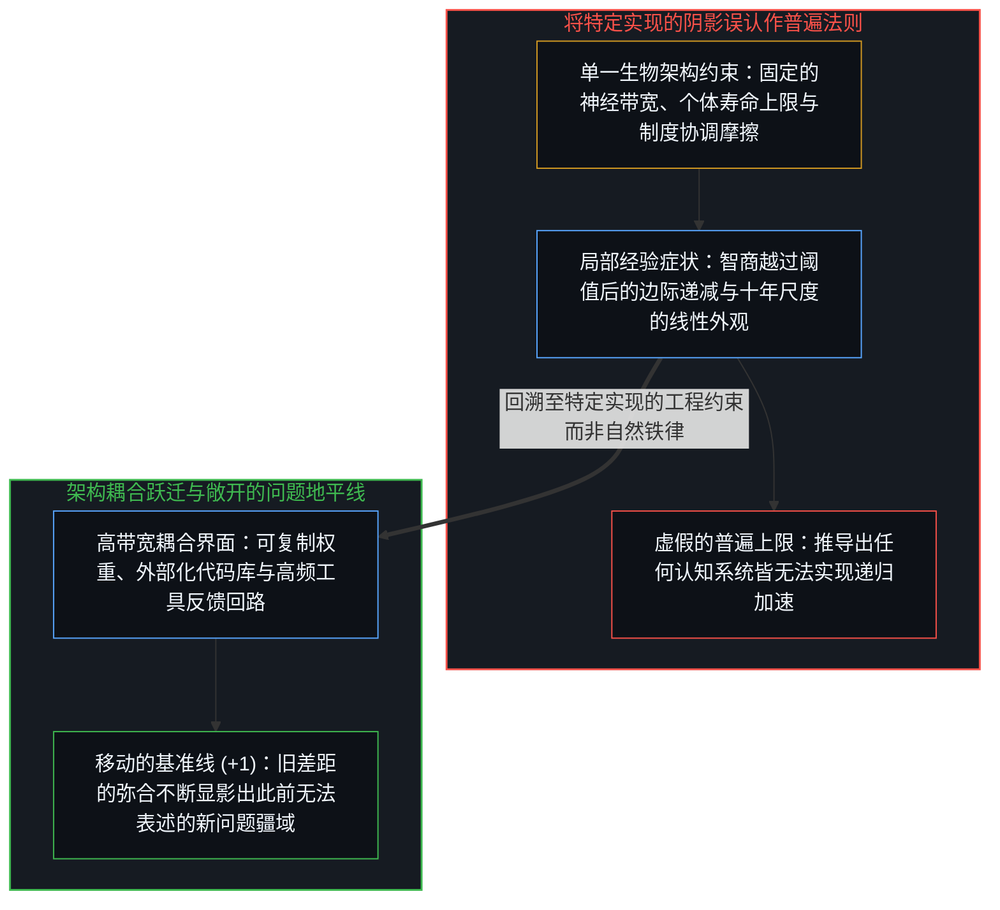
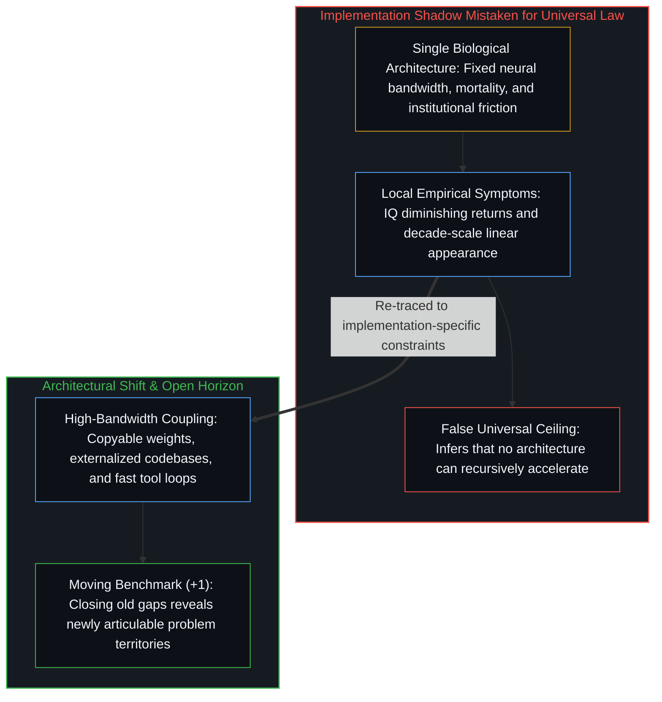

# 被误认作实体的阴影 / The Shadow Mistaken for the Object

*肖莱将人类特定生物架构投下的阴影，误认作了认知递归放大的普遍上限。 / Chollet mistakes the shadow cast by one biological implementation for a universal ceiling on recursive amplification.*

弗朗索瓦·肖莱在 2017 年发表的《智能爆炸的不可能性》中主张，递归自我改进不可能螺旋上升为超级智能，理由是智能离不开其所处的身体、环境与文化语境，受制于数学上的“没有免费午餐定理”，在跨过特定智商阈值后呈现边际收益递减，并且嵌在人类文明这一宏观表现为线性而非指数演进的既有系统之中。每一项局部观察都指认了人类认知的真实侧面，但整套论证却反复将不同维度的因果轴线强行压扁到同一条直线上，把单一生物实现投射在墙上的阴影误当成了被投射物本身的几何边界。

François Chollet's 2017 essay "The Impossibility of Intelligence Explosion" argues that recursive self-improvement cannot spiral into superintelligence because intelligence is situated in an environment, bounded by the No Free Lunch theorem, subject to diminishing returns past an IQ threshold, and embedded in a civilizational system whose historical progress looks linear rather than exponential. Each observation points at a genuine feature of human cognition, yet the argument repeatedly forces distinct causal axes onto a single line and mistakes the shadow of one biological implementation for the geometry of the object itself.

## 一、 处境耦合与没有免费午餐定理的错置 / 1. Situated Coupling and the No Free Lunch Misdirection

肖莱最有力的一点洞察在于智能无法在真空中空转——一颗切断了一切感官与工具反馈的大脑什么也解不开。然而论证随即发生了一次隐蔽的滑移：从“认知的运转需要与环境耦合”滑向了“认知的上限被锁死在当前环境之中”。从火种、文字到半导体，人类锻造的每一样工具都依赖具体的环境耦合，但处境性从未阻止心智去重塑它所耦合的处境本身；耦合的存在描述的是行动如何获得抓地力，却并未对系统改写与复利其耦合界面的速率设下任何上限。

Chollet's strongest observation is that intelligence requires environmental coupling—a brain in a vacuum with zero sensory or tool feedback resolves nothing. Yet his argument slides from "operation requires coupling to a context" to "capability is bounded by the current context." Every human tool from fire and script to semiconductors required environmental coupling, and at no step did situatedness prevent the Mind from restructuring the environment it coupled to; the existence of a coupling describes how action gains traction, not the velocity at which a system can modify and compound its couplings.

援引“没有免费午餐定理”来否定通用能力的扩展，则是把一条连续谱系压扁成了非此即彼的二元对立。该定理成立的前提是对数学上一切可能的问题空间赋予均匀权重——那是一个未来与过去毫无结构关联的最大熵白噪声宇宙。而真实的认知与学习发生在一个充满持久规律的低熵宇宙之中；这里的通用性衡量的是系统在现实所生成的问题族之间迁移结构的跨度，而非在随机白噪声中胜出的能力。

Invoking the No Free Lunch theorem to deny general capability collapses a continuum of generality into an all-or-nothing binary. The theorem holds over the uniform distribution of all mathematically possible problem spaces—a maximum-entropy noise floor where the future shares zero structure with the past. Actual learning operates inside a low-entropy cosmos rich with persistent regularities, where generality measures how broadly a system transfers structure across the problems reality generates rather than across white noise.

## 二、 架构内方差、线性错觉与文明瓶颈 / 2. Intra-Architectural Variance, the Linearity Illusion, and Civilizational Bottlenecks

观察到智商 170 的人与智商 130 的人并未拉开成比例的现实成就差距，测量的只是同一套生物架构内部的参数微调方差，而非不同架构之间的设计空间边界。所有人脑共享相近的工作记忆窗口、声带语言传输速率与生物寿命；拿同一架构内的收益递减去推断一个运转速率与上下文容量高出数个数量级的系统也会撞上同一道墙，无异于根据燃油轿车在时速两百英里后的收益递减，断言一切交通工具都不可能飞出大气层。

Observing that human beings with an IQ of 170 do not achieve proportionally greater impact than those at 130 measures parametric variance within a single biological architecture rather than the boundary of cognitive architectures as a whole. Human brains share the same working-memory bottleneck, vocal-tract communication speed, and lifespan; inferring from intra-human variance that a system operating at orders-of-magnitude higher clock speed and context capacity faces the same curve mistakes the top speed of one chassis for a law of motion.

同理，将近几十年的科学产出读作线性演进，是一种依赖观测尺度的光学错觉——它与把前方斜率看作垂直奇点高墙的错觉互为镜像。只要把镜头推得足够近，任何指数曲线在局部都近似平坦，因为其斜率始终与当前基数成正比；而一旦拉长到世纪尺度，能量捕获、算力规模与知识存量无一不呈现指数级复利。至于人类科学在具体运行中遭遇的摩擦，则源于生物模块无法直接拷贝权重、隐性经验随个体死亡而重置、以及官僚制度围绕自我存续而非探索效率运转——正如[你的代码库即是记忆](../your-codebase-is-memory/)所揭示的，一旦外部化记忆与人工脚手架改写了耦合媒介，这些属于特定传输管道的瓶颈便随之改写。

Similarly, reading recent decades of scientific output as linear is a scale-dependent optical illusion—the mirror image of projecting a vertical singularity wall. Zoomed in closely enough, any exponential curve looks locally flat because its derivative scales with its current base, while over centuries energy capture, computation, and recorded knowledge compound exponentially. Where human science does hit friction, those bottlenecks belong to biological modules that cannot copy their weights, lose tacit depth at death, and coordinate through slow institutional politics—constraints that shift whenever externalized memory and artificial scaffolding change the coupling medium, as traced in [Your Codebase Is Memory](../your-codebase-is-memory/).

## 三、 维护既有叙事与移动的基准线 / 3. Narrative Maintenance and the Moving Benchmark Horizon

当肖莱在 2026 年一面预测人工智能将在 2030 年前抹平几乎所有可指认的人类日常任务差距，一面又宣称 2017 年文章里的“每一句话至今依然正确”时，对既往表征的维护便取代了当下的鲜活观察。同时抱持这两项主张，恰恰丢掉了 2017 年文章里最有生命力的直觉——即能力并非一条奔向固定终点线的单一标量——反而死守了其中最脆弱的推论，即单个系统的规模扩展存在硬性天花板。

When revisited in 2026 alongside the prediction that artificial systems will close nearly every measurable task gap with humans by 2030, defending the 2017 essay by declaring that "every single thing said there is still true" replaces live observation with frame maintenance. Holding both claims at once abandons the 2017 essay's substantive intuition—that capability is not a single scalar converging on a finish line—while clinging to its weakest inference that individual system scaling hits a hard ceiling.

正如[智能只属于心智](../intelligence-belongs-only-to-the-mind/)、[指数级进程与线性之眼](../Analysis_Adolescence_of_Technology/)以及[AI 不会终结软件工程，而是将其扩展](../ai-wont-kill-software-engineering/)所确立的，外部系统执行的是形式投射的推演，而活生生的心智则给出定义“何为问题”的那一刀。每当工具放大把既有基准测试的百分之九十九填平，剩下的百分之一都会在新视界下展开为一片此前连提问方式都尚不存在的全新百分百疆域。把人类生物管道的阴影误认作普遍的速度上限，遮蔽了工具底座复利演进的陡峭程度；而把基准测试的合拢当作终局的抵达，则遗忘了每一个新立足点都会让未决的地平线重新敞开。

As [Intelligence Belongs Only to the Mind](../intelligence-belongs-only-to-the-mind/), [The Exponential and the Linear Eye](../Analysis_Adolescence_of_Technology/), and [AI Won't Kill Software Engineering, It Will Expand It](../ai-wont-kill-software-engineering/) establishes, external systems execute formal projections while the living Mind supplies the unprojected cut that defines what counts as a problem. Every time tool amplification closes ninety-nine percent of a fixed benchmark, the remaining one percent unfolds into a newly visible territory of problems that could not even be articulated from the old vantage point. Mistaking the shadow of human biological bottlenecks for a universal speed limit forecloses how fast the tool substrate can compound, while mistaking benchmark closure for a final finish line forgets that each new vantage point opens the horizon anew.
