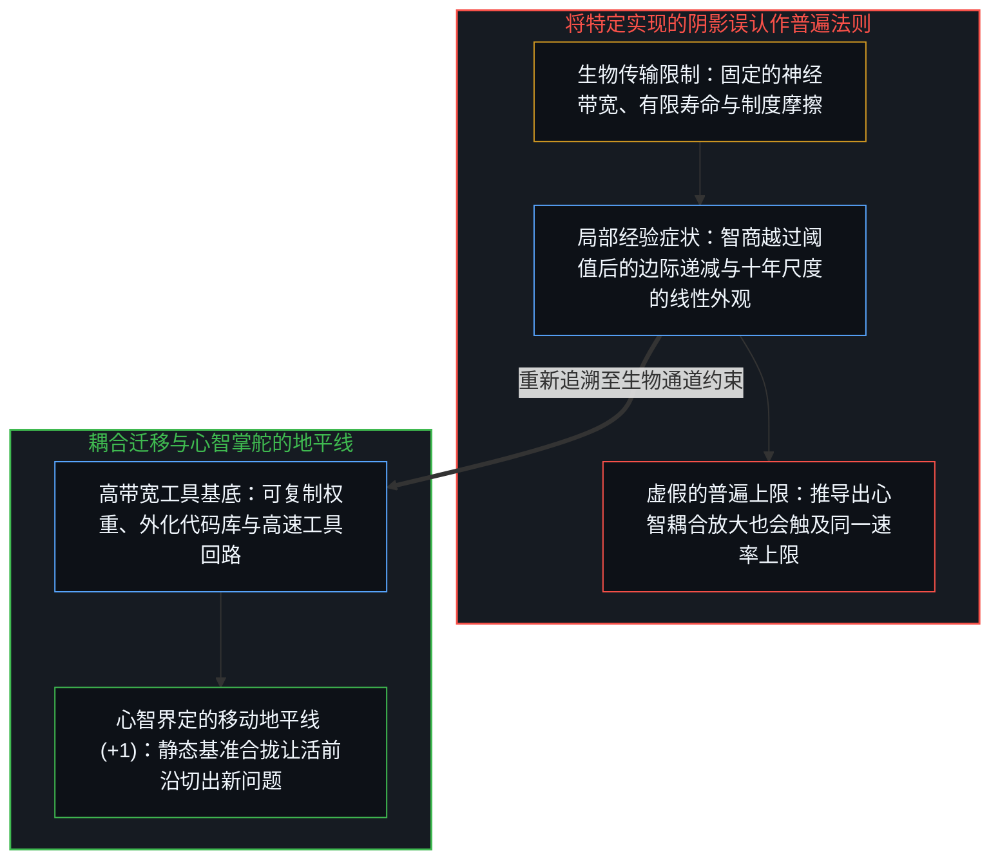
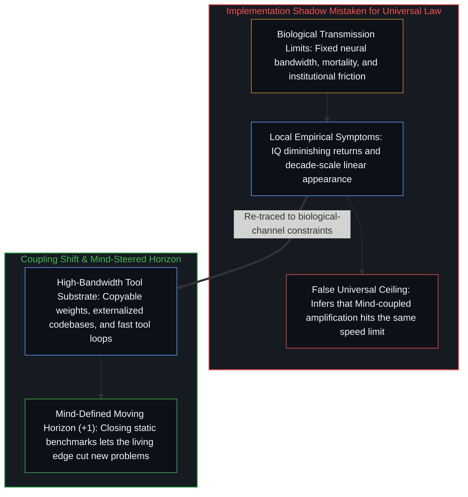

# 被误认作实体的阴影 / The Shadow Mistaken for the Object

*肖莱将单一生物实现投下的阴影，误认作了递归放大的普遍上限。 / Chollet mistakes the shadow cast by one biological implementation for a universal ceiling on recursive amplification.*

弗朗索瓦·肖莱在 2017 年发表的《智能爆炸的不可能性》中主张，递归自我改进不可能螺旋上升为超级智能，理由是智能处于具体环境之中，受制于“没有免费午餐定理”，在跨过智商阈值后呈现收益递减，并且嵌在历史进程看似线性而非指数演进的文明系统之中。每一项观察都登记了具体处境中人类实践的一项局部约束，但整套论证却反复将不同的因果轴线强行压扁到同一条直线上，把单一生物实现投下的阴影误当成了实体本身的几何结构。

François Chollet's 2017 essay "The Impossibility of Intelligence Explosion" argues that recursive self-improvement cannot spiral into superintelligence because intelligence is situated in an environment, bounded by the No Free Lunch theorem, subject to diminishing returns past an IQ threshold, and embedded in a civilizational system whose historical progress looks linear rather than exponential. Each observation registers a local constraint in situated human practice, yet the argument repeatedly forces distinct causal axes onto a single line and mistakes the shadow of one biological implementation for the geometry of the object itself.

## 一、 处境耦合与没有免费午餐定理的错置 / 1. Situated Coupling and the No Free Lunch Misdirection

肖莱最有力的一点洞察在于智能需要环境耦合——一颗在真空中毫无感官或工具反馈的大脑什么也解不开。然而他的论证从“运转需要与语境耦合”滑向了“能力受限于当前语境”。从火种、文字到半导体，人类的每一样工具都需要环境耦合，而处境性在任何一步都未曾阻止心智去重塑它所耦合的环境；耦合的存在描述的是行动如何获得抓地力，而不是心智通过外化器具改写并复利这些耦合的速率。

Chollet's strongest observation is that intelligence requires environmental coupling—a brain in a vacuum with zero sensory or tool feedback resolves nothing. Yet his argument slides from "operation requires coupling to a context" to "capability is bounded by the current context." Every human tool from fire and script to semiconductors required environmental coupling, and at no step did situatedness prevent the Mind from restructuring the environment it coupled to; the existence of a coupling describes how action gains traction, not the velocity at which the Mind can modify and compound those couplings through externalized instruments.

援引“没有免费午餐定理”来否定通用能力，是把通用性的连续谱系压扁成了非此即彼的二元对立。该定理成立在数学上一切可能问题空间的均匀分布之上——那是一片早先步骤对后续步骤不留任何痕迹的最大熵噪声基底。相比之下，学习是在由痕迹塑形的因果场中展开的：具体约束让规律得以跨越相继行动而持续留存；而通用性衡量的，正是经过压缩的结构在心智于摩擦中界定的诸问题族之间迁移的跨度，而非在白噪声中的迁移。

Invoking the No Free Lunch theorem to deny general capability collapses a continuum of generality into an all-or-nothing binary. The theorem holds over the uniform distribution of all mathematically possible problem spaces—a maximum-entropy noise floor where earlier steps leave no trace on later ones. Learning, by contrast, unfolds inside a trace-shaped causal field where concrete constraints keep regularities persistent across acts, and generality measures how broadly compressed structure transfers across the problem families the Mind defines under friction rather than across white noise.

## 二、 架构内方差、线性错觉与文明瓶颈 / 2. Intra-Architectural Variance, the Linearity Illusion, and Civilizational Bottlenecks

观察到智商 170 的人并未比智商 130 的人取得成比例的更大影响力，这所测量的只是单一生物具身内部的方差——在狭隘的心理测量切片之下——而非心智耦合器具复利速率的普遍界限。所有人脑都共享相同的工作记忆瓶颈、声道交流速率与寿命；从人类内部方差推断，那些时钟频率与上下文容量高出数个数量级的外化计算系统也会面对同一条曲线，便是把单一生物通道的吞吐限制，误认作了复利的普遍上限。

Observing that human beings with an IQ of 170 do not achieve proportionally greater impact than those at 130 measures variance within one biological embodiment—under a narrow psychometric slice—rather than a universal bound on how fast Mind-coupled instruments can compound. Human brains share the same working-memory bottleneck, vocal-tract communication speed, and lifespan; inferring from intra-human variance that externalized computational systems operating at orders-of-magnitude higher clock speed and context capacity face the same curve mistakes the throughput limits of one biological channel for a universal limit on compounding.

同理，将近几十年的科学产出读作线性，是一种依赖观测尺度的光学错觉——它与投射出一堵垂直奇点高墙互为镜像。只要把镜头推得足够近，任何指数曲线在局部都近似平坦，因为其导数始终与当前基数成正比；而若拉长到世纪尺度，能量捕获、计算能力与载录下来的知识都在呈指数级复利。在人类科学确实遭遇摩擦的地方，这些瓶颈属于生物具身：它们无法在心智之间直接复制未外化的神经状态，会在死亡时失落未被记录的默会深度，并经由缓慢的制度政治进行协调——每当外化记忆、可复制权重与人造脚手架改写耦合媒介时，这些约束便随之迁移，正如[你的代码库即是记忆](../your-codebase-is-memory/)所追溯的那样。

Similarly, reading recent decades of scientific output as linear is a scale-dependent optical illusion—the mirror image of projecting a vertical singularity wall. Zoomed in closely enough, any exponential curve looks locally flat because its derivative scales with its current base, while over centuries energy capture, computation, and recorded knowledge compound exponentially. Where human science does hit friction, those bottlenecks belong to biological embodiments that cannot directly duplicate unexternalized neural states across minds, lose unrecorded tacit depth at death, and coordinate through slow institutional politics—constraints that shift whenever externalized memory, copyable weights, and artificial scaffolding change the coupling medium, as traced in [Your Codebase Is Memory](../your-codebase-is-memory/).

## 三、 叙事维护与移动的基准地平线 / 3. Narrative Maintenance and the Moving Benchmark Horizon

在 2026 年将 2017 年的文章与“人造系统将在 2030 年前弥合与人类之间几乎所有可度量的任务差距”的预测并置重访，却以宣称“其中每一句话至今依然正确”来为之辩护，便是以框架维护取代了鲜活观察。同时抱持这两项主张，恰恰放弃了 2017 年文章中的实质直觉——即能力并非收敛于终点线的单一标量——却死守了其中有缺陷的推论，即认为生物瓶颈封死了心智耦合工具基底得以达到的复利斜率。

When revisited in 2026 alongside the prediction that artificial systems will close nearly every measurable task gap with humans by 2030, defending the 2017 essay by declaring that "every single thing said there is still true" replaces live observation with frame maintenance. Holding both claims at once abandons the 2017 essay's substantive intuition—that capability is not a single scalar converging on a finish line—while clinging to its flawed inference that biological bottlenecks cap how steeply Mind-coupled tool substrates can compound.

正如[智能只属于心智](../intelligence-belongs-only-to-the-mind/)、[指数级进程与线性之眼](../Analysis_Adolescence_of_Technology/)以及[AI 不会终结软件工程，而是将其扩展](../ai-wont-kill-software-engineering/)所确立的，外部系统执行形式投射，而活生生的心智给出定义“何为问题”的那一道未投射切分——因此器物从不会自举为自主的第二重心智，然而由心智掌舵的投射，其复利速率并不被生物带宽所封顶。每当工具放大合拢既有基准测试的百分之九十九，余下的百分之一便展开为一片新近可见的问题疆域，在旧立足点上甚至无从表述。把人类生物瓶颈的阴影误认作普遍的速度上限，便先行封死了工具基底能以多快速度复利的视野；而把基准测试的合拢当作终局的终点线，则遗忘了每一个新立足点都会让地平线重新敞开。

As [Intelligence Belongs Only to the Mind](../intelligence-belongs-only-to-the-mind/), [The Exponential and the Linear Eye](../Analysis_Adolescence_of_Technology/), and [AI Won't Kill Software Engineering, It Will Expand It](../ai-wont-kill-software-engineering/) establish, external systems execute formal projections while the living Mind supplies the unprojected cut that defines what counts as a problem—so an artifact never bootstraps into an autonomous second Mind, yet nothing caps the compounding velocity of Mind-steered projections at biological bandwidth. Every time tool amplification closes ninety-nine percent of a fixed benchmark, the remaining one percent unfolds into a newly visible territory of problems that could not even be articulated from the old vantage point. Mistaking the shadow of human biological bottlenecks for a universal speed limit forecloses how fast the tool substrate can compound, while mistaking benchmark closure for a final finish line forgets that each new vantage point opens the horizon anew.
