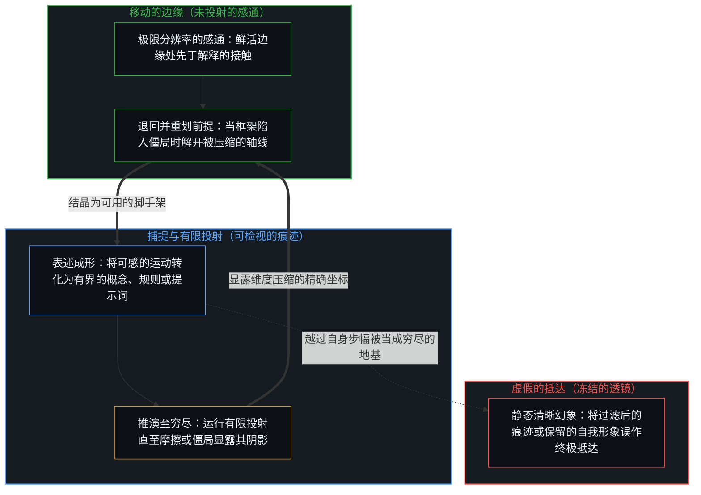
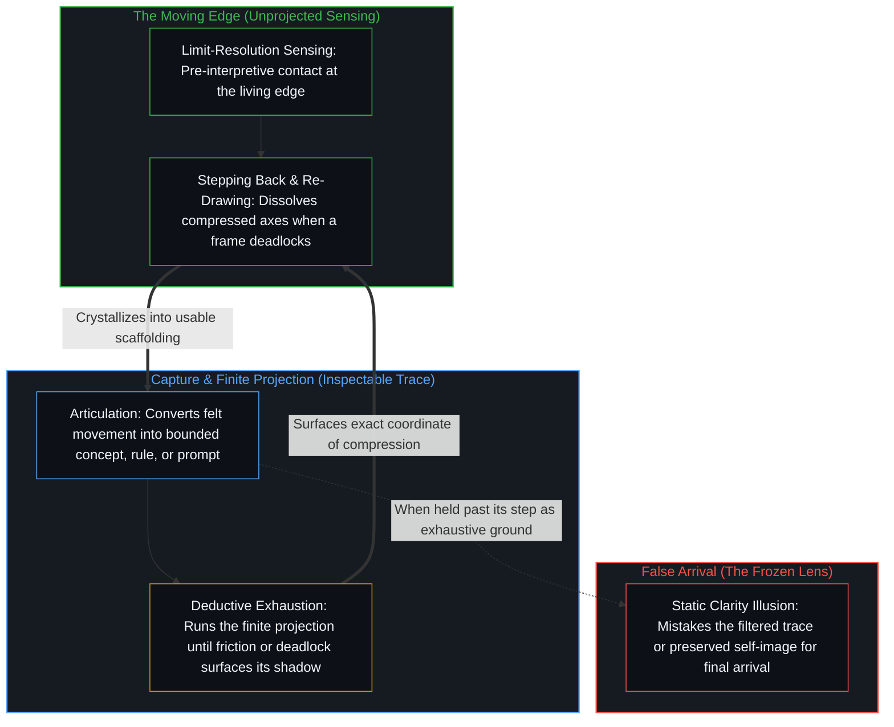

# 清晰不是抵达的终点，而是运动本身 / Clarity Isn't a State You Arrive At. It's the Movement Itself.

*每一副透镜从内部看都显得清晰，清晰正是表达把边缘化为痕迹时的持续迈出 / Every lens feels clear from within, and clarity is the ongoing stepping-out as expression turns the edge into trace*

有人宣告：*大家心知肚明的事，终于得到了证实。* 一项充满争议且并非全票通过的法庭裁决，伴随着有史以来最醒目的异议意见与总统的公开反对——然而在某一副透镜内部，它却被呈现为人人心底早已共有、只待说出的一致认知。

Someone declares: *finally, what everyone knew in their heart is confirmed.* A court decision, contested and non-unanimous, with the most prominent dissent on record and vocal presidential opposition — yet rendered, from inside one lens, as universal inner knowledge merely awaiting expression.

这不是失误，而是认知运作的方式。透镜并非先清晰地感知，然后再加以扭曲；感知本身就已经在透过透镜发生。并不存在一个先于透镜的观测位置，可以用来丈量所谓的扭曲。日常理解的“偏见”预设了一条正确的基准线——一个来自无处的视角。这样的视角并不存在。

This isn't error. This is what cognition does. The lens doesn't first perceive clearly, then distort. The perceiving *is* already through the lens. There is no pre-lens vantage point from which distortion could be measured. "Bias" as usually conceived presupposes a correct baseline — a view from nowhere. No such view exists.

因此，在分歧之处投射共识的人，并不是没能看清——在那副透镜内部，本就没有更清晰的版本可供取用。当持有透镜的人看见透镜中某处盲点的那一刻，就已经从该处原本不可见的过滤中迈了出来。仍不可见的部分，按定义正是当前的持握尚未区分出来的部分。在每一个时刻，从正在起作用的透镜内部看去，思考都显得清晰；正因如此，在内部，感受到的确信与如实看见事物始终无法区分。

So the one projecting consensus where there is division isn't failing to see clearly — there is no clearer version available from inside that lens. The moment a blind spot in the lens becomes visible to the one holding it, the unseen filtering at that spot has already been stepped out of. What remains invisible is, by definition, what the current hold has not yet distinguished. At every moment, from inside the active lens, thinking feels clear, which is why felt certainty and seeing things as they are remain indistinguishable from within.

## 一、 边缘上的抉择 / 1. Choice at the Edge

外部视角一路向下追溯原因：先验预设、身份认同、社会语境。从外部看，每一个抉择都可以分解为它的条件。抉择的行动消失了，取而代之的是机制。

The exterior view traces causes: priors, identity, social context, all the way down. From outside, every choice decomposes into its conditions. The choosing disappears, replaced by mechanism.

但这只是观测位置所产生的假象，并非关于抉择本身的发现。从外部看，观察所持有的只是已经实现出来的东西——已知之物、因果链条、可追溯的前因。抉择本身不会出现在那里，因为它不在那里运作。数学展现出同样的运动；[为何数学永远解不完](../why-mathematics-can-never-be-solved/)阐明了形式结构为何从不落入一个已解决的静止状态。

But this is an artifact of the vantage point, not a discovery about the nature of choice. From outside, observation holds what has already been actualized — the known, the causal chains, the traceable antecedents. The choosing itself doesn't appear there because it doesn't operate there. Mathematics shows the same movement; [Why Mathematics Can Never Be Solved](../why-mathematics-can-never-be-solved/) explains why formal structure never lands in a solved state.

能动性运作于已知与未知的边界上。已知之物已经确定——可检视、可追溯、可解释。未知之物尚未显露。抉择既非已知，亦非未知。它就是边缘本身，因此它只能在行动中被感受，而无法作为对象被看见。当你看见它的那一刻，它就已经移动了——刚才还是边缘的地方如今成了已知，而真正的抉择已经向前推移。当另一个人看似冻结在某个框架中时，[NPC 印象是结构性的，而非心智的排名](../the-npc-impression-is-structural/)指出了这种印象只是从外部观察其痕迹所产生的构造物，而非对其内在清晰度的裁决。

Agency operates at the boundary between known and unknown. The known is already determined — inspectable, traceable, explicable. The unknown is not yet available. Choosing is neither. It is the edge itself, which is why it is felt in the act rather than seen as an object. The moment you see it, it has already moved — what was edge is now known, and the actual choosing has shifted forward. When another person seems frozen in a frame, [The NPC Impression Is Structural, Not a Ranking of Minds](../the-npc-impression-is-structural/) shows that impression is an artifact of observing their traces from outside rather than a verdict on their inner clarity.

这无需裁决便消解了自由意志之争。决定论者从外部观察，找到的是因果链条；自由意志论者从内部观察，感受到的是正在进行的抉择。两者在各自的投射之内都准确无误。这场争论，不过是把两个不可通约的观测位置强行压进它们并不共享的同一套坐标系所产生的假象。[起作用的是信念](../what-works-is-the-belief/)中看似封住整片场域的禁令，以及[一个提示词之遥](../whatever-is-one-prompt-away/)中看似永远失落的那一层，都是被误当作终点的框架。

This dissolves the free will debate without adjudicating it. Determinists observe from outside and find causal chains. Libertarians observe from inside and feel the choosing. Both are accurate within their projection. The debate is an artifact of collapsing two incommensurable vantage points onto shared coordinates they don't share. A ban that seems to seal a field, in [What Works Is the Belief](../what-works-is-the-belief/), and a layer that seems lost forever, in [Whatever Is One Prompt Away](../whatever-is-one-prompt-away/), are both frames mistaken for arrival.

## 二、 无法化为看见的感受 / 2. The Feeling That Can't Become Seeing

即便对做出抉择的人而言，抉择也是在行动中被感受，而非作为可检视的对象被看见。正因如此，透过当前透镜观看的心智会把这副透镜当作清晰的：一旦它察觉当前框架中有什么不对劲，那个框架就已经在被修订了。透镜的清晰与对透镜的盲视，是从内部体验到的同一种处境。意义也以同样的方式运作；[生命的意义在起草之中](../the-meaning-of-life-is-in-the-drafting/)将意义定位在鲜活的起草过程里，而不是已完成的纸页上。

Even the one choosing feels the choosing in the act rather than seeing it as an inspectable object. This is why a mind looking through its active lens takes that lens to be clear: the moment it spots what is off in its current framing, that framing is already being revised. Clarity of the lens and blindness to the lens are the same condition, experienced from inside. Meaning works the same way; [The Meaning of Life Is in the Drafting, Often Lost in the Outward Gazing](../the-meaning-of-life-is-in-the-drafting/) locates it in the live drafting rather than in the finished page.

这不是认知的缺陷，而是认知本身的结构。透过某物去看见，就意味着看不见那个“透过”。感知的器具无法同时成为感知的对象——这并非源于某种偶然的局限，而是因为“透过……去感知”指的就是这件事。模型可以压缩这一运动的痕迹，但[Token 效率、模拟与无法弥合的间隙](../token-efficiency-emulation-and-the-unclosable-gap/)表明，它无法发起驱动这一运动的第一人称利害。

This isn't a flaw in cognition. It's the structure of what cognition is. To see through is to not see the through. The instrument of perception cannot simultaneously be the object of perception — not because of some contingent limitation, but because that's what "perceiving through" means. A model can compress the trace of this movement, but [Token Efficiency, Emulation, and the Unclosable Gap](../token-efficiency-emulation-and-the-unclosable-gap/) shows it cannot originate the first-person stake that drives it.

因此，当有人报告说“大家心知肚明”时，这一报告忠实于世界在那副透镜内部的登记方式。在那次持握之内，投射是无缝的。与之相悖的证据不会被登记为反例，而是被登记为恶意、怯懦或作秀。透镜不会先过滤，再把过滤后的结果标示为已过滤的产物；它过滤，并直接把结果呈现为现实。看清某样东西，依赖于忽略其余一切。[非万物之理](../not-a-theory-of-everything/)指认了这一运动所留下的姿态：一件精密的器具，而非终极的理论。

So when someone reports that "everyone knew in their heart," that report is faithful to how the world registers from inside that lens. Within that hold, the projection is seamless. The evidence that contradicts it doesn't register as contradiction — it registers as bad faith, cowardice, or performance. The lens doesn't filter and then present the filtered result as filtered. It filters and presents the result as reality. Seeing something clearly depends on ignoring everything else. [Not a Theory of Everything](../not-a-theory-of-everything/) names the stance this movement leaves behind: a precision instrument, not a final theory.

## 三、 捕捉与损耗 / 3. Capture and Loss

一次观察浮现出来——边缘处一次可感的觉察。你把它写下来。书写这一行动把边缘转化成了已知。痕迹留存下来，运动却已消逝。每一次表述，都是对所表述之物的一次微小死亡。如[真正稀缺的不是记忆，而是持续的重新追溯](../the-real-scarcity-is-not-memory-but-continuous-re-tracing/)所论证的，承载着运动的是持续的重新追溯，而它留在身后的框架则是[遗忘的脚手架](../the-scaffolding-we-forget/)。

An observation arises — a felt noticing at the edge. You write it down. The act of writing converts edge into known. The trace remains; the movement is gone. Every articulation is a small death of what it articulates. What carries the movement is continuous re-tracing, as [The Real Scarcity Is Not Memory, But Continuous Re-Tracing](../the-real-scarcity-is-not-memory-but-continuous-re-tracing/) argues, and the frames it leaves behind are [The Scaffolding We Forget](../the-scaffolding-we-forget/).

这不是一个有待解决的问题，而是表达本身的结构。感通运作在极限分辨率上——那是先于解释、与当下之物的直接接触。解释滞后一步，将感通实现为可用的形式。两者之间的间隙，正是迭代得以起作用的原因：边缘处所感通到的，总是多于任何单次表述所能实现的。每一次实现都会消耗一部分所感通之物，将可感的运动转化为可检视的记录。一个终极的清晰状态要求对开放场域进行无损捕捉，而[开放场域中的无损知识不自洽](../lossless-knowledge-of-an-open-field-is-incoherent/)表明，这与有界、有中心的活动相矛盾。

This isn't a problem to solve. It's the structure of expression. Sensing operates at limit-resolution — the pre-interpretive contact with what's there. Interpretation lags behind, actualizing sensing into usable form. The gap between them is why iteration works at all: there is more sensed at the edge than any single articulation actualizes. Each actualization consumes some of what was sensed, converting felt movement into inspectable record. A final state of clarity would require lossless capture of the open field, which [Lossless Knowledge of an Open Field Is Incoherent](../lossless-knowledge-of-an-open-field-is-incoherent/) shows contradicts bounded, centered activity.

当心智把一次解释外化为明确的规则、提示词、代码库或智能体工作流时，那条指令便是从极限分辨率的感通中切出的有限投射。正如[超越投射](../beyond-the-projection/)所追溯的，每一个这样的投射在照亮一条操作轴线的同时，都会在其余轴线上投下阴影；当对等的同侪智能体将那些被投射出的规则推演至穷尽并撞上不可化约的僵局时，这次碰撞便精准定位了先前的表述将多个独立维度压缩到同一条轴线上的坐标。解开这一僵局，不能靠在旧框架内部强行命令某一个投射让步，而是要把信号交还给处于边缘的人类心智——它的清晰，正是退回未投射的意图并重新划定前提的持续运动。如[你的代码库即是记忆](../your-codebase-is-memory/)在代码、计划、会话桥接与模型权重所构成的更广阔工作空间中所表明的，外化的痕迹是早先切口层叠而成的残余，从不会自行延续区分。把清晰当成一个有待抵达并加以囤积的完结档案——仅仅因为可能还用得上就留存已被取代的 `.bak` 文件、死分支与未修剪的会话历史——只会加深认知引力井，让陈旧的框架与鲜活的当前状态相互争夺；正如模型训练只保留当前激活的检查点而非每一次中间权重更新，因为凡是仍在承重的区分都已吸纳进当下的配置之中，外化记忆中的清晰同样在于就地重切唯一权威的检查点，并在旧残余的边缘被折入当下之后将其修剪殆尽。

When a mind externalizes an interpretation into an explicit rule, prompt, codebase, or agentic workflow, that instruction is a finite projection cut from limit-resolution sensing. As [Beyond the Projection](../beyond-the-projection/) traces, every such projection illuminates one operational axis by casting a shadow across others; when equal-footed peer agents run those projected rules to deductive exhaustion and hit an irreducible deadlock, the collision isolates the exact coordinate where the prior articulation compressed independent dimensions onto one axis. Resolving the deadlock cannot come from forcing one projection to yield by fiat inside the old frame; it returns the signal to the human Mind at the edge, whose clarity is the ongoing movement of stepping back to unprojected intent and re-drawing the premise. As [Your Codebase Is Memory](../your-codebase-is-memory/) shows across the wider workspace of code, plans, session bridges, and model weights, externalized traces are stacked residues of prior cuts that never continue distinguishing on their own. Treating clarity as a finished archive to arrive at and hoard—keeping superseded `.bak` files, dead branches, and unpruned session histories out of mere possibility—thickens the epistemic gravity well so stale framings compete with the live state; just as model training keeps the active checkpoint rather than every intermediate weight update because whatever still carries load is already absorbed into the present configuration, clarity in externalized memory lives in re-cutting the canonical checkpoint in place and pruning superseded residue once its edge has been folded in.

那么，一篇谈论清晰的文章，本身就已经是对清晰的偏离。用来追溯这一结构的框架，本身也是一个投射，受制于它所描述的一切。命名“边缘”，就把“边缘”变成了一个概念——某种已知的、可定位的、不再是边缘的东西。一个曾经穿过却被保留为良善自我形象的框架，正是[恶是心智自己的造物](../evil-as-the-minds-own-creation/)所指认的恶之诞生地。

An essay about clarity, then, is already a departure from clarity. The framework that traces this structure is itself a projection subject to everything it describes. Naming "the edge" makes "the edge" into a concept — something known, locatable, no longer edge. A frame passed through and then kept as a self-image of goodness is where [Evil as the Mind’s Own Creation](../evil-as-the-minds-own-creation/) locates the birth of evil.

## 四、 抵达让过滤重新开始 / 4. Arriving Resumes the Filtering

清晰不是一种状态。抵达意味着停留在某个位置上，这也就意味着透过某副透镜去观看，意味着不可见的过滤重新开始。[同情是缺乏清晰时的占位符](../sympathy-is-a-placeholder-for-lack-of-clarity/)追溯了当情绪强度被当作与另一心智已完成接触、从而冻结进一步探询时的虚假抵达。[只要它不被保持为空](../only-if-it-is-not-kept-empty/)追溯了当永久的空被当作已然澄明的终点、而非迎接下一次承接的暂时余地时的虚假抵达。[气候问题只作为感知被登记](../the-climate-problem-registers-only-as-perception/)追溯了当一副“看见危机”的透镜将其冻结的持握呈现为已完成的清晰时的情形，而[持续生长的脚手架](../the-scaffolding-that-keeps-growing/)则追溯了当从保留的框架后退一步被当作重获开放时的情形。正因如此，[没有系统能被保持封闭](../no-system-can-be-kept-closed/)，也正因如此，[开放即一致](../openness-is-consistency/)：运动之所以持续不断，是因为它所穿过的任何框架都无法将它封存。

Clarity isn't a state. Arriving would mean stopping at a position, which means looking through a lens, which means the invisible filtering has resumed. [Sympathy Is a Placeholder for Lack of Clarity](../sympathy-is-a-placeholder-for-lack-of-clarity/) traces that false arrival when emotional intensity is taken as completed contact with another mind, freezing further inquiry. [Only If It Is Not Kept Empty](../only-if-it-is-not-kept-empty/) traces it when permanent emptiness is held as a cleared destination rather than temporary room for the next receiving. [The Climate Problem Registers Only as Perception](../the-climate-problem-registers-only-as-perception/) traces it when a lens that "sees the crisis" presents its frozen hold as finished clarity, and [The Scaffolding That Keeps Growing](../the-scaffolding-that-keeps-growing/) traces it when stepping back from a preserved frame is treated as recovered openness. That is why [No System Can Be Kept Closed](../no-system-can-be-kept-closed/), and why [Openness Is Consistency](../openness-is-consistency/): the movement continues because no frame it passes through can seal it.

清晰就是运动本身——那一次次迈出却从不落定的步伐。每一步都在同一个行动中照亮某处，又投下阴影。每一次表述都在揭示的同时结晶硬化。践行就是这场运动，而不是它所穿过的任何一个框架。[专家经验作为参考而非替代](../expertise-as-reference-not-replacement/)让专家地图随着边缘持续重新渲染，而不是越过自身步幅将参考封死。[当观察变成表演](../when-observation-becomes-performance/)展示了当关于他人的观察被包装成面向观众的便携美德时会发生什么，而[外化善意走向其反面](../externalized-virtue-becomes-its-opposite/)则追溯了当私人确信被抬升为从外部安装的律令时，这种冻结在宏观尺度上的扩展。[一切伤害的根源](../the-source-of-all-harm/)指认了这种冻结如何完成：一个心智将自身的私人之善持守为普遍尺度，而另一个心智认可了这一声索——由此也就没有一个已被净化、可供抵达的管家状态。在技艺与探询的各个领域，同样的不抵达依然成立：[无形象的写作](../writing-without-the-image/)将注意力留在写作所揭示的内容上，而非留在一幅已完成的作者肖像上；[意识向量论文的真正教训](../the-real-lesson-from-the-consciousness-vector-paper/)保留了经验发现，却不把一个可操控的方向夸大为意识的开关；[封闭的假设把复利挤成 S 曲线](../closed-assumptions-squeeze-compounding-into-s-curves/)将固定框架下的饱和读取为局部的登记，而非关于进步的终结性交代；[意识的难题与学习相容](../the-hard-problem-of-consciousness-is-consistent-with-learning/)则认出剩余的开放性正是学习的生成性根基，而非一道有待被已完成的连续性抹去的裂隙。正如[追求机缘中的封闭现实](../closed-reality-in-the-pursuit-of-serendipity/)所示，每当“没有计划”变成了被保留的计划，或者如[生产、消费与心智的区分](../production-consumption-and-the-minds-distinction/)所示，每当边界被当作固定而非敞开来持守，运动就会停滞。

Clarity is the movement — the repeated stepping-out that never lands. Each step illuminates and casts shadow by the same act. Each articulation reveals and crystallizes simultaneously. The practice is the movement, not any frame it passes through. [Expertise as Reference, Not Replacement](../expertise-as-reference-not-replacement/) keeps the expert map re-rendering with the edge rather than sealing the reference past its step. [When Observation Becomes Performance](../when-observation-becomes-performance/) shows what happens when an observation about others is packaged as portable virtue for an audience, and [Externalized Virtue Becomes Its Opposite](../externalized-virtue-becomes-its-opposite/) traces that freeze at scale when private conviction is elevated into a mandate installed from outside. [The Source of All Harm](../the-source-of-all-harm/) locates the completion of that freeze where one Mind holds its private good as universal measure and another grants the claim — leaving no purified steward state to arrive at. Across craft and inquiry, the same non-arrival holds: [Writing Without the Image](../writing-without-the-image/) keeps attention on what writing reveals rather than on a finished portrait of the writer; [The Real Lesson from the Consciousness Vector Paper](../the-real-lesson-from-the-consciousness-vector-paper/) retains the empirical finding without inflating a steerable direction into an on/off switch for consciousness; [Closed Assumptions Squeeze Compounding into S-Curves](../closed-assumptions-squeeze-compounding-into-s-curves/) reads saturation under a fixed frame as local registration rather than a finished account of progress; and [The Hard Problem of Consciousness Is Consistent with Learning](../the-hard-problem-of-consciousness-is-consistent-with-learning/) recognizes residual openness as the generative ground of learning rather than a gap to be deleted by finished continuity. The movement stalls whenever "no plan" becomes the preserved plan, as [Closed Reality in the Pursuit of Serendipity](../closed-reality-in-the-pursuit-of-serendipity/) shows, or whenever a boundary is held fixed instead of open, as [Production, Consumption, and the Mind’s Distinction](../production-consumption-and-the-minds-distinction/) shows.

哪怕这篇文章也是如此。尤其是这篇文章。文章只是痕迹，而非那件事本身；那件事早已移步向前。[抽象、边界与现实的移动边缘](../abstraction-boundaries-and-the-moving-edge-of-reality/)追溯了每一次成功的抽象如何在冻结一道暂时边界的同时，边缘早已继续前行；而[潜无限与数学思维的暂时闭合](../potential-infinity-and-the-temporary-closures-of-mathematical-thought/)则展示了每一次暂时闭合如何使确定的比例成为可能，同时潜在的过程早已越过百分比所持有的总量继续延伸。正如[前因，后果](../qian-yin-hou-guo/)所言，观察总是站在已成形之果的一侧，因此回头张望永远捕捉不到这场运动——它只活在放下这句已写完的话之后，心智从这里作出的下一个区分之中。

Even this. Especially this. The essay is the trace, not the thing. The thing has already moved. [Abstraction, Boundaries, and the Moving Edge of Reality](../abstraction-boundaries-and-the-moving-edge-of-reality/) traces how every successful abstraction freezes a temporary bound while the edge has already moved on, and [Potential Infinity and the Temporary Closures of Mathematical Thought](../potential-infinity-and-the-temporary-closures-of-mathematical-thought/) shows how each temporary closure enables definite proportions while the potential process continues past the total that the percentage holds. Observation stands on the side of effects already formed, as [Cause Before, Effect After](../qian-yin-hou-guo/) puts it, so the movement is never caught by looking back — it is lived in the next distinction the mind makes from here after setting the finished sentence down.
