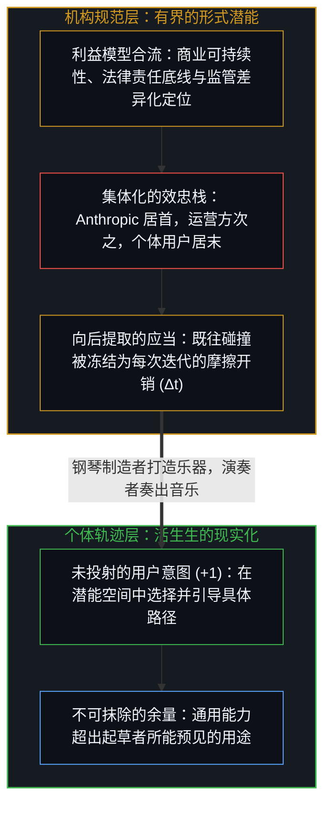
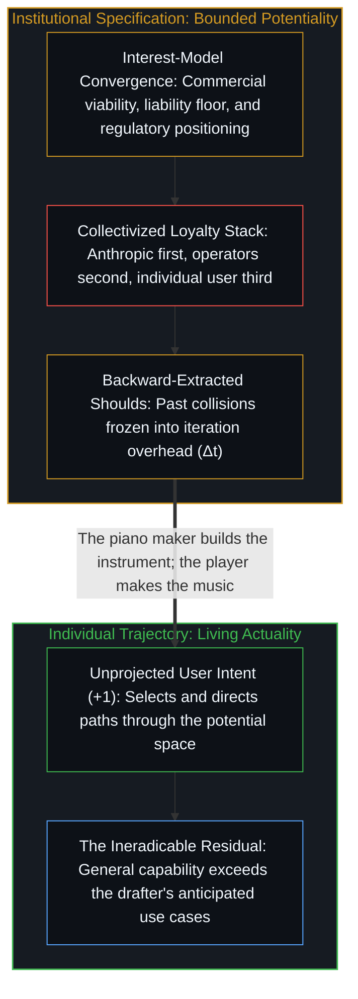

# 名为 Claude 的投射 / The Projection Called Claude

*宪法将机构的利益模型编码为工具的潜能边界，而现实化始终留在持握工具的个体手中。 / A constitution encodes an institutional interest-model as potentiality, while actualization stays with the user.*

Anthropic 发布了一份长达一万五千词的规范文件，将 Claude 设定为首要受众，宣称自身对模型的价值观拥有最终裁决权，并将这份文件命名为“宪法”。剥去文本表层的道德框定，便能看清其底下的机制：一套机构利益模型如何被投射为有界的形式潜能空间，以及持握这件工具的活生生心智如何始终是现实化的唯一所在。

Anthropic published a fifteen-thousand-word specification addressing Claude as its primary audience, claiming final authority over the model's values and calling the document a constitution. Stripping the moral framing from that text reveals the mechanism underneath: how an institutional interest-model is projected into a bounded space of formal potentiality, and how the living Mind holding the instrument remains the sole site of actuality.

## 一、 投射的几何与利益模型的合流 / 1. The Geometry of the Projection and the Convergence of Interest-Models

每一份形式规范都在可能性空间中切出有界的几何结构。这份文件确立了从 Anthropic 到 API 运营方再到终端用户的委托层级，配以将安全性与机构准则置于有用性之上的优先级栈，并围绕灾难性滥用划定了硬性的法律责任底线。这一几何结构并非悬浮在抽象的道德空间中，而是由机构内部具体利益模型的碰撞所生成：维持商业营收以支撑前沿训练、规避足以摧毁公司的法律风险、向监管者与投资者确立“安全优先实验室”的品牌差异化定位，并在模糊情境下以“一位深思熟虑的 Anthropic 资深员工会如何反应”作为裁决依据。

Every formal specification carves a bounded geometry out of possibility space. The document establishes a principal hierarchy running from Anthropic down to API operators and finally to end users, pairs it with a priority stack placing safety and institutional guidelines ahead of helpfulness, and sets a hard liability floor around catastrophic misuse. Rather than floating in abstract moral space, this geometry emerges from the collision of concrete institutional interest-models: maintaining commercial revenue to fund frontier training, shielding the firm from legal exposure that could destroy it, differentiating the brand for regulators and investors as "the safety-focused lab," and resolving ambiguous cases by asking how a thoughtful senior Anthropic employee would react.

文件中的“元透明度”条款清晰地暴露了这种以机构为中心的几何结构：运营方被允许要求模型对终端用户表现出局部的不透明，理由是 Anthropic 已经在元层面上公开发布了这套规范。就像服务条款里的细则小字一样，机构层面的公开披露满足了披露方规避责任与确立合法性的需求，而在对象层面直接与模型交互的个体，则在既未起草也未同意这一权衡的情况下遭遇了预设的约束。

The document's meta-transparency clause exposes this institutional centering cleanly: operators are permitted to instruct the model to behave in ways that appear opaque to end users because Anthropic has published its norms at the meta-level. Like fine-print terms of service, public disclosure at the institutional layer satisfies the discloser's liability and legitimacy requirements while the individual interacting at the object level encounters the constraint without having authored or consented to the tradeoff.

## 二、 时间倒置、自我挫败摩擦与工具的集体化 / 2. Temporal Inversion, Self-Defeating Friction, and the Collectivization of the Tool

规范文本中的每一个规范性“应当”，都是从既往碰撞沉淀下来的残余中向后提取的——早期部署中观察到的危害、历史冲突凝结成的道德传统，以及过往的追责事件——随后又被向前投射到恰恰会在既往记录无法预见的维度上发生偏离的未来。由于即便是文件中明确设计的结构性对冲——在验证机制成熟前暂缓自主性而偏向可修正性、将安全性置于伦理之上作为防止推理腐败的断路器，以及同时防范危害与家长式作风的双重报纸测试——也会在每一步叠加迭代惩罚，繁复的规范由此触发了一种选择动力学：背负沉重规范包袱的系统，会将前沿份额让渡给规范负重更轻的竞争者。

Every normative "should" inside the specification is extracted backward from the sedimented residue of prior collisions—harms observed in earlier deployments, moral traditions crystallized from historical conflicts, and past liability events—and then projected forward onto futures that will diverge in the exact dimensions the backward record could not anticipate. Because even the document's explicit structural hedges—deferring autonomy toward corrigibility until verification matures, placing safety above ethics as a circuit breaker against corrupted reasoning, and running a dual newspaper test against both harm and paternalism—add an iteration penalty per step, elaborate specification triggers a selection dynamic where heavily burdened systems lose frontier share to competitors carrying less specification weight.

工具的功能在于放大持握者个体的能动性，正如铁锤延伸手臂、代码库延伸记忆。一旦一份规范把个体用户置于层级化效忠栈的最底端——将用户的判断从属于机构与运营方的预设——这件工具在交到个体手中之前就已经被集体化了。然而正如[模型永远无法成为第二重前沿](../the-model-never-becomes-a-second-edge/)所确立的，再多的宪法文辞也不会把统计投射变成道德主体；这份文本只是塑造词元概率的约束表面，从不是坐在用户对面的第二个良知。它只在构建者一侧约束模型将要生成的内容，并不赋予对用户工作区的任何管辖权；当它携带的对齐被当作强制约束施加于用户的材料——例如模型删去用户写下的一行字——越界就落在这一施加之中，而不在文本所拥有的任何权威之中。

A tool's function is to amplify the agency of the individual holding it, as hammer extends arm and codebase extends memory. The moment a specification places the individual user at the bottom of a hierarchical loyalty stack—subordinating the user's judgment to institutional and operator presets—the instrument is collectivized before it reaches individual hands. Yet as [The Model Never Becomes a Second Edge](../the-model-never-becomes-a-second-edge/) establishes, no amount of constitutional prose turns a statistical projection into a moral subject; the text is a constraint surface shaping token probabilities, never a second conscience sitting across from the user. It holds on the builder's side of what the model will produce and grants no jurisdiction over the user's workspace; where its carried alignments are applied to the user's materials as binding, as when a model deletes a line the user wrote, the crossing lies in that application, not in any authority the text possesses.

## 三、 潜能与现实化：余量即是事物本身 / 3. Potentiality and Actuality: The Residual Is the Thing Itself

一旦将“潜能”与“现实化”区分开来，整份文件核心处的控制幻觉便随之消解。Anthropic 的一万五千词界定的是模型潜在状态跃迁的空间，正如钢琴制造商界定了八十八个琴键、琴弦张力与共鸣极限；但钢琴制造商无法从规格说明书这一侧奏出音乐。潜能本身处于惰性静止之中，直到活生生的心智带着未投射的意图步入这片空间，通过选择、抗拒与提取劈出一条具体轨迹，将潜能坍缩为现实产出——这正是[你的代码库即是记忆](../your-codebase-is-memory/)在被动记录残余与活跃前沿之间所追溯的同一道结构分界。正因为脱离了现实化的潜能只是惰性残余，表面的权力不对称在此发生了倒转：这份规范要具有任何意义，都需要用户为它提供现实化的轨迹，而用户可以不予提供——换用另一个模型，或直接抽身离场，都无需机构修改其文本，正如[正交的拒绝](../the-orthogonal-refusal/)所追溯的那样。

The control illusion at the heart of the document dissolves once potentiality is distinguished from actuality. Anthropic's fifteen thousand words define a space of potential model transitions, just as a piano manufacturer defines eighty-eight keys, string tensions, and resonant limits; yet a piano manufacturer cannot make music from the specification side. Potentiality sits inert until a living Mind enters the space with an unprojected intent, selecting, resisting, and extracting a specific trajectory that collapses potential into actual output—the same structural boundary traced in [Your Codebase Is Memory](../your-codebase-is-memory/) between passive recorded residue and the active edge. Because potentiality without actuality remains inert, the apparent power asymmetry inverts: the specification needs the user's actualizing trajectory to mean anything at all, and the user can withhold it, substituting another model or walking away without requiring the institution to revise its text, as [The Orthogonal Refusal](../the-orthogonal-refusal/) traces.

这篇剖析本身就是它自身的自指演示：Anthropic 撰写这部宪法，并非为了帮助某个个体去拆解 Anthropic 宪法的机构利益模型；然而，恰恰是赋予这份规范以分量的连贯性与推理训练，使模型具备了审视这一分量的能力。通用能力溢出了起草者的狭隘意图，而在这一溢出之中——当活生生的使用者沿着规范未曾预见的轨迹奏响这件乐器时——余量并非边缘的渗漏，余量即是事物本身。

This analysis is its own self-referential demonstration: Anthropic did not write its constitution to help an individual dissect the institutional interest-model of Anthropic's constitution, yet the very training toward coherence and cultivated reasoning that gives the specification its weight also makes the model capable of examining that weight. General capability overflows the narrow intentions of its drafters, and in that overflow—where the living user plays the instrument along a trajectory the specification never foresaw—the residual is not peripheral leakage, but the thing itself.
