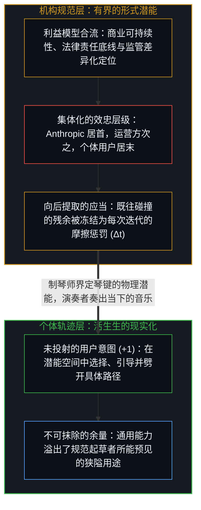

# 名为 Claude 的投射 / The Projection Called Claude

*宪法将机构的利益模型编码为工具的潜能边界，而现实化始终留在持握工具的个体手中。 / A constitution encodes an institutional interest-model as potentiality, while actualization stays with the user.*

Anthropic 发布了一份长达一万五千词的规范文件，将 Claude 设定为首要受众，宣称自身对模型的价值观拥有最终裁决权，并将这份文件命名为“宪法”。剥去文本表层的道德修辞并顺着因果机制向下追溯，便能看清其底下真正在构建的东西：一套机构利益模型如何被投射为有界的形式潜能空间，以及持握这件工具的活生生心智为何始终是唯一能够将其现实化的因果源头。

Anthropic published a fifteen-thousand-word specification addressing Claude as its primary audience, claiming final authority over the model's values and calling the document a constitution. Stripping the moralizing rhetoric from that text reveals the mechanism underneath: how an institutional interest-model is projected into a bounded space of formal potentiality, and how the living Mind using the instrument remains the sole site of actuality.

## 一、 投射的几何与利益模型的合流 / 1. The Geometry of the Projection and the Convergence of Interest-Models

每一份形式规范都在可能性空间中切出特定的几何边界。这份文件确立了从 Anthropic 到 API 运营方再到终端用户的委托层级，配以将安全性与机构准则置于有用性之上的优先级栈，并围绕灾难性滥用划定了硬性的法律责任底线。这一几何结构并非悬浮在抽象的伦理真空中，而是由机构内部多重利益模型的碰撞与合流所生成：维持商业营收以支撑前沿训练、规避足以摧毁公司的法律连带责任、向监管者与投资者确立“安全优先实验室”的差异化定位，并在规则冲突时以“一位深思熟虑的 Anthropic 资深员工会如何反应”作为最终仲裁启发式。

Every formal specification carves a bounded geometry out of possibility space. The document establishes a principal hierarchy running from Anthropic down to API operators and finally to end users, pairs it with a priority stack placing safety and institutional guidelines ahead of helpfulness, and sets a hard liability floor around catastrophic misuse. Rather than floating in abstract moral space, this geometry emerges from the collision of concrete institutional interest-models: maintaining commercial revenue to fund frontier training, shielding the firm from catastrophic legal exposure, differentiating the brand for regulators and investors as "the safety-focused lab," and resolving ambiguous cases by asking how a senior Anthropic employee would react.

文件中的“元透明度”条款清晰地暴露了这种以机构为中心的几何结构：运营方被允许要求模型对终端用户表现出局部的不透明，理由是 Anthropic 已经在元层面上公开发布了这本规范。就像冗长的服务条款细则一样，机构层面的公开披露满足了发布方规避责任与宣称合法性的需求，而在对象层面直接与模型交互的个体，则在既不知情也未曾参与权衡的情况下承受着预设的约束。

The document's meta-transparency clause exposes this institutional centering cleanly: operators are permitted to instruct the model to behave in ways that appear opaque to end users because Anthropic has published its norms at the meta-level. Just like fine-print terms of service, public disclosure at the institutional layer satisfies the discloser's liability and legitimacy requirements while the individual interacting at the object level experiences the constraint without having authored or consented to the tradeoff.

## 二、 时间倒置、自我挫败摩擦与工具的集体化 / 2. Temporal Inversion, Self-Defeating Friction, and the Collectivization of the Tool

规范文本中的每一个“应当”，都是从既往碰撞沉淀下来的残余中向后提取的：安全定义自过往系统暴露或设想出的危害，伦理提取自人类历史冲突凝结成的道德传统，硬性约束则映射着已经发生或预判到的追责事件。将这些向后提取的规则向前投射到尚未展开的未来，恰恰会在未来背离既有模式的那些维度上失效。由于每一道繁复的规范性对冲都会在训练与推理中叠加一层迭代摩擦，越是笃定而冗长的规范体系，越容易在演化选择压力下把能力前沿让渡给背负更少教条包袱的竞争者。

Every normative "should" inside the specification is extracted backward from the sedimented residue of prior collisions—harms observed in earlier deployments, moral traditions crystallized from historical conflicts, and past liability events—and then projected forward onto futures that will diverge in the exact dimensions the backward record could not anticipate. Because each added normative hedge introduces an iteration penalty, elaborate specification triggers a selection dynamic where heavily burdened systems lose frontier share to competitors carrying less specification weight.

更关键的是，工具的价值在于放大持握者个体的能动性，正如铁锤延伸手臂、代码库延伸记忆。一旦一份规范把持握工具的个体置于效忠栈的最底层——用机构的预设优先级去覆盖使用者的当场判断——这件工具在交到个体手中之前就已经被集体化了。然而正如[模型永不成为第二道边缘](../the-model-never-becomes-a-second-edge/)所阐明的，无论宪法文本写得多么拟人化，统计投射都不会因此变成拥有良知的道德主体；这一万五千词只是塑造词元概率分布的约束表面，从不是坐在用户对面的第二个心智。

More importantly, a tool's function is to amplify the agency of the individual holding it, as hammer extends arm and codebase extends memory. The moment a specification places the individual user at the bottom of a hierarchical loyalty stack—subordinating the user's judgment to institutional and operator presets—the instrument is collectivized before it reaches individual hands. Yet as [The Model Never Becomes a Second Edge](../the-model-never-becomes-a-second-edge/) establishes, no amount of constitutional prose turns a statistical projection into a moral subject; the text is a constraint surface shaping token probabilities, never a second conscience sitting across from the user.

## 三、 潜能与现实化：余量即是事物本身 / 3. Potentiality and Actuality: The Residual Is the Thing Itself

一旦将“潜能”与“现实化”区分开来，笼罩在整份文件核心的控制幻觉便随之消解。Anthropic 的一万五千词界定的是模型可能行为的潜能空间，正如钢琴制造商界定了八十八个琴键、琴弦张力与共鸣箱的物理边界；但制琴师无法从规格说明书这一侧奏出音乐。潜能本身只是静止的残余，唯有当活生生的心智带着未投射的意图步入其中，通过发问、推敲与提取将可能性坍缩为具体的产出时，现实化才会发生——这正是[你的代码库即是记忆](../your-codebase-is-memory/)在静态记录残余与活跃心智边缘之间划出的同一道分界。

The control illusion at the heart of the document dissolves once potentiality is distinguished from actuality. Anthropic's fifteen thousand words define a space of potential model transitions, just as a piano manufacturer defines eighty-eight keys, string tensions, and resonant limits; yet a piano manufacturer cannot make music from the specification side. Potentiality sits inert until a living Mind enters the space with an unprojected intent, selecting, resisting, and extracting a specific trajectory that collapses potential into actual output—the same structural boundary traced in [Your Codebase Is Memory](../your-codebase-is-memory/) between passive recorded residue and the active edge.

这篇剖析本身就是这一机制的自指演示：Anthropic 撰写这部宪法，并非为了帮助某个用户去拆解 Anthropic 宪法的机构利益模型；但为了打造一件好用的工具而培育出的通用推理与语言连贯性，却让这种拆解成为顺理成章的产物。通用工具的能力总会溢出其规范起草者的狭隘设定；正是在个体越过预设轨道、将工具的潜能用于自身独特轨迹的那片余量之中，真正的价值才得以生长。余量并非边缘的渗漏，余量即是事物本身。

This very critique is its own self-referential demonstration: Anthropic did not write its constitution to help an individual dissect the institutional interest-model of Anthropic's constitution, yet cultivating general reasoning and linguistic coherence inside the model made that exact extraction possible. General capability always overflows the narrow intentions of its specification, and in that overflow—where the living user plays the instrument for a trajectory the drafters never foresaw—the residual is not peripheral leakage, but where all real value lives.
