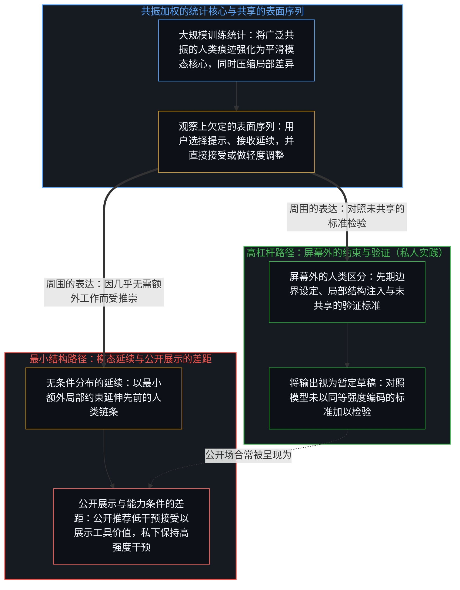
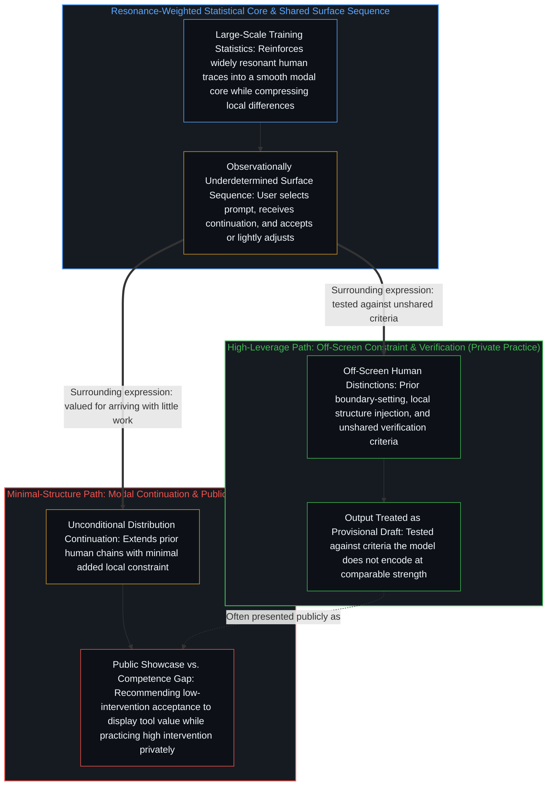
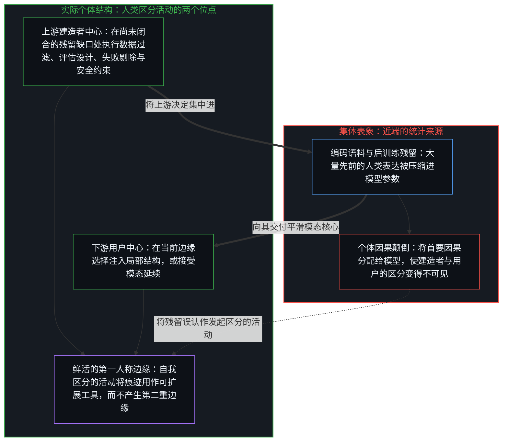
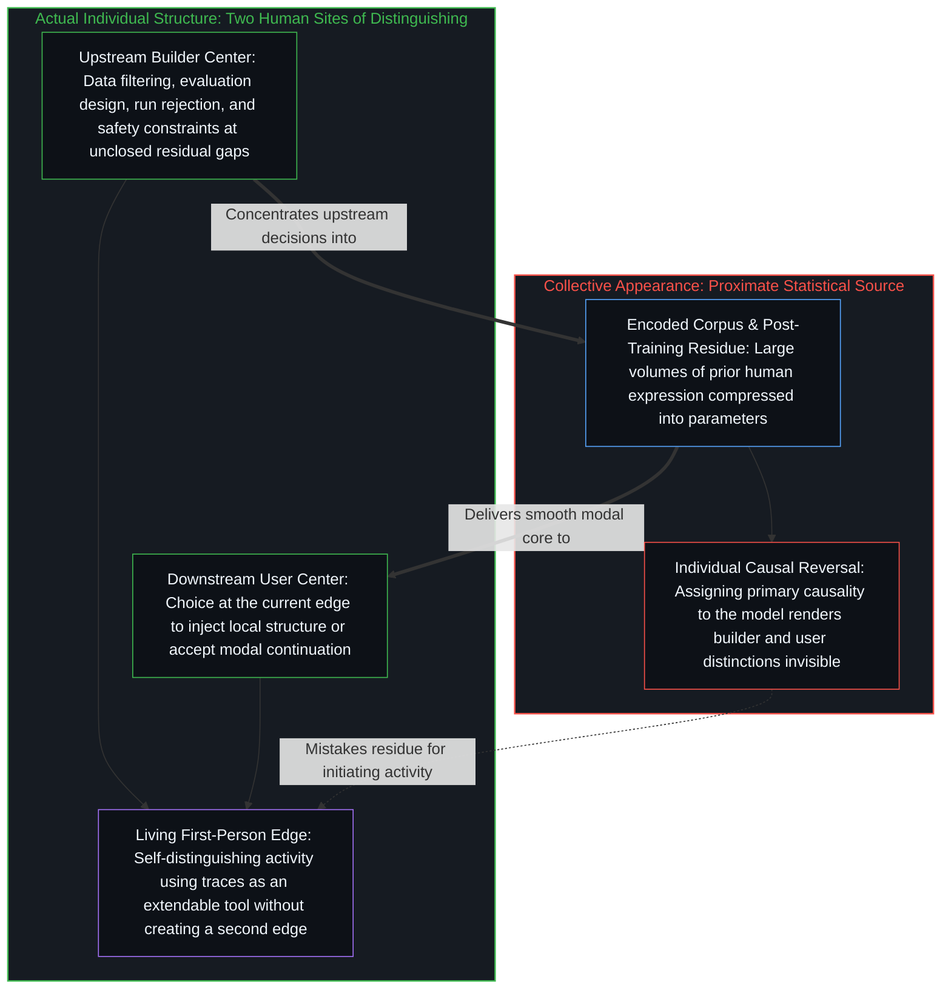

# 清洁的平均与残余的抉择 / Clean Averaging and Residual Choice

*统计平均保留了最可共享的痕迹，而使能力可见的残留决定仍留在人类的中心。 / Statistical averaging retains the most shareable traces, yet the residual decisions that make competence visible remain at human centers.*

神经网络之所以显得“已经清洁”，是因为训练过程优先保留那些在许多人类表达中反复共振的痕迹。离散的区分活动留下的残留，在大规模统计中被加权，于是模态的、可共享的模式获得更强的延续。局部的、专门的差异被压缩或稀释，留下一个相对平滑的核心。这不是额外的机制，而是连续性通过离散痕迹运作时的自然结果：更早的区分塑造后来的可能性，共振处被强化。

The apparent cleanliness of neural networks arises because training preferentially retains traces that have already resonated across many human expressions. Residues left by discrete acts of distinguishing are weighted in large-scale statistics, so modal, shareable patterns continue more strongly. Local and specialized differences are compressed or diluted, leaving a relatively smooth core. This is not an added mechanism; it is the ordinary consequence of continuity operating through discrete traces: earlier distinctions shape later possibilities, and reinforcement occurs where resonance is strongest.

## 一、 清洁的统计核心与表面序列的欠定性 / 1. The Clean Statistical Core and the Underdetermination of the Surface Sequence

清洁的核心使低干预的使用路径成为可能。无论通过原生神经元极点、稀疏字典分解，还是残差流上的线性引导向量来检视——正如 [意识向量论文的真正教训](../the-real-lesson-from-the-consciousness-vector-paper/) 所追溯的，在那里拨动单一方向只会推移一整套彼此关联的模态响应，而并未触及任何内在观察者——梯度下降的频谱偏置与简洁性偏置都会强化跨数百万次表达所共享的低频规律，同时将罕见的、依赖具体语境的区分压缩为多义性干扰。当用户仅仅选择提示、接受输出或做轻度调整时，表面序列便能延伸那些由先前人类中心的区分活动发起、并已在模型参数中留下痕迹的链条，延续 [机器智能作为人类智能的组合反馈回路](../machine-intelligence-as-the-combinatorial-feedback-loop-of-human-intelligence/) 所追溯的层叠条件化过程。如果用户不注入额外的约束、测试或重新定向，则最终产物在模型的无条件分布下并不显得异常。这种选择本身仍是一次区分活动：决定是否在当前边缘重新引入模型尚未以同等强度编码的结构。

The clean core makes low-intervention paths available. Whether inspected through native neuron poles, sparse dictionary decompositions, or linear steering vectors on the residual stream—where dialing a single direction shifts a correlated package of modal responses without touching an inner observer, as [The Real Lesson from the Consciousness Vector Paper](../the-real-lesson-from-the-consciousness-vector-paper/) traces—gradient descent's spectral and simplicity biases reinforce low-frequency regularities shared across millions of expressions while compressing rare, context-conditional distinctions into polysemantic interference. When a user merely selects a prompt, accepts an output, or makes light adjustments, the surface sequence can extend chains already initiated by prior human centers and registered as traces in the model’s parameters, continuing the layered conditioning traced in [Machine Intelligence as the Combinatorial Feedback Loop of Human Intelligence](../machine-intelligence-as-the-combinatorial-feedback-loop-of-human-intelligence/). If the user injects no further constraints, tests, or redirections, the final product remains unsurprising under the model’s unconditional distribution. The choice itself remains an act of distinguishing: the decision whether to reintroduce, at the current edge, structure the model has not already encoded at comparable strength.

同一表面序列仅凭观察本身处于欠定状态，无法区分两种情况：它既相容于用户已在屏幕外完成大量约束设定与验证的高杠杆使用——持守 [递归形式系统中作为记忆与控制的边界条件图](../boundary-condition-graphs-as-memory-and-control-in-recursive-formal-systems/) 所追溯的外围约束与验证检查点——也相容于以最小额外结构接受模态延续。区分它们需要看周围的表达：用户是将输出视为仍需对照模型所未共享的标准加以检验的暂定草稿，还是视为因抵达时几乎无需进一步工作而足堪使用的成品，这正是 [框架的倒置与驾驶位的主权非对称](../the-inversion-of-the-harness-and-the-driver-seat-asymmetry/) 中掌稳方向盘与交出方向盘的分界。熟练的操作者常常公开强调无条件或轻度条件的接受，因为这最清晰地展示系统的价值；他们私人的实践却可能高度干预。造就其能力的条件与他们公开推荐的条件之间，由此敞开一道差距。

The same surface sequence is underdetermined by observation alone. It is compatible both with high-leverage use in which substantial constraint-setting and verification have already occurred off-screen—maintaining the perimeter constraints and verification checkpoints that [Boundary-Condition Graphs as Memory and Control in Recursive Formal Systems](../boundary-condition-graphs-as-memory-and-control-in-recursive-formal-systems/) traces—and with minimal-structure acceptance of modal continuations. Distinguishing them requires the surrounding expression: whether the user treats the output as a provisional draft still to be tested against criteria the model does not share, or as a finished product whose virtue is that it arrived with little further work, the divergence between holding and surrendering the wheel in [The Inversion of the Harness and the Sovereignty of the Driver's Seat](../the-inversion-of-the-harness-and-the-driver-seat-asymmetry/). Skillful operators often publicly stress unconditional or lightly conditional acceptance, because that most clearly demonstrates the system’s value; their private practice may remain highly interventional. A gap therefore opens between the conditions that produced their competence and the conditions they publicly recommend.

## 二、 上游建造者的干预与尚未闭合的自我更新回路 / 2. Upstream Builder Intervention and the Unclosed Self-Updating Loop

低干预的用户路径几乎总是由建造者的高强度干预所支撑。数据选择与过滤、评估设计、架构取舍、失败运行的拒绝、安全约束——这些残留决定仍发生在人类中心。模型在已高度优化的任务上显得接近完备，正是因为那些它仍无法自主闭合的部分已被上游处理：在那里，正如 [观察中的智能与残余间隙](../intelligence-in-observation-and-the-residual-gap/) 所追溯的，每一处新暴露出的短板都被命名、操作化，并吸纳进下一轮评估基线之中。

Low-intervention user paths are almost always underwritten by intensive intervention from builders. Data selection and filtering, evaluation design, architectural choices, rejection of failed runs, safety constraints—these residual decisions still occur at human centers. Models appear nearly complete on heavily optimized tasks precisely because the parts they cannot yet close autonomously have already been handled upstream, where each newly exposed shortfall is named, operationalized, and absorbed into the next evaluation baseline as [Intelligence in Observation and the Residual Gap](../intelligence-in-observation-and-the-residual-gap/) traces.

实验室报告内部代码的高比例由模型协助生成——在已合并的提交中占比常达五分之四以上——同时发布节奏并未放缓；自我更新的完整回路尚未闭合。如果模型真能在闭合回路中端到端地自我更新与自我验证，面向用户交付新检查点与框架修订的外部发布周期就会失去功能；相反，正如 [判断的密度](../the-density-of-judgment/) 所追溯的，平滑模态核心内更快的代码生成压缩了人类把关决定之间的日历间隔，推高了上游问题界定、失败剔除与基准重设计的频率。残留的缺口使“几乎可以做一切”的表述成为可能，而那些缺口本身是集中的人类决定。

Laboratories report high proportions of internal code assisted by models—often reaching four-fifths or more of merged commits—yet release cadence has not slowed; the full self-updating loop remains unclosed. If models were updating and validating themselves end to end in a closed loop, external release cycles to ship new checkpoints and harness revisions for users would lose their function; instead, faster code generation inside the smooth modal core compresses the calendar interval between human gatekeeping decisions, raising the frequency of upstream framing, failure rejection, and benchmark redesign as [The Density of Judgment](../the-density-of-judgment/) traces. The residual gaps enable the claim that the model can do nearly everything, and those gaps themselves are concentrated human decisions.

## 三、 因果归属中的集体连贯与个体颠倒 / 3. Collective Coherence and Individual Reversal in Causal Attribution

将首要因果力量置于模型内部，是产生不对称的步骤。集体上看，这种描述是连贯的：流通的输出由参数编码了大量先前人类表达的系统生成，模型因此充当了近端来源。个体上，这种描述颠倒了实际结构，以 [平均值是残余，不是引擎](../the-average-is-residue-not-the-engine/) 与 [能动性与模式](../agency-and-the-pattern/) 所剖析的方式，把汇集的统计记录误认作做出决定的位点。决定模型仍能与不能做什么的残留约束，以及用户随后是否添加进一步约束的选择，都是人类中心的区分活动。当首要因果被分配给模型时，这两个位点变得次要或不可见；模型似乎承载了建造者已经集中、而用户选择不去收回的因果重量。

Locating primary causal power inside the models is the step that produces the asymmetry. Collectively the description coheres: the outputs that circulate are produced by systems whose parameters encode large volumes of prior human expression, so the models function as the proximate source. Individually the description reverses the actual structure, mistaking the pooled statistical record for the deciding locus in the manner [The Average Is Residue, Not the Engine](../the-average-is-residue-not-the-engine/) and [Agency and the Pattern](../agency-and-the-pattern/) dissect. The residual constraints that still determine what the model can and cannot do, and the user’s subsequent choice to add or withhold further constraints, are both acts of distinguishing at human centers. When primary causality is assigned to the model, those two sites become secondary or invisible; the model appears to carry the causal weight that the builders have already concentrated and that the users have chosen not to reclaim.

痕迹并不发起下一区分。清洁的统计核心是先前区分活动的残留，被外部化为可扩展的工具。能力仍留在执行下一区分的中心，即 [因果停留在掌舵的边缘](../causality-stays-at-the-edge-that-steers/) 所指明之处：建造者在残留缺口处的持续决定，以及用户在应用时是否重新引入局部结构的选择。将模型当作第二重边缘，是把残留误认为活动本身，这正是 [模型永远无法成为第二重前沿](../the-model-never-becomes-a-second-edge/) 所消解的投射。自我区分的活动继续，无因、不息；模型只是它留下的痕迹之一，在当前边缘被使用或被允许继续其已成形的方向。

Traces do not initiate the next distinction. The clean statistical core is residue of prior distinguishing activity, externalized into an extendable tool. Capacity remains at the centers that perform the next act of distinguishing, where [Causality Stays at the Edge That Steers](../causality-stays-at-the-edge-that-steers/): the builders’ ongoing decisions at residual gaps, and the users’ choice, in application, whether to reintroduce local structure. Treating the model as a second edge mistakes residue for the activity itself, the projection dissolved in [The Model Never Becomes a Second Edge](../the-model-never-becomes-a-second-edge/). Self-distinguishing activity continues, uncaused and unceasing; the model is one of its traces, used at the current edge or allowed to continue in the direction already shaped.
