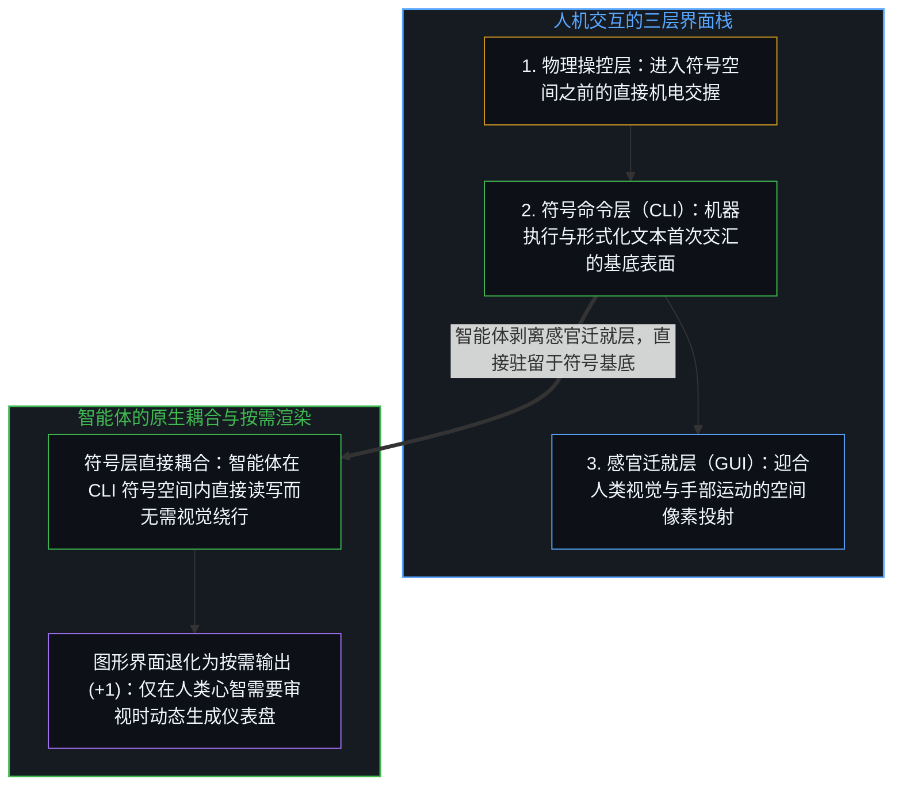
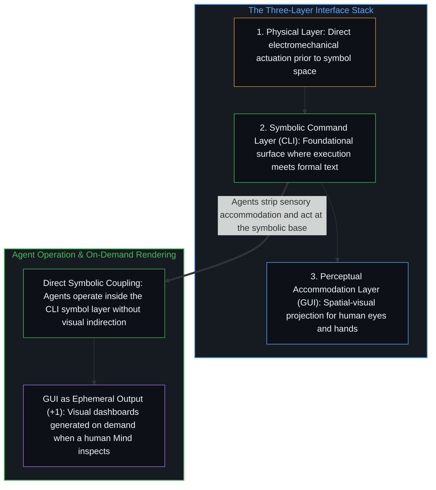

# 界面栈与命令行基底 / The Interface Stack

*命令行并非偶然幸存的遗产技术，而是人机交互首次进入符号空间的基底接口层。 / The CLI is not an accidental legacy survivor, but the foundational layer where interaction enters symbol space.*

安德烈·卡帕西指出，命令行界面之所以在智能体时代令人振奋，恰恰在于它是一项“遗产”技术，因而智能体可以借由整套终端工具链原生地调用、组合并与之交互。倡导开发者通过命令行与可组合工具暴露软件能力，在工程实践上切中肯綮；但将命令行的契合归因于历史“遗产”，却把界面栈的因果依赖关系颠倒了过来。

Andrej Karpathy observes that command-line interfaces are exciting for the era of artificial intelligence agents because they are a "legacy" technology that agents can natively combine and operate across the terminal toolkit. While the practical advice to expose software through command-line interfaces and composable tools is sound, attributing their fit to historical legacy inverts the dependency stack it describes.

## 一、 三层界面栈与“遗产”一词的遮蔽 / 1. The Three-Layer Interface Stack and What "Legacy" Obscures

人机交互建立在三层界面栈之上，每一上层都是由紧邻的下层投射生成的。最底层是物理操控层——拨动开关、继电器、穿孔卡片与直接的机电动作，其间没有任何符号中介；中间层是符号命令层，即命令行界面，交互在此首次将连续的硬件状态折叠为离散的形式化文本，此后的一切运算皆是符号对符号的操作；悬浮在最上层的是图形用户界面，它将底层的符号指令重新投射为空间隐喻、像素排布与鼠标点击目标，以迎合人类的视觉与运动习惯。

Human-machine interaction rests on a three-layer stack in which each upper layer is a projection generated from the one beneath it. At the base sits physical manipulation—switches, relays, punch cards, and direct electromechanical actuation without symbolic mediation. Above that sits the symbolic command layer—the command-line interface—where interaction first collapses continuous hardware states into discrete formal text and everything thereafter is symbol operating on symbol. Floating above the command line sits the graphical user interface, which re-projects symbolic operations into spatial metaphors, pixel layouts, and mouse targets tailored to human visual-motor habits.

把命令行称为“遗产”，是将结构上的层级关系压扁成了时间上的先后顺序，仿佛计算技术只是单纯地从命令行进化到图形窗口，而今天的智能体又怀旧地退回了过去。命令行并非靠历史侥幸才留存至今；它之所以长存，是因为它正处在机器执行与形式语言首次共享同一表面的基底位置，而图形界面只是架设在其上方的一层可选感官迁就——正如[我们遗忘的脚手架](../the-scaffolding-we-forget/)、[AI 不会终结软件工程，而是将其扩展](../ai-wont-kill-software-engineering/)与[万物一如既往地流变](../everything-is-changing-as-always/)所剖析的那样，上层投射的普及掩盖了底层支点的结构必然性。

Calling the command-line interface "legacy" collapses a structural hierarchy into a chronological timeline, as though computing simply marched from command lines to graphical windows and agents are now nostalgically reaching back into the past. The command line did not survive by historical luck; it persisted because it is the foundational layer where machine execution and formal language share a single surface, whereas the graphical layer is an optional sensory accommodation built on top of it, a forgotten projection of the kind traced in [The Scaffolding We Forget](../the-scaffolding-we-forget/), [AI Won't Kill Software Engineering, It Will Expand It](../ai-wont-kill-software-engineering/), and [Everything Is Changing, as Always](../everything-is-changing-as-always/).

## 二、 图形界面作为感官迁就与物理基底的断层 / 2. The GUI as Sensory Accommodation and the Physical Layer Below

图形桌面之所以把创建文件、移动目录与启动进程等符号操作重新编码为文件夹图标、拖拽手势与双击按钮，是因为人类的感官系统在三维空间隐喻中导航远比直接解析形式语法更为流畅。而语言模型智能体原本就栖居在符号空间之中，其上下文窗口、工具调用与外部代码库皆是以文本操作文本，正如[你的代码库即是记忆](../your-codebase-is-memory/)所定位的那样。智能体并不存在对命令行的主观“偏好”；它们只是无需绕道那层本就不是为它们设计的视觉迁就层，并在人类观察者需要审视结果时，将图形仪表盘作为下游的渲染产物按需生成出来。

A graphical desktop takes symbolic file and process operations and wraps them in folders, drag-and-drop gestures, and buttons because human perception navigates space more fluently than raw syntax. Language-model agents already live inside symbol space, where their context windows, tool calls, and externalized repositories operate as text on text, as [Your Codebase Is Memory](../your-codebase-is-memory/) traces. Agents do not "prefer" command-line interfaces out of taste; they simply bypass a visual accommodation layer that was never built for them, and generate visual dashboards on demand as a downstream rendering pass whenever a human observer asks to inspect the state.

顺着命令行向下看，同样能看清为何具身机器人比纯软件自动化困难得多。命令行与图形界面之间的跨步依然留在符号空间内部，只是把文本指令转译为文本指令的视觉呈现；而从物理硬件到命令行的跨步，则横跨了从连续的前语言物质世界到离散符号词元的断层。在尚未建立稳固符号底座的物理界面上，单靠堆叠上层文本包装无法凭空跨过这道鸿沟。

Looking downward from the command line also clarifies why robotics remains structurally harder than software automation. The step between a command line and a graphical window stays inside symbol space, translating text commands into visual representations of text commands; the step between physical hardware and the command line crosses the boundary from continuous, pre-linguistic matter into discrete symbolic tokens. Where no clean symbolic floor exists, adding more textual wrappers cannot bridge the gap on its own.

## 三、 传播广度与清晰度的权衡及倒置的消解 / 3. The Reach-Clarity Tradeoff and Dissolving the Inversion

为何一位敏锐捕捉到终端原生工作流趋势的实践者，仍会借用“遗产”一词来解释它？因为面向大众的广泛传播要求将结构性的洞察压缩进受众已有的认知坐标。“遗产”能瞬间落在大众熟悉的时间线上，而“基底符号接口层”则需要从头拆解界面栈的投射关系；然而一旦这种妥协性的压缩标签流行开来，它所附带的编年史错觉又会反过来框定整个行业的后续讨论。

Why does a practitioner who senses the shift toward terminal-native workflows still frame it through the word "legacy"? Because broadcasting to a wide audience requires compressing a structural observation into coordinates the audience already holds. "Legacy" lands immediately on a familiar timeline, whereas "foundational symbolic interface layer" requires tracing the stack from first principles; yet once the compressed label circulates, its chronological distortion feeds back into how the field frames the problem.

把写作当成廓清自身思考的外部化工具，而非博取传播广度的扩音器，便能卸下这种为了迎合既有坐标而做的维度压缩。命令行对智能体有用，不是因为它古老；它之所以古老，是因为作为人机交互的符号基石，它必须在一切上层感官迁就之前被率先建造出来。智能体时代所改变的并不是界面栈的底层结构，而是哪些投射层还需要被渲染出来。

Treating writing as an externalized thinking instrument rather than a broadcast megaphone removes the need for that compression. Command-line interfaces are not useful to agents because they are old; they are old because they had to be built first as the symbolic bedrock on which every higher accommodation rests. What changes in the agentic era is not the architecture of the stack, but which layers need to be rendered at all.
