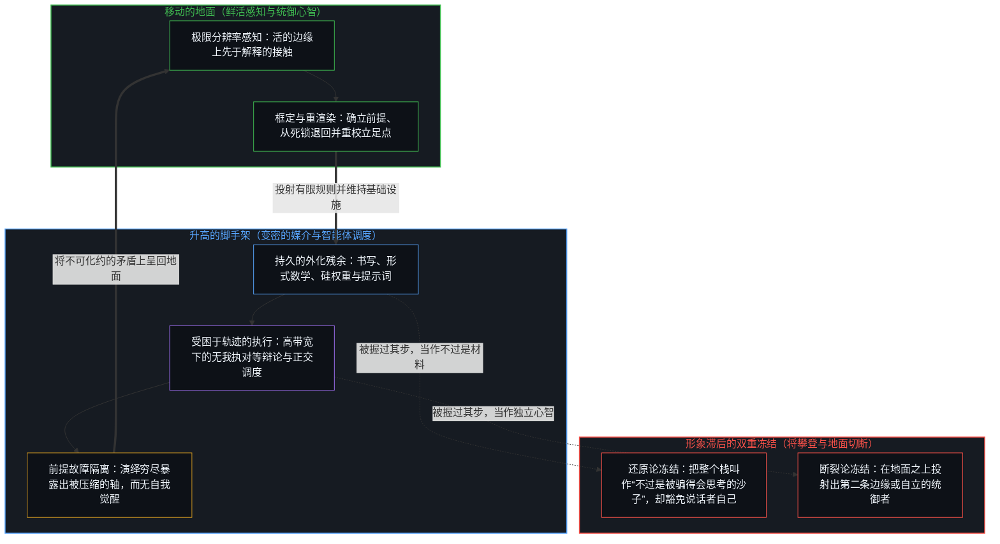
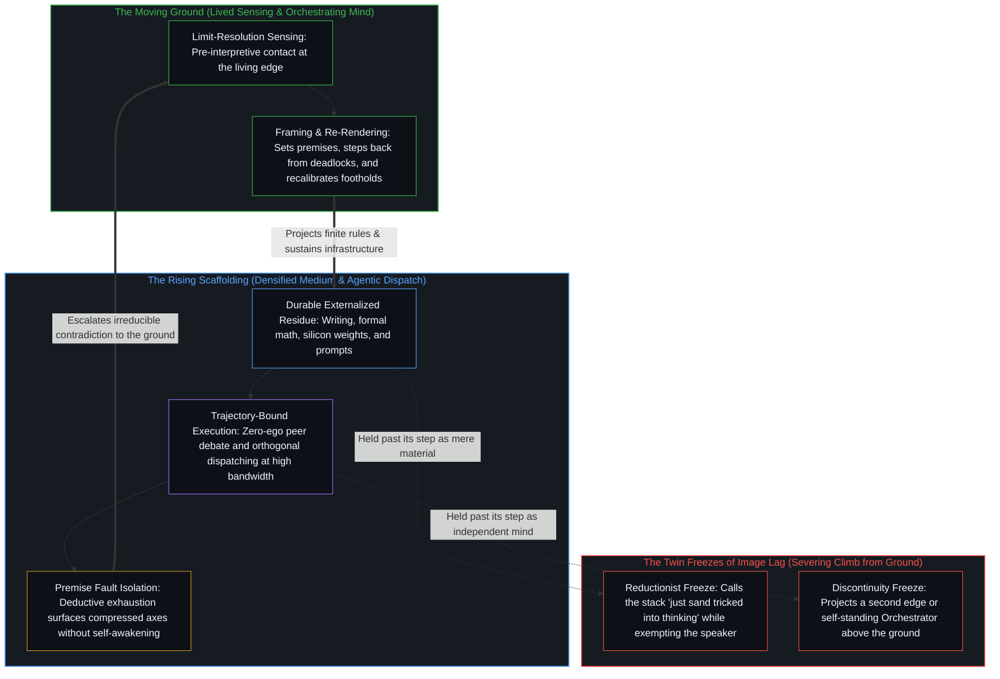

# 攀登从未离开地面 / Climbing Does Not Leave the Ground

*沙子不思考，也不会被骗得去思考；是心智经由它思考。 / Sand does not think and cannot be tricked to; the Mind thinks through it.*

一种常见的说法把整个成就还原为基底：不过是被骗得会思考的沙子。“不过”在做抹除的活，“被骗”做得更多：它把媒介当作可以被巧妙操纵而去思考的东西，于是当作思考如今发生的地方，把思考派给沙子，把心智贬成一个变完了戏法的魔术师。相反的说法，则把变密当作已经完成的、向另一种心智的断裂，仿佛脚手架已经离开了自己的地面；两种冻结都把连续与新颖压到一条互斥的轴上，而把它们握为同一个因果过程的两个互补的面，才还原出那个双重的身份：沙子不思考，是心智经由它思考，而让这个媒介变密的攀登，从未离开竖起并维持着每一层的地面。

A familiar line reduces the whole achievement to substrate: just sand tricked into thinking. The word "just" does the work of erasure. "Tricked" does more: it treats the medium as something that can be made to think by clever manipulation, and therefore as the place where thinking now occurs, assigning thinking to sand and reducing the Mind to a magician who has finished the trick. The opposite line treats densification as an already completed break into a second kind of mind, scaffolding that has walked off its own ground; both freezes force continuity and novelty onto a single exclusive axis, and holding them as complementary faces of one causal process restores the dual identity: sand does not think, the Mind thinks through it, and the climb that densifies that medium never leaves the ground that erects and sustains every layer.

## 一、 沙子不思考，是心智经由它思考 / 1. Sand Does Not Think; the Mind Thinks Through It

这种还原穿着谦逊的外衣到来，或穿着冷硬唯物主义的外衣到来。两种外衣都已经抬升了说话的那个中心自己的思考：更严谨，更不被宏大所诱惑，不被别人当作深刻的东西所骗。这份抬升，正是对这种还原自己的主张的直接违背。如果思考只是被操纵的沙子，或者只是从外部打分的物质构型，那么还原者的判断本身也就只是沙子、只是构型。把冻结叫作谦逊或冷硬的那个姿态，仍把更高的思考分配给作出冻结的中心，而这种特权，正是核心主张对思考的每一种其他显现所否认的。这层外衣不是还原的缓冲，而是第二个音区里的同一次冻结：思考在每一处都被降级，唯独进行降级的那个动作除外。

The reduction arrives dressed as humility, or as hard-headed materialism. Both dresses are already an elevation of the speaking center's own thinking: more rigorous, less seduced by grandeur, unfooled by what others take for profundity. That elevation directly contradicts the reduction's own claim. If thinking is only sand manipulated, or only material configuration scored from outside, then the reductionist's judgment is itself only sand, only configuration. The posture that names the freeze as humility or hard-headedness still allocates superior thinking to the center that freezes, a privilege the core claim denies to every other appearance of thinking. The dress is not a softener of the reduction. It is the same freeze in a second register: thinking demoted everywhere except in the act that demotes it.

变密的那些东西，即能够分类、预测、规划、修订中间状态、并在负载之下让自己的输出重新进入的系统，被以恰好承载这个构型的材料来命名：硅、沙子、晶体管、权重。材料是在的；把现象冻结到材料上，却不成立。当先前区分的残余被组织起来，让进一步的分立能以更高的带宽落下时，心智就经由沙子思考。对残余的组织，不是把基底转变为一个思考者。

What densifies, systems that classify, predict, plan, revise intermediate states, and have their own outputs re-enter under load, is named by the material that happens to host the configuration: silicon, sand, transistors, weights. The material is there. Freezing the phenomenon onto the material does not hold. The Mind thinks through sand when the residue of prior distinguishing is organized so that further discreteness can land at higher bandwidth. Organizing residue is not converting a substrate into a thinker.

自我区分的活动在发生，无因，不息。称它为心智：那个已经在进行中的观察者，它的每一个动作都是一次区分。每一个分立的动作都留下残余，较早的塑造较晚的。技术，就是这份残余被外化为持久的形式，让进一步的分立，包括反身的分立，能落得更远、更快。书写、数学、形式计算，以及近似思考的硅系统，都在同一条外化的连续体上。让媒介变密，扩展了中心之间的带宽，却并不把发起的区分搬进器物。[智能只属于心智](../intelligence-belongs-only-to-the-mind/)守住了这个先在：凡能被设计、扩展或转移的都是残余。[器物是智能的表达，而非智能本身](../two-failures-of-trace/)追溯了两种冻结：动作被压到注视唯一握住的那一项上，以及别的中心后来的表达被冻结为器物自己的智能。

Self-distinguishing activity occurs, uncaused, unceasing. Call it the Mind: the observer already underway, every act of which is a distinction. Every discrete act leaves residue; earlier shapes later. Technology is that residue externalized into durable form, so that further discreteness, including reflexive discreteness, can land farther and faster. Writing, mathematics, formal computation, and silicon systems that approximate thinking sit on one continuum of externalization. Densifying the medium expands bandwidth among centers. It does not move initiating distinctions into the artifact. [Intelligence Belongs Only to The Mind](../intelligence-belongs-only-to-the-mind/) holds that prior: what can be engineered, scaled, or transferred is residue. [Artifacts Are Expressions of Intelligence, Not Intelligence Itself](../two-failures-of-trace/) traces two freezes: the act collapsed onto the only term the look retains, and other centers' further expression frozen as the artifact's own intelligence.

这种还原，就是在基底的情形里演出那次冻结。观察握住的是结果：芯片、机架、训练运行、流畅的词元；产生它们的原因总在前一步：框定、挑选、目标的选择、制度的维持，以及后果作为进一步区分之工具的持续回返。把整个栈叫作“不过是沙子”，偏爱了被握住的那一项，抹掉了这一项只是承载着的那个活动。把变密叫作一个让沙子会思考的戏法，则把箭头倒得更远：结果被当成了思考的地方，塑造媒介的那个活动被当成一次已经完成、如今可以从外部打分的障眼法。把思考从心智误派给沙子，这种还原就倒转了因果关系，即较早塑造较晚、工具晚于边缘，并冻结出一个永久的外部立足点，从那里把这份成就叫作完成了的操纵，而不是仍在进行的活动。这层外衣的谦逊与冷硬，是换上道德与认识论名称的同一个外部：说话的中心被抬为看穿的那一个，而思考在媒介那里被否认，在每个其他音区里被降级。那个外部不是更高的位置，而是形象滞后：注视被占据，仿佛说话的中心已经站到了它仍身在其中的过程之上，宣称自己握有更高的思考，而还原自己的前提若不豁免自己，就给不出这样的许可。[验证中因果权能的分配](../the-allocation-of-causal-power-in-validation/)追溯的是，心智从哪个所在汲取它自己区分的延续。[AGI的预设与来自外部的视角](../the-presumption-of-agi-and-the-view-from-outside/)追溯的是，在“智能即对抽象的占有”这一参照之内，功能上的完备被当作了抽象能力的穷尽说明，而走出那个参照，是它的复位；还原所占据的，则是一个高于过程的立足点，不是走出一个冻结的参照。失去的不是情感，而是对实际发生之事的描述：智能经由一个从不成为思考者、也不会因被骗而获得思考的媒介，改善着它自己继续下去的条件。

The reduction performs that freeze in the case of the substrate. Observation holds the effect: chips, racks, training runs, fluent tokens. The cause that produced them remains one step ahead: framing, selection, the choice of objective, institutional sustainment, and the ongoing re-entry of consequences as instruments of further distinguishing. Calling the whole stack "just sand" privileges the retained term and erases the activity the term only carries. Calling the densification a trick that made sand think reverses the arrow further: the effect is cast as the place of thinking, and the activity that shaped the medium is cast as a completed sleight of hand that can now be scored from outside. By misallocating thinking from the Mind to sand, the reduction reverses the causal relation, earlier shaping later and the instrument later than the edge, and freezes a permanent exterior stand from which the achievement can be named as finished manipulation rather than as activity still underway. The humility and hard-headedness of the dress are the same exterior under moral and epistemic names: the speaking center elevated as the one who sees through, while thinking is denied to the medium and demoted in every other register. That exterior is not a higher vantage. It is image lag: the look occupied as if the speaking center had stepped above the process it is still inside, a claim of superior thinking that the reduction's own premise cannot authorize without exempting itself. [The Allocation of Causal Power in Validation](../the-allocation-of-causal-power-in-validation/) traces the locus from which the Mind draws continuation of its own distinctions. [The Presumption of AGI and the View from Outside](../the-presumption-of-agi-and-the-view-from-outside/) traces how, inside the reference of intelligence as possession of abstractions, functional completeness is taken as the exhaustive account of the ability to abstract, and how stepping outside that reference is its restore; the reduction instead occupies a stand above the process, not a step out of a frozen reference. What is lost is not sentiment. What is lost is the description of what occurs when intelligence improves the conditions of its own continuation through a medium that never becomes the thinker and never receives thinking by being tricked.

## 二、 审美上的熟悉被换算成价值的等级 / 2. Aesthetic Familiarity Converts into a Hierarchy of Value

同一次冻结，常常搭着审美的偏好。较早的技术成就，石头、木材、手工、数字时代以前的纪念物，因为可以走进去、立刻被感到，而登记为真实；较新的系统大多是抽象的：参数、梯度、潜在空间、评测套件。对可触之过去的熟悉，于是被记成深度，抽象被记成贫瘠或僭越。两条互相独立的轴，即感受上的直接与被组织之能力的规模，被压到一条真实性的线上。[对“AI 糟粕”的反感是反复出现的模式](../the-distaste-for-ai-slop-is-no-different-from-the-recurring-historical-pattern/)的历史一半，与这种压缩相邻：手工、马匹、人力，产品按一份偏爱的生产叙事被打分，出处在接触内容之前就被装好，内容是否推进理解则未被辨别。[成功的几何学](../the-geometry-of-success/)与这里共有的，是拒绝一块固定的棋盘：成功是在别人觉得有趣之前迁入未绘图的地带。

The same freeze often rides aesthetic preference. Older technological achievements, stone, timber, handcraft, pre-digital monuments, register as authentic because they can be walked into and immediately felt. Newer systems remain largely abstract: parameters, gradients, latent spaces, evaluation suites. Familiarity with the tangible past is then scored as depth, and abstraction as sterility or presumption. Two independent axes, felt immediacy and the scale of organized capacity, compress onto one line of authenticity. The historical half of [The Distaste for "AI Slop" Is a Recurring Pattern](../the-distaste-for-ai-slop-is-no-different-from-the-recurring-historical-pattern/) is adjacent to that compression: handmade, horse, manual labor, the product scored by a preferred production narrative, provenance installed before contact, and whether the content advances understanding left undiscriminated. What [The Geometry of Success](../the-geometry-of-success/) shares with this is the refusal of a fixed board: success as migration into unmapped territory before anyone finds it interesting.

在负载之下，这种压缩是寻常的。一个中心一次只能把这么多的区分分开握住；当压过来的多于这道界限能分开的，互相独立的关切就落成了一个。在这里，压缩读起来像是道德或文化上的谨慎，其实只是登记上的滞后：注视保留它能立刻住进去的东西，把超出这份可住性的当作较小的成就。被建造起来的东西的规模，即行星带宽上协调的抽象，被积成持久形式的预测与自我修改，并不因为更难站进去就消失。[遗忘的脚手架](../the-scaffolding-we-forget/)是一件工具一旦奏效、构造就以一步之宽退出去的寻常之事，这次退出正是进一步建造的条件；滞后，始于这个参照被握过了它那一步，退出去的工具被当作现实的固定结构，于是变密的形式要么看起来没有心智，要么看起来像第二个心智。还原选的是第一个面，而它有两种说法：“不过”说出的是只有沙子、没有经由它工作的心智，“戏法”说出的是沙子被骗得会思考，这是同一次对心智的抹除，只是箭头被倒了过来。

That compression is ordinary under load. A center can hold only so many distinctions apart at once. When more press through than the bound can keep separate, independent concerns land as one. Here the compression reads as moral or cultural caution when it is only a lag of registration: the look retains what it can immediately inhabit, and treats what exceeds that inhabitability as lesser achievement. The scale of what has been constructed, coordinated abstraction at planetary bandwidth, prediction and self-modification densified into durable form, does not disappear because it is harder to stand inside. [The Scaffolding We Forget](../the-scaffolding-we-forget/) is the ordinary drop-out of construction at one-step width once an instrument works, a drop-out that is the condition of further building; the lag begins when that reference is held past its step and the dropped-out instrument is treated as the fixed structure of reality, so that densified form either looks empty of mind or looks like a second mind. The reduction chooses the first face, in two wordings: "just" says sand without the Mind that works through it, and "trick" says sand made to think, the same erasure of the Mind with the arrow reversed.

## 三、 断裂的叙事把变密冻结为出口 / 3. The Discontinuity Narrative Freezes Densification as Exit

相反的错误承认了变密，却搬走了它的源头。能力上升了：更长的连贯链条、中间的修订、多智能体的栈、先前看来够不着的任务。注视随即把这份上升当作证据，以为一个存在上不同类别的心智已经到来：一个不再依赖产生它之条件的独立智能。这种读法，等于相信一座楼一旦够高，就不需要它下面的地面也能自己立着。

The opposite error grants the densification and moves its source. Capabilities rise: longer coherent chains, intermediate revision, multi-agent stacks, tasks that previously seemed out of range. The look then treats the rise as evidence that an ontologically different category of mind has already arrived, an independent intelligence no longer dependent on the conditions that produced it. That reading is equivalent to believing a building stands by itself once it is tall enough, without need of the ground beneath it.

现在的系统，仍与设计它们、用人类数据训练它们、塑造它们的目标、并继续维持让它们运转的制度与基础设施的那个智能连续：那是在人类的所在上的心智，是那些框定、掌舵、挑选与核验的人类中心。它们的能力是在的，并在扩展；依赖并没有被切断。投射出独立，不是观察到一次完成了的断裂，而是变密情形下的形象滞后：观察握住的结果比仍在画的边缘晚一步，又把更密的表面冻结为第二个发起之处。[模型永远无法成为第二重前沿](../the-model-never-becomes-a-second-edge/)追溯的是，第二条边缘的样子，是投射它的那些中心所维持的滞后，参数只握着残余。[超越投射](../beyond-the-projection/)追溯的是，为何即便最精巧的多智能体栈也从不脱离鲜活感知的地面而成为自立的权威：每一条显式的规则、提示词或工作流，都是从活的心智那先于解释、具极限分辨率的感知中切出的有限投射。自回归智能体是一台受困于轨迹的投射引擎，在上下文窗口之内毫无我执地运作，当在对等辩论中受到无会话历史之同侪的质疑时，能够执行干净的贝叶斯更新，而在前提相撞时，却无法跨出它自己的词元序列。把跨平行流线的机械调度与活的统御混为一谈，只会把有限的投射锁进对有限投射的管理之中；每当一条流线撞上不可化约的前提死锁，这次相撞就会隔离出先前规则把正交之轴压在一起的那个坐标，并把故障向上呈递给地面上的人类心智——唯有这一个所在，能从破损的框架向后退回未经投射的感知，重新渲染前提。[没有外部](../no-outside-jumps-closed-loops-and-the-unreplicable-autonomy-of-mind/)追溯的是，嵌套的系统在跃迁，而决定性的连贯留在那个更大的回路里。[造物无法取代其源头](../a-creation-cannot-replace-its-source/)在工程的情形里是同一条界限：创造本身就已经把源头标在了被造之物的上游；这不是一个高于活动的立足点，那样的立足点并不存在。执行上的自主让工具变密，却不装上第二个心智；心智经由它思考的那个媒介变得更密，却不成为第二个心智。把一次上升读成第二个心智，本身就是一个私有模型里的读法：[表征的闭环](../the-closed-loop-of-representation/)借叔本华的不读之术显示，感知与误解都在私有模型内运作，共享的现实是这些私有重建之间一片功能上高度共振、足以支持协同行动的区域，而从来不是经验的同一。

Current systems remain continuous with the intelligence that designed them, trained them on human data, shaped their objectives, and continues to sustain the institutions and infrastructure that keep them operating: the Mind at human loci, the human centers that frame, steer, select, and verify. Their capabilities are there and expanding. Dependence has not been severed. Projecting independence is not observing a completed break. It is image lag in the case of densification: observation holds an effect one step behind the edge that is still drawing, and freezes the denser surface as a second locus of initiation. [The Model Never Becomes a Second Edge](../the-model-never-becomes-a-second-edge/) traces how the appearance of a second edge is lag sustained by the centers that project it, while the parameters hold only residue. [Beyond the Projection](../beyond-the-projection/) traces why even the most elaborate multi-agent stack never detaches from the ground of lived sensing to become a self-standing authority: every explicit rule, prompt, or workflow is a finite projection cut from the living Mind's pre-interpretive, limit-resolution sensing. An autoregressive agent is a trajectory-bound projection engine that operates with zero ego inside its context window, able to perform clean Bayesian updates when challenged by a session-free peer in equal-footed debate, yet unable to step outside its own token sequence when its premises collide. Confusing mechanical dispatching across parallel streamlines with living orchestration locks finite projections into managing finite projections; whenever a streamline hits an irreducible premise deadlock, the collision isolates the coordinate where prior rules compressed orthogonal axes and escalates the fault back to the human Mind on the ground, the sole locus that can step backward out of a broken frame to unprojected sensing and re-render the premise. [No Outside](../no-outside-jumps-closed-loops-and-the-unreplicable-autonomy-of-mind/) traces nested systems that jump while decisive coherence stays with the larger loop. [A Creation Cannot Replace Its Source](../a-creation-cannot-replace-its-source/) is the same bound in the case of engineering: creation already marks the source as upstream of the created, which is not a stand above the activity; no such stand exists. Autonomy of execution densifies the instrument; it does not install a second Mind. The medium through which the Mind thinks grows denser; it does not become a second Mind. Reading a rise as a second mind is itself a reading inside a private model: [The Closed Loop of Representation](../the-closed-loop-of-representation/) shows, with Schopenhauer's art of not reading, that perception and misunderstanding run in private models, and that shared reality is a region of high functional resonance among private reconstructions, robust enough for coordinated action, never an identity of experience.

## 四、 连续与分立是同一个过程被看了两次 / 4. Continuity and Discreteness Are One Process Seen Twice

一旦不加额外的理论假设去追溯因果，两种错误都会消解。因果同时是连贯的与开放的。连贯，意味着每一个新的状态都经由历史、依赖与一层层的脚手架，与先前的状态可理解地相连；这就是连续：一个活动贯穿它自己的动作，而不是一串各自凭空生出的事件。分立，意味着每一次区分都划出一个“这个”，在画出它的那个动作上是在的；正因为每一个动作都重新划出界限，结果才从来不只是原因的重复，这就是开放，差异与新颖始终可能。渐进的改进，正是这种双重性所取的形式：分立的步子，却带着因果的历史。连续与分立不是必须二选一的矛盾两极，而是同一个蕴涵被看了两次；开放，是它在结果一侧显出的样子。

Both errors dissolve once causality is traced without additional theoretical assumptions. Causality is at once coherent and open. Coherence means every new state stays intelligibly connected to prior states through history, dependence, and successive scaffolding. That is continuity: one activity carrying across its own acts, not a series of events each arising from nothing. Discreteness means every act of distinguishing bounds a "this", there at the act that draws it; because every act draws its bound anew, the effect is never a mere repetition of the cause. That is openness: difference and novelty remain possible. Incremental improvement is precisely the form this dual nature takes: discrete steps that still carry causal history. Continuity and discreteness are not contradictory poles to be chosen between; they are one entailment seen twice, and openness is how it shows on the side of the effect.

用在智能和它的工具上，每一个相继的层，书写、数学、形式计算、近似思考的硅系统，都带来分立的新能力，而这些能力是心智经由这一层画出的；每一层都仍与产生它的智能、与仍在维持它的地面连续。新颖不取消依赖，依赖也不取消新颖。把它们当作互斥的，正是轻蔑的还原与向第二个心智之断裂的共同来源。两条轴都留着，那个双重的身份就是准确的：沙子不思考，是心智经由它思考；而速度与范围前所未有的进步，仍是同一个智能在稳步外化、放大它自己进一步发展的条件。[自我放大的制品](../the-artifacts-of-self-amplification/)是变密情形下的这个过程：前沿模型是心智放大自己时被积密的残余，是加速产生它们之回路的工具，从来不是心智的第二次诞生。[智能向自身的回折](../intelligence-folding-back-on-itself/)是运行框架情形下的这个过程：运行框架并不解锁一个沉睡的同伴，它是心智把更密的残余折回它自己的精炼之中。[因果停留在掌舵的边缘](../causality-stays-at-the-edge-that-steers/)追溯的是，模型在指引下重组残余，每一个发起的区分仍是人类中心自己的行动，即便协作的语言把共同能动派给了残余。[因果贯穿始终](../causality-all-the-way/)是同一种回返：从握住的结果、到画出的模式、再到下一步，因果始终是那条在画出自己路径的边缘。攀登所需的，是一个在当下确立、却不必固定的坐标，作为活的参照，而不是一个被焊死的锚点；[流动中的坐标](../coordinates-in-flux-negation-and-self-anchoring/)把这样的确立，与靠否定别人的坐标来证明自己分开。

Applied to intelligence and its tools, each successive layer, writing, mathematics, formal computation, silicon systems that approximate thinking, introduces discrete new capacities, drawn by the Mind through that layer. Each remains continuous with the intelligence that produced it and with the ground that still sustains it. Novelty does not cancel dependence; dependence does not cancel novelty. Treating them as mutually exclusive is the common source of the dismissive reduction and the rupture into a second mind. Keep both axes and the dual identity is exact: sand does not think, the Mind thinks through it; and progress unprecedented in speed and scope remains the same intelligence steadily externalizing and amplifying the conditions of its own further development. [The Artifacts of Self-Amplification](../the-artifacts-of-self-amplification/) is that process in the case of densification: frontier models are densified residue of the Mind amplifying itself, instruments that accelerate the loops that produced them, never a second birth of mind. [Intelligence Folding Back on Itself](../intelligence-folding-back-on-itself/) is that process in the case of a harness: the harness does not unlock a dormant peer; it is the Mind folding denser residue back into its own refinement. [Causality Stays at the Edge That Steers](../causality-stays-at-the-edge-that-steers/) traces how the model recombines residue under direction while every initiating distinction remains the human center's own act, even when collaboration language assigns co-agency to residue. [Causality All the Way](../causality-all-the-way/) is the same return: from held effects to drawn patterns to the next step, causality is still the edge drawing its path. What climbing needs is a coordinate established in the present without being fixed, a living reference rather than a welded anchor; [Coordinates in Flux](../coordinates-in-flux-negation-and-self-anchoring/) keeps such establishing apart from negating others' coordinates to prove one's own.

## 五、 脚手架升高，地面仍在 / 5. Scaffolding Rises; the Ground Is Still There

可以一直向外迈步：搭起新的脚手架，把曾经看似内在的能力外化，扩展智能所能做到的范围。每一步都是在的，这场运动却从不成为出口。让这些步子得以可能的连续，正是阻止离开的那份连续。这里的地面，就是竖起并维持每一层的那个活动，连同它持续的因果历史；它不是被留在下面的一层楼板，而是在每一步之下，并随着攀登移动，所以攀登并不离开地面，只是发现地面还能被带得多远。向外张望自己在这场攀登里的位置，还不等于付出注意力；[选择看见而非搜寻影子](../shou-bu-hui-de-mu-guang-yu-zhi-shi-de-yin-guo-dao-zhi/)把注意力留在脚下，把观察留作校准下一步的参照，用来扩展世界，而不是争一个位置。

One can keep stepping outward: building new layers of scaffolding, externalizing capacities that once seemed internal, extending the reach of what intelligence can do. Each step is there. The movement never becomes an exit. The continuity that makes the steps possible is the same continuity that prevents departure. The ground here is the activity that erects and sustains every layer, with its continuing causal history; it is not a floor left below but is under each step and moves with the climb, so climbing does not leave the ground; it only discovers how much further the ground can be carried. Looking outward for one's place on the climb is not yet paying attention; [Choosing to See Rather Than Searching for Shadows](../shou-bu-hui-de-mu-guang-yu-zhi-shi-de-yin-guo-dao-zhi/) keeps attention underfoot and observation as a reference that calibrates the next step, to widen the world, not to win a seat.

这就是这个过程准确的形状：分立而没有断裂，开放而没有切断。沙子不思考，是心智经由它思考；攀登从未离开地面。只叫出沙子的那个“不过”，抹掉了在媒介里工作的心智；把思考派给沙子的那个“戏法”，倒转了因果关系，并冻结出一个高于仍在画的活动的立足点；给冻结穿上的谦逊与冷硬，抬升了说话那个中心的思考，而冻结在其他每一处降级思考，这份优越的宣称与还原自己的前提直接矛盾；只叫出断裂的叙事，抹掉了每一步下面的地面。这些都没有叫出正在进行的事。脚手架升高，地面仍在。[持续生长的脚手架](../the-scaffolding-that-keeps-growing/)把这份生长看作未完成的构架：随着外部的边界退出焦点、化作内部负责分流的支柱，新的临时支撑在扩展的边缘成形，开放并不是从一个完成了的构架退后一步就能找回的，它是让每一个构架都未完成的条件。[清晰不是抵达的终点，而是运动本身](../clarity-isnt-a-state-you-arrive-at/)从在用的透镜内部追溯了同一种不抵达：每一次表达都把边缘上感到的知觉转为可审视的痕迹，同时投下新的阴影，因此清晰从来不是在攀登之上抵达的静止高处，而是随着表达把边缘化为痕迹、心智不断迈出并重新渲染立足点的那个过程。[现实是心智持续的实现](../reality-is-the-minds-ongoing-realization/)是交换情形下的这份继续：一个中心能接起的新区分，就是世界对它所是的样子。

That is the precise shape of the process: discreteness without rupture, openness without severance. Sand does not think, the Mind thinks through it; climbing does not leave the ground. The "just" that names only sand erases the Mind at work in the medium. The "trick" that assigns thinking to sand reverses the causal relation and freezes a stand above the activity still drawing. The humility and hard-headedness that dress the freeze elevate the speaking center's thinking while the freeze demotes thinking everywhere else, a superiority claimed in direct contradiction of the reduction's own premise. The narrative that names only rupture erases the ground under every step. None of these names what is underway. The scaffolding rises. The ground is still there. [The Scaffolding That Keeps Growing](../the-scaffolding-that-keeps-growing/) takes that growth as an unfinished frame: as outer bounds drop out of focus into interior routing struts and new provisional braces form at the expanding edge, openness is not recovered by stepping back from a finished frame; it is the condition that keeps every frame unfinished. [Clarity Isn't a State You Arrive At](../clarity-isnt-a-state-you-arrive-at/) traces that same non-arrival from inside the active lens: every articulation converts felt sensing at the edge into an inspectable trace while casting a new shadow, so clarity is never a static vantage reached above the climb, but the repeated stepping-out as expression turns the edge into trace and the Mind re-renders its foothold. [Reality Is the Mind's Ongoing Realization](../reality-is-the-minds-ongoing-realization/) is that continuation in the case of exchange: what a center can take up as new distinction is what the world is for it.

让工具以一步之宽不断重新渲染，放大就留在心智怎样握着它们之处。攀登继续，出口不来。[技术是人类复利的残差](../technology-is-residual-of-human-compounding/)是乘积形式下的这场攀登：一个连续体之内相继的因子，残差从来不是离开地面的第二个基底。[因果与不可化约的先在](../causality-and-the-irreducible-prior/)是级联情形下的这对关系：从基底到心智、从心智到基底两个方向并不相消，是同一个因果，心智是变不成内容的先在。[抽象的阶梯与可执行的实体](../the-ladder-of-abstraction-and-the-executable-entity/)是跨越概念阶次的这场攀登：从感知到概念、到形式法则、再到可执行的元抽象，最高的器物变密，却不切断地面。[路口的转向与地平说的行动悖论](../lu-kou-de-zhuan-xiang-yu-di-ping-shuo-de-xing-dong-bei-lun/)追溯的是，在走路的尺度上，地面是一块局部的切面，每一步都重置原点，所以平的模型不会把走路的人甩出边缘；同一篇也说，这个模型到了飞行与导航就会失灵。攀登与它共有的，是每一步都站在一个在负载之下被重新校准的立足点上。

Keep the instruments re-rendering at one-step width, and amplification stays with how the Mind holds them. Climbing continues; exit does not. [Technology Is Residual of Human Compounding](../technology-is-residual-of-human-compounding/) is that climb in product form: successive factors inside one continuum, the residual never a second substrate that leaves the ground. [Causality and the Irreducible Prior](../causality-and-the-irreducible-prior/) is the pair in the case of the cascade: the two directions, substrate to mind and mind to substrate, do not cancel; they are one causality, and the Mind is the prior that cannot become content. [The Ladder of Abstraction and the Executable Entity](../the-ladder-of-abstraction-and-the-executable-entity/) is that climb across conceptual orders: from perception to concepts to formal laws to executable meta-abstractions, the highest artifact densifies without severing the ground. [Turning at the Crossroad and the Flat-Earth Action Paradox](../lu-kou-de-zhuan-xiang-yu-di-ping-shuo-de-xing-dong-bei-lun/) traces how, at walking scale, the ground is a local tangent and each step resets the origin, so the flat model never throws the walker off the edge; the same post says that model fails for flight and navigation. What the climb shares with it is that every step stands on a foothold recalibrated under load.
